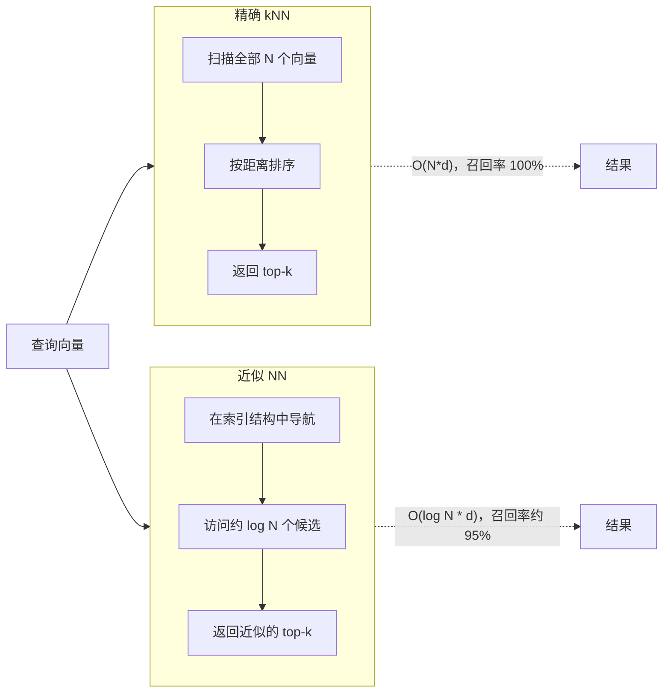
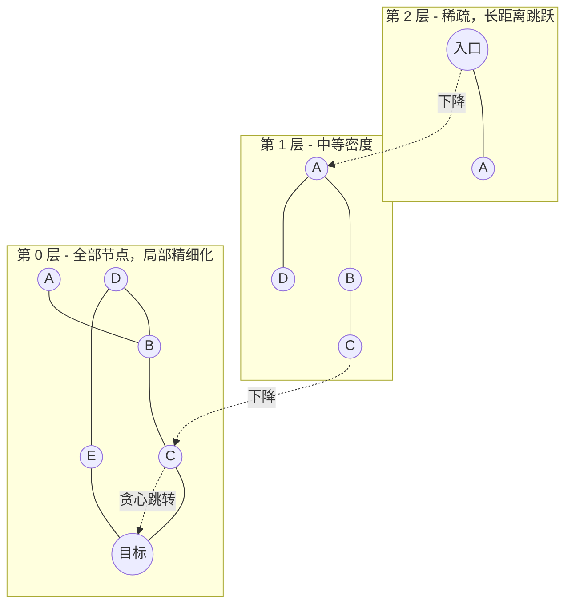
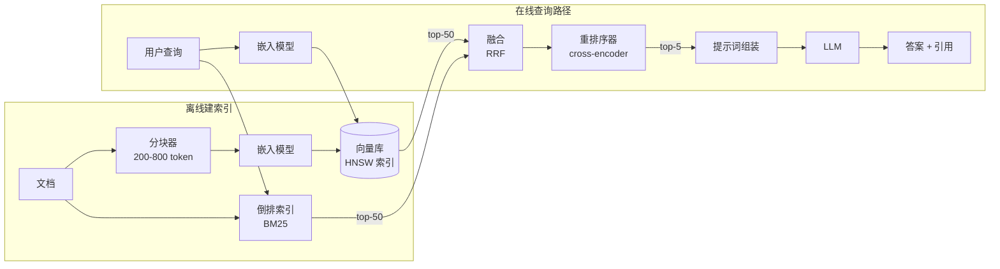

# 向量数据库：嵌入、ANN 索引与 AI 检索层

> **TL;DR**: 向量数据库回答的是“库里哪些条目与这次查询最相似”，做法是用近似最近邻（approximate nearest-neighbor，ANN）算法给高维嵌入向量建索引。内存型负载由 HNSW 主导（对数级搜索、95%+ 召回率），IVF-PQ 用召回率换 64 倍压缩[^1]，DiskANN 能在单节点上以低于 3 ms 的平均延迟服务十亿条向量[^2]。对多数团队来说：1000 万条以内用 pgvector，想要零运维用 Pinecone，上规模用 Milvus 或 Qdrant。混合检索（BM25 + 向量 + 重排序）在生产 RAG 里没有商量余地。

## 学习目标

学完本模块，你将能够：

- [ ] 解释什么是嵌入，以及为什么余弦相似度是默认度量
- [ ] 描述 HNSW 与 IVF 索引，以及它们在召回率与延迟之间的权衡
- [ ] 设计一条结合 BM25 与向量检索的召回流水线
- [ ] 在 Pinecone、pgvector、Weaviate、Milvus 和 Qdrant 之间做选型
- [ ] 估算一份向量负载的内存、磁盘与查询成本

## 直觉理解

你走进一家图书馆，问管理员有没有“假日期间保持健康”方面的书。书架上并没有贴着这句话的标签。关键词目录会把“健康”和“假日”分开来找，却找不到《节日季养生指南》——因为两边的词一个都没重合。

现在设想管理员有一张神奇的地图，每本书都是上面的一个点，主题相近的书聚在一起。你的问题也变成地图上的一个点。管理员走到你的点旁边，抓起最近的五本：一本是《节日季养生》，另一本是《假日营养指南》。它们和你的措辞没有相同的词，但意思很近。

这张地图就是嵌入空间（embedding space）。每个点是一个由神经网络产出的、768 或 1,536 个浮点数组成的向量。“近”意味着余弦距离小。管理员的那一趟走位就是最近邻搜索。而这座图书馆之所以需要专门的索引（而不是把每个点线性扫一遍），是因为有 5000 万本书时，逐个检查太慢了。

这就是向量数据库要解决的核心问题：在海量数据中找到离查询向量最近的 k 个向量，要快，且不扫全表。本章余下部分讲怎么做到。

## 原理

### 嵌入与距离度量

Transformer 编码器把文本（或图像、音频、代码）转成一个固定长度的向量，含 d 个浮点数。语义相近的输入在这个 d 维空间里彼此靠近。OpenAI 的 text-embedding-3-large 输出 3,072 维，在 MTEB 基准上得分 64.6%；text-embedding-3-small 用 1,536 维，得分 62.3%[^3]。Cohere embed-v3（1,024 维，商业 API）和开源的 BGE-M3（1,024 维）等替代方案质量不相上下，还省掉了按 token 计的 API 费用。

三种距离度量占据主流：

- **余弦相似度（cosine similarity）** 衡量向量之间的夹角，忽略长度。它是归一化嵌入的默认选择。
- **内积（点积）** 在向量为单位长度时等价于余弦，也是 pgvector 在这种情况下最快的算子[^4]。
- **欧氏距离（L2）** 衡量直线距离。Airbnb 特意选了 L2，因为它在 IVF 下产生的簇大小比点积更均匀[^5]。

> [!TIP]
> OpenAI 的嵌入已经预先归一化到单位长度。对它们用内积，就等于免费拿到余弦排序，计算量还更小。选度量之前，先确认你的编码器是否做了归一化。

### 为什么要近似而非精确

精确最近邻搜索每次查询的代价是 O(N * d)。当 d=1,536、N=1000 万时，一次查询大约要做 600 亿次浮点运算。即使上了 SIMD，单核也要几百毫秒。这就是“维度灾难”：在高维空间里距离比值会集中，任何分区方案想高效剪枝，都必须接受一定误差。

ANN 索引接受一点召回损失（通常是真实 top-k 的 95%–99%），换来 100 倍以上的加速。关键认知是：你不需要精确的最近邻，你需要的结果好到下游的重排序器或 LLM 分辨不出差别。

*精确搜索保证完美召回，但代价随规模线性增长；ANN 索引拿几个百分点的召回率，换数量级的加速。*

### HNSW：分层可导航小世界

HNSW 是当今生产环境中最主流的 ANN 算法。它构建一张多层邻近图，灵感来自跳表。[分布式系统的数据结构](../part-0-prerequisites/02-data-structures-for-systems.md) 里把跳表介绍为平衡树的一种概率化替代；HNSW 把这套分层思路搬到了图搜索上。

**工作方式：** 每个向量是一个节点。插入时，节点从一个指数分布里随机抽一个层数，然后在第 0 层到它抽中的层之间，每层连上最近的 M 个邻居。上层稀疏（长距离跳跃），底层包含全部节点（局部精细化）[^6]。

**搜索：** 从顶层的入口点出发，贪心地朝查询点走，下降一层，重复。到第 0 层时把搜索束扩大到 `ef_search` 个候选，返回 top-k。

**关键参数（pgvector 默认值）：**

| 参数 | 默认值 | 影响 |
|-----------|---------|--------|
| M | 16 | 每个节点的连接数。越大召回越好，内存越多 |
| ef_construction | 64 | 建索引时的束宽。越大建得越慢，图质量越好 |
| ef_search | 40 | 查询时的束宽。越大查得越慢，召回越好 |

**内存开销：** HNSW 除了存向量本身，还要存邻接表。实践中由于邻接表和图的元数据，索引通常占掉原始向量存储的 1.5–2 倍。100 万条 1,536 维向量（原始 float32 为 6 GB），常驻内存要按 9–12 GB 准备。

*HNSW 的搜索从稀疏的顶层（廉价的长距离跳跃）逐层下降到稠密的底层（局部精细化），查询时间随向量数量呈对数增长。*

### IVF 与乘积量化

**IVF（倒排文件索引）** 用 k-means 把语料聚成 `nlist` 个 Voronoi 单元。查询时先算出最近的 `nprobe` 个质心，只扫这些单元里的向量。它比 HNSW 省内存，但需要一次训练步骤，而且在标准基准上同等速度下召回率更低[^7]。

**乘积量化（product quantization，PQ）** 对向量做大幅压缩。把每个 d 维向量切成 m 个子向量，在每个子空间上用 256 个中心跑 k-means，然后只存这 m 个码本索引（每个 1 字节）。d=1,536、m=96 时：每条向量 96 字节，而原始是 6,144 字节，压缩了 64 倍[^1]。

**IVF-PQ** 把两者合起来：先聚成单元，再在每个单元内对向量做 PQ 压缩。这让单机就能支撑十亿级检索。代价是距离有损：PQ 会把头部候选之间的细微差异抹平，所以生产系统会拿精确距离对入围名单做二次排序。

**ScaNN**（Google，ICML 2020）改进了 PQ：它对平行于数据向量的量化误差施以比正交方向更重的惩罚。在 glove-100-angular 基准上，同等召回率下 QPS 约为次优库的 2 倍[^8]。

### DiskANN：单节点承载十亿级向量

微软的 DiskANN（NeurIPS 2019）把压缩后（PQ）的向量放在内存里做路由，而全精度向量和图邻接表放在 SSD 上，并通过精心设计的图布局把随机读降到最低。在十亿点的 SIFT1B 数据集上，结果是：每秒超过 5,000 次查询，平均延迟低于 3 ms，1-recall@1 达 95%+，只用 64 GB 内存加一块 SSD；而同等精度下，纯内存算法最多撑到 1 亿–2 亿点[^2]。

有一份独立报告记录了这样的替换：把一套 3 TB 内存的分片 HNSW 集群换成单台 96 GB 的 DiskANN 节点，同样的负载成本降低 40 倍[^9]。当向量数量超出内存容量、但你又需要个位数毫秒延迟时，DiskANN 就是正解。

### 混合检索与 RAG 流水线

纯向量检索会漏掉精确匹配、专有名词、产品编码和罕见实体。纯 BM25 又抓不住语义相似性。生产系统把两者结合。

**倒数排名融合（reciprocal rank fusion，RRF）** 把两个有序列表合并：每个文档在每张列表里按 `sum(1 / (k + rank_i))` 计分（k=60 是标准值）。它不看原始分数，只用排名，因此在异构检索系统之间都很稳。Weaviate 的 relativeScoreFusion（把分数归一化到 [0,1] 再加权求和）在 FIQA 基准上比 rankedFusion 的召回率高出约 6%[^10]。

一条完整的 RAG 流水线包含这些阶段：

*端到端 RAG：离线阶段同时建向量索引和倒排索引；在线阶段融合两路结果，用 cross-encoder 重排序，再把上下文喂给 LLM。*

**评测：** RAGAs 定义了四个 0–1 打分的指标：忠实度（每句结论都能在上下文里找到依据）、答案相关性、上下文精确率、上下文召回率[^11]。上线前先测这些；上下文召回率低，说明分块或召回环节已经坏了。

### 元数据过滤策略

真实查询总是把语义相似度与硬性过滤条件放在一起：`tenant_id = 7 AND created > 2024-01-01 ORDER BY embedding <-> query LIMIT 10`。这有三种做法：

| 策略 | 工作机制 | 权衡 |
|----------|-------------|-----------|
| 后过滤 | 先跑 ANN，再丢弃不满足条件的结果 | 快，但过滤条件选择性强时返回不足 k 行 |
| 前过滤 | 先构造命中 ID 的位图，再在这个子集上跑 ANN | 数量正确，但语料大时更慢 |
| 图内过滤（可过滤 HNSW） | 按 payload 值建子图，再合并成整图 | 带过滤时召回最好，但内存和建索引成本更高 |

pgvector 的 HNSW 配合后过滤、`ef_search=40`，当过滤条件命中 10% 数据时，平均只剩约 4 行返回。0.8.0 版本引入 `iterative_scan` 来解决这个问题[^4]。Qdrant 的可过滤 HNSW 按 payload 建子图，在过滤条件下仍保持图的连通性[^12]。Milvus 则在向量检索前用前过滤位图[^13]。

## 真实案例

### Airbnb：基于嵌入的搜索召回

Airbnb 用双塔神经网络做房源召回。房源塔离线处理房源特征（设施、可住人数、历史互动），每天跑一个批任务，预先算好全部房源嵌入。查询塔在线处理每次请求的搜索特征（地点、人数、日期）[^5]。

关键的架构决策是：Airbnb 选了 IVF 而不是 HNSW。房源更新频繁（价格和可订状态时刻在变），HNSW 的内存涨得太大；而且 HNSW 检索叠加必不可少的地理与可订性过滤后，延迟表现很差。IVF 的簇 ID 直接存进现有搜索索引里，和价格、可订性一样当作普通过滤条件用，集成起来“相当直接”[^5]。

他们用欧氏距离而不是点积，因为点积产生的簇不均衡，会“大幅削弱” IVF 召回的区分能力。训练时用的是真实用户旅程中的难负样本（看过但没订的房源），而不是随机负样本。

结果是：A/B 测试显示订单量的提升“与过去两年我们对搜索排序做的最大几项机器学习改进处于同一量级”[^5]。

这是对“HNSW 总是更好”这一默认认知的重要反例。当你的向量更新频繁、查询又总是带硬性过滤条件时，把 IVF 融进已有的搜索栈，可能胜过独立的 HNSW 索引。

## 权衡

| 方案 | 优点 | 缺点 | 适用场景 | 我们的选择 |
|----------|------|------|-----------|----------|
| pgvector（HNSW） | 无需额外基础设施；ACID 事务横跨数据与向量；支持 SQL join | 受单节点内存限制；超过 1000 万条后建索引很慢 | 1000 万条以内，且已经在用 Postgres | **多数团队的默认选择** |
| Pinecone（serverless） | 零运维；基于 slab 的架构；透明扩缩容 | 供应商锁定；高 QPS 下昂贵；内部实现不透明 | 从快速原型走到生产，没有基础设施团队 | 托管方案里最优 |
| Milvus / Zilliz | 多种索引（HNSW、IVF-PQ、DiskANN、GPU）；K8s 原生；十亿级 | 运维复杂；可调参数太多 | 超过 1 亿条向量；需要索引类型灵活切换 | 大规模自建首选 |
| Qdrant | Rust 带来的性能；可过滤 HNSW 在过滤下保持连通性 | 生态比 Milvus/Pinecone 小 | 过滤密集的多租户负载 | 元数据丰富时最优 |
| Weaviate | 内置混合检索（RRF + relativeScoreFusion）；开发者体验好 | Go 运行时的内存开销；按租户扩展需要留心 | 想要开箱即用混合检索的团队 | 综合表现均衡 |
| Elasticsearch / OpenSearch kNN | 词法与语义检索统一在一个引擎里；Lucene 的 HNSW | 比纯向量库更重；历史上带过滤的 kNN 较弱 | 已经在用 ES/OS 做日志或搜索 | 已部署 ES/OS 时自然之选；不值得只为向量单独起一套 ES 集群 |

## 常见陷阱

> [!WARNING]
> **HNSW 带过滤时返回不足 k 条结果。** 后过滤配 `ef_search=40`，在选择性 10% 的过滤条件下平均只剩约 4 行。修法：把 ef_search 提到 200–500，开启 pgvector 的 `iterative_scan`，或改用前过滤／可过滤 HNSW 方案[^4]。

> [!WARNING]
> **IVF 索引建在不具代表性的数据上。** IVF 的质心在 `CREATE INDEX` 那一刻训练出来。如果你建索引时表里只有 1,000 行，后来长到 100 万行，那不管探多少个单元，召回率都会惨不忍睹。务必在灌入有代表性的数据之后再建 IVF，或者干脆选没有训练步骤的 HNSW[^4]。

> [!WARNING]
> **把向量库当成记录系统（system of record）。** 换更好的模型重新嵌入时，你需要原始文本才能重建。把原始文档留在 Postgres、S3 或你的内容库里，把向量索引当成派生产物。pgvector 的优势正在这里：向量和源文本处在同一个 ACID 事务里。

> [!WARNING]
> **忽视规模化之后的嵌入成本。** OpenAI text-embedding-3-large 定价 $0.00013/1k token（约 $0.13/百万 token），text-embedding-3-small 约 $0.02/百万 token[^3]。5000 万份文档、平均每份 500 token，就是 250 亿 token，用 3-large 跑一遍嵌入要 $3,250。每次升级模型或改动分块策略都会触发全量重嵌入。要么把它算进预算，要么用开源编码器。价格请以 Embeddings 指南为准，因为 OpenAI 主价格页现在主要讲 GPT-5.x 系列模型。

> [!WARNING]
> **把 RAG 语料切得过碎。** 按固定 token 数切会把答案拦腰截断。明明语料里有答案，LLM 却说“我不知道”。用带重叠的分块（512 token，重叠 64 token），在语义边界（段落、小节）处切，并在上线前测 RAGAs 的上下文召回率[^11]。

## 练习

为 5000 万份客服文档上的 RAG 问答机器人设计检索层。选一个嵌入模型，定一种 ANN 索引，算出内存与存储需求，定义混合检索策略，并说明文档更新与删除怎么处理。

提示

从成本估算入手：5000 万份文档，平均 500 token。嵌入要花多少钱？向量要占多少存储？然后挑一个装得进你内存预算的索引。再想想一篇客服文章被更新或下架时会发生什么。

解答

**嵌入模型：** text-embedding-3-small（1,536 维，$0.02/百万 token）。成本：5000 万份 * 500 token = 250 亿 token * $0.02/百万 = 首轮 $500。对客服文档来说质量够用；只有召回指标撑不住时才升到 3-large。

**存储：** 5000 万个向量 *1,536 维* 4 字节 = 300 GB 原始数据。加上 HNSW 的额外开销（1.5–2 倍），常驻内存要 450–600 GB，单节点装不下。

**索引选择：** Milvus 配 HNSW，分片到 8–12 个节点（每节点约 50 GB 索引）。另一种做法是 DiskANN 跑在 2–3 个节点上，每台 128 GB 内存加 NVMe SSD，成本更低。

**混合检索：** 用 Elasticsearch 的 BM25 抓精确匹配（错误码、产品名、工单号），与向量检索的结果用 RRF（k=60）融合。再用 cross-encoder（Cohere Rerank 或自托管模型）把 top-50 重排到 top-5。

**更新与删除：** 权威文档留在 PostgreSQL，带内容哈希。更新时只重嵌入发生变化的块（比对哈希）。删除时同时从向量索引和倒排索引里移除。用带 `deleted_at` 时间戳的软删除，避免在途查询返回过期结果。

**评测：** 在 500 对问答的留出集上跑 RAGAs。上线前目标：上下文召回率 > 0.8，忠实度 > 0.9。

## 要点回顾

- 向量检索在设计上就是近似的。用 ef_search（HNSW）或 nprobe（IVF）在召回率与延迟之间调，别指望精确。
- HNSW 是当下默认的 ANN 算法：对数级搜索、支持增量插入、召回率可调。代价是内存占用达到原始向量大小的 1.5–2 倍。
- IVF-PQ 把向量压缩 64 倍，在内存紧张或向量更新频繁时胜出（Airbnb 的选择）。
- DiskANN 从 SSD 服务十亿级向量，平均延迟低于 3 ms，比全内存分片 HNSW 便宜 40 倍。
- 混合检索（BM25 + 向量 + 重排序）在真实基准上胜过任何单一路径。生产 RAG 里没有商量余地。
- 1000 万条向量以内，pgvector 对多数团队够用了。在真的撑不住之前，别为了过度设计而另起一套向量数据库。
- 大规模下真正吃钱的是嵌入 API 成本，不是存储成本。按每百万 token $0.02–$0.13 做预算，并为模型升级时的重嵌入留好计划。

## 延伸阅读

- [Efficient and robust approximate nearest neighbor search using HNSW (Malkov and Yashunin, 2018)](https://arxiv.org/abs/1603.09320) - HNSW 的经典论文；如果 ANN 图索引你只读一篇，就读这篇。
- [DiskANN: Fast Accurate Billion-point Nearest Neighbor Search on a Single Node (NeurIPS 2019)](https://www.microsoft.com/en-us/research/project/project-akupara-approximate-nearest-neighbor-search-for-large-scale-semantic-search/) - 如何用 64 GB 内存加 SSD 服务 10 亿条向量；微软十亿级搜索背后的架构。
- [Embedding-Based Retrieval for Airbnb Search](https://airbnb.tech/ai-ml/embedding-based-retrieval-for-airbnb-search/) - Airbnb 为什么选 IVF 而不是 HNSW；向量检索领域最精彩的一手生产权衡案例。
- [ANN-Benchmarks](https://ann-benchmarks.com/) - 跨算法、跨数据集的标准化召回率与 QPS 曲线；信任何厂商的基准之前先来这里对一对。
- [pgvector README](https://github.com/pgvector/pgvector) - 这个 Postgres 扩展的完整文档：HNSW/IVF 参数、iterative scan、混合检索写法、距离算子。
- [Weaviate Hybrid Search Fusion Algorithms](https://weaviate.io/blog/hybrid-search-fusion-algorithms) - 深入比较 rankedFusion 与 relativeScoreFusion，带实例演算和基准结果。
- [New embedding models and API updates (OpenAI, 2024)](https://openai.com/index/new-embedding-models-and-api-updates/) - text-embedding-3 的基准、定价，以及 Matryoshka 维度缩减。
- [搜索系统](./05-search-systems.md) - 词法检索那一半；[搜索系统](./05-search-systems.md) 讲倒排索引与 BM25，它们构成混合检索的另一半。

## 记忆卡片

**Q:** 在向量数据库的语境里，嵌入是什么？
**A:** 由神经编码器产出的定长浮点数向量；语义相近的输入在余弦相似度这类距离度量下会映射到彼此靠近的位置。

**Q:** 为什么向量数据库用近似最近邻（ANN）而不是精确搜索？
**A:** 精确搜索每次查询代价是 O(N*d)。1000 万条向量、1,536 维时，这要几百毫秒。ANN 索引拿约 5% 的召回率换 100 倍以上加速；这是可接受的，因为下游重排序器能把丢掉的质量大部分找回来。

**Q:** HNSW 的三个关键参数在 pgvector 里的默认值分别是多少？
**A:** M=16（每节点连接数，控制内存与召回）、ef_construction=64（建索引时的束宽）、ef_search=40（查询时的束宽，可不重建索引直接调）。

**Q:** 100 万条 1,536 维向量，HNSW 需要多少内存？
**A:** 原始存储是 6 GB（1M *1,536* 4 字节）。HNSW 额外开销 1.5–2 倍，所以常驻内存按 9–12 GB 准备。

**Q:** 乘积量化在 1,536 维向量上能达到多少压缩比？
**A:** 64 倍。m=96 个子向量配 8 位码本时，每条向量从 6,144 字节压到 96 字节。

**Q:** 什么是倒数排名融合（RRF），什么时候用它？
**A:** RRF 把多张有序列表合并，每个文档按 sum(1/(k+rank_i)) 跨列表计分（k=60）。混合检索里用它融合 BM25 与向量检索的结果。它只看排名不看原始分数，所以很稳。

**Q:** Airbnb 为什么在房源召回上选 IVF 而不是 HNSW？
**A:** 房源更新频繁，HNSW 的内存涨得太大；而且 HNSW 叠加必不可少的地理/可订性过滤后延迟很差。IVF 的簇 ID 能直接当作过滤条件融进他们现有的搜索索引。

**Q:** DiskANN 面向十亿级向量检索的关键创新是什么？
**A:** 它在内存里放 PQ 压缩后的向量做图路由，而全精度向量和邻接表存在 SSD 上。在 SIFT1B 十亿点基准上，用 64 GB 内存加一块 SSD 就能做到 >5,000 QPS、平均延迟 <3 ms、1-recall@1 达 95%+。

**Q:** 元数据过滤的三种策略及其权衡是什么？
**A:** 后过滤（快，但返回不足 k 行）、前过滤（数量正确，但更慢）、图内过滤／可过滤 HNSW（过滤下召回最好，但内存和建索引成本更高）。

**Q:** 什么时候用 pgvector，什么时候该上专门的向量数据库？
**A:** 1000 万条以内、且已经在用 Postgres 时用 pgvector（零额外基础设施，ACID 事务横跨数据与向量）。超出单节点内存，或需要十亿级、GPU 索引、托管运维时，换成 Milvus/Qdrant/Pinecone。

**Q:** RAGAs 的四个评测指标是什么？
**A:** 忠实度（结论有上下文依据）、答案相关性（答案确实回应了问题）、上下文精确率（召回的分块是相关的）、上下文召回率（需要的信息都被召回了）。

**Q:** 怎么估算 5000 万份文档的嵌入成本？
**A:** 5000 万份 * 平均 500 token = 250 亿 token。按 $0.13/百万 token（text-embedding-3-large）算，跑一遍嵌入是 $3,250；按 $0.02/百万（3-small）算是 $500。每次换模型或改分块都会触发全量重嵌入。

## 参考文献

[^1]: Herve Jegou, Matthijs Douze, Cordelia Schmid, "Product Quantization for Nearest Neighbor Search", IEEE TPAMI 2011. https://dl.acm.org/doi/10.1109/TPAMI.2010.57
[^2]: Suhas Jayaram Subramanya et al., "DiskANN: Fast Accurate Billion-point Nearest Neighbor Search on a Single Node", NeurIPS 2019. https://www.microsoft.com/en-us/research/project/project-akupara-approximate-nearest-neighbor-search-for-large-scale-semantic-search/
[^3]: OpenAI, "New embedding models and API updates", 25 Jan 2024. https://openai.com/index/new-embedding-models-and-api-updates/
[^4]: pgvector GitHub README, v0.8.2. https://github.com/pgvector/pgvector
[^5]: Mustafa Abdool et al., "Embedding-Based Retrieval for Airbnb Search", Airbnb Engineering & Data Science blog. https://airbnb.tech/ai-ml/embedding-based-retrieval-for-airbnb-search/
[^6]: Yu. A. Malkov and D. A. Yashunin, "Efficient and robust approximate nearest neighbor search using Hierarchical Navigable Small World graphs", arXiv:1603.09320v4, IEEE TPAMI 2018. https://arxiv.org/abs/1603.09320v4
[^7]: ANN-Benchmarks, maintained by Aumueller, Bernhardsson, Faitfull. https://ann-benchmarks.com/
[^8]: Philip Sun, "Announcing ScaNN: Efficient Vector Similarity Search", Google Research Blog, 28 Jul 2020. https://research.google/blog/announcing-scann-efficient-vector-similarity-search/
[^9]: Wilson Lin, "Superseding billion vector HNSW with 40x cheaper DiskANN", 2025. https://blog.wilsonl.in/diskann
[^10]: Dirk Kulawiak and JP Hwang, "Unlocking the Power of Hybrid Search", Weaviate blog, 29 Aug 2023. https://weaviate.io/blog/hybrid-search-fusion-algorithms
[^11]: Shahul Es et al., "RAGAs: Automated Evaluation of Retrieval Augmented Generation", 2023; official documentation at https://docs.ragas.io/en/stable/
[^12]: Qdrant, "Combining Vector Search and Filtering" (filterable HNSW). https://qdrant.tech/course/essentials/day-2/filterable-hnsw/
[^13]: Yujian Tang, "An Introduction to Milvus Architecture", Zilliz blog, 2 Feb 2024. https://zilliz.com/blog/introduction-to-milvus-architecture
