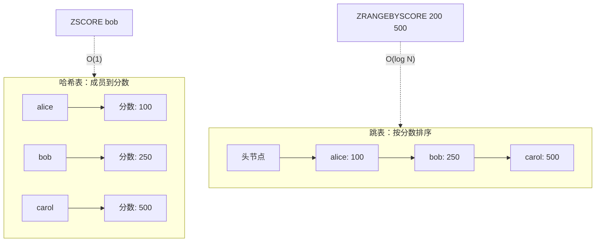
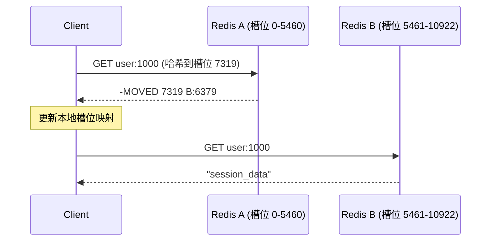
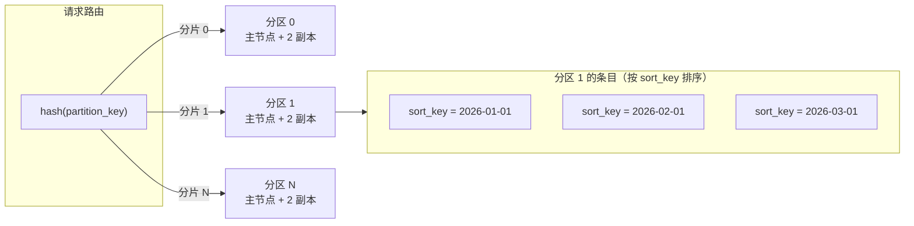
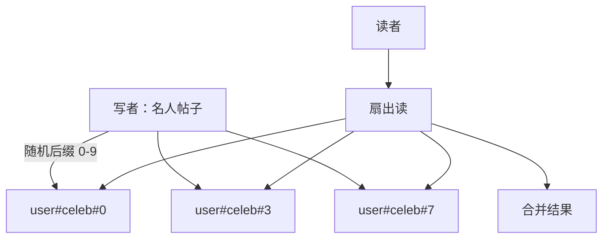

# 键值存储：Redis、Memcached、DynamoDB，以及如何选对那张哈希表

> **TL;DR**: "键值存储"是一种 API 形态（`get`、`put`、`delete`），不是一个产品类别。在这套 API 之下，Redis 在内存里提供丰富的数据结构，持久化可选；Memcached 是极其简单的多线程缓存；DynamoDB 则是全托管、可持久化、在任意规模下都能把 P99 压到 10 ms 以内的存储 [^1]。大多数"Redis 太慢"和"DynamoDB 在限流"的工单，本质都是热点键问题。设计分区键时就当 SLO 全靠它，因为确实如此。

## 学习目标

学完本章，你将能够：

- [ ] 从一致性、持久性和数据模型三个维度区分 Redis、Memcached、DynamoDB
- [ ] 用 DynamoDB 的分区键和排序键对业务负载建模
- [ ] 在字符串之外使用 Redis 的数据结构（有序集合、流、HyperLogLog）
- [ ] 分析热点键、集群分片和故障切换
- [ ] 估算给定 QPS 与数据量下托管 KV 存储的成本

## 直觉理解

想想演唱会现场的衣帽间。你把外套递过去，拿到一张带编号的票据；散场时把票据递回去，取回外套。服务生根本不在乎你的外套长什么样，他只关心票据编号和它对应的挂钩。这就是键值存储：票据（键）映射到一件东西（值），取回是 O(1)，因为服务生直接走到对应编号的挂钩前。

现在想象三个场地。第一个是没有围墙的快闪帐篷，快、便宜，但一下雨外套就没了。这就是 Memcached：纯易失内存，无持久化，没有任何花哨功能。第二个场地是带编号货架、有 VIP 外套分拣系统、地下还有备用储藏室的固定建筑。这就是 Redis：组织方式丰富，持久化可选，但仍然受建筑面积（内存）限制。第三个场地是全国连锁仓库，由一家物流公司运营。你从来看不到仓库，只要打个电话报上票据编号，外套就送到。这就是 DynamoDB：全托管、持久、弹性，但每次取件都要付费，而且开业之后你没法重新摆放货架。

问题从来不是"我该不该用键值存储"——几乎每个系统都已经在用了。问题是选哪一个，而答案取决于你需要的是持久性、数据类型，还是省心的托管运维。

## 原理

### “键值存储”覆盖的范围

键值存储指任何以 `get(key)`、`put(key, value)`、`delete(key)` 为主 API 的系统。这个定义覆盖了一个谱系：

- **纯易失缓存**（Memcached）：无持久化、无复制，除字节之外没有数据类型。
- **结构丰富的内存存储**（Redis/Valkey）：有序集合、流、HyperLogLog，磁盘持久化可选。
- **托管持久存储**（DynamoDB）：三副本、Paxos 协调、弹性伸缩。
- **宽列存储**（Bigtable、Cassandra、ScyllaDB）：行键查找，加上分区内的范围扫描。
- **嵌入式引擎**（RocksDB、LevelDB、BoltDB）：没有网络往返，直接链接进进程。

[数据库基础](../part-0-prerequisites/03-database-fundamentals.md)介绍过关系模型：查询在多个索引之上做规划。KV 存储把它反过来——你放弃查询规划器，换取任意规模下最快的查找 [^1]。二级访问模式（范围扫描、连接、过滤）要么很弱，要么根本不存在，这就逼着你做反范式化。

### Redis 与 Valkey

Redis 在每个分片内用单线程事件循环执行命令。单线程意味着没有锁、没有竞态条件、延迟可预测。从 Redis 6.0 起，多线程 I/O 负责套接字的读写，但数据修改仍然串行执行。

**数据结构。** Redis 不是字符串缓存。它自带八种核心类型：字符串、列表、哈希、集合、有序集合、流、HyperLogLog 和位图。有序集合是它的杀手级功能：用跳表支撑 O(log N) 的范围查询，再用一张哈希表支撑 O(1) 的分数查找 [^2]。做一个排行榜只要三条命令：`ZADD` 写入分数，`ZREVRANGE` 取前 N 名，`ZRANK` 查某位玩家的名次。

*有序集合在同一批元素上维护两套结构：哈希表支撑 O(1) 的 `ZSCORE` 查找，跳表支撑 O(log N) 的范围与排名查询。小的有序集合以紧凑的 listpack 存储，超过 128 个元素或值长度超过 64 字节后，才转换成这种双结构形态[^2]。*

**持久化。** 两种选择：通过 `fork()` 加写时复制生成 RDB 快照，或者用 AOF（只追加文件）记录每次写入。混合模式在 AOF 前面拼一个 RDB 快照，以便快速重启 [^3]。默认情况下两者都不提供同步持久化。除非你接受这个持久性权衡，否则 Redis 不算数据库。

**集群。** Redis Cluster 按 `CRC16(key) mod 16384` 计算哈希槽来分片 [^4]。客户端缓存槽位到节点的映射。当客户端打错节点时，会收到 `MOVED` 重定向，更新映射后重试。哈希标签（`{user:1000}.followers`）把相关键强制放进同一个槽，好让多键命令能执行。

*槽位映射过期（stale）的客户端打到错误节点，收到 MOVED，更新本地缓存，再向真正持有该槽位的主节点重试。*

**许可证状况（2024）。** Redis Ltd. 在 2024 年 3 月把许可证从 BSD 改成 RSALv2/SSPLv1 [^5]。Linux 基金会同一周以 BSD-3 分叉出 Valkey。对于全新的项目，就许可证风险而言 Valkey 是更稳妥的选择。对于已有的 Redis 部署，今天什么都不会坏，但要为生态分裂做好准备。

**Redlock 之争。** Redis 的分布式锁算法（Redlock）假设网络延迟有界、时钟漂移有界。Kleppmann 认为它既不高效也不正确：一次超过锁 TTL 的 GC 停顿会悄悄破坏互斥性 [^6]。结论不是"Redlock 有 bug"，而是：对正确性关键的锁，用能产生单调递增 fencing token 的共识系统（ZooKeeper、etcd）；对尽力而为的去重，单节点的 `SETNX` 配短 TTL 更简单也够用。

### Memcached

Memcached 是 Redis 的反面：没有持久化、没有复制、内置没有集群模式、除字节串之外没有数据类型。它有的是多线程架构，吞吐随 CPU 核数近似线性增长 [^7]。

slab 分配器把内存切成固定大小的类别，以避免碎片。条目在各自的 slab 类别内按 LRU 淘汰。多个工作线程共享一张中央哈希表，锁的粒度细到桶级。客户端用一致性哈希（Ketama）把键分散到各个节点。

Facebook 把 Memcached 扩到了每秒数十亿次请求、约 300 TB 内存的规模 [^8]。单节点根据硬件和条目大小，大约能扛每秒百万级操作。那篇论文引入了 lease 机制来防惊群和过期写入，用 gutter pool 吸收故障切换的溢出，GET 走 UDP 以省掉套接字开销。

什么时候选 Memcached 而不是 Redis？当你需要一个纯粹的读穿透缓存、只存序列化字节、追求单节点最高的 QPS，并且不需要数据类型、持久化和发布订阅。Netflix 的 EVCache 在 Memcached 之上包了复制和数据分块，覆盖约 22,000 个服务器实例、14 PB 缓存数据，峰值处理 4 亿次操作/秒 [^9]。

### DynamoDB

DynamoDB 是全托管、多租户、水平分区的存储。它源自 2007 年的 Dynamo 论文，但架构上已经完全不同：现代 DynamoDB 用 Paxos 复制的预写日志，而不是 gossip 加向量时钟 [^1]。

**数据模型。** 表按分区键的哈希分区。每个分区是一个跨三个可用区的三节点复制组。条目只靠分区键寻址（简单键），或者靠分区键加排序键（复合键）。排序键让分区内可以做范围查询。

*分区键的哈希决定落到哪个分区；排序键决定分区内的顺序，从而支持在排序键上做高效的范围查询。*

**容量与定价。** 每个分区上限为 3,000 RCU/s（读容量单位）和 1,000 WCU/s [^10]。按需模式在美国东部（弗吉尼亚北部）每百万写请求单位 $0.625，每百万读请求单位 $0.125（标准表类，2026 年 5 月）[^11]。强一致性读消耗的 RRU 是最终一致性读的 2 倍（每 4 KB 1 RRU 对每 4 KB 0.5 RRU），所以在条目大小相同时，每次读的成本是 2 倍。预置模式在稳定负载下更便宜，但需要做容量规划。

**二级索引。** 全局二级索引（GSI）在自己的分区空间里异步维护。本地二级索引（LSI）与基表分区共置。在低基数字段（比如 `status`）上建 GSI 会在该 GSI 里造出热点分区，反过来对基表形成背压。

**单表设计。** Alex DeBrie 的模式是让 `PK` 和 `SK` 承载复合值（`PK=USER#123`、`SK=ORDER#2026-01-15`），用一张表服务多种访问模式。威力很大，但模式不透明，迁移很痛。当你对同一组实体有 3 种以上访问模式时再用它。

### 热点键问题

每个 KV 存储都假设访问大致均匀。真实负载是 Zipf 分布：某个名人的主页、黑五的促销页、Reddit 的首页。按平均值定容的分区，当某个键吃掉 30% 流量时就会撞到上限。

**缓解手段：后缀分片。** 写入时在分区键后追加随机后缀（分片 0-9 就写 `user#celebrity#shard-3`）。读取时扇出到所有后缀再合并结果。这样就把一个逻辑键摊到 N 个物理分区上。

*后缀分片把热点键摊到 N 个物理分区；读侧扇出再合并，用多一次往返换来 10 倍的吞吐余量。*

其他缓解手段：在 DAX 或客户端 LRU 里缓存热点键；利用 DynamoDB 的自适应容量（它会在一段延迟后自动拆分热点分区）；或者把热点键提升到专用的 Redis 实例。

### 用 Redis 做限流

Redis 的原子 Lua 脚本让它天然适合放限流器。三种常见算法：

- **固定窗口：** `INCR key` 配 `EXPIRE`。简单，但窗口边界处允许 2 倍突发。
- **滑动日志：** 把每个请求的时间戳存进有序集合，用 `ZRANGEBYSCORE` 统计窗口内的请求数。精确，但吃内存。
- **令牌桶：** 一段 Lua 脚本从哈希里读出剩余令牌数和上次补充时间，算出补充量，扣掉消耗，再原子写回。Stripe 的生产限流器用的就是这个模式 [^12]。

默认选令牌桶。它能平滑处理突发，每个键的内存占用恒定，而且 Lua 脚本让读—改—写变成原子操作。

### 扩展模式

有三种模式能让你突破单机：

- **客户端一致性哈希**（Memcached 的默认方式）：客户端库把键哈希到节点。没有额外跳数，但每个客户端都要知道池成员，环的再平衡要手工做。
- **服务端槽位路由**（Redis Cluster）：16,384 个哈希槽，靠 gossip 维护成员关系。客户端在重新分片期间会收到重定向。故障切换靠副本内置支持。
- **托管弹性分区**（DynamoDB）：请求路由器缓存分区到节点的映射。扩容对客户端不可见。代价是厂商锁定和按请求计费。

[缓存](../part-2-building-blocks/03-caching.md)详细讲过分布式缓存架构。这里适用同一套一致性哈希与代理路由模式。

## 真实案例

### 大规模 Facebook Memcached（NSDI 2013）

Facebook 运营着有记录以来最大的缓存部署之一：每秒数十亿次请求、数万亿条目，Memcached 集群约 300 TB 内存 [^8]。系统以原版 memcached 为积木，外面包了自研客户端库和服务端扩展。

**架构。** 每个面向用户的请求经 mcrouter 扇出到许多 memcached 分片。GET 走 UDP（负载小、可容忍丢包），SET/DELETE 走 TCP（可靠性重要）。各个池跨地域复制，一个主地域加若干从地域。

**lease 机制。** 缓存未命中时，客户端会拿到一个 64 位 lease token，只有持有 token 的一方才能 SET 这个键。如果并发的写者在过程中让该键失效，lease 被撤销，过期的那次 SET 会被拒绝。每个键每 10 ms 只发放一次 lease，这就硬性限制了重算的 QPS，防止惊群 [^8]。

**故障处理。** 跨地域流量切换会造成冷缓存风暴，因为从地域的 memcached 里没有工作集。解决办法是异步预热从地域：把热点键的 SET 复制过去。另有一个小型的"gutter"池，在主分片不可达时吸收溢出流量。

**教训：** 在 Facebook 这个量级上，朴素的 cache-aside 会崩。lease、返回过期值、地域预热是必需项，不是优化项。这篇论文至今仍是理解极端负载下 KV 存储的最佳案例。

## 权衡

| 方案 | 优点 | 缺点 | 适用场景 | 我们的选择 |
|---|---|---|---|---|
| Redis / Valkey | 数据类型丰富、亚毫秒延迟、发布订阅、流 | 成本受内存约束、fork 停顿、许可证不明确 | 缓存、队列、排行榜、会话、限流器 | 结构化内存负载的默认选择 |
| Memcached | 多线程、极其简单、开销极小、行为可预测 | 无持久化、无数据类型、无集群模式 | 追求最高 QPS 的纯字节读穿透缓存 | 当你只需要 get/set 时 |
| DynamoDB | 托管、持久、弹性、全局表、三可用区复制 | 成本、分区键灵活性差、厂商锁定 | Serverless 技术栈、规模不可预测、数据不能丢 | 需要持久性又不想运维时 |
| Cassandra / ScyllaDB | 开源、宽列、多地域、线性扩展 | 运维负担、compaction 调参、宽行反模式 | 写密集、时序、多地域自建 | 自有机房且需要全球写入时 |
| 嵌入式（RocksDB） | 无网络往返、亚微秒、随应用发布 | 进程内状态、无法共享、compaction 抖动 | 作为更大系统的存储引擎（CockroachDB、TiKV） | 当 KV 存储本身就是应用时 |

## 常见陷阱

> [!WARNING]
> **BGSAVE 的 fork 停顿（Redis）。** `BGSAVE` 会调用 `fork()`，复制父进程的页表。在数 GB 的实例上，这会把主循环阻塞几百毫秒。开启透明大页会更糟。修复：关闭 THP，单分片实例控制在 10 GB 以内，在副本而不是主节点上做快照 [^13]。

> [!WARNING]
> **DynamoDB 热点分区限流。** 一张总容量还有大量余量的表，仍可能在一部分键上返回 `ProvisionedThroughputExceededException`。无论表级预置多少，每个分区上限就是 3,000 RCU/s 和 1,000 WCU/s [^10]。修复：对热点键做后缀分片，在 DAX 缓存，或者避免用 `yyyy-mm-dd` 这种基于时间的分区键。

> [!WARNING]
> **Memcached 冷启动。** Memcached 没有持久化，进程重启等于数据全丢。在 Netflix 这个量级上，一次地域切换如果没提前预热，就意味着数小时的冷缓存未命中 [^9]。修复：带预热阶段的滚动重启，从 EBS 快照预热缓存，或者用开了 AOF 的 Redis 来支持热重启。

> [!WARNING]
> **GSI 放大热点分区（DynamoDB）。** 在低基数字段（例如 `status`）上建 GSI，即使基表本身健康，也会让基表的写入被限流。每次基表写入都会传播到每个 GSI。修复：绝不要用低基数字段做 GSI 分区键，要拼接分片后缀。

> [!WARNING]
> **把 Redis 当主数据库。** 用 `appendfsync everysec` 的 Redis 在崩溃时最多丢一秒的写入；用 `appendfsync always`，写延迟会涨 10 倍。如果一点数据都不能丢，Redis 就不是你的主存储。把它当缓存或队列，后面挂一个持久化的后备存储。

## 练习

> **设计挑战：** 为一个 2,000 万日活的消费级应用设计会话存储，要求读 P99 在 100 ms 预算内，并且单可用区故障时能优雅存活。在 Redis Cluster（自建）、ElastiCache for Redis（托管）和 DynamoDB 之间做选择，并从成本、一致性和故障行为三方面论证。

Hint

先算 QPS：2,000 万日活、每用户每天约 10 次会话读，平均约 2,300 读/秒，峰值约 7,000。这远在单个 Redis 节点的能力之内。真正有意思的问题是可可用区存活：Redis Cluster 配多可用区副本，对比 DynamoDB 内置的三可用区复制。再比较这个规模下两者每月的成本。

Solution

**方案 A：ElastiCache for Redis（多可用区）。**

单个 `cache.r6g.large` 节点（13 GB 内存）轻松扛住 7,000 次操作/秒。开启多可用区和自动故障切换。会话存成哈希（`HSET session:{id} user_id 123 expires_at ...`）。TTL 设 24 小时，访问时滑动续期。成本：主从一对约 $200/月。

**方案 B：DynamoDB 按需模式。**

分区键 = `session_id`，不需要排序键。美国东部按需定价：2,000 万日活 × 每天 10 次会话读 = 每月 2 亿次读；小于 1 KB 的会话条目强一致性读每次 1 RRU，所以 2 亿 RRU 按每百万 $0.125 计 = 每月 $25 的读成本。写（大约每个日活 1 个新会话，加上滑动更新，姑且算每月 4,000 万 WRU）按每百万 $0.625 计 = 每月 $25。约 2,000 万个活跃会话、每个 1 KB（约 20 GB）的存储约每月 $5。合计：这个规模下每月约 $55-75 [^11]。内置三可用区复制，不用配故障切换，不用做容量规划。

**建议：两者都可行，按持久性要求来选。** 在这个量级上，两种方案都落在每月几百美元以内，成本不是决定因素。ElastiCache 给出亚毫秒 P99（轻松打过 100 ms 预算），但故障切换有一个短暂窗口（几十秒），且 `appendfsync everysec` 最多可能丢一秒写入。DynamoDB 在可用区故障时零停机，写入持久，P99 在个位数毫秒，而对于这么小的会话条目，成本相当。如果一点会话都不能丢（金融、认证），或者想彻底免运维，选 DynamoDB；如果最看重尽可能低的延迟、而且已经在跑 Redis，选 ElastiCache。

**接受的权衡：** Redis 更快，但故障切换有短暂窗口，还有一秒的丢失预算。DynamoDB 提供零停机的可用区故障处理和逐请求的持久性。2,000 万日活时成本差距很小；到 2 亿日活时，DynamoDB 按需模式随流量线性增长，此时预置模式配自动扩缩（或者在前面加一层激进的客户端缓存）才是成本更优的路径。

## 要点回顾

- "键值存储"是三个除 `get`/`put` API 形态之外几乎毫无共同点的产品。搞清楚你在买什么：易失缓存、结构化内存存储，还是托管持久存储。
- Redis 的有序集合、流和 HyperLogLog 让它远不止是缓存。用原生数据结构，别把所有东西都序列化成字符串。
- 纯字节缓存的原始多线程吞吐上 Memcached 更强。Facebook 靠它扛住每秒数十亿次请求 [^8]。
- DynamoDB 的分区键设计是一扇单向门。键的形状设计错了，再多的预置容量也救不了限流。
- 热点键会毁掉每一种 KV 存储。后缀分片、客户端缓存、自适应容量是你的缓解手段。
- 除非你接受它的持久性模型，否则 Redis 不是数据库。`appendfsync everysec` 在崩溃时最多丢一秒。
- 分布式锁要用带 fencing token 的共识系统。Redlock 的安全性依赖一些在生产环境里必然被打破的时序假设 [^6]。

## 延伸阅读

- [Scaling Memcache at Facebook（Nishtala 等，NSDI 2013）](https://www.usenix.org/conference/nsdi13/technical-sessions/presentation/nishtala) - 生产级 KV 的经典论文；数十亿 QPS 下的 lease、gutter pool 和地域失效。
- [Amazon DynamoDB: A Scalable, Predictably Performant, and Fully Managed NoSQL Database Service（Elhemali 等，ATC 2022）](https://www.usenix.org/conference/atc22/presentation/elhemali) - 现代 DynamoDB 架构论文；Paxos 复制、MemDS 和 split-for-heat。
- [Redis Cluster Specification](https://redis.io/docs/latest/operate/oss_and_stack/reference/cluster-spec/) - 关于 16,384 个哈希槽、MOVED/ASK 重定向和 gossip 协议的权威资料。
- [How to do distributed locking（Kleppmann，2016）](http://martin.kleppmann.com/2016/02/08/how-to-do-distributed-locking.html) - 对 Redlock 的批评；搭配 [Is Redlock safe?（antirez）](http://antirez.com/news/101) 一起读才完整。
- [Scaling your API with rate limiters（Stripe，2017）](https://stripe.com/blog/rate-limiters) - 生产环境里跑在 Redis 上、用 Lua 脚本实现的令牌桶；API 限流的参考实现。
- [The DynamoDB Book（Alex DeBrie）](https://www.dynamodbbook.com/) - 单表设计的参考书；在对复杂访问模式建模之前必读。
- [Best practices for partition keys（AWS）](https://docs.aws.amazon.com/amazondynamodb/latest/developerguide/bp-partition-key-design.html) - 讲热点分区缓解、写分片和自适应容量的最好的一页文档。
- [Linux Foundation: Valkey announcement](https://www.linuxfoundation.org/press/linux-foundation-launches-open-source-valkey-community) - BSD 许可的 Redis 分叉；2024 年许可证变更的背景。

## 记忆卡片

**Q:** Redis Cluster 里的 16,384 个哈希槽是什么？
**A:** Redis Cluster 通过 `CRC16(key) mod 16384` 把每个键分配到 16,384 个槽之一。每个槽恰好由一个主节点持有。客户端缓存槽位到节点的映射，映射变化时会收到 MOVED 重定向。

**Q:** Redis 有序集合如何同时做到 O(1) 的分数查找和 O(log N) 的范围查询？
**A:** 它在同一批元素上维护两种数据结构：一张把成员映射到分数的哈希表（O(1) 查找），和一个按分数排序的跳表（O(log N) 的范围查询和排名操作）。

**Q:** DynamoDB 每个分区的吞吐上限是多少？
**A:** 每个分区读上限 3,000 RCU/s，写上限 1,000 WCU/s。单个分区超过这个量就会限流，无论表级容量配了多少。

**Q:** 纯缓存场景下，为什么 Memcached 的单节点扩展性比 Redis 好？
**A:** Memcached 用多个工作线程共享一张哈希表，锁粒度细到桶级。Redis 在每个分片内把所有修改串行化到单线程事件循环，要用上更多核就得多开分片。

**Q:** 针对热点键的后缀分片是什么？
**A:** 写入时在分区键后追加随机后缀（例如 0-9），把一个逻辑键摊到 N 个物理分区。读侧扇出到所有后缀并合并结果，用多一次往返换取 N 倍的吞吐余量。

**Q:** 为什么 `fork()` 对大实例上的 Redis BGSAVE 是个问题？
**A:** `fork()` 要复制父进程的页表，这会阻塞单线程事件循环。在数 GB 的实例上这要几百毫秒。随后写入过程中的写时复制缺页会带来更多延迟尖峰。

**Q:** 2007 年的 Dynamo 论文和现代 DynamoDB 有什么区别？
**A:** 2007 年的论文用 gossip、向量时钟和宽松法定人数。现代 DynamoDB 用 Paxos 复制的预写日志、带分区映射缓存的请求路由器和确定性的主节点选举。两者共享名字和分区键概念，但架构不同。

**Q:** 什么情况下会话存储该选 DynamoDB 而不是 Redis？
**A:** 当你需要零数据丢失（Redis 崩溃时最多丢 1 秒）、需要无需手工配置的零停机可用区故障切换，或者规模不可预测、自动扩缩比单请求成本更重要时。

**Q:** Facebook 的 lease 在 Memcached 里解决了什么问题？
**A:** lease 防止两种失效模式：（1）惊群——大量客户端同时未命中同一个键，一起冲向数据库；（2）过期写入——并发的失效操作与缓存回填发生竞争。只有持有 lease token 的一方才能 SET，且每个键每 10 ms 只发放一次 lease。

**Q:** 举出三种能在 Redis 上实现的限流算法。
**A:** （1）固定窗口：INCR + EXPIRE，简单，但边界处允许 2 倍突发。（2）滑动日志：用有序集合存时间戳，精确但吃内存。（3）令牌桶：Lua 脚本做原子读—改—写，平滑处理突发且内存恒定。

**Q:** 对一个靠 KV 支撑的服务来说，"对缓存上瘾"意味着什么？
**A:** 服务在冷缓存下无法运转。如果 Redis 或 Memcached 重启、所有请求同时打到源站，数据库会崩。修复：用缓存预热、源站容量余量和软 TTL/硬 TTL 模式来设计优雅降级。

**Q:** DynamoDB 读操作的一致性模型是什么？
**A:** 最终一致性读（默认）可能从任意副本返回过期数据。强一致性读会走 Paxos 主节点，消耗 2 倍 RCU。[一致性模型](../part-1-core-fundamentals/03-consistency-models.md)覆盖了更完整的光谱。

## 参考文献

[^1]: Perianayagam and Vig, "Lessons learned from 10 years of DynamoDB", Amazon Science, October 2022. https://www.amazon.science/blog/lessons-learned-from-10-years-of-dynamodb
[^2]: Redis source, `src/t_zset.c`. Sorted set implementation: hash table + skiplist, derived from Pugh 1990. https://github.com/redis/redis/blob/unstable/src/t_zset.c
[^3]: Redis documentation, "Redis persistence" (RDB, AOF, hybrid). https://redis.io/docs/latest/operate/oss_and_stack/management/persistence/
[^4]: Redis Cluster specification. https://redis.io/docs/latest/operate/oss_and_stack/reference/cluster-spec/
[^5]: Linux Foundation, "Linux Foundation Launches Open Source Valkey Community", March 28, 2024. https://www.linuxfoundation.org/press/linux-foundation-launches-open-source-valkey-community
[^6]: Kleppmann, "How to do distributed locking", February 8, 2016. http://martin.kleppmann.com/2016/02/08/how-to-do-distributed-locking.html
[^7]: memcached source, `doc/threads.txt`. Threading model, locking hierarchy. https://github.com/memcached/memcached/blob/master/doc/threads.txt
[^8]: Nishtala et al., "Scaling Memcache at Facebook", NSDI 2013. https://www.usenix.org/conference/nsdi13/technical-sessions/presentation/nishtala
[^9]: Netflix Tech Blog, "Cache warming: Leveraging EBS for moving petabytes of data", 2021. https://web.archive.org/web/20231227201120/https://netflixtechblog.medium.com/cache-warming-leveraging-ebs-for-moving-petabytes-of-data-adcf7a4a78c3
[^10]: AWS, "Best practices for designing and using partition keys effectively in DynamoDB". https://docs.aws.amazon.com/amazondynamodb/latest/developerguide/bp-partition-key-design.html
[^11]: AWS, "Amazon DynamoDB pricing (on-demand capacity)". https://aws.amazon.com/dynamodb/pricing/on-demand/
[^12]: Tarjan, "Scaling your API with rate limiters", Stripe Engineering, March 30, 2017. https://stripe.com/blog/rate-limiters
[^13]: antirez, "Redis latency spikes and the Linux kernel: a few more details". https://antirez.com/news/84
