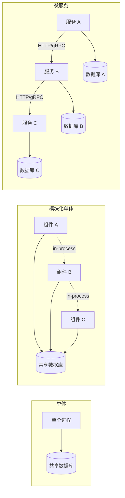
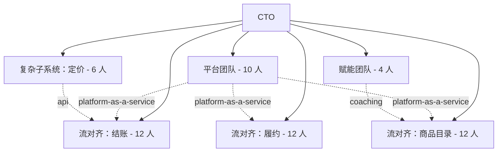
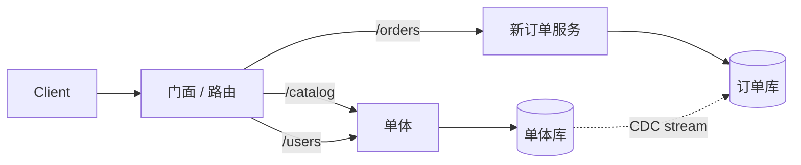
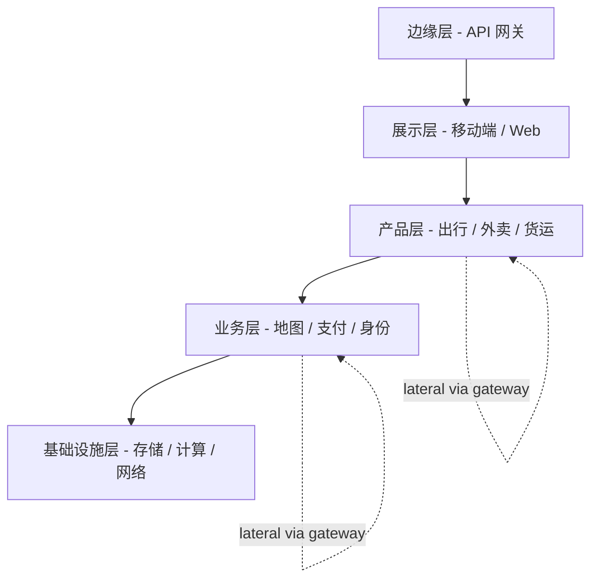

# 单体 vs 微服务：团队拓扑、康威定律与分布式系统税

> **TL;DR**: 微服务是披着技术外衣的组织模式。要不要拆，取决于团队规模、部署频率和认知负荷，而不是请求量。一旦跨过进程边界，分布式系统税（网络故障、版本化、可观测性、saga）可能吃掉 30-50% 的工程产能。Uber 从 2 个单体服务长到 2200+ 个关键微服务，然后又花两年在顶上强加领域结构，原因就是无约束的拆分产出了一张没有任何单个工程师能读懂的依赖图[^1]。模块化单体——单一可部署单元、内部边界受强制约束——是 100 名工程师以下团队的务实默认解。拆服务是为了解决扩展问题或团队问题，永远不是为了显得现代。

## 学习目标

学完本节，你将能够：

- [ ] 在评估一个拆分方案时运用康威定律
- [ ] 列出分布式系统税的各个项目，并逐项估算成本
- [ ] 识别真正具备拆分条件的限界上下文（bounded context）
- [ ] 针对给定的团队规模与负载，在单体、模块化单体和微服务之间做出选择
- [ ] 规划一次增量拆分，而不是大爆炸式重写

## 直觉理解

想象你在经营一家餐厅的后厨。只有五个厨师的时候，大家围着一张长操作台干活。刀、砧板、同一个步入式冷柜都是共用的。沟通是即时的：喊一句"借过！"就管用，因为所有人都在听得到的范围内。这就是单体。

现在想象餐厅扩张到五十个厨师。操作台变成灾难现场。人挤人，抓错刀，排着队等那唯一一台烤箱。你把厨房划分成工位：烧烤、点心、寿司、备菜。每个工位有自己的工具和自己的小冰箱。一个工位要给另一个工位下单，靠传菜窗口递单子。这就是模块化单体：同一栋楼，独立的工作区，共用的水电。

再往后你开了一家美食广场。每个菜系在各自独立的楼里拥有自己的厨房，靠配送员互相传话。这时候一张顾客订单可能需要三个厨房之间的配送员来回跑。哪个厨房的配送员丢了单，顾客就得等。哪个厨房改了菜单格式，所有往它那儿递单的厨房都得跟着改。你换来了独立性，但付出了协调成本。这就是微服务。

问题从来不是"哪个最好"，而是"你有几个厨师，他们是不是已经挤在一起了"。[可扩展性：让系统长大而不崩掉](../part-1-core-fundamentals/00-scalability.md)讲过系统扩张的机制，本章问的是更难的问题：到底该把它当成一个系统来长，还是拆成很多个。

## 原理

### 四个能落地的定义

这个话题由四个词主导。大多数团队用得很随意。但精确很重要，因为每个词背后的运维成本完全不同。

**单体（monolith）。** 单一可部署单元、单一进程类型、共享数据库。所有模块一起编译、一起发布。一个 Rails 应用，用同一份代码打同一个 PostgreSQL 实例，同时提供 HTTP 服务、后台任务和管理后台。在 30 名工程师以内，它运转得很好。

**模块化单体（modular monolith）。** 仍然是单一可部署单元，但代码库被切分成若干组件，边界由机制强制：公开 API、依赖规则、独立的测试套件。Shopify 的核心单体是参考实现：280 万行 Ruby、37 个内部组件，依赖图在每次拉取请求上由 Packwerk 校验[^2]。

**微服务（microservices）。** 多个可独立部署的服务，各自拥有自己的数据，通过网络通信。公认的规模锚点是亚马逊的两个披萨团队：通常 6-10 人（两张披萨喂饱整个团队），端到端负责一个服务[^3]。

**分布式单体（反模式）。** 纸面上拆开了，但必须一起部署、共用数据库，或者形成超过两跳的同步调用链。分布式税全交，独立性一点没拿到。气味：升一次库版本要重新部署每一个服务；一个功能在一个 PR 里动了五个仓库；测试环境得把整支舰队跑起来。

*图 1：三者都有一条请求路径，区别只在于什么东西跨过了进程边界。进程内调用（虚线）是免费的；网络调用（实线）要承担完整的分布式税。*

### 分布式系统税

跨过进程边界的那一刻，下面每一项你都要交税。它不是一次性成本，而是随着每新增一个服务不断复利。

- **网络本身就是一种故障模式。** 进程内调用变成了 RPC。每次调用都需要超时、重试、熔断器和幂等性。在 Uber 的规模上，如果 100 个依赖各有 1% 的概率响应缓慢，那么一次请求里至少出现一个慢响应的概率是 1 - 0.99^100 = 63%[^4]。
- **契约版本化。** 一个服务一旦有不止一个消费方，每次改 schema 就变成一个上线顺序问题。你需要向后兼容的演进、Tolerant Reader 模式和版本协商。
- **跨服务事务。** 数据库内的 ACID 保证，跨服务后就变成 saga 或 outbox 模式。原本一行数据库事务搞定的事，变成带补偿动作的多步编排。
- **跨边界的可观测性。** 单体里一次碰三个模块的用户操作，现在要穿过十几个服务。Uber 做 Jaeger 就是因为生产调用链动不动就包含上万个 span[^4]。
- **值班负担成倍放大。** Segment 的运维开销随服务数量线性增长。一支小团队全被 140+ 个服务的存活状态吃掉了[^5]。
- **服务网格与基础设施。** 你需要服务发现、负载均衡、mTLS、健康检查，以及每个服务各自的部署编排。平台团队之所以存在，就是因为这个。

**总成本：** Segment 的小团队被运维开销吞掉，Uber 在既有服务之上又做了两年 DOMA。所谓"吃掉 30-50% 工程产能"是个估算值，与这些定性报告一致。

### 康威定律与逆康威机动

Melvin Conway 在 1968 年的论文里写道："设计系统的组织，其产出的设计必然是这些组织沟通结构的副本"[^6]。他用一个合同研究项目举例：一个 8 人团队按 5:3 分成 COBOL 编译器和 ALGOL 编译器两组，最后产出了一个 5 阶段的 COBOL 编译器和 3 阶段的 ALGOL 编译器。

这不是建议，是约束。如果你有一个前端团队、一个后端团队、一个 DBA 团队，那么不管白板上画的是什么，你最后都会得到一个三层架构。Fowler 和 Lewis 在 2014 年那篇微服务开山文里明确引用康威定律，作为"按业务能力而不是技术分层来组织团队"的理由[^3]。

**逆康威机动（Inverse Conway Maneuver）** 是刻意反着来：先塑造团队，让他们产出你想要的架构。你想要一个结账服务，就建一个从 API 到数据库全栈负责的结账团队。

**团队拓扑（Team Topologies，Skelton 与 Pais，2019）** 把这套思路变成可操作的框架[^7]：

- **流对齐团队**（默认形态）：端到端拥有一个业务域
- **平台团队**：通过提供自助式内部产品来降低认知负荷
- **赋能团队**：限时的教练辅导，帮流对齐团队解除阻塞
- **复杂子系统团队**：为需要深厚专业知识的组件配备专家

明确的设计原则是：每个团队的认知负荷必须可持续。

*图 2：团队拓扑应用在一个 56 人的工程组织上。流对齐团队拥有业务域；平台团队以自助产品的方式提供基础设施；交互模式（虚线）是显式声明的。*

**Spotify 的前车之鉴。** Spotify 的"小队模型"（2012）成了敏捷规模化默认的复制粘贴模板。2020 年，Spotify 员工 Jeremiah Lee 记录道，它"从来只是愿景，从未完整落地"。2011-2017 年担任 Spotify 敏捷教练的 Joakim Sunden 也确认："即便在我们写它的时候，我们也没在这么做。它一半是雄心，一半是近似"[^8]。不要去照搬一个连作者都公开劝阻别人抄的品牌模型。

### 各架构的胜出场景

人数启发式是起点，不是规则：

| 信号 | 保持单体 | 模块化 | 拆分服务 |
|--------|---------------|------------|------------------|
| 团队规模 | <30 名工程师 | 30-150 名工程师 | 150+ 且配有平台团队 |
| 部署瓶颈 | 没有 | 共享构建开始变慢 | 部署队列成为主导 |
| 限界上下文 | 尚未稳定 | 正在浮现，已有命名 | 稳定且归属明确 |
| 扩展差异 | 没有 | 有一些 | 有（读写不对称、运行时不同） |
| 合规隔离 | 没有 | 没有 | 有（缩小 PCI、SOC2 范围） |

Fowler 的"MonolithFirst"主张：你得先摸清自己的限界上下文，才能划出硬性的服务边界。跨进程边界重构，比跨类重构难得多[^9]。DHH 的"Majestic Monolith"是更带观点的版本：大多数 Web 应用都该以单体起步，而且大多数在整个生命周期里都会被这个模式服务得很好[^10]。

对 30-150 人、只有单一产品的团队，模块化单体胜出。Shopify 用 280 万行 Ruby 支撑数百名开发者，37 个内部组件的边界受强制约束，只在有具体理由时才拆服务：扩展曲线不同（店面渲染）或合规隔离（信用卡保管）[^2]。

当组织养得起平台团队、有几个清晰的限界上下文，并且面临团队自治压力、负载特征分化或合规隔离要求时，微服务胜出。

### 拆分策略

真要拆的时候，套路是增量式，绝不是大爆炸。

**绞杀榕（Strangler Fig）**（Fowler，2004）[^11]。让进来的流量走一个门面，对每个能力，把一部分流量切到新服务，其余仍由单体承担。随着时间推移新系统长大，直到单体那部分可以退休。[绞杀榕：不搞大爆炸的增量迁移](./06-strangler-fig.md)详细讲了这个模式。

**抽象分支（Branch by Abstraction）。** 在单体内部，围绕你要替换的功能插入一层抽象，把新实现建在抽象背后，翻开关，再删掉旧实现。这样每一步系统都是可发布的。

**通过 CDC 迁移数据。** 拆分最难的部分很少是代码，而是数据。变更数据捕获（CDC）把单体数据库的写入流式送进新服务的存储，管道接通之后就不再需要改单体代码。

*图 3：绞杀榕拆分进行中。门面把每个能力路由到单体或新服务；CDC 让数据持续流动，而不把两边的代码库耦合在一起。*

## 真实案例

### Uber：从 2 个服务到 4,000+ 再到 DOMA

Uber 的架构演进是业界最锋利的案例，因为它把三个阶段都演了一遍：单体、无约束拆分、结构化回收。

**第一阶段（约 2012-2013）：单体。** 两个服务：一个 Python API 单体和一个 Node.js 派单服务，共用一个 PostgreSQL。到这一阶段末期（2013 年底），大约 100 名工程师、65 个城市[^1]。

**第二阶段（2013-2018）：激进拆分。** 到 2016 年中，Uber 有 1000+ 个生产服务（2016 年 3 月初越过这条线）、8000+ 个 git 仓库、2000 名工程师[^4]。首席系统架构师 Matt Ranney 在 2016 年 QCon 纽约上把由此形成的依赖图形容为"死星"。他的评价很直白："Uber 最可靠的时候是周末，因为那时候 Uber 的工程师不在改东西"[^4]。

**第三阶段（2018-2020）：DOMA。** Uber 在既有舰队之上强加了面向领域的微服务架构（Domain-Oriented Microservice Architecture）。2200 个关键服务被归入 70 个领域。每个领域对外只暴露一个网关作为接口。五层结构（边缘、展示、产品、业务、基础设施）强制调用只能向下流动，或同层之间经网关横穿[^1]。

*图 4：Uber 的 DOMA 分层架构。依赖只能向下流动；同层之间的横向调用要走目标领域的网关；向上调用被禁止。*

**关键经验：**

- 服务的半衰期是 1.5 年，所以 Uber 选择在领域层面加结构，而不是去减少服务数量[^1]。
- 网关吸收了两轮大型平台重写，而没有迫使上游做迁移。
- 到 2023 年 9 月，Uber 每周在 4500 个服务、4000 名工程师之间跑 10 万+ 次部署[^12]。

另一个方向的故事是 **Segment 的撤退**。Segment 长到 140+ 个微服务（每个分析目标一个），发现一支小团队全被维持这支舰队吃掉了，2018 年又合并回一个服务。共享库的改进次数：微服务时代 32 次，合并后第一年 46 次[^5]。

两边给出的教训是同一个：微服务不是终点。它是当团队协调成本超过分布式成本时你伸手去拿的工具，而当反过来时，你要把它收回去。

## 权衡

| 方案 | 优点 | 缺点 | 适用场景 | 我们的选择 |
|----------|------|------|-----------|----------|
| 单体 | 简单、快、一个调试器、零网络税 | 团队一多就伤；部署队列变长 | 创业期到约 30 名工程师 | **早期产品的默认选择** |
| 模块化单体 | 有团队归属却不交分布式税；保留以后拆分的余地 | 需要强制工具（Packwerk、ArchUnit） | 30 到 150 名工程师、单一产品 | **成长中团队的默认选择** |
| 微服务 | 团队自治、独立扩展、多语言运行时 | 完整的分布式税（30-50% 产能） | 150+ 工程师且有平台团队 | 当协调成本超过分布式成本时 |
| Serverless / 函数 | 按函数自治、无空闲成本 | 冷启动、调试、工具链缺口 | 事件驱动、突发负载 | 定点用于 webhook、ETL、图片处理 |

[权衡思维](../part-1-core-fundamentals/06-trade-off-thinking.md)介绍过表达这类决策的框架。这里的关键洞察是："我们的选择"那一列取决于你的团队规模，而不是流量大小。

## 常见陷阱

> [!WARNING]
> **分布式单体。** 服务是拆开了，但它们一起部署、共用数据库，或者形成五跳深的同步链。于是你交着全套分布式税，却一点独立性都没拿到。检测方法：数一数一次典型发布里有多少服务是一起上线的。如果答案是"大部分"，那就合并回去。

> [!WARNING]
> **照抄别人的组织架构图。** 原样搬来 Spotify 小队模型，一年后发现缺少对齐的自治只会产出不一致的流程。那个模型是愿景式的、从未完整落地，作者本人也公开劝阻照抄[^8]。改用团队拓扑，或者干脆用朴素的业务单元词汇。

> [!WARNING]
> **先拆错了边界。** 拆出去的能力需要不断同步回调单体；延迟翻倍；两个系统锁步部署。该拆的是低耦合、高内聚、数据自包含的能力。Shopify 的两次拆分（店面渲染、信用卡保管）选的是扩展曲线不同和合规隔离，而不是因为它们"长得像微服务"。

> [!WARNING]
> **过早投入平台。** 40 人的团队在还不需要的时候就自建服务网格、内部 PaaS 和自研可观测性。半年产能投进基础设施，服务的只有八个服务。先用现成平台（托管 Kubernetes、Datadog、Honeycomb），直到它们明显不够用。

> [!WARNING]
> **纳米服务。** 拆得过猛，每个服务就是一个函数。每次跨服务调用都加延迟，每个 schema 都是版本问题，在 200 个仓库之间找东西的认知开销，远远超过共享一份代码库的协调成本。Uber 对 DOMA 的应对是往上加结构，而不是把服务合回去。

## 练习

你手上有一个 Rails 单体，80 名工程师，部署流水线要跑 90 分钟，三个团队每天互相阻塞。请提出一个拆分方案：先拆哪些上下文、哪些保持单体、共享数据库怎么处理，以及如何避免变成分布式单体。

提示

部署流水线和团队阻塞是症状。要问的是：问题出在运行时（一个进程）还是代码库（一个仓库、一套测试、一个部署队列）？后者可以在不动前者的前提下解决。想想 Shopify 在拆任何东西之前先用 Packwerk 做了什么。

参考答案

**第 1 步：先把单体模块化。**

不要跳到微服务。80 名工程师还处在模块化单体的地盘上。用 Packwerk（Ruby）或 ArchUnit（Java）这类工具引入内部组件边界。给三个团队各分一个带公开 API 的组件。在 CI 里强制依赖规则，让新的跨边界违规直接把构建打挂。

**第 2 步：拆部署流水线，而不是拆运行时。**

90 分钟的流水线很可能被一套单体测试套件主导。按组件归属拆测试。每个 PR 只跑受影响组件的测试。合并到 main 时保留完整的集成套件，但按组件边界并行化。光这一步就可能把每队的部署时间降到 15-20 分钟。

**第 3 步：找出第一个拆分候选。**

找那个扩展曲线最不同、或合规隔离需求最强的组件。常见候选：支付处理（缩小 PCI 范围）、媒体处理（CPU 密集、扩展曲线不同）、高读 QPS 的店面（可缓存、可独立扩展）。

**第 4 步：用绞杀榕来拆。**

在单体前面放一层路由。把被拆能力的流量导到新服务。用 CDC（而不是双写）迁移数据归属。过渡期把单体那一份副本置为只读，作为回退。

**第 5 步：避免分布式单体。**

拆出去的服务必须能独立部署、独立测试。如果它每个请求都要同步回调单体，那说明边界划错了。跨边界通信优先用异步事件（outbox 模式）。如果单体一挂这个服务就不能工作，那它就不算独立。

**接受的权衡：** 你推迟了完整的微服务架构。你接受有些团队仍然共享单体那部分的部署流水线。但你立刻消除了每天的互相阻塞（靠组件归属），缩短了部署时间（靠测试拆分），而且没交分布式税。

## 要点回顾

- 微服务是给组织用的答案，不是给应用用的。决定因素由团队规模支配，而不是流量大小。
- 分布式系统税是真实存在的：网络故障、版本化、可观测性、saga 和值班负担，会吃掉 30-50% 的工程产能。
- 康威定律是约束，不是建议。你规划也好、不规划也好，架构都会映射你的组织架构图。
- 模块化单体（单一可部署单元 + 强制的内部边界）是 30-150 人团队的正确答案。
- 拆服务要有具名的问题驱动（扩展曲线分化、合规隔离、150+ 工程师的团队自治），绝不要为了"显得现代"。
- Segment 的逆向迁移和 Uber 的 DOMA 改造是必读材料。两者都说明：无约束拆分产生的运维开销，最终会逼出结构性纠正。
- 逆康威机动是有效的：先塑造团队，架构会跟上来。

## 延伸阅读

- [Microservices](https://martinfowler.com/articles/microservices.html) by Martin Fowler and James Lewis - 定义了这个词、并明确引用康威定律的 2014 年那篇文章；理解后续一切的前提。
- [MonolithFirst](https://martinfowler.com/bliki/MonolithFirst.html) by Martin Fowler - 一页纸的反调默认解；在提出任何拆分方案之前先读它。
- [Goodbye Microservices](https://www.twilio.com/en-us/blog/developers/best-practices/goodbye-microservices) by Alexandra Noonan, Segment - 最经典的逆向迁移案例，运维成本带具体数字。
- [Under Deconstruction: The State of Shopify's Monolith](https://shopify.engineering/shopify-monolith) by Philip Muller - 280 万行的模块化单体；对第一次尝试中哪些没做成也照实说了。
- [Introducing Domain-Oriented Microservice Architecture](https://www.uber.com/blog/microservice-architecture/) by Adam Gluck, Uber - 2200 个微服务加上结构之后是什么样；DOMA 原始论文。
- [Team Topologies](https://teamtopologies.com/book) by Matthew Skelton and Manuel Pais - 取代了照抄式小队模型的组织框架；读它是为了以认知负荷为先来设计团队。
- [Spotify's Failed #SquadGoals](https://www.jeremiahlee.com/posts/failed-squad-goals/) by Jeremiah Lee - 为什么不要照抄 Spotify 模型，由 Spotify 内部员工记录。
- [The Majestic Monolith can become The Citadel](https://www.signalvnoise.com/svn3/the-majestic-monolith-can-become-the-citadel/) by DHH - Basecamp 带观点的替代方案：单体居中，为扩展曲线不同的负载开定点前哨。

## 记忆卡片

**Q:** 什么是康威定律？
**A:** 设计系统的组织，其产出的设计必然是这些组织沟通结构的副本。你规划也好、不规划也好，架构都会映射你的组织架构图。

**Q:** 什么是逆康威机动？
**A:** 刻意先塑造团队结构，让最终长出来的架构贴合你想要的设计。想要一个结账服务，就建一个全栈负责的结账团队。

**Q:** 团队拓扑里的四种团队类型是什么？
**A:** 流对齐（端到端拥有一个业务域）、平台（提供自助式内部产品）、赋能（限时教练辅导）、复杂子系统（针对特定组件的深厚专业知识）。

**Q:** 什么是分布式单体？
**A:** 纸面上拆开了，但必须一起部署、共用数据库，或者形成很深的同步调用链。分布式税全交，独立性的好处一个没拿到。

**Q:** 指导单体到微服务决策的人数启发式是什么？
**A:** 30 人以下：单体。30-150 人：模块化单体。150 人以上且有平台团队：微服务。这些是起点，不是规则；真正的约束是协调成本与分布式成本的对比。

**Q:** Segment 为什么从微服务退回单体？
**A:** 140+ 个微服务把一支小团队全耗在维持舰队存活上。运维开销随服务数量线性增长。合并之后，共享库的改进次数从 32 次（微服务时代）跳到 46 次（合并后第一年）。

**Q:** Uber 的 DOMA 是什么，为什么需要它？
**A:** 面向领域的微服务架构把 2200 个服务归入 70 个领域，配网关和分层依赖规则。之所以需要，是因为无约束拆分产出了一张"死星"依赖图，查一次故障要在 12 个团队、50+ 个服务之间穿行。

**Q:** 什么是分布式系统税？
**A:** 跨进程边界的总成本：需要重试和幂等的网络故障、API 版本化、跨服务事务（saga）、分布式追踪、成倍的值班负担，以及服务网格基础设施。估算占工程产能的 30-50%。

**Q:** 什么时候该从单体里拆出一个服务？
**A:** 当你有具体的、能说出名字的理由：扩展曲线不同（某个组件需要另一种运行时或 10 倍的实例数）、合规隔离（缩小 PCI 范围），或者团队自治压力（150+ 工程师需要不协调就能发布）。永远不要为了"显得现代"而拆。

**Q:** Spotify 小队模型的问题出在哪？
**A:** 它是愿景式的，即便在 Spotify 也从未完整落地。缺少对齐的自治产出了不一致的流程。到 2020 年，它的共同作者和内部人士公开收回，并劝阻把它当框架照搬。

**Q:** 拆服务用的绞杀榕模式是什么？
**A:** 让流量走一个门面。对每个能力，把一部分流量切到新服务，其余由单体继续承担。随着时间推移新系统长大，直到单体那部分可以退休。永远增量，绝不大爆炸。

**Q:** 为什么模块化单体是大多数团队的正确答案？
**A:** 它给你团队归属和变更局部性，又不交分布式系统税。你把网络故障、版本化和可观测性的成本往后推，同时保留在具体压力出现时再拆的选项。

## 参考文献

[^1]: Adam Gluck, "Introducing Domain-Oriented Microservice Architecture", Uber Engineering Blog, July 2020. https://www.uber.com/blog/microservice-architecture/
[^2]: Philip Muller, "Under Deconstruction: The State of Shopify's Monolith", Shopify Engineering, 16 Sep 2020. https://shopify.engineering/shopify-monolith
[^3]: James Lewis and Martin Fowler, "Microservices", martinfowler.com, 25 March 2014. https://martinfowler.com/articles/microservices.html
[^4]: Matt Ranney, "Scaling Uber to 1,000 Services", QCon New York 2016 (recorded), InfoQ. https://www.infoq.com/presentations/uber-scalability-services/. Summarised in "Lessons Learned from Scaling Uber to 2000 Engineers, 1000 Services, and 8000 Git Repositories", HighScalability, October 2016. https://highscalability.com/lessons-learned-from-scaling-uber-to-2000-engineers-1000-ser/
[^5]: Alexandra Noonan, "Goodbye Microservices: From 100s of problem children to 1 superstar", Twilio Segment blog, 10 July 2018. https://www.twilio.com/en-us/blog/developers/best-practices/goodbye-microservices
[^6]: Melvin E. Conway, "How Do Committees Invent?", Datamation, April 1968. http://www.melconway.com/Home/Committees_Paper.html
[^7]: Matthew Skelton and Manuel Pais, "Team Topologies", teamtopologies.com. https://teamtopologies.com/book
[^8]: Jeremiah Lee, "Spotify's Failed #SquadGoals", jeremiahlee.com, 19 April 2020. https://www.jeremiahlee.com/posts/failed-squad-goals/
[^9]: Martin Fowler, "MonolithFirst", martinfowler.com, 3 June 2015. https://martinfowler.com/bliki/MonolithFirst.html
[^10]: David Heinemeier Hansson, "The Majestic Monolith can become The Citadel", Signal v. Noise, 8 April 2020. https://www.signalvnoise.com/svn3/the-majestic-monolith-can-become-the-citadel/
[^11]: Martin Fowler, "Strangler Fig", martinfowler.com, originally published 29 June 2004, updated 22 August 2024. https://martinfowler.com/bliki/StranglerFigApplication.html
[^12]: Mathias Schwarz and Andrew Neverov, "Up: Portable Microservices Ready for the Cloud", Uber Engineering Blog, 7 September 2023. https://www.uber.com/blog/up-portable-microservices-ready-for-the-cloud/
