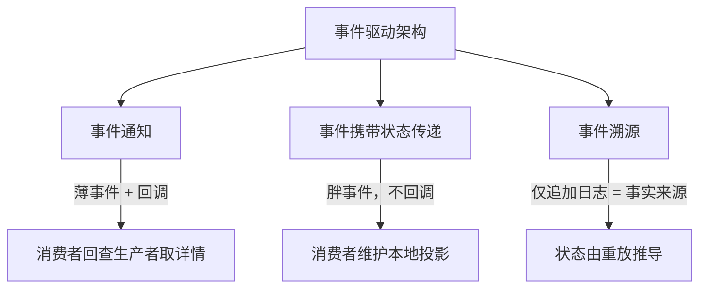
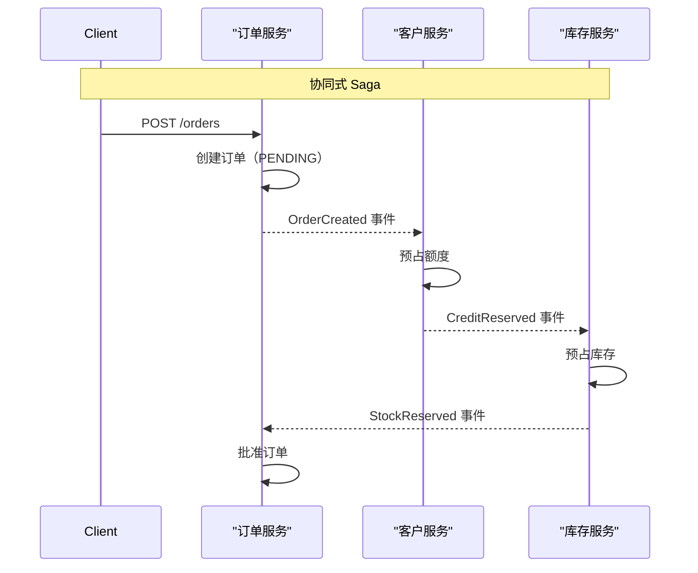
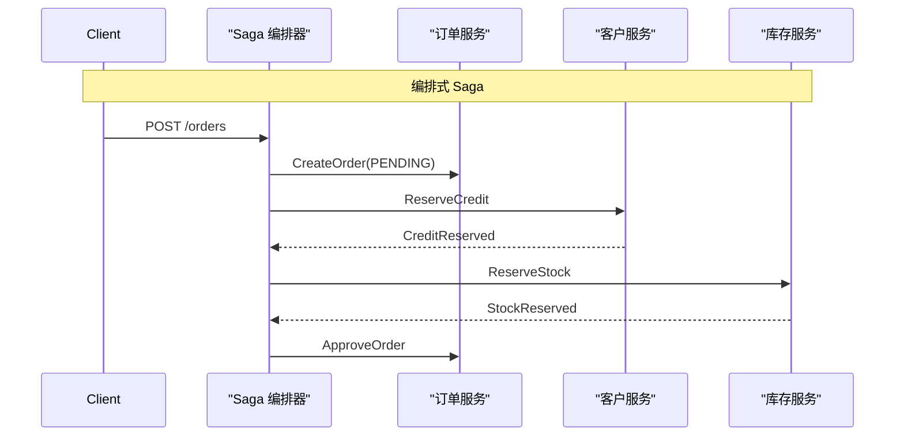
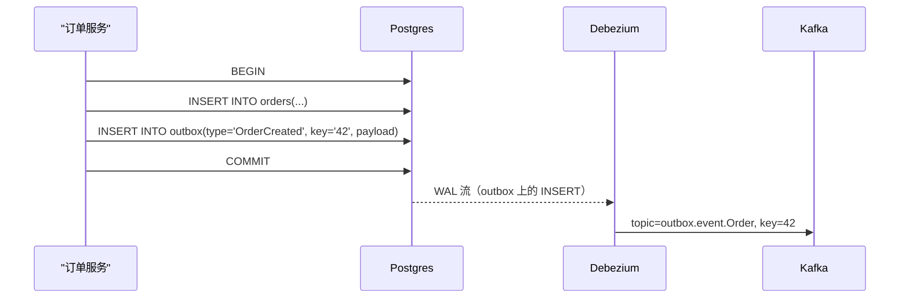

# 事件驱动架构：事件通知、状态传递与协同

> **TL;DR**: “事件驱动”这个词掩盖了三种截然不同的模式，人们却经常把它们混为一谈：事件通知（薄事件，消费者回查）、事件携带状态传递（胖事件，消费者自给自足）、事件溯源（事件就是数据库）。选错一种，耦合方式、存储责任和故障处理都会跟着变。协调又分为协同（服务各自响应事件，没有中心大脑）与编排（工作流引擎驱动每个步骤）。LinkedIn 每天通过 Kafka 处理 7 万亿条消息[^1]；Netflix 的影视与财务事件流量走的是 producer-enricher-consumer 多级 Kafka 管道[^2]。这套架构安静的超能力是重放。安静的杀手是双写缺陷，而事务性发件箱模式能把它彻底消除。

## 学习目标

学完本章，你将能够：

- [ ] 区分事件通知、事件携带状态传递与事件溯源
- [ ] 为事件设计稳定、可演进、自描述的 schema
- [ ] 在多步流程中判断该用协同还是编排
- [ ] 在事件驱动系统里推演最终一致性、重放与幂等性
- [ ] 针对具体负载在 Kafka、EventBridge、SNS/SQS 与 NATS 之间做选择

## 直觉理解

你在报社工作。一条新闻发生时，有三个部门需要知道：印刷组、网站团队、社交媒体团队。

**方案 A（通知）：** 编辑在新闻编辑室里喊一嗓子“4217 号稿子好了！”每个部门走到编辑桌前，拿起稿件，把需要的部分复印下来。编辑被打断三次。编辑去吃午饭，所有人就干不了活。

**方案 B（状态传递）：** 编辑把完整稿件副本放进每个部门的收件箱。各部门独立工作。编辑请病假回家，各部门照样有需要的一切。但现在存在三份稿件副本，编辑一旦改稿，这些副本就是旧的，直到下一次投递。

**方案 C（事件溯源）：** 编辑根本不写定稿。每一次修改、每一次新增段落、每一次删除，都按顺序记录在一条共享时间线上。每个部门从时间线开头重放，重建当前稿件。如果有人问“下午 3 点时稿子长什么样”，重放到那一刻就行。

这三种方案正好对应 Martin Fowler 在 2017 年那份分类法[^3]里指出的三种模式：事件通知、事件携带状态传递（ECST）、事件溯源。事件驱动设计的第一项技能，就是说清楚你说的是哪一种——因为每一种都改变了谁依赖谁、有多少数据在流动、以及出错时会发生什么。

[消息队列与流式处理](../part-2-building-blocks/08-message-queues-streaming.md) 介绍了传输层原语（topic、分区、消费者组、保留策略）。本章在此基础上，讲如何把这些原语组合成架构模式。

## 原理

### Fowler 的分类法

Fowler 那篇 2017 年的文章写于 Thoughtworks 就此主题举办工作坊和峰会之后，指出“事件驱动”至少混淆了三种权衡各不相同的模式[^3]。把这个分类法装进词汇表，是本章最大的教学收益。



*三种事件驱动架构形态，差别在负载大小、耦合方向，以及事实来源放在哪里。*

**事件通知。** 一条小消息宣告“X 发生了，id 是 Y”。消费者订阅、得知有变化，然后向生产者发同步查询拉取当前状态。Fowler 把这描述为“只是一点 id 信息加一个指回发送方的链接”。[^3] 好处是 schema 极简、耦合松。坏处是 N+1 回调风暴：一个事件扇出到 N 个消费者，每个都去打生产者的 API。你用同步耦合换来了隐藏耦合。

**事件携带状态传递（ECST）。** 事件携带相关实体的状态，消费者不必回调就能行动。每个消费者维护自己关心的那部分数据的本地投影。Kafka 的典型实现是按实体 id 做键的日志压缩 topic：新消费者从 offset 0 开始读，就能拿到每个实体的最新状态[^4]。好处是生产者挂掉时消费者照常工作。坏处是 schema 压力、过时投影，以及 GDPR 的麻烦——敏感数据现在被复制到了许多服务里。

**事件溯源。** 仅追加的事件日志就是事实来源。当前状态是可以丢掉重建的派生投影。Fowler 用 git 打比方：提交日志是主体，工作树是派生出来的[^3]。这和 ECST 不是一回事。ECST 用事件做传输，事件溯源用事件当数据库。把两者混为一谈，是团队出问题时怪错模式的最常见原因。

> [!IMPORTANT]
> 不要把事件溯源和 ECST 混为一谈。在 ECST 里，生产者的数据库仍然是事实来源，事件只是复制机制。在事件溯源里没有单独的数据库，事件日志本身就是事实。两者混淆，得到的架构会复杂但并不正确。

### 事件即契约

事件是公开 API。破坏性变更要像发 API v2 一样对待。

**传输信封：CloudEvents。** CNCF CloudEvents 规范定义了必需属性（`id`、`source`、`specversion`、`type`）和可选属性（`subject`、`time`、`dataschema`），让路由器、过滤器和链路追踪工具无需解码负载就能工作[^5]。生产者必须保证 `source + id` 对每个不同事件唯一，这样消费者才能去重。

```json
{
  "specversion": "1.0",
  "type": "com.acme.order.placed",
  "source": "/orders/service",
  "id": "A234-1234-1234",
  "time": "2026-05-03T14:31:00Z",
  "datacontenttype": "application/json",
  "data": { "order_id": "42", "total_cents": 9999 }
}
```

**负载 schema：Avro + Schema Registry。** Confluent Schema Registry 默认 `BACKWARD` 兼容，意思是使用新 schema 的消费者既能读用新 schema 写的数据，也能读紧邻的上一版[^6]。注意 `BACKWARD` 不具传递性：它只保证与上一个 schema 兼容，不保证与所有历史版本兼容。如果你需要让消费者安全地回溯一个 topic 的所有历史版本，用 `BACKWARD_TRANSITIVE`。无论哪种模式，都先升级消费者再升级生产者。对只增不改的变更，用 `FULL` 模式，这样上线顺序就无所谓了。

**数据契约的归属。** 有三种模式：生产者主导（生产者发布带版本的 schema，消费者自行适配）、消费者驱动（消费者声明所需，生产者必须满足所有契约）、平台团队居中（由中心团队在 CI/CD 里强制校验兼容性）。生产者主导加 CI 强制校验，是多数组织务实的默认选择。

### 协同与编排

[单体 vs 微服务](./00-monolith-vs-microservices.md) 介绍了分布式系统的额外成本。协同（choreography）与编排（orchestration）是在不做分布式事务的前提下，跨服务协调多步工作流的两种方式。

**协同：** 每个服务各自响应事件，没有中心协调者。`OrderService` 发出 `OrderCreated`；`CustomerService` 消费它，预占额度，发出 `CreditReserved`；`OrderService` 收到后批准订单[^7]。新增步骤只需加一个消费者。没有中心瓶颈。但也没有任何一条代码路径描述端到端流程。Fowler 提醒：“这样的流程很难看清，因为它在任何程序文本里都不是显式的。”[^3]

**编排：** 由单一工作流引擎（Temporal、AWS Step Functions、Camunda）显式驱动每一步：发送 `ReserveCredit` 命令、等待回复、发送 `ReserveInventory`、等待回复、批准或补偿[^7]。工作流是你能读、能测、能调试、能版本化的代码。Temporal 的说法是：“saga 模式本质上就是一个状态机，保存程序进度，避免重复扣款，必要时回滚，并且在断电后清楚知道如何以一致的状态安全恢复。”[^8]



*协同模式下，每个服务通过事件推动下一步。没有哪个服务知道完整的工作流。*



*编排模式下，单个工作流驱动所有步骤，并在失败时负责补偿。*

**Saga 模式。** Garcia-Molina 和 Salem 在 1987 年的 SIGMOD 论文中提出，把长事务拆成若干本地事务，每个都配一个补偿动作，在后面步骤失败时把它撤销[^9]。现代 saga 上面两种形态都有。关键约束：补偿并不总是可行。邮件发出去收不回。信用卡扣款不退就没法“取消扣款”。设计 saga 时，把不可逆的步骤放在最后执行。

> [!WARNING]
> **补偿失败。** 补偿本身失败了怎么办？你需要对补偿加带指数退避的重试循环、为永久失败的补偿准备死信机制，以及人工介入的升级路径。没有补偿失败策略的 saga 是不完整的。

**怎么选：** 协同扩展的是团队自治（每个团队管自己的消费者，没有中心工作流要协调）。编排扩展的是工作流复杂度（10 步、带分支、超时和人工审批闸门的流程）。4 步以内、团队彼此独立的流程，协同更合适。超过 4 步，或者有严格顺序与审计需求，编排更合适。

### 传输层

[消息队列与流式处理](../part-2-building-blocks/08-message-queues-streaming.md) 讲过 Kafka 的内部机制。这里换架构视角：Kafka 作为事件驱动架构的骨干。

**Kafka 用于 ECST。** 日志压缩至少保留每个键的最新值。空负载消息（tombstone）把某个键标记为已删除。tombstone 在 `delete.retention.ms`（默认 24 小时）之后被清理[^4]。这正是 ECST 需要的：新消费者从 offset 0 读起，就能拿到每个实体的最新状态，完全不用访问生产者。

**按键分区保证顺序。** 同一个聚合（同一订单、同一用户）的所有事件进入同一分区，从而在该聚合内保证顺序。跨分区顺序没有保证。这是根本性的权衡：顺序 vs 并行度。分区越多，消费者并行度越高，全局顺序越弱。

**消费者组用于扩展。** 每个分区只被组内一个消费者消费。增加消费者（最多到分区数）可以线性提升吞吐量。超过这个数，多出来的消费者只能空转。

| 平台 | 最适合 | 顺序性 | 保留期 | 托管方案 |
|----------|----------|----------|-----------|----------------|
| Kafka | 高吞吐有序流、ECST、重放 | 分区内 | 数天到永久 | Confluent Cloud、MSK |
| EventBridge | AWS 原生的扇出，带内容过滤 | 尽力而为 | 无（路由器）；归档可选 | 全托管 |
| SNS + SQS | 扇出到队列，按消费者重试 | 队列内（FIFO） | 4-14 天（SQS） | 全托管 |
| NATS JetStream | 低延迟、轻量、边缘 | 流内 | 可配置 | Synadia Cloud |
| Google Pub/Sub | GCP 原生，窗口内精确一次 | 按订阅的顺序键 | 7-31 天 | 全托管 |
| RabbitMQ | 复杂路由、优先队列、小规模 | 队列内 | 直到被消费 | CloudAMQP |

需要有序的分区流、重放和 ECST 时用 Kafka。需要在 AWS 里做简单扇出加按消费者重试时用 SNS+SQS。延迟比持久性更重要时用 NATS。

### 可靠发布：发件箱模式

一旦服务既要更新数据库又要发出事件，它就背上了双写问题。数据库可能在 broker 挂掉时提交成功，broker 也可能在事务回滚时接受了事件。Postgres 和 Kafka 之间没有 2PC，你也不该试图引入一个。

解法：**事务性发件箱**。把事件行写进 `outbox` 表，与业务写入放在同一个事务里。一个独立的 relay（Debezium CDC，或轮询 worker）读取 outbox 并发布到 Kafka。



*发件箱模式把两次写入合并成一个事务。Debezium 把 WAL 变成可靠的 Kafka 发布，堵住了双写的缺口。*

[变更数据捕获](../part-4-data-systems/04-change-data-capture.md) 深入讲了这个机制：Debezium 配置、WAL 与 binlog 的差别、快照策略，以及 outbox 表的 schema 演进。简版结论：服务永远只写自己的数据库，向 broker 发布是 WAL 的下游结果，而不是服务需要额外协调的一次独立 I/O。

## 真实案例

### LinkedIn：每天 7 万亿条消息

LinkedIn 的 Kafka 部署是业界行星级 EDA 的标准参考。增长曲线本身就说明问题：从早期的每天数十亿条，到 2019 年的每天 7 万亿条，跨 100+ 集群、4000+ broker、10 万+ topic、700 万个分区[^1]。

这套架构把 Kafka 放在生态系统的中心：面向非 Java 客户端的 REST proxy、管 Avro 契约的 Schema Registry、做跨集群镜像的 Brooklin、自愈再均衡的 Cruise Control，以及审计与用量追踪的 Bean Counter[^1]。

对你的设计有参考价值的关键工程决策：

- **控制面与数据面分离。** 在 140+ broker 的集群上，负载一高主控节点故障就会连锁，因为 controller 与数据面流量共用连接。LinkedIn 向上游贡献了 KIP-291，把 controller 连接隔离出来[^1]。
- **broker 维护模式。** SRE 可以在下线前干净地排空副本，避免滚动升级期间出现副本不足的分区[^1]。
- **通过 Brooklin 做跨集群复制。** 每天 7 万亿条消息在集群之间镜像，用于灾难恢复，而不只是在单个集群内部流动[^1]。

教训：Kafka 能扩展到行星级吞吐量，但前提是在 controller 隔离、复制工具和 schema 治理上持续投入运维。broker 本身是简单的部分。它周围的生态（schema registry、审计、跨集群镜像、消费延迟监控）才是生产级 EDA 的生死线。

## 权衡

### 事件形态

| 形态 | 优点 | 缺点 | 适用场景 | 我们的选择 |
|--------|------|------|-----------|----------|
| 事件通知 | 事件小、耦合松、schema 简单 | N+1 回调风暴；对生产者 API 的隐藏耦合 | 高扇出、各消费者需要不同数据切片的场景 | 简单场景从这里起步 |
| 事件携带状态传递 | 消费者自给自足；生产者负载平稳；投影可借日志压缩重建 | 事件更大；schema/PII 压力；投影可能过时 | 大量读模型消费者，且必须扛住生产者停机 | **多数微服务 EDA 的默认选择** |
| 事件溯源 | 完整审计链、重放、时间旅行、“假如”分析 | 复杂；外部副作用难以重放；schema 演进要覆盖全部历史 | 金融、账本、审计密集且历史本身就是产品的领域 | 只在审计/重放是硬需求时用 |

### 协调风格

协同与编排不是上面那些形态的替代品。它们回答的是另一个问题（谁驱动流程，而不是事件携带什么）。

- **协同。** 每个服务响应事件，没有中心协调者。适合流程短（<4 步）、团队独立、流程可见性不如团队自治重要的场景。优点：无中心瓶颈，新步骤可以自由挂载。缺点：端到端流程在任何单一程序文本里都不显式[^3]，容易引入循环依赖，追踪困难。
- **编排。** 单一工作流引擎（Temporal、AWS Step Functions、Camunda）显式驱动每一步，内置补偿[^7][^8]。适合复杂 saga（>4 步）、严格顺序、人工审批闸门或严格审计。优点：工作流是你能读、能测、能调试的代码。缺点：编排器是中心依赖，如果所有领域逻辑都搬进去，它会退化成上帝对象。

**默认建议：** 简单的、团队自治优先的事件扇出用协同；超过四步或涉及不可逆动作的用编排。4 步这个阈值是业界常见的经验法则[^8]，不是硬边界。换工具之前，先算清楚你在工作流可观测性上吃了多少苦。

## 常见陷阱

> [!WARNING]
> **事件是伪装的 RPC。** 团队把 `ChargeCustomer` 当成“事件”发出去，却期望恰好一个消费者处理它并返回结果。这是命令，不是事件。用命令总线、Temporal 或直接 RPC。把“事件”留给那些消费者未知或有很多个的事实。

> [!WARNING]
> **毒丸消息堵死分区。** 一条格式错误的消息就能堵住整个 Kafka 分区，因为消费者无法反序列化它，会在同一个 offset 上永远重试。实现 Uber 的分层重试模式：失败时带退避重新发布到重试 topic；重试 N 次后转入死信队列并推进 offset[^10]。

> [!WARNING]
> **没有发件箱的双写。** 先写数据库，再单独发布到 Kafka。进程在两步之间崩溃，下游系统就永久性地分叉了。始终用事务性发件箱或 CDC。完整模式见[变更数据捕获](../part-4-data-systems/04-change-data-capture.md)。

> [!WARNING]
> **事件广播意面（链条超过 3 跳）。** 30+ 个服务都在监听 30+ 个 topic，每个又产出更多 topic。不上 grep 谁也答不出“谁依赖 OrderPlaced”。强制执行显式的数据契约：生产者主导、带版本、在 CI/CD 里校验。用 ACL 把公开契约 topic 和内部 CDC topic 分开。

> [!WARNING]
> **忽视最终一致性的用户体验。** 用户改了资料，刷新一下却看到旧数据，因为下游投影还没追上。缓解手段：写 API 直接返回刚写入的状态（读己之写）、展示数据新鲜度提示，并始终使用幂等键让重试不会产生重复。完整论述见[幂等性与精确一次](../part-3-distributed-systems-theory/07-idempotency-exactly-once.md)。

## 练习

为电商平台设计履约流程：下单、支付、库存、仓库、发货、通知。在协同（事件总线）与编排（Temporal）之间做选择。写清事件 schema、重试策略，以及你如何处理部分失败。

<details>
<summary>提示</summary>

数一数步骤。想想哪些步骤不可逆（扣款、发通知）。想想库存预占成功但支付失败时会发生什么。哪种协调风格让补偿更容易推演？

</details>

<details>
<summary>参考答案</summary>

**决定：用 Temporal 做编排。**

六个步骤，顺序严格，含不可逆动作（扣款、面单），补偿逻辑复杂。这已经超过协同难以追踪的 4 步阈值。

**工作流伪代码：**

```python
@workflow.defn
class FulfillmentWorkflow:
    @workflow.run
    async def run(self, order_id: str):
        # 步骤 1：预占库存（可补偿）
        await workflow.execute_activity(reserve_inventory, order_id)

        # 步骤 2：扣款（部分不可逆）
        payment_id = await workflow.execute_activity(charge_payment, order_id)

        # 步骤 3：分配仓库（可补偿）
        await workflow.execute_activity(assign_warehouse, order_id)

        # 步骤 4：创建发货单（面单打印后不可逆）
        await workflow.execute_activity(create_shipment, order_id)

        # 步骤 5：发送通知（不可逆）
        await workflow.execute_activity(notify_customer, order_id)
```

**补偿策略：** 支付失败就释放库存预占。仓库分配失败就退款并释放库存。通知放在最后，因为它不可逆。

**重试策略：** 每个 activity 配重试策略，指数退避（初始 1s，上限 60s，最多 5 次）。重试耗尽后，工作流进入补偿路径，按相反顺序回退已完成的步骤。

**事件 schema（CloudEvents 信封）：**

```json
{
  "specversion": "1.0",
  "type": "com.acme.fulfillment.inventory_reserved",
  "source": "/fulfillment/orchestrator",
  "id": "uuid-here",
  "data": { "order_id": "42", "warehouse": "SEA-1", "sku_count": 3 }
}
```

**部分失败处理：** 编排器持久化工作流状态（Temporal 自动做到这点）。编排器在流程中途崩溃，会从最后一个检查点恢复并继续。没有任何步骤会执行两次，因为每个 activity 都是幂等的（以 order_id + 步骤为键）。

**接受的权衡：** 中心编排器是一个依赖。用 Temporal 内置的复制和多集群故障切换来缓解。另一种选择（协同）会要求每个服务都了解上游失败的补偿逻辑，把复杂度摊到六个团队身上，而不是集中在一个工作流里。

</details>

## 要点回顾

- “事件驱动”指三件不同的事。永远说清是哪一种：通知、ECST，还是事件溯源。
- 用日志压缩的 Kafka topic 做 ECST，是微服务通信务实的默认选择。消费者自给自足，可以从 offset 0 重建。
- 协同扩展团队自治，编排扩展工作流复杂度。超过 4 步的流程用编排。
- 双写缺陷是 EDA 的沉默杀手。事务性发件箱模式（同一事务里把事件写进 outbox 表，经 CDC 转发）是解药。
- Schema 就是契约。用 Avro + Schema Registry；`BACKWARD` 是默认值但不具传递性，所以需要在多个历史版本上重放一个 topic 时，选 `BACKWARD_TRANSITIVE`。先升级消费者，再升级生产者。
- 最终一致性是用户体验问题。写 API 返回刚写入的状态，展示数据新鲜度提示，始终使用幂等键。
- 事件日志可重放是那项安静的超能力：新消费者从 offset 0 自举，投影可重建，时间旅行调试成为可能。

## 延伸阅读

- [What do you mean by Event-Driven?](https://martinfowler.com/articles/201701-event-driven.html) 作者 Martin Fowler - 这份 2017 年的分类法终结了围绕该主题的大多数争论；先读它，才不会再混淆三种模式。
- [How LinkedIn customizes Apache Kafka for 7 trillion messages per day](https://engineering.linkedin.com/blog/2019/apache-kafka-trillion-messages) - “行星级 Kafka”的标准参考；涵盖 controller 隔离、维护模式和运维工具。
- [Building Reliable Reprocessing and Dead Letter Queues with Apache Kafka](https://www.uber.com/us/en/blog/reliable-reprocessing/) - Uber 的分层重试 + DLQ 模式；毒丸消息处理的业界范本。
- [Featuring Apache Kafka in the Netflix Studio and Finance World](https://www.confluent.io/blog/how-kafka-is-used-by-netflix/) - Netflix 的 producer、enricher、consumer 模式，配合延迟物化与 Flink；展示了通知 + ECST 的混合实践。
- [Pattern: Saga](https://microservices.io/patterns/data/saga) 作者 Chris Richardson - 协同式与编排式 saga 的标准定义，附补偿示例。
- [SAGAS (1987)](https://www.cs.cornell.edu/andru/cs711/2002fa/reading/sagas.pdf) 作者 Garcia-Molina 和 Salem - 原始的 SIGMOD 论文；篇幅短、可读性强，至今仍是所有现代 saga 实现的理论基础。
- [Schema Evolution and Compatibility](https://docs.confluent.io/platform/current/schema-registry/fundamentals/schema-evolution.html) - BACKWARD/FORWARD/FULL 兼容模式的规则，以及为什么 BACKWARD 是默认值。
- [CloudEvents Specification](https://github.com/cloudevents/spec/blob/main/cloudevents/spec.md) - CNCF 的跨厂商事件互操作信封规范；把它作为你的事件信封标准。

## 记忆卡片

**Q:** “事件驱动架构”这个说法底下藏着哪三种模式？
**A:** 事件通知（薄事件，消费者回查详情）、事件携带状态传递（胖事件，消费者自给自足）、事件溯源（仅追加的事件日志就是事实来源，状态由重放推导）。

**Q:** ECST 与事件溯源的关键差别是什么？
**A:** 在 ECST 里，生产者的数据库仍是事实来源，事件只是复制机制。在事件溯源里没有单独的数据库，事件日志本身就是事实来源。

**Q:** 什么时候该选编排而不是协同？
**A:** 工作流超过 4 步、需要严格顺序、涉及需补偿的不可逆动作，或需要审计链与人工审批闸门时。编排让工作流显式、可测试、可观测。

**Q:** 什么是双写问题，怎么修？
**A:** 服务先写数据库、再单独向 broker 发布，两步之间崩溃就会造成永久性的数据分叉。用事务性发件箱模式修：在同一个数据库事务里把事件写进 outbox 表，再通过 CDC 转发给 broker。

**Q:** Confluent Schema Registry 里的 BACKWARD 兼容是什么意思？
**A:** 使用新 schema 的消费者可以读用新 schema 写的数据，也可以读紧邻上一版写的数据。它不具传递性，因此不保证与所有更早版本兼容；要那个保证就用 `BACKWARD_TRANSITIVE`。先升级消费者再升级生产者。BACKWARD 之所以是默认值，是因为它让消费者可以安全回退重放。

**Q:** Kafka 里的毒丸消息是什么，怎么处理？
**A:** 一条消费者无法反序列化的格式错误消息，因为 offset 推不动而堵死整个分区。用 Uber 的分层重试模式处理：带退避重新发布到重试 topic，重试 N 次后转入死信队列，让主分区继续推进。

**Q:** 为什么日志压缩对 ECST 很重要？
**A:** 日志压缩至少保留每个键的最新值，新消费者可以从 offset 0 读起自举本地投影，不需要回调生产者。它把一个 Kafka topic 变成了可重建的状态存储。

**Q:** 什么是 saga 模式？
**A:** 把长运行的业务事务实现为一串本地事务，每个都配一个补偿事务，在后面步骤失败时撤销它。1987 年由 Garcia-Molina 和 Salem 提出。可以用协同（事件）或编排（工作流引擎）来协调。

**Q:** 事件通知里的 N+1 回调风暴是什么？
**A:** 薄事件扇出到 N 个消费者，每个消费者都向生产者发同步查询去取完整状态。一个事件产生 N 次后续调用，放大了源头的读负载，并与生产者 API 的可用性形成隐藏耦合。

**Q:** Netflix 如何解决其 ECST 管道里的事件乱序？
**A:** 延迟物化。生产者只发实体 id。一个 enricher 微服务通过 gRPC/GraphQL 从源系统取当前状态，从而保证最后一条富化后的事件反映最新事实，与到达顺序无关。

**Q:** 是什么让事件 schema 成为“契约”？
**A:** 它是生产者团队与消费者团队之间的公开 API。破坏性变更（删字段、改类型）必须像 API v2 发布一样处理，留出弃用窗口。Schema Registry 在生产者部署时强校验兼容性，而不是在消费者运行时。

**Q:** 什么时候用 Kafka，什么时候用 SNS+SQS？
**A:** 需要有序分区流、长保留期、从 offset 0 重放和日志压缩的 ECST 时用 Kafka。需要简单扇出加按消费者重试、不要求顺序保证、并且想要全托管 AWS 原生基础设施免运维时用 SNS+SQS。

## 参考文献

[^1]: Jon Lee and Wesley Wu, "How LinkedIn customizes Apache Kafka for 7 trillion messages per day", LinkedIn Engineering Blog, 2019 年 10 月. https://engineering.linkedin.com/blog/2019/apache-kafka-trillion-messages
[^2]: Nitin Sharma, "Featuring Apache Kafka in the Netflix Studio and Finance World", Confluent Blog, 2020 年 1 月. https://www.confluent.io/blog/how-kafka-is-used-by-netflix/
[^3]: Martin Fowler, "What do you mean by 'Event-Driven'?", 2017 年 2 月. https://www.martinfowler.com/articles/201701-event-driven.html
[^4]: Confluent Platform Documentation, "Kafka Log Compaction". https://docs.confluent.io/kafka/design/log_compaction.html
[^5]: CNCF CloudEvents Specification v1.0.3-wip. https://github.com/cloudevents/spec/blob/main/cloudevents/spec.md
[^6]: Confluent Platform Documentation, "Schema Evolution and Compatibility for Schema Registry". https://docs.confluent.io/platform/current/schema-registry/fundamentals/schema-evolution.html
[^7]: Chris Richardson, "Pattern: Saga" (microservices.io). https://microservices.io/patterns/data/saga
[^8]: Temporal, "Saga Design Pattern Explained for Distributed Systems", 2023 年 5 月. https://temporal.io/blog/saga-pattern-made-easy
[^9]: Hector Garcia-Molina and Kenneth Salem, "SAGAS", Proceedings of the 1987 ACM SIGMOD, 1987. https://www.cs.cornell.edu/andru/cs711/2002fa/reading/sagas.pdf
[^10]: Uber Engineering, "Building Reliable Reprocessing and Dead Letter Queues with Apache Kafka", 2018 年 2 月. https://www.uber.com/us/en/blog/reliable-reprocessing/
