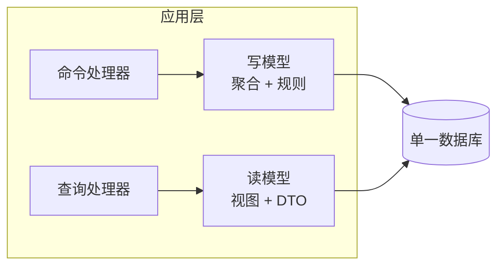
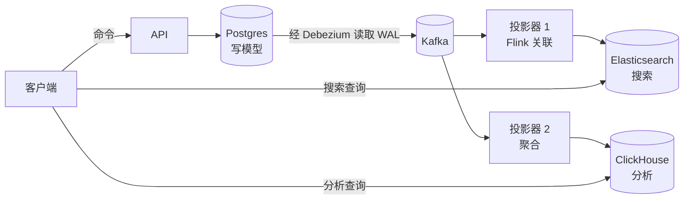
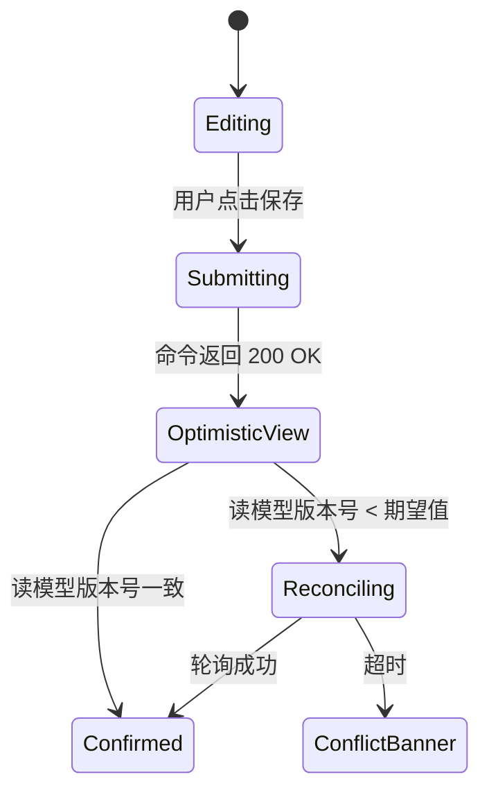
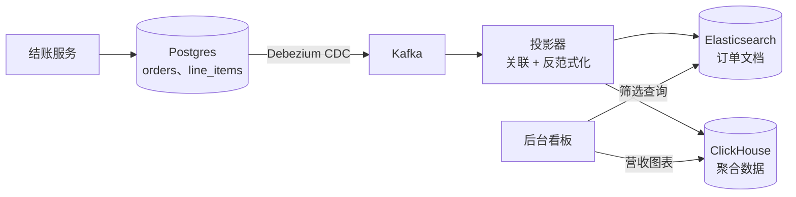

# CQRS：把读写分开，又不把自己逼疯

> **TL;DR**: CQRS 的意思是：更新数据用的模型，和读取数据用的模型不是同一个[^1]。温和形态下，你只是在同一个数据库上把命令和查询的代码路径分开；强形态下，写入落到 OLTP 存储，再由一个或多个读存储（Elasticsearch、Redis、ClickHouse）通过 CDC 或事件异步保持同步。GitHub 在 schema 域这一层把读与写切开，用 1,200+ 台 MySQL 主机撑起每秒 550 万次查询[^2]。只有当读与写的形态真的分化时，这套模式才配得上它带来的复杂度。Greg Young 说得很直接：CQRS 不是一个架构（architecture），而是一个架构模式（architectural pattern），它描述的是单个系统或组件内部的东西——把它用在限界上下文里面，而不是铺满整个系统[^3]。

## 学习目标

学完本章，你将能够：

- [ ] 讲清 CQRS 到底在说什么，而不是复述 buzzword，并区分温和形态与强形态
- [ ] 判断两个模型带来的成本，是否值得那份收益
- [ ] 设计从写入到读存储的投影管道
- [ ] 在 UI 层处理最终一致性（读己之写、陈旧数据提示）
- [ ] 避开常见的 CQRS 反模式

## 直觉理解

你经营一家餐厅。厨房里有一排出餐单夹（ticket rail），厨师从上面读订单。前厅有一块菜单牌，客人从上面看今晚有什么。

出餐单夹是为速度和准确服务的：每张单子写明是哪一桌、按备餐顺序列出菜品、还标注改动（"不要洋葱，酱多一点"）。它丑、全是缩写，只有厨师看得懂。

菜单牌是为浏览服务的：菜品按上菜顺序分组，配图片、过敏原图标、配酒建议。它漂亮、反范式化，一晚上只更新一次。没人会把厨房小票递给客人，也没人会要求厨师照着菜单牌出菜。

这就是 CQRS。写模型（厨房小票）的形态，是为了约束业务规则："这桌点的是套餐，所以不能再加单点主菜。"读模型（菜单牌）的形态，是为了服务客人的查询："把 30 美元以下的无麸质主菜都给我看看。"把这两件事塞进同一套 schema，等于把菜单印在厨房小票上。餐厅小的时候还行，一旦有 200 个餐位、15 页酒单，就撑不住了。

[事件驱动架构](./01-event-driven-architecture.md)介绍了那些把生产者与消费者异步连起来的传输原语。本章在这块地基上继续往下走，讲怎么把事件两端连着的模型拆开。

## 原理

### 核心思路：命令、查询、两个模型

**命令（command）** 表达改变状态的意图：`PlaceOrder`、`CancelReservation`、`RateProduct`。它由写模型处理，写模型拿一个饱满的领域聚合（aggregate）来校验业务规则[^4]。**查询（query）** 返回一个为调用方定形的 DTO，且从不改动状态：`GetOrderSummary`、`SearchProducts`、`ListRecentActivity`[^4]。

关键洞察是：这两件事想要的数据形态不一样。写模型需要范式化、外键和约束来守住不变量；读模型需要反范式化、预先拼好的文档、按访问模式调过的索引。硬把两者塞进一套 schema，会带来锁争用、OLTP 上复杂的 join，以及一个实体同时承担两侧职责时的安全问题[^4]。

CQRS 把 Meyer 在方法级别提出的命令查询分离（CQS）向外推，推到整个模型，有时甚至推到整个存储[^1]。两侧可以共用一个数据库，可以在同一个库上挂不同的 ORM，也可以各住各的存储、靠事件同步。

### 温和形态的 CQRS：一个存储，两个模型

温和形态的 CQRS 里，命令和查询共用一个数据库，但走不同的代码路径、不同的 DTO、不同的仓储（repository）。不需要任何异步管道。

写侧加载聚合、施加业务逻辑、通过仓储落盘。读侧用独立的查询对象，映射到同一个库里的 SQL 视图或反范式化投影，完全绕过领域模型[^4]。

*温和形态的 CQRS 只拆代码路径，库还是同一个。没有最终一致性，没有消息中间件，没有投影器。*

**什么时候温和形态就够了：**

- 领域逻辑复杂，而查询的形态与写入的形态明显不同
- 面向任务的 UI，命令按意图命名（`BookRoom`，而不是 `SetStatus`）
- 团队想要更干净的关注点分离，但不想背上基础设施负担

代价是：读写仍然共享数据库的 I/O、buffer pool 和连接预算。如果读负载已经把主库压死，只做温和形态的 CQRS 救不了你。

### 强形态的 CQRS：独立存储，异步投影

强形态的 CQRS 里，写模型落到一个存储（Postgres、DynamoDB），一个或多个读存储（Elasticsearch、Redis、ClickHouse）通过事件或变更数据捕获异步保持最新。

*强形态的 CQRS：写入落 Postgres；CDC 把变更流经 Kafka；两个投影器各自按独立的延迟预算构建搜索索引和分析库。*

写侧在提交之后发布事件。投影器（Flink、Kafka Streams，或自己写的消费者）负责把每个读存储物化出来。[变更数据捕获](../part-4-data-systems/04-change-data-capture.md)讲了 Debezium、WAL 流式读取，以及避开双写危险的事务性发件箱（transactional outbox）模式的实现机制。

**关键的运维关注点：**

- 你没法把消息中间件和数据库拉进同一个分布式事务。用事务性发件箱（transactional outbox）或 CDC 来避免双写[^4]。
- 每个投影器必须把 offset 与读模型更新原子地一起落盘，或者改用按事件 ID 幂等的写入。
- 全量重建要求事件日志保留得足够久（或者有快照），这样才能从 offset 0 开始重放。

### CQRS 与事件溯源：正交的两个模式

CQRS 分离读写模型。事件溯源（event sourcing）把状态存成一条只可追加的不可变事件日志。它们是两个正交的模式，经常被组合使用，但谁都不依赖谁[^1][^3]。

**有 CQRS、没有事件溯源** 长这样：写 Postgres，Debezium 把变更 CDC 到 Kafka，再投影到 Elasticsearch 做搜索。没有事件存储，也没有从事件历史重建聚合这回事。这被普遍认为是最常见的 CQRS 生产部署方式。

**有事件溯源、没有 CQRS** 长这样：把事件追加到事件存储，读的时候通过折叠事件重建聚合，读也走同一批聚合。这能撑到"按非主键查询"变贵为止——这也正是两者常被组合的原因。

**CQRS + 事件溯源** 给你完整历史、可重放的投影，以及通过重放日志事后构建新读模型的能力。但这是复杂度的天花板。[事件溯源](./03-event-sourcing.md)会深入讲这个组合。

> [!IMPORTANT]
> 别因为上了 CQRS 就顺带把事件溯源也上了。大多数从 CQRS 受益的团队，用的还是传统的关系型写入存储加 CDC。只有当完整审计历史或事后重建投影是硬性要求时，事件溯源才值得。

### 最终一致性是个用户体验问题

存储分开之后，读会落后于写，落后几毫秒到几秒。系统要么把这个滞后遮住，要么诚实地摆出来。

经典故障：用户提交表单，命令成功，读模型还没追上，用户下一次加载页面看到的是旧数据，于是又提交了一遍。这不是纸上谈兵，它是生产环境里 CQRS 缺陷报告的高频来源。

*UI 依次走过提交、乐观渲染、确认三个状态，用户就不会看到"我的改动不见了"那个窗口。*

**实用的缓解手段：**

- **为操作者本人提供读己之写（read-your-writes）。** 把写者紧接着的那次读路由回写侧，或者在客户端缓存命令的响应。
- **乐观 UI。** 立刻在客户端渲染出期望状态，等读模型追上再做对账。
- **版本号。** 写入响应里带回一个版本号，客户端轮询读模型直到看到这个版本（或者超时）。
- **感知延迟的路由。** Vitess 只把副本读流量路由到复制延迟低于阈值的副本，这样应用不会读到离谱的陈旧数据[^5]。
- **诚实的提示。** 对于每 10 秒刷新一次的看板，用户根本察觉不到亚秒级滞后。标一句"3 秒前更新"就够了。

## 真实案例

### GitHub：1,200+ 台 MySQL 主机上的 550 万 QPS

GitHub 的架构是"温和到中等强度 CQRS，务实落地"的教科书案例。平台从 2019 年单个 `mysql1` 集群承担 950,000 QPS，长到 2023 年 50+ 个集群、1,200+ 台 MySQL 主机承担 550 万 QPS[^2]。

这种类 CQRS 的分离在两个层次上起作用：

**通过 ProxySQL 和 freno 做读写分离。** ProxySQL 把读路由到副本、写路由到主库。`freno` 是一个协作式限速服务（靠 Raft 做高可用），持续轮询复制延迟，向批量写入任务返回 200 或限速决策，好让副本永远不会落后到用户能察觉的阈值之外。大约 30% 的读流量从主库被改道到副本[^2]。

**用 schema 域当限界上下文。** GitHub 没有做哈希分片，而是按逻辑域（repositories、issues、users）给表分组，一旦 SQL linter 证明跨域的 join 或事务已经清零，就把整个域迁到自己的集群[^2]。这是基础设施层面的温和形态 CQRS：每个域的写路径彼此隔离，读密集的域拿到专属副本容量，又不会给写主库添压力。

**关键工程决策：**

- 在分区之前先投了五年工具建设（无触发器的迁移工具 gh-ost、基于 Raft 的 10-13 秒故障切换编排器），所以迁移风险很低。
- 按逻辑域分区，而不是按负载分区，从而保住域内的事务一致性。
- 选择不迁出 MySQL。重写 Rails 查询模式的代价，比继续投 MySQL 工具更差。

教训是：你不一定需要消息中间件、投影器和 Elasticsearch 才能拿到 CQRS 的好处。在数据库路由层把读写路径分开，配上域对齐的集群，就能拿到绝大部分扩展收益，而运维复杂度只是一小部分。

## 权衡

| 方案 | 优点 | 缺点 | 适用场景 | 我们的选择 |
|----------|------|------|-----------|----------|
| 不做 CQRS（传统 CRUD） | 简单、强一致、一套 schema | 读写抢同一个 buffer pool | 大多数 CRUD 应用、简单领域 | 从这里开始；痛了就搬走 |
| 温和 CQRS（同库、两个模型） | 代码更干净、没有异步管道、没有最终一致性惊吓 | 仍然共享数据库 I/O 与连接预算 | 领域逻辑复杂、面向任务的 UI | 读写形态分化时的**默认第一步** |
| 强 CQRS（独立存储、CDC） | 独立扩展、每个存储可选最合适的引擎、支持多种读格式 | 最终一致性、中间件 + 投影器 + 监控的运维开销 | 读远多于写（100:1 以上）、搜索/报表压 OLTP | 当只读副本已经不够用时 |
| CQRS + 事件溯源 | 完整审计日志、可重放历史、靠重放构建新投影 | 复杂度拉满；schema 演进要靠 upcaster | 审计密集、金融、强监管领域 | 只有重放/审计是硬需求时 |

## 常见陷阱

> [!WARNING]
> **全局套用 CQRS，而不是按限界上下文套用。** 团队没节制地把整个应用的命令和查询都拆开，然后发现代码量翻倍、扩展收益为零。Greg Young 警告说，像 CQRS 这样的架构模式"不适合到处套用"，而且 CQRS 描述的是"单个系统或组件内部的东西"[^3]。只在读写形态真正分化的地方用它。

> [!WARNING]
> **让 UI 直接查写模型。** UI 代码从事务型写入存储直接读，绕过了投影。读存储随之失步，缺陷被算到投影头上，而读存储的查询形态从来没被验证过。要强制架构边界，让读 API 根本够不到写侧的数据库。

> [!WARNING]
> **用双写代替 CDC。** 应用写完 Postgres，又直接写一遍 Elasticsearch。第二次写失败，读模型不一致，而且没有回滚。要从事务日志里用 CDC 捕获变更，或者用事务性发件箱模式。完整论述见[变更数据捕获](../part-4-data-systems/04-change-data-capture.md)。

> [!WARNING]
> **第一天就上太多投影。** 投影看起来加一个很便宜，于是每个团队都加自己的读模型。维护、回填、重建这些投影会变成一份全职工作。先上一个读模型，等你有了证据说明它服务不了第二个场景，再加第二个。

> [!WARNING]
> **不管投影器的故障恢复。** 投影器崩了。重启之后，它要么跳过事件（丢数据），要么从头重放（重复）。把 offset 与读模型更新原子地一起落盘，或者用按事件 ID 幂等的写入。从最后落盘的 offset 重放，是标准的恢复路径。

## 练习

设计一个电商后台看板的读侧：要能对 5,000 万订单做 20 种筛选条件组合的查询，而 OLTP 侧要扛住每秒 5,000 次结账写入。在只读副本、投影出来的 Elasticsearch 索引、ClickHouse 数仓之间做选择，并明确延迟容忍度与一致性的用户体验方案。

提示

先看查询形态：后台看板的查询（时间区间、状态筛选、聚合）跟为单笔结账优化的 OLTP schema 兼容吗？再想只读副本能不能在 5,000 万行上顶住 20 种筛选组合而不做全表扫描。最后，后台管理员能容忍的延迟，跟正在结账的顾客能容忍的延迟，是一回事吗？

参考答案

**决策：强形态 CQRS，以 Elasticsearch 为主读存储，ClickHouse 承担聚合。**

**为什么不能只加只读副本？** OLTP schema 是为结账范式化的（orders、line_items、payments 各自成表）。后台查询需要在反范式化的订单文档上做 20 种筛选组合。在 5,000 万行上拿任意 WHERE 条件 join 三张表，会让副本做全表扫描，拖高复制延迟，还会连带影响共用这些副本的结账读请求。

**架构：**

**延迟容忍度：** 后台用户能容忍 5-10 秒的延迟。在看板头部标"数据截至 3 秒前"。极少数情况下管理员需要看自己刚改过的订单，就把这一条按 ID 的查询直接路由到 Postgres（读己之写的例外）。

**投影设计：** 投影器消费 `orders`、`line_items`、`payments` 三个 topic 的 CDC 事件，按 `order_id` 关联，把一份反范式化的文档 upsert 进 Elasticsearch。第二个投影把每日营收聚合进 ClickHouse，供时序图表使用。

**接受的代价：** 多两个存储（Elasticsearch + ClickHouse）加一个要维护的投影器。这值得，因为另一条路——把 20 种筛选的查询压到 OLTP 主库或其副本上——需要昂贵的复合索引，会拖慢结账写入。

## 要点回顾

- CQRS 就是读写用不同模型。它是一个谱系：从温和形态（同库、拆代码）到强形态（独立存储、异步投影）。
- 大多数团队应该从温和形态起步，或者干脆留在 CRUD。只有当读写形态真正分化、只读副本跟不上时，强形态的复杂度才划算。
- 最终一致性是用户体验问题，不只是理论问题。用乐观 UI、版本轮询、为操作者本人提供读己之写来解决。
- CQRS 不要求事件溯源。最常见的生产部署是 CQRS 配关系型写入存储，加上 CDC 喂数据的投影。
- 投影加着便宜，拆掉很贵。先上一个，并且给它的归属和下线做好预算。
- CQRS 要按限界上下文用，不要全局用。如果你说不出某个子系统的读写模式到底哪里不同，那它就不需要 CQRS。
- 双写缺陷是沉默的杀手。永远用 CDC 或事务性发件箱来喂读存储。

## 延伸阅读

- [CQRS](https://martinfowler.com/bliki/CQRS.html)，Martin Fowler——定义性的文章，短、有主张，也诚实地说清 CQRS 什么时候会让事情更糟。先读这篇。
- [Greg Young's CQRS Documents (2010 PDF)](https://cqrs.files.wordpress.com/2010/11/cqrs_documents.pdf)——最早的技术文档，把这个模式形式化，并与 CQS 区分开。
- [Clarified CQRS](http://udidahan.com/2009/12/09/clarified-cqrs/)，Udi Dahan——2009 年的文章，把 CQRS 与事件溯源、与 SOA 分开讲；想避免概念混用，这篇必读。
- [CQRS Pattern - Azure Architecture Center](https://learn.microsoft.com/en-us/azure/architecture/patterns/cqrs)——微软的参考指南，带示例代码、权衡表和温和/强两种形态的实施建议。
- [CQRS and Stream Processing](https://streamkap.com/resources-and-guides/cqrs-stream-processing/)，Streamkap——配 CDC 与 Flink 的具体管道模式，演示怎么用流式 SQL 构建投影。
- [GitHub: Scaling MySQL from One Database to 1,200+ Hosts](https://sujeet.pro/articles/github-mysql-migration)——深入 GitHub 的 schema 域分区、freno 限速，以及规模化的读写分离。
- [Scaling Event Sourcing for Netflix Downloads, Episode 2](https://netflixtechblog.com/scaling-event-sourcing-for-netflix-downloads-episode-2-ce1b54d46eec)——Netflix 用于下载授权业务的生产级 CQRS + ES 系统，展示了这个模式在强监管领域的样子。
- [An introduction to Monzo's data stack](https://monzo.com/blog/2021/10/14/an-introduction-to-monzos-data-stack)——Monzo 从事件洪流到 BigQuery 的投影管道；用 Kafka、NSQ 和 dbt 集中管理数据，是组织尺度上的强形态 CQRS。

## 记忆卡片

**Q:** CQRS 的核心主张是什么？
**A:** 更新数据用的模型，应该和读取数据用的模型不同。命令通过写模型改变状态；查询从读模型返回 DTO。两者可以共用一个数据库，也可以各住各的存储。

**Q:** 温和形态与强形态 CQRS 的区别在哪？
**A:** 温和形态在同一个数据库上把命令与查询的代码路径分开（没有最终一致性）。强形态用独立的读存储（Elasticsearch、Redis、ClickHouse），通过事件或 CDC 异步同步，因而引入了最终一致性。

**Q:** CQRS 需要事件溯源吗？
**A:** 不需要。它们是正交的模式，经常组合但互不依赖。最常见的 CQRS 部署方式是关系型写入存储加 CDC 喂数据的投影，完全不涉及事件存储。

**Q:** 强形态 CQRS 最常见的生产故障模式是什么？
**A:** UI 层的最终一致性缺陷。用户提交表单，命令成功，读模型没追上，下次加载显示旧数据，用户又提交一次。用乐观 UI、版本轮询或读己之写路由来修。

**Q:** 什么时候 CQRS 属于过度设计？
**A:** 读写形态完全一致的简单 CRUD 应用；没有平台工程能力去维护中间件和投影器的小团队；以及到处都要求严格写后读的领域。

**Q:** 在 CQRS 投影的语境里，双写问题是什么？
**A:** 先写主库，再单独写读存储。如果进程在两次写之间崩掉，读模型就永久分叉了。用从事务日志做 CDC，或者用事务性发件箱模式来修。

**Q:** 投影器崩溃后怎么恢复？
**A:** 把消费者 offset 与读模型更新原子地一起落盘（或者用按事件 ID 幂等的写入）。重启时从最后落盘的 offset 重放。要做全量重建，就得让事件日志保留足够久，能从 offset 0 重放。

**Q:** Greg Young 说"CQRS 不是一个架构"是什么意思？
**A:** CQRS 是个架构模式，描述的是单个系统或组件内部的东西，不是系统级的架构风格。只把它用在读写形态真正分化的子系统上，其他地方继续 CRUD。

**Q:** GitHub 怎么在没有中间件和投影器的情况下拿到类 CQRS 的收益？
**A:** schema 域分区按逻辑域（repositories、issues、users）把表分到独立的 MySQL 集群。ProxySQL 把读路由到副本、写路由到主库。freno 对批量写入限速，把复制延迟压在用户可察觉的阈值之下。

**Q:** 强形态 CQRS 里的投影管道是什么？
**A:** 一个专职进程（投影器），从中间件（Kafka）消费事件，做变换（关联、反范式化、聚合），再把结果写进读存储（Elasticsearch、ClickHouse）。每个投影器跟踪自己的 offset，可以通过从 offset 0 重放来重建。

**Q:** 说出三种在 UI 层缓解最终一致性的手段。
**A:** (1) 读己之写：把操作者紧接着的读路由到写侧，或者返回缓存的响应。(2) 乐观 UI：立刻渲染期望状态，等读模型追上再对账。(3) 版本轮询：写入时返回版本号，轮询读模型直到版本一致。

## 参考文献

[^1]: Martin Fowler, "CQRS", July 14 2011. https://martinfowler.com/bliki/CQRS.html
[^2]: Sujeet Jaiswal, "GitHub: Scaling MySQL from One Database to 1,200+ Hosts", sujeet.pro, April 21 2026. https://sujeet.pro/articles/github-mysql-migration
[^3]: Greg Young, "CQRS is not an Architecture", September 9 2012. https://gregfyoung.wordpress.com/2012/09/09/cqrs-is-not-an-architecture/
[^4]: Microsoft, "CQRS Pattern - Azure Architecture Center", updated February 2025. https://learn.microsoft.com/en-us/azure/architecture/patterns/cqrs
[^5]: Vitess docs, "Read Query Load Balancing". https://vitess.io/docs/user-guides/configuration-advanced/query-load-balancing/
