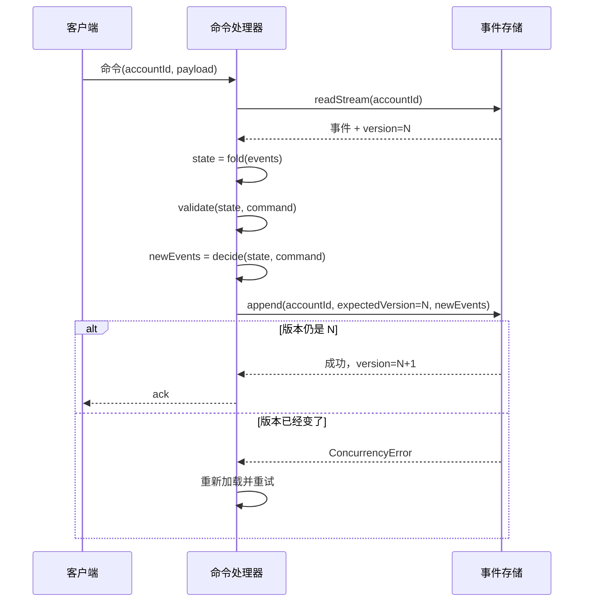
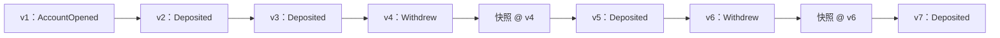
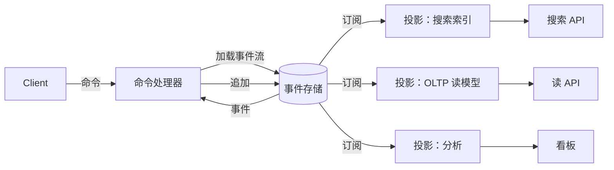
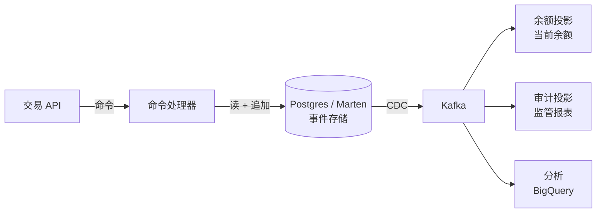

# 事件溯源：事件即事实来源

> **TL;DR**: 事件溯源（event sourcing）把应用状态的每一次变更都存成一条不可变、按时间排序的事件，写入只追加的日志。当前状态不是表里的一行，而是对该实体事件流的左折叠（left fold）[^1]。你因此得到完美的审计轨迹、时间旅行，以及通过重放历史来事后新增读模型的能力。代价是模式演进的纪律、规模化之后的重放成本，以及一条让雄心勃勃的团队折戟的学习曲线。Microsoft Azure Architecture Center 提醒：事件溯源是“一种复杂的模式，会引入显著的权衡……迁移进去和迁移出来都很昂贵”[^2]。只有当审计、时间维度查询和分析灵活性足以支撑这份投入时才用它。其余场景，老老实实用关系数据库。

## 学习目标

学完本章，你将能够：

- [ ] 把领域建模成事件，而不是状态变更
- [ ] 设计聚合、事件流与投影
- [ ] 用快照把重放时间控制在有界范围内
- [ ] 在不破坏重放的前提下演进事件模式
- [ ] 判断事件溯源的复杂度是否值得

## 直觉理解

你在一家银行工作。银行有一本账。每次资金流动，柜员就写一行：“3 月 3 日，向账户 4421 存入 500 美元。”柜员从不擦掉任何一行。如果出了错，柜员再写一行：“3 月 4 日，冲正账户 4421 的 500 美元存入。”余额不存放在任何地方，它是把账本从上到下读一遍、累加出来的。

这时监管人员走进来问：“3 月 3 日 14:02，账户 4421 的余额是多少？”如果数据库只存当前余额，你答不上来——旧值已经被覆盖了。有了账本，你把截至那个时间点的条目重放一遍，算出答案。

这就是事件溯源。你的数据库就是那本账。每一行是一个事件。“当前余额”是一个派生视图，由折叠事件算出。你从不改写历史，也从不丢失信息。

代价是真实的。账本会一直长下去。客户每次查余额都从头读一遍，太慢——你需要周期性汇总（快照）。账本条目的格式一旦改变，所有旧条目仍然必须可读。而当客户行使被遗忘权时，你会撞上一个矛盾：账本不可变，法律却要求删除。

[事件驱动架构](./01-event-driven-architecture.md)把事件当作服务之间的通信机制。[CQRS](./02-cqrs.md)展示了如何分离读模型和写模型。本章再往前走一步：事件本身成为数据库。

## 原理

### 核心模型：事件是事实，状态是折叠

事件（event）是对过去已发生事情的不可变记录，用过去时命名：`AccountOpened`、`FundsDeposited`、`OrderShipped`。它不是命令（“请存入”），也不是差分（“余额从 100 变成 600”）。它承载的是业务意图[^2]。

实体的状态由一个纯函数算出：

```text
state = fold(evolve, initial, events)
```

其中 `evolve(state, event)` 施加一个事件、产出下一个状态，`initial` 是空的起始值。这是一个左折叠。折叠函数是确定性的：只要事件相同、顺序相同，得到的状态永远相同。

所有可信的实现都遵守三条不变量：

1. **事件不可变。** 一旦追加，就不再修改，也不删除。
2. **写入只追加**，并对事件流的期望版本做乐观并发控制。
3. **状态永远可以通过重放重建。** 快照只是优化，从来不是事实来源[^2]。

### 聚合与乐观并发

聚合（aggregate）是一组领域对象，为了一致性而被当作一个单元。在事件溯源里，每个聚合实例拥有一个事件流，通常以聚合 ID 作为键[^2]。

命令处理流程：

1. 从事件存储加载该聚合的事件流。
2. 折叠事件，重建当前状态。
3. 用这个状态校验进来的命令。
4. 产出新事件（这就是决策）。
5. 以 `expectedVersion = lastSeenVersion` 追加新事件。

如果并发的写者先追加成功，存储会以并发错误拒绝这次写入。处理器重新加载、重试。这就是标准的乐观并发控制（optimistic concurrency control），也是全部的一致性机制[^3]。



*追加时的期望版本校验，把并发写者变成可重试的冲突，而不是静默的数据损坏。*

按聚合划分一致性，意味着单聚合操作永远不需要分布式锁。事件流天然按聚合 ID 分片，便于横向扩展。权衡在于：跨聚合的不变量需要 saga 或流程管理器（process manager），难度高得多。saga 模式见[分布式事务](../part-3-distributed-systems-theory/06-distributed-transactions.md)。

### 事件存储的接口

最小的事件存储 API 暴露三个操作[^2]：

```typescript
interface EventStore {
  appendToStream(streamId: string, expectedVersion: number, events: Event[]): void;
  readStream(streamId: string, fromVersion: number, maxCount: number): Event[];
  subscribe(fromPosition: number): AsyncIterator<Event>;
}
```

**专用存储**（EventStoreDB/Kurrent、Axon Server、跑在 Postgres 上的 Marten）自带这些原语，乐观并发是内建的。Marten 用一条 `UNIQUE (stream_id, version)` 约束加上 `jsonb` 载荷，把这些语义叠在 Postgres 之上[^3]。Equinox 在单一编程模型后面同时支持 EventStoreDB、CosmosDB、DynamoDB、Postgres（MessageDB）和 SqlStreamStore，其中 CosmosStore 用一次 1.0 RU 的单点读就能扛住典型负载[^4]。

**把 Kafka 当事件存储**是常见的坑。Kafka 没有按聚合查询的能力，也没有基于期望版本的追加。两个服务都读到某个聚合的版本 5，都能写入版本 6，而且都成功——因为 Kafka 没有乐观并发控制[^5]。Kafka 很适合做事后分发层：事件先提交到正经的事件存储，再由它往外分发。它不能替代事件存储。

> [!WARNING]
> **Kafka 不是事件存储。** 你需要按聚合的并发控制时，用专用事件存储，或者用带 `UNIQUE (stream_id, version)` 约束的关系表。把某个聚合的所有命令都路由到单一写者，或者额外加一层版本校验。Kafka 的只追加日志看起来很像，但缺了最关键的 `expectedVersion` 保证。

### 快照

随着事件流变长，每条命令都重放整个事件流会越来越贵。快照（snapshot）就是聚合状态在某个流位置上的序列化表示[^6]。

加载时，处理器读取最近的快照，从它恢复状态，然后只施加该位置之后的事件。Axon Framework 允许组合多个快照触发条件：施加 N 个事件后触发，或者溯源耗时超过阈值（比如 500 ms）时触发，先到者为准[^6]。



*快照标出状态检查点，聚合加载时只重放最近一次快照之后的事件，从而把命令延迟压在界内。*

快照的关键规则：

- **它永远只是优化，永远不是事实来源。** 快照不兼容或损坏时，系统退回全量事件重放[^6]。
- **模式变更时让它失效。** 快照里编码了过时的业务规则，领域模型一演进，它就变成一个静默的 bug。
- **靠测量来调频率。** 太频繁浪费存储；太稀疏加载就慢。Axon 的文档给出了组合策略的例子：施加 5 个事件后触发，或溯源耗时超过 500 ms 时触发[^6]。

### 模式演进

因为事件要永久保存，事件载荷或语义的任何改动，几十年后仍必须能被折叠函数读出来。这是事件溯源里最难的运维挑战。

Greg Young 的 *Versioning in an Event Sourced System* 系统梳理了这些策略[^7]。主要手法：

1. **宽容反序列化。** 消费方忽略不认识的字段，缺失的字段用默认值补上。只适用于加法式变更。
2. **上转型（upcasting）。** 在反序列化与领域逻辑之间放一层中间件，加载时把 `EventV1` 提升为 `EventV2`，领域层只看最新形状[^2]。上转器把兼容代码集中到一处。
3. **新增事件类型。** 引入 `OrderPlacedV2`，旧事件的处理器永远保留。Adam Warski 指出：除非重写事件流，处理旧事件类型的代码“必须永远留着”[^3]。
4. **拷贝加转换。** 把事件按新形状迁移到新的事件流，原文保留作归档。这是最后手段，因为它破坏了事件流的身份。

强模式的注册中心（Avro 或 Protobuf 配 Confluent Schema Registry）在写入时就把兼容性校验掉。弱的 JSON 载荷把校验推迟到运行时。Oskar Dudycz 的实用建议是：“事件模式版本化的最佳选项，是消除需要版本化的那些条件”——让聚合保持短命，旧形状自然退役[^8]。

> [!TIP]
> 从第一天就用演进友好的方式设计事件。用可选字段，避免用无法扩展的枚举，用业务动词命名事件（`SeatsReserved`）而不是 CRUD 标签（`SeatsUpdated`）。事件越有语义，你越不需要给它做版本化。

### 投影与读模型

投影（projection）是一个或多个事件流的反范式化视图，由投影器（projector）计算：它订阅事件流，把事件折叠成查询需要的任何形状[^2]。

投影器天然和 CQRS 配对：写侧拥有事件，读侧拥有为查询优化的投影。同一条事件流上可以并存多个投影，各自服务不同的访问模式（搜索索引、OLTP 表、看板聚合）。



*写路径把命令捕获成事件；投影是由事件流派生出来的最终一致读模型。*

**重建投影是一等操作：** 丢掉输出，把偏移量重置为零，幂等地重放全部事件。这就是你事后新增读模型的方式——回答写事件时没人想到要问的问题。

坑在这里：投影处理器必须幂等。至少一次投递几乎是每个事件投递栈的固有属性。去重和幂等写入的具体手法见[幂等性与精确一次](../part-3-distributed-systems-theory/07-idempotency-exactly-once.md)。

面对数十亿事件，全量重建投影可能要花几小时到几天。缓解手段包括：分片投影器（按流 ID 分键的并行消费者）、预热好的投影集群，以及把重建当成计划内的运维事件而非紧急事故。

### 运维现实：增长与擦除

只追加日志会一直长下去。磁盘增长靠分层存储管理：旧事件迁到更便宜的介质（S3、Glacier），投影继续对外提供查询。

更难的问题是监管要求的擦除。GDPR 的“被遗忘权”和不可变性直接冲突。有三种做法：

- **把 PII 挡在事件之外。** 用一个可删除的独立存储，通过不透明 ID 引用个人数据。
- **加密粉碎（crypto-shredding）。** 用每个主体独立的密钥加密敏感属性。需要擦除时，删掉密钥。事件还在，但已不可读[^9]。
- **墓碑事件。** 标记逻辑删除，不重写历史。

Mathias Verraes 把加密粉碎称作务实的生产手法，但同时指出一个法律麻烦：在 GDPR 之下，加密后的个人数据仍然是个人数据。单靠加密粉碎未必能让每个监管机构满意[^9]。最安全的路径是把 PII 完全放在事件存储之外，只用一个可以独立删除的不透明标识符去引用。

## 真实案例

### Monzo：复式记账的事件溯源账本

英国数字银行 Monzo 把核心账本跑成一套复式记账（double-entry）的事件溯源系统，外围的微服务在 2024 年已增长到 2800 多个[^10]。每一笔资金流动都会向 `service.ledger` 写入一对金额相等、方向相反的条目，称为一个 `EntrySet`[^11]。

每个条目落在一个地址上（命名空间 + 名称 + 法人实体 + 币种 + 账户 ID），并携带两个时间戳：`committed`（写入时刻）和 `reporting`（产生会计影响的时刻）。余额通过按给定地址和时间轴累加条目算出。“面向客户的余额”和“可计息余额”是两套各自命名的余额定义，投影在同一份条目日志之上[^11]。

**关键工程决策：**

- 复式记账的不变量在单个微服务内的 `EntrySet` 层级强制执行，让账本保持为单一一致性边界。
- 命名的余额定义是硬编码的、带版本的配置。用名字调用 `/balances`，后端和数据仓库会返回一致的结果。
- 上游方面，截至 2021 年，多数数据以事件形式经 Kafka 和 NSQ 流入 BigQuery。数据团队在其上构建 dbt 模型，把事件流当作分析的唯一事实来源[^12]。

这套架构通过重放截至那个时间点的条目，回答了监管的问题（“3 月 3 日 14:02 这笔余额是多少？”）。不需要额外的审计系统，因为账本本身就是审计轨迹。

## 权衡

| 方案 | 优点 | 缺点 | 适用场景 | 我们的选择 |
|----------|------|------|-----------|----------|
| 经典状态存储（CRUD） | 简单、快、人人熟悉；SQL 开箱即用 | 没有审计轨迹、无法回溯时间、更新有损 | 大多数系统；默认选项 | 除非有硬性审计要求，否则从这里起步 |
| 完整事件溯源 | 完美的历史、灵活的投影、时间维度查询 | 复杂、最终一致、模式演进痛苦、重放成本 | 审计密集、分析灵活性足以抵消复杂度的领域 | **银行、医疗、交易** |
| 事件溯源 + CQRS | 灵活性最大；读写独立扩展 | 复杂度最高；两套模型都要演进 | 金融、受监管或流程密集的领域 | 当你既需要完整历史、又需要多种读形态时 |

## 常见陷阱

> [!WARNING]
> **拿 Kafka 当权威事件存储。** Kafka 在追加时没有 `expectedVersion` 校验，没有按聚合查询的 API，而日志压缩（log compaction）只保留每个键的最新值——这对事件溯源是灾难性的。两个在版本 5 的写者可以各自提交版本 6 而不冲突，`retention.ms` 的默认值还会悄悄丢掉历史事件。Conduktor 逐条记录了这三种失效模式[^5]。把 Kafka 用作下游分发层；权威日志放在正经的事件存储后面（EventStoreDB、Postgres 上的 Marten，或者关系表上的一条 `UNIQUE (stream_id, version)` 约束）。

> [!WARNING]
> **事件写成了 CRUD 差分。** 像 `UserUpdated` 配一份前后对比的事件，把事件日志降级成一份没有业务含义的慢变更日志。用过去时的业务动词命名事件（`CustomerMovedHome`、`OrderShipped`）。Microsoft 的说法是：“记录‘两个座位被预订’的事件，比记录‘剩余座位变为 42’的事件更有价值”[^2]。

> [!WARNING]
> **把事件存储当应用数据库。** 开发者绕过投影，直接对事件存储跑临时查询，把自己耦合到事件的内部形状上。把事件存储当作只写、只用于重放的源头。查询的入口是投影。

> [!WARNING]
> **忽略投影处理器的幂等性。** 一条重复事件让计数器加两次，或者发出两条通知。至少一次投递几乎是每个栈的固有属性。按消费者记录最后处理的事件序号并跳过重复，或者把变更设计成本身就幂等。

> [!WARNING]
> **跨聚合不变量却没有 saga。** 你有一条规则要跨两个聚合成立，但它们各有各的事件流。症状是：反复出现的分布式锁，或者悄悄变成承重结构的“临时”跨聚合读取。重新划聚合边界，或者用带补偿事件的流程管理器。

> [!WARNING]
> **把投影当成整库的反范式化拷贝。** 团队“以防万一”把每个字段都拷进每个投影，重建时间膨胀到几天。一个查询模式一个投影。删掉没人用的投影。定期把从零重放当成演练跑一遍。

## 练习

为一家金融科技公司设计账户账本。需求：对每一次余额变更做完整审计、能算出任意时刻的历史余额、支撑每秒 1 万笔交易。选择事件存储、设计聚合边界、指定快照频率。

<details>
<summary>提示</summary>

考虑每个聚合的写入量。在每秒 1 万笔、跨越数百万账户的情况下，单个账户的事件流增长很慢（多数用户一天也就几个事件）。热路径是追加，不是重放。想一想哪个存储能在那个吞吐下给你 `expectedVersion` 保证，以及在每个账户的流都很短的前提下，你是否真的需要频繁快照。

</details>

<details>
<summary>参考答案</summary>

**聚合边界：** 一个账户一个事件流。每个账户累积 `FundsDeposited`、`FundsWithdrawn`、`FeeCharged` 这类事件。聚合强制这条不变量：余额不得为负（或不得超过透支额度）。

**事件存储选择：PostgreSQL 上的 Marten。**

- 全局每秒 1 万笔的情况下，多数账户的流每天只增长个位数事件。热账户（商户）一天可能几百个。这完全在 Postgres 配分区表的写入能力之内。
- Marten 提供 `UNIQUE (stream_id, version)` 做乐观并发，`jsonb` 载荷提供灵活的事件形状，还有内建的快照支持。
- 备选：用 DynamoDB 的条件写入（Equinox 的 DynamoStore）。需要多区域双活时更好，但增加运维复杂度，而且有 400 KB 的单条上限。
- EventStoreDB/Kurrent 是专用方案，但引入一个新的运维依赖。只有配备专职平台工程师的较大团队才划算。

**快照频率：** 每个账户每 50 个事件一次。多数账户一年都碰不到这个阈值。热商户账户大约每天快照一次。折叠函数（累加条目）很便宜，所以即便没有快照，重放 50 个事件也就几微秒。

**历史余额查询：** 把账户流重放到请求的时间戳。流短、又有快照，多数账户是亚毫秒级。对少数有几千个事件的账户，快照把重放限制在最多 50 个事件。

**架构：**



**接受的权衡：** Postgres 是单区域主库。要多区域，就得按账户 ID 分片，或者换到 DynamoDB 全局表。单区域每秒 1 万笔，Postgres 轻松扛住。

</details>

## 要点回顾

- 事件溯源把每一次状态变更都存成不可变事件。当前状态由重放派生，从不作为事实来源存储。
- 每个聚合实例一个事件流。基于 `expectedVersion` 的乐观并发就是全部的一致性机制。
- 快照给重放时间设了上界，但从来不是权威。快照过期或损坏时，退回全量重放。
- 模式演进是最难的运维挑战。第一天就用宽容反序列化、上转器或带版本的事件类型做好规划。
- 投影让一条事件流产出多个读模型。从零重放来重建投影是一等操作。
- Kafka 是分发层，不是事件存储。它缺按聚合查询的能力和期望版本的保证。
- GDPR 与不可变性冲突。加密粉碎或把 PII 放在事件存储之外是生产上的变通做法，但两者在法律上都还没有定论。

## 延伸阅读

- [Event Sourcing](https://martinfowler.com/eaaDev/EventSourcing.html) by Martin Fowler - 2005 年那个开创一切的定义；至今仍是对“事件即状态”最清晰的简要解释。
- [Versioning in an Event Sourced System](https://leanpub.com/esversioning) by Greg Young - 模式演进的参考书；第一次上生产之前先读它。
- [Event Sourcing pattern - Azure Architecture Center](https://learn.microsoft.com/en-us/azure/architecture/patterns/event-sourcing) - Microsoft 关于权衡、版本化和 GDPR 处理的最佳短文。
- [Implementing event sourcing using a relational database](https://softwaremill.com/implementing-event-sourcing-using-a-relational-database/) by Adam Warski - 带代码的实用 Postgres 事件存储；证明你不需要一个专门的数据库。
- [Event sourcing with Kafka: patterns and pitfalls](https://conduktor.io/blog/event-sourcing-kafka-patterns-pitfalls) by Conduktor - 为什么拿 Kafka 当事件存储会咬人，附具体故障场景。
- [Eventsourcing Patterns: Crypto-Shredding](https://verraes.net/2019/05/eventsourcing-patterns-throw-away-the-key/) by Mathias Verraes - 兼容 GDPR 的擦除模式，包括它的法律局限。
- [How we calculate balances](https://monzo.com/blog/2022/02/18/how-we-calculate-balances) by Monzo Engineering - 规模化下真实的复式记账事件溯源账本；展示该模式在生产银行里的样子。
- [Jet/Equinox](https://github.com/jet/equinox) - 一个成熟的 F# 库，覆盖 EventStoreDB、Cosmos、Dynamo 和 Postgres，RU 成本文档写得很细。

## 记忆卡片

**Q:** 事件溯源的根本数据模型是什么？
**A:** 状态不直接存储。每一次变更都记录成只追加日志里的一条不可变事件。当前状态通过从头部开始折叠（重放）某个实体的全部事件算出。

**Q:** 事件溯源的三条不变量是什么？
**A:** （1）事件是过去时命名、不可变的事实。（2）写入只追加，并基于期望版本做乐观并发。（3）状态永远可以靠重放重建；快照只是优化，从不是事实来源。

**Q:** 事件存储里的乐观并发是怎么工作的？
**A:** 命令处理器读取事件流，记下当前版本 N。决策出新事件后，以 `expectedVersion=N` 追加。如果另一个写者先自增了版本，存储会以并发错误拒绝这次写入。处理器重新加载并重试。

**Q:** 为什么 Kafka 不适合做事件存储？
**A:** Kafka 缺按聚合查询的能力（无法高效读取单个实体的事件流），追加时也没有 `expectedVersion` 保证。两个并发写者可以都为同一个聚合成功写入互相冲突的事件。把 Kafka 用在正经事件存储下游做分发层。

**Q:** 事件溯源里的快照是什么，什么时候用？
**A:** 快照是聚合状态在某个流位置上的序列化表示。加载时处理器读快照，只重放该位置之后的事件。当事件流长到全量重放会给命令处理带来无法接受的延迟时，就该用快照。

**Q:** 说出三种事件模式演进的策略。
**A:** （1）宽容反序列化：忽略未知字段，缺失字段给默认值。（2）上转型：用中间件在加载时把旧事件形状提升到当前版本。（3）新增事件类型：引入 `OrderPlacedV2`，旧处理器永远保留。

**Q:** 事件溯源系统里怎么处理 GDPR 擦除？
**A:** 三种做法：（1）把 PII 完全挡在事件之外，从可删除的存储里用不透明 ID 引用。（2）加密粉碎：用每个主体独立的密钥加密 PII，需要擦除时删除密钥。（3）用墓碑事件表示逻辑删除。注意：加密粉碎在 GDPR 下的法律地位尚未完全确定。

**Q:** 事件溯源里的投影是什么？
**A:** 投影是由投影器构建的反范式化读模型：投影器订阅事件流，把事件折叠成面向查询优化的形状。同一条流上可以并存多个投影。重建投影就是丢掉输出、把偏移量重置为零、幂等地重放全部事件。

**Q:** 什么情况下不该用事件溯源？
**A:** 没有审计要求的简单 CRUD 领域、刚接触 DDD 的团队、模式频繁变更的快速迭代领域、有严格擦除要求的系统，以及任何复杂度成本超过审计／时间查询收益的系统。

**Q:** 事件溯源和 CQRS 是什么关系？
**A:** 两个正交的模式，经常组合使用，但谁都不依赖谁。事件溯源定义怎么持久化（只追加事件）。CQRS 定义怎么把读和写分开（不同模型）。组合起来，事件是写模型，投影是读模型。

**Q:** “CRUD 事件”这个反模式是什么？
**A:** 把事件命名成 `UserUpdated` 加一份通用前后差分，而不是 `CustomerMovedHome` 这样的业务意图动词。CRUD 风格的事件丢掉语义，让投影更难建，事件日志也不比一份慢变更日志更有用。

## 参考文献

[^1]: Martin Fowler, "Event Sourcing", December 2005. https://martinfowler.com/eaaDev/EventSourcing.html
[^2]: Microsoft Azure Architecture Center, "Event Sourcing pattern", updated 2026-03-28. https://learn.microsoft.com/en-us/azure/architecture/patterns/event-sourcing
[^3]: Adam Warski, "Implementing event sourcing using a relational database", Softwaremill, 2021. https://softwaremill.com/implementing-event-sourcing-using-a-relational-database/
[^4]: Jet/Equinox README on GitHub. https://github.com/jet/equinox
[^5]: Stéphane Derosiaux, "Event sourcing with Kafka: patterns and pitfalls", Conduktor, 2024-07-03. https://conduktor.io/blog/event-sourcing-kafka-patterns-pitfalls
[^6]: Axon Framework Reference, "Snapshots", AxonIQ. https://docs.axoniq.io/axon-framework-reference/development/tuning/snapshotting/
[^7]: Greg Young, "Versioning in an Event Sourced System", Leanpub. https://leanpub.com/esversioning
[^8]: Oskar Dudycz, "How to (not) do the events versioning?", event-driven.io, 2020. https://event-driven.io/en/how_to_do_event_versioning/
[^9]: Mathias Verraes, "Eventsourcing Patterns: Crypto-Shredding", 13 May 2019. https://verraes.net/2019/05/eventsourcing-patterns-throw-away-the-key/
[^10]: Will Sewell, "How we run migrations across 2,800 microservices", Monzo Engineering, 26 August 2024. https://monzo.com/blog/how-we-run-migrations-across-2800-microservices
[^11]: Basma Taha, "How we calculate balances", Monzo Engineering, 2022-02-18. https://monzo.com/blog/2022/02/18/how-we-calculate-balances
[^12]: Monzo Engineering, "An introduction to Monzo's data stack", 2021-10-14. https://monzo.com/blog/2021/10/14/an-introduction-to-monzos-data-stack
