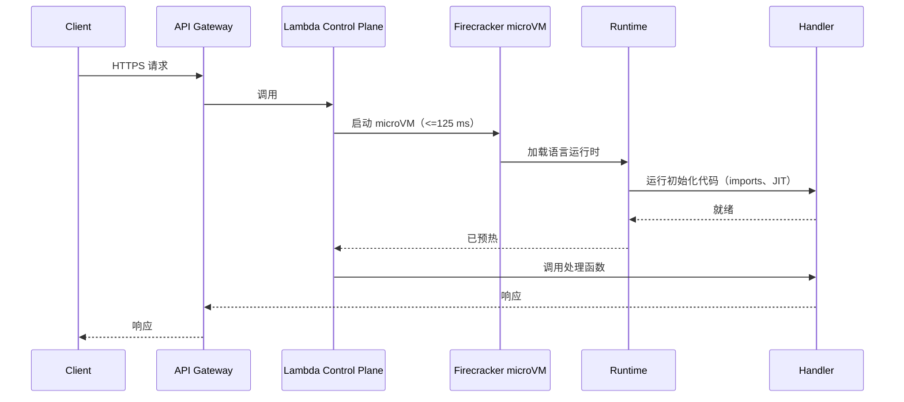
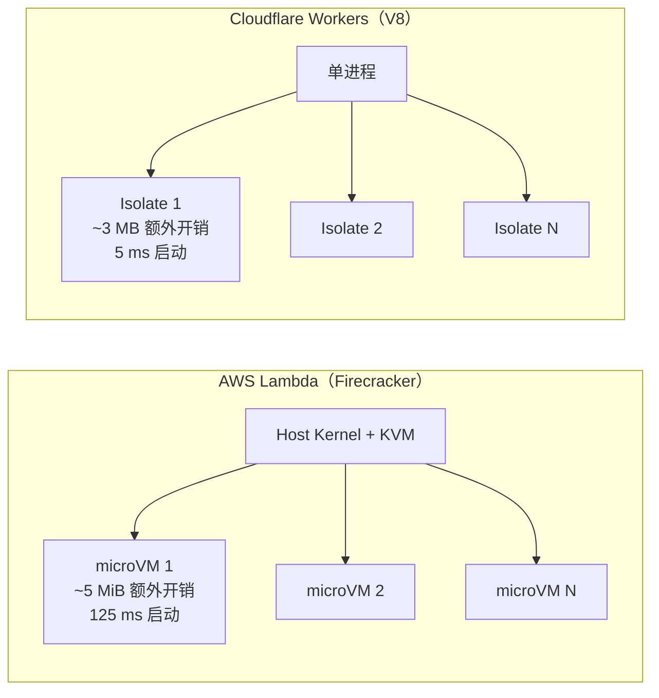
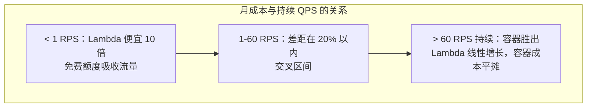
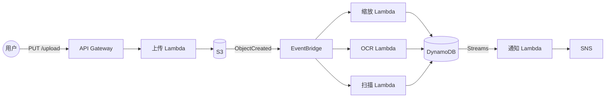

# Serverless：函数、冷启动，以及 FaaS 究竟何时真能省钱

> **TL;DR**：Serverless 是一种计费模型，不是“没有服务器”。你按请求数付费，按执行的 GB-秒付费，空闲时一分不花。AWS Lambda 每百万次调用收 $0.20，另外按 GB-秒收 $0.0000166667，精度到 1 ms[^1]。这让 FaaS 在突发、事件驱动的负载上无可匹敌，而一旦持续跑到大约 60 RPS 以上，它就变成一个安静烧钱的坑。冷启动（Firecracker microVM 125 ms[^2]，Cloudflare Workers 的 V8 isolate 5 ms[^3]）就是你为“缩容到零”交的延迟税。搞清楚隔离机制、把成本账算出来，你就能准确判断什么时候该伸手拿 Lambda，什么时候该伸手拿容器。

## 学习目标

学完本模块，你将能够：

- [ ] 解释冷启动、热池与预置并发
- [ ] 估算一个 Lambda 函数与一个容器各自的单请求成本
- [ ] 用 Lambda、EventBridge、SQS、Step Functions 设计事件驱动架构
- [ ] 识别 serverless 反而更贵的那些负载
- [ ] 对比 AWS Lambda、Google Cloud Functions、Azure Functions 与 Cloudflare Workers

## 直觉理解

你经营一辆餐车。客人走过来，你点火开烤，做好递出去。客人走了就把火关掉。燃气费与卖出的单量成正比。冷清的周二你几乎不花钱；节日的周六你不停手地做，账单很高，但你从不为空着的厨房付钱。

再对比一下租一间餐厅。无论你卖出 10 份还是 10,000 份，房租照付。你拥有一个随时可用的厨房（没有启动延迟），但每一个空闲的小时你都在付钱。

FaaS 就是那辆餐车，容器集群是那间餐厅。需求尖峰化、不可预测时，餐车赢；夜夜爆满时，餐厅赢。冷启动就是每天第一个汉堡下锅前那点点火的时间。预置并发则是花钱让炉子一直温着，哪怕没人在点单。

[单体与微服务](./00-monolith-vs-microservices.md)介绍过拆分的谱系。Serverless 站在最远端：每个函数都是一个零运维负担的纳米服务，但厂商的执行模型限制了你到底能造什么。

## 原理

### FaaS 的执行模型

FaaS 平台响应事件，调用短生命周期、无状态的函数。厂商维护一个预先初始化的执行环境池。事件到达时，平台把它路由到一个已预热的环境；如果没有，就新建一个（这就是冷启动）。状态不能留在函数里跨调用存活，因为任何实例随时可能被回收。状态应该放在 DynamoDB、S3、Redis 这类托管服务里。

AWS Lambda 定下的规格，后来所有竞品都跟着走：内存 128 MB 到 10,240 MB（CPU 按比例给，1,769 MB 对应 1 vCPU），最长执行 15 分钟，同步负载上限 6 MB，默认并发上限每区域 1,000[^4]。Google Cloud Functions gen 2 把天花板推到 16 GB 内存、4 vCPU、60 分钟 HTTP 超时、单实例最多 1,000 个并发请求[^5]。Azure Functions 提供 Consumption（缩容到零）、Premium（预热实例，可接入 VNet）与 Dedicated 三种计划。

核心约束在于：你把运行时交给了厂商。你接受他们的时长限制、负载上限、并发模型和冷启动行为。作为交换，你得到的是零容量规划、零空闲成本。

### 冷启动与热启动

冷启动是平台新建执行环境时，第一个请求所承受的延迟惩罚。在 Lambda 上，四个阶段串行发生：

*冷实例上的一次同步 API 调用要依次付出四笔成本：microVM 启动、运行时初始化、代码初始化、以及处理函数执行。*

典型冷启动时间因语言而异：Node.js 200-400 ms，Python 300-500 ms，Go 100-200 ms，Java 1-3 s（JIT 编译占大头），.NET 1-5 s。AWS 自己的基准测试显示，Java 的 p99.9 冷启动在按需模式下是 5,114 ms，用 SnapStart 则是 488 ms[^6]。

**缓解手段：**

- **预置并发（Provisioned Concurrency）** 让 N 个环境保持预初始化，持续计费 $0.0000041667/GB-秒[^1]。p99 可预测，但你失去了缩容到零。
- **SnapStart**（Java，2022 年 re:Invent 发布）对初始化完成的 JVM 做快照并从快照恢复，把 Java 冷启动砍掉 10 倍，且没有持续费用。
- **更小的运行时。** Go 和 Rust 的自定义运行时能在 200 ms 内启动，因为没有 JIT，也没有框架引导过程。

> [!IMPORTANT]
> 冷启动只对 p99 SLA 卡得很紧的同步 API 才要紧。对异步事件处理（SQS、Kinesis、S3 触发）来说，冷启动通常不可见，因为队列把延迟吸收掉了。先掂量问题有多大，再动手解决。

### 隔离：Firecracker microVM 与 V8 isolate

隔离机制决定了冷启动的下限、内存开销和多租户密度。

*Firecracker 给每个租户一台硬件隔离的虚拟机；V8 isolate 共享一个进程，靠 JavaScript 引擎做沙箱。权衡点在于安全边界的强度与启动速度。*

**Firecracker** 是 AWS 用 Rust 写的极简 VMM：大约 5 万行 Rust，而 QEMU 是 140 万行[^2]。它能在 125 ms 内把 microVM 启动到用户态 `/sbin/init`，VMM 内存开销低于 5 MiB。单台宿主机每秒可创建最多 150 个 microVM，同时运行数千个。这 125 ms 的预算是 CI 强制的，每个 Firecracker PR 都要过。

**Cloudflare Workers** 把客户代码跑在 V8 isolate 里（就是浏览器标签页之间那套沙箱）。冷启动约 5 ms（按 Cloudflare 2018 年的公告），每个 isolate 内存开销约 3 MB[^3]。权衡是：Workers 只能跑 JavaScript、TypeScript 或编译到 WebAssembly 的语言。不能跑任意二进制。Workers Paid 计划给 128 MB 内存、5 分钟 CPU 时间、每次调用 10,000 个子请求。平均每个 Worker 每请求消耗约 2.2 ms CPU。

Workers 默认部署到 Cloudflare 全球每一个数据中心（100 多个国家、数百座城市）。没有“主区域”这个概念。这让它非常适合延迟敏感的边缘逻辑：A/B 路由、鉴权 token 校验、请求改写。

### 真实的成本账

FaaS 计费 = 固定的按请求费用 + 按分配内存与执行时长计费的计算费用。空闲不收费。

**Lambda 定价（us-east-1，x86，2024 年）：**

- 每百万次请求 $0.20
- 每 GB-秒 $0.0000166667（Arm/Graviton2 便宜 20%）
- 时长按最近的 1 ms 取整（2020 年 12 月从 100 ms 取整改成这样）

**实算盈亏平衡点：每天 100 万次请求，每次 200 ms，512 MB**

Lambda：每月 3000 万次请求。计算量 = 30M *0.2 s* 0.5 GB = 3,000,000 GB-s。月成本 = $6.00（请求）+ $50.00（计算）= **每月 56 美元**[^1]。

Fargate（0.25 vCPU，512 MB，7×24）：$0.04048/vCPU-小时 + $0.004445/GB-小时，约合每个任务每月 $8.89[^7]。在 11.6 RPS（每天 100 万次）下，你需要多个任务来扛住负载，落在大约 **每月 50-90 美元**。

在这个流量水平上，Lambda 与 Fargate 咬得很紧。交叉点翻过去大约在持续每天 500 万次请求（约 60 RPS）：Fargate 胜出，因为它的成本与请求数无关，是平的。而低于每天 10 万次请求时，Lambda 便宜 10 倍，因为免费额度（每月 100 万次请求 + 400,000 GB-秒）把账单大部分吃掉了。

*Lambda 成本随请求数线性增长；容器集群的成本是阶梯函数，一旦利用率越过交叉点就更便宜。*

### 事件触发源与常见模式

典型的 serverless 架构，就是一条由托管服务靠事件串起来的流水线：

*一次 S3 上传经 EventBridge 扇出到并行的 Lambda 并写入 DynamoDB；每一根箭头都是托管服务，至少一次投递。*

关键事件源：API Gateway（同步 HTTP）、SQS（队列）、S3（对象事件）、Kinesis（流）、DynamoDB Streams（变更捕获）、EventBridge（事件总线）、定时规则（cron）。Step Functions 负责编排多步工作流，Standard 模式（每百万次状态转移 $25，最长运行 1 年）或 Express 模式（按执行计费，最长 5 分钟）。

[键值存储](../part-4-data-systems/09-key-value-stores.md)讲过 DynamoDB 的数据模型。Lambda 配 DynamoDB 是最常见的 serverless 组合，因为两者都能横向扩展、都按请求计费、都不需要容量规划。

## 真实案例

### Liberty Mutual：财富 100 强规模下的 serverless 优先

Liberty Mutual 是一家财富 100 强的保险公司（排名第 77），在云迁移中采取了 serverless 优先的姿态。超过 50% 的负载迁到 AWS，默认计算栈就是 Lambda + API Gateway + DynamoDB[^8]。

Liberty IT 的技术架构师、CDK Patterns 的作者 Matt Coulter，演示了如何用 AWS CDK（Cloud Development Kit）部署 serverless 流水线。架构完全遵循上面的模式：API Gateway 接收请求，Lambda 函数处理业务逻辑，DynamoDB 存状态，S3 放文档。基础设施用 TypeScript 的 CDK construct 定义，团队之间以可复用模式的形式共享。

Liberty Mutual 这次 adoption 最关键的洞察是组织层面的，不是技术层面的。一家受强监管的保险公司把 FaaS 选作默认选项，而不是例外。他们的理由：

- **第一天就能上线。** 新项目第一天就能交付代码，因为没有基础设施要预先开通。
- **FinOps 透明度。** 按请求计费让成本归属变得极其简单。每个团队都能看到自己的函数花了多少钱。
- **爆炸半径。** 每个函数独立失败。文档 OCR 出了 bug 不会拖垮保单报价。

他们接受的约束是：绑定 AWS。Lambda + DynamoDB + Step Functions 是本手册里耦合最紧的 AWS 组合。Liberty Mutual 明确给这个风险定了价，并认为省下的运维成本值得。对于超出 FaaS 经济性范围的负载，容器仍是逃生通道。

## 权衡

| 方案 | 优点 | 缺点 | 适用场景 | 我们的选择 |
|----------|------|------|-----------|----------|
| FaaS（Lambda、Cloud Functions、Azure Functions） | 零运维；缩容到零；按请求计费；1 ms 精度 | 冷启动；15 分钟上限；厂商锁定 | 突发、事件驱动、胶水代码、低频任务 | **事件驱动负载的默认选择** |
| 容器（ECS Fargate、Cloud Run） | 运行时灵活；延迟可预测；预热后无冷启动 | 容量规划归你；空闲也在付费 | 持续流量高于 60 RPS、有状态、长时间运行 | **稳态 API 的默认选择** |
| 边缘函数（Cloudflare Workers） | 5 ms 冷启动；全球 POP；只按 CPU 计费 | 只能 JS/Wasm；128 MB 内存；API 受限 | 延迟敏感逻辑、A/B 路由、边缘鉴权 | **边缘计算的默认选择** |
| 传统虚拟机 / 裸金属 | 控制力最强；任意操作系统；任意二进制 | 运维量最大；打补丁；容量规划 | 遗留系统、专用硬件（GPU、FPGA） | 别的都不合适时才用 |

## 常见陷阱

> [!WARNING]
> **同步关键路径上的冷启动。** 一个平时 50 ms 的 API，偶发出现 1-10 s 的 p99。每台新 microVM 都要跑你的初始化代码。在 JVM 或 .NET 上，这会主导关键路径。修法：对已知尖峰用预置并发，Java 用 SnapStart，或者把热函数用 Go/Rust 重写。不要用定时 ping“保活”，那是在跟平台对抗，而且最多只能保住一个热实例。

> [!WARNING]
> **“Lambdalith”。** 团队把一个 Express 或 Spring 应用原封不动地塞进单个 Lambda，前面用 API Gateway 的 catch-all 路由兜住。部署爆炸半径变成整个 API；一个慢接口会耗光所有接口的并发；冷启动随打包体积一起变大。修法：按限界上下文拆成函数。把共享逻辑抽到 Lambda Layer，而不是打进每个函数里。

> [!WARNING]
> **经 Lambda 递归。** 函数往一个 S3 桶或 SQS 队列写东西，而那里的事件又反过来调用同一个函数。这个循环会一直跑到并发打满或者账单告警响。AWS 在 2023 年加了递归调用保护，但设计时仍要用幂等键，并把源与汇的资源分开。

> [!WARNING]
> **NAT Gateway 这笔隐形账单。** Lambda 计算费用每月 15 美元，NAT Gateway 加跨可用区出网流量每月 400 美元。VPC 内 Lambda 流向公网的每一个字节都要过 NAT Gateway，按 $0.045/GB 计费。修法：S3 和 DynamoDB 用 VPC Gateway Endpoint（免费）；只跟 AWS API 打交道的 Lambda 干脆别挂 VPC。

> [!WARNING]
> **Lambda 上持续跑超过 60 RPS。** 月账单会悄悄超过一个等效 Fargate 服务的成本。FaaS 计费对调用次数是线性的；容器按墙上时钟计费，与负载无关。利用率高（超过 60%）时，按时长计价的方案赢。把热路径迁到 Fargate，Lambda 留给胶水、扇出和尖峰接口。

## 练习

设计一条图像处理流水线：用户上传照片，你转成 5 种尺寸，跑目标检测，存结果。产品发布期间流量会涨 100 倍。在 Lambda、ECS Fargate 和基于 Kubernetes 的方案之间做选择。分别估算每月 100 万张和每月 5000 万张图片的成本。

提示

每月 100 万张时，计算是突发的，大部分时间空闲。每月 5000 万张时，你大约在持续处理 19 张/秒。想一想：一次缩放操作的平均时长是多少？一次目标检测推理呢？这又怎么映射到 Lambda 的 GB-秒和 Fargate 的 vCPU-小时？

解答

**每月 100 万张（突发型，发布期有尖峰）：**

Lambda 明显胜出。假设每张图触发 5 个缩放函数（各 200 ms，512 MB）和 1 个检测函数（2 s，3 GB）。

- 缩放：500 万次调用 *0.2 s* 0.5 GB = 500,000 GB-s。成本 = $1.00（请求）+ $8.33（计算）= 每月 $9.33。
- 检测：100 万次调用 *2 s* 3 GB = 6,000,000 GB-s。成本 = $0.20 + $100.00 = 每月 $100.20。
- Lambda 合计：约每月 110 美元，非发布期零空闲成本。

Fargate 等效方案：你得为 100 倍尖峰备足容量。要么预留冗余（空闲很贵），要么依赖自动扩缩（尖峰期间有几秒到几分钟的滞后）。Lambda 能瞬间接住尖峰，因为每次调用都是独立的。

**每月 5000 万张（持续 19 张/秒）：**

- Lambda 缩放：每月 $467。Lambda 检测：每月 $5,010。合计：约每月 5,500 美元。
- Fargate 加 GPU 检测容器 7×24 运行：高利用率下大约每月 2,000-3,000 美元。

在这个量级上，检测负载用 Fargate 更划算（持续、可预测）。缩放扇出仍然用 Lambda 更划算（短、并行、发布期突发）。

**推荐的混合方案：** 缩放用 Lambda（永远突发、生命周期短），目标检测用 Fargate（持续、能吃 GPU、吞吐可预测）。两路都由 S3 事件经 EventBridge 触发。这样你在便宜的那条路上拿到缩容到零，在昂贵的那条路上拿到成本高效的持续算力。

## 要点回顾

- Serverless 是一种计费与运维模型：你按请求付费而不是按小时，运行时归厂商管。
- 冷启动真实存在，但要看场景。它影响 p99 SLA 卡得紧的同步 API；对异步事件处理则不可见。
- Firecracker 能在 125 ms 内启动一台硬件隔离的 microVM；Cloudflare Workers 用 5 ms 启动一个 V8 isolate。权衡点是隔离强度与启动速度。
- 持续超过约 60 RPS 之后，FaaS 反而更贵。下决定之前先把盈亏平衡点算出来。
- 典型 serverless 栈（API Gateway、Lambda、DynamoDB、S3、EventBridge）是本手册里耦合最紧的 AWS 组合。容器是逃生通道。
- serverless 的厂商锁定比容器更重。诚实地给这个风险定价。
- “缩容到零”是长尾负载的杀手级特性。如果你的函数每小时才跑一次，任何容器集群在成本上都打不过它。

## 延伸阅读

- [Firecracker: Lightweight Virtualization for Serverless Applications (Agache et al., NSDI 2020)](https://www.usenix.org/conference/nsdi20/presentation/agache) - Lambda 隔离层的经典论文；解释了那个 5 万行 Rust 的 VMM 和 125 ms 启动预算。
- [Cloud Computing without Containers (Cloudflare, 2018)](https://blog.cloudflare.com/cloud-computing-without-containers/) - Zack Bloom 讲 V8 isolate 这个赌注，以及为什么容器不是实现多租户的唯一路径。
- [AWS Lambda Pricing](https://aws.amazon.com/lambda/pricing/) - 按请求费率与 GB-秒费率的权威来源；算成本之前先来这里核对。
- [Reducing Java cold starts with SnapStart (AWS Compute Blog, 2022)](https://aws.amazon.com/blogs/compute/reducing-java-cold-starts-on-aws-lambda-functions-with-snapstart/) - 用 CRaC 检查点-恢复把 Java 冷启动砍掉 10 倍。
- [Serverless Architectures (Mike Roberts, martinfowler.com)](https://martinfowler.com/articles/serverless.html) - 关于 FaaS 与 BaaS 的长篇权威论述；至今仍是最好的概念总览。
- [Introducing the next generation of Cloud Functions (Google Cloud, 2022)](https://cloud.google.com/blog/products/serverless/introducing-the-next-generation-of-cloud-functions) - Gen 2 发布公告，含 1,000 并发、16 GB、60 分钟这些数字。
- [Azure Functions Premium plan (Microsoft Learn)](https://learn.microsoft.com/en-us/azure/azure-functions/functions-premium-plan) - 始终就绪与预热实例的区别；Azure 消除冷启动的路子。
- [Cloudflare Workers Limits](https://developers.cloudflare.com/workers/platform/limits/) - V8 isolate 模型各项资源上限的权威表格。

## 记忆卡片

**Q：** FaaS 里的冷启动是什么？
**A：** 平台新建执行环境时，第一个请求承受的延迟惩罚。在 Lambda 上，它包括 microVM 启动（125 ms）、运行时初始化、代码初始化、处理函数执行。典型总和：200 ms（Go）到 5 s（未用 SnapStart 的 Java）。

**Q：** Lambda 的定价怎么算？
**A：** 每百万次请求 $0.20，外加每 GB-秒 $0.0000166667（x86，us-east-1）。时长按最近的 1 ms 取整。空闲时不收费。

**Q：** Firecracker 是什么，AWS 为什么用它？
**A：** 一个 Rust 写的极简 VMM（约 5 万行，QEMU 是 140 万行），能在 125 ms 内启动一台硬件隔离的 microVM，开销低于 5 MiB。它让 Lambda 能给每个租户完整的硬件隔离，又不必背负传统 hypervisor 的重量。

**Q：** Cloudflare Workers 怎么做到 5 ms 冷启动？
**A：** 它把客户代码作为 V8 isolate 跑在单个进程内（就是浏览器标签页之间那套沙箱）。V8 每个进程只付一次 JavaScript 运行时成本，启动一个 isolate 约 5 ms，开销约 3 MB。权衡是：只能跑 JS、TS 或 WebAssembly 代码。

**Q：** 持续多少 QPS 之后 Lambda 比容器贵？
**A：** 大约持续 60 RPS（在 200 ms、512 MB 条件下）。低于这个值，Lambda 的缩容到零和免费额度占优。高于这个值，Fargate 平坦的按时长计费胜过 Lambda 线性的按请求成本。

**Q：** 预置并发是什么？
**A：** Lambda 的一项功能，让可配置数量的执行环境保持预初始化，随时可服务请求且没有冷启动。它持续计费 $0.0000041667/GB-秒，放弃了缩容到零的好处，换来可预测的 p99 延迟。

**Q：** SnapStart 是什么？
**A：** Lambda 的一项功能（Java，2022 年 re:Invent），对初始化完成的 JVM 做加密快照，冷启动时从快照恢复。它把 Java 的 p99.9 冷启动从约 5 s 降到约 500 ms，且没有持续费用。

**Q：** “Lambdalith”这个反模式是什么？
**A：** 把整个 Express 或 Spring 应用原封不动地塞到单个 Lambda 后面，用 API Gateway 的 catch-all 路由兜住。部署爆炸半径是整个 API，一个慢接口会耗光所有接口的并发，冷启动随打包体积增长。

**Q：** 什么情况下不该用 serverless？
**A：** 持续流量超过 60 RPS（容器更便宜）、对冷启动敏感又没有预算买预置并发的同步 API、单次执行超过 15 分钟的负载、出网流量大的负载（NAT Gateway 成本占主导），以及厂商锁定不可接受的时候。

**Q：** AWS 上典型的 serverless 事件流水线长什么样？
**A：** API Gateway 接收 HTTP 请求，Lambda 处理业务逻辑，DynamoDB 存状态，S3 存对象，EventBridge 在服务之间路由事件，Step Functions 编排多步工作流。每个组件独立扩展、按用量计费。

**Q：** 为什么冷启动对异步负载影响更小？
**A：** 当 Lambda 处理来自 SQS、Kinesis 或 S3 的事件时，队列把冷启动延迟吸收掉了。用户不是在同步等响应。SQS 消费者上一次 3 秒的冷启动，只给处理时间加了 3 秒，终端用户完全看不到。

## 参考文献

[^1]: AWS，“AWS Lambda Pricing”（Lambda 产品页）。https://aws.amazon.com/lambda/pricing/
[^2]: Agache、Brooker、Florescu、Iordache、Liguori、Neugebauer、Piwonka、Popa，“Firecracker: Lightweight Virtualization for Serverless Applications”，NSDI 2020。https://www.usenix.org/conference/nsdi20/presentation/agache
[^3]: Zack Bloom，“Cloud Computing without Containers”，Cloudflare 博客，2018 年 11 月 9 日。https://blog.cloudflare.com/cloud-computing-without-containers/
[^4]: AWS，“Lambda quotas”（Lambda 开发者指南）。https://docs.aws.amazon.com/lambda/latest/dg/gettingstarted-limits.html
[^5]: Vinod Ramachandran 与 Jaisen Mathai，“Supercharge your event-driven architecture with new Cloud Functions (2nd gen)”，Google Cloud 博客，2022 年 2 月 15 日。https://cloud.google.com/blog/products/serverless/introducing-the-next-generation-of-cloud-functions
[^6]: Mark Sailes，“Reducing Java cold starts on AWS Lambda functions with SnapStart”，AWS Compute Blog，2022 年 11 月 29 日。https://aws.amazon.com/blogs/compute/reducing-java-cold-starts-on-aws-lambda-functions-with-snapstart/
[^7]: AWS，“AWS Fargate Pricing”（Linux on x86 的每 vCPU-小时与每 GB-小时价格）。https://aws.amazon.com/fargate/pricing/
[^8]: AWS，“Liberty Mutual Insurance Case Study”与 AWS Architecture Blog，“Liberty IT Adopts Serverless Best Practices Using AWS Cloud Development Kit”，2020 年 7 月。https://aws.amazon.com/solutions/case-studies/liberty-mutual-case-study/
