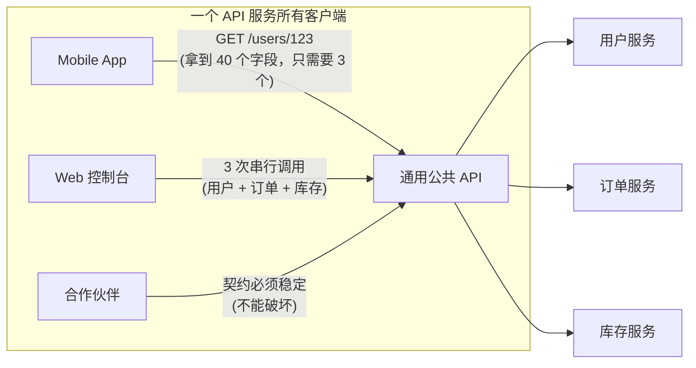
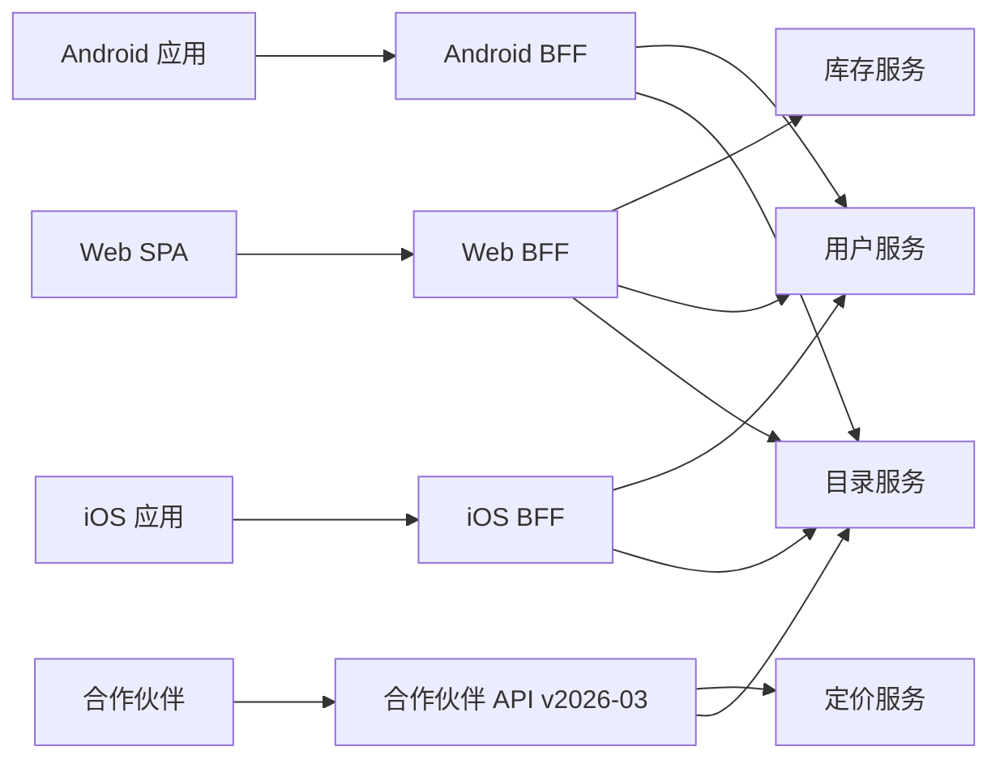
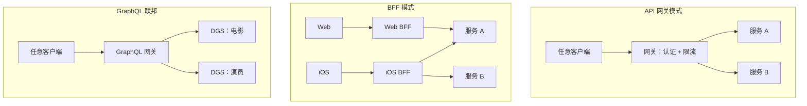
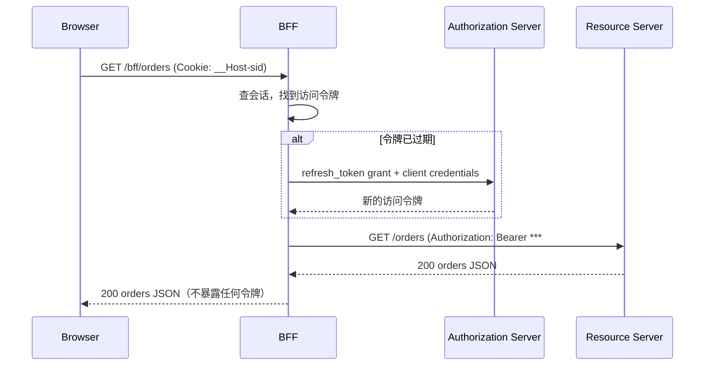

# Backend for Frontend：为每个客户端做好 API 聚合

> **TL;DR**: Backend for Frontend（BFF）是一个瘦服务端的聚合服务，由一个客户端团队拥有，只服务一个界面。它调用下游微服务，把响应改写成这个客户端要的形状，并处理认证、限流这类边界职责。这个模式是 SoundCloud 在 2011 至 2013 年拆解单体时摸索出来的，2015 年由 Phil Calcado[^1] 和 Sam Newman[^2] 正式定义。决定成败的只有一条规则：谁交付客户端，谁拥有 BFF。如果 BFF 归平台团队所有，你就把模式本想消除的那个瓶颈又造了一遍。

## 学习目标

学完本章，你将能够：

- [ ] 解释为什么一个公共 API 往往难以服务好形态各异的客户端
- [ ] 设计一个为单一客户端类型聚合微服务调用的 BFF
- [ ] 比较 BFF、API 网关与 GraphQL 联邦，并做出有意识的选择
- [ ] 避开常见的 BFF 反模式（共享 BFF、业务逻辑外泄）
- [ ] 决定归属：客户端团队拥有 BFF，否则它就不是 BFF

## 直觉理解

你经营一家旅行社。走进门的有三类客人：背包客想要最便宜的机票和青旅，最好一页看全；商务旅客需要休息室权益和方便报销的发票；企业客户要的是每月一张稳定、毫无意外的账单。

你的后台有一排专员：一个柜台管机票，一个管酒店，第三个管结算。如果硬让三类客人都自己挨个柜台跑、自己凑信息，背包客会在休息室柜台浪费时间，商务旅客会收到一辈子用不上的青旅推荐，企业客户则被一堆没法报销的选项淹没。

解法显而易见：给每类客人配一位专属接待。背包客的接待跑机票柜台和青旅柜台，凑出一张写着最便宜选项的单子递过去；商务旅客的接待跑机票、休息室和结算，凑出一份可直接报销的材料；企业客户的接待则按固定的月度节奏跑结算和机票。

每位接待都清楚自己这类客人要什么。他们从不去要求后台柜台改流程，只是去对的柜台、取对的数据，再为自己的客人重新组织。

这位接待就是 BFF。后台的那些柜台就是你的微服务。三类客人就是你的客户端：移动 App、Web SPA、合作伙伴集成。[API 设计基础](../part-0-prerequisites/04-api-design-basics.md)介绍了 REST 和 GraphQL 的基本构件，[单体与微服务](./00-monolith-vs-microservices.md)解释了为什么要拆成服务。本章讲的则是这些服务和消费它们的客户端之间该放什么。

## 原理

### 问题：一个 API 服务不了所有人

一个通用的公共 API 必须稳定（合作伙伴依赖它）、粒度细（为未知场景留出灵活度）、不带倾向性（不对界面布局做假设）。这些约束与移动 App 的需求直接冲突：载荷要小、响应要聚合、迭代要快且不必跨团队协商。

结果就是每天都要疼两次：

- **过度获取（over-fetching）。** 移动 App 调用 `/users/123`，拿到 40 个字段，而它只需要 3 个。首页每个接口都这么来一遍，你就在蜂窝网络上传输着几 KB 用不上的 JSON。
- **获取不足（under-fetching）。** Web 控制台渲染一个页面要用户、订单、库存三处数据，于是三次串行往返，每次都叠加网络延迟。在 PayPal，每次客户端到服务端的往返在 p99 下至少 700 ms[^3]。三次往返意味着界面渲染前先等 2 秒以上。

*一个通用 API 逼着所有客户端接受同一种载荷形状，结果是移动端过度获取、Web 端获取不足。*

诱惑在于往公共 API 上加移动端专用接口。可一旦这么做，每次移动端界面改动都要和 API 团队跨团队协商，公共 API 也会堆满让合作伙伴困惑的客户端专属残留。

### BFF 模式：每个体验一个后端

BFF 是一个瘦服务端，只做三件事：

1. **聚合。** 并行扇出到下游微服务，收集响应。
2. **改写。** 把合并后的数据转换、裁剪成客户端正好需要的样子。
3. **兜住边界职责。** 认证、限流、请求头清洗、CORS。

BFF 不做这些：

- 不含业务逻辑（定价规则、权益判定、授权决策）
- 不持有超出请求级缓存的状态
- 不服务多种客户端类型

Phil Calcado 的关键洞见是：「BFF 是应用的一部分」[^1]。它不是客户端从外面调用的 API，而是客户端在服务端的另一半，与客户端同一个团队、同一个发布节奏、同一份值班表。

*每个客户端只和自己那个 BFF 打交道。几个 BFF 聚合同一批共享微服务，但形状各不相同。合作伙伴 API 是另一份稳定的契约，不是 BFF。*

**归属是这里最重要的变量。** Newman 和 Calcado 在这一点上完全一致：BFF 必须由交付对应界面的团队拥有[^1][^2]。如果 BFF 归平台团队，每次界面改动都要跨团队协调，模式本来消除的瓶颈又原样回来了。Stewart Gleadow 的经验法则是「一个体验，一个 BFF」[^2]。

### BFF、API 网关与 GraphQL 联邦

这三个模式有重叠，但解决的问题不同。[反向代理与 API 网关](../part-2-building-blocks/01-reverse-proxies-api-gateways.md)已经深入讲过网关，这里对比一下：

| 方案 | 做什么 | 谁拥有 | 是否面向特定客户端 | 最适用场景 |
|----------|-------------|-------------|-------------------|-----------|
| API 网关 | 通用路由、认证、限流、TLS 终止 | 平台团队 | 否 | 所有客户端的横切关注点 |
| BFF | 按客户端聚合、改写、视图级缓存 | 客户端团队 | 是 | 多种客户端类型、需求各不相同 |
| GraphQL 联邦 | 跨子图的统一 schema，客户端自选字段 | 领域团队拥有子图，平台拥有网关 | 部分（客户端选字段） | 大型组织、服务众多、实体模型共享 |

几个关键区别：

- API 网关坐在 BFF 前面（或者直接坐在服务前面）。它管策略，不改写载荷。
- GraphQL 既可以实现成 BFF（PayPal 就是这么做的[^3]），也可以实现成共享 schema——后者若不仔细划定范围，Calcado 警告说会重演「企业数据模型」的失败。
- Netflix 的 Studio API 经历了好几个架构阶段，最终落在 GraphQL 联邦上，70 个 Domain Graph Service，查询规划最坏情况约 10 ms 开销[^4]。

*三个互相重叠的模式：网关是共享的策略层，BFF 是由客户端团队拥有的按客户端聚合器，联邦则是带分散解析器的统一图。*

### OAuth BFF 模式

IETF 的《OAuth 2.0 for Browser-Based Applications》（draft-ietf-oauth-browser-based-apps-26，2025 年 12 月）把 BFF 列为处理 OAuth 的 SPA 最安全的架构[^5]。安全模型很朴素：浏览器永远看不到访问令牌。

BFF 是一个机密型 OAuth 客户端。它通过授权码 + PKCE 换取令牌，把令牌绑定到以 Cookie 承载的会话上，再代理每一次 API 调用——剥掉 Cookie，换上正确的访问令牌。Cookie 必须是 `Secure` 且 `HttpOnly`，应当使用 `SameSite=Strict`，并应当带 `__Host-` 前缀。

*浏览器手里只有一个 HttpOnly 会话 Cookie。BFF 在每次代理请求时把它换成正确的访问令牌，令牌因此永远到不了客户端 JavaScript。*

这挡住了令牌窃取、静默帧取令牌和长期刷新令牌外泄。IETF 草案把 BFF 作为浏览器端 OAuth 应用最安全的架构模式，在三种模式的「安全性递减排序」里排第一[^5]。

### 现代替代方案：BFF 融进框架的时候

对于单一来源的应用（一个团队、一个客户端、一个服务端），现代框架把 BFF 直接融进了框架本身：

- **Remix loader** 相当于按路由的 BFF 端点：隐藏 bearer token、裁剪响应、把 HTML 转义挪到服务端。
- **Next.js Server Actions** 让 React 组件直接调用服务端函数，不必显式造一层 API。
- **tRPC** 为 TypeScript monorepo 提供端到端类型安全的 RPC，零代码生成。

这些不是 BFF 模式的替代品，而是 BFF 模式在单一来源应用里融进框架的形态。对多客户端产品（移动 + Web + 合作伙伴），你仍然需要显式的按客户端 BFF，因为 Remix 的 loader 没法服务你的 iOS App。

## 真实案例

### SoundCloud：BFF 的诞生地

SoundCloud 从 Rails 单体转向微服务，始于 2011 年。被 Web、移动端和第三方开发者共用的那个公共 API 成了瓶颈：每个新功能都得在不破坏任何客户端的前提下加进去[^1]。

解法是给每个客户端团队一套自己的瘦边缘服务。到 2015 年，SoundCloud 生产上大约跑着 5 个 BFF：iOS/Android 听众共用的那个、Web、嵌入与合作伙伴、创作者应用 Pulse，以及 public-api-strangler[^1][^2]。每个 BFF 都是基于 Finagle 的服务，接收某一类客户端的 HTTP 请求，再扇出到内部微服务。

**数字最能说明问题。** 有 BFF 之前，渲染一个用户主页要几百次细粒度 API 调用；引入 BFF 的 Presentation Model 端点后，降到十几次[^7]。

SoundCloud 的核心工程团队做了一个共享 BFF 框架，把告警、监控、遥测、认证、限流、请求头清洗都收进去。这个框架按周发布[^6]。关于重复的规则是：只有当同一段代码出现在 3 个以上 BFF 里，才抽成共享库或服务（三次法则）。

还有一个特殊的 BFF 叫 `public-api-strangler`，坐在老 Rails 单体前面，代理调用并逐步把每个调用按新微服务重新实现。这就是在不搞大爆炸重写的前提下，一点点绞杀单体的机制[^6]。

**事后总结的教训：** SoundCloud 最初让 iOS 和 Android 听众应用共用一个 BFF。两个应用的 API 需求分化得比预期大得多，团队后来说如果重来一次会按平台拆开[^6]。哪怕客户端看起来很像，共享 BFF 也是反模式。

## 权衡

| 方案 | 优点 | 缺点 | 最适用场景 | 我们的选择 |
|----------|------|------|-----------|----------|
| 每个客户端一个 BFF | 载荷按客户端优化、团队拥有自己的 API、绞杀式迁移容易 | 部署数量多、聚合逻辑重复、前端团队要具备后端能力 | 多种客户端类型且各有团队 | **多客户端产品的默认选择** |
| GraphQL（按客户端） | 客户端自选字段、单次往返、内省能力强 | GraphQL 运维复杂度（缓存、N+1、深度限制）、展示模型挪到客户端 | 客户端需求灵活、客户端团队强 | 客户端团队能扛住查询复杂度时 |
| GraphQL 联邦 | 统一的图、所有权分散、避免中心 API 瓶颈 | schema 组合工具链、约 10 ms 规划开销、运维门槛高 | 大型组织（70+ 服务）、实体模型共享 | 仅在 Netflix 那样的企业规模 |
| 单体公共 API | 简单、一个版本、运维开销低 | 每个客户端都过度或不足获取、改动要跨团队协商 | 单一客户端类型、产品早期 | **单客户端初创团队的默认选择** |
| 稳定的合作伙伴 API | 弃用窗口长、有 SLA 背书的稳定性 | 无法按伙伴演进、兼容层要永远留着 | 你控制不了的第三方集成方 | 客户端是外部开发者时 |

## 常见陷阱

> [!WARNING]
> **跨客户端类型共享 BFF。** 一个同时服务 iOS 和 Android 的 BFF 会吸收两边的诉求，越长越胖，最后退回成通用 API。SoundCloud 是硬着头皮学会这一点的：他们合并后的移动 BFF 分化得足够厉害，以至于他们建议拆开[^6]。铁律：一个体验，一个 BFF。容忍重复。

> [!WARNING]
> **业务逻辑外泄。** 定价规则、权益判定、授权决策会一点点爬进 BFF，因为这里是加「就多一个检查」最省事的地方。等到规则一变，所有 BFF 都得协调发布。业务逻辑留在领域服务里，BFF 只拥有展示模型（Presentation Model），别的一概不管[^1]。

> [!WARNING]
> **延迟串联。** 一个扇出到 N 个下游服务、然后串行等待的 BFF，其长尾延迟等于最慢的那个依赖。把互相独立的调用并行跑（RxJava、Finagle future、Promise.all），给每次调用设短超时；非关键服务挂掉时返回部分响应，而不是直接 500。

> [!WARNING]
> **部署与客户端脱节。** BFF 每 5 分钟就能发一版；移动 App 每两周过一次应用商店审核。一次老客户端解析不了的 BFF 改动，会弄坏还没升级的用户。BFF 的改动必须对受支持的所有客户端版本保持向后兼容。新字段用功能开关，只有客户端版本头支持时才启用。

> [!WARNING]
> **泄漏下游契约。** 原样透传下游 JSON，意味着上游服务任何一个字段改名都会弄坏所有客户端。把每个下游响应都映射成 BFF 自己定义的显式类型。在客户端与 BFF 之间用消费者驱动的契约测试（Pact），在 CI 里抓住意外的 schema 漂移。

## 练习

你的公司有一个 React Web 应用、iOS 和 Android 应用，以及一个对外的合作伙伴 API。目前这四个客户端共用一套 REST API。请设计 BFF 的布局：谁拥有什么、后端服务怎么改、哪些东西（如果有）迁到 GraphQL、以及如何在没有大爆炸的前提下完成迁移。

提示

先找出哪些客户端的需求彼此分化。合作伙伴 API 要的是稳定（不是 BFF）。两个移动应用的需求也许在初期足够接近，一个 BFF 就能撑住，但要想清楚 iOS 和 Android 团队是否独立发布。Web 应用的数据需求最丰富。迁移时可以考虑绞杀者模式（Strangler Fig）。

参考方案

**第一步：识别客户端类型与团队。**

- Web SPA：由 Web 团队拥有，需要每页 10 个以上数据源的丰富控制台。
- iOS 与 Android：由各自的移动团队拥有（或一个移动团队里的平台专属工程师）。需要最小载荷、离线优先的设计。
- 合作伙伴 API：由平台/开发者体验团队拥有。需要稳定性、版本化、长弃用窗口。

**第二步：设计 BFF 布局。**

- **Web BFF**（Web 团队拥有）：聚合用户、订单、库存、分析数据，为每个页面返回预组合好的视图模型。如果 Web 团队足够强、能自己拥有查询，这里可以考虑 GraphQL。
- **iOS BFF** 与 **Android BFF**（由各自的移动团队拥有）：如果团队分开、独立发布，就用两个 BFF。如果一个移动团队同时负责两端，先从一个移动 BFF 起步，但要做好需求分化时拆开的准备。
- **合作伙伴 API**（不是 BFF）：基于日期版本化的稳定 REST，由开发者体验团队拥有，不按伙伴改写形状。

**第三步：用绞杀者模式迁移。**

在现有单体 API 前面放一层路由（API 网关）。把 `/web/*` 路由到新的 Web BFF，`/mobile/*` 路由到移动 BFF，`/v2/*` 路由到合作伙伴 API。老 API 继续为未迁移的端点服务流量。一个端点一个端点地迁，不要一次全上。

**第四步：后端服务不动。**

BFF 调用的还是老 API 调用的那些内部服务，后端不需要重构。BFF 是新增的聚合层，不是把业务逻辑重写一遍。

**接受的权衡：** 你现在要跑 3 到 4 个边缘服务而不是 1 个，运维开销上升。换来的是团队自治：Web 团队每天都能发版，不用等移动端的审核；合作伙伴 API 保持稳定，也不挡任何人的路。

## 要点回顾

- BFF 是一个瘦聚合服务，由一个客户端团队拥有、只服务一个界面。它做聚合、改写、兜住边界职责，仅此而已。
- 谁交付客户端，谁拥有 BFF。如果归平台团队，你就把模式本想消除的瓶颈重造了一遍。
- 共享 BFF 不过是又一个单体 API。容忍 BFF 之间的重复，只有到三次法则的门槛才抽成共享服务。
- BFF、API 网关、GraphQL 联邦解决的是不同问题。横切策略用网关，按客户端塑形用 BFF，70 个以上服务需要统一图时才上联邦。
- OAuth BFF 模式（IETF BCP draft-26）是最安全的 SPA 架构：浏览器永远看不到令牌。
- 现代框架（Remix、Next.js、tRPC）在单一来源应用里把 BFF 融进了框架；对多客户端产品，显式 BFF 依然更优。
- 别把业务逻辑放进 BFF。BFF 拥有的是展示模型，不是领域模型。

## 延伸阅读

- [The Back-end for Front-end Pattern (BFF)](http://philcalcado.com/2015/09/18/the_back_end_for_front_end_pattern_bff.html) by Phil Calcado —— 来自 SoundCloud 的源头文章，讲 BFF 如何从单体拆解的痛苦中长出来，是最权威的叙述。
- [Pattern: Backends For Frontends](http://samnewman.io/patterns/architectural/bff/) by Sam Newman —— 经典的形式化定义，覆盖团队归属、按客户端与按用户类型的边界、以及边界职责。
- [BFF @ SoundCloud](https://www.thoughtworks.com/insights/blog/bff-soundcloud) by Lukasz Plotnicki —— ThoughtWorks 与 SoundCloud 工程师合写的文章，重点讲绞杀式 BFF 和共享框架的权衡。
- [Some thoughts on GraphQL vs BFF](https://philcalcado.com/2019/07/12/some_thoughts_graphql_bff.html) by Phil Calcado —— 2019 年的后续思考，把 BFF（归属模式）与 GraphQL（线路协议）区分开，对比表格必读。
- [How Netflix Scales its API with GraphQL Federation](https://netflixtechblog.com/how-netflix-scales-its-api-with-graphql-federation-part-1-ae3557c187e2) —— Netflix Studio Edge：从 BFF 走向联邦的历程，70 个 Domain Graph Service。
- [GraphQL: A Success Story for PayPal Checkout](https://softwareengineeringdaily.com/2018/11/15/graphql-a-success-story-for-paypal-checkout/) —— Mark Stuart 的案例研究，那个 700 ms 往返数字，以及从 REST 到 Batch 再到 GraphQL 的演进。
- [OAuth 2.0 for Browser-Based Applications (draft-26)](https://www.ietf.org/archive/id/draft-ietf-oauth-browser-based-apps-26.html) —— 把 BFF 列为最安全 SPA OAuth 模式的 IETF BCP，Cookie 要求看第 6.1 节。
- [Pact: Consumer-Driven Contract Testing](https://docs.pact.io/) —— 不用共享预发环境就能抓住客户端与 BFF 契约漂移的标准工具。

## 记忆卡片

**Q:** 什么是 Backend for Frontend（BFF）？
**A:** 一个瘦服务端的聚合服务，由一个客户端团队拥有，只服务一个界面。它调用下游微服务，为这个特定客户端改写响应，并处理认证、限流这类边界职责。它不含业务逻辑。

**Q:** BFF 应该由谁拥有？
**A:** 交付对应客户端界面的团队。如果 BFF 归平台团队或共享 API 团队，每次界面改动都要跨团队协调，模式本想消除的瓶颈就又回来了。

**Q:** BFF 与 API 网关的区别是什么？
**A:** API 网关为所有客户端处理通用的横切关注点（认证、限流、TLS 终止）。BFF 是面向特定客户端的：它为一个界面类型聚合并改写数据。网关常常坐在 BFF 前面。

**Q:** 为什么共享 BFF 是反模式？
**A:** 一个服务多种客户端类型的 BFF 会吸收所有类型的诉求，越长越胖，最终退回成通用 API，瓶颈一个不少。SoundCloud 合并 iOS/Android BFF 后发现分化超出预期，就是这么学到的。

**Q:** BFF 承担哪三项职责？
**A:** （1）聚合：并行扇出到下游微服务。（2）改写：把合并后的数据转换、裁剪成客户端正好需要的样子。（3）兜住边界职责：认证、限流、请求头清洗。

**Q:** OAuth BFF 模式如何保护浏览器端应用？
**A:** BFF 是机密型 OAuth 客户端。浏览器只持有一个 HttpOnly 会话 Cookie，永远看不到访问令牌和刷新令牌。BFF 在每次代理请求时把 Cookie 换成正确的访问令牌，从而挡住通过 XSS 的令牌窃取。

**Q:** 什么时候该用 GraphQL 联邦而不是 BFF？
**A:** 当你是一个大型组织、有 70 个以上服务需要统一 schema，多个客户端团队共享同一套实体模型，并且具备运行 schema 组合、查询规划和联邦解析器的运维能力时。Netflix Studio Edge 是参考实现。

**Q:** BFF 里的延迟串联是什么，怎么修？
**A:** 串行等待 N 个下游服务的 BFF，其长尾延迟等于最慢的那个依赖。修法是让独立调用并行跑、给每次调用设短超时、并在非关键服务失败时返回部分响应。

**Q:** Remix、Next.js 这类现代框架与 BFF 模式是什么关系？
**A:** 它们把 BFF 融进了框架：Remix 的 loader 和 Next.js 的 Server Actions 相当于按路由的 BFF 端点。这在单一来源应用里成立，但替代不了多客户端产品需要的显式 BFF——iOS、Android、Web 仍需各自的聚合。

**Q:** 什么测试手段能抓住客户端与 BFF 的契约漂移？
**A:** 用 Pact 做消费者驱动的契约测试。客户端把期望的请求/响应形状声明为契约，BFF 的 CI 验证自己能否满足该契约。双方各自独立测试，不必跑对方的整套环境。

**Q:** BFF 模式起源于哪里？
**A:** SoundCloud，在他们 2011 至 2013 年从 Rails 单体迁往微服务的过程中。这个词由 Nick Fisher（Web 技术负责人）提出，2015 年由 Phil Calcado 和 Sam Newman 在两篇几乎同时发表的文章里公开记录。

**Q:** PayPal 采用 GraphQL 作为 BFF 的动机是什么？
**A:** 每次客户端到服务端的往返在 p99 下至少 700 ms，多个原子的 REST 端点意味着页面加载要好几秒。GraphQL 让客户端在一次往返里定义响应的大小和形状；一年之内，PayPal 有 30 多个应用/团队在构建或消费 GraphQL API[^3]。

## 参考文献

[^1]: Phil Calcado, "The Back-end for Front-end Pattern (BFF)", 18 September 2015. http://philcalcado.com/2015/09/18/the_back_end_for_front_end_pattern_bff.html
[^2]: Sam Newman, "Pattern: Backends For Frontends", 18 November 2015. http://samnewman.io/patterns/architectural/bff/
[^3]: Mark Stuart, "GraphQL: A Success Story for PayPal Checkout", Software Engineering Daily, 15 November 2018. https://softwareengineeringdaily.com/2018/11/15/graphql-a-success-story-for-paypal-checkout/
[^4]: Tejas Shikhare et al., "How Netflix Scales its API with GraphQL Federation (Part 1)", Netflix Tech Blog, 9 November 2020. https://netflixtechblog.com/how-netflix-scales-its-api-with-graphql-federation-part-1-ae3557c187e2
[^5]: Aaron Parecki, Philippe De Ryck, David Waite, "OAuth 2.0 for Browser-Based Applications", draft-ietf-oauth-browser-based-apps-26, IETF, 4 December 2025. https://www.ietf.org/archive/id/draft-ietf-oauth-browser-based-apps-26.html
[^6]: Lukasz Plotnicki, "BFF @ SoundCloud", ThoughtWorks Insights, 9 December 2015. https://www.thoughtworks.com/insights/blog/bff-soundcloud
[^7]: Phil Calcado, "Some thoughts on GraphQL vs. BFF", 12 July 2019. https://philcalcado.com/2019/07/12/some_thoughts_graphql_bff.html
