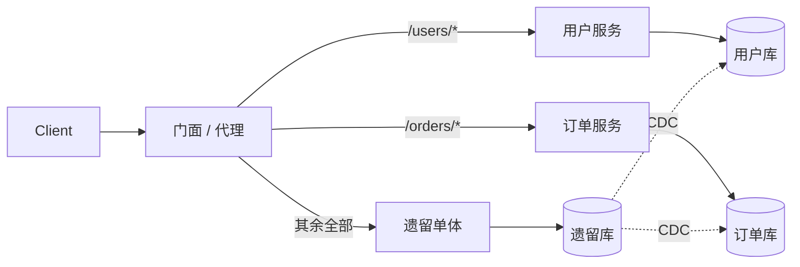
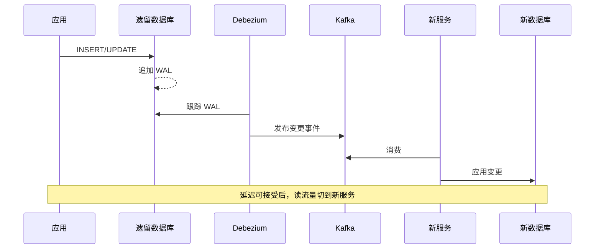
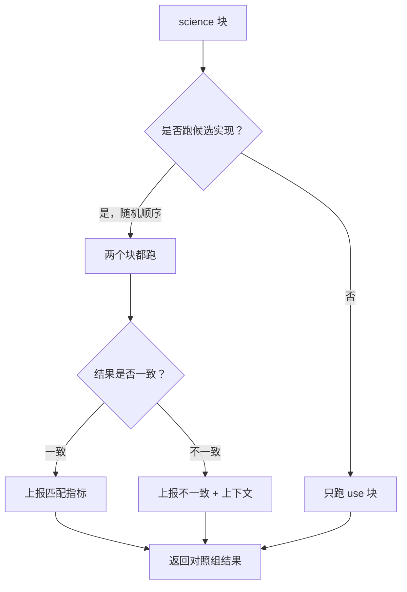
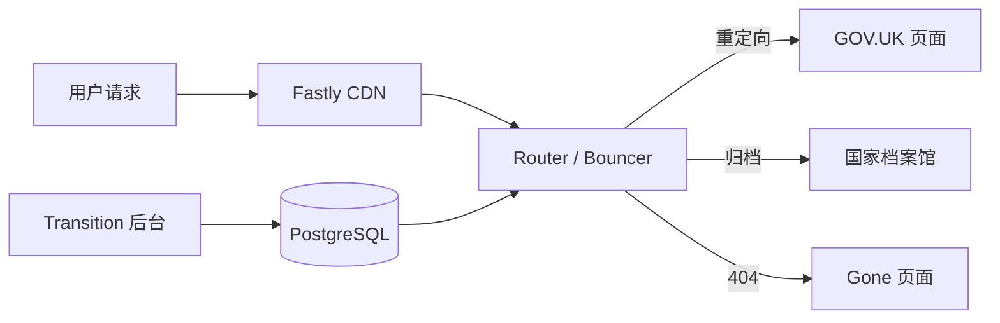

# 绞杀者榕树：不做大爆炸式重写的渐进迁移

> **TL;DR**: 大爆炸式重写之所以失败，是因为你在重写的同时业务还在往前走，而在切换之前你交付的价值是零。绞杀者榕树（strangler fig）模式的做法是围着旧系统长出一个新系统：门面（facade）按请求路由流量，你一次抽出一个能力，遗留系统的版图不断缩小，直到可以下线。难的是数据迁移而不是代码，要用遗留库上的 CDC，而不是脆弱的双写。GOV.UK 用这套办法在 15 个月内把 312 个政府机构迁到同一个平台上，通过专门搭建的门面配置了 180 万多条 URL 重定向[^1]。这个模式不快，但它持续交付价值，而且灯始终亮着。

## 学习目标

学完本章，你将能够：

- [ ] 解释绞杀者榕树模式，以及它为什么胜过大爆炸式重写
- [ ] 设计在遗留系统与新系统之间路由的门面层
- [ ] 处理迁移期间的双写与数据同步问题
- [ ] 按业务价值与技术风险安排抽取顺序
- [ ] 跟踪进度，并判断何时可以宣布遗留系统死亡

## 直觉理解

你住在一栋老房子里。电线是 1920 年的 knob-and-tube（瓷珠穿管布线），水管是镀锌钢管，厨房的布局毫无道理。你有两个选择。

方案 A：把房子推倒，去酒店住两年，在同一个地块上盖新的。这两年你没有厨房、没有院子，还要为一堆瓦砾还房贷。钱要是花到一半没了，你得到半栋房子，而且没地方住。

方案 B：一个房间一个房间地重新布线。主卧换线时你先搬到客房；楼上卫生间重新接管路时，楼下那个还能用。厨房留到最后再动，因为它最折腾，而到那时候你已经在三个更简单的房间上练过手了。任何时刻你都有一栋能住的房子。电工走后第二天，那个房间就更好用。

方案 B 就是绞杀者榕树。门面（配电箱、总水阀）决定哪些房间走旧的基础设施、哪些走新的。你一次迁一个房间。旧线路不断缩短，直到最后一根 1920 年的穿管回路被断开、抽走。

名字来自生物学。Martin Fowler 2001 年在昆士兰的雨林里观察到绞杀榕：一粒种子在寄主树的树冠里发芽，根须一路垂到土壤，渐渐把寄主包裹起来，直到原来那棵树消失，只剩榕树[^2]。他在 2004 年发表了这个比喻，2019 年将其更名为 “Strangler Fig Application”，把它锚回植物学的出处[^3]。

本章剩下的部分，讲的就是怎么当那根藤。

## 原理

### 为什么大爆炸式重写会失败

Joel Spolsky 在 2000 年的文章《Things You Should Never Do, Part I》里，把扔掉一套还能跑的代码库称为“任何软件公司可能犯下的最严重的战略错误”。[^4] 他写这篇文章的那一年，Netscape 终于把它的从零重写版本作为 Netscape 6.0 发了出去。Netscape Communicator 4.0 于 1997 年中发布；Mozilla 的工程师在 1998 年 10 月下旬决定废弃 Communicator 的代码，在 Gecko 引擎上重起炉灶；Netscape 6.0 直到 2000 年 11 月才发布[^5]。在这大约三年的交付空窗期里，Netscape 没有向用户交付任何大版本，而 Internet Explorer 拿下了市场。

大爆炸式重写失败，有四个互相强化的原因：

1. **目标在动。** 重写期间加进遗留系统的每个功能，替代品上线之前也必须实现。规格从来没有被冻结过。
2. **切换之前零价值。** 预算和政治压力不断累积，却没有可见的进展向干系人交代。
3. **遗留行为没有文档。** “照旧系统那样做”听起来简单，但多年的 bug 修复早已变成承重结构。重新实现它们是浪费；不重新实现它们会伤到用户。
4. **范围蔓延是必然的。** 干系人把重写当成一次性把所有被推迟的东西都塞进去的机会。

绞杀者榕树押的是相反的一注：认真对待还能跑的系统，把它包起来，然后以增量的方式替换——每一个增量都在整体完成之前就交付价值[^3]。

### 门面与路由策略

任何绞杀式迁移的承重件都是门面。所有客户端流量先打到门面。门面逐请求决定是路由到遗留系统还是新服务。客户端完全不知道发生过变化。



*门面把每个请求路由到遗留系统或某个已抽出的服务；随着时间推移，越来越多的路由迁到新服务，直到遗留系统可以下线。*

具体来说，门面可以是一个 Nginx 反向代理、一个 Envoy sidecar、一个 API 网关，或者一个专门写的应用。最小可用的门面就是一个 Nginx location 块：

```nginx
location /v2/users/ {
    proxy_pass http://new-users-svc;
}
location / {
    proxy_pass http://legacy-monolith;
}
```

路由粒度随信心增长：

| 策略 | 机制 | 复杂度 | 适用场景 |
|----------|-----------|------------|----------|
| URL 路径路由 | `/v2/*` 走新服务 | 低 | 第一次抽取 |
| 请求头路由 | `X-Route: new-checkout` | 中 | 内部试用（dogfooding） |
| 功能开关路由 | LaunchDarkly / Unleash 按用户放量 | 高 | 渐进放量 |
| 百分比放量 | 1% 到 5% 到 25% 到 100% | 高 | 近乎零停机的切换 |
| 用户分桶路由 | 企业租户先行 | 中 | B2B 迁移 |

百分比放量最有威力：让新路径先承接 1% 的流量，盯错误率和延迟，再爬到 5%、25%、50%、100%。Stripe 采用按日期滚动的 API 版本（比如 `2017-05-24`），配一套内部的版本变更框架，让 API 演进几乎无摩擦；截至 2017 年，他们报告“过去六年里做了近百次向后不兼容的升级”，却没有强迫任何人迁移[^6]。

[反向代理与 API 网关：智能边缘](../part-2-building-blocks/01-reverse-proxies-api-gateways.md) 讲了通常承载门面的那些基础设施原语。

### 数据迁移模式

数据迁移通常比代码迁移更难。主流有四种模式，各自的一致性与停机特性不同：

| 数据策略 | 一致性 | 停机 | 适用场景 |
|---------------|-------------|----------|-----------|
| 双写 | 脆弱（无 2PC） | 无 | 只适合低风险的过渡期 |
| CDC + 发件箱 | 通过日志重放达成强最终一致 | 无 | 大多数迁移（新系统是派生副本） |
| 影子写 + 结果比对 | 强（切换前已验证） | 无 | 安全攸关的数据（支付、权限） |
| 大爆炸式周末迁移 | 简单 | 数小时 | 有维护窗口的小系统 |

**双写**让应用在每条写路径上同时写新旧两个存储。想清楚很容易，但很脆弱：两次写之间的任何网络抖动或进程崩溃，都会让存储不一致。业界的答案是事务性发件箱（transactional outbox）模式：应用在同一个事务里写自己的数据库和一张 outbox 表，再由一个 relay 进程把 outbox 里的行发到 Kafka 供异步消费[^7]。

**基于 CDC 的复制**把新系统当成遗留系统的只读副本。Debezium 跟踪遗留数据库的预写日志（WAL），把变更事件发到 Kafka；新服务消费这些事件并填充自己的存储。新系统追上进度后，读流量可以切过去；写流量切过去之后，还可以反向同步一段时间作为安全期。



*基于 CDC 的数据迁移：遗留数据库仍是记录系统（system of record），Debezium 把变更流给新服务，新服务无需应用层双写就能保持同步。*

[变更数据捕获：把数据库的内心独白流出来](../part-4-data-systems/04-change-data-capture.md) 深入讲了跟踪 WAL 的机制、Debezium 配置和发件箱模式。

### 抽取顺序与抽象分支

不是所有部分抽起来都一样安全。主流的排序策略有三种：

- **按业务价值：** 先抽一个价值高、耦合低的部分，用来验证模式，也为后面的事赢得信任。Fowler 认为，“对业务有价值的功能，能给团队继续走下去的信誉。”[^2]
- **按技术风险：** 先抽无聊、低风险的部分，在碰危险东西之前先把组织肌肉练出来。
- **按限界上下文：** 沿 DDD 风格的限界上下文找出接缝，整个上下文一起抽。Shopify 的模块化单体截至 2020 年从 280 万行 Rails 代码里切出了 37 个组件，每个组件对应电商的一个子域；Packwerk 对其中大约三分之一强制了边界[^8]。

唯一被普遍认同的规则：绝不要从最难、耦合最紧的那块开始。抽它花的时间会超过你的耐心。

**抽象分支（branch by abstraction）**是绞杀者榕树在代码库内部的表亲。Jez Humble 区分了两者：绞杀者榕树跨进程边界替换整个系统；抽象分支改动的是同一个代码库内部的一个组件[^9]。做法是：在要替换的东西前面引入一层抽象，把所有调用方迁到这层抽象上，在它背后实现新的版本，然后切换。Humble 的团队在 Go CD 产品里用它把 iBatis 换成 Hibernate、把 Velocity 换成 JRuby on Rails，期间持续向生产发布了一年多。关键纪律是：新的调用永远不许走旧实现。“你得承受这个代价，就在 Hibernate 里做。这是唯一能确保你在往前走的方式。”[^9]

### 并行运行、影子流量与功能开关

切换之前，你需要证据证明新系统与旧系统行为一致。并行运行能在不担风险的情况下给你这份证据。

GitHub 在 2016 年开源了 [Scientist](https://github.com/github/scientist)，正是为了这个目的。一个 “science” 块包住一段代码路径；对照组（旧）和候选（新）以随机顺序执行，结果被比较，而返回给调用方的永远是对照组的结果[^10]。GitHub 用它重写了守护每个仓库、团队和组织访问检查的权限代码。

```ruby
require "scientist"

class MyWidget
  include Scientist

  def allows?(user)
    science "widget-permissions" do |experiment|
      experiment.use { model.check_user(user).valid? } # 旧路径
      experiment.try { user.can?(:read, model) }       # 新路径
    end # 返回对照组的值
  end
end
```

Twitter 的 Diffy（2015）是服务层面的对应物：一个代理把每个请求多播到三个实例（primary、secondary、candidate），报告回归，同时用 primary 与 secondary 的对比抵消噪声[^11]。



*并行运行流程：新旧代码都执行，结果被比较，不一致被记录，但调用方拿到的始终是对照组的结果。对用户零风险。*

**功能开关（feature flag）**在绞杀式迁移中干三件事：藏住没做完的工作、控制切换、提供急停开关。Pete Hodgson 2017 年那份经典分类把它们分成发布开关（Release Toggle，短命，控制切换）、运维开关（Ops Toggle，长命，急停）、实验开关（Experiment Toggle）和授权开关（Permissioning Toggle）[^12]。切换用的开关应该是临时的；急停开关应该长期存在，并且有明确的负责人和操作手册（runbook）。

2012 年 8 月 1 日的 Knight Capital 事件就是那块警示牌。Knight 把一枚 8 年前的死代码开关 “Power Peg” 挪作新功能用。一次部署漏掉了八台服务器中的一台。那台服务器上陈旧的开关把死代码重新激活，由此产生的失控下单循环在 45 分钟内让 Knight 损失了 4.6 亿美元[^13]。教训是：绝不重用旧开关；开关进入稳态后就删掉；给开关加上过期日期和定时炸弹测试，让它在活得比规格更久时失败。

## 真实案例

### GOV.UK：15 个月把 312 个机构搬上同一个平台

截至 2014 年 12 月的 15 个月里，英国政府数字服务局（GDS）把 312 个政府机构迁到同一个发布平台上，关闭了 685 个网站域名，并配置了 180 万多条从旧 URL 到 GOV.UK 或国家档案馆的重定向[^1]。

这个绞杀式门面是一个叫 Bouncer 的 Ruby/Rack 应用。任何对旧政府 URL 的请求都会打到 Bouncer，它在 PostgreSQL 的 URL 映射表里查这个路径，然后返回重定向到对应的 GOV.UK 页面、归档页面，或者 404。迁移经理通过另一个叫 Transition 的 Rails 后台应用来编辑映射。

这套架构强制了关注点分离：

- **Bouncer**（热路径）只读 PostgreSQL 副本，所以 Transition 挂掉也不会让重定向停摆[^14]。
- **Fastly CDN** 挡在前面，吸收了大约 70% 的回源流量[^14]。
- **Jenkins** 在映射变化时，从 Transition 的 hosts API 重新生成 Fastly 配置。



*GOV.UK 的绞杀式架构：Bouncer 是门面，把每个旧政府 URL 路由到它的新家，背后是一张 PostgreSQL 映射表，迁移经理通过后台界面编辑它。*

结果是可以量化的。知识产权局（Intellectual Property Office）是较晚迁入的机构（2014 年 10 月），切换后的四周里，呼叫中心话务量下降 19%，邮件量下降 17%，客户到访量下降 42%[^1]。

GOV.UK 的关键经验：

- 门面必须比它背后的任何一个系统都简单。Bouncer 是一个只干一件事的无状态 Rack 应用。
- URL 级粒度（180 万行）让你能逐页控制迁移。
- 门面前面放一个 CDN，能吸收流量尖峰而不碰路由逻辑。
- 仪式感很重要：685 个域名是被正式退役的，不是晾在那里不管。

## 权衡

替换一套还能跑的系统，默认选择是绞杀者榕树。有两种相关技术值得与它区分：

- **绞杀者榕树。** 门面在遗留系统与一个或多个已抽出的新服务之间路由流量。持续交付价值、灯始终亮着，也能撑起国家级规模的迁移（GOV.UK，312 个机构，15 个月[^1]）。代价：周期长、双跑的基础设施、门面的复杂度。**生产系统的默认选择。**
- **抽象分支。** 绞杀者榕树在代码库内部的表亲：在一个代码库里插入一层抽象，在它背后实现新版本，然后切换调用方。适用于改动发生在内部（换 ORM、升级框架、换模板引擎）且不引入新进程边界的情况[^9]。它要求严格纪律：新的调用永远不许碰旧实现，否则你永远做不完。
- **并行运行（Scientist、Diffy）。** 一种验证技术，用在绞杀式迁移或抽象分支迁移*内部*，而不是它们的替代方案。它让新旧代码路径在真实流量上同时跑，比较输出，永远返回对照组的结果。用在安全攸关的路径上（权限、定价、风控）；在新旧不一致率降到零之前，旧系统始终是权威[^10][^11]。

大爆炸式重写（废掉旧系统、造一个替代品、在某个指定日切换）在下面作为陷阱来讲，而不是并列的备选方案。三十年的复盘（Netscape 6、Joel Spolsky 2000 年的文章）把它归入“你永远不该做”的那一类——只要系统上还有活用户。

## 常见陷阱

> [!WARNING]
> **对还有活用户的系统做大爆炸式重写。** 用 Joel Spolsky 的话说，扔掉一套还能跑的代码库从零重建，是“任何软件公司可能犯下的最严重的战略错误”[^4]。Netscape 在 1998 年决定废弃 Communicator 4.0、在 Gecko 上重起炉灶，结果大约三年没有发布任何大版本，市场被 Internet Explorer 拿走[^5]。Fowler 从另一个方向得出同样的结论：那些“看起来很容易写规格”的替代品，往往“多数时候是以惨败收场”[^3]。失败模式：重写期间业务一直在变（目标在动）、切换前交付零价值（政治压力累积）、遗留行为没有文档（重复实现的浪费）、范围蔓延是必然的（干系人往上堆被推迟的功能）。改用绞杀者榕树：持续交付价值，以增量方式退役遗留系统。

> [!WARNING]
> **迁移永远卡住（两套系统长期并存）。** 团队把有意思的部分抽完，然后资金或注意力就没了。五年后两套系统并排跑着，谁也没有收尾计划。开始之前就把切换日期和一位高管赞助人定下来。每周跟踪新系统上的流量占比；如果在 100% 以下停滞超过一个季度，就上报。

> [!WARNING]
> **双写导致数据不一致。** 应用同时写遗留库和新库。一次写失败，两个存储悄悄分叉。没有 2PC，跨两个系统就没有事务，而没人想要 2PC。用发件箱模式加 CDC，让唯一权威的写只落在遗留库上；在切换之前，新库只是一个派生的只读副本。重试语义见 [幂等性与 Exactly-Once：投递保证的诚实真相](../part-3-distributed-systems-theory/07-idempotency-exactly-once.md)。

> [!WARNING]
> **重用功能开关。** Knight Capital 把一枚 8 年前的 “Power Peg” 开关挪作新功能用。一台漏掉的服务器重新激活了死代码，45 分钟损失 4.6 亿美元[^13]。绝不重用开关。进入稳态就删掉。加上过期日期和定时炸弹测试。

> [!WARNING]
> **新系统继承了遗留系统的设计缺陷。** 团队把遗留数据模型照搬进新代码，理由是“旧行为就是规格”。并行运行工具奖励的是行为等价，而对结构性问题来说，这可能是个错误的目标。把迁移当成重新设计的机会，而不只是重新实现。用 Scientist 的 ignore 块跳过那些已知且可接受的差异。

> [!WARNING]
> **门面变成单点故障。** 所有流量都走门面；门面出个 bug；新旧两个系统都不可达。门面必须比它背后的任何一个系统都简单。GOV.UK 把 Bouncer 放在自己的机器、自己的虚拟数据中心、自己的数据库副本上跑，这样后台出故障也不会让重定向停摆。

## 练习

你有一套 10 年历史的 Python 2 单体，支撑着一个金融科技产品。监管期限要求两年内必须完成重写。设计绞杀者榕树方案：抽取顺序、门面策略、数据迁移方式，以及迁移期间如何继续交付功能。

<details>
<summary>提示</summary>

从门面开始。今天单体前面是什么？你能在那里插一个代理吗？然后考虑抽取顺序：哪个限界上下文的业务价值最高、耦合最低？数据方面，问自己：在一个金融科技产品里，你能接受双写不一致吗，还是 CDC 是必须的？

</details>

<details>
<summary>参考答案</summary>

**第 1 步：插入门面。**

在单体前面放一个 Nginx 或 Envoy 反向代理。一开始它把 100% 的流量原样路由到单体。这是一次空操作部署，用来证明代理在生产负载下能正常工作。

**第 2 步：安排抽取顺序。**

把限界上下文画出来：认证、KYC/开户、支付、报表、通知。从通知开始：业务价值高（监管审计留痕）、耦合低（消费事件，不产出别的服务依赖的状态）、风险低（出 bug 是多发一封邮件，不是多扣一笔钱）。

**第 3 步：用 CDC 做数据迁移。**

金融科技无法容忍双写不一致。用 Debezium 跟踪单体的 PostgreSQL WAL，把变更流到 Kafka。新的通知服务从 Kafka 消费，构建自己的读模型。在并行运行证明通知服务正确之前，单体一直是记录系统。

**第 4 步：对支付做并行运行。**

支付是风险最高的抽取。切换之前，用 Scientist 式的对比让新旧两条支付路径同时跑。记录每一次不一致。只有当不一致率连续两周为零时才切换。

**第 5 步：用功能开关控制切换。**

把每次抽取都放在一个发布开关后面。先放给内部用户（“champagne brunch”，内部专属发布），再放 1% 的外部流量，然后逐步爬坡。留一个运维开关作为急停，能瞬间把流量切回单体。

**第 6 步：继续交付功能。**

如果新功能所属的限界上下文已经抽出来了，就写进新服务。还没抽出的上下文里的功能写进单体，并明确它们以后会迁走。绝不要冻结单体；那正是大爆炸的陷阱。

**第 7 步：宣布遗留系统死亡。**

当最后一个端点切完、单体连续 30 天零流量时，办一场遗留系统葬礼。删代码、退服务器、吊销数据库凭证。仪式感能防止它意外复活。

**接受的权衡：** 这个方案要 18 到 24 个月，并且需要并行维护两套系统。另一个选择（大爆炸式重写）完全错过监管期限的概率更高。

</details>

## 要点回顾

- 绝不要对还在被活跃使用的系统做大爆炸式重写。Netscape 就是在一场持续多年的重写里输掉了浏览器战争——从 Communicator 4.0（1997）到 Netscape 6.0（2000 年 11 月），中间没有发布任何大版本[^4][^5]。
- 门面是承重件。先把它建起来，以空操作的方式部署，然后才开始路由。
- 数据迁移比代码迁移更难。用遗留数据库上的 CDC；双写只适合低风险的过渡期，超出这个范围就别用。
- 按业务价值和限界上下文抽取，而不是按“看起来容易”。绝不要从最难的那块开始。
- 并行运行（Scientist、Diffy）能在切换之前给你正确性证据。用在安全攸关的路径上。
- 功能开关控制切换，并提供急停。绝不重用旧开关；到达稳态就删掉。
- 当最后一个端点切完、遗留系统零流量时宣布胜利。办一场仪式。否则那具尸体会一直躺在那儿。

## 延伸阅读

- [Strangler Fig Application（2024 修订版）](https://martinfowler.com/bliki/StranglerFigApplication.html) - Fowler 的权威定义，含渐进现代化的四活动框架；从这里开始读。
- [Things You Should Never Do, Part I](https://www.joelonsoftware.com/2000/04/06/things-you-should-never-do-part-i/) - Joel Spolsky 2000 年论重写为何失败的文章，附 Netscape 的反面教材；用来提振动机。
- [Make Large Scale Changes Incrementally with Branch By Abstraction](http://continuousdelivery.com/2011/05/make-large-scale-changes-incrementally-with-branch-by-abstraction/) - Jez Humble 以 Go CD 产品为例的详细示范，讲如何在持续交付的同时替换 ORM。
- [Feature Toggles (aka Feature Flags)](https://martinfowler.com/articles/feature-toggles.html) - Pete Hodgson 的开关分类学；实现切换开关之前的必读。
- [Scientist: Measure Twice, Cut Once](https://github.blog/developer-skills/application-development/scientist/) - Jesse Toth 讲 GitHub 的并行运行库，如何在不给用户带来风险的情况下验证代码重写。
- [Under Deconstruction: The State of Shopify's Monolith](https://shopify.engineering/shopify-monolith) - 经典的长期模块化单体案例，展示了以组件而非微服务收尾的绞杀者榕树。
- [Architectural deep-dive of GOV.UK](https://docs.publishing.service.gov.uk/manual/architecture-deep-dive.html) - 一个国家级发布平台的绞杀式架构在生产中怎么跑，含 Bouncer、Router 与 Fastly 配置。
- [Knightmare: A DevOps Cautionary Tale](https://dougseven.com/2014/04/17/knightmare-a-devops-cautionary-tale/) - 开关重用酿成大祸的经典案例；实施任何功能开关策略之前先读它。

## 记忆卡片

**Q:** 什么是绞杀者榕树模式？
**A:** 一种迁移策略：门面在遗留系统与新系统之间路由流量。你一次抽出一个能力，不断挪动路由，直到遗留系统零流量、可以下线。名字来自一种绕着寄主树生长并最终取代它的藤。

**Q:** 大爆炸式重写为什么会失败？
**A:** 四个互相强化的原因：重写期间业务一直在变（目标在动）、切换前交付零价值（政治压力）、遗留行为没有文档（重复实现的浪费）、范围蔓延是必然的（干系人往上堆被推迟的功能）。

**Q:** 门面在绞杀式迁移中扮演什么角色？
**A:** 门面挡在两套系统前面，逐请求决定去遗留系统还是新系统。它把客户端与迁移解耦，客户端完全不知道发生过变化。它可以是一个 Nginx 代理、一个 API 网关，或者一个专门写的路由应用。

**Q:** 为什么数据迁移期间双写很危险？
**A:** 没有 2PC，跨两个系统就没有事务。两次写之间的任何网络抖动或进程崩溃都会让存储不一致。更安全的替代是 CDC：只写遗留库，跟踪它的 WAL，把变更流给新系统。

**Q:** 什么是抽象分支，它与绞杀者榕树有何不同？
**A:** 抽象分支通过插入一层抽象、在背后实现新版本、再切换的方式，改动一个代码库内部的某个组件。绞杀者榕树则用门面跨进程边界替换整个系统。两者互补：内部的替换（ORM、模板引擎）用抽象分支，系统级迁移用绞杀者榕树。

**Q:** 什么是并行运行（Scientist 模式）？
**A:** 新旧代码以随机顺序在真实流量上同时执行。结果被比较、不一致被记录，但调用方拿到的永远是旧代码的结果。这样能在不给用户带来风险的情况下拿到正确性证据。GitHub 用它重写了权限系统。

**Q:** Knight Capital 因为重用功能开关出了什么事？
**A:** Knight 把一枚 8 年前的死代码开关 “Power Peg” 挪作新功能用。一次部署漏掉了八台服务器中的一台。陈旧的开关重新激活了死代码，引发失控下单循环，45 分钟损失 4.6 亿美元，公司因此破产。

**Q:** 怎么判断一次绞杀式迁移已经完成？
**A:** 当遗留系统零流量、最后一个端点也已切换时。跟踪新系统上的流量占比、已迁移端点的比例、遗留系统的代码行数。办一场正式的退役仪式，防止它意外复活。

**Q:** 应该按什么顺序抽取？
**A:** 从一个价值高、耦合低的限界上下文开始，用来验证模式、赢得信任。绝不要从最难、耦合最紧的那块开始。常见策略：按业务价值排序、按技术风险排序（先做容易的来练肌肉），或按 DDD 的限界上下文排序。

**Q:** 绞杀者榕树的四种数据迁移策略是什么？
**A:** 双写（脆弱，只用于过渡）、CDC 加发件箱（强最终一致，无停机，最常用）、影子写加结果比对（安全攸关场景）、大爆炸式周末迁移（有维护窗口的小系统）。

**Q:** 绞杀者榕树模式在什么情况下不适用？
**A:** 遗留系统没有干净的请求边界可以拦截时（深度纠缠的批处理流程）、团队在组织上没有耐心支撑多年工程时，或者在抽出足够价值证明值得继续之前预算就会耗尽时。

**Q:** GOV.UK 是怎么落地绞杀模式的？
**A:** 一个叫 Bouncer 的 Rack 应用接收所有对旧政府 URL 的请求，通过在 PostgreSQL 映射表里查路径，返回重定向、归档页或 404。迁移经理通过 Rails 后台界面编辑映射。Fastly CDN 吸收 70% 的流量。他们在 15 个月里迁移了 312 个机构、685 个域名。

## 参考文献

[^1]: Mark Hazelby，“300+ websites to just 1 in 15 months”，Inside GOV.UK 博客，2014 年 12 月 19 日。https://insidegovuk.blog.gov.uk/2014/12/19/300-websites-to-just-1-in-15-months/
[^2]: Martin Fowler，“Original Strangler Fig Application”，2004 年 6 月 29 日（2019 年 4 月更名）。https://martinfowler.com/bliki/OriginalStranglerFigApplication.html
[^3]: Martin Fowler，“Strangler Fig”，2024 年 8 月 22 日。https://martinfowler.com/bliki/StranglerFigApplication.html
[^4]: Joel Spolsky，“Things You Should Never Do, Part I”，2000 年 4 月 6 日。https://www.joelonsoftware.com/2000/04/06/things-you-should-never-do-part-i/
[^5]: Wikipedia，“Netscape 6”。https://en.wikipedia.org/wiki/Netscape_6（2026-05-08 访问）。“The Mozilla engineers decided in late October 1998 to scrap the Communicator code and start over from scratch using the standards-compliant Gecko rendering engine...Netscape 6.0 shipped in November 2000.”
[^6]: Brandur Leach，“APIs as infrastructure: future-proofing Stripe with versioning”，Stripe 博客，2017 年 8 月 5 日。https://stripe.com/blog/api-versioning
[^7]: Red Hat Developer，“Avoid dual writes in event-driven applications”。https://developers.redhat.com/articles/2021/07/30/avoiding-dual-writes-event-driven-applications
[^8]: Philip Muller，“Under Deconstruction: The State of Shopify's Monolith”，Shopify Engineering，2020 年 9 月 16 日。https://shopify.engineering/shopify-monolith
[^9]: Jez Humble，“Make Large Scale Changes Incrementally with Branch By Abstraction”，continuousdelivery.com，2011 年 5 月 5 日。http://continuousdelivery.com/2011/05/make-large-scale-changes-incrementally-with-branch-by-abstraction/
[^10]: Jesse Toth，“Scientist: Measure Twice, Cut Once”，GitHub 博客，2016 年 2 月 3 日（2020 年 12 月 3 日更新）。https://github.blog/developer-skills/application-development/scientist/
[^11]: Puneet Khanduri，“Diffy: Testing services without writing tests”，Twitter 工程博客，2015 年 9 月 3 日。https://web.archive.org/web/20240226074204/https://blog.twitter.com/engineering/en_us/a/2015/diffy-testing-services-without-writing-tests
[^12]: Pete Hodgson，“Feature Toggles (aka Feature Flags)”，martinfowler.com，2017 年 10 月 9 日。https://martinfowler.com/articles/feature-toggles.html
[^13]: Doug Seven，“Knightmare: A DevOps Cautionary Tale”，2014 年 4 月 17 日。https://dougseven.com/2014/04/17/knightmare-a-devops-cautionary-tale/
[^14]: GOV.UK Developer Docs，“Architectural deep-dive of GOV.UK”。https://docs.publishing.service.gov.uk/manual/architecture-deep-dive.html
