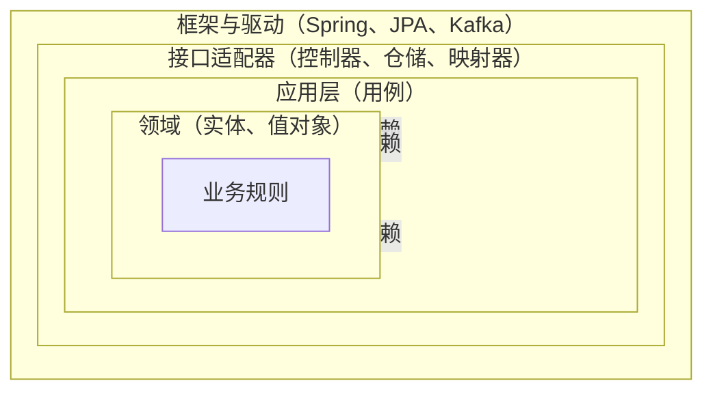
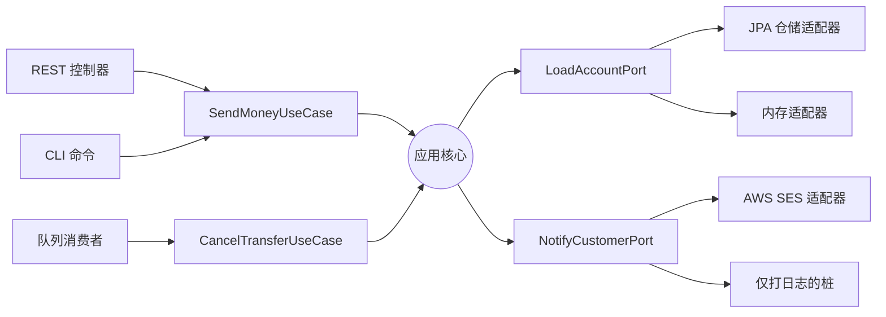
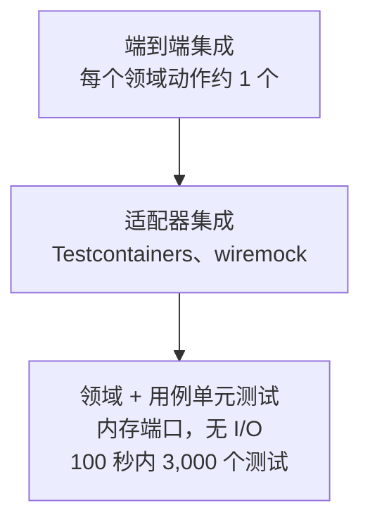

# 六边形架构与整洁架构：让业务逻辑保持独立

> **TL;DR**：六边形架构、整洁架构和洋葱架构，是同一套结构纪律的三个名字：把业务逻辑放在中心，把基础设施放在边缘，只允许源码依赖指向内部。真正承重的思想是依赖规则（Dependency Rule）："源码依赖只能指向内部"[^1]。收益是领域代码在没有 Web 框架、ORM 或消息中间件的 classpath 上也能编译，测试几秒跑完而不是几分钟。Netflix 的 Studio 团队把 JSON API 数据源换成 GraphQL 只花了两个小时，因为没有任何持久化细节泄漏进业务逻辑[^2]。代价是实打实的：文件数量是事务脚本的 2-3 倍，新人上手更慢，简单 CRUD 会陷入分析瘫痪。领域复杂、生命周期长，就用六边形；不是这样，就用更简单的结构。

## 学习目标

学完本章，你将能够：

- [ ] 解释端口、适配器与依赖规则
- [ ] 设计一个包含领域层、应用层和基础设施层的模块
- [ ] 编写不启动数据库就能跑通领域逻辑的单元测试
- [ ] 判断六边形架构何时是杀鸡用牛刀，何时真能回本
- [ ] 把六边形架构的概念对应到 DDD 与分层架构

## 直觉理解

你开了一家咖啡店。意式咖啡机、磨豆机和奶泡机就是你的业务逻辑：不管是谁下的单、钱怎么收的，它们都照常产出咖啡。

现在想象你把收银机直接焊死在咖啡机上。每次升级收银机，你都得重新给咖啡机接线。想接移动支付？再改一次线。想带着另一台收银机去农夫市集摆摊？除非把整个吧台一起搬走，否则没戏。

正常的咖啡店用的是标准接口：咖啡师看的是订单小票。这张小票无论是收银员打的、手机 App 下的，还是语音助手转的，长得都一样。输出这一侧，咖啡师把做好的饮品放在取餐台上。是顾客自己拿走、外卖骑手取走，还是机械臂抓走，跟咖啡师无关。

订单小票是一个**入站端口（inbound port）**。取餐台是一个**出站端口（outbound port）**。收银员、手机 App、语音助手是**入站适配器**。顾客、外卖骑手、机械臂是**出站适配器**。你换掉其中任何一个，咖啡师（你的领域逻辑）都不用变。

这就是六边形架构。领域定义了自己输入输出的形状，外部世界去迎合这些形状。外部世界变了，你就写一个新适配器，领域原封不动。

## 原理

### 依赖规则

Robert C. Martin 给出的这条规则统一了三种变体："源码依赖只能指向内部。内圈里的任何东西，都不能知道外圈里的任何东西"[^1]。

落到实践上，就是领域代码永远不 import 基础设施类型。没有 `@Entity`，没有 `HttpClient`，没有 `KafkaProducer`。当控制流需要向外穿越（比如某个用例要触发一次数据库写入），内层定义一个接口（端口），外层去实现它（适配器）。这就是 SOLID 的依赖倒置原则（Dependency Inversion Principle）用在架构层面。



*所有源码依赖都指向内部。领域对外面包裹它的那些层一无所知。*

机制很简单：用例需要持久化一个实体时，调用应用层里的 `SaveOrderPort` 接口。基础设施层的 `PostgresOrderRepository` 类实现这个接口。编译期，依赖箭头指向内部（基础设施依赖应用）。运行期，调用流向外部（用例调用仓储）。依赖倒置把编译期的箭头翻转过来，于是运行期的调用可以向外走，而 import 图仍然指向内部。

### 三个名字与它们的来历

三位作者各自描述了同一套结构纪律：

- **六边形 / 端口与适配器**（Alistair Cockburn，2005）。Cockburn 画六边形"不是因为六这个数字重要"，而是为了让图里有空间容纳多个端口，不被一维的分层画法限制住[^3]。他把这个技术模式命名为"端口与适配器"，并提出主/次（primary/secondary）的不对称性。

- **洋葱架构**（Jeffrey Palermo，2008 年 7 月 29 日）。Palermo 画的是同心圆环，"所有耦合都朝向中心"，数据库在外部而不是中心[^4]。他的关键贡献是挑明一件事：传统三层架构把数据库放在最底下（暗示一切都依赖它），而洋葱把数据库放在边缘。

- **整洁架构**（Robert C. Martin，2012 年 8 月 13 日；2017 年成书）。Martin 把六边形、洋葱、DCI 和 BCE 统一到一张图里，含四个默认圆环（实体、用例、接口适配器、框架与驱动），并提出依赖规则[^1]。

三者的重叠造成了术语混乱。Three Dots Labs 记录过这个坑："我们不小心给不同的东西取了同样的名字。我们的 ports 是六边形架构里的 Primary Adapters，我们的 adapters 是六边形架构里的 Secondary Adapters"[^5]。别陷进命名之争。承重的思想在三种说法里完全一致：依赖指向内部。

### 入站与出站端口、适配器

Cockburn 更精细的不对称划分区分了两个方向：

**入站（primary，驱动）端口**是供外部世界调用的用例接口。REST 控制器、CLI 命令或队列消费者调用入站端口来触发一个领域动作。例子：`SendMoneyUseCase` 是入站端口，控制器依赖它。

**出站（secondary，被驱动）端口**是供用例调用的仓储或外部服务接口。领域说明自己需要什么，基础设施提供它。例子：`LoadAccountPort` 和 `UpdateAccountStatePort` 是出站端口，服务依赖它们。



*左侧的主（驱动）适配器调用入站端口。右侧的次（被驱动）适配器实现出站端口。应用核心只认识端口接口，永远不认识具体适配器。*

这种不对称让"谁驱动谁"在代码评审里一目了然。新同事能回答："这行代码是框架调的，还是我的用例调的？"清晰的命名约定（`port.in/` 与 `port.out/` 包）让静态检查工具能强制方向。

### 典型分层

按惯例分四层：

| 层 | 包含 | 依赖 | 示例包名 |
|-------|----------|------------|-----------------|
| 领域层 | 实体、值对象、领域服务、领域事件 | 无 | `domain.model`、`domain.service` |
| 应用层 | 用例、入站/出站端口接口、事务边界 | 领域层 | `application.port.in`、`application.port.out` |
| 基础设施层 | 适配器实现（Postgres 仓储、Kafka 消费者、REST 客户端） | 应用层、领域层 | `adapter.out.persistence`、`adapter.out.messaging` |
| 表现层 | 控制器、CLI 处理器、队列监听器（薄入站适配器） | 应用层 | `adapter.in.web`、`adapter.in.cli` |

Tom Hombergs 的参考项目 `buckpal` 用这个布局放在单个 Gradle 模块里，并用 ArchUnit 在 CI 中强制依赖规则[^6]。Three Dots Labs 的 Go 布局则在每个微服务下使用顶层 `domain/`、`app/`、`adapters/`、`ports/` 目录[^5]。Netflix 用三种核心类型：Entities（不含存储知识）、Repositories（领域定义的接口）、Interactors（用例编排者）[^2]。

关键点：事务从应用层开始。`@Transactional`（或其等价物）放在用例服务上，既不在控制器上，也不在仓储上。领域保持无框架状态。

### 测试收益

因为领域层和应用层不 import 任何框架类型，单元测试不需要数据库、HTTP 服务器或消息中间件。

测试策略分三层：

1. **领域与用例单元测试**（数量最多）。用内存中的假实现替换出站端口。Netflix 用这个办法在单进程里用 100 秒跑完 3,000 个测试[^2]。
2. **适配器集成测试**（较少）。拿真实适配器实现去对真实基础设施做测试（用 Testcontainers 连 Postgres，用 wiremock 模拟 HTTP）。
3. **全链路集成测试**（最少）。每个领域动作一条成功路径、一条失败路径。验证装配是否正确。



*快速的领域单元测试构成金字塔的底座。适配器集成测试验证基础设施。全链路测试验证装配。*

内存版仓储实现还兼作早期的快速原型工具：在选数据库之前，你就能把整个领域建起来并验证。Hombergs 和 Three Dots Labs 都更愿意给仓储用真实的内存实现，而不是 mock，因为 mock 会让测试变得脆弱[^5][^6]。

### 六边形与 DDD

六边形架构与领域驱动设计（Domain-Driven Design）彼此独立，但互补。六边形提供物理的代码结构（这个类放在哪？）。DDD 提供往领域层里填什么（聚合、实体、值对象、领域事件、统一语言）。

jMolecules 这个 Java 库把这件事显式化，它出两套独立的注解：一套给 DDD 构建块（`@Entity`、`@ValueObject`、`@AggregateRoot`、`@Repository`），一套给六边形架构风格（`@Application`、`@PrimaryPort`、`@SecondaryPort`、`@PrimaryAdapter`、`@SecondaryAdapter`）[^7]。两者正交。

团队可以先用简单的 CRUD 实体套上六边形结构，之后再加深到 DDD，而不用搬文件。反过来，做全套 DDD 的团队也可以用任何代码结构。不要把两者混为一谈。六边形不要求 DDD，DDD 也不要求六边形。

陷阱在于：没有 DDD 或同等纪律，领域层会退化成"贫血领域模型"（anemic domain model）——实体只有 getter 和 setter，所有逻辑都住在应用服务里。Martin Fowler 在 2003 年造了这个词，而它至今仍是"整洁架构"代码库里最常见的反模式[^8]。

## 真实案例

### Netflix Studio 工程团队：生产环境里的六边形

Netflix 的 Studio Workflows 团队（Damir Svrtan 和 Sergii Makagon，2020）构建了一个横跨多个领域的应用：剧本采购、交易、排期、供应商管理。它的前身单体已经长到 300 多张数据库表，30 多位开发者并行工作[^2]。

新系统通过 gRPC、JSON API、GraphQL 和 Elasticsearch 从众多上游服务取数据。团队预期上游单体在项目中期会被拆分，也就是说数据源会变。他们明确采用六边形，"这样业务逻辑就不该依赖我们对外暴露的是 REST 还是 GraphQL API，也不该依赖数据从哪里来"[^2]。

**架构：** 三种核心类型。Entities 持有领域状态，不含存储知识。Repositories 是领域定义的接口。Interactors 编排用例。数据源（SQL、GraphQL 客户端、REST、Elasticsearch）实现仓储接口。传输层（HTTP 控制器）触发 interactor。

**回报：** 上游没有批量 API 时，适配器就用并发的单资源调用拼出来，而 interactor 从来不知道这是个权宜之计。团队需要把 JSON API 换成 GraphQL 数据源时，端到端只花了两个小时，因为没有任何持久化细节泄漏进业务逻辑[^2]。

**测试策略：** 基于 mock 的 interactor 单元测试（数量最多）、数据源集成测试（少）、全链路集成测试（每个领域动作一成功一失败）。整套 3,000 个测试在单进程里 100 秒跑完[^2]。

**可配置切换的数据源：** 团队能通过配置决定用哪个数据源，这让灰度发布和新后端的 A/B 测试更安全，而完全不用碰领域代码。

这是该模式最强的公开案例。第一次遇到上游服务改了 API 契约、而领域层一行都不用改的时候，那些仪式感成本（更多接口、更多文件）就回本了。

## 权衡

| 方案 | 优点 | 缺点 | 最适用 | 我们的选择 |
|----------|------|------|-----------|----------|
| 六边形 / 整洁 / 洋葱 | 领域可测试且无需 I/O；不依赖框架；基础设施可替换（Netflix：2 小时完成替换） | 文件多 2-3 倍；多一层间接；新人上手慢 | 长生命周期系统、复杂领域、多团队协作 | **复杂领域、寿命 10 年以上的系统默认选项** |
| 分层（传统三层） | 更简单，人人熟悉；每个端点一个文件 | 框架渗入领域；传递性耦合；每 3 年重写一次 | 领域简单的 CRUD 应用、短期项目 | 简单 CRUD 的默认选项 |
| 事务脚本 | 文件最少；仪式感最低；单个开发者容易上手 | 离开数据库难测试；逻辑在脚本间重复 | 简单脚本、一次性批处理、原型 | 原型和一次性代码 |
| 活动记录（Rails 风格） | 生产力高；有主见的框架替你处理装配 | 领域与数据库表结构耦合；易掉进贫血模型；测试慢 | 创业公司、简单 CRUD、以框架为中心的团队 | 当框架的生产力胜过灵活性时 |

[Monolith vs Microservices](./00-monolith-vs-microservices.md) 说明了架构决策主要由团队规模和协作成本主导。同样的原则在这里适用：领域复杂到值得那些仪式感时，六边形才回本。对一个只有两个端点的 CRUD 服务来说，它只是架构上的 cosplay。

## 常见陷阱

> [!WARNING]
> **贫血领域模型。** 每个领域类都只有 getter 和 setter，所有逻辑住在应用服务里。领域层存在，但不产生价值。把不变式搬进实体：`Account.withdraw()` 应该自己保证余额非负，而不是靠某个服务方法。Fowler 在 2003 年造了这个反模式的说法，它至今仍是最常见的失败模式[^8]。

> [!WARNING]
> **领域泄漏（框架注解渗入内部）。** `@Entity`、`@Table`、`@Column` 或 `@JsonProperty` 出现在领域类上。领域离了框架就编译不过。保留两个类：纯领域的 `Account` 和持久化层的 `AccountJpaEntity`，中间放一个映射器。用 ArchUnit 或等价检查工具禁止领域包 import 框架。

> [!WARNING]
> **架构 cosplay（给永不变的东西建端口）。** 代码库里有 `EmailPort`、`LoggerPort`、`ClockPort`、`UuidGeneratorPort`，每个只有一个实现，从来没被换过。Cockburn 最初的例子里，一个应用只用了很少几个端口[^3]。等第二个适配器出现、基础设施确实易变、或者可测试性真的需要时，再引入端口。

> [!WARNING]
> **无意中把依赖方向搞反了。** 接口住在适配器包里，领域反过来 import 它。编译能过，但依赖规则被悄悄违反了。把端口（接口）放在领域包或应用包，让适配器去实现。用静态检查工具（`go-cleanarch`、ArchUnit）在 CI 里强制，因为代码评审可靠地抓不住这个。

> [!WARNING]
> **给 CRUD 服务套上过度设计的六边形。** 一个"管理用户偏好"的服务，一张表、两个端点，却拥有 domain、application、ports-in、ports-out、adapter 一堆包。加一个字段要改五个文件。Palermo 说得很直接："这个架构不适合小网站"[^4]。Three Dots Labs 在整洁架构重构里把 `users` 微服务留在了外面："那里没有应用逻辑，整体也很小"[^5]。

## 练习

用六边形风格设计一个订单服务的模块结构。要写明：领域实体、端口（仓储、外部 API）、适配器（Postgres、Stripe、SES），以及"下单"用例的流向。再写出一个不需要数据库的单元测试签名。

<details>
<summary>提示</summary>

从用例出发。"下单"需要做什么？需要加载库存、扣款、持久化订单、通知客户。每一个都是一个出站端口。用例本身就是入站端口。单元测试把每个出站端口都替换成内存假实现。

</details>

<details>
<summary>参考答案</summary>

**模块结构：**

```text
order-service/
  domain/
    Order.java          (实体，含行为：addItem、calculateTotal)
    OrderItem.java      (值对象)
    Money.java          (值对象)
  application/
    port/in/
      PlaceOrderUseCase.java       (入站端口接口)
      PlaceOrderCommand.java       (输入 DTO)
    port/out/
      OrderRepository.java         (出站端口：保存/加载订单)
      PaymentGateway.java          (出站端口：向客户扣款)
      CustomerNotifier.java        (出站端口：发送确认)
    service/
      PlaceOrderService.java       (实现 PlaceOrderUseCase)
  adapter/
    in/web/
      OrderController.java         (REST，调用 PlaceOrderUseCase)
    out/persistence/
      PostgresOrderRepository.java (实现 OrderRepository)
    out/payment/
      StripePaymentAdapter.java    (实现 PaymentGateway)
    out/notification/
      SesNotificationAdapter.java  (实现 CustomerNotifier)
```

**用例流程：**

1. `OrderController` 收到 `POST /orders`，构造 `PlaceOrderCommand`，调用 `PlaceOrderUseCase`。
2. `PlaceOrderService` 创建 `Order` 领域对象，调用 `Order.calculateTotal()`。
3. 服务调用 `PaymentGateway.charge(total)`。
4. 成功后调用 `OrderRepository.save(order)`。
5. 调用 `CustomerNotifier.sendConfirmation(order)`。
6. 返回订单 ID。

**单元测试签名（不用数据库）：**

```java
@Test
void placeOrder_chargesPaymentAndPersists() {
    // 给定
    var fakeRepo = new InMemoryOrderRepository();
    var fakePayment = new AlwaysApprovesPaymentGateway();
    var fakeNotifier = new NoOpCustomerNotifier();
    var service = new PlaceOrderService(fakeRepo, fakePayment, fakeNotifier);

    // 当
    var command = new PlaceOrderCommand(customerId, List.of(item1, item2));
    var orderId = service.placeOrder(command);

    // 那么
    assertThat(fakeRepo.findById(orderId)).isPresent();
    assertThat(fakePayment.chargedAmount()).isEqualTo(Money.of(42, "USD"));
}
```

测试在毫秒级跑完。没有 Spring 上下文，没有 Testcontainers，没有网络调用。领域逻辑（订单创建、总价计算）和编排逻辑（先扣款再持久化）都在没有 I/O 的情况下被验证了。

</details>

## 要点回顾

- 依赖规则是承重的思想。其余的一切（六边形的形状、圆环数量、层名）都只是偏好。
- 端口是领域定义的接口。适配器是插到端口上的实现。这两者别搞混。
- 这个模式真正的回报是测试速度和框架独立性。Netflix 用 100 秒跑 3,000 个测试；靠数据库的测试套件要跑上几分钟。
- 六边形在单体里能用，在每个微服务里也能用。它与部署拓扑无关。
- 对简单的 CRUD 应用，六边形通常是杀鸡用牛刀。用更简单的结构不需要道歉。
- 六边形不会自动给你一个好的领域模型。该动脑还是得动脑。没有带行为的实体，你得到的只是包着一层仪式感的贫血领域。
- 贫血领域模型是最常见的单一失败模式。如果你的领域类全是 getter 和 setter，那这个六边形没扛起它该扛的重量。

## 延伸阅读

- [Hexagonal Architecture](https://web.archive.org/web/2024/https://alistair.cockburn.us/hexagonal-architecture/) · Alistair Cockburn —— 2005 年的原始文章，含后来那些变体丢掉的主/次参与者不对称性；读任何二手资料之前先读这篇。（原文链接 2024 年已下线，此处链到存档快照。另见 Cockburn 与 Garrido de Paz 2025 年的书 *Hexagonal Architecture Explained*。）
- [The Clean Architecture](https://blog.cleancoder.com/uncle-bob/2012/08/13/the-clean-architecture.html) · Robert C. Martin —— 2012 年那篇把六边形、洋葱、DCI 和 BCE 统一到"依赖规则"之下的博文；短小且经典。
- [The Onion Architecture: part 1](https://jeffreypalermo.com/2008/07/the-onion-architecture-part-1/) · Jeffrey Palermo —— 里面有一句最实用的警告："不适合小网站。"
- [Ready for changes with Hexagonal Architecture](https://netflixtechblog.com/ready-for-changes-with-hexagonal-architecture-b315ec967749) · Svrtan 与 Makagon，Netflix Tech Blog —— 最好的公开生产案例，测试速度和数据源替换都有真实数字。
- [Get Your Hands Dirty on Clean Architecture, 2nd ed.](https://reflectoring.io/book/) · Tom Hombergs —— 参考级 Spring Boot 实现（buckpal 仓库），含走捷径与强制约束的章节。
- [Introducing Clean Architecture by refactoring a Go project](https://threedots.tech/post/introducing-clean-architecture/) · Three Dots Labs —— 最清晰的 Go 惯用写法讲解，包括他们重命名了什么以及为什么。
- [AnemicDomainModel](https://martinfowler.com/bliki/AnemicDomainModel.html) · Martin Fowler —— 2003 年的造词之作；20 多年后仍是最常见反模式的权威参考。
- [DDD, Hexagonal, Onion, Clean, CQRS, ...](https://herbertograca.com/2017/11/16/explicit-architecture-01-ddd-hexagonal-onion-clean-cqrs-how-i-put-it-all-together/) · Herberto Graca —— 经典的"这些到底怎么拼在一起"综述，适合同时采用多个模式的团队。

## 记忆卡片

**Q:** 整洁架构里的依赖规则是什么？
**A:** 源码依赖只能指向内部。内圈里的任何东西都不能知道外圈里的任何东西。领域永远不 import 基础设施类型。

**Q:** 六边形架构里的端口是什么？
**A:** 由领域层或应用层定义的接口，描述应用需要外部世界提供什么（出站），或外部世界可以向应用要求什么（入站）。

**Q:** 六边形架构里的适配器是什么？
**A:** 端口的具体实现，把应用接到某项具体技术上（Postgres、Stripe、REST、内存假实现）。适配器住在基础设施层。

**Q:** 入站端口和出站端口有什么区别？
**A:** 入站（primary，驱动）端口是供外部世界（控制器、CLI）调用的用例接口。出站（secondary，被驱动）端口是供用例调用的仓储或外部服务接口。

**Q:** 六边形架构如何提升测试速度？
**A:** 领域与用例单元测试用内存假实现替换出站端口，消除了 I/O。Netflix 这样在 100 秒内跑完 3,000 个测试。不需要数据库、HTTP 服务器或消息中间件。

**Q:** 贫血领域模型这个反模式是什么？
**A:** 领域类里只有 getter 和 setter，全部业务逻辑住在应用服务里。领域层存在但不产生价值。修法是把不变式搬进实体（例如 `Account.withdraw()` 保证余额非负）。

**Q:** 什么时候六边形架构是杀鸡用牛刀？
**A:** 简单 CRUD 服务、原型、单人项目，或者领域本身没有规则需要保护的框架重度应用（Rails、Django）。Palermo 明确说过它"不适合小网站"。

**Q:** 六边形架构和 DDD 是什么关系？
**A:** 两者独立但互补。六边形提供物理的代码结构（类放在哪）。DDD 提供往领域层里填什么（聚合、值对象、领域事件）。可以只用其中一个。

**Q:** 在六边形架构的语境里，"架构 cosplay"指什么？
**A:** 给每个依赖都建端口（日志器、时钟、UUID 生成器），而它们永远不会被替换。这些仪式感只增加了导航负担，既没带来可测试性，也没带来灵活性。

**Q:** 六边形架构里事务边界应该放在哪？
**A:** 放在应用层，用例服务上。不放在控制器上（太早），也不放在仓储上（太晚）。用例编排多个端口，并定义工作单元。

**Q:** Netflix 那次两小时的数据源替换说明了什么？
**A:** 说明基础设施变化时，六边形的端口抽象真的回本。因为没有任何持久化细节泄漏进业务逻辑，从 JSON API 换成 GraphQL 只需要写一个新适配器，领域层和用例代码一行都不用动。

**Q:** 举三个能在 CI 里强制依赖规则的静态分析工具。
**A:** ArchUnit（Java/Kotlin）、go-cleanarch（Go），以及 jMolecules 配 jQAssistant（Java）。它们都验证内层没有 import 外层的类型。

## 参考文献

[^1]: Robert C. Martin，"The Clean Architecture"，The Clean Code Blog，2012 年 8 月 13 日。https://blog.cleancoder.com/uncle-bob/2012/08/13/the-clean-architecture.html
[^2]: Damir Svrtan 与 Sergii Makagon，"Ready for changes with Hexagonal Architecture"，Netflix TechBlog，2020 年 3 月 10 日。https://netflixtechblog.com/ready-for-changes-with-hexagonal-architecture-b315ec967749 （需要 Medium 账号；同主题另见 Svrtan 的会议演讲）。
[^3]: Alistair Cockburn，"Hexagonal architecture"，2005。存档：https://web.archive.org/web/2024/https://alistair.cockburn.us/hexagonal-architecture/ （原文链接 2024 年已下线；另见 Alistair Cockburn 与 Juan Manuel Garrido de Paz，*Hexagonal Architecture Explained*，独立出版，2025）。
[^4]: Jeffrey Palermo，"The Onion Architecture: part 1"，2008 年 7 月 29 日。https://jeffreypalermo.com/2008/07/the-onion-architecture-part-1/
[^5]: Milosz Smolka，"How to implement Clean Architecture in Go (Golang)"，Three Dots Labs，2020。https://threedots.tech/post/introducing-clean-architecture/
[^6]: Tom Hombergs，*Get Your Hands Dirty on Clean Architecture*，第 2 版，Packt Publishing，2023。https://reflectoring.io/book/
[^7]: jMolecules 项目，xmolecules/jmolecules。https://github.com/xmolecules/jmolecules
[^8]: Martin Fowler，"AnemicDomainModel"，2003 年 11 月 25 日。https://martinfowler.com/bliki/AnemicDomainModel.html
