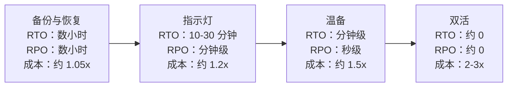
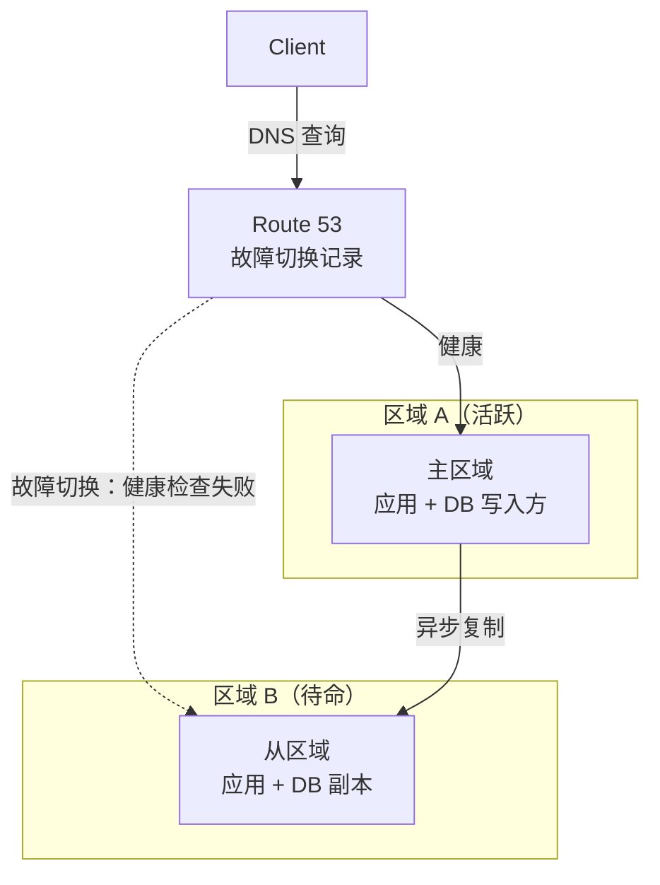
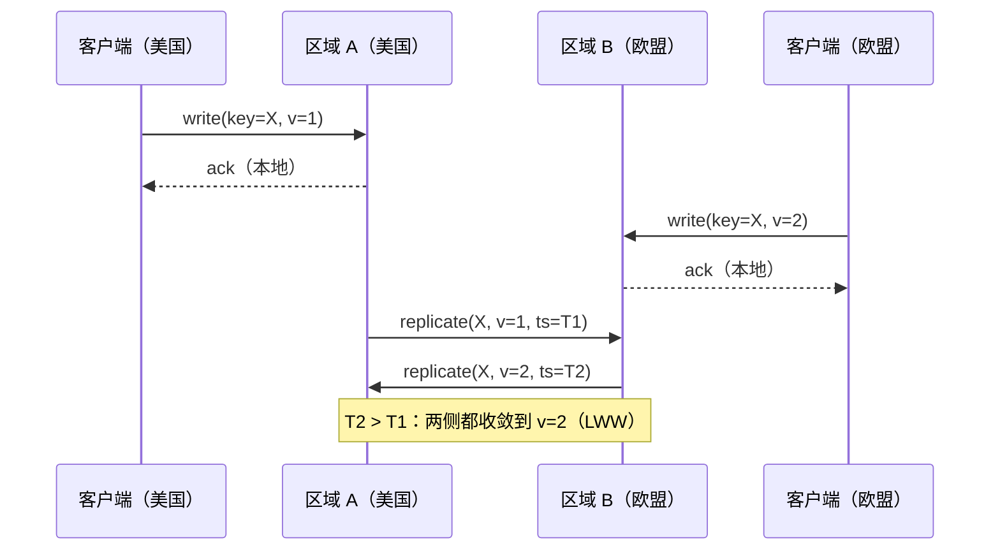
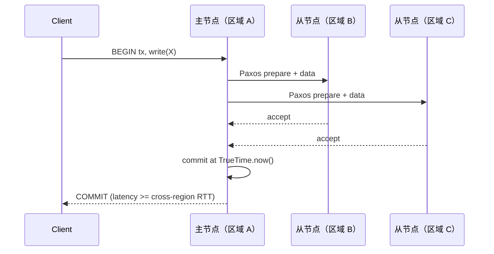

# 多区域架构：主备、双活与 CRDT

> **TL;DR**：云区域（region）是一个迟早会熄灯的故障域。2021 年 12 月 7 日，AWS `us-east-1` 的 EC2、ELB 和 Route 53 控制面瘫痪了七个小时[^1]。多区域架构的存在就是为了扛过这类事件，但它有分档：主备（active-passive）用不大的成本换来灾难恢复能力；双活（active-active）让每个地方的用户都就近读写，代价是 2-3 倍成本，外加冲突解决这笔税。核心的设计问题是：你需要跨区域的强一致性（每次写付出 80-200 ms），还是能容忍最终一致性——用最后写入者胜（LWW）、CRDT，或者按归属区域路由写入。

## 学习目标

学完本模块，你将能够：

- [ ] 区分主备、双活和指示灯（pilot light）三种灾难恢复模型
- [ ] 计算每种方案的 RTO 和 RPO，并对应到各自的成本档位
- [ ] 为区域故障切换设计 DNS 与 anycast 路由
- [ ] 推理冲突解决：最后写入者胜、向量时钟、CRDT、全局共识
- [ ] 在多区域数据选型时，比较 DynamoDB Global Tables、Aurora Global、Spanner、CockroachDB 和 Cosmos DB
- [ ] 讲清双活部署的成本与复杂度代价

## 直觉理解

你在三个城市各开了一家咖啡店，每家店有自己的收银机和库存台账。西雅图的顾客买走一袋咖啡豆，西雅图的台账立刻更新。到了晚上，每家店把当天销售额传真给总部，总部通宵对账。

这就是带批量对账的主备。对本地交易而言，西雅图店自己就是“主”。如果西雅图店烧了，你手里还有总部昨天的传真，可以把顾客导流到波特兰。你损失当天销售额（RPO 是一天），重新配置导流要花几个小时（RTO）。

现在换个场景：三家店共用一套实时库存系统。西雅图的一位顾客买走了最后一份限量烘焙豆，同一时刻波特兰的顾客也在买同一份。两台收银机都显示“已售出”。冲突出现了。你可以按时间戳裁决（最后写入者胜，给其中一位顾客发封致歉邮件），可以合并（CRDT：计数器变成 -1，先欠着发货），也可以加锁（共识：一台收银机等另一台确认后才完成交易，凭空多出 80 ms 的跨城延迟）。

这就是多区域的设计空间。本章把它讲精确。

## 原理

### 为什么需要多区域：故障、延迟与法律

可用区（AZ）的故障是常态。区域级故障更罕见，但一旦发生就是灾难。2017 年 2 月 28 日，一位运维敲错了一条缩容命令，把 `us-east-1` 的 S3 索引子系统打挂了四个小时[^2]。2020 年 11 月 25 日，一个线程数限制的回归从 Kinesis 蔓延开来，演变成 17 小时的故障，波及 Cognito、CloudWatch 和 Lambda[^3]。2021 年 12 月 7 日，一次自动扩缩容动作引发内部网络拥塞，让 EC2、ELB、Route 53 和 STS 受损七个小时[^1]。2019 年 6 月，Google Cloud 的 YouTube 和 Gmail 中断约四个小时[^4]。2021 年 3 月，Azure Active Directory 全球故障约 14 小时[^5]。

除了可用性，监管也在逼你做多区域。GDPR 限制把欧盟个人数据传输到 EEA 之外。印度 2023 年的《数字个人数据保护法》授权政府限制跨境传输。一旦你在多个司法辖区都有受监管的用户，数据驻留（data residency）就成了法律不变量，而不是性能优化。

最后是物理规律。光在美国境内往返要 40 ms，跨大西洋要 80 ms，从弗吉尼亚到新加坡要 180-200 ms。让用户访问附近的区域，长尾延迟会明显下降。

[CAP 与 PACELC](../part-3-distributed-systems-theory/03-cap-and-pacelc.md) 已经确立：网络分区发生时，你只能在一致性和可用性之间二选一。跨区域链路是你基础设施里最容易分区的路径。[数据库复制](../part-2-building-blocks/07-database-replication.md) 介绍了下面每一种灾难恢复策略都依赖的复制机制。本章把两者都用上，来处理多区域问题。

### RTO、RPO 与灾难恢复的阶梯

恢复时间目标（RTO）指恢复服务要花多久。恢复点目标（RPO）指你会丢多少数据，用时间衡量。AWS Well-Architected 的灾难恢复白皮书定义了四档[^6]：

*随着 RTO 和 RPO 向零收缩，基础设施成本成倍上涨：备份恢复很便宜，但要几小时才能拉起来；双活很贵，恢复时间却接近零。*

**备份与恢复（backup and restore）** 把快照存在灾备区域。出故障时，你从零重新部署基础设施。最便宜，但 RTO 是小时级。

**指示灯（pilot light）** 持续复制数据（数据库、对象存储），但计算资源关着。故障切换时，你启动实例、提升副本。RTO 是几十分钟。

**温备（warm standby）** 跑一份缩配但活着的副本。它能立刻吃下初期流量，再自动扩容到全量。RTO 是分钟级。

**双活（active-active）** 每个区域都跑满全量。故障时流量自动集中到存活的区域。RTO 接近零。

关键的洞见在这里：依赖控制面操作的故障切换（启动 EC2、改 DNS 记录、提升副本）本身就暴露在这次故障里。2021 年 12 月那次 AWS 事件中，EC2 启动 API 和 Route 53 记录变更都受损了好几个小时[^1]。你的灾难恢复预案必须尽量使用数据面操作（已经预置好的容量、预先配好的路由）。

### 用于区域故障切换的 DNS 与 anycast

基于 DNS 的故障切换靠 Route 53 健康检查（每 10 秒或 30 秒跑一次）发现死掉的区域，把流量甩到健康区域。变更在 60 秒内传播到 Route 53 的边缘节点，但终端用户的递归解析器会按 TTL 缓存答案。真实世界里的 DNS 故障切换要 1-5 分钟，不是秒级。

anycast 更快。Cloudflare 和 AWS Global Accelerator 通过 BGP 从每个 PoP 宣告同一个 IP。某个 PoP 消失时，BGP 撤回它的路由，流量在几秒内被引导到别处，完全不用等 DNS TTL。Cloudflare 从 330 多个城市宣告自己的 IP 段[^7]。权衡在于：anycast 要求每个 PoP 都跑同一套栈。

> [!TIP]
> 故障切换用的记录，DNS TTL 就设 60 秒。递归解析器缓存带来的长尾要认。想要亚秒级切换，用 anycast 或 Global Accelerator，别指望换 DNS 记录。

### 主备的工作机制

一个区域（主）承担全部读写。另一个区域（从）跑异步副本，外加足够在故障时接手的算力。

*DNS 健康检查发现主区域故障，把流量甩给从区域；切换时从区域把自己的异步副本提升为主。*

RPO 等于故障发生那一刻的复制延迟。Aurora Global Database 的典型复制延迟在 1 秒以内，能在 1 分钟内提升一个从区域[^8]。Shopify 为每个 pod 部署成对的数据中心，他们的 Pod Mover 工具大约 1 分钟就能搬迁一个 pod，且不丢请求[^9]。

运营上的风险：一个从来没演练过的从区域，真要用的时候不会工作。把故障切换当作一等一的生产操作。按计划跑，别只在事故里跑。

### 双活：所有区域都接受写入

每个区域都接受读写。数据在区域之间异步复制，或者走共识。冲突要么靠路由提前避免，要么事后解决。

*两个区域都在本地接受写入并异步复制；冲突的更新在到达时按最后写入者胜裁决。*

好处：用户看不到故障切换。流量自动集中到存活的区域。读延迟永远是本地的。

代价：只要同一份数据在两个区域被同时写入，冲突解决就躲不掉。而且基础设施账单大致翻倍。AWS 的跨区域数据传输大约 $0.02/GB[^10]。一个每月在 `us-east-1` 和 `eu-west-1` 之间复制 5 TB 的服务，光复制每个方向就要付 $100，还没算应用层的往来通信。

### 冲突解决：一条光谱

当两个区域在复制窗口内对同一条数据都接受了写入，系统必须收敛。这里有四种策略，按复杂度排序：

**最后写入者胜（LWW）。** DynamoDB Global Tables（MREC 模式）为每条数据存一个隐藏时间戳。复制时，时间戳更晚的赢。更早的那次写入被静默丢弃，不会记到 CloudTrail 或 CloudWatch[^11]。对以用户为边界的数据，它简单且可预期。对共享状态，它是一把会走火的数据丢失枪。

**向量时钟（vector clock）。** 记录哪个副本见过哪些更新。真正并发的写入被标记出来，交给应用层合并。2007 年的原版 Dynamo 就是这套设计。比 LWW 更正确，但把复杂度推给了应用。

**CRDT。** 一类数据结构，其合并操作满足交换律、结合律和幂等性。不管到达顺序如何，副本最终都收敛。[CRDT：无冲突复制数据类型](../part-3-distributed-systems-theory/05-crdts.md) 深入讲了理论。CRDT 适用于计数器、集合、寄存器和部分文本结构。它搞不定唯一性约束，也搞不定跨实体的不变量。

**全局共识。** Paxos 或 Raft 把写入串行化过一遍法定人数（多数派），每次写至少等一个跨区域往返。没有冲突，但每次写都多 80-200 ms。[共识协议：分布式系统如何达成一致](../part-3-distributed-systems-theory/00-consensus-protocols.md) 讲了机制。

### 全局强一致数据库

有些数据库替你把跨区域协调这笔税交了，好让应用代码保持简单：

**Google Spanner** 在 Paxos 复制的分片之上跑两阶段提交，并用 TrueTime——一个基于原子钟和 GPS、能给出有界时钟不确定性的 API——来给事务做全局排序，而不用在每次读时都协调[^12]。诀窍不在 Paxos（很多系统都用 Paxos）。诀窍是用硬件时钟让读只等一个不确定性区间，而不是等一整次往返。

**CockroachDB** 用混合逻辑时钟（物理 NTP 时间加一个逻辑计数器）替代原子钟，每个 range 跑 Raft。它是开源的、受 Spanner 启发的 SQL 数据库[^13]。权衡在于：NTP 时钟偏移可能导致事务重试，而 TrueTime 能避免这一点。

**YugabyteDB** 走类似的每 tablet 一个 Raft 的路线，兼容 PostgreSQL 线协议。

**DynamoDB Global Tables MRSC**（多区域强一致，2025 年 6 月 GA）在应答之前把写入同步复制到至少另一个区域。限制是只能在一个区域集内的恰好三个区域。写延迟等于到最近副本的往返[^11]。

**Aurora Global Database** 异步复制，延迟通常在 1 秒以内。它是灾难恢复加本地读的特性，不是全局一致的数据库[^8]。

**Azure Cosmos DB** 提供五档可配置的一致性级别。强一致性大约要多付两个最远区域之间往返的 2 倍代价，而且对区域间距超过约 8,000 公里的账号默认被禁用。

*一次强一致写入在应答客户端之前，至少要付一个跨区域往返来凑够 Paxos 法定人数；Spanner 用 TrueTime 让读不必协调。*

### Cloudflare 的模型：anycast 加按对象的单例

Cloudflare 走的是另一条路。每个 PoP 都跑完整的软件栈，BGP anycast 把每个客户端路由到最近的位置。状态方面，Cloudflare 在一致性光谱的两端各提供了一个原语：

**Workers KV** 是最终一致的，最后写入者胜。适合很少变动的配置和静态资源。

**Durable Objects** 按标识符全局唯一。每个对象只存在于一个位置，单线程，可以被透明地迁移到离使用者更近的地方。这就完全绕开了 CRDT：你不复制状态再去合并冲突，而是把请求路由到该对象那唯一的权威协调者。

Durable Objects 的博客明确主张，CRDT 常常“过于复杂，不值得”（overly complex and not worth the effort），对每个逻辑状态单元保留单一事实来源才是务实的替代方案。权衡在于：每个对象的吞吐量受限于单台机器。

这个模式很适合聊天室、文档、购物车、限流器和 IoT 设备——凡是状态有天然“归属者”、能串行化访问的场景。

### 基于单元的架构与爆炸半径

Shopify 的 pod 架构展示了一个很有力的模式：把状态分片，让跨区域故障切换变成按分片进行，而不是按服务进行。每个 pod 是一套完全隔离的数据存储（MySQL、Redis、Memcached），装着全部商家中的一部分。负载均衡器里一个叫 Sorting Hat 的组件把每个请求路由到正确的 pod。pod 之间没有写入，冲突解决问题被彻底消除[^9]。

pod 级的灾难恢复意味着，疏散一个数据中心就是逐个疏散每个 pod。数据中心从来不是恢复的单位。这限制了爆炸半径：一次坏发布或一次数据损坏只影响一个 pod，而不是整批机队。

基于单元的架构（cell-based architecture）把这个想法一般化了。每个单元是一个自包含的部署单位，有自己的数据、算力和故障边界。关于限制爆炸半径的相关模式，见 [优雅降级](../../../hld/part-6-reliability-and-operations/03-graceful-degradation.md)。

## 真实案例

Netflix 在 `us-east-1` 和 `us-west-2` 之间为北美用户请求路径建了完整的双活[^14]。架构是这样的：

- **无状态服务** 在两个区域部署完全相同的版本。
- **用户会话数据** 放在 Apache Cassandra 里，跨区域异步复制。Netflix 在生产负载下测试过：在一个区域写 1,000,000 条记录，500 ms 后在另一个区域读，全部记录都在[^14]。
- **EVCache**（基于 memcached）挡在热状态前面，通过 SQS 做远程缓存失效。它不复制缓存本身，而是在区域 A 写入时让区域 B 缓存里对应的键失效。下一次读时，区域 B 回源到 Cassandra。
- **Zuul** 在边缘做地理路由，处理被路由错的请求，并在惊群情况下主动丢弃（过载保护）。
- **DNS** 通过 Denominator 同时驱动 UltraDNS（方向性路由）和 Route 53（快速切换 CNAME）。

所有面向用户的读写都用 Cassandra 的 `LOCAL_QUORUM`，所以每个区域在一致性上都不依赖跨区域往返。这是关键的设计决策：通过对用户数据（资料、观看历史、推荐）接受最终一致性，Netflix 完全避开了跨区域写延迟这笔税。

Netflix 把这套系统能扛住真实的 AWS 事件，归功于 Chaos Kong 演练——每隔几周做一次整区域疏散，目标十分钟内完成。此前一次真实的故障切换是由一个内部服务劣化触发的；Netflix 在几分钟内把流量甩到健康区域，恢复了服务质量，然后才诊断问题并切回去[^14]。

教训是：双活不只是一种架构，它是一种运营纪律。没有定期演练，故障切换这条路会烂掉。

## 权衡

| 方案 | 优点 | 缺点 | 适用场景 | 我们的选择 |
|---|---|---|---|---|
| 单区域 | 简单、便宜、没有冲突 | 区域就是单点故障，无法满足多辖区驻留要求 | 早期阶段、非关键业务 | 从这里起步，同时规划退路 |
| 温备（主备） | 分钟级 RTO、秒级 RPO、运维简单 | 容量闲置、需要演练故障切换、切换时有副本延迟 | 灾难恢复要求明确、切换节奏可预期 | 多数生产系统的默认选择 |
| 双活异步（LWW） | 本地读写、故障切换对用户不可见 | 最终一致、冲突时静默丢写 | 以用户为边界的数据，能容忍冲突或可按用户分区 | 数据有天然归属区域时 |
| 双活加 CRDT | 分区下由数学保证收敛 | 适用数据形态窄、调试复杂 | 计数器、集合、在线状态、购物车 | 只用于 CRDT 形态的数据 |
| 双活同步（Spanner 式） | 全局一致、RPO 为零 | 写延迟 80-200 ms、昂贵、受区域集限制 | 金融交易、票务、唯一性不变量 | 正确性压过延迟时 |

## 常见陷阱

> [!WARNING]
> **LWW 带来的静默数据丢失。** DynamoDB Global Tables MREC 会丢弃“输掉”的那次写入，不记入 CloudTrail 或 CloudWatch[^11]。如果两个区域在复制窗口内写了同一条数据，其中一次更新会无声消失。缓解办法是把每个用户的写入路由到单一归属区域，或者在并发冲突会显式报错的场景用 MRSC。

> [!WARNING]
> **从没演练过的故障切换。** 灾难恢复演练总是被往后推。人们假定控制面 API（IAM、EC2 启动、DNS 变更）在故障期间可用，但它们自己也在受损。2021 年 12 月的 AWS 事件就是参照案例：连 Service Health Dashboard 自己都切不过去[^1]。把故障切换当作生产操作，按计划执行。

> [!WARNING]
> **把 DNS TTL 当成延迟下限。** 就算用 Route 53 的 60 秒最小 TTL，加上递归解析器缓存，切换的长尾也是 1-5 分钟。要亚秒级切换，用 anycast（Global Accelerator、Cloudflare），而不是换 DNS 记录。

> [!WARNING]
> **跨区域出网成本爆炸。** AWS 跨区域传输是 $0.02/GB[^10]。跨区域的碎聊式微服务会很快把这个数字叠上去。把互相通信的服务放在同一个区域；静态资源走 CDN 缓存；追踪跨区域请求路径，把不必要的干掉。

> [!WARNING]
> **写延迟这笔税出人意料。** 单区域内看着很快的设计，一旦每次写都含 80-200 ms 的跨区域往返，在全球范围就没法用了。上线前从每个区域压测写延迟。只给真正需要强一致性的事务用强一致；其余全部降到会话级或最终一致。

## 练习

为一家金融科技公司设计多区域架构：必须扛住区域级宕机，RTO 小于 5 分钟，数据丢失小于 1 秒，并且在欧盟和美国都有监管数据驻留要求。选定数据库与复制模型，设计故障切换，并估算相对单区域的成本增量。

提示

数据驻留约束意味着欧盟用户数据必须留在欧盟区域，美国用户数据留在美国区域。这不是一个全局数据库能解决的问题。想清楚哪些数据需要强一致性（账户余额、交易），哪些可以是最终一致（通知、分析）。可以考虑 Shopify 的 pod 模式：按司法辖区分片。

解答

**架构：** 两个主区域：`eu-west-1`（欧盟用户）和 `us-east-1`（美国用户）。每个区域对自己辖区内的数据是权威。用 CockroachDB 或 Spanner，配合按区域固定的分片：欧盟用户的行活在欧盟副本上，美国用户的行活在美国副本上。只碰本地数据的事务不付任何跨区域延迟。

**故障切换：** 在每个辖区内，于第二个区域（`eu-central-1`、`us-west-2`）跑温备。Aurora Global Database 或 CockroachDB 多区域部署，把存活目标（survival goal）设为 "region"，就能给辖区内切换提供亚秒级 RPO 和亚分钟级 RTO。Route 53 健康检查配 60 秒 TTL 触发 DNS 切换。

**跨辖区读：** 一位美国合规官要查欧盟数据，请求走欧盟区域的 API 网关。数据从不离开欧盟，只有查询结果跨越边界，满足 GDPR。

**成本估算：** 每个辖区在第二个区域跑温备，大约增加 1.5 倍算力成本（缩配副本、常开的数据库）。一家交易数据 10 TB、每天新增写入 1 GB 的金融科技公司，跨区域复制带宽可以忽略（$0.60/天）。总计约为单区域的 1.6-1.8 倍，远低于全双活的 2-3 倍。

**达成的 RTO/RPO：** RPO 小于 1 秒（辖区内同步复制）。RTO 小于 5 分钟（温备有预置容量，故障切换不依赖控制面）。

## 要点回顾

- 主备是灾难恢复策略；双活是延迟与韧性策略。目标不同，成本不同，复杂度也不同。
- 灾难恢复的档位阶梯（备份、指示灯、温备、双活）直接对应 1.05x 到 3x 的成本倍数。
- 依赖控制面操作的故障切换，会在控制面本身挂掉的时候失效。
- LWW 冲突解决会静默丢数据。把写入路由到归属区域，或者在你无法容忍静默丢失时改用强一致性。
- CRDT 保证收敛，但只对允许交换合并的数据形态成立。多数业务领域总得在某处用到共识。
- 全局强一致（Spanner、CockroachDB、DynamoDB MRSC）每次写要花 80-200 ms。据此设计交互体验。
- 基于单元的架构（Shopify 的 pod）把恢复单位从区域缩小到分片，从而限制爆炸半径。

## 延伸阅读

- [Spanner: Google's Globally-Distributed Database (Corbett et al., OSDI 2012)](https://www.usenix.org/conference/osdi12/technical-sessions/presentation/corbett) - TrueTime 那篇论文；全局强一致性的经典参考，讲清了原子钟为什么重要。
- [Netflix: Active-Active for Multi-Regional Resiliency](https://netflixtechblog.com/active-active-for-multi-regional-resiliency-c47719f6685b) - 一个流媒体服务如何用 Cassandra、EVCache 和 Zuul 走向双活的完整叙述。
- [AWS Summary of the Service Event in us-east-1 (Dec 7 2021)](https://aws.amazon.com/message/12721/) - 为什么依赖控制面的灾难恢复会失效，这篇复盘是参照案例；连亚马逊自己的仪表盘都切不过去。
- [Disaster Recovery Options in the Cloud (AWS Well-Architected)](https://docs.aws.amazon.com/whitepapers/latest/disaster-recovery-workloads-on-aws/disaster-recovery-options-in-the-cloud.html) - 权威的四档灾难恢复分类，附成本与 RTO/RPO 指导。
- [Cloudflare: A New Approach to Stateful Serverless (Durable Objects)](https://blog.cloudflare.com/introducing-workers-durable-objects/) - 边缘状态下单协调者路线的替代方案；读它对 CRDT 复杂度的鲜明反对。
- [A Pods Architecture To Allow Shopify To Scale](https://shopify.engineering/a-pods-architecture-to-allow-shopify-to-scale) - 把爆炸半径与数据中心边界解耦的分片级灾难恢复；应对多区域复杂度时被低估的答案。
- [Azure Cosmos DB Consistency Levels](https://learn.microsoft.com/en-us/azure/cosmos-db/consistency-levels) - 从强到最终的五档一致性光谱，公开资料里讲得最清楚的一份。
- [Verifying Strong Eventual Consistency in Distributed Systems (Kleppmann et al., OOPSLA 2017)](https://arxiv.org/abs/1707.01747) - CRDT 正确性的形式化框架；CRDT 能保证什么、不能保证什么的基准答案。

## 记忆卡片

**Q：** RTO 和 RPO 有什么区别？
**A：** RTO（恢复时间目标）是故障后恢复服务要多久。RPO（恢复点目标）是会丢多少数据，用时间衡量。RPO 为 1 秒的系统在故障时最多丢 1 秒的写入。

**Q：** 按成本递增、RTO 递减的顺序说出四档灾难恢复。
**A：** 备份与恢复（RTO 数小时，约 1.05x 成本）、指示灯（几十分钟，约 1.2x）、温备（分钟级，约 1.5x）、双活（接近零，2-3x 成本）。

**Q：** 为什么基于 DNS 的故障切换比基于 anycast 的慢？
**A：** DNS 答案会被中间解析器按 TTL 缓存。就算 TTL 只有 60 秒，真实世界的 DNS 切换也要 1-5 分钟。anycast 走 BGP 路由撤回，几秒内就能把流量引导走，不用等缓存里的 DNS 记录过期。

**Q：** DynamoDB Global Tables MREC 的静默数据丢失风险是什么？
**A：** MREC 基于隐藏时间戳做最后写入者胜。如果两个区域在复制窗口内写了同一条数据，更早的那次写入会被静默丢弃，不记入 CloudTrail 或 CloudWatch。

**Q：** Spanner 如何在不对每次读做协调的前提下实现全局强一致？
**A：** Spanner 用 TrueTime（原子钟 + GPS）给出时钟不确定性的上界。在时间戳 T 的读只需等不确定性区间过去，然后本地读，不需要跨区域协调。写入仍然需要跨区域 Paxos 法定人数。

**Q：** 强一致性的跨区域写延迟代价是多少？
**A：** 每次写 80-200 ms，取决于区域间距离。美国到欧洲往返约 80 ms；美国到新加坡 180-200 ms。每次强一致写至少付一次这样的往返。

**Q：** Cloudflare 的 Durable Objects 如何避开 CRDT 的复杂度？
**A：** 每个 Durable Object 有全局唯一 ID，只存在于一个位置。对该对象的所有请求都路由到它唯一的协调者，而协调者是单线程的。冲突在构造上就不存在，而不是事后解决。

**Q：** 什么是以单元为基础的架构，它怎么帮助多区域灾难恢复？
**A：** 基于单元的架构（例如 Shopify 的 pod）把状态切成相互隔离的单元，每个单元有自己的数据和算力。故障切换变成按单元进行而非按区域进行，从而限制爆炸半径并消除跨单元冲突。

**Q：** 2021 年 12 月 AWS us-east-1 故障为什么体现了依赖控制面的灾难恢复有多危险？
**A：** 那次故障让 EC2 启动、ELB 供给和 Route 53 记录变更受损数小时。任何需要在故障期间启动新实例或改 DNS 记录的预案都执行不了。只有预先置备的数据面容量活了下来。

**Q：** 什么时候该选双活同步（Spanner 式）而不是双活异步（LWW）？
**A：** 正确性压过延迟时选同步：金融交易、票务库存、唯一性约束。数据以用户为边界、冲突罕见或可容忍、本地写延迟比全局一致性更重要时选异步。

## 参考文献

[^1]: "Summary of the AWS Service Event in the Northern Virginia (US-EAST-1) Region," AWS, 10 December 2021. https://aws.amazon.com/message/12721/
[^2]: "Summary of the Amazon S3 Service Disruption in the Northern Virginia (US-EAST-1) Region," AWS, 28 February 2017. https://aws.amazon.com/message/41926/
[^3]: "Summary of the Amazon Kinesis Event in the Northern Virginia (US-EAST-1) Region," AWS, 25 November 2020. https://aws.amazon.com/message/11201/
[^4]: "Google Cloud Networking Incident #19009," Google Cloud Status Dashboard, 2 June 2019. https://status.cloud.google.com/incident/cloud-networking/19009
[^5]: Sergiu Gatlan, "Microsoft explains the cause of yesterday's massive service outage" (quoting Microsoft's official RCA for the 15 March 2021 Azure AD outage), BleepingComputer, 16 March 2021. https://www.bleepingcomputer.com/news/microsoft/microsoft-explains-the-cause-of-yesterdays-massive-service-outage/
[^6]: "Disaster recovery options in the cloud," AWS Well-Architected, Disaster Recovery of Workloads on AWS. https://docs.aws.amazon.com/whitepapers/latest/disaster-recovery-workloads-on-aws/disaster-recovery-options-in-the-cloud.html
[^7]: "Cloudflare Global Network," Cloudflare. https://www.cloudflare.com/network/
[^8]: "Using Amazon Aurora Global Database," AWS. https://docs.aws.amazon.com/AmazonRDS/latest/AuroraUserGuide/aurora-global-database.html
[^9]: Xavier Denis, "A Pods Architecture To Allow Shopify To Scale," Shopify Engineering, 2 March 2018. https://shopify.engineering/a-pods-architecture-to-allow-shopify-to-scale
[^10]: "Amazon EC2 On-Demand Pricing: Data Transfer," AWS. https://aws.amazon.com/ec2/pricing/on-demand/#Data_Transfer
[^11]: "Using DynamoDB global tables," AWS. https://docs.aws.amazon.com/amazondynamodb/latest/developerguide/bp-global-table-design.html
[^12]: Corbett et al., "Spanner: Google's Globally-Distributed Database," OSDI 2012. https://www.usenix.org/conference/osdi12/technical-sessions/presentation/corbett
[^13]: "CockroachDB: The Resilient Geo-Distributed SQL Database," SIGMOD 2020. https://www.cockroachlabs.com/guides/cockroachdb-the-resilient-geo-distributed-sql-database-sigmod-2020/
[^14]: Ruslan Meshenberg, Naresh Gopalani, Luke Kosewski, "Active-Active for Multi-Regional Resiliency," Netflix TechBlog, 2 December 2013. https://netflixtechblog.com/active-active-for-multi-regional-resiliency-c47719f6685b
