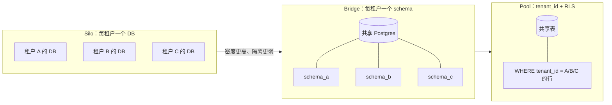
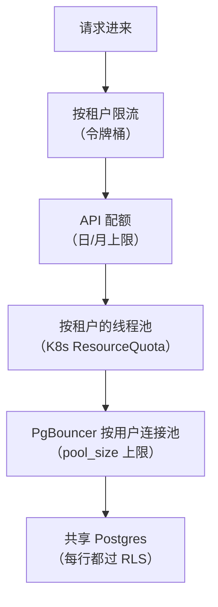
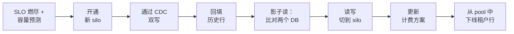
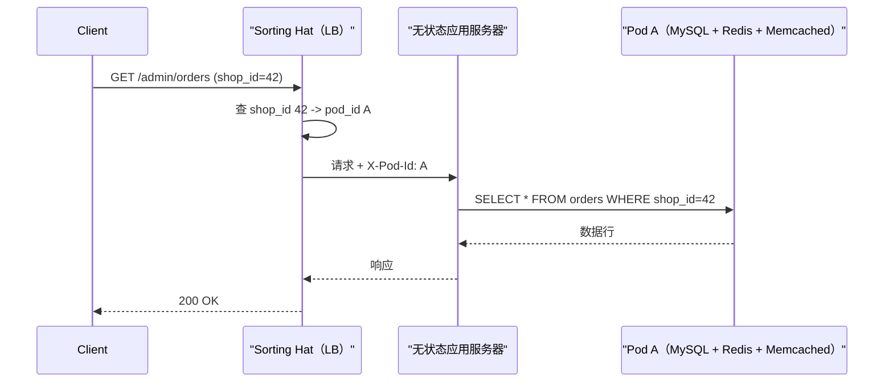

# 多租户：Silo、Pool 与 SaaS 的隔离光谱

> **TL;DR**: 多租户（multi-tenancy）指的是把众多客户组织托管在同一套共享基础设施上，隔离靠软件实现，而不是靠物理上彼此独立的栈。选择落在一条光谱上：silo（每个租户独占资源）贵 10 到 100 倍，但合规干净、爆炸半径为零；pool（共享表加一个 `tenant_id` 列）密度最高，但漏写一处 `WHERE tenant_id = ?` 就是跨租户数据泄露[^1]。多数生产系统停在中间。Shopify 把店铺装进由共享数据存储组成的 pod，在 2024 年 BFCM 峰值扛住每分钟 2.84 亿次边缘请求[^2]。Salesforce 把数千个 org 挤进共享的 Oracle 实例，用 governor limits 当吵闹邻居的挡箭牌[^3]。按光谱设计，不要做二选一。

## 学习目标

学完本章，你将能够：

- [ ] 把某个负载放到 silo 到 pool 的光谱上，并说清理由
- [ ] 在限流、配额、调度器三层设计吵闹邻居的防御
- [ ] 搭建按租户计量与成本归因的管道
- [ ] 用 Postgres RLS 为行级租户隔离加上纵深防御
- [ ] 定义把租户从 pool 提升到 silo 的 SLA 触发条件

## 直觉理解

你在一栋公寓楼里做物业。所有租户共用同一套水管、同一路电网、同一部电梯。这就是 pool 多租户：每户摊的成本低，但有人凌晨两点开洗衣机，整栋楼的管道都跟着震。哪户的热水器炸了，整层都淹。

再想象一片独栋别墅的封闭小区。每栋房子有自己的水管、自己的配电箱、自己的车道。这就是 silo：建起来贵，但某栋的水管爆了也只限在那栋。业主想装修，不用等业委会批。

现实里更多的是联排：共用墙体和地基，但每户有独立的电表、独立的断路器。一家电路过载，跳的是自己家的闸，不是整栋楼的总闸。这就是桥接（bridge）模型，也是多数 SaaS 平台最终落脚的地方。

工程问题直接对上：客户之间共享多少基础设施，用什么围栏挡住一个客户的行为把另一个客户的体验拖垮？[数据库分区与分片](../part-2-building-blocks/06-database-partitioning-sharding.md)讲过把数据拆到多个节点的机制。本章问的是更难的一层：按什么分片（tenant_id）、分片之间隔离到什么程度、以及当某个租户长得比共享基础设施还大时怎么办。

## 原理

### 三种隔离级别

AWS Well-Architected 的 SaaS Lens 定义了三种标准模型[^4]：

**Silo** 给每个租户独占的基础设施：自己的数据库实例、自己的算力、自己的备份链。数据隔离是物理的，跨租户泄露在架构上就不可能发生。GDPR 的删除操作就是 `DROP DATABASE`。代价是每租户贵 10 到 100 倍，且运维开销随租户数量线性增长[^1]。

**Pool** 把所有租户塞进共享表。每行带一个 `tenant_id` 列，每条查询都按它过滤。隔离由应用逻辑保证，理想情况下还由数据库层的行级安全（Row-Level Security）保证。密度最高、每租户成本最低，但一条跑飞的查询或一处漏掉的过滤会影响所有人[^1]。

**Bridge**（也叫“pod”或“schema-per-tenant”）夹在两者之间。租户共享一个数据库实例，但每个租户有自己的 schema 或逻辑库。可以按租户单独迁移。`pg_dump -n tenantschema` 就能轻松备份。但 Postgres 的目录膨胀会变成硬上限：一万个租户、每个 50 张表，`pg_class` 里就是 50 万张表，每个查询计划都要付这份查找成本[^5]。



*隔离是一条连续光谱；每租户成本与爆炸半径朝相反方向走。*

这个选择不是整平台一个答案。它按层级、按服务，有时甚至按表来定。创业公司全部走 pool。年合同 50 万美元的企业客户给一套 silo。中间那 80% 共用一套 bridge。schema-per-tenant 会在 1000 到 10000 个租户之间某个点崩掉，具体取决于表的数量；Atlassian 的 Forge 插件平台撞上这堵墙时已经堆到 750 多个 Postgres 集群，后来迁到约 16 个 TiDB 集群，仍然为每个租户保留一个逻辑库[^5]。

### 用行级安全做纵深防御

最常见的多租户漏洞不是什么高明的攻击手法，而是开发同学写了一句 `SELECT * FROM orders WHERE order_id = ?`，没带 `tenant_id` 条件。如果 `order_id` 在不同租户之间撞了，数据就漏了。

Postgres 的行级安全（RLS）在数据库层让这类 bug 不可能发生。你定义一条策略：

```sql
ALTER TABLE orders ENABLE ROW LEVEL SECURITY;

CREATE POLICY tenant_isolation ON orders
USING (tenant_id = current_setting('app.current_tenant')::UUID);
```

应用在取连接时设置 `app.current_tenant`。之后每条查询——包括管理脚本、ORM 的懒加载、后台任务——都会被自动过滤。漏掉的 `WHERE tenant_id = ?` 会返回零行，而不是泄露数据[^6]。

AWS Prescriptive Guidance 推荐用运行时变量的写法，而不是给每个租户建 Postgres 角色，因为后者意味着每个租户一个数据库用户[^6]。RLS 是纵深防御：应用仍然按 `tenant_id` 过滤以拿到性能（走索引），但即使应用出错，数据库也能兜住正确性。

> [!IMPORTANT]
> **PgBouncer 事务模式的坑。** 如果你用 PgBouncer 的事务模式，`SET app.current_tenant = 'A'` 会泄漏到下一个事务的连接上。对受 RLS 保护的查询，请用 `SET LOCAL`（作用域限于当前事务），或者用会话模式连接池。

### 吵闹邻居的防御

在 pool 里，一个行为失控的租户（跑飞的集成、无限重试的循环、一次批量导出）就能把共享资源吃满，拖垮其他所有租户。防御要分层：



*纵深防御：每层单独有效，合起来才够。*

**第 1 层：按租户限流。** 在 API 网关按 `tenant_id` 建令牌桶。[限流](../part-2-building-blocks/11-rate-limiting.md)讲了各种算法；多租户的变数是：全局限流不够用，单个租户就能把全局额度吃干净。

**第 2 层：资源配额。** Salesforce 的 governor limits 是经典例子：每事务最多 100 次 SOQL 查询、150 次 DML 操作、10000 毫秒 CPU 时间、6 MB 堆内存、50000 条记录[^7]。这些是直接抛异常的硬顶，不是温和的告警。

**第 3 层：算力隔离。** Kubernetes 的 `ResourceQuota` 限制每个租户命名空间的 CPU 与内存总量，`LimitRange` 限制每个 pod 的默认值。两者合起来，防止某个租户的 pod 把别人饿死。

**第 4 层：连接池分配。** Postgres 默认 `max_connections = 100`。PgBouncer 把成千上万的客户端连接复用到几十条后端连接上，但如果没有按用户的 `pool_size` 限制，一个租户就能独占整个池[^8]。

### 鲸鱼租户从 pool 迁到 silo

SaaS 也符合 80/20 法则：一小部分租户（通常 1% 到 10%）贡献了大部分负载。当某个租户威胁到共享基础设施的 SLO 时，就把它从 pool 提升到 silo。

探测信号：按租户统计的 CPU 占比、连接数、数据量增速、以及该租户 SLO 上的错误预算消耗速度。

这次提升是一份迁移 runbook，不是一条命令：



*把一个鲸鱼租户从 pool 提升到 silo 是七步迁移；每一步都可能失败并独立重试。*

Shopify 的 Pod Mover 能在一分钟内把 pod 切到灾备数据中心且不丢请求[^9]，它的分片均衡工具能在分片之间搬店铺且对消费者零停机[^10]。Notion 在 2021 年分片迁移时用了类似套路：通过审计日志双写、回填历史数据、跑影子读对比两个数据库，验证通过后才切换[^11]。

关键洞察：在第一条鲸鱼到来之前就把提升路径设计好。压力之下临时做晋升，才是跨租户 bug 藏身的地方。

### 按租户计量是产品能力，不是附属功能

计量不是事后补的东西。AWS SaaS Lens 把成本感知列为其成本优化支柱下的核心最佳实践[^12]。没有每租户成本，你就没法定价、没法找出毛利为负的租户、也没法为鲸鱼档的报价找到依据。

模式是：给每个可计费动作埋点，发出一条带 `tenant_id`、`meter_name`、`value` 和 `timestamp` 的事件。常见的用量类型：

- **API 调用**（按租户、按端点计数）
- **存储**（保留数据的 GB-月）
- **算力**（消耗的 CPU-秒或 GPU-秒）
- **带宽**（传输的 GB）

Stripe 的 Meter Events API 要求 `event_name`、`customer_id`（对应租户）、一个数值，以及可选的幂等标识[^13]。用量闸门（到预付费上限就停线）适合实时流式处理；成本归因报表适合按天批量聚合。

试金石是这个问题：“这个月服务租户 X 的单位成本是多少？”如果答案要花一天以上才算出来，计量就还不是一等公民。

### 数据驻留与加密粉碎

GDPR 第 17 条赋予删除权，第 12(3) 条要求控制者在收到请求后不得无故拖延、且无论如何在一个月内处理（复杂情形可再延长两个月）；不合规按第 83(5) 条最高可罚 2000 万欧元或上一财年全球年营业额的 4%，取较高者[^14]。法国监管机构 CNIL 在 2024 年共开出 87 笔处罚，合计 5520 万欧元[^15]。

对有备份、日志和数据仓库副本的 pool 数据库来说，物理上找出并删掉某个租户的每一行很难。加密粉碎（crypto-shredding）是这类场景的惯用解法[^16]：用租户专属密钥（存在 KMS 里）加密该租户的全部数据。收到删除请求时，删掉密钥。数据在每一份副本、备份和日志里都变得不可读，而无需做分布式删除。

架构上的影响：

- **按区域的数据面。** 一家法国医疗租户的数据留在 eu-west-1。Slack 提供绑定到具体区域的工作区级数据驻留[^17]。
- **租户专属加密密钥。** 每个租户一个 KMS 密钥。轮换、访问日志、删除都是按租户进行的操作。
- **备份粒度。** 在 silo 里，按租户 PITR 是原生能力（恢复一个实例即可）。在 pool 里，你要么每次备份时抽出该租户的行（运维开销随租户数线性增长），要么把整个多租户快照恢复到临时库再从里面抽[^18]。

## 真实案例

### Shopify Pods：超大规模下的桥接模型

Shopify 的 pod 架构诞生于 2016 年，此前 2015 年的数据库分片解决了扩展问题，却破坏了韧性：任何一个分片故障都会让全平台的操作停摆[^9]。解法是每个 pod 完全隔离。

一个 pod 是一组店铺，它们跑在一整套完全隔离的数据存储上：自己的 MySQL 分片、Redis 集群、Memcached 池和 cron 调度器。无状态的应用服务器是共享的，但每个请求会经“Sorting Hat”（分院帽）负载均衡器钉到某一个 pod 上：它把 `shop_id` 查成 `pod_id`，加一个 header，应用用这个 header 去选对应的数据存储[^9]。

2024 年 BFCM 期间，Shopify 处理了每分钟 2.84 亿次边缘请求、每分钟 8000 万次应用服务器请求、10.5 万亿次数据库查询、以及 1.17 万亿次数据库写入[^2]。



*每个请求都钉在唯一一个 pod 上；该 pod 拥有这个店铺完整的数据存储切片。*

关键的工程决策：

- **pod 之间没有运行时依赖。** 一个 pod 挂掉不会螺旋成平台级故障。
- **分片键是 `shop_id`。** 数据按商家聚在一起，租户内查询很便宜。
- **Pod Mover 解决鲸鱼提升。** 长大的商家会被挪到负载更轻的 pod，对消费者零停机[^10]。
- **模块化单体优于微服务。** 每个 pod 内部保持运维简单。[单体与微服务](./00-monolith-vs-microservices.md)解释了为什么这个权衡在 Shopify 的规模上成立。

## 权衡

| 隔离级别 | 优点 | 缺点 | 适用场景 | 我们的选择 |
|---|---|---|---|---|
| Silo（每租户独立基础设施） | 隔离强、合规干净、责任清晰 | 成本贵 10 到 100 倍、每实例都有运维开销 | 企业合规、租户数 <200 | 鲸鱼档与受监管行业 |
| Pool，共享 schema（`tenant_id`） | 密度最高、发布简单 | 有吵闹邻居风险、RLS 增加复杂度 | 创业公司、租户规模均匀 | **自助档的默认选择** |
| Pool，schema-per-tenant | 可单租户迁移、目录视图干净、`pg_dump -n` 备份 | 超过约 1000 租户后 Postgres 目录膨胀、迁移要扇出、DDL 成本线性增长 | 中型 SaaS，且合同要求按租户定制 schema（ISV 平台、要求按客户审计 schema 的受监管行业） | 适用面窄。保持在约 1000 租户以下，或者规划好迁往 TiDB/Citus 的路径（见目录膨胀那条陷阱） |
| Bridge/Pod（silo 的分片集合） | 可按 pod 扩量、映射稳定 | 再均衡复杂 | 大规模、1 万以上租户 | **成长期 SaaS 的默认选择** |

## 常见陷阱

> [!WARNING]
> **忘了 tenant_id 过滤。** `SELECT * FROM orders WHERE order_id = ?` 没有 tenant_id 条件时，如果 ID 撞了就会返回别的租户的行。多数多租户 SaaS 数据泄露就是这么发生的。缓解办法：Postgres RLS 把漏掉的过滤变成空结果集，而不是数据泄露。再配上 ORM 的作用域插件，在测试模式下对未加作用域的查询直接 panic。

> [!WARNING]
> **没有按租户限流。** 全局限流限制了总 QPS，却允许单个租户把它全吃掉。一个吵闹租户就能塞满连接池（Postgres 默认 `max_connections = 100`），其他所有租户的延迟随之飙升。修法：网关按 `tenant_id` 做令牌桶，再加 PgBouncer 的按用户 `pool_size`。

> [!WARNING]
> **计量是事后补的。** 改一次定价要在 20 个微服务里发版；每租户成本变成每季度拉一张表格的活。从第一天就发出带 `tenant_id` 的用量事件，哪怕暂时没人用。AWS SaaS Lens 把这当作核心最佳实践。

> [!WARNING]
> **schema-per-tenant 的目录膨胀。** 一万个租户、每个 50 张表，`pg_class` 里就是 50 万条记录。每个查询计划都要付目录查找的成本。Atlassian 在迁到 TiDB 之前把“元数据爆炸（数亿个对象）”列为硬上限[^5]。超过约 1000 个租户就别用 schema-per-tenant，除非上了分布式 SQL。

> [!WARNING]
> **备份不是按租户的。** 某个租户要求恢复到昨天某个时间点；在 pool 库里，你要么把所有人一起恢复（不可接受），要么恢复到临时库再抽取（很慢）。在第一个删除请求到来之前，就把加密粉碎和按租户抽取的工具做好。

## 练习

为一个多租户分析平台设计隔离策略：5 万租户，其中 10 个租户贡献 40% 的负载。逐层论证 pool 与 silo 的取舍，定义鲸鱼提升的 SLA 触发条件，并画出迁移 runbook（数据拷贝、切换、DNS、计费拆分）。

<details>
<summary>提示</summary>

那 10 个鲸鱼租户需要与其余 49990 个隔开。但 49990 个都需要同样的待遇吗？想三个层级：鲸鱼（silo）、中档（bridge/pod）、自助（pool）。SLA 触发条件必须不靠人的判断就能度量：某个指标越过阈值，而不是“感觉有点慢”。

</details>

<details>
<summary>答案</summary>

**分层设计：**

- **自助（49900 个租户）：** pool 加共享 schema、`tenant_id` 列、Postgres RLS。按租户限流 100 QPS。K8s 按命名空间的 ResourceQuota。成本约每租户每月 0.50 美元的基础设施。
- **中档（90 个租户）：** bridge 模型，在专用 Postgres 集群上做 schema-per-tenant。按租户配 PgBouncer 的 pool_size。支持按租户迁移和 `pg_dump` 备份。成本约每租户每月 50 美元。
- **鲸鱼（10 个租户）：** silo，独立 RDS 实例、独立 Redis、独立算力命名空间。完整 PITR、租户专属 KMS 密钥、定制 SLA。成本约每租户每月 5000 美元。

**鲸鱼提升的 SLA 触发条件：**

满足以下任意两项即提升：(1) 该租户 p99 延迟连续 3 天超过 500 ms；(2) 该租户占共享集群 CPU 的比例按 24 小时平均超过 5%；(3) 该租户数据量超过 100 GB（接近单分片上限）。

**迁移 runbook：**

1. 在鲸鱼租户偏好的区域开一个新的 RDS 实例。
2. 从 pool 分片到新实例开启 CDC（逻辑复制），按 `tenant_id` 过滤。
3. 用带 `WHERE tenant_id = X` 的 `pg_dump` 回填历史行。
4. 跑 48 小时影子读：同时查两个库、比对结果、记录差异。
5. 切换：更新 Sorting Hat 的路由，把该租户指向新实例。读写从此打到 silo。
6. 更新计费系统，改成鲸鱼档定价。
7. 观察 7 天后，从 pool 里删掉该租户的行，并用 `VACUUM` 回收空间。

**接受的权衡：** 90 个中档租户共用一套 bridge 集群，彼此之间仍可能出现吵闹邻居效应。这可以接受，因为它们的单体负载比鲸鱼小 10 倍，而且按租户限流压住了爆炸半径。

</details>

## 要点回顾

- 隔离是光谱，不是二选一。按层级、按服务，有时按表来选。
- `tenant_id` 列就是多租户的分片键。Postgres RLS 让漏掉的过滤返回空行，而不是泄露数据。
- 吵闹邻居的防御是一套栈：限流、配额、调度器、连接池。每层单独有效。
- schema-per-tenant 会在 1000 到 10000 租户之间因 Postgres 目录膨胀而崩。再往上要么用 pool 加 RLS，要么用分布式 SQL。
- 计量是产品能力，不是运维的附属品。没有每租户成本，你就没法定价。
- 鲸鱼租户是必然的。在第一条鲸鱼把 pool 掀翻之前，先把提升路径（双写、影子读、切换）设计好。
- 加密粉碎（删掉租户的 KMS 密钥）是唯一能在备份、日志和数据仓库副本上都兑现 GDPR 删除权的可行办法。

## 延伸阅读

- [AWS SaaS Lens (Well-Architected)](https://docs.aws.amazon.com/wellarchitected/latest/saas-lens/saas-lens.html) - silo/pool/bridge 框架的权威出处，给出了租户隔离、计量、运维几个支柱的明确要求。
- [Shopify: A Pods Architecture To Allow Shopify To Scale](https://shopify.engineering/a-pods-architecture-to-allow-shopify-to-scale) - 大规模 bridge/pod 模型的一手资料；讲了 Sorting Hat、Pod Mover 和灾备对。
- [Notion: Herding elephants, sharding Postgres at Notion](https://www.notion.so/blog/sharding-postgres-at-notion) - 零停机迁移的范本（双写、追平、影子读），可以直接套到鲸鱼提升上。
- [Salesforce Platform Multitenant Architecture](https://architect.salesforce.com/fundamentals/platform-multitenant-architecture) - 元数据驱动的 pool 模型，配 governor limits 和透视表；共享 schema 密度的极限形态。
- [AWS: Multi-tenant data isolation with PostgreSQL RLS](https://aws.amazon.com/blogs/database/multi-tenant-data-isolation-with-postgresql-row-level-security/) - 带 CloudFormation 和 Spring Boot 示例代码的参考实现。
- [AWS Database Blog: Backup and recovery in a multi-tenant SaaS application](https://aws.amazon.com/blogs/database/managed-database-backup-and-recovery-in-a-multi-tenant-saas-application/) - 各隔离模型下的按租户 PITR 模式；pool 模型恢复的硬骨头。
- [Stripe: Usage-based billing meter events](https://docs.stripe.com/billing/subscriptions/usage-based/meters/configure) - 带租户标记的用量事件 API；计量管道的接入点。
- [How Atlassian Scaled to 3M+ Tables: Multi-Tenancy with TiDB](https://www.pingcap.com/blog/how-atlassian-scaled-three-million-tables-multi-tenancy-tidb) - Postgres schema-per-tenant 上限的真实数字，以及迁往分布式 SQL 的过程。

## 记忆卡片

**Q:** 多租户的三种标准隔离模型是什么？
**A:** silo（每租户独占基础设施）、pool（共享表，按 tenant_id 过滤）、bridge（共享实例，每租户一个 schema 或逻辑库）。真实系统大多在不同层级上混用。

**Q:** 共享 schema 的 pool 多租户最主要的风险是什么？
**A:** 任何一条查询漏掉 `WHERE tenant_id = ?` 都可能跨租户泄露数据。这是实践中最常见的多租户漏洞。

**Q:** Postgres 行级安全（RLS）如何防住跨租户泄露？
**A:** RLS 在应用看到数据之前，对每条 SELECT/INSERT/UPDATE/DELETE 强制加上 `tenant_id = current_setting('app.current_tenant')` 谓词。漏掉的过滤会返回零行，而不是泄露数据。

**Q:** 为什么 schema-per-tenant 在规模上会崩？
**A:** Postgres 的系统目录（pg_class、pg_attribute）随表数量线性增长。一万个租户、每个 50 张表就是 50 万条目录记录，导致查询计划器承压、DDL 变慢。

**Q:** 多租户系统的吵闹邻居防御栈长什么样？
**A:** 四层：(1) API 网关按租户限流；(2) 资源配额（CPU、内存、IOPS 上限）；(3) 用 K8s 按命名空间的 ResourceQuota 做算力隔离；(4) 用 PgBouncer 的按用户 pool_size 做连接池分配。

**Q:** 哪些信号触发鲸鱼租户从 pool 升到 silo？
**A:** 按租户的 CPU 占比越过阈值、连接数增长、数据量逼近分片上限、以及按租户 SLO 的错误预算燃尽。当该租户威胁到别人的共享基础设施 SLO 时就提升。

**Q:** 什么是加密粉碎，为什么用它满足 GDPR？
**A:** 用租户专属的 KMS 密钥加密该租户全部数据，收到删除请求时删掉密钥。数据在每一份副本（数据库、备份、日志、数据仓库）里都变得不可读，且不需要做分布式删除。

**Q:** Shopify 的 Sorting Hat 怎么把请求路由到正确的 pod？
**A:** 负载均衡器在路由表里把 shop_id 查成 pod_id，加上 X-Pod-Id header，无状态应用服务器用这个 header 连接到对应 pod 的 MySQL、Redis 和 Memcached 实例。

**Q:** 把鲸鱼租户从 pool 提升到 silo，正确的顺序是什么？
**A:** 开通 silo、通过 CDC 双写、回填历史数据、跑影子读比对两个库、把读写切到 silo、更新计费、从 pool 下线该租户的行。

**Q:** 为什么多租户系统从第一天就该埋点计量？
**A:** 没有按租户归因的用量事件，你就算不出每租户成本、没法给按量计费的方案定价、找不出毛利为负的租户、也没法执行预付费用量闸门。事后在众多服务里补埋点，比一开始就做贵得多。

**Q:** RLS 场景下 PgBouncer 事务模式的坑是什么？
**A:** 事务模式连接池下，`SET app.current_tenant = 'A'` 在事务结束后仍留在后端连接上。下一个事务（属于租户 B）继承了租户 A 的上下文，造成跨租户读取。修法：用 `SET LOCAL`，它的作用域限于当前事务。

**Q:** Salesforce 在纯 pool 架构里怎么防吵闹邻居？
**A:** governor limits 给每个事务设硬顶：最多 100 次 SOQL 查询、150 次 DML 操作、10000 毫秒 CPU 时间、6 MB 堆内存、每事务取回 50000 条记录。超过任一限制就抛异常，从而保护共享实例。

## 参考文献

[^1]: AWS Prescriptive Guidance, "Multi-tenant SaaS partitioning models for PostgreSQL". https://docs.aws.amazon.com/prescriptive-guidance/latest/saas-multitenant-managed-postgresql/partitioning-models.html
[^2]: Kyle Petroski and Matthew Frail, Shopify Engineering, "How we prepare Shopify for BFCM" (Nov 2025). https://shopify.engineering/bfcm-readiness-2025
[^3]: Salesforce Architects, "Platform Multitenant Architecture". https://architect.salesforce.com/fundamentals/platform-multitenant-architecture
[^4]: AWS Well-Architected SaaS Lens, "Silo, Pool, and Bridge Models". https://docs.aws.amazon.com/wellarchitected/latest/saas-lens/silo-pool-and-bridge-models.html
[^5]: Brian Foster, PingCAP Blog, "How Atlassian Scaled to 3M+ Tables: Multi-Tenant Control with TiDB" (Dec 2025). https://www.pingcap.com/blog/how-atlassian-scaled-three-million-tables-multi-tenancy-tidb
[^6]: AWS Prescriptive Guidance, "Row-level security recommendations". https://docs.aws.amazon.com/prescriptive-guidance/latest/saas-multitenant-managed-postgresql/rls.html
[^7]: Salesforce Developers, "Execution Governors and Limits" (Apex Developer Guide). https://developer.salesforce.com/docs/atlas.en-us.apexcode.meta/apexcode/apex_gov_limits.htm
[^8]: PlanetScale, "Scaling Postgres connections with PgBouncer". https://planetscale.com/blog/scaling-postgres-connections-with-pgbouncer
[^9]: Xavier Denis, Shopify Engineering, "A Pods Architecture To Allow Shopify To Scale" (Mar 2018). https://shopify.engineering/a-pods-architecture-to-allow-shopify-to-scale
[^10]: Shopify Engineering, "Shard Balancing: Moving Shops Confidently with Zero-Downtime at Terabyte-scale". https://shopify.engineering/mysql-database-shard-balancing-terabyte-scale
[^11]: Garrett Fidalgo, Notion Blog, "Herding elephants: Lessons learned from sharding Postgres at Notion" (Oct 2021). https://www.notion.so/blog/sharding-postgres-at-notion
[^12]: AWS Well-Architected SaaS Lens, "Expenditure awareness". https://docs.aws.amazon.com/wellarchitected/latest/saas-lens/expenditure-awareness.html
[^13]: Stripe Docs, "Create and configure a meter". https://docs.stripe.com/billing/subscriptions/usage-based/meters/configure
[^14]: GDPR, "Art. 83 - General conditions for imposing administrative fines". https://gdpr-info.eu/art-83-gdpr/
[^15]: CNIL, "Sanctions and corrective measures: CNIL's actions in 2024". https://cnil.fr/en/sanctions-and-corrective-measures-cnils-actions-2024
[^16]: Conduktor Blog, "Crypto Shredding in Kafka: GDPR Compliance Without Deletion" (Mar 2025). https://conduktor.io/blog/crypto-shredding-in-kafka-a-cost-effective-way-to-ensure-compliance
[^17]: Slack Help Center, "Data residency for Slack". https://slack.com/help/articles/360035633934-Data-residency-for-Slack
[^18]: AWS Database Blog, "Managed database backup and recovery in a multi-tenant SaaS application" (Dec 2022). https://aws.amazon.com/blogs/database/managed-database-backup-and-recovery-in-a-multi-tenant-saas-application/
