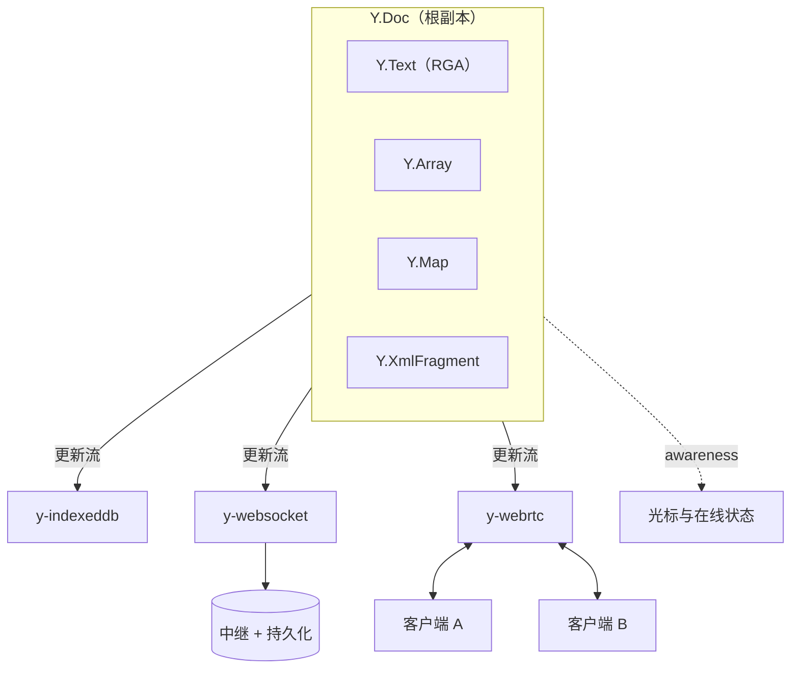
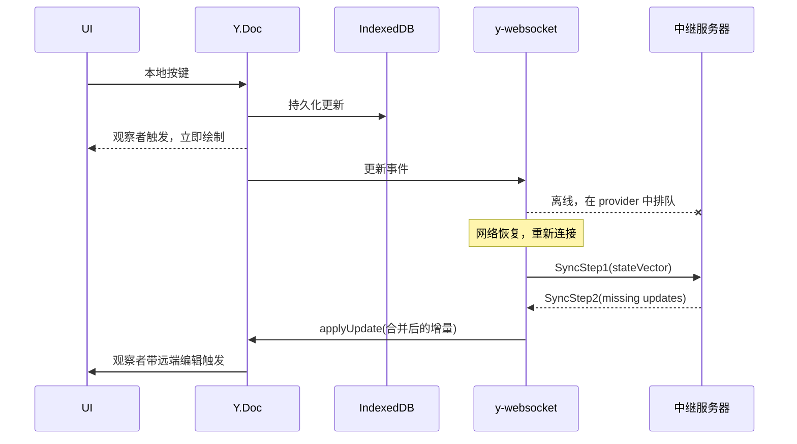
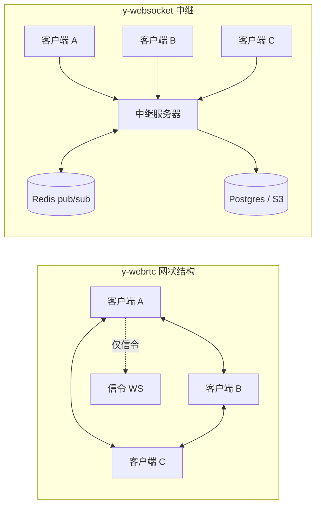
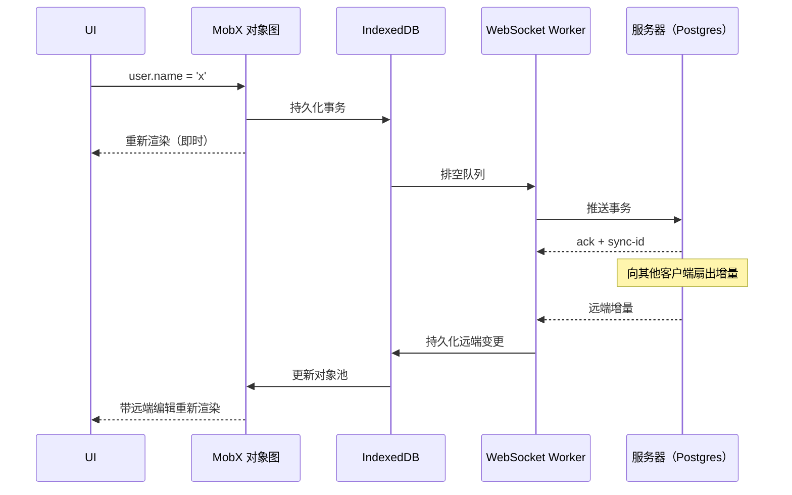

# CRDT 应用（Yjs、Automerge、本地优先软件）

> **TL;DR**: CRDT 理论承诺无需协调就能确定性合并，但在生产环境里，难的部分从来不是合并函数，而是持久化、传输、模式迁移、访问控制与可观测性。CRDT 库给你收敛性，同步引擎才给你一个能上线的产品。Yjs 处理 260K 次编辑操作约需 1,074 ms（Ryzen 9 7900X）[^1]，这些操作在磁盘上只占约 227 KB[^2]。Automerge 2.0 的 Rust 重写把同一条 trace 上的内存占用从 1.1 GB 降到约 44.5 MB。[^1] Web 编辑器选 Yjs，JSON 形态、重视历史的应选 Automerge，而如果要在几周而不是几个月内做出协作能力，就用托管服务。

## 学习目标

学完本章，你应当能够：

- [ ] 针对具体的协作产品，在 Yjs、Automerge 与 Liveblocks 之间做出选择
- [ ] 在 NAT、规模与隐私约束下设计同步拓扑（p2p、服务端中继、混合）
- [ ] 围绕 IndexedDB 持久化与后台同步搭建离线优先的应用架构
- [ ] 在 CRDT 文档之上做出用户可见的撤销/重做与冲突消解交互
- [ ] 给同步链路加上足够的埋点，以便在生产环境排查卡住的客户端
- [ ] 解释为什么新的协作产品用 CRDT 取代了操作转换（Operational Transform, OT）

## 直觉理解

你和朋友在厨房的白板上维护一张共享的购物清单。某天早上你写下"鸡蛋"，而朋友在另一个房间写下"牛奶"。谁都没等谁。等两人回到白板前，两个条目都在。没有冲突，没有协调者。白板之所以同时容纳两条记录，是因为新增操作彼此并不干扰。

现在想象你们同时擦掉同一个条目。一个人看到它消失了，另一个人又把它加了回去。谁的版本赢？普通白板没有规则。CRDT 白板有：它把确定性的消解规则嵌进数据结构本身，于是无论谁先同步，两块白板最终都收敛到同一个状态。

把这块白板放大到 50 个光标同时在线的富文本编辑器、一千万个 issue 的项目跟踪系统，或者共享画布上带矢量图形的设计工具。白板这个类比依然成立：每个副本在本地应用变更，异步同步，靠构造保证收敛。难的部分不再是合并，而是它周围的一切：用户关掉标签页后白板怎么持久化？网络断了一小时怎么同步？怎么阻止恶意用户破坏所有人的白板？

[CRDT：无冲突复制数据类型](../part-3-distributed-systems-theory/05-crdts.md) 讲过半格数学、CvRDT 与 CmRDT、OR-Set 和 LWW-Register。本章讲应用那一半：工程师周一真正要交付的东西。

## 原理

### 本地优先的论点

Ink & Switch 在 2019 年的文章中提出了"本地优先软件"（local-first software）这个概念，并给出七条理想：没有加载转圈、工作成果不被锁在一台设备上、网络可选、无缝协作、长期存储、默认安全与隐私、用户保留最终所有权。[^3] 其核心是一次架构上的倒置：云应用把服务器当作权威，把客户端当作随时可丢弃的缓存；本地优先把这个契约翻过来，让本地副本成为权威，服务器退化为中继。

CRDT 之所以能支撑这种倒置，是因为它允许各个副本独立修改而无需协调，并且只要更新最终被交换，就有收敛性的数学保证。实际效果是交互延迟低于 50 ms（读写都落在本地存储而不是网络上），而且无需事后改造就具备完整的离线能力。[^4]

今天在践行本地优先理念的产品包括 Linear、Actual Budget、Logseq、Obsidian 和 Apple Notes。没有一个完美命中全部七条理想。把差距说清楚本身就是这门手艺的一部分：Linear 的服务器对排序仍然权威；Obsidian 把文件存在本地，却没有内置的多用户合并。理想是指南针，不是检查清单。

### Yjs 架构

Yjs 是一个高性能的 JavaScript CRDT 库，实现了 YATA 算法。`Y.Doc` 是根容器，持有各种共享类型：`Y.Text`（RGA 风格的序列 CRDT）、`Y.Array`、`Y.Map` 和 `Y.XmlFragment`。每个共享类型本身就是一个独立的 CRDT。编辑器绑定（ProseMirror、Tiptap、Monaco、Slate、BlockSuite）直接观察并修改这些类型。[^5]

Provider 是可插拔的包，负责在多个 `Y.Doc` 实例之间搬运更新，或者把它们持久化：

- **y-websocket** 连接到中继服务器，由服务器广播更新，并可选地持久化状态。
- **y-webrtc** 通过 WebRTC DataChannel 在节点之间直接同步。
- **y-indexeddb** 把每一次更新都写入浏览器的 IndexedDB，保证离线下的持久性。

awareness 协议是一条独立的临时通道，承载光标、选区和在线状态。y-protocols 规范定义了两个时间间隔：节点至少每 15 秒重新广播一次自己的 awareness 状态；任何超过 30 秒未刷新的条目被视为离线，并在本地删除。[^6]

*一个 Y.Doc 承载带类型的共享结构，并通过彼此独立的 provider 包复制出去；持久化不过是又一个监听同一条更新流的 provider。*

传输协议是二进制的。两个节点同步时先交换状态向量（一份紧凑的 `Map<clientId, clock>`，记录各自已见过的内容），然后各自通过 `encodeStateAsUpdate(doc, remoteStateVector)` 只发送缺失的更新。完成初始握手后，每次本地变更都以增量更新消息广播。单个字符追加的更新大小中位数约为 27 字节。[^2]

*每一次本地编辑都先落到 Y.Doc 和 IndexedDB，之后才涉及网络；重连时通过 SyncStep1/SyncStep2 发送一个压缩后的增量，而不是重放成千上万条微小操作。[^6]*

### Automerge 2.0

Automerge 把文档建模成任意嵌套的 JSON（map、数组、文本、计数器），并保留完整、可寻址的历史。2.0 版本（2023 年 1 月）是用 Rust 从头重写的，取代了纯 JS 的 v0.14。文档采用压缩的列式二进制格式：相关联的数据（所有字符的 opId、所有插入位置）打包在一起，以提升缓存效率。[^1]

每次变更都携带 Lamport 时间戳 `(counter, actorId)`。完整历史可查询，因此能实现时间旅行、blame 和类似 git 的分支。Peritext 由 Automerge/Ink & Switch 团队的研究者开发，是唯一对重叠富文本格式区间做了严肃处理的 CRDT 方案。[^7]

在 Martin Kleppmann 论文所用 trace（259,778 次编辑操作）上的性能，数据取自 Automerge 2.0 发布博客，硬件为 Ryzen 9 7900X：[^1]

| 库 | 应用耗时 | 内存 | 磁盘文档大小 |
|---|---|---|---|
| Automerge 0.14（JS） | ~500,000 ms | ~1,100 MB | ~146 MB |
| Automerge 2.0（Rust/WASM） | ~1,816 ms | ~44.5 MB | ~129 KB |
| Yjs 13.6 | ~1,074 ms | ~10.1 MB | ~227 KB[^2] |

在不同硬件上跑跨库基准测试，结果可能相差 2 到 3 倍：Loro 团队在 MacBook Pro M1 上跑同一条 trace，Yjs 13.6.15 约 2,616 ms，Automerge 2.1.10 约 7,109 ms。[^2] 在把任何数字写进容量规划之前，务必在你自己的目标硬件上重跑一遍基准。

Automerge-repo（2023 年）是更高层、开箱即用的库，带可插拔的网络适配器（WebSocket、BroadcastChannel、WebRTC）和存储适配器（IndexedDB、OPFS、文件系统）。它之所以存在，是因为 v0.x 时代分布式系统的复杂度把应用开发者吓跑了。

### Automerge 3.0

Automerge 3.0（2025 年 7 月）重构了运行时，让内存中也使用此前只用于磁盘的列式压缩格式。结果是内存占用在 2.0 的基础上再降 10 倍以上。最能说明问题的数字：把《白鲸》全文粘贴进一个 Automerge 2 文档要吃掉约 700 MB 内存；在 Automerge 3 里同一份文档只占约 1.3 MB。[^14] 大历史文档的加载时间也大幅改善（有报告称从 17 小时以上降到 9 秒）。文件格式与 2.0 保持一致，所以迁移只是升个版本号，API 改动很小（`Text` 类被移除，改用原生字符串；`RawString` 更名为 `ImmutableString`）。

### 新兴库：Loro 与 Diamond Types

**Loro** 是一个 Rust 实现的 CRDT 库，同时面向文本和富结构化数据。在论文 trace 上它落盘约 231 KB，与 Yjs 旗鼓相当，并且提供了可移动树（Movable Tree）CRDT 来处理层级数据——这是 Yjs 和 Automerge 都不原生支持的能力。

**Diamond Types** 是 Joseph Gentle 的纯文本研究性 CRDT，目前在论文 trace 上是单线程最快的文本 CRDT。Gentle 的博客"CRDTs go brrr"记录了相对早期 Automerge 的 5,000 倍提速。[^8] 它证明了 CRDT 的开销并非本质性的。不过它只支持纯文本，也还没打算作为生产库使用。

### 同步拓扑

占主导的是两种传输形态：

**服务端中继**（`y-websocket`、Liveblocks、PartyKit）：单个 WebSocket 服务器接收更新，把它们应用到已持久化的 `Y.Doc` 上，再广播给其他客户端。多实例部署时用 Redis pub/sub 做扇出。访问控制落在服务器上，这正是纯 p2p 会丢失的保证。[^5]

**点对点**（`y-webrtc`、libp2p）：节点之间通过 WebRTC DataChannel 直接同步。一个不受信任的信令服务器只负责交换 SDP。客户端把连接数上限设为 `20 + random(15)` 个节点，避免 O(n^2) 的网状结构撞上浏览器限制；随机因子则用来防止形成簇。[^9]

*WebRTC 网状结构让数据不经过中继，但每个节点大约 35 个连接就到顶了；轴辐式结构能扩展到数千名编辑者，代价是自己要承担鉴权执行点的角色。*

NAT 穿透需要 STUN 做公网 IP 发现，直连 UDP 失败时还需要 TURN 做中继。相当一部分连接（常被引用为 10% 到 20%）因为对称 NAT 或严苛防火墙而必须走 TURN 中继。[^10] 没有 TURN，就有相当比例的用户无法直连。这就是为什么纯 p2p 很少成为生产环境的默认选择。

### 托管服务与同步框架

生态的中间层把持久化、传输和鉴权打包在一起，让团队几天内就能交付协作功能：

| 服务 | 模式 | 关键特性 |
|---|---|---|
| Liveblocks | 托管 WebSocket + 自有冲突类型 + Yjs 模式 | 几天即可上线；v2 引擎从存储流式加载文档，把上限提到每对象 2 MB[^11] |
| PartyKit | Cloudflare Durable Objects + Yjs | 部署在边缘的房间，每个房间独立状态 |
| Y-Sweet | 托管 Yjs 中继，S3 持久化 | y-websocket 的即插即用替代品 |
| Replicache | 客户端同步引擎，后端可插拔 | 借鉴游戏体验的乐观交互；后继产品为 Zero（见下）[^12] |
| Zero (Rocicorp) | 查询驱动的 Postgres 到客户端同步引擎 | 2026 年 3 月正式可用；取代 Replicache 与 Reflect；把 Postgres 的子集同步到客户端 SQLite[^15] |
| ElectricSQL / PowerSync | Postgres 与 SQLite 双向同步 | 兼容既有 Postgres；内部并非基于 CRDT |

警示故事：Rocicorp 在 2023 年推出 Reflect，又在 2024 年 11 月把它关停。[^12] 它的后继产品 Zero 于 2026 年 3 月正式可用。[^15] 依赖厂商违背了 Ink & Switch 的长期存续理想。如果本地优先是你的核心价值，就自己掌握同步层。

### 什么情况下不该用 CRDT

CRDT 无法强制全局不变量。以下场景请用传统协调机制：

- **唯一性约束**（用户名、邮箱地址）：两个副本可以各自独立地抢下同一个用户名。
- **金融交易**：防双花必须靠串行化。
- **需要全局一致的顺序序列**：CRDT 会收敛，但最终顺序可能让用户意外。
- **网络可靠的小团队**：一条简单的 Postgres 行锁就够用时，复杂度开销并不划算。

## 真实案例

Linear 是一个项目跟踪系统，依托受本地优先理念启发的同步引擎，在任何网络条件下都能为大型工作区提供低于 50 ms 的交互延迟。[^4] 它的同步引擎是自研的，并非 CRDT 库，但建立在 CRDT 启发的原则之上。

**架构：** 客户端持有一份完整的对象图（Issue、Project、User），用 MobX 做响应式，并镜像到 IndexedDB。每次变更的流向是：前端修改对象图，事务被追加到 IndexedDB 中持久化的队列，再由一个 WebSocket worker 把队列排空送到服务器。读路径：服务器通过 WebSocket 推送 changeset，客户端拉取增量、更新 IndexedDB，MobX 通知 UI。

**冲突消解：** 大多数字段用最后写入者胜（Last-Write-Wins, LWW）。Linear 的 CTO Tuomas Artman 指出，issue 跟踪系统里真正的冲突很少，因为人的注意力天然是分区的。CRDT（Yjs 风格）只用在对 issue 描述（富文本）的处理上——那里确实会发生并发的字符级编辑。[^13]

**初始加载：** 首次连接拉取压缩快照。后续连接只发送上次已知的 sync-id，然后接收增量。后端读流量因此大幅下降，因为大部分读都命中本地 IndexedDB。

*一次赋值加上一次 save() 就是协作编辑在业务代码里暴露的全部接口。同步引擎替应用作者藏起了乐观更新、重试、持久化和扇出。*

洞察在于：并非每个协作应用都需要到处用 CRDT。重叠很少时，LWW 是诚实的选择。把 CRDT 圈在真正会发生并发字符级编辑的字段上。

## 权衡

| 方案 | 优点 | 缺点 | 适用场景 | 我们的选择 |
|---|---|---|---|---|
| Yjs | 基准测试中最快的 CRDT；久经生产验证；编辑器绑定丰富 | JS 优先；不做手动压缩历史就会持续增长 | Web 编辑器，2 到 50 名并发编辑者 | 浏览器端协作的默认选项 |
| Automerge | JSON 用起来干净；完整历史与时间旅行；Rust 内核 | 单操作开销更高（约慢 2 倍）；生态较小 | JSON 形态的数据，原生多平台 | 需要历史或非 JS 客户端时 |
| Liveblocks（托管） | 几天即可上线；鉴权、在线状态、评论开箱即用 | 依赖厂商；服务端权威；按 MAU 计费 | 现在就要协作能力的初创团队 | 上市速度比自主可控更重要时 |
| 自研（Linear、Figma） | 精确贴合自己的数据模型；完全可控 | 数年工程量；自己的 bug 自己扛 | 有 10 名以上工程师且数据形态独特 | 只有在现成库确实不合用时 |
| OT（Google Docs） | 超大规模下已验证成熟；元数据紧凑；无墓碑 | 必须有中央权威；离线体验差 | 已经跑在 OT 上的存量系统 | 维护既有 OT 部署；新协作产品选 CRDT 库 |

## 常见陷阱

> [!WARNING]
> **把 CRDT 库当成同步引擎。** 你选了 Yjs，接上 WebSocket，三个月后发现没有鉴权模型、没有备份策略、也没法观察卡住的客户端。库宣传"无需中央服务器"；可现实世界需要服务器来做鉴权、限流和持久化。要么在上面加一层同步引擎，要么直接用 Liveblocks / Y-Sweet / Automerge-repo。

> [!WARNING]
> **历史无限增长。** 编辑一年之后，本该 50 KB 的 Yjs 文档变成 20 MB，因为 CRDT 会记录包含墓碑在内的全部历史。定期用 `Y.encodeStateAsUpdate(doc)` 拍快照，重新持久化为压缩后的更新，并丢弃更早的条目。Ink & Switch 在用 PushPin 做内部冲刺规划之后就明确指出了这个问题。[^3]

> [!WARNING]
> **NAT 穿透挡住 p2p 同步。** 两个用户通过 awareness 协议互相看得见"在线"，但更新永远传不过去。两人都在对称 NAT 后面。部署一台 TURN 服务器（coturn、Twilio），或者干脆绕开这个问题：常见场景走服务端中继，只有明确私密的文档才走 p2p。

> [!WARNING]
> **在文本字段上做最后写入者胜。** 两个编辑者在同一段落里并发输入，其中一次编辑会静默覆盖另一次。字段级 LWW 把整块文本当成一个值。任何超过约 16 个字符的内容都该用序列 CRDT（`Y.Text`、Automerge Text）。Peritext 论文专门提到 Notion（曾资助该研究）：当两个用户并发修改同一个块时，Notion 自身的块级合并只会保留一方的编辑。[^7]

> [!WARNING]
> **面对离线客户端的模式迁移。** 你把字段从 `authors` 改名为 `contributors`。一个旧客户端重新连上，重放引用旧模式的待处理编辑，僵尸数据就此复活。Ink & Switch 的 Cambria 库通过双向 lens 做转换：每次写入都打上写入者模式的标签，读取方则沿模式图中的最短 lens 路径转换。

## 练习

为一个移动优先的笔记应用设计同步架构，该应用有 Web 客户端并需要离线支持。选一个库并说明理由；画出拓扑；定义 IndexedDB 持久化与增量加载方案；说明撤销/重做的范围；列出上线前必须埋点的三个最重要指标。

提示

想一想用户离线编辑一周后重新连接会发生什么。待同步的更新有多大？你怎么避免重放成千上万条微小操作？再考虑服务器是需要权威，还是只当中继就够。

解答

**选库：** Yjs。笔记是富文本（`Y.Text` 的最佳场景），应用覆盖 Web 与移动端（Yjs 通过 ywasm 支持 React Native），生态里已有生产级的 IndexedDB 持久化。

**拓扑：** 用 y-websocket 做服务端中继。每个文档房间一个中继，后端用 Postgres `bytea` 存持久快照，用 Redis pub/sub 做多实例扇出。笔记是个人或小群体的，用不上 p2p；NAT 问题不值得那份复杂度。

**持久化：** 客户端用 y-indexeddb。应用启动时从 IndexedDB 加载已持久化的 Y.Doc（冷启动即时完成）。订阅更新流做增量持久化。服务器端每 1,000 次更新把更新日志压缩成一个快照，以约束存储增长。

**增量加载：** 重连时客户端发送自己的状态向量。服务器回以 `encodeStateAsUpdate(serverDoc, clientStateVector)`，一个只含缺失操作的二进制块。不重放任何单次击键。

**撤销/重做：** 使用 `Y.UndoManager`，作用域限定在本地用户的 client-id 上。撤销栈只回退本地用户自己的操作，不碰会话期间到达的远端编辑。

**三个最重要的指标：**

1. `sync_lag_seconds`，按（用户, 文档）统计：距上次成功收到服务器 ack 的时间。
2. `pending_queue_depth`：尚未同步的本地更新数量。
3. `doc_size_bytes` 与 `content_length_bytes` 的比值：比值异常说明墓碑膨胀。

## 要点回顾

- CRDT 库给你收敛性，同步引擎才给你产品。不要把两者混为一谈。
- Web 编辑器默认选 Yjs；JSON 形态、历史丰富的应用选 Automerge；上市速度最要紧时选托管服务。
- 本地优先是一次价值观转变：本地副本为权威、服务器为中继、用户数据所有权成为设计输入。
- 纯 p2p 很少是正确的默认选项。NAT 穿透、节点发现和访问控制会把产品推回服务端中继。
- 并非每个协作应用都需要到处用 CRDT。重叠很少时 LWW 是诚实的；把 CRDT 圈在会发生并发字符级编辑的字段上。
- 同步可观测性上的缺口会毁掉生产上线。要在用户之前先上线遥测（状态向量大小、队列深度、最后 ack 时间戳）。
- CRDT 世界里的模式迁移需要双向 lens 或带版本的 schema。要为离线客户端重放旧 schema 写入做好准备。

## 延伸阅读

- [Local-First Software (Kleppmann et al., 2019)](https://www.inkandswitch.com/local-first/)。为这场运动命名的宣言；七条理想是应用类文献中被引用最多的框架。
- [Peritext: A CRDT for Rich-Text Collaboration (Litt et al., 2022)](https://www.inkandswitch.com/peritext/)。唯一严肃处理 CRDT 中重叠富文本格式区间的成果；动手做任何富文本编辑器之前先读它。
- [How Figma's multiplayer technology works (Evan Wallace, 2019)](https://www.figma.com/blog/how-figmas-multiplayer-technology-works/)。生产环境中服务端权威、受 CRDT 启发的系统的经典文章，它明确同时拒绝了 OT 和真正的 CRDT。
- [Introducing Automerge 2.0 (2023)](https://automerge.org/blog/automerge-2/)。展示 Rust 重写带来 10 到 100 倍性能跃升的数据；选库时必备的背景材料。
- [Automerge 3.0 (2025)](https://automerge.org/blog/automerge-3/)。运行时列式压缩让内存再降一个 10 倍以上；《白鲸》占 1.3 MB，而 2.0 里要 700 MB。
- [Yjs documentation](https://docs.yjs.dev/)。Y.Doc、共享类型、provider 和 awareness 协议的参考。
- [Cambria: Schema evolution via bidirectional lenses (Ink & Switch, 2020)](https://www.inkandswitch.com/cambria/)。对"在 CRDT 世界里怎么迁移模式"唯一严肃的回答。
- [dmonad/crdt-benchmarks](https://github.com/dmonad/crdt-benchmarks)。可复现的基准测试套件；在做出任何性能断言之前先读 README 和 B4 的数字。
- [Diamond Types (Joseph Gentle)](https://github.com/josephg/diamond-types)。看看纯性能导向的文本 CRDT 能被推到多远；"CRDTs go brrr" 那篇博客是背后的故事。

## 记忆卡片

**Q:** 本地优先软件的核心架构倒置是什么？
**A:** 本地副本是权威，服务器是中继；这颠覆了服务器权威、客户端只是可丢弃缓存的云模型。

**Q:** 说出 Yjs 的四种共享类型。
**A:** `Y.Text`（序列/RGA）、`Y.Array`、`Y.Map` 和 `Y.XmlFragment`。

**Q:** 两个 Yjs 节点在断连之后如何高效同步？
**A:** 各自发送状态向量（clientId 到已知最高时钟的映射）。对方只回以缺失的更新，用 `encodeStateAsUpdate(doc, remoteStateVector)` 编码。

**Q:** Yjs 中单次字符追加的传输大小中位数是多少？
**A:** 约 27 字节。

**Q:** Automerge 2.0 为什么用 Rust 重写？
**A:** 纯 JS 的 v0.14 在 260K 次编辑下用掉约 1.1 GB 内存和约 146 MB 磁盘。Rust 重写把内存降到约 44.5 MB、磁盘降到约 129 KB（约每字符 1 字节开销）。

**Q:** WebRTC 连接常被引用的 TURN 回退比例是多少？
**A:** 常被引用为 10% 到 20% 的连接需要 TURN 中继，因为对称 NAT 或严苛防火墙导致直连 UDP 失败。

**Q:** Linear 为什么在大多数字段上用 LWW 而不是 CRDT？
**A:** issue 跟踪系统里真正的冲突很少，因为人的注意力天然是分区的。CRDT 只留给 issue 描述（富文本）——那里确实会发生并发字符级编辑。

**Q:** Cambria 解决什么问题？
**A:** CRDT 世界里的模式迁移。它通过双向 lens 转换写入，让使用旧 schema 的离线客户端重连时不引入僵尸数据。

**Q:** 说出上线同步引擎前应当埋点的三个指标。
**A:** （1）按（用户, 文档）的同步延迟；（2）未同步本地更新的队列深度；（3）文档大小与内容长度的比值，用于发现墓碑膨胀。

**Q:** 什么情况下不该用 CRDT？
**A:** 当你需要全局不变量（唯一用户名、金融交易、防双花），或者按你的团队规模和网络可靠性，一条 Postgres 行锁就够用时。

**Q:** Yjs 中的 awareness 协议是什么？
**A:** 一条独立的临时通道，承载光标、选区和在线状态。节点至少每 15 秒重播一次状态；任何超过 30 秒未刷新的条目被标记为离线并在本地删除。

**Q:** Figma 的多人在线机制与真正的 CRDT 有何不同？
**A:** Figma 采用服务端权威模型加属性级 LWW。顺序由服务器定义，因此不需要 Lamport 时间戳或去中心化合并。它受 CRDT 启发，但明确不是 CRDT。

## 参考文献

[^1]: "Introducing Automerge 2.0", Automerge Project, January 2023. https://automerge.org/blog/automerge-2/
[^2]: Loro project, "JS/WASM Benchmarks" (Yjs 13.6.15, Automerge 2.1.10, Loro 1.0.0-beta.2). https://loro.dev/docs/performance
[^3]: Kleppmann, Wiggins, van Hardenberg, McGranaghan, "Local-first software: you own your data, in spite of the cloud", Onward! 2019. https://www.inkandswitch.com/local-first/
[^4]: Tuomas Artman, "Scaling the Linear Sync Engine", Linear, June 2023. https://linear.app/blog/scaling-the-linear-sync-engine
[^5]: Yjs Documentation, "Introduction". https://docs.yjs.dev/
[^6]: y-protocols PROTOCOL.md (sync v1 encoding and awareness). https://github.com/yjs/y-protocols/blob/master/PROTOCOL.md
[^7]: Litt, Lim, Kleppmann, van Hardenberg, "Peritext: A CRDT for Rich-Text Collaboration", CSCW 2022. https://www.inkandswitch.com/peritext/
[^8]: Joseph Gentle, "5000x faster CRDTs: An Adventure in Optimization", July 2021. https://josephg.com/blog/crdts-go-brrr/
[^9]: y-webrtc README. https://github.com/yjs/y-webrtc
[^10]: WebRTC.ventures, "Mastering STUN/TURN Servers", November 2024. https://webrtc.ventures/2024/11/mastering-stun-turn-servers-a-guide-to-proper-integration-for-webrtc-applications/
[^11]: Liveblocks, "The new realtime data storage engine and its benefits" (v2, March 2026). https://liveblocks.io/docs/guides/about-the-new-storage-engine
[^12]: Rocicorp, "Retiring Reflect", June 2024. https://roci.dev/blog/retiring-reflect
[^13]: "Linear's sync engine architecture", fujimon.com, August 2024. https://www.fujimon.com/blog/linear-sync-engine
[^14]: "Automerge 3.0", Automerge Project, July 2025. https://automerge.org/blog/automerge-3/
[^15]: Rocicorp, "Zero - Project Status" (GA March 2026). https://zero.rocicorp.dev/docs/status
