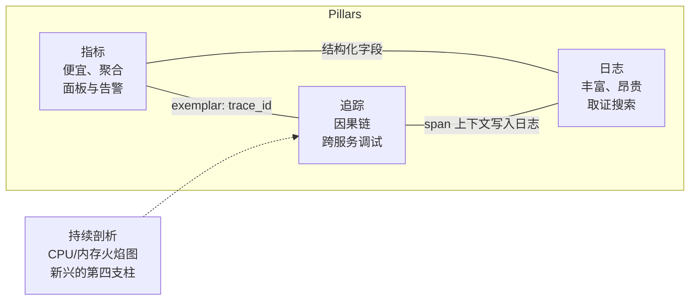
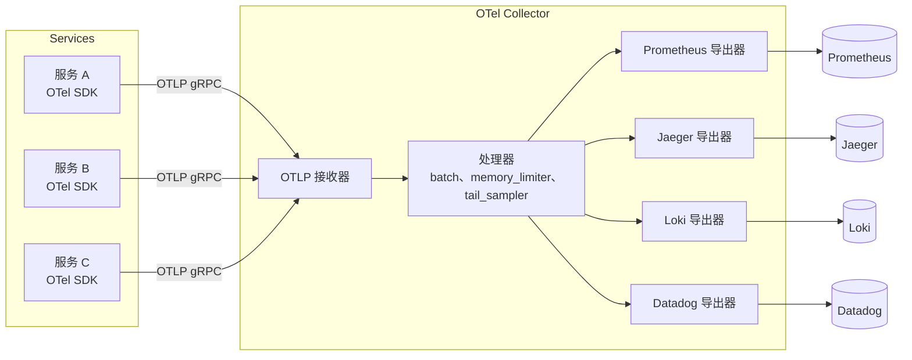
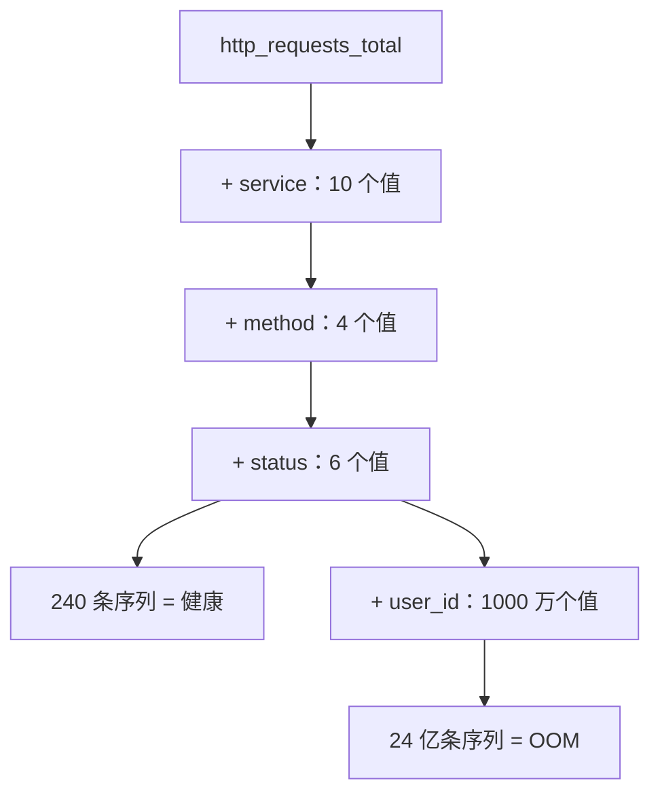
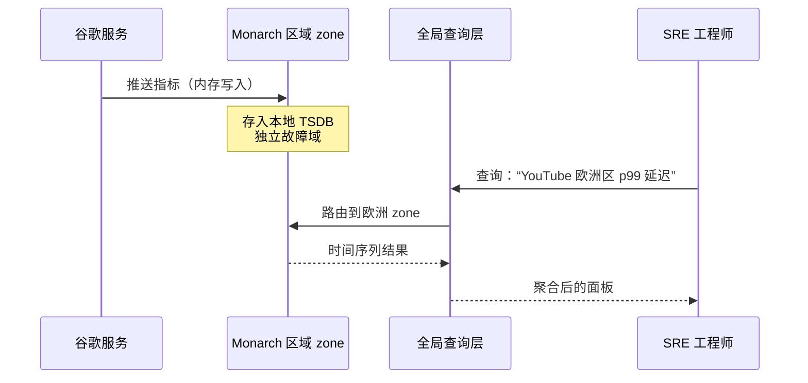

# 可观测性：指标、日志、追踪与 OpenTelemetry 标准

> **TL;DR**：可观测性是指不发布新代码就能对系统行为提出任意问题的能力。它建立在三大支柱上：指标（metrics，廉价的数值聚合，用于面板和告警）、日志（logs，离散事件，用于事后取证）、追踪（traces，跨服务的单请求因果链）。Google 的 Dapper 证明，即使只采样 0.1% 的追踪，在行星级规模下也能产出有用的调试数据[^1]。这个领域的核心张力是成本与精细度：指标便宜但粗糙，日志丰富但昂贵，追踪保留因果性但必须采样。每一个生产环境的可观测性部署，本质上都是一组基数与采样决策，外面套了个技术栈的名字。用 OpenTelemetry 埋点，按 SLI 燃烧率告警，并把标签基数当成需要在 PR 里评审的 schema。

## 学习目标

学完本模块，你将能够：

- [ ] 说清三大支柱各自擅长什么、不擅长什么
- [ ] 用 USE 和 RED 方法论决定资源与服务分别该测什么
- [ ] 用 OpenTelemetry 为一个服务埋上指标、日志和追踪
- [ ] 基于 SLI 燃烧率设计告警，而不是基于噪声很大的资源阈值
- [ ] 在规模化场景下推理基数、采样与可观测性成本
- [ ] 用 exemplar 把指标连到追踪，快速导航到根因

## 直觉理解

你经营着 50 家咖啡店。每天早上你看一块面板：总销量、平均等待时间、每家店的营收。这些就是你的**指标**（metrics）。它们告诉你哪里出了问题（“12 号店营收掉了 40%”），但说不出原因。

于是你调出 12 号店的监控录像。你在几个小时的视频里来回拖，找事情开始跑偏的那一刻。这就是你的**日志**（logs）：细节丰富、成本高昂，一旦你知道该往哪看，取证非常管用。

但如果问题不在某一家店里呢？顾客在 App 下单，支付走支付服务商，订单路由到最近的店，店员拿到一张小票。如果顾客等了 10 分钟，是哪一跳慢了？你需要沿着这一位顾客的旅程，走过它碰到的每一个系统。这就是**追踪**（trace）：用同一个订单 ID 串起来的因果链。

现在想象你有 50 家店，每家 7×24 小时产生录像。你不可能全部永久保存。你采样：只在等待时间指标飙高或有顾客投诉时保留录像。这个采样决策——留什么、丢什么——就是规模化可观测性的核心经济问题。

[可用性与可靠性](../part-1-core-fundamentals/02-availability-and-reliability.md) 给了你几个 9 和错误预算这套词汇。这一章给你测量自己是否达标的埋点手段，以及判断自己何时没达标的告警哲学。

## 原理

### 三大支柱（以及它们的批评者）

2017-2018 年由 Cindy Sridharan 和 Peter Bourgon 推广开的常规模型，把可观测性框定为三类互补的遥测数据[^2]。

**指标**是聚合成时间序列的数值样本，以指标名和一组标签作为键。Prometheus 默认每 1 分钟抓取一次，不过生产部署常把它调到 15-30 秒[^3]。按每个数据点算，它是最便宜的支柱：一个计数器占的是字节，不是千字节。非常适合面板和告警评估。

**日志**是带时间戳、严重级别、消息以及（越来越多的）结构化键值属性的离散事件。规模化之后，账单主要是它们贡献的。一个 10K RPS、平均每条日志 5 KB 的服务，每天产生约 4 TB。

**追踪**是 span 的集合，每个 span 代表一个工作单元，带开始时间、时长和父 span ID。span 通过 W3C `traceparent` 头传播的 trace ID 串在一起。在一个 100 个微服务的系统里，只有追踪这一支柱能回答“为什么这一次请求花了 2 秒”。

三支柱模型正在被积极批评。Ben Sigelman（Dapper 的共同作者、OpenTracing 的共同作者、OpenTelemetry 治理委员会成员）在 KubeCon 2018 上主张，把指标、日志、追踪当成彼此独立的烟囱是没抓住重点：真正的可观测性在于缩小可能解释的搜索空间，而任何单一支柱都做不到这一点。Charity Majors 和 Honeycomb 更进一步，走向“可观测性 2.0”：一个统一的真相源（任意宽、高基数的结构化事件），指标、追踪、日志都是从它派生出来的视图，而不是三个独立的存储。还有第三派提出把持续剖析（continuous profiling）作为第四支柱，依据是 Google 2010 年的 Google-Wide Profiling 论文[^4]。

务实的结论：对大多数团队来说，三大支柱仍是运维现实，但要用共享上下文把它们连起来（日志里的 trace ID、指标里的 exemplar），而不是把它们当成孤岛。



*三大支柱不是孤岛：exemplar 把指标连到追踪，追踪上下文丰富日志，结构化日志字段又反过来喂给指标聚合。持续剖析是新兴的第四类信号。*

### USE、RED 与四大黄金信号

有三套有名字的方法论告诉你该测什么。它们面向不同的层。

**USE**（Brendan Gregg）：对每个资源（CPU、磁盘、网卡、锁），记录 Utilization（使用率，忙碌百分比）、Saturation（饱和度，队列长度）、Errors（错误数）。Gregg 称它用 5% 的力气解决了大约 80% 的服务器性能问题[^5]。关键洞见：100% 使用率持续几秒就会造成饱和，哪怕 5 分钟平均值只有 80%。

**RED**（Tom Wilkie，Grafana Labs）：对每个服务，记录 Rate（每秒请求数）、Errors（每秒失败请求数）、Duration（延迟直方图）。RED 让每个服务都有形状相同的面板，对比和新人上手都变得毫不费力[^6]。

**四大黄金信号**（Google SRE Book）：延迟、流量、错误、饱和度。它合并了两种视角，并加上一条关键原则：对用户能感受到的症状告警，而不是对你猜出来的原因告警[^7]。

| 方法论 | 对象 | 度量 | 最适合 |
|---|---|---|---|
| USE | 资源（CPU、磁盘、网卡） | 使用率、饱和度、错误 | 排查基础设施瓶颈 |
| RED | 服务（API 端点） | 请求速率、错误、时长 | 单服务面板与 SLO |
| 黄金信号 | 面向用户的系统 | 延迟、流量、错误、饱和度 | 对用户可见的影响告警 |

> [!TIP]
> 三者一起用。基础设施层用 USE，服务层用 RED，告警定义用黄金信号。它们是互补的，不是竞争的。

### OpenTelemetry：埋点一次，发往任意后端

OpenTelemetry（OTel）于 2019 年 5 月由 OpenTracing 和 OpenCensus 合并而成，在 KubeCon 巴塞罗那站宣布[^8]。它是 CNCF 的厂商中立标准，用来生成、收集和导出遥测数据，按贡献者数量算是第二活跃的 CNCF 项目，仅次于 Kubernetes[^9]。

架构分三层：

1. **API + SDK**（按语言分：Java、Go、Python、.NET、JS、Rust、C++）。你调用 API，SDK 负责采样、批处理和导出。
2. **OTLP**（OpenTelemetry Protocol）：走 gRPC（:4317）或 HTTP（:4318）的线格式。
3. **Collector**：厂商中立的中转代理，负责接收、处理（批处理、内存限制、尾部采样、PII 擦除）并导出到任意后端。

语义约定（semantic conventions）统一了属性名（`http.request.method`、`db.system`、`service.name`），所以为某个后端写的面板换到另一个后端上也能直接用[^9]。



*OpenTelemetry Collector 站在已埋点的服务和任意数量的后端之间。埋点只写一次；换目标靠配置，不靠改代码。*

Collector 的配置是声明式 YAML：

```yaml
receivers:
  otlp:
    protocols:
      grpc:
        endpoint: 0.0.0.0:4317
processors:
  batch:
    timeout: 10s
  memory_limiter:
    check_interval: 1s
    limit_mib: 512
exporters:
  prometheus:
    endpoint: 0.0.0.0:8889
  otlp/jaeger:
    endpoint: jaeger:4317
service:
  pipelines:
    metrics:
      receivers: [otlp]
      processors: [memory_limiter, batch]
      exporters: [prometheus]
    traces:
      receivers: [otlp]
      processors: [memory_limiter, batch]
      exporters: [otlp/jaeger]
```

> [!IMPORTANT]
> “厂商中立”不等于“厂商配合”。Datadog 把 OTel 语义约定映射到自家 span 的方式有损，许多进阶特性仍然要靠它自己的专有 SDK。承诺之前先评估厂商对 OTel 的支持程度。

### 基数、采样与成本

基数是某个指标名下不同标签值组合的数量。每一种唯一组合都是一条独立的时间序列，有自己的索引条目、保留策略和成本。它是那个悄无声息的预算杀手。

一个 `http_requests_total` 指标，标签为 `service`（10 个值）、`method`（4 个）、`status`（6 个），产生 240 条序列。加上 `user_id`（1000 万用户），你就得到 24 亿条序列。Prometheus 直接 OOM，Datadog 的账单跳几个数量级。



*每个标签都在乘序列数。一个没有上界的标签能在一夜之间毁掉 TSDB 的经济性。*

**Datadog 的定价把这件事摆得很具体。** 免费额度之外（Pro 版每台主机 100 个自定义指标，Enterprise 版 200 个），每多接入 100 个自定义指标（Metrics without Limits 下）收费 0.10 美元/月；索引指标超额的部分按合同谈，但金额可能相当可观。一次基数爆炸造出几百万条序列，就能带来六位数美元的意外账单[^10]。

**采样**是追踪侧的对应手段。头部采样（head-based sampling）在请求入口决定要不要追踪（典型比例 0.1% 到 1%）。Dapper 在 Google 生产环境按 0.1% 采样上线，在数十亿次请求里照样产出了有用的数据[^1]。问题在于：一个万分之一概率的 bug，在 10 QPS 的服务里一天可能连一条追踪都产生不了。

**尾部采样**（tail-based sampling）解决了这个问题：先把所有 span 缓冲几秒，等请求结束后再决定要不要导出，并偏向保留错误和长延迟的追踪。代价是 Collector 里的内存和复杂度。

**规则：** 把指标标签当成 schema，像数据库迁移一样在 PR 里评审。只用可枚举的标签（service、route、status_code、region）。用 exemplar 把指标连到具体的追踪，而不是硬把 request ID 塞进标签。

### 告警哲学：看症状，不看原因

默认的直觉是对资源阈值告警：CPU > 80%、磁盘 > 85%、内存 > 90%。这些都不是用户能感受到的症状。值班工程师慢慢就不看了。真正的故障淹没在噪声里。

现代告警按 SLI 相对 SLO 的燃烧率（burn rate）来告警。参考算法是 Google SRE Workbook 里的多窗口多燃烧率（multi-window, multi-burn-rate，MWMBR）[^11]。

- 30 天内 99.9% 的 SLO，错误预算就是总事件的 0.1%。
- 燃烧率 1.0 正好在 30 天内花完预算。
- 燃烧率 14.4 会在窗口的 1/14.4（约 2 天）内把它耗尽。

MWMBR 规则在长窗口和短窗口同时超过阈值时才发告警：

| 燃烧率 | 长窗口 | 短窗口 | 消耗预算 | 动作 |
|---|---|---|---|---|
| 14.4 | 1 小时 | 5 分钟 | 2% | PAGE |
| 6 | 6 小时 | 30 分钟 | 5% | PAGE |
| 1 | 3 天 | 6 小时 | 10% | TICKET |

短窗口就是那个“我们还在烧吗”的检查。它防止告警在恢复几个小时之后还挂着。

```yaml
# Prometheus MWMBR 告警级规则
expr: (
        job:slo_errors_per_request:ratio_rate1h{job="myjob"} > (14.4*0.001)
      and
        job:slo_errors_per_request:ratio_rate5m{job="myjob"} > (14.4*0.001)
      )
severity: page
```

这种做法逼着告警去对应真实存在、用户能感受到的影响。[SLI、SLO、SLA 与错误预算](./01-sli-slo-sla-error-budgets.md) 讲了这套告警哲学所依赖的完整 SLO 框架和错误预算机制。

> [!TIP]
> 每条告警都该有 runbook。如果你写不出这条告警的 runbook，它就不可执行。删掉它。

## 真实案例

### Google Monarch：行星级指标系统

Google 的 Monarch 是一个内存型、多租户、全球分布的时间序列数据库，监控着 Gmail、YouTube、Maps 和 Google Cloud。2020 年的 VLDB 论文报告其摄入速率达每秒数 TB 时间序列数据，查询速率达每秒数百万次[^12]。

Monarch 的架构做了三个刻意的权衡：

1. **可用性优先于一致性。** 如果一次区域故障就让监控系统看不见这次故障，那它毫无用处。Monarch 选择了 AP（可用性与分区容忍），明确拒绝 Spanner 式的强一致，因为对一个 SLO 以秒计的系统来说，读写强一致后端会阻塞太久[^12]。

2. **内存优先于磁盘。** Monarch 取代了 Borgmon，后者跨实例关联数据非常痛苦。内存让最近窗口的查询延迟降到亚秒级。长期保留放在独立的冷存储里。

3. **区域化 zone 加一个全局查询面。** 每个 zone 有独立的故障域，就近从周围的服务摄入数据。全局面提供统一的查询入口，但本身无状态，只把查询路由到合适的 zone。



*Monarch 的区域化架构保证某个 zone 挂了，运维人员不会因此看不见这次故障。全局层只是无状态的查询路由，不是一致性瓶颈。*

对比一下：Netflix Atlas 从 Atlas 之前的约 200 万条时间序列长到 2014 年的 12 亿条以上[^13]，用的也是类似的内存维度模型。Meta 的 Scuba 每秒把数百万行摄入数百台服务器（每台 144 GB 内存），从事件发生到开发者看到面板的延迟不到一分钟[^14]。这个模式在规模化场景下是通用的：热窗口放内存，冷尾放廉价对象存储。

## 权衡

| 方案 | 优点 | 缺点 | 何时合适 | 我们的选择 |
|---|---|---|---|---|
| 只有指标 | 便宜、亚秒查询、能扩到数十亿条序列 | 无法取证，解释不了单个慢请求 | 早期系统、基础设施监控 | 从这里开始 |
| 指标 + 日志 | 面板加取证搜索 | 日志量和成本随请求速率爆炸 | 微服务爆发前的大多数生产系统 | 服务数 < 10 时的默认选择 |
| 完整三支柱 | 全景：告警 + 取证 + 因果分析 | 成本、复杂度、三套心智模型、工具碎片化 | 10 个以上服务且有 SLO 的分布式系统 | 微服务的默认选择 |
| 事件式（Honeycomb 风格） | 高基数是一等公民、单一真相源、能回答没预料到的问题 | 生态比 Prometheus/Grafana 小，按事件计价的账单容易出意外 | 未知的未知占主导的复杂分布式调试 | 三支柱不够用的时候 |

## 常见陷阱

> [!WARNING]
> **基数炸弹。** 某个开发把 `user_id` 或 `request_id` 加成指标标签。序列数爆炸。Prometheus OOM，或者 Datadog 账单翻 10 倍。把指标标签当成需要评审的 schema。只用可枚举的值。盯住 `prometheus_tsdb_head_series` 当哨兵。

> [!WARNING]
> **“全都记下来，回头再理。”** 一个 10K RPS、每条日志 5 KB 的服务每天产生 4 TB。按商业日志索引的价格，那是每个服务每月 5 万美元以上。凡是能聚合的东西都优先用指标。日志留给那种需要原始事件的故障调查。在摄入端采样或丢弃。

> [!WARNING]
> **基于原因的告警带来告警疲劳。** CPU > 80% 或磁盘 > 85% 的告警不是用户能感受到的症状。值班工程师慢慢就不看了。改成对 SLI 燃烧率告警。每季度量一下你的误报率。

> [!WARNING]
> **缺少 exemplar 链路。** 面板上延迟指标飙了，却没有办法跳到一条示例追踪。打开 OpenTelemetry 的 exemplar。确保 `service.name`、`trace_id`、`span_id` 在指标和追踪两条导出链路里都流动。

> [!WARNING]
> **面板泛滥。** 团队攒了几百块面板，大多数没人维护。真出事的时候，没人知道哪块是当前的。面板按服务归属。从 SLO 定义自动生成。90 天没人看的归档掉。

## 练习

为一个有 50 个服务、总流量 100K RPS 的微服务平台设计可观测性。选一套埋点栈，为每个服务定义黄金信号，指定追踪的采样率，并估算商业厂商与自建的月度成本。

<details>
<summary>提示</summary>

从写入量算起：100K RPS 摊到 50 个服务，平均每个服务约 2K RPS。指标方面，从标签推算序列数（service × method × status × endpoint）。追踪方面，按 1% 头部采样算存储量。日志方面，假设每条结构化日志 2 KB，算日增量。把 Datadog 的按主机 + 自定义指标计价和 Prometheus + Grafana Cloud 的计价对比一下。

</details>

<details>
<summary>解答</summary>

**技术栈选择：** 所有服务里放 OpenTelemetry SDK，用 OTel Collector 做网关，导出到 Prometheus（指标）、Tempo（追踪）、Loki（日志）。这样既厂商中立，后端又是经过验证的开源方案。

**指标：** 50 个服务 × 4 个黄金信号 × 约 20 种标签组合 = 每个服务约 4,000 条序列 = 总共 200,000 条序列。按 Prometheus 每 15 秒抓一次、每个样本 1-2 字节算，这个量不大。自建成本：3 台 Prometheus 加 Thanos 做长期存储，算力大约每月 2,000 美元。

**追踪：** 100K RPS 按 1% 头部采样 = 每秒 1,000 条追踪。平均每条追踪 5 个 span = 每秒 5,000 个 span。每个 span 约 500 字节 = 2.5 MB/s = 每月 6.5 TB。Tempo 存 S3：存储约每月 150 美元，查询节点算力约每月 1,500 美元。

**日志：** 100K RPS × 2 KB = 200 MB/s = 每天 17 TB。全量索引太贵。索引日志采样到 10%（每天 1.7 TB），其余归档到冷存储。Loki 存 S3：约每月 3,000 美元。

**自建总计：** 基础设施约每月 7,000 美元（不含人力）。

**Datadog 对比：** 50 个服务分布在约 100 台主机上。基础设施监控（23 美元/主机）+ APM（40 美元/主机）+ 日志管理（每天 1.7 TB 索引，约 1.70 美元/百万事件）= 每月大约 25,000 到 40,000 美元，取决于日志量和自定义指标。

**权衡：** 自建在直接成本上省 3-5 倍，但需要 1-2 名工程师维护这套栈。对 200 人以下的工程团队，商业厂商在总拥有成本上往往更划算。

**采样策略：** 1% 头部采样做基线覆盖。在 Collector 里做尾部采样，保留 100% 的错误追踪和超过 p99 延迟的追踪。这样能抓到头部采样漏掉的罕见 bug。

</details>

## 要点回顾

- 可观测性是不发布新代码就能对系统行为提出任意问题的能力。监控告诉你出了问题；可观测性帮你搞清楚为什么。
- 三大支柱（指标、日志、追踪）是互补的，不是竞争的。用共享上下文把它们连起来：日志里的 trace ID，指标里的 exemplar。
- USE 面向资源，RED 面向服务，黄金信号面向用户可见的告警。三者各用在对应的层。
- OpenTelemetry 是埋点标准。用 OTel 埋一次，通过 Collector 导出到任意后端。
- 基数是那个悄无声息的预算杀手。把指标标签当成 schema：只用可枚举的值，在 PR 里评审。
- 对 SLI 燃烧率（MWMBR）告警，不对资源阈值告警。每条告警都需要 runbook，否则它不该存在。
- 尾部采样能抓到头部采样漏掉的罕见错误，代价是 Collector 的内存和复杂度。

## 延伸阅读

- [OpenTelemetry Documentation](https://opentelemetry.io/docs/) - 从 Concepts > Signals 看起，再看 Collector > Architecture。你的埋点应该对齐的标准。
- [Google SRE Book: Monitoring Distributed Systems](https://sre.google/sre-book/monitoring-distributed-systems/) - 四大黄金信号，以及支撑现代 SRE 实践的“症状而非原因”告警原则。
- [Google SRE Workbook: Alerting on SLOs](https://sre.google/workbook/alerting-on-slos/) - MWMBR 的完整推导，包含六种越来越精细的告警形态。配置生产告警之前的必读。
- [Dapper, a Large-Scale Distributed Systems Tracing Infrastructure](https://research.google/pubs/dapper-a-large-scale-distributed-systems-tracing-infrastructure/) - Sigelman 等，2010 年。所有分布式追踪系统都建在这篇论文上。它证明不到 1% 的采样在 Google 的规模下依然管用。
- [Monarch: Google's Planet-Scale In-Memory Time Series Database](https://research.google/pubs/monarch-googles-planet-scale-in-memory-time-series-database/) - VLDB 2020。Google 如何用一个 AP 时间序列数据库监控十亿级用户的服务。
- [The USE Method](https://www.brendangregg.com/usemethod.html) - Brendan Gregg 的完整方法论，外加针对每种资源类型的操作系统级检查清单。
- [Distributed Systems Observability](https://www.oreilly.com/library/view/distributed-systems-observability/9781492033431/) - Cindy Sridharan 2018 年的 O'Reilly 报告，三支柱框架正是由它流行起来，至今仍是最好的简短入门。
- [Scuba: Diving into Data at Facebook](https://research.facebook.com/publications/scuba-diving-into-data-at-facebook/) - VLDB 2013。Honeycomb 宽事件模型的思想祖先；它说明了为什么做临时调试时，内存里的暴力扫描胜过预建索引。

## 记忆卡片

**Q:** 可观测性的三大支柱是什么？
**A:** 指标（面向面板/告警的数值聚合）、日志（用于取证的离散事件）、追踪（跨服务的单请求因果链，用于分布式调试）。

**Q:** USE 代表什么？谁提出的？
**A:** Utilization、Saturation、Errors（使用率、饱和度、错误）。Brendan Gregg 提出。按资源（CPU、磁盘、网卡、锁）逐个应用，用来找基础设施瓶颈。

**Q:** RED 代表什么？什么时候用？
**A:** Rate、Errors、Duration（请求速率、错误、时长）。Tom Wilkie 提出。按服务应用，让每个微服务都有形状相同的面板。

**Q:** Google 的四大黄金信号是什么？
**A:** 延迟、流量、错误、饱和度。它们合并了 USE 和 RED 的视角，是基于 SLI 对用户可见症状告警的基础。

**Q:** OpenTelemetry 是什么？为什么会有它？
**A:** OTel 是 CNCF 的厂商中立遥测标准（API + SDK + Collector + OTLP 协议）。2019 年 5 月由 OpenTracing 和 OpenCensus 合并而成，为的是解决厂商锁定：埋点一次，导出到任意后端。

**Q:** 为什么基数在指标系统里很危险？
**A:** 每一种唯一的标签值组合都会创建一条独立的时间序列。给指标加上 `user_id` 这种没有上界的标签，序列数会乘以用户数，导致 TSDB OOM 或账单暴涨。

**Q:** 头部采样和尾部采样的追踪有什么区别？
**A:** 头部采样在请求入口就决定要不要追踪（此时还不知道会不会出错）。尾部采样先缓冲所有 span，等请求结束后再决定，并偏向保留错误和高延迟的追踪。尾部采样能抓到罕见 bug，但更吃 Collector 内存。

**Q:** 什么是多窗口多燃烧率（MWMBR）告警？
**A:** 只有当长窗口和短窗口都显示 SLO 错误预算的消耗速度超过阈值时才触发。长窗口抓真实故障；短窗口保证恢复之后告警很快消掉。

**Q:** 指标语境里的 exemplar 是什么？
**A:** 一个携带 trace ID 的指标数据点，让你能从面板上的延迟尖峰直接跳到某个慢请求的示例追踪。它在指标和追踪之间搭了座桥。

**Q:** Google 的 Dapper 在生产环境用的采样率是多少？
**A:** 0.1%（1000 次请求里 1 次）。即使这么低，系统每天在数十亿次请求里也能产出有用的调试数据，因为基数大，每个服务每天仍能采到数千条追踪。

**Q:** 什么时候该对 CPU > 80% 告警，什么时候该对 SLI 燃烧率告警？
**A:** 几乎永远不要对裸 CPU 告警。要对反映用户可见影响的 SLI 燃烧率（错误率、延迟）告警。CPU 指标用在容量规划面板上，不要用来叫醒人。CPU 高但用户满意，就没有故障。

**Q:** 说出完整三支柱可观测性的开源参考栈。
**A:** 指标用 Prometheus + Grafana，日志用 Loki，追踪用 Tempo 或 Jaeger，全部通过 OpenTelemetry Collector 连接。指标需要长期存储就再加 Thanos、Cortex 或 Mimir。

## 参考文献

[^1]: Sigelman, B. H., Barroso, L. A., Burrows, M., et al., "Dapper, a Large-Scale Distributed Systems Tracing Infrastructure", Google Technical Report, 2010. https://research.google/pubs/dapper-a-large-scale-distributed-systems-tracing-infrastructure/
[^2]: Sridharan, Cindy, "Distributed Systems Observability", O'Reilly 2018. https://www.oreilly.com/library/view/distributed-systems-observability/9781492033431/
[^3]: "Configuration", Prometheus documentation (global `scrape_interval` default `1m`). https://prometheus.io/docs/prometheus/latest/configuration/configuration/
[^4]: Ren, G., Tune, E., Moseley, T., et al., "Google-Wide Profiling: A Continuous Profiling Infrastructure for Data Centers", IEEE Micro, 2010. https://research.google/pubs/google-wide-profiling-a-continuous-profiling-infrastructure-for-data-centers/
[^5]: Gregg, Brendan, "The USE Method". https://www.brendangregg.com/usemethod.html
[^6]: Wilkie, Tom, "The RED Method: How to Instrument Your Services", Grafana Labs blog, August 2018. https://grafana.com/blog/2018/08/02/the-red-method-how-to-instrument-your-services/
[^7]: Ewaschuk, Rob, "Monitoring Distributed Systems", Google SRE Book Chapter 6. https://sre.google/sre-book/monitoring-distributed-systems/
[^8]: "A brief history of OpenTelemetry (So Far)", CNCF blog, May 2019. https://cncf.io/blog/2019/05/21/a-brief-history-of-opentelemetry-so-far
[^9]: OpenTelemetry documentation (Collector, SDK, Semantic Conventions). https://opentelemetry.io/docs/
[^10]: "Custom Metrics Billing", Datadog documentation, 2026. https://docs.datadoghq.com/account_management/billing/custom_metrics/
[^11]: Thurgood, S., Frame, J., Lenton, A., et al., "Alerting on SLOs", Google SRE Workbook Chapter 5. https://sre.google/workbook/alerting-on-slos/
[^12]: "Monarch: Google's Planet-Scale In-Memory Time Series Database", VLDB 2020. https://research.google/pubs/monarch-googles-planet-scale-in-memory-time-series-database/
[^13]: "Introducing Atlas: Netflix's Primary Telemetry Platform", Netflix Tech Blog, December 2014. https://netflixtechblog.com/introducing-atlas-netflixs-primary-telemetry-platform-bd31f4d8ed9a
[^14]: Abraham, L., Allen, J., Barykin, O., et al., "Scuba: Diving into Data at Facebook", VLDB 2013. https://research.facebook.com/publications/scuba-diving-into-data-at-facebook/
