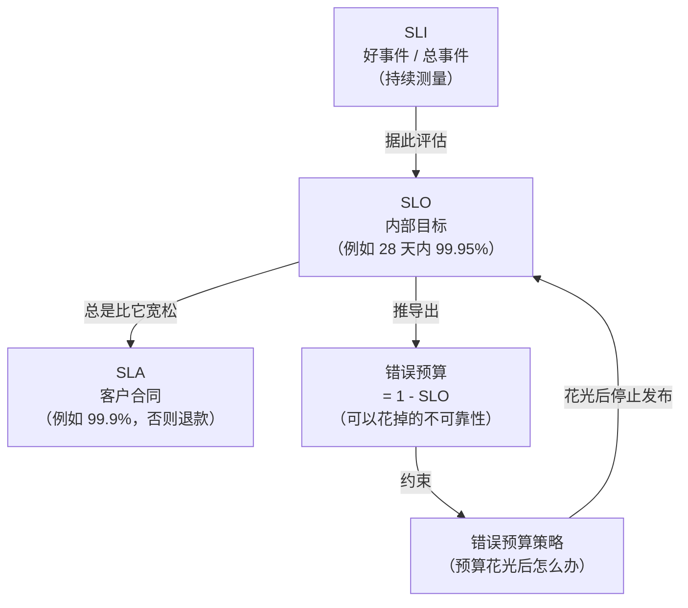
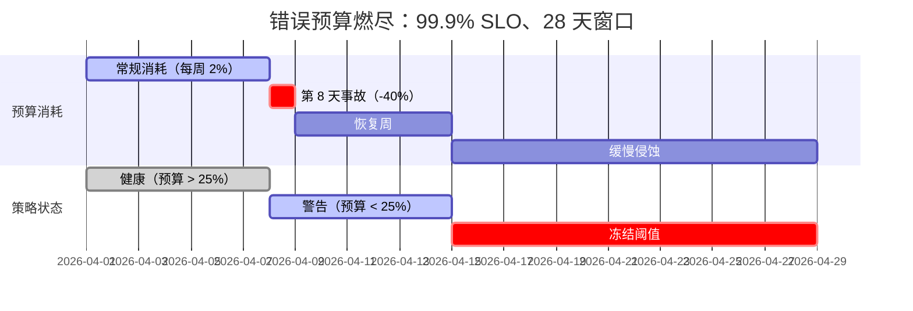
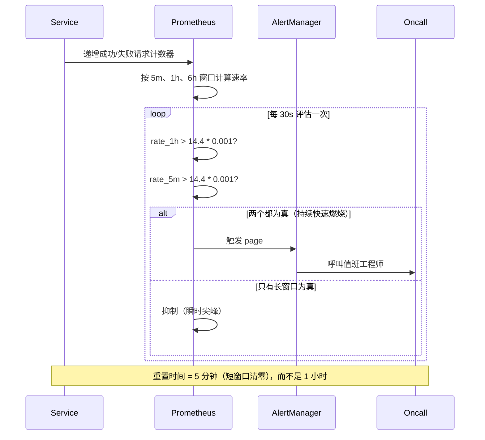

# SLI、SLO、SLA 与错误预算：让可靠性可量化

> **TL;DR**: SLI 是“好事件 / 总事件”的比值。SLO 是这个比值在一段时间窗口内的目标。SLA 是当 SLO 没达成时要赔钱的合同。错误预算就是 `1 - SLO`：允许你在发布、实验和新功能上线时花掉的那部分不可靠性。预算花光，就冻结发布，等窗口重置。这个机制把可靠性从一句空泛的愿望，变成一种可交易的资源，让产品团队和基础设施团队用同一套算术对话[^1]。

## 学习目标

学完本章，你将能够：

- [ ] 挑选反映用户体验的 SLI，而不是内部资源用量
- [ ] 设定务实、可度量、能支撑决策的 SLO
- [ ] 计算错误预算与燃烧率
- [ ] 设计多窗口、多燃烧率告警
- [ ] 用错误预算策略裁决功能开发与可靠性工作的优先级

## 直觉理解

你办了个每月 10 GB 流量的手机套餐。你不会在第一天就一个字节一个字节地省着用，而是在月中查一下用量：如果到第 15 天已经用掉 80%，就把视频降个清晰度；如果还剩 60%，那就随便刷。

错误预算就是这么运作的。你的 SLO 说“28 天里 99.9% 的请求成功”，这就给了你 0.1% 的失败额度。你把这笔额度花在风险较高的发布、数据库迁移和实验上。仪表盘告诉你还剩多少额度。额度不多时，你放慢节奏；额度用光，你停止发功能，回头修可靠性。

妙处在于：没人再吵该优先做功能还是优先保稳定，预算说了算。产品经理和 SRE 看的是同一个数字。预算健康，就快速发布；预算在烧，就投稳定性。不讲政治，只算算术。

本章提供把这套东西落到生产环境所需的词汇、算法和告警机制。

## 原理

### 术语：SLI、SLO、SLA、错误预算

SRE 可靠性框架的分量全压在这四个词上。把它们搞清楚，剩下的自然顺了。

**SLI（Service Level Indicator，服务水平指标）** 是对服务某个方面的量化度量，写成“好事件 / 总事件”的比值[^2]。例如：“在 300 ms 内返回 2xx 的 HTTP 请求占比”。这个比值永远落在 0% 到 100% 之间。

**SLO（Service Level Objective，服务水平目标）** 是该 SLI 在一段定义好的时间窗口内要达到的目标值[^2]。例如：“滚动 28 天窗口内 99.9% 的请求成功”。没达成会触发工程动作，但不产生法律责任。

**SLA（Service Level Agreement，服务水平协议）** 是与用户签的合同，里面约定了若协议中的 SLO 未达成，要承担财务或商业后果[^2]。区分它们的关键一问是：“目标没达成会怎样？”如果答案是“什么也不会发生”，那你手里的是 SLO，不是 SLA。

**错误预算** 是 `1 - SLO`。99.9% 的 SLO 给出 0.1% 的预算。放到 1,000,000 次请求上，就是 1,000 次允许出错的额度。你把额度花在发布和实验上。额度耗尽，就冻结。



*SLI 喂给 SLO；SLO 推导出错误预算；策略在预算花光时执行后果。*

> [!IMPORTANT]
> 大多数人嘴上说 “SLA”，心里想的是 “SLO”。一个识别方法：如果有人谈“SLA 违规”，他几乎总是在说 SLO 没达成。真正的 SLA 违规可能意味着要吃违约官司[^3]。

### 从关键用户旅程中挑 SLI

SLI 应该度量用户实际经历的东西。SRE Workbook 建议把 SLI 当作“两个数字的比值：好事件数除以总事件数”[^1]。

**SLI 菜单**把服务类型映射到指标类别：

| 服务类型 | SLI 类型 |
|---|---|
| 请求驱动型 | 可用性、延迟、质量 |
| 流水线型 | 新鲜度、正确性、覆盖率 |
| 存储型 | 持久性 |

先从找出你的**关键用户旅程（CUJ，Critical User Journey）**开始。电商站点的 CUJ 包括搜索商品、加入购物车、完成支付。每条 CUJ 对应一个或多个 SLI。

**延迟要写成比值，而不是分位数。** 不要写“p99 < 300 ms”，而是写成“99% 的请求在 < 300 ms 内完成”。这样错误预算就能直接算：慢于 300 ms 的请求就是坏事件[^1]。

**为什么不能用 CPU 或内存当 SLI？** 资源指标是容量规划的输入，不是用户满意度的指示器。服务器 CPU 冲到 90%，用户体验可能毫无退化；反过来，CPU 只有 20% 时也可能出现局部故障。一个指标如果不能直接影响用户满意度，就不适合当 SLI[^4]。

### 设定 SLO 目标与 9 的个数对照表

从历史的 SLI 实测值出发。SRE Workbook 建议以当前表现为起点，再向下取整到团队真正做到过的数字[^1]。

**9 的个数对照表**把每个目标的代价变得具体：

| 可用性 | 每年停机 | 每月停机 | 每周停机 |
|---|---|---|---|
| 99% | 3.65 天 | 7.20 小时 | 1.68 小时 |
| 99.5% | 1.83 天 | 3.60 小时 | 50.4 分钟 |
| 99.9% | 8.77 小时 | 43.20 分钟 | 10.08 分钟 |
| 99.95% | 4.38 小时 | 21.60 分钟 | 5.04 分钟 |
| 99.99% | 52.60 分钟 | 4.32 分钟 | 1.01 分钟 |
| 99.999% | 5.26 分钟 | 25.9 秒 | 6.05 秒 |

按服务等级划分的常见目标（行业惯例，不是正式标准）：

- **99.0%**：内部工具、批处理流水线
- **99.9%**：面向消费者的 Web 应用
- **99.95%**：关键 B2B API、支付网关
- **99.99%**：业务关键的平台服务（Slack 就在客户协议里承诺这一档[^5]）

**SLO 要比 SLA 更严。** 内部 SLO 定得比合同 SLA 更紧。对外 SLA 是 99.9% 时，Google 建议内部 SLO 定 99.95%[^2]。这段差距就是你的安全边际。

**叠加效应：依赖封住了你的 SLO 上限。** 如果服务 A（99.9%）每次请求都同步调用服务 B（99.9%），那么 A 能达到的最高可用性只有 `0.999 x 0.999 = 99.8%`[^6]。除非你用缓存、队列或[优雅降级](./03-graceful-degradation.md)把依赖软化，否则你不可能比关键依赖的乘积更可用。

**为什么 100% 是错的。** SRE Workbook 给了四条理由：物理规律上做不到；用户侧的依赖链本来也从来不是 100%；超出用户感知的每一个 9 都是白花的工程投入；而 100% 的目标意味着团队永远不能发变更[^1]。

### 错误预算与错误预算策略

错误预算让 SLO 变得可执行。一个 99.9% 的 SLO，四周窗口，服务在这段时间收到 3,000,000 次请求，预算是 3,000 次错误。一次产生 1,500 次错误的故障，就花掉 50% 的预算。

**错误预算策略**是一份书面约定，写明预算花光后该怎么办。Google 的经典版本[^7]：

1. **预算健康**：发布照常进行。
2. **预算耗尽**：除 P0 问题或安全修复外，停止一切变更，直到服务回到 SLO 之内。
3. **单次事故消耗 > 20% 预算**：强制复盘，至少产出一个 P0 行动项。
4. **例外**：由全公司网络问题引起的故障、上游团队已被冻结、或不在范围内的流量（压测、渗透测试）。

冻结是工具，不是惩罚。Workbook 说得很直接：“停止变更是令人不快的；但当数据表明可靠性比其他产品特性更重要时，这条策略给了团队许可，可以全力专注在可靠性上”[^7]。



*一次大事故一天就花掉 40% 的预算；剩下几周的缓慢侵蚀，决定策略要不要冻结发布。*

### 多窗口、多燃烧率告警

一个粗糙的告警——错误率一超过 SLO 阈值就响——每天能给你发上百次呼叫，而 SLO 其实根本没危险[^8]。解法是燃烧率告警。

**燃烧率（burn rate）** 是服务消耗错误预算的速度相对于可持续速度的倍数。燃烧率 1 表示预算刚好能撑满整个 SLO 窗口。燃烧率 14.4 表示 1 小时内烧掉预算的 2%。

| 燃烧率 | 错误率（99.9% SLO） | 耗尽预算所需时间 |
|---|---|---|
| 1 | 0.1% | 30 天 |
| 2 | 0.2% | 15 天 |
| 10 | 1% | 3 天 |
| 1,000 | 100% | 43 分钟 |

**多窗口、多燃烧率矩阵**把一个长窗口用于发现、一个短窗口用于确认，两者配对使用[^8]：

| 严重级别 | 长窗口 | 短窗口 | 燃烧率 | 消耗预算 |
|---|---|---|---|---|
| 呼叫 | 1 小时 | 5 分钟 | 14.4x | 2% |
| 呼叫 | 6 小时 | 30 分钟 | 6x | 5% |
| 工单 | 3 天 | 6 小时 | 1x | 10% |

短窗口的长度是长窗口的 1/12。只有**两个**窗口都超过阈值，告警才响。这能滤掉瞬时尖峰造成的误报，并把恢复时间从 1 小时缩短到 5 分钟[^8]。



*只有快慢两个窗口同时确认高燃烧率，告警才发出；单窗口告警要么反复抖动，要么漏掉事件。*

用 Prometheus 实现这个模式的告警规则：

```yaml
- alert: ErrorBudgetBurn_Page
  expr: |
    (
      job:slo_errors_per_request:ratio_rate1h{job="checkout"} > (14.4 * 0.001)
      and
      job:slo_errors_per_request:ratio_rate5m{job="checkout"} > (14.4 * 0.001)
    )
    or
    (
      job:slo_errors_per_request:ratio_rate6h{job="checkout"} > (6 * 0.001)
      and
      job:slo_errors_per_request:ratio_rate30m{job="checkout"} > (6 * 0.001)
    )
  labels:
    severity: page
```

[Sloth](https://github.com/slok/sloth) 这类工具能从一份简短的 YAML SLO 描述自动生成这些 recording rule 和告警，产出完整的那套 Google 多窗口多燃烧率告警。

### 依赖关系算术与 SLO 下限

你的服务能达到的 SLO，上限由关键依赖的 SLO 封住。如果结账服务依赖一个公开 SLA 为 99.95% 的支付网关，那么在没有兜底路径的前提下，结账服务不可能超过 99.95%。

解法是软化依赖。带退避的重试、缓存、熔断器、兜底响应、排队异步处理，都能把你的 SLO 与下游下限解耦[^6]。[优雅降级](./03-graceful-degradation.md)会深入讲这些模式。

## 真实案例

**Slack 的 Service Delivery Index（SDI-R）。** Slack 在客户协议里维持 99.99% 的可用性目标[^5]。但它不用一个全局 SLO，而是用一个叫 SDI-R（Service Delivery Index, Reliability）的复合可靠性指标。

SDI-R 的计算方式是 `uptime(status site) * availability(api)`，其中 API 可用性为 `successful_requests / total_requests`[^5]。这个指标按天、按小时、按服务分别跟踪。不同 API 按用户影响加权，大企业客户还能拿到自己的子 SDI-R 明细。

组织结构的重要性不亚于算法本身。SDI-R 由可靠性工程团队负责，但在有工程管理层参加的 Engineering Monday Meeting 上评审。这样一来，权衡就是组织级决策，而不是团队局部决策。一个叫 “Webapp Ownership Tool” 的工具为每个 API 端点自动配置 SLO、告警和仪表盘。一个叫 Omni 的服务目录则跟踪与 SDI-R 回退挂钩的归属关系和升级路径[^5]。

关键洞察是：等到一个问题影响到 SDI-R 时，它早就被服务级告警抓到了。SDI-R 是战略指标，燃烧率告警是战术响应。两层结构把“我们有没有守住承诺”和“现在该不该叫人起来”分开了。

**工具生态。** 除了自研实现，SLO 领域已经标准化出一批工具：

- **Sloth** 从 YAML 描述生成 Prometheus recording rule 和多燃烧率告警
- **OpenSLO** 提供厂商中立的 SLO 定义 YAML 规范
- **Honeycomb** 从 trace 事件计算 SLO，可借助 BubbleUp 分析从“预算在烧”立刻跳到“原因是这个”
- **Nobl9** 和 **Datadog** 提供托管 SLO 平台，支持复合目标和预算标注

## 权衡

一旦你决定用正式的错误预算策略跑 SLO，下一个设计决策就是*形状*：整个服务一个全局 SLO、每条关键用户旅程一个 SLO，还是按客户等级做分层/复合 SLO。下表几行是可以真正互换的选项。

| 方案 | 优点 | 缺点 | 适用场景 | 我们的选择 |
|---|---|---|---|---|
| 全服务单一 SLO + 错误预算策略 | 算术最简单；一个共享数字驱动功能与可靠性的权衡 | 平均值会掩盖单条旅程的故障（搜索正常，结账已挂） | 单条主用户路径占主导的中小型服务 | 单个团队负责单个服务时的默认选项 |
| 按旅程划分的 SLO（每条关键用户旅程一个 SLO） | SLI 与用户真实行为对齐；结账出问题不会藏在健康的搜索后面 | 更多仪表盘、更多 recording rule、更多要协调的负责人 | 有 2-5 条明显不同关键旅程的服务 | 中大型服务的默认选项 |
| 分层 SLO（按客户等级） | 贴合合同现实；付费更高的客户拿到更严的内部目标 | 度量与告警更复杂；每个层级要独立的燃烧率数据流 | 有付费客户分层或企业级 SLA 的服务 | 当高端客户能证明度量成本合理时 |
| 复合可靠性指标（SDI-R 风格） | 给管理层评审一个可汇总的数字；按影响加权 | 若不同时配按旅程的告警，会抹平单条旅程的急剧故障 | 需要向高管汇报可靠性的大型组织 | 叠加在按旅程 SLO 之上，而不是替代它 |

> [!NOTE]
> 这张表里原本还有“没有 SLO”和“有 SLO 但没有策略”两个反模式，它们属于反模式，已挪到下面的“常见陷阱”。SLA 与 SLO 之间的权衡也不在这个维度上：Google 的指导是永远让内部 SLO 比任何外部 SLA 更严[^2]，而不是二选一。

## 常见陷阱

> [!WARNING]
> **有 SLO，没有错误预算策略。** SLO 公布了，但没达成时什么也不发生。团队照样在烧预算发布。SLO 沦为汇报指标，而不是决策工具。把策略作为 SLO 落地的一部分强制要求[^1]。

> [!WARNING]
> **定一个团队根本够不着的理想化目标。** 为了好听定 99.99%，然后每个窗口都没达成——结果要么把功能开发拖死（策略天天触发），要么把策略变成表演（悄悄被无视）。从历史数据出发；把更严的目标单独列成一个明确的“理想化 SLO”来跟踪[^1]。

> [!WARNING]
> **用 CPU 或内存当 SLI。** 你会因为一次没人感受到退化的 CPU 尖峰被叫起来，却漏掉一次 CPU 看着很正常的部分故障。资源指标用于容量规划，SLI 用请求成功率。

> [!WARNING]
> **从不触发的 SLO（太松）或永远触发的 SLO（太紧）。** 一个从不触发策略的 SLO 提供不了任何信号；一个永远触发的 SLO 只是噪声。按季度复盘：一直达成且没有用户投诉，就收紧；一直没达成但用户满意度很高，就放宽[^1]。

> [!WARNING]
> **把 SLA 和 SLO 混为一谈。** 直接拿合同 SLA 的数字当内部目标，就没有安全边际了。每一次 SLA 违约同时都是一次内部意外。内部 SLO 至少要比外部 SLA 严 0.05%[^2]。

## 练习

为一个结账服务设计 SLI 与 SLO：找出关键用户旅程，定义 SLI（可用性、延迟、新鲜度），设定 SLO 目标，算出错误预算，用燃烧率窗口设计告警策略，并起草错误预算策略。

<details>
<summary>提示</summary>

结账的 CUJ 是：用户点“支付”到看到订单确认。想想这里的“好”意味着什么：返回 2xx **并且**够快**并且**用的是新鲜的价格数据。预算要按请求数算，不是按分钟算。告警用 Workbook 里的 14.4x/1h 和 6x/6h 燃烧率。

</details>

<details>
<summary>参考答案</summary>

**关键用户旅程：** 用户点击“下单”，在可接受的时间内收到订单确认，且价格正确。

**SLI：**

1. **可用性：** `POST /checkout` 返回 2xx 的请求数 / 总请求数
2. **延迟：** `POST /checkout` 在 < 800 ms 内完成的请求数 / 总请求数
3. **新鲜度：** 使用 60 秒内新鲜数据的价格校验请求数 / 总价格校验请求数

**SLO 目标（28 天滚动窗口）：**

- 可用性：99.95%（预算：每 1,000,000 次请求 500 次错误）
- 延迟：99% < 800 ms（预算：每 1,000,000 次请求 10,000 次慢请求）
- 新鲜度：99.9%（预算：每 1,000,000 次 1,000 次过期价格事件）

**错误预算算术（可用性）：** 28 天窗口约 3M 次请求。预算 = 3,000,000 * 0.0005 = 1,500 次允许错误。

**告警（可用性 SLI）：**

```yaml
- alert: CheckoutBudgetBurn_Page
  expr: |
    (
      job:slo_errors_per_request:ratio_rate1h{job="checkout"} > (14.4 * 0.0005)
      and
      job:slo_errors_per_request:ratio_rate5m{job="checkout"} > (14.4 * 0.0005)
    )
    or
    (
      job:slo_errors_per_request:ratio_rate6h{job="checkout"} > (6 * 0.0005)
      and
      job:slo_errors_per_request:ratio_rate30m{job="checkout"} > (6 * 0.0005)
    )
  labels:
    severity: page
```

**错误预算策略：**

1. 预算 > 50%：自由发布功能。
2. 预算 25-50%：所有发布需 SRE 评审；不做高风险迁移。
3. 预算 < 25%：冻结功能上线；只做可靠性工作。
4. 预算耗尽：全面冻结发布，直到窗口重置。
5. 单次事故消耗 > 20% 预算：强制复盘并产出 P0 行动项。

**依赖检查：** 如果支付网关的 SLA 是 99.95%，在没有兜底（排队重试、备用服务商）的情况下，结账服务不可能超过这个数。你的 99.95% SLO 正好卡在依赖允许的天花板上。

</details>

## 要点回顾

- 100% 可靠性是错的目标。超出用户感知的每一个 9 都是白花的工程投入。
- SLI = 度量（好事件/总量之比）。SLO = 内部目标。SLA = 带后果的合同。错误预算 = 1 - SLO。
- SLI 要从关键用户旅程里挑，不要从服务器资源指标里挑。CPU 用于容量规划，不用于 SLO。
- SLO 目标从历史数据出发。定得比 SLA 严，但比理想化目标松。
- 依赖封住你的 SLO 上限：两个 99.9% 的服务串联，最多给你 99.8%。
- 错误预算让产品团队和 SRE 团队用同一套算术对话。预算说了算，不是政治说了算。
- 多窗口、多燃烧率告警能抓到真问题，又不会为每个瞬时尖峰叫人。呼叫用 14.4x/1h，较慢的燃烧用 6x/6h。

## 延伸阅读

- [The Site Reliability Workbook: Implementing SLOs (Ch. 2)](https://sre.google/workbook/implementing-slos/) - 最正统的起点，包含完整的演算示例、SLI 菜单和基于比值的度量方法。
- [The Site Reliability Workbook: Alerting on SLOs (Ch. 5)](https://sre.google/workbook/alerting-on-slos/) - 多窗口多燃烧率告警的六轮迭代推导，全程配 PromQL。
- [Google SRE Book: Service Level Objectives (Ch. 4)](https://sre.google/sre-book/service-level-objectives/) - 原始定义，包含 Chubby 计划内停机案例和“9 的代价”框架。
- [Example Error Budget Policy (Appendix B, SRE Workbook)](https://sre.google/workbook/error-budget-policy/) - 一份简短可用的组织约定模板，让 SLO 真正长出牙齿。
- [The Calculus of Service Availability (ACM Queue, 2017)](https://queue.acm.org/detail.cfm?id=3096459) - Treynor、Dahlin、Rau 和 Beyer 讲为什么依赖会封住你可达的 SLO，以及如何做组合推理。
- [Service Delivery Index: A Driver for Reliability (Slack Engineering, 2023)](https://slack.engineering/service-delivery-index-a-driver-for-reliability/) - Slack 真实的复合 SLO 实现，含 API 重要性加权与组织级评审节奏。
- [Sloth: Prometheus SLO Generator](https://github.com/slok/sloth) - 开源工具，能从一份简短 YAML SLO 描述自动生成 Workbook 那套告警，配合 OpenSLO 可移植。
- [OpenSLO Specification](https://github.com/OpenSLO/OpenSLO) - 跨工具的厂商中立 YAML 规范，用于定义 SLO、SLI 和告警策略。

## 记忆卡片

**Q:** 错误预算的公式是什么？
**A:** 错误预算 = 1 - SLO。99.9% 的 SLO 给出 0.1% 的预算。放到 1,000,000 次请求上，就是 1,000 次允许出错的额度。

**Q:** SLA 与 SLO 的区别在哪？
**A:** SLA 是合同，没达成会有财务或商业后果（赔付、罚金）。SLO 是内部目标，没达成只触发工程动作。如果目标没达成时什么明确的事都不发生，那就是 SLO，不是 SLA。

**Q:** 为什么不该用 CPU 使用率当 SLI？
**A:** CPU 不直接反映用户体验。服务器 CPU 冲到 90% 时用户可能毫无感觉，也可能在 CPU 只有 20% 时出现部分故障。要用从用户视角测得的请求成功率。

**Q:** 在 Google 推荐的告警方案里，多大的燃烧率会触发呼叫？
**A:** 燃烧率 14.4x，且在 1 小时和 5 分钟两个窗口上同时持续，意味着 1 小时烧掉了 30 天预算的 2%。

**Q:** 为什么多窗口告警要求两个窗口都超过阈值？
**A:** 长窗口负责发现持续性问题，短窗口负责确认问题还在。没有短窗口，问题解决后告警还会再响最多一小时；没有长窗口，瞬时尖峰会造成误报。

**Q:** 两个服务串联，各自 99.9%，系统最高可用性是多少？
**A:** 0.999 x 0.999 = 99.8%。串行依赖是相乘的，可用性只会更差。要超过这个下限，需要缓存、队列或优雅降级。

**Q:** 错误预算耗尽时会发生什么？
**A:** 错误预算策略生效：停止一切非关键变更和发布，直到服务回到 SLO 之内。这次冻结给了团队许可，可以只专注可靠性。

**Q:** 为什么 100% 是错的可靠性目标？
**A:** 四条理由：物理规律上做不到；用户的依赖链本来也从来不是 100%；超出用户感知的每一个 9 都是白花的工程投入；而 100% 的目标意味着团队永远不能发变更。

**Q:** 推荐的 SLO 窗口是多长？
**A:** 四周（28 天）滚动窗口。滚动窗口比自然日历窗口更能反映用户体验，因为用户不会因为月份翻页就忘掉一次故障。

**Q:** 内部 SLO 与外部 SLA 应该是什么关系？
**A:** 内部 SLO 应该更严（例如 SLA 99.9% 时内部定 99.95%）。这段差距就是安全边际：内部策略会在合同数字被击穿之前先触发。

**Q:** 请求驱动型服务的三类 SLI 是什么？
**A:** 可用性（成功响应占比）、延迟（快于阈值响应占比）、质量（使用完整保真数据而非降级兜底数据的响应占比）。

**Q:** Slack 的 SDI-R 是什么？
**A:** Service Delivery Index, Reliability。一个复合指标，把 uptime 与 API 可用性按 API 重要性加权组合，按服务跟踪，并在工程管理层会议上评审，让可靠性权衡成为组织级决策。

## 参考文献

[^1]: Steven Thurgood, David Ferguson, Alex Hidalgo, Betsy Beyer, "Implementing SLOs", The Site Reliability Workbook Ch. 2, Google/O'Reilly, 2018. https://sre.google/workbook/implementing-slos/
[^2]: Jay Judkowitz and Mark Carter, "SRE fundamentals: SLIs, SLAs and SLOs", Google Cloud Blog, 2018. https://cloud.google.com/blog/products/devops-sre/sre-fundamentals-slis-slas-and-slos
[^3]: Chris Jones, John Wilkes, Niall Murphy, Cody Smith (ed. Betsy Beyer), "Service Level Objectives", Site Reliability Engineering Ch. 4, Google/O'Reilly, 2016. https://sre.google/sre-book/service-level-objectives/
[^4]: Mark Azer and Kai Xin Tai, "SLOs: How to establish and define service level objectives", Datadog blog, 2020 (updated 2025). https://www.datadoghq.com/blog/establishing-service-level-objectives/
[^5]: Matthew McKeen and Ryan Katkov, "Service Delivery Index: A Driver for Reliability", Slack Engineering, 2023. https://slack.engineering/service-delivery-index-a-driver-for-reliability/
[^6]: Ben Treynor, Mike Dahlin, Vivek Rau, Betsy Beyer, "The Calculus of Service Availability", ACM Queue 15, no. 2, 2017. https://dl.acm.org/doi/10.1145/3096459 (also archived at https://web.archive.org/web/20250105182530/https://queue.acm.org/detail.cfm?id=3096459)
[^7]: Steven Thurgood, "Example Error Budget Policy", Appendix B, Site Reliability Workbook, Google/O'Reilly, 2018. https://sre.google/workbook/error-budget-policy/
[^8]: Steven Thurgood et al., "Alerting on SLOs", The Site Reliability Workbook Ch. 5, Google/O'Reilly, 2018. https://sre.google/workbook/alerting-on-slos/
