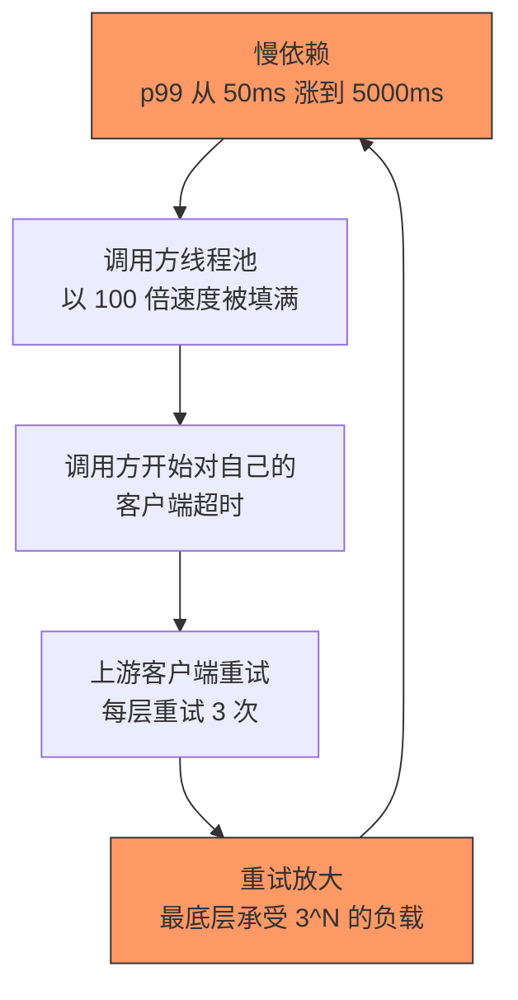
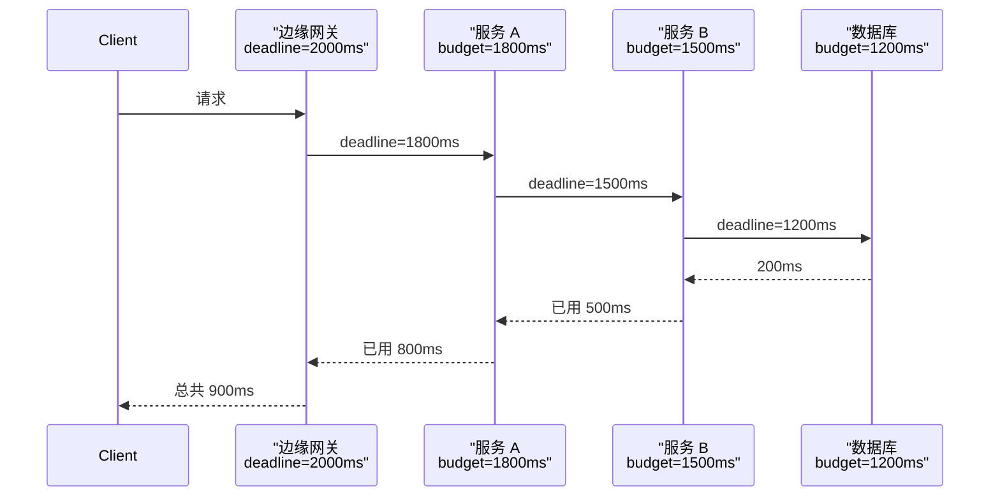
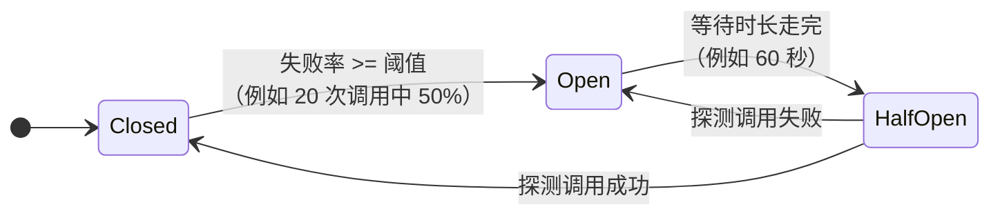

# 韧性模式：超时、重试、熔断器与舱壁隔离

> **TL;DR**: 一个分布式系统若有 30 个依赖，每个依赖的可用性都是 99.99%，整体可用性就只有 99.7%，大约每月 2 小时停机——除非每一条依赖边都被独立防护[^1]。防御工具箱其实很小：超时（永远不要无限等待）、带指数退避和全抖动的重试（永远不要同步重试）、熔断器（对已经坏掉的东西停止调用）、舱壁隔离（隔离爆炸半径）。这些模式不是可选项，而是服务之间任何一次 RPC 的最低安全配置。起步就设：请求超时 2 秒、重试 2 次且基础退避 100 ms 配全抖动、20 次请求里失败率 50% 触发熔断，然后在此基础上测量调优。

## 学习目标

学完本章，你将能够：

- [ ] 在调用链的每一层设置合适的超时
- [ ] 实现带指数退避与抖动的重试，同时不引发重试风暴
- [ ] 配置熔断器：阈值、半开探测、兜底逻辑
- [ ] 用线程池、连接池或自适应并发上限设计舱壁隔离
- [ ] 在库方案（Resilience4j、Polly）与网格方案（Istio/Envoy）之间做选择

## 直觉理解

你住在一栋只有一根总水管的公寓楼里。某天早上，4B 公寓的水管爆了。水淹了走廊，整栋楼水压下降，每家每户都没了热水。楼管关掉总阀止住了水，但现在所有人一点水都没有。抢修要好几个小时，因为走廊被淹着，水管工根本走不到爆管的地方。

再想象这栋楼每层都装了隔离阀、每户都有独立关断阀。4B 的管子爆了，楼层阀自动关闭。水只淹了一条走廊，其他楼层水压照旧。水管工 20 分钟就修好了 4B，因为走廊是干的。

分布式系统是同一个道理。慢依赖就是那根爆掉的水管。没有防护，它会淹没你的线程池、饿死其他依赖，并一路向上级联，直到整个系统挂掉。超时是关断阀，熔断器是自动楼层阀，舱壁是公寓之间的墙。带退避的重试则是楼管等水压稳定后再去开总阀，而不是每秒开关一次。

[可用性与可靠性](../part-1-core-fundamentals/02-availability-and-reliability.md) 讲过几个 9 的算术。本章给出真正能把这些数字做出来的工程模式。

## 原理

### 级联故障是怎么发生的

级联故障不是某个组件挂掉那么简单。它是一个反馈回路：一个慢依赖吃掉调用方的资源，调用方跟着变慢，又传导给它自己的调用方，直到系统很大一部分都不可用。

机制分三个阶段。第一，下游服务劣化，p99 从 50 ms 跳到 5,000 ms。第二，调用方按稳态延迟配置的线程池，被填满的速度是排空速度的 100 倍。本该服务其他依赖的线程，现在都阻塞着等那个慢依赖。第三，调用方开始对自己的客户端超时，客户端再重试，于是每一层的负载都被放大。一个五层深的调用栈，每层重试 3 次，就把一个原始请求变成 3^5 = 243 个下游请求[^2]。

2015 年 9 月的 AWS DynamoDB 故障是教科书案例。一次短暂的网络抖动，让存储服务器同时向元数据服务重新请求成员信息。元数据响应体（因为 Global Secondary Index 的普及）已经涨到接近取回时限。请求超时，服务器重试，元数据服务在重试负载下被打满。连健康服务器的心跳续约都失败了。错误率峰值达到 55%，持续近 5 小时[^3]。加机器没有用，因为在重试风暴下元数据服务根本无法接受管理类请求。AWS 只能暂停所有请求来打断这个循环。

教训是：靠“多加机器”治不了级联故障。瓶颈是相关联的重试负载，而不是稳态容量。



*慢依赖触发反馈回路：连接池耗尽导致上游超时，上游超时触发重试，重试又给本就吃力的依赖加压。*

### 超时

超时是客户端在放弃请求、释放资源之前等待的最长时间。它分几种：

- **连接超时（connection timeout）**：等待 TCP + TLS 握手的时间（通常 1-3 秒）
- **请求超时（request timeout）**：连接建立后等待响应的端到端时间（最关键的那个）
- **套接字/读超时（socket/read timeout）**：单次 read 调用在已打开的套接字上阻塞多久
- **空闲超时（idle timeout）**：一条闲置连接在被连接池关闭前能活多久

危险的默认值：大多数 HTTP 客户端库（Java 的 `HttpURLConnection`、Python 的 `requests`、Node 的 `http.request`、Go 默认的 `http.Client`）历史上都默认无限超时[^2]。一个永不完成的请求会永久占住一个线程。这是级联故障最常见、最单一的根因。

**怎么定这个值。** 从下游服务的延迟分布出发，取 p99.9，再为网络波动留出余量。如果下游 p99.9 是 800 ms，就把超时设成 2,000 ms。设太低会误判超时，反而触发重试风暴；设太高，超时就失去了防止资源耗尽的作用。

**超时预算**（timeout budget）解决多跳问题。在边缘设一个端到端截止时间（deadline），请求沿调用链前进时逐跳扣减。gRPC 用 `grpc-timeout` 头实现，每跳递减。如果调用方只剩 200 ms 预算，而下游 p99 是 300 ms，这个调用应当立即短路，而不是发出去。



*边缘设定的截止时间逐跳扣减；如果剩余预算小于下游已知的 p99，调用直接短路。*

**对冲请求**（hedged request）出自 Dean 和 Barroso 的 "The Tail at Scale"，用来对付干扰（GC 停顿、邻居吵闹）造成的长尾延迟。先发主请求，等到 p95 延迟还没回，就向另一个副本再发一份，谁先返回用谁。这能显著压低 p99 延迟，代价是尾部多出一些负载。只对幂等读安全。

### 重试

重试能掩盖瞬时故障。但只有当目标操作幂等时才安全，因为超时并不意味着副作用没有发生。[幂等性与精确一次](../part-3-distributed-systems-theory/07-idempotency-exactly-once.md) 讲了让重试变安全的设计模式。

**指数退避**让延迟按 `delay = base * 2^attempt` 增长。线性退避不够用，因为竞争的客户端是一个一个退出的，总工作量是 O(N^2)。带上限的指数退避限制最大延迟（例如 30 秒），避免无休止地等下去。

**抖动**（jitter）用来打破同步。没有它，所有在同一时刻失败的客户端算出的退避值完全一样，于是同时重试。Marc Brooker 的仿真给出四种变体[^4]：

```python
# 无抖动（糟糕：重试同步爆发）
sleep = min(cap, base * 2 ** attempt)

# 全抖动（最佳：总工作量最低）
sleep = random_between(0, min(cap, base * 2 ** attempt))

# 等额抖动（折中）
temp = min(cap, base * 2 ** attempt)
sleep = temp / 2 + random_between(0, temp / 2)

# 去相关抖动（完成最快）
sleep = min(cap, random_between(base, sleep_prev * 3))
```

全抖动的客户端总工作量比无抖动减少一半以上。AWS 在多数 SDK 里把它作为默认[^4]。

```mermaid
gantt
    title 重试在时间轴上的分布，无抖动与全抖动对比（5 个客户端）
    dateFormat X
    axisFormat %Ss
    section 无抖动
    客户端 A 重试 :a1, 1, 1s
    客户端 B 重试 :b1, 1, 1s
    客户端 C 重试 :c1, 1, 1s
    客户端 D 重试 :d1, 1, 1s
    客户端 E 重试 :e1, 1, 1s
    section 全抖动
    客户端 A 重试 :a2, 0, 1s
    客户端 B 重试 :b2, 2, 1s
    客户端 C 重试 :c2, 3, 1s
    客户端 D 重试 :d2, 5, 1s
    客户端 E 重试 :e2, 6, 1s
```



*没有抖动时，一起失败的客户端算出同样的退避值，在 t=1s 齐刷刷重试；全抖动把这些重试摊到整个退避窗口里，下游看到的是平滑恢复。*

**重试预算**（retry budget）给放大倍数封顶。gRPC 的令牌桶从 10 个令牌开始，每次失败扣 1，每次成功加 0.1。令牌掉到 5 个或更少（即不超过 maxTokens/2）时，重试被禁用，直到计数回升超过阈值。这样无论失败率多高，重试流量大约只占基线流量的 10%。

**哪些状态码可以重试：** 500、502、503、504、408、429（带 Retry-After）。4xx 一律不重试（408/429 除外），因为请求本身就是错的，重试会一模一样地失败。

**关键规则：** 整个栈只在恰好一层重试，通常是最外层。5 层深、每层 3 次重试，就是 243 倍放大。下层负责把错误抛出来，要不要重试由边缘决定。

### 熔断器

熔断器是一个状态机：下游失败率超过阈值后立即快速失败，让调用方不再把资源浪费在注定超时的调用上。Michael Nygard 的 "Release It!"（2007）提出了这个模式，Netflix Hystrix 让它流行起来。

生命周期由三个状态控制：



*熔断器在三个状态之间迁移；半开状态下的探测调用决定下游是否已经恢复。*

**CLOSED（关闭）**：调用正常放行，熔断器在滑动窗口里记录结果。Resilience4j 默认是基于计数的窗口，100 次调用、失败率阈值 50%[^5]。

**OPEN（打开）**：所有调用立即短路（快速失败）。持续一个可配置的等待时长（Resilience4j 里是 60 秒）。

**HALF-OPEN（半开）**：允许有限次数的探测调用（Resilience4j 里是 10 次）。如果这些调用成功、失败率低于阈值，熔断器关闭；否则重新打开。

**按服务 vs 按主机**：库级熔断器（Resilience4j、Polly）通常是按服务的。Envoy 的异常点检测是按主机的：它独立跟踪每个上游 Pod，把不健康的摘掉，健康的继续轮转。这明显更强，因为一个生病的 Pod 不会让整个服务被一刀切地熔断。

### 舱壁隔离

舱壁隔离把资源池切开，让某个失败的依赖只消耗自己那一份，把资源留给别人。这个名字来自船舶设计：横舱壁能阻止一个舱室进水把整条船拖沉。

**线程池隔离**（Hystrix 的做法）：每个依赖一个独立线程池，通常 10 个线程[^1]。某个依赖变慢，只会打满自己的池子。代价是线程池上下文切换，每次调用多花几微秒到几十微秒。

**信号量隔离**：用一个计数信号量限制并发调用，不需要独立线程池。开销接近于零，但慢依赖仍然占着调用方自己的线程。你得到了并发上限，但没有真正的隔离。

**连接池隔离**：每个下游一个独立的 HTTP 客户端和独立连接池。慢依赖会打满自己的池子，打不到别人。

**单元化架构**（cell-based architecture）：最极端的形态。把租户或分片路由到互相隔离的“单元”里，每个单元都是一套完整栈。某个单元出问题，只影响路由到该单元的租户。AWS S3 2017 年的复盘明确把单元化架构列为事故后 S3 团队加速推进的恢复时间策略。

**自适应并发上限**（Netflix 的 `concurrency-limits` 库）用类 TCP 的拥塞控制回路取代静态池大小。Vegas 算法用 `L * (1 - minRTT/sampleRTT)` 估算排队深度：延迟接近最小值时放大上限，检测到排队时收缩上限[^6]。这样就省掉了手工调线程池大小。

### 降级兜底与优雅降级

兜底（fallback）是主路径失败时走的备选响应路径。按对用户的影响从轻到重：

- **返回过期的缓存响应**（stale-while-revalidate）
- **静态默认值**（个性化推荐给个空列表）
- **换一条上游**（用只读副本代替主库）
- **静默失败**（返回 null，界面直接忽略）

**失败关闭还是失败放开**取决于操作性质。认证应该失败关闭（拿不准就拒绝）。个性化应该失败放开（展示非个性化内容）。

> [!IMPORTANT]
> **AWS 在兜底上的反直觉立场。** Jacob Gabrielson 的 "Avoiding fallback in distributed systems" 记录了 2001 年亚马逊的一次故障：从故障缓存兜底到直接查数据库，把“发货时效不可用”升级成整站不可用，外加全球履行业务停摆，原因是兜底路径与主路径共担风险。AWS 更推崇的替代做法是：提升主路径可靠性、让调用方自己重试、主动推送数据，或者让两条路径都被持续演练，别让“兜底”变成极少执行的死代码。

[优雅降级](./03-graceful-degradation.md) 深入讨论这个问题在用户体验侧的处理。

### 客户端库与服务网格

| 维度 | 客户端库（Resilience4j、Polly） | 服务网格（Istio/Envoy） |
|-----------|-------------------------------|----------------------------|
| 作用范围 | 进程内，按语言 | Sidecar，与语言无关 |
| 粒度 | 方法级、请求级状态 | 主机级、连接级 |
| 开销 | 接近于零 | 约 1 ms 的 sidecar 跳 |
| 配置方式 | 代码或配置文件 | Kubernetes CRD |
| 异常点检测 | 服务级（一刀切） | 主机级（精准剔除） |
| 最适合 | 细粒度的自适应逻辑 | 全集群策略统一执行 |

现代答案是混合：用服务网格做基线防护（异常点检测、连接数限制、全局重试预算），用库做请求级的自适应行为（对冲、自定义兜底、结合业务语义的熔断）。

## 真实案例

### Netflix：从 Hystrix 到自适应并发

Netflix 的 API 网关在 2012 年每天处理超过 10 亿次入站调用，按 1:6 的比例扇出到数十亿次出站依赖调用[^1]。30 多个依赖，单个可用性都是 99.99%，如果不做隔离，整体可用性只有 99.7%，大约每月 2 小时停机。

Netflix 的方案是 2012 年开源的 Hystrix。每个走网络的依赖调用都被包进一个 `HystrixCommand`，跑在按依赖划分的线程池上（默认 10 个线程）。每个命令都有单次调用超时、滑动窗口熔断器（10 秒窗口、最少 20 次请求、失败率阈值 50%）和强制的 `getFallback()` 方法。线程池拒绝、超时、熔断打开，统统走兜底。

这个设计逼着开发者在设计阶段就想清楚怎么降级，而不是等故障发生时才想。峰值时，Netflix 用这套模型每秒处理超过 10 万次依赖请求。

**Hystrix 为什么在 2018 年被弃用。** Netflix 宣布 Hystrix 进入维护模式，因为重心转向“根据应用实时表现自适应调整，而不是依赖预先配置的参数”[^6]。问题在于：Hystrix 每个依赖都要调几十个参数（线程池大小、超时、错误阈值、窗口大小）。30 个依赖就是 300 多个旋钮，没人能全调对。线程池隔离模型还带来可观的单次调用开销，这在 Netflix 的规模上不能忽略。

替代品 `Netflix/concurrency-limits` 用 TCP 拥塞控制算法（Vegas、Gradient2）从实测延迟里动态找出合适的并发上限。RTT 相对最小 RTT 上涨，说明在排队，上限收缩；延迟接近最小值，上限放大。不需要手工调参。

**行业轨迹：** 早期的韧性方案是大量配置出来的静态阈值（Hystrix）。现代韧性方案越来越多地用测量取代配置（自适应并发、Envoy 异常点检测）。Resilience4j 和 Polly 对基于模式的工作依然有用，但方向很明确：去测量，别去猜。

## 权衡

| 方案 | 优点 | 缺点 | 适用场景 | 我们的选择 |
|----------|------|------|-----------|----------|
| 库（Resilience4j、Polly） | 细粒度、进程内、无网络跳 | 按语言分裂、配置爆炸 | 小规模集群，需要请求级逻辑 | **20 个服务以下默认用它** |
| 服务网格（Istio/Envoy） | 语言无关、按主机做异常点检测 | 约 1 ms 开销、运维负担 | 大规模多语言集群 | **20 个服务以上默认用它** |
| 只用 API 网关 | 策略集中，一处调参 | 只在入口生效，管不到东西向流量 | 以边缘为主、内部集群很小 | 作为补充，不做主力 |
| 自适应并发 | 无需手工调参、跟随真实负载 | 控制回路可能震荡 | 高流量、负载波动大的服务 | **叠加在网格或库之上** |

## 常见陷阱

> [!WARNING]
> **不设超时（无限等待陷阱）。** 大多数 HTTP 客户端库默认无限超时。一个卡住的请求会永久占住一个线程，而你不会察觉，直到连接池耗尽、整个服务失去响应。每个客户端都必须显式设置连接超时和请求超时。没有例外。

> [!WARNING]
> **重试没有抖动。** 带上限的指数退避如果不加抖动，所有客户端算出的 sleep 值都一样。它们在同一个瞬间重试，制造出同步的负载尖峰，把下游继续压在过载状态。永远用全抖动：`sleep = random_between(0, min(cap, base * 2^attempt))`。

> [!WARNING]
> **重试没有幂等性保障。** 超时不代表服务端没处理请求。重试非幂等操作（扣款、发消息）会产生重复副作用。只重试那些设计上幂等、或者有幂等键保护的操作。

> [!WARNING]
> **每一层都重试。** 每层都想在本地做韧性，结果没人对端到端的重试策略负责。5 层深、每层 3 次重试，就是 243 倍负载放大。只在恰好一层重试，通常是最外层。

> [!WARNING]
> **兜底与主路径共担风险。** “缓存挂了就直接查数据库”听起来合理，直到你发现缓存一直在替数据库挡住 10 倍容量。兜底恰好在数据库最扛不住的时候被触发。优先选静态默认值或静默失败这类不碰任何共享依赖的响应。

## 练习

为一个结算服务设计韧性配置，它调用 5 个下游服务（库存 Inventory、支付 Payments、物流 Shipping、税费 Tax、通知 Notifications）。为每个依赖指定超时、带抖动的重试配置、熔断阈值、舱壁容量和兜底行为。每个数字都要给出理由。

<details>
<summary>提示</summary>

并非所有依赖都平等。支付最关键，而且在没有幂等键的情况下不幂等。通知是发出去就不管的类型。税费的结果可以缓存。想清楚哪些服务可以失败放开、哪些必须失败关闭。用推荐默认值作为起点：超时 = 下游 p99 的 2-5 倍，重试不超过 3 次，基础退避 100 ms，20 次请求里失败率 50% 触发熔断。

</details>

<details>
<summary>参考方案</summary>

**假设：** 库存 p99 = 80 ms，支付 p99 = 400 ms，物流 p99 = 150 ms，税费 p99 = 50 ms，通知 p99 = 200 ms。

| 依赖 | 超时 | 重试 | 退避 | 熔断 | 舱壁 | 兜底 |
|------------|---------|---------|---------|---------|----------|----------|
| 库存 | 500 ms | 1 | 100 ms 全抖动 | 50% / 20 req | 15 线程 | 失败关闭（卖不了你没有的货） |
| 支付 | 2,000 ms | 2 | 200 ms 全抖动 | 40% / 10 req | 20 线程 | 失败关闭 + 必须带幂等键 |
| 物流 | 800 ms | 2 | 100 ms 全抖动 | 50% / 20 req | 10 线程 | 缓存费率（过期 5 分钟内可接受） |
| 税费 | 300 ms | 1 | 50 ms 全抖动 | 60% / 30 req | 10 线程 | 缓存税率（过期 24h 可接受，税表很少变） |
| 通知 | 1,000 ms | 0 | 不适用 | 50% / 20 req | 5 线程 | 静默失败（入队稍后处理，绝不阻塞结算） |

**理由：**

- 超时取下游 p99 的 2-5 倍，既给长尾延迟留余量，又不会无限等下去。
- 支付拿到最宽松的超时和最大的舱壁，因为它最关键、也最慢。重试必须带幂等键（Stripe 的做法）。
- 通知零重试、最小舱壁，因为它绝不能拖住结算。失败就丢进死信队列异步处理。
- 税费和物流用缓存兜底，因为数据变化不频繁，短暂过期可以接受。
- 熔断器在 20 次请求、50% 失败率时打开（Hystrix 默认值），支付例外，触发更激进（40% / 10 次请求），因为错误扣款比拒绝结算更糟。
- 线程预算合计 60 个线程分给 5 个依赖，剩下的 Tomcat 线程（通常 200 个）留给请求处理和别的工作。

</details>

## 要点回顾

- 超时没有商量余地。任何调用都不能无限等待。默认取下游 p99 的 2-5 倍。
- 不带抖动的重试会造出同步的惊群。永远用全抖动。
- 重试只对幂等操作安全。目标不幂等，就先加幂等键，再加重试。
- 熔断器把慢失败变成快失败，保护调用方不把资源浪费在坏掉的依赖上。
- 舱壁隔离防止单个故障依赖吃光所有资源。线程池、信号量、自适应并发上限都行。
- 整个栈只在恰好一层重试。多层重试导致指数放大（3^N）。
- 行业正从静态阈值（Hystrix）走向自适应测量（并发上限、Envoy 异常点检测）。先用合理默认值起步，再让系统自己调。

## 延伸阅读

- [Timeouts, retries, and backoff with jitter](https://aws.amazon.com/builders-library/timeouts-retries-and-backoff-with-jitter/) —— Marc Brooker 的权威实践文章，讲前三个模式，带上亚马逊生产案例。
- [Exponential Backoff And Jitter](https://aws.amazon.com/blogs/architecture/exponential-backoff-and-jitter/) —— 2015 年那篇文章，定义了四种抖动变体并附仿真图；AWS SDK 重试默认值的基础。
- [Avoiding fallback in distributed systems](https://aws.amazon.com/builders-library/avoiding-fallback-in-distributed-systems/) —— Gabrielson 反直觉的观点：兜底通常让故障更糟；含 2001 年亚马逊缓存转数据库的事故。
- [The Tail at Scale](https://research.google/pubs/the-tail-at-scale/) —— Dean 和 Barroso 2013 年的 CACM 论文，提出对冲请求与绑定请求来缓解长尾延迟。
- [Fault Tolerance in a High Volume, Distributed System](https://netflixtechblog.com/fault-tolerance-in-a-high-volume-distributed-system-91ab4faae74a) —— Netflix 2012 年的文章，解释后来演变成 Hystrix 的 DependencyCommand 模式。
- [Performance Under Load](https://netflixtechblog.medium.com/performance-under-load-3e6fa9a60581) —— Netflix 2018 年宣布从 Hystrix 转向自适应并发上限的文章，讲解 Vegas 和 Gradient2 算法。
- [Resilience4j CircuitBreaker Documentation](https://resilience4j.readme.io/docs/circuitbreaker) —— 现代 JVM 上熔断器配置的参考，所有默认值都有文档。
- [Envoy Outlier Detection](https://www.envoyproxy.io/docs/envoy/latest/intro/arch_overview/upstream/outlier) —— 网格层面的按主机剔除，作为熔断手段，明显强于按服务的库级熔断器。

## 记忆卡片

**Q:** RPC 调用的四个核心韧性模式是什么？
**A:** 超时（永远不无限等待）、带指数退避和抖动的重试（永远不同步重试）、熔断器（对坏掉的东西停止调用）、舱壁隔离（按依赖隔离资源池）。

**Q:** 为什么“多加机器”治不了级联故障？
**A:** 瓶颈是相关联的重试负载，不是稳态容量。当现有服务器在重试风暴下连管理类请求都接不了时，加机器没用。必须先打断反馈回路（例如暂停所有请求），再加容量。

**Q:** 什么是全抖动，为什么它是推荐的默认做法？
**A:** `sleep = random_between(0, min(cap, base * 2^attempt))`。它把整个退避窗口随机化，避免同步的重试波。Brooker 的仿真显示它把客户端总工作量比无抖动减少一半以上。

**Q:** 为什么重试只能发生在调用栈的一层？
**A:** 5 层深、每层重试 3 次，一个原始请求就变成 3^5 = 243 个下游请求。多层重试造成的指数放大注定让后端恢复不了。

**Q:** 熔断器的三个状态是什么？
**A:** CLOSED（调用放行，记录结果）、OPEN（所有调用立即短路）、HALF-OPEN（用有限的探测调用测试下游是否恢复）。

**Q:** 按服务的熔断和按主机的熔断有什么区别？
**A:** 库级熔断器（Resilience4j）是按服务的：一个生病的 Pod 就让所有 Pod 的电路打开。Envoy 异常点检测是按主机的：只摘掉不健康的 Pod，健康的继续轮转。按主机明显更强。

**Q:** 什么是超时预算（截止时间传播）？
**A:** 在边缘设一个端到端截止时间，逐跳扣减。如果剩余预算小于下游已知的 p99，调用立即短路。gRPC 用 `grpc-timeout` 头实现。

**Q:** Netflix 为什么在 2018 年弃用 Hystrix？
**A:** Hystrix 每个依赖都要几十个调参项，开发者很少能调对。Netflix 转向自适应并发上限，根据实时表现（Vegas/Gradient2 算法）调整，而不是预先配置的静态阈值。

**Q:** 什么是重试预算，gRPC 怎么实现？
**A:** 重试预算把重试流量限制在成功请求数的某个百分比内。gRPC 用令牌桶：最多 10 个令牌，每次失败扣 1，每次成功加 0.1。令牌掉到 5 个或更少（不超过 maxTokens/2）时禁用重试。这把放大控制在基线的大约 10%。

**Q:** 什么时候该失败关闭，什么时候该失败放开？
**A:** 安全攸关的操作（如认证）失败关闭（拿不准就拒绝）。非核心功能（如个性化）失败放开（给降级内容），没有推荐总好过首页打不开。

**Q:** 哪些 HTTP 状态码可以重试？
**A:** 500、502、503、504（服务端错误），408（请求超时），429（请求过多，带 Retry-After 头）。其他 4xx 一律不重试，因为请求本身就是错的。

**Q:** 韧性模式的推荐起步配置是什么？
**A:** 请求超时 = 下游 p99 的 2-5 倍，最多重试 2-3 次，基础退避 100 ms 配全抖动、上限 10-30 秒，熔断器用 10 秒窗口、20 次请求里失败率 50%。然后测量再调整。

## 参考文献

[^1]: Ben Christensen, "Fault Tolerance in a High Volume, Distributed System", Netflix Technology Blog, February 2012. https://netflixtechblog.com/fault-tolerance-in-a-high-volume-distributed-system-91ab4faae74a (archived: https://web.archive.org/web/2023/https://netflixtechblog.com/fault-tolerance-in-a-high-volume-distributed-system-91ab4faae74a)
[^2]: Marc Brooker, "Timeouts, retries, and backoff with jitter", Amazon Builders' Library. https://aws.amazon.com/builders-library/timeouts-retries-and-backoff-with-jitter/
[^3]: Amazon Web Services, "Summary of the Amazon DynamoDB Service Disruption and Related Impacts in the US-East Region", September 2015. https://aws.amazon.com/message/5467D2/
[^4]: Marc Brooker, "Exponential Backoff And Jitter", AWS Architecture Blog, March 2015 (updated May 2023). https://aws.amazon.com/blogs/architecture/exponential-backoff-and-jitter/
[^5]: Resilience4j, "CircuitBreaker documentation", version 2.4.0. https://resilience4j.readme.io/docs/circuitbreaker
[^6]: Eran Landau, William Thurston, Tim Bozarth, "Performance Under Load: Adaptive Concurrency Limits @ Netflix", Netflix Technology Blog, March 2018. https://netflixtechblog.medium.com/performance-under-load-3e6fa9a60581
