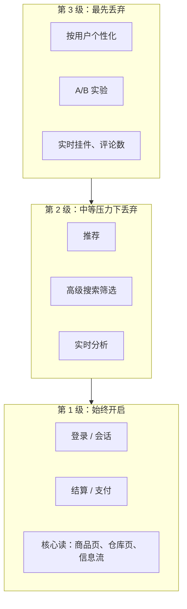
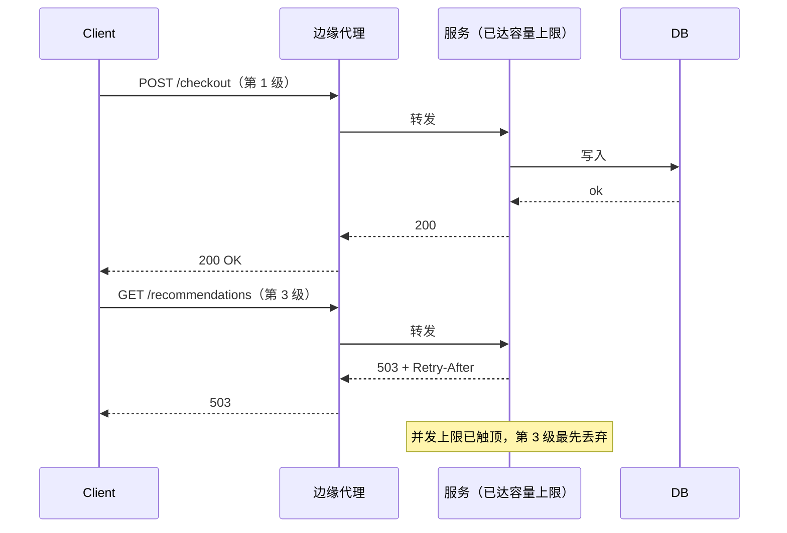
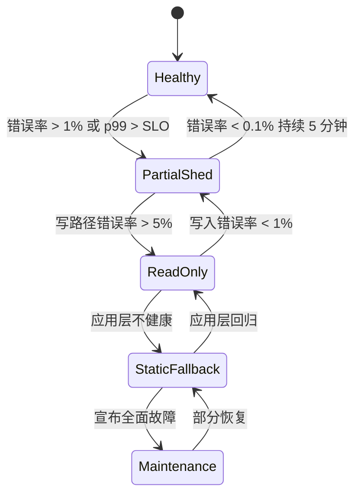
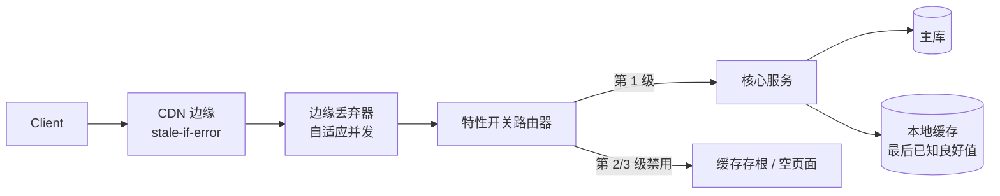

# 优雅降级：部分可用胜过完全不可用

> **TL;DR**：生产系统从来不是“全好”或“全坏”。真正的问题是：哪些功能留着，哪些功能丢掉。优雅降级（graceful degradation）是一门在故障发生前就决定好的纪律——结算流程保住，推荐可以消失。工具箱很小：主动丢弃（load shedding，早拒、廉价地拒）、特性开关（feature flags，非关键路径上的急停开关）、缓存兜底（旧数据好过没数据）、静态兜底（应用层已经没了，就返回预渲染的 HTML）。AWS 区分“吞吐量（throughput）”与“有效吞吐（goodput）”，后者指成功完成、且快到足以对用户有用的请求[^1]。当服务器越过它的有效吞吐拐点，工程目标就是通过拒绝或降级多余流量来守住有效吞吐，而不是接下自己干不完的活。

## 学习目标

学完本章，你将能够：

- [ ] 为主动丢弃设计功能的优先级分级
- [ ] 在负载均衡器、网关或应用层实施主动丢弃
- [ ] 用特性开关在高负载时关掉开销大的功能
- [ ] 用过期缓存内容作为兜底
- [ ] 向用户传达降级状态，同时不把局面弄得更糟

## 直觉理解

周五晚上，你经营着一家餐厅。厨房已经满负荷，出单开始积压。你有两个选择：继续接下每桌的完整点单，然后看着每道菜都又冷又晚地端上去；或者精简菜单。你对领位员说：“今晚没有每日特餐。前菜只留三个选项。甜点全部停。”

没有人会因为焦糖布丁没了就给一星差评。他们给一星差评，是因为牛排晚了 90 分钟、端上来还是凉的。压力之下敢于精简菜单的餐厅，比那家什么都承诺、什么都做不好的餐厅，给出的体验更好。

软件系统也是同一个道理。当某个依赖挂掉、或者流量涨过承载能力，你可以继续接下每个请求，看着延迟一路爬到客户端超时；也可以丢掉非关键工作，保住关键路径。推荐可以消失，个性化可以退化成“热门条目”，分析埋点可以停止采集。但登录、结算和核心读必须继续工作。

[弹性模式](./02-resilience-patterns.md)给了你防御机制：超时、熔断器、舱壁隔离。本章讲的是怎么用这些机制：哪些功能配得上熔断器的兜底分支？主动丢弃器先拒哪些请求？谁来决定，什么时候决定？

## 原理

### 关键路径分级

优雅降级的第一步不是技术问题，而是一场产品讨论：哪些功能最重要？

Google 内部的 RPC 框架使用四个固定的关键性等级：CRITICAL_PLUS、CRITICAL、SHEDDABLE_PLUS、SHEDDABLE[^2]。服务器过载时先拒掉关键性更低的请求。关键性会跨 RPC 跳传播，下游服务因此沿用同一套优先级。AWS 的做法是把分级决策尽量推到靠近客户端边缘的位置，而不是在每个服务内部做全局优先级判断[^1]。

大多数系统适用的三级模型：



*功能被分进不同级别，运维才知道在 70% 容量、90% 容量、以及数据库宕机这三种情况下分别该丢什么。*

组织层面的难题是分级膨胀。如果每个团队都把自己的功能标成 CRITICAL_PLUS，这个信号就废了[^2]。把分级绑到 SLO 上：第 1 级功能给三个 9 的目标，第 2 级两个 9，第 3 级尽力而为。[SLO、SLI 与错误预算](./01-sli-slo-sla-error-budgets.md)提供了设定这些目标的方法框架。

### 主动丢弃

主动丢弃（load shedding）是指在最早那个掌握足够信息的层次上，用快速、廉价的响应拒掉请求，而不是接下服务器根本完不成的工作。

当服务器越过有效吞吐拐点，延迟上升，客户端超时，重试又把负载放大。解法是把已接受的工作量限制住，其余的用一个廉价的 503 + Retry-After 拒掉。AWS 建议在最早能做出判断的位置丢弃：边缘代理、API 网关，或应用中间件[^1]。

**在哪里丢：**

- **L4 负载均衡器**：连接数限制、SYN flood 防护。简单粗暴但很快。
- **API 网关**：按客户端限流、按端点配额。知道路由，但看不到请求体。
- **应用中间件**：基于请求元数据（用户等级、端点关键性）做优先级丢弃。最精确，但拒一个请求的代价也最高。

**基于优先级的丢弃**把分级和主动丢弃合在一起：给每个请求打上关键性标记，压力上来时先拒第 3 级，再拒第 2 级，第 1 级最后丢。Netflix 的 `concurrency-limits` 库把容量切开：90% 留给在线流量，10% 给批处理。压力上来时批处理被丢弃，在线流量照常跑[^3]。



*已达容量上限的服务器用 503 廉价地拒掉低优先级请求，而不是接下自己完不成的工作。*

**自适应并发上限**解决了调参问题。Netflix 这个库把 TCP 拥塞控制算法（Vegas、Gradient2）套用到 HTTP/gRPC 上：采样延迟，用利特尔法则（`Limit = Average RPS * Average Latency`）判断是否在排队，动态收缩允许的在途请求数[^3]。没有静态 RPS 天花板，也就不会在服务自动扩缩之后过期失效。

### 特性开关作为急停开关

用于降级的特性开关本质上是一个运维开关：一个手工管理的熔断器，不用重新部署就能关掉某个具体功能[^4]。Pete Hodgson 的分类法把开关分成四类（Release、Experiment、Ops、Permissioning）。运维开关（Ops）就是急停开关这一类。

生命周期很简单：健康时开着，出故障时关掉，恢复后打开。LaunchDarkly、Unleash、[OpenFeature](https://openfeature.dev/) 这类平台提供分布式配置存储、定向规则和审计日志。很多平台能在可观测性信号（错误率、延迟）越过阈值时自动翻开关，直接接进[可观测性](./00-observability.md)流水线。

**按级别自动禁用**在此基础上再进一步：p99 延迟超过 SLO，自动禁用第 3 级功能；错误率超过 5%，禁用第 2 级。第 1 级始终保留人工覆盖的权力。

> [!IMPORTANT]
> **没人测过的急停开关等于不存在。** Hodgson 建议把“所有开关都打开”和“所有开关都关闭”这两种配置都测一遍，再加上生产配置[^4]。每季度安排一次急停开关演练。为每个运维开关记录“上次翻转”时间戳。90 天没演练过的开关值得怀疑。

**开关债**是持有成本。加开关很便宜，删开关很贵。每次部署都有指数级的开关状态组合要测。Hodgson 说：“精明的团队把特性开关当作库存，而库存是有持有成本的”[^4]。建开关的时候就顺手加一条删除任务，在配置里写过期日期。Knight Capital 在 45 分钟内亏掉约 4.4 亿美元：一次代码部署让已废弃的逻辑在八台服务器中的一台上继续生效——这是关于陈旧代码路径的教训，与失控的开关债带来的风险颇为相似[^4]。

### 缓存与静态兜底

依赖不可达时，你有两个选择：报错，或者返回旧数据。对于读多写少的路径，旧数据几乎总是更优。

**RFC 5861** 为此定义了两个 HTTP 指令[^5]：

- `stale-while-revalidate=N`：在后台重新校验的同时，先返回过期内容 N 秒。
- `stale-if-error=M`：源站返回 500、502、503、504 时，返回过期内容 M 秒。

```http
Cache-Control: max-age=600, stale-if-error=1200
```

这告诉 CDN：内容 10 分钟内是新鲜的；如果重新校验失败，缓存副本还能再发 20 分钟。Cloudflare 的 Always Online 走得更远：源站彻底不可达时，Cloudflare 从 Internet Archive 取热门页面的静态快照返回。它没法提供动态内容、登录或 POST 请求，但对营销页和文档来说，这能把一次全面宕机变成“内容旧了但还能看”的体验[^6]。

**应用内最后已知良好值**是应用层的等价物。推荐服务超时时，从本地缓存返回上一次成功的响应。用户看到的是稍微过时的推荐，而不是一个错误或者一个空挂件。

**静态兜底**是维护页之前的最后一道：

- 首页的预渲染 HTML，从 S3/CDN 直接发
- 骨架屏 UI，只显示结构不显示数据
- 只读模式（写禁用，读从副本提供）

**Amazon 的反方观点。** AWS 的明确立场是：兜底在分布式系统里“几乎从不”有用，因为兜底路径很少被执行、很难测，而且会以难以察觉的方式和主路径共享故障[^7]。他们偏好的替代方案是：把主路径做可靠；主动推送数据（例如提前几小时推送 IAM 凭证）；或者把兜底改造成故障切换——两条路径都持续运行。这并不矛盾，区别在于：**降级响应**（有意的、测过的、持续在跑的）是安全的；**兜底**（极少执行、满是潜伏 bug 的代码路径）是危险的。

### 向用户传达降级状态

静默降级是反模式。功能关了，就要告诉用户。

**状态页**（Statuspage、Instatus）用来传达系统级状态。但 2017 年 2 月 AWS S3 故障暴露了它的失效模式：状态页本身就依赖 S3，所以它没法报告 S3 挂了[^8]。把状态页放在独立的基础设施上。

**应用内横幅**与后端急停开关绑定同一个开关。推荐被禁用时，就在挂件的位置显示“推荐暂时不可用”。不要留一个空 div，让人以为是 bug。

**结构化错误响应**用 [RFC 9457](https://www.rfc-editor.org/rfc/rfc9457) 的 `application/problem+json`（它取代了 RFC 7807），让客户端和 SDK 能以程序方式判断降级模式：

```json
{
  "type": "https://example.com/probs/degraded",
  "title": "Recommendations temporarily unavailable",
  "detail": "Upstream recommender is disabled; showing popular items.",
  "instance": "/products/SKU-123"
}
```

原则是：诚实，不要沉默。用户对“我们正在处理故障，部分功能受限”的容忍度，远高于对一个神秘空白页或一段说不出原因的卡顿。

## 真实案例

### GitHub 的只读模式（2018 年 10 月）

2018 年 10 月 21 日，GitHub 美国东海岸中心与主数据中心之间 43 秒的网络中断触发了一连串反应。Orchestrator（GitHub 的 MySQL 拓扑管理器）把西海岸数据库提升为主库。网络恢复后，应用层跨全美链路向新的西海岸主库写入，引入了应用层吸收不了的延迟。在短暂分区期间，一个繁忙集群上有 954 次写入没有复制到西海岸；而西海岸在工程师介入前，已经接收了将近 40 分钟来自应用层的新写入[^9]。

GitHub 的应对是有意的降级：**只读模式**。他们暂停了 webhook 投递和 GitHub Pages 构建，而不是冒险覆盖用户数据。在 24 小时 11 分钟里，用户可以浏览仓库和 issue，但不能 push、不能开 PR、收不到 webhook[^9]。

数字讲清了积压的规模：超过 500 万个 webhook 事件排队，8 万次 Pages 构建排队，约 20 万条 webhook 载荷超出内部 TTL 被丢弃[^9]。



*系统在若干明确的降级状态之间迁移；每次迁移都由一个可测量的信号触发，并且有明确的退出条件。*

关键的工程决策是：**数据完整性优先于站点可用性。** GitHub 明确选择了“让用户烦躁，而不是让用户被骗”。GitHub 的流量大部分是读，所以多数用户看到的仍是一个慢但能用的站点。事后行动包括加速双活多数据中心设计，以及投入混沌工程，在生产环境真的出问题之前先验证故障场景[^9]。

这就是优雅降级做对的样板：预先规划好的运行模式、清晰的触发条件、明确的影响范围、以及一条恢复路径。

## 纵深防御

优雅降级不是从菜单里挑一个技术。成熟的服务会把这些层次叠起来用，让某一层的失效不会把整个系统拖垮。本章的架构图把这三层称为“三层互相加强的防线”，下表与之一致。每一行都是叠加关系，“我们的选择”那一列说的是**什么时候**加这一层，而不是拿它替代其他层。

| 层次 | 优点 | 缺点 | 适用场景 | 何时加入这一层 |
|----------|------|------|-----------|----------|
| 入口处主动丢弃 | 在入口实现容易；过载时守住有效吞吐 | 粗糙：所有被拒流量一视同仁 | 容量驱动的过载 | **每个服务的基础配置** |
| 功能级降级（运维开关） | 外科手术式、由运维驱动、翻转快 | 开关债；未测过的开关；需要可观测性 | 功能边界清晰的系统 | **有了 3 个以上功能级别后再加** |
| 读路径缓存兜底 | 用户无感；对边缘友好；能扛住源站故障 | 数据过时风险；AWS 警告兜底难以验证和测试[^7] | 读多写少、且能容忍过时的路径 | **给第 2/3 级的读加上，但要谨慎** |
| 只读模式 | 存储故障期间保住数据完整性（GitHub 2018 年 10 月[^9]） | 需要全应用支持；后补代价高 | 写流量占比不高、且有安全读路径的 CRUD 系统 | **任何写流量低于 30% 的系统都应预先建好** |

## 常见陷阱

> [!WARNING]
> **兜底与主路径共享依赖。** 2001 年，Amazon 给配送时效查询加了一个缓存，兜底逻辑是直接查数据库。当所有缓存同时失效，每台 Web 服务器都直接打数据库，数据库锁死，整个站点连同所有履约中心一起挂掉[^7]。兜底把一次局部故障升级成了全站故障。每一条兜底路径都要审一遍，看它是否和主路径共享故障。

> [!WARNING]
> **静默降级。** 运维翻了急停开关，但没更新 UI 也没更新状态页。用户看到陈旧数据、缺失功能或者一些说不清的报错，根本不知道某个功能已经被关掉。把应用内横幅绑到与后端开关同一个开关上。用 RFC 9457 结构化错误，让客户端能判断当前处于哪种降级模式。

> [!WARNING]
> **虚假可用。** 服务器接下请求，开始干活，干到一半失败。客户端早已超时并重试过了，服务器那句迟到的回复纯属浪费[^1]。把每个请求的截止时间传递下去；从内部队列里清掉已过期的请求；过载时用 LIFO 而不是 FIFO，让最新的请求先被服务。

> [!WARNING]
> **没测过的急停开关。** 生产上没人翻过的急停开关等于不存在。代码会漂移：开关走进了一条有 bug 的分支，或者配置键被改了名。每季度演练一次，记录“上次翻转”时间戳。90 天以上没测过的开关都值得怀疑。

> [!WARNING]
> **把降级当补丁。** 系统建完之后再设计降级，就意味着：每条写路径都要后补只读信号的处理，每个 UI 都要学会隐藏缺失的挂件，每个依赖都要重新分类。把降级分级和功能设计放在一起做，成本低 10 倍。

## 练习

为一个电商站点设计降级方案：按优先级列出功能，说明在 70% 容量、90% 容量、以及数据库宕机时分别丢什么，并设计 UX，让用户能理解发生了什么，又不至于失去信任。

<details>
<summary>提示</summary>

先把商品页和结算流程上所有可见功能列出来，分成三级。对每一级回答：禁用什么功能的触发条件是什么？用户看到什么替代内容？恢复条件是什么？再想想在边缘丢弃（直接拒请求）和在功能级丢弃（页面照发，只是没有那个挂件）之间的区别。

</details>

<details>
<summary>答案</summary>

**分级：**

| 级别 | 功能 | 丢弃触发条件 | 用户体验 |
|------|----------|--------------|-----------------|
| 1（始终开启） | 登录、购物车、结算、支付、商品页（价格 + 库存） | 永不丢弃；这些功能出问题就宣布全面故障 | 正常 |
| 2（90% 容量时丢弃） | 推荐、评价、问答、配送时效预估、心愿单 | p99 > 2 倍 SLO 或依赖错误率 > 5% | 横幅：“部分功能暂时受限” + 带说明的空挂件 |
| 3（70% 容量时丢弃） | 个性化、A/B 实验、在线客服、最近浏览、社交证明计数 | p99 > 1.5 倍 SLO 或 CPU > 70% | 功能静默隐藏（用户对这些功能本来就没期待） |

**数据库宕机时：**

切到只读模式。商品页从缓存返回（stale-if-error=3600）。购物车和结算返回 503 并配横幅：“结算暂时不可用。你的购物车已保存。”不接受任何写入。恢复条件：主库连续 5 次健康检查通过。

**UX 传达：**

- 第 3 级丢弃：不出横幅（用户基本注意不到这些功能没了）
- 第 2 级丢弃：页面顶部黄色横幅：“当前访问量较大，部分功能暂时受限。”
- 数据库宕机：红色横幅：“部分服务暂时不可用。你的数据是安全的，我们正在处理。”附上状态页链接。
- 状态页托管在独立基础设施上（不与主站共用 CDN 或云账号）。

**架构：**



*三层互相加强的防线：边缘丢弃器拒掉多余流量，开关服务关掉非关键功能，源站不可达时缓存兜底返回过期数据。*

</details>

## 要点回顾

- 降级表面是技术决策，实质是产品决策。在故障之前把功能分级，而不是在故障之中。
- 早丢、廉价地丢。最坏的情况是接下干不完的活，浪费了资源，最后还是让客户端失败。
- 区分**降级响应**（有意的、测过的、持续在跑的）与**兜底**（极少执行、满是潜伏 bug 的代码路径）。AWS 警告说兜底几乎从不管用[^7]。
- 缓存兜底买的是时间。对读多的路径，过期内容几乎总比报错好。
- 只读模式被用得太少。多数系统可以做到写先降、读后降，在保证数据完整性的同时让大多数用户还能用。
- 没人翻过的急停开关等于不存在。每季度演练一次降级。方法论见[混沌工程与演练日](./06-chaos-engineering.md)。
- 诚实沟通。静默降级比一条写着“部分功能受限”的横幅更快地侵蚀信任。

## 延伸阅读

- [Using load shedding to avoid overload](https://aws.amazon.com/builders-library/using-load-shedding-to-avoid-overload/) - David Yanacek 关于有效吞吐、拐点和尽早拒绝的经典入门文章；这个主题最好的起点。
- [Avoiding fallback in distributed systems](https://aws.amazon.com/builders-library/avoiding-fallback-in-distributed-systems/) - Jacob Gabrielson 反直觉的论证：兜底通常让故障更糟，文中附有 2001 年 Amazon 缓存打垮数据库的事故。
- [Handling Overload (Google SRE Book, Ch. 21)](https://sre.google/sre-book/handling-overload/) - 来自 Google 生产实践的关键性分级、客户端限速与重试预算。
- [Feature Toggles](https://martinfowler.com/articles/feature-toggles.html) - Pete Hodgson 的开关分类法与持有成本论证；搭开关平台之前的必读。
- [Netflix concurrency-limits](https://github.com/Netflix/concurrency-limits) - 借 TCP 拥塞控制算法做自适应丢弃；静态 RPS 天花板的现代替代品。
- [RFC 5861: HTTP Cache-Control Extensions for Stale Content](https://www.rfc-editor.org/rfc/rfc5861) - `stale-while-revalidate` 与 `stale-if-error` 指令的正式规范。
- [GitHub October 21 post-incident analysis](https://github.blog/news-insights/company-news/oct21-post-incident-analysis/) - 24 小时有意的只读降级；“部分可用胜过完全不可用”最好的公开案例。
- [Performance Under Load](https://netflixtechblog.medium.com/performance-under-load-3e6fa9a60581) - Netflix 谈自适应并发与静态超时的终结；解释了 Vegas 与 Gradient2 算法。

## 记忆卡片

**Q：** “吞吐量”和“有效吞吐”有什么区别？
**A：** 吞吐量是压到服务器上的总请求数每秒。有效吞吐是成功完成、且快到对客户端有用的请求数每秒。服务器越过拐点后，吞吐量还在涨，有效吞吐已经塌了。

**Q：** Google 的四个 RPC 关键性等级是什么？
**A：** CRITICAL_PLUS、CRITICAL、SHEDDABLE_PLUS、SHEDDABLE。服务器过载时先拒关键性低的请求，关键性会跨 RPC 跳传播。

**Q：** 为什么 AWS 建议在尽可能早的层次丢弃？
**A：** 因为在边缘拒掉一个请求（不花计算、内存、下游调用）比接下它、干了一半再失败要便宜几个数量级。迟到的失败既浪费资源，又照样让客户端失望。

**Q：** 什么是运维开关，它和发布开关有什么区别？
**A：** 运维开关是运行时关掉某个功能、不需要重新部署的急停开关，用于故障期间。发布开关在开发期拦住未完成的代码。运维开关活得久，必须定期测试；发布开关活得短，上线后就删掉。

**Q：** 为什么 Amazon 2001 年的配送时效兜底让故障更严重？
**A：** 兜底路径查的正是缓存本来要保护的那个供应链数据库。缓存全挂之后，每台服务器都直接打数据库，把它压死，整个站点连同所有履约中心一起下线。兜底和主路径共享了故障。

**Q：** Cache-Control 头里的 `stale-if-error=1200` 是什么意思？
**A：** 如果源站在重新校验期间返回 500、502、503 或 504，缓存可以继续返回过期响应最多 1200 秒，而不是把错误转发给客户端。

**Q：** 什么是“虚假可用”，它为什么有害？
**A：** 虚假可用指服务器接下了它完不成的请求。客户端超时并重试，而服务器迟到的回复纯属浪费。它消耗资源却不产生价值，还通过重试放大负载。

**Q：** 自适应并发上限是怎么工作的？
**A：** 它把 TCP 拥塞控制算法（Vegas、Gradient2）套用到 HTTP/gRPC 上。系统采样延迟，用利特尔法则判断是否在排队，动态收缩或放大允许的在途请求数。没有需要配置、也不会过期的静态 RPS 天花板。

**Q：** 为什么“没人测过的急停开关等于不存在”是一条核心原则？
**A：** 代码会随时间漂移。开关可能走进一条带新 bug 的分支，配置键也可能被改过名。不定期演练（至少每季度一次），你会在最需要它的那次故障里才发现开关是坏的。

**Q：** GitHub 在 2018 年 10 月的只读故障中优先保了什么？
**A：** 数据完整性优先于站点可用性。他们暂停 webhook 投递和 Pages 构建达 24 小时，也不愿冒着用分叉的数据库副本覆盖用户数据的风险。因为 GitHub 流量大部分是读，多数用户看到的仍是一个可用（只读）的站点。

**Q：** 什么时候用只读模式，什么时候用完全维护模式？
**A：** 写路径受损但读安全时（数据库故障切换、复制延迟）用只读模式。只有读也不安全、或者应用层本身挂了，才用完全维护模式。在读多的系统里，只读保住了大部分用户价值。

**Q：** 开关债有什么风险？
**A：** 无用的开关不断堆积，产生指数级、根本测不完的状态组合。陈旧开关会变成潜伏 bug。Knight Capital 在一台服务器上残留了废弃代码，45 分钟里亏掉约 4.4 亿美元。把开关当作有持有成本的库存，并设定过期日期。

## 参考文献

[^1]: David Yanacek, "Using load shedding to avoid overload," Amazon Builders' Library. https://aws.amazon.com/builders-library/using-load-shedding-to-avoid-overload/
[^2]: Alejandro Forero Cuervo, "Handling Overload," Google SRE Book, Chapter 21. https://sre.google/sre-book/handling-overload/
[^3]: Netflix, "concurrency-limits: Java Library that implements and integrates concepts from TCP congestion control to auto-detect concurrency limits for services." https://github.com/Netflix/concurrency-limits
[^4]: Pete Hodgson, "Feature Toggles (aka Feature Flags)," martinfowler.com, 9 October 2017. https://martinfowler.com/articles/feature-toggles.html
[^5]: Mark Nottingham, "HTTP Cache-Control Extensions for Stale Content," RFC 5861, May 2010. https://www.rfc-editor.org/rfc/rfc5861
[^6]: Cloudflare, "Always Online," Cloudflare Cache (CDN) docs. https://developers.cloudflare.com/cache/troubleshooting/always-online/
[^7]: Jacob Gabrielson, "Avoiding fallback in distributed systems," Amazon Builders' Library. https://aws.amazon.com/builders-library/avoiding-fallback-in-distributed-systems/
[^8]: AWS, "Summary of the Amazon S3 Service Disruption in the Northern Virginia (US-EAST-1) Region," 28 February 2017. https://aws.amazon.com/message/41926/
[^9]: Jason Warner, "October 21 post-incident analysis," GitHub Blog, 30 October 2018. https://github.blog/news-insights/company-news/oct21-post-incident-analysis/
