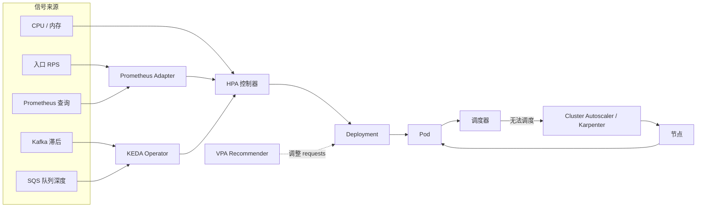
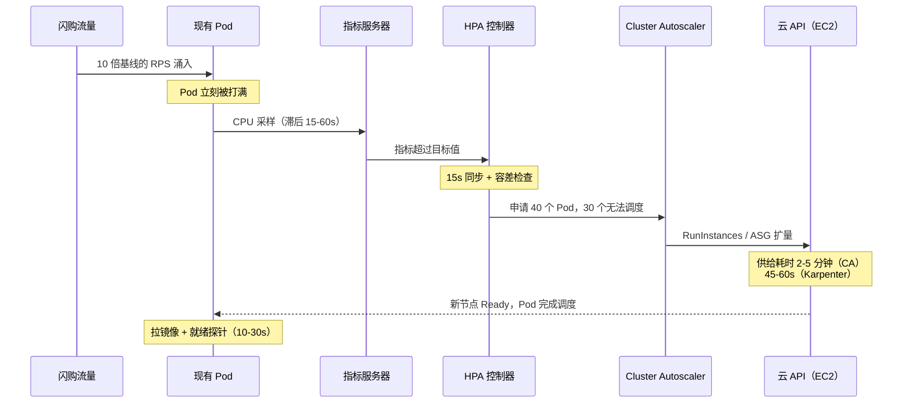
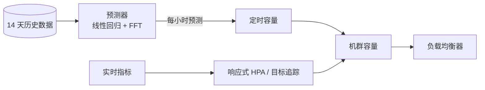
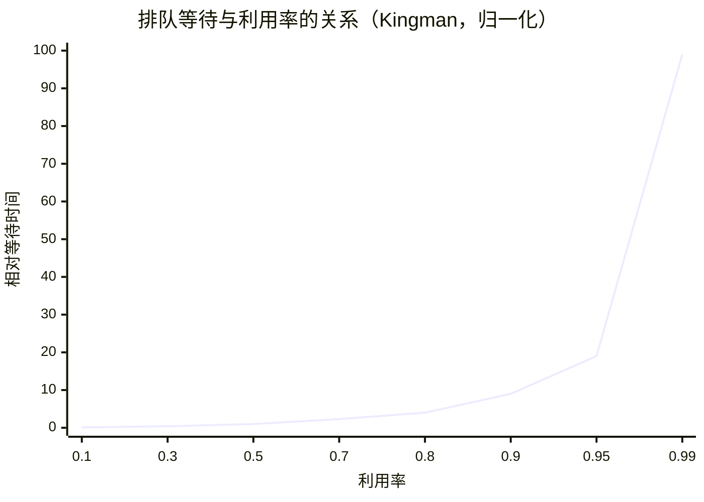

# 自动扩缩容与容量规划：从 HPA 到预测式扩缩容

> **TL;DR**: 自动扩缩容（auto-scaling）是个闭环控制系统，但它有个见不得光的秘密：它比它想追赶的流量尖峰更慢。响应式链路（指标采样、控制器决策、节点供给、Pod 就绪）端到端要 1 到 5 分钟[^1][^2]，而闪购的峰值只持续几秒。你需要三层：响应式扩缩容应对日常曲线，定时或预测式扩缩容应对已知高峰，容量算术（利特尔法则、金曼公式）用来设定余量，接住前两层都来不及抓住的流量。

## 学习目标

学完本章，你将能够：

- [ ] 说清 Kubernetes 的 HPA、VPA 和 Cluster Autoscaler 各自管什么、什么时候用
- [ ] 按负载类型挑选扩缩容信号（CPU、RPS、队列深度、自定义指标）
- [ ] 用利特尔法则和排队论做容量规划
- [ ] 针对扩缩容滞后做设计，并处理那些不会跟着你扩的依赖
- [ ] 在响应式、定时和预测式扩缩容之间做选择

## 直觉理解

你经营着一支出租车队。凌晨 2 点，路上跑着 10 辆车。早上 7 点，通勤人群涌入 App。你可以盯着等车的乘客队列，队列变长就多派几辆车（响应式扩缩容）。可车从车库开到繁忙城区要 20 分钟。等它们到位，早高峰已经过半，乘客早就流失了。

更聪明的调度员会翻出上周二的数据：“早上 7 点市中心固定要 80 辆车。”于是她在 6:40 就把车预置过去（定时扩缩容）。再聪明一点的做法，是把一整年的出行数据喂进模型，预测明天每个片区、每个小时的需求（预测式扩缩容）。响应式系统仍然在跑，作为应对突发演唱会或球赛的安全网，但它不再独自承担日常负载。

现在把“出租车”换成“Pod”，把“20 分钟”换成“加一个新节点要 3 到 5 分钟”。算术完全一样。真正的功夫在于：知道哪一层负责哪种流量形态，并且知道你的数据库、你的支付服务商和你的可观测性后端根本没有“再派几辆车”这个按钮。

## 原理

### 扩缩容的维度

[可扩展性](../part-1-core-fundamentals/00-scalability.md)已经讲过纵向扩展与横向扩展。自动扩缩容再补上两个维度：

- **应用层扩缩容**调整现有基础设施内的副本数量（Pod、任务、Lambda 并发）。
- **集群层扩缩容**调整基础设施本身（节点、VM、实例组）。

无状态服务躲在[负载均衡器](../part-2-building-blocks/00-load-balancers.md)后面横向扩展。有状态服务（数据库、消息代理、协调服务）难以横向扩展，因为它们各自拥有一部分数据。这种不对称正是大多数自动扩缩容翻车的根源：应用层几分钟内翻三倍，数据库一动不动。

### Kubernetes 的自动扩缩容家族

Kubernetes 把自动扩缩容拆成三个控制器，各自工作在不同层级：

**HPA（Horizontal Pod Autoscaler）**每 15 秒跑一次，按下式计算[^1]：

```text
desiredReplicas = ceil(currentReplicas * (currentMetricValue / desiredMetricValue))
```

如果当前 CPU 是目标值的 140%，而你有 2 个副本，HPA 就会请求 `ceil(2 * 140/70) = 4`。容差区间（默认 10%）用来抑制抖动。缩容走 5 分钟的稳定窗口，取窗口内最高的建议值，避免过早收缩[^1]。

**VPA（Vertical Pod Autoscaler）**为每个 Pod 给出甚至直接应用 CPU 与内存 requests。Google 的 Autopilot 在生产中同时做横向和纵向调优，把资源冗余从 46% 压到 23%，把严重 OOM 减少 10 倍[^3]。

**Cluster Autoscaler** 盯着无法调度的 Pod，通过云厂商 API 增加节点。这条路径（ASG 启动、VM 引导、kubelet 启动、CNI 初始化、拉镜像）要 2 到 5 分钟[^2]。

**Karpenter**（AWS，2021 年开源）完全绕过 ASG 这层抽象。它直接调用 `RunInstances`，挑选能装下待调度 Pod 的最便宜实例类型。结果是：从 Pod pending 到节点就绪约 45 到 60 秒[^2]。

**KEDA（Kubernetes Event-Driven Autoscaler）**用外部触发器扩展 HPA：Kafka 消费者滞后、SQS 队列深度、Prometheus 查询、cron 定时。它让异步 worker 能缩到零，这是默认 HPA 做不到的[^4]。



*Kubernetes 自动扩缩容技术栈：HPA 按指标调整副本；KEDA 接入外部信号；Pod 调度不上去时，由 Cluster Autoscaler 或 Karpenter 加节点。*

### 选对信号

CPU 是 HPA 的默认指标，而它经常是错的。一个 Node.js 服务的事件循环被阻塞时，请求会卡住却不烧 CPU。一个受制于数据库的服务阻塞在 I/O 上，进程看着闲得发慌。只按 CPU 扩缩容，这两种情况都会漏掉[^5]。

按负载类型排序，更好的信号是：

| 负载 | 最佳信号 | 原因 |
|---|---|---|
| Web API（无状态） | 每秒请求数 | 比 CPU 早几秒反映变化；从负载均衡器上就能拿到 |
| 异步消费者（Kafka、SQS） | 队列深度 / 消费者滞后 | 消费者闲坐着积压一堆消息时，CPU 毫无意义 |
| 延迟敏感服务 | 趋向 SLO 的 p99 延迟 | 在 SLO 被击穿之前就扩，而不是之后 |
| 通用并发 | 在途请求数（利特尔法则） | 直接预测线程池耗尽 |
| ML 推理 | GPU 利用率 / KV-cache 占用 | 对 GPU 负载来说 CPU 无关 |

Cloudflare 的 Traffic Manager 用的是每秒 CPU 毫秒数，而不是原始 RPS，因为不同客户的单请求 CPU 开销差异极大。一个 ML 模型动态调整每个数据中心的 CPU 阈值，把 `cfcheck` 延迟（请求穿过 Cloudflare 一线服务器的耗时）的 95 分位压在 20 ms 的 SLO 之下[^6]。

### 扩缩容滞后：隐藏的敌人

响应式扩缩容链路是一串串行延迟：



*响应式链路加起来要 1 到 5 分钟以上。闪购的峰值只持续几秒。这个时间差就是单靠响应式扩缩容不够用的原因。*

总滞后的拆解：

- 指标采样：15 到 60 秒
- HPA 决策周期：15 秒
- 节点供给（Cluster Autoscaler）：2 到 5 分钟[^2]
- 节点供给（Karpenter）：45 到 60 秒[^2]
- Pod 启动 + 就绪：10 秒到 2 分钟

缓解手段：用定时扩缩容预热，设一个合理的 `minReplicas` 下限，对周期性形态用预测式扩缩容，并保留一批“占位 Pod”（低优先级的 pause 镜像）预先占住节点空间，让真正的 Pod 一来就能调度上去。

### 定时扩缩容与预测式扩缩容

**定时扩缩容**就是给副本数配 cron：`min=20 from 8am to 10pm, min=4 overnight`。它用零 ML 复杂度应对已知的每日和每周周期。

**预测式扩缩容**用历史负载训练一个预测器。AWS EC2 Predictive Scaling 至少需要 24 小时数据，14 天效果最好，产出 48 小时预测、每 6 小时刷新一次[^7]。它只负责扩量，缩容交给响应式扩缩容。

**Netflix Scryer**（2013）比 AWS Predictive Scaling（2018）早了五年。Netflix 需要预测，是因为当时 EC2 实例启动要 10 到 45 分钟[^8]。Scryer 用预测算法（普遍报道称包含线性回归和 FFT）在需求到来之前预测容量。预测出的基线喂给定时扩缩容动作；AWS Auto Scaling 仍然作为响应式安全网，兜住没预测到的尖峰[^8]。



*预测式扩缩容根据历史规律设定基线，响应式扩缩容接住预测器漏掉的部分。两者合起来，既覆盖日常曲线，也覆盖突发尖峰。*

### 容量规划的算术

三个公式锚定容量规划：

**利特尔法则（Little's Law）**：`L = lambda * W`。在途请求的平均数量（L）等于到达速率（lambda）乘以平均服务时间（W）。一个每秒处理 1,000 个请求、平均延迟 340 ms 的服务，就有 340 个请求在途。如果每台服务器有 6 个工作线程，你至少需要 `ceil(340 / 6) = 57` 台服务器[^9]。

**金曼公式（Kingman's formula）**（VUT 近似）针对 G/G/1 队列：期望等待时间为 `E(Wq) ~ (rho / (1 - rho)) * ((ca^2 + cs^2) / 2) * tau`，其中 `rho` 是利用率，`ca` 和 `cs` 分别是到达时间与服务时间的变异系数，`tau` 是平均服务时间。`rho / (1 - rho)` 这一项是利用率因子，波动性会在此基础上进一步放大它。在 M/M/1 这个特例下（`ca = cs = 1`），等待时间等于 `rho / (1 - rho)` 乘以服务时间：利用率 50% 时，等待等于一次服务时间；80% 时是 4 倍；95% 时是 19 倍。到达过程突发性强的真实系统（`ca > 1`）会更狠地撞上悬崖。这就是为什么很多团队把稳态利用率定在 50% 到 60%，而不是 80%[^10]。



*利用率过了 80% 之后，每多一个百分点加上的排队时间都不成比例。这条曲线解释了为什么“CPU 打到 60%”不是浪费，而是活命余量。*

**关联故障缓冲**：3 个可用区里挂掉一个，剩下两个各自要多扛 50% 的负载。如果你平时跑在 66% 利用率，挂掉一个可用区就把幸存者推到 100%。把稳态定在 50%，挂掉一个可用区后剩下的两个到 75%，仍在金曼悬崖之下。

### 扩不动的依赖

加 Pod 只要几秒钟。下面这些跟不上：

- **数据库连接**：RDS 的 `max_connections` 默认值随实例规格增长，但有硬上限。Aurora Serverless v2 有 ACU 上限。应用层翻三倍，你就会撞上 `FATAL: sorry, too many clients already`。解法：用 PgBouncer 或 RDS Proxy 做连接多路复用。
- **第三方限流**：Stripe、Twilio 和支付服务商有按账号的封顶，不关心你起了多少 Pod。已知高峰之前先把额度谈上去。
- **Kafka 分区数**：消费者并行度受分区数限制。只有 12 个分区，却扩到 50 个消费者，其中 38 个纯属白开。
- **可观测性成本**：机群翻三倍，指标基数、日志量、trace 数量一起翻三倍。你的 Datadog 账单跟着机群涨，不跟着营收涨。

## 真实案例

### Netflix：Scryer、Titus 与预测式-响应式混合

Netflix 一直是全球互联网流量的最大单一来源之一（Sandvine 的 Global Internet Phenomena 报告显示，2010 年代后期高峰时段它约占北美下行视频流量的三分之一；到 2024 年，随着 YouTube 和社交视频平台崛起，它仍居全球前三）。他们的容器平台 Titus 在上万台 EC2 实例上调度工作负载[^11]。

**问题**：2013 年，Netflix 的 EC2 实例启动要 10 到 45 分钟。晚上的流量爬坡在几小时内就把机群规模从日峰值的 20% 拉到 80%，响应式扩缩容根本追不上[^8]。

**方案**：Scryer，一个用预测算法（普遍报道称用线性回归捕捉趋势、用 FFT 捕捉周期性）在需求到来之前预测容量的引擎。预测结果驱动定时扩缩容动作。AWS Auto Scaling 仍作为响应式层，兜住没预测到的尖峰[^8]。

**演进到 Titus（2018）**：Netflix 转向容器时，与 AWS 合作把 Titus 和 AWS Application Auto Scaling 集成起来。Titus 作业通过 API Gateway 注册成可扩缩资源。容器指标从 Atlas（Netflix 的遥测系统）流到 CloudWatch。AWS Auto Scaling 做出决策，由 Titus 执行——启动或终止容器[^11]。这样 Netflix 的工程师就用上了他们从 EC2 时代就熟悉的目标追踪和步进扩缩容语义，而不用重造这个控制回路。

**关键决策**：

- 按自定义指标扩缩容（来自 Atlas 的 RPS、容器 CPU），而不是只看 CPU[^11]
- 预测式定下限，响应式管上限
- 建在 AWS 托管扩缩容之上，而不是自己维护一套控制回路

教训是：没有哪一种扩缩容策略够用。预测式应对已知曲线，响应式应对未知尖峰，合起来才覆盖完整的流量形态。

## 权衡

| 策略 | 优点 | 缺点 | 适用场景 | 我们的选择 |
|---|---|---|---|---|
| 响应式（HPA、目标追踪） | 跟随流量，不需要预测 | 1-5 分钟滞后；CPU 常常是错的信号 | 没有尖锐突刺的平滑日曲线 | **所有同步服务的默认选择** |
| 定时（cron） | 应对已知高峰；零 ML 复杂度 | 漏掉意外；排程错了就是白留容量 | 可预测的每日/每周规律 | 高峰时间已知时**叠加在响应式之上** |
| 预测式（Scryer、AWS Predictive Scaling） | 在周期性尖峰前预热 | 需要 14 天以上历史[^7]；漏掉史无前例的事件 | 流量有周期性、数据超过 14 天的大型系统 | 数据够用后**叠加在响应式之上** |
| 事件驱动（KEDA） | 异步场景的正确解法；能缩到零 | 首个事件要冷启动 | 队列 worker、批处理作业、消费者 | **所有异步消费者的默认选择**[^4] |

> [!NOTE]
> 节点供给托着上面每一种策略。Karpenter 45-60 秒就能供出节点；Cluster Autoscaler 要 2-5 分钟[^2]。在 AWS 上用 Karpenter，那里它已经生产可用（GA）。截至 2025 年 7 月，它对 GCP、Azure 以及通过 CAPI 的通用本地部署的 provider 抽象仍是 beta[^2]，所以这块格局还会继续变。

## 常见陷阱

> [!WARNING]
> **对事件循环型或 I/O 密集型服务只按 CPU 扩缩容。** Node.js 服务的事件循环被阻塞时，请求会卡住，而 CPU 永远碰不到 HPA 阈值。改用 RPS、并发数或基于 SLO 的延迟来扩缩容。如果你的 p99 在往上爬而 CPU 是一条平线，那你扩缩容的信号就选错了。

> [!WARNING]
> **Cluster Autoscaler 对闪购来说太慢。** HPA 想要 500 个 Pod，集群只装得下 100 个，CA 要 3 到 5 分钟才把节点加上。等容量到位，尖峰已经过去，或者现有 Pod 已经崩了。迁到 Karpenter（45-60 秒），或者预置占位 Pod 提前占住节点空间。

> [!WARNING]
> **只扩应用，不扩数据库。** 应用副本成倍增长，每个都朝 Postgres 开连接，`max_connections` 被打满，应用层整体融化。用 PgBouncer 或 RDS Proxy，把 `maxReplicas` 压在连接上限之下，并在已知高峰前先跟第三方 API 谈好限流额度。

> [!WARNING]
> **下一个高峰还没来就激进缩容。** 两个高峰之间流量下滑，扩缩容器把节点撤了，下一个高峰撞上冷机群。把 HPA 的缩容稳定窗口设成 15 到 30 分钟（不是默认的 5 分钟），保一个合理的 `minReplicas` 下限，并用定时扩缩容在已知高峰窗口内顶住容量。

> [!WARNING]
> **没有副本下限，也没从冷状态压测过。** 一个夜里缩到 1 个 Pod 的服务，早上被尖峰正面打中，毫无余量。把 `minReplicas` 设成“扩缩容器预热期间仍能吸收典型尖峰”的最小规模。每季度从最小状态压到峰值，而不是从峰值压到峰值。Shopify 每年做五次全流量压测，从稳态压到预估峰值[^12]。

## 练习

为一个服务设计自动扩缩容：基线 5k RPS，闪购期间 30k RPS（提前 10 分钟公告），p99 延迟预算 200 ms，后端 Postgres 上限 10k RPS。说明你选的扩缩容信号、阈值，以及你如何保护数据库。

<details>
<summary>提示</summary>

用利特尔法则算出 30k RPS 时的最小副本数。然后问自己：应用层扩 6 倍时数据库会怎样？数据库可没有 HPA 帮它扩。

</details>

<details>
<summary>解答</summary>

**第 1 步：用利特尔法则做容量算术。**

30k RPS、目标延迟 200 ms 时：`L = 30,000 * 0.2 = 6,000` 个并发请求。如果每个 Pod 处理 50 个并发请求（6 个线程，外加一些排队余量），峰值需要 `ceil(6000 / 50) = 120` 个 Pod。

**第 2 步：选扩缩容信号。**

按每 Pod 的 RPS 扩缩容（不是 CPU）。目标设为每 Pod 250 RPS（p99 < 200 ms 时实测能力的 50%）。基线 5k RPS：`5000 / 250 = 20` 个 Pod。30k 时：`30000 / 250 = 120` 个 Pod。HPA 会算出 `ceil(20 * (30000/5000)) = 120`。

**第 3 步：用上那 10 分钟提前量。**

用定时扩缩容：闪购事件一触发（提前 10 分钟），就把 `minReplicas = 120` 设上去。这样流量到达之前机群已经预热好。响应式 HPA 仍作为安全网，兜住超调。

**第 4 步：保护数据库。**

Postgres 后端上限 10k RPS。你的应用在 30k RPS 会把它压垮。缓解手段：

- 给闪购读流量主力的商品目录查询加一个读穿缓存（Redis）。目标缓存命中率 70% 以上，把数据库负载压在 10k 以下。
- 部署 PgBouncer，`max_client_conn = 2000`、`default_pool_size = 100`，做连接多路复用。
- 应用层加熔断器：数据库延迟超过 500 ms 时，直接用缓存返回降级响应，而不是把请求排进队列。
- 把 `maxReplicas` 封在 150（而不是不设上限），这样应用层开出的连接数不会超过 PgBouncer 能扛的量。

**第 5 步：节点供给。**

用 Karpenter（45-60 秒供给）而不是 Cluster Autoscaler。10 分钟提前量够 Karpenter 加好节点，但如果你需要多轮扩量，CA 那条 3-5 分钟的路径就不够了。

**接受的权衡：** 闪购前 10 分钟预留冗余（预热的成本）。接受闪购期间缓存陈旧（商品数据退化为最终一致）。把吞吐量封在数据库能处理的水平，而不是让应用层无上限地长。

</details>

## 要点回顾

- 响应式扩缩容有 1 到 5 分钟的滞后。对几秒内打顶的尖峰，必须再叠上定时或预测式扩缩容。
- 对 Web 类负载，CPU 很少是正确的扩缩容信号。用 RPS、队列深度或基于 SLO 的延迟。
- 利特尔法则（`L = lambda * W`）能推出最小副本数、线程池大小和连接池大小。把它记住。
- 金曼公式解释了为什么 80% 利用率是悬崖而不是目标。稳态瞄准 50% 到 60%。
- 依赖（数据库、有限流的 API、Kafka 分区）不会跟着应用层一起扩。要围绕它们的上限来规划。
- Karpenter 供节点 45 到 60 秒，Cluster Autoscaler 要 3 到 5 分钟。对突发型负载，这个差别很要命。
- 黄金标准是预测式 + 响应式混合：预测出的容量定下限，响应式扩缩容兜住其余。

## 延伸阅读

- [Scryer: Netflix's Predictive Auto Scaling Engine](https://netflixtechblog.com/scryer-netflixs-predictive-auto-scaling-engine-a3f8fc922270) - 预测式扩缩容的经典博文；把“为什么单靠响应式在 Netflix 的体量下会失效”讲得最清楚。
- [Auto Scaling Production Services on Titus](https://netflixtechblog.com/auto-scaling-production-services-on-titus-1f3cd49f5cd7) - Netflix 与 AWS 如何一起做出 Application Auto Scaling；指标到 CloudWatch 再到 Titus 的架构。
- [Kubernetes HPA documentation](https://kubernetes.io/docs/tasks/run-application/horizontal-pod-autoscale/) - 权威规范；重点读算法、容差区间和稳定窗口的算术。
- [How predictive scaling works (AWS)](https://docs.aws.amazon.com/autoscaling/ec2/userguide/predictive-scaling-policy-overview.html) - 14 天历史、48 小时预测、6 小时刷新节奏的准确细节，以及面向运维的各种模式。
- [Meet Traffic Manager: how Cloudflare routes traffic](https://blog.cloudflare.com/meet-traffic-manager/) - Plurimog、Duomog、ML 调优的 CPU 阈值，以及 300 多个城市的 anycast 负载分布。
- [Using Little's Law to scale applications](https://blog.danslimmon.com/2022/06/07/using-littles-law-to-scale-applications/) - 把 `L = lambda * W` 用到线程池和副本数上，最清晰的一份生产实践走查。
- [How we prepare Shopify for BFCM (2025)](https://www.shopify.engineering/bfcm-readiness-2025) - 每年五次扩容压测、200M RPM 目标，以及黑色星期五撑住 284M req/min 背后的运维打法。
- [KEDA documentation](https://keda.sh/docs/) - 事件驱动扩缩容的 API 面：缩到零、多触发器组合。

## 记忆卡片

**Q:** HPA 的扩缩容公式是什么？
**A:** `desiredReplicas = ceil(currentReplicas * (currentMetricValue / desiredMetricValue))`。它每 15 秒跑一次，带 10% 的容差区间来抑制抖动。

**Q:** Karpenter 供出一个节点比 Cluster Autoscaler 快多少？
**A:** Karpenter：45 到 60 秒。Cluster Autoscaler：2 到 5 分钟。Karpenter 绕过 ASG 那条路径，直接调 RunInstances。

**Q:** 说出利特尔法则，并举一个容量规划的例子。
**A:** `L = lambda * W`。每秒 1,000 个请求、平均延迟 340 ms 时，有 340 个请求在途。每台服务器 6 个线程，就至少需要 57 台（`ceil(340/6)`）。

**Q:** 为什么金曼公式说“目标定 50-60% 利用率，不是 80%”？
**A:** 金曼的 G/G/1 近似是 `E(Wq) ~ (rho / (1 - rho)) * ((ca^2 + cs^2) / 2) * tau`。光利用率因子 `rho / (1 - rho)`，在 80% 时就给出 4 倍服务时间，90% 时 9 倍（M/M/1 情形）；到达过程有突发性（`ca > 1`）还要更糟。80% 以下的余量是活命空间，不是浪费。

**Q:** 为什么对 Web 服务而言 CPU 常常是错的扩缩容信号？
**A:** CPU 是滞后指标。Node.js 事件循环阻塞和 I/O 受限的服务会把请求卡住，却不推高 CPU。RPS、队列深度或基于 SLO 的延迟比 CPU 领先，能更早触发扩缩容。

**Q:** 3 个可用区场景下的关联故障缓冲规则是什么？
**A:** 一个可用区挂掉，剩下两个各自多扛 50% 负载。把稳态利用率定在 50%，丢掉一个可用区后幸存者到 75%，仍在金曼悬崖之下。

**Q:** KEDA 与标准 HPA 有什么区别？
**A:** KEDA 用外部事件源触发器（Kafka 滞后、SQS 深度、Prometheus 查询、cron）扩展 HPA，并支持缩到零，这是默认 HPA 做不到的。

**Q:** 一套生产级扩缩容策略由哪三层构成？
**A:** （1）响应式扩缩容（HPA/目标追踪）应对日常曲线；（2）定时或预测式扩缩容应对已知高峰；（3）容量算术（利特尔法则、金曼）设定余量，接住前两层都来不及抓住的流量。

**Q:** 举三个不会跟着应用层自动扩的依赖。
**A:** 数据库连接（max_connections 上限）、第三方 API 限流（Stripe、Twilio）、Kafka 分区数（消费者并行度受分区数限制）。

**Q:** Netflix Scryer 用什么来预测容量？
**A:** 预测算法（普遍报道称用线性回归捕捉趋势、用 FFT 捕捉周期性），在需求到来之前预测容量。预测结果驱动定时扩缩容；AWS Auto Scaling 仍作为响应式安全网。

## 参考文献

[^1]: Kubernetes Authors, "Horizontal Pod Autoscaling", Kubernetes documentation (v1.36). https://kubernetes.io/docs/tasks/run-application/horizontal-pod-autoscale/
[^2]: Chkk Engineering, "Karpenter vs. Cluster Autoscaler". https://www.chkk.io/blog/karpenter-vs-cluster-autoscaler
[^3]: Krzysztof Rzadca, Pawel Findeisen, John Wilkes, et al., "Autopilot: workload autoscaling at Google", EuroSys 2020. https://dl.acm.org/doi/10.1145/3342195.3387524
[^4]: KEDA Project (CNCF), "KEDA: Kubernetes Event Driven Autoscaling" README and docs. https://keda.sh/docs/
[^5]: Codelit, "Kubernetes HPA Deep Dive: CPU, Custom Metrics, Scaling Policies, and KEDA", 2025. https://codelit.io/blog/kubernetes-horizontal-pod-autoscaler
[^6]: David Tuber, Luke Orden, Goncalo Grilo, "How Cloudflare's systems dynamically route traffic across the globe", Cloudflare Blog, Sep 25 2023. https://blog.cloudflare.com/meet-traffic-manager/
[^7]: AWS, "How predictive scaling works - Amazon EC2 Auto Scaling". https://docs.aws.amazon.com/autoscaling/ec2/userguide/predictive-scaling-policy-overview.html
[^8]: Daniel Jacobson, Danny Yuan, Neeraj Joshi, "Scryer: Netflix's Predictive Auto Scaling Engine", Netflix TechBlog, Nov 5 2013. https://netflixtechblog.com/scryer-netflixs-predictive-auto-scaling-engine-a3f8fc922270
[^9]: Dan Slimmon, "Using Little's Law to scale applications", danslimmon.com, Jun 7 2022. https://blog.danslimmon.com/2022/06/07/using-littles-law-to-scale-applications/
[^10]: Alejandro Forero Cuervo, "Handling Overload", Site Reliability Engineering book (Google, O'Reilly). https://sre.google/sre-book/handling-overload/
[^11]: Andrew Leung, Amit Joshi et al., "Auto Scaling Production Services on Titus", Netflix TechBlog, Jul 9 2018. https://netflixtechblog.com/auto-scaling-production-services-on-titus-1f3cd49f5cd7
[^12]: Kyle Petroski, Matthew Frail, "How we prepare Shopify for BFCM", Shopify Engineering, Nov 20 2025. https://www.shopify.engineering/bfcm-readiness-2025
