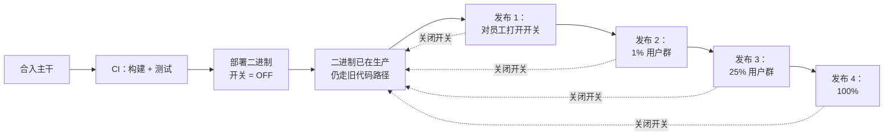
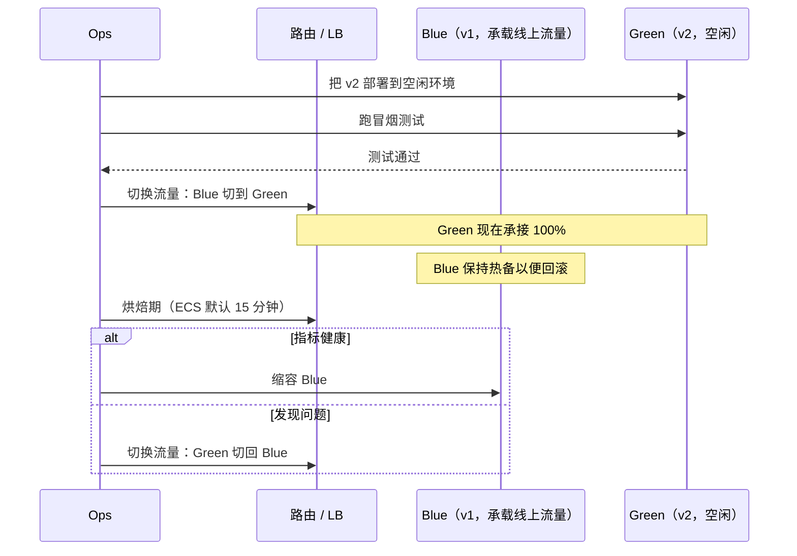
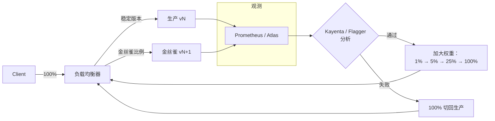
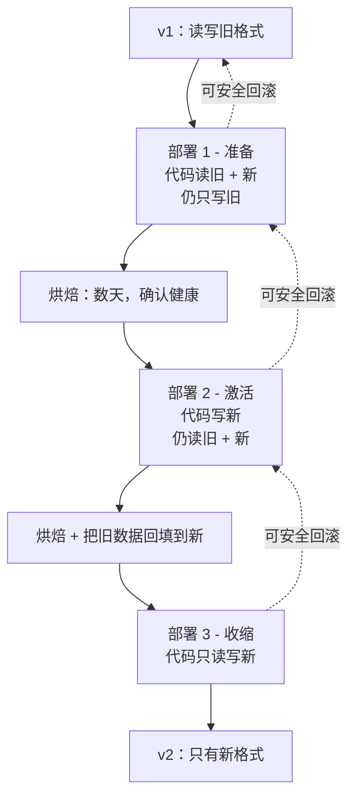

# 部署策略：蓝绿、金丝雀、滚动与特性开关

> **TL;DR**: 生产事故大多由变更引起，而不是由自然增长的流量引起。部署策略的作用是控制每次变更的爆炸半径（故障影响面），让你在用户察觉之前就能回滚。滚动部署是 Kubernetes 的默认方式（简单、零额外成本）。蓝绿部署用 2 倍的基础设施成本换取瞬时回滚。金丝雀发布用真实流量在可控风险下做验证。特性开关把部署和发布解耦，回滚从“以分钟计的重新部署”变成“以秒计的开关翻转”。Amazon 的上线节奏快到一个服务每秒多次部署[^1]，这不是因为他们跳过安全措施，而是因为安全措施已经自动化、已经写进代码。

## 学习目标

学完本节，你将能够：

- [ ] 比较滚动、蓝绿、金丝雀与影子四种部署策略
- [ ] 基于 SLI 设计自动回滚的触发条件
- [ ] 用特性开关把部署与发布解耦
- [ ] 用扩展-收缩（expand-contract）的方式，让数据库迁移与应用部署并行推进
- [ ] 按风险、流量形态和基础设施成本选择策略

## 直觉理解

你经营一家餐厅。今晚你要换菜单，摆在面前的有四个选择。

**方案 A（大爆炸）**：停业一晚，重印所有菜单，重新培训所有服务员，明天重新开业。新菜不好吃，你就损失一整晚的营收，老客人还不高兴。

**方案 B（滚动）**：一桌一桌地换菜单。有的客人看到旧菜单，有的看到新的。某道菜难吃，你可以从下一桌起撤掉，但已经上过菜的桌子没法把吃下去的东西还回来。

**方案 C（蓝绿）**：印两整套菜单。今晚所有人拿到的都是旧菜单（蓝）。明天你把所有桌一次性换成新菜单（绿）。投诉暴增，你几秒钟就能换回去，因为旧菜单还躺在抽屉里。

**方案 D（金丝雀）**：只把新菜单给一桌。观察他们的表情。喜欢，就再给两桌，然后五桌，最后全店。表情难看，就在别人注意到之前收回来。

**秘密配方（特性开关）**：新菜早就印在每份菜单上了，只是标着“即将上市”。你在后厨拨一下开关，它就能点了。出问题就把开关拨回去，完全不用重印。

餐厅就是你的生产机群，菜单就是你的二进制包，食客就是你的用户。本章剩下的内容，就是怎么把方案 D 做成默认做法，让方案 C 当安全网，让特性开关成为所有事情的控制面。

## 原理

### 部署与发布

Jez Humble 和 Dave Farley 在 *Continuous Delivery*（2010）里给出了这个关键区分：把代码部署到生产，是把二进制放上服务器的动作；发布一个特性，是让用户看见这个特性的动作。两者彼此分离，可以各自独立触发[^2]。

为什么这很重要？因为它改变了“回滚”的含义。回滚一次部署意味着退回旧的二进制包，视机群规模需要几分钟到几小时。回滚一次发布意味着翻转一个特性开关，只需要几秒，也不必重新部署。

Facebook 的 Gatekeeper 系统把这件事落到了实处：每一处工程变更都被特性开关包住，以关闭状态推上生产。随后这个开关依次开放给内部员工、1% 的金丝雀、最终全部用户。到 2016 年，Facebook 每天往主干合入超过 1,000 个 diff；2017 年 4 月，Web 前端转向准连续的“从主干推送”模式，每隔几小时就把“几十到几百个 diff”部署到 100% 的生产服务器，并按员工、2%、100% 分级放量[^3]。这样的速度之所以可能，只因为部署和发布已经解耦。



*部署二进制和发布特性是两个独立事件。二进制以关闭状态上线（开关 OFF），然后开关依次对员工、对部分用户群、最终对全部用户打开。任一阶段的回滚都是把开关拨回 OFF，而不是重新部署。*

DORA 的研究量化了“好”是什么样：精英团队按需部署（每天多次），变更失败率维持在 5%，部署失败后一小时内恢复[^4]。落后者每周到每月部署一次，变更失败率 64%，恢复时间一到六个月。差别不在风险偏好，而在自动化程度。[可用性与可靠性](../part-1-core-fundamentals/02-availability-and-reliability.md) 介绍了错误预算，它让“部署得更快”成为一个有纪律的论断，而不是凭感觉喊口号；本章这些策略，就是安全花掉这笔预算的方式。

### 滚动部署

滚动部署分批替换实例，负载均衡器同时摘掉旧实例、挂上新实例，整体容量全程保持在阈值之上。

Kubernetes 的 Deployment 用 `strategy: RollingUpdate`，两个旋钮：`maxSurge`（允许超出期望副本数的额外 pod）和 `maxUnavailable`（允许低于期望副本数的缺失 pod）。两者默认都是 25%[^5]。一个 4 副本的 Deployment 最多会跑 5 个 pod，任意时刻最多 1 个不可用。

```yaml
apiVersion: apps/v1
kind: Deployment
metadata:
  name: web
spec:
  replicas: 4
  strategy:
    type: RollingUpdate
    rollingUpdate:
      maxSurge: 25%
      maxUnavailable: 25%
```

权衡很直白：滚动部署没有额外成本（新实例就地替换旧实例），但会造出一个多版本并存的窗口。滚动期间，客户端连续两次请求可能一次打到旧版本、一次打到新版本。任何隐藏的协议不兼容都会立刻暴露。回滚本身也是一次滚动，所以退回和前进一样慢。

滚动部署适合无状态 Web 服务，前提是批大小加上就绪探针能提供足够的安全感。务必加上就绪门禁，确认新 pod 能正常服务流量之后，再终止旧 pod。

### 蓝绿部署

Martin Fowler 在 2010 年的表述：两套完整的生产环境，同一时刻只有一套承接线上流量。要部署时，把新版本装进空闲的那套，跑冒烟测试，然后切换路由[^6]。



*一次蓝绿部署会先准备好空闲环境，再翻转路由器，并在烘焙期内把上一套环境保持热的，作为回滚目标。*

回滚只是一次流量切换，耗时受负载均衡器或 DNS 生效时间限制（几秒到一分钟）。代价是切换窗口期内 2 倍的基础设施开支。对大型有状态服务来说，那份空闲副本是一笔不小的账单。

难的部分在数据库。Fowler 指出：“数据库在这套技术下往往是个难题，尤其当你需要改表结构的时候”[^6]。答案是扩展-收缩，下面会讲。

### 带自动化分析的金丝雀发布

金丝雀发布把一小部分流量导给新版本，在金丝雀和对照组上测量特定的 SLI。指标过关就加大权重，不过关就中止。

Netflix 把这件事形式化为三个集群：生产集群（不变，承接大部分流量）、基线集群（代码与生产相同，新起，3 个实例）、金丝雀集群（新代码，3 个实例，流量份额与基线相同）。拿金丝雀跟新起的基线比，而不是跟长期运行的生产比，可以剔除热缓存和 JIT 带来的影响[^7]。

Netflix 开源的自动化金丝雀分析平台 Kayenta，从两个集群取指标，做校验和清洗，再用 Mann-Whitney U 检验把每个指标判为 Pass、High 或 Low。金丝雀得分就是判为 Pass 的指标占比（例如 9/10 = 90%）。2018 年 4 月开源时，Kayenta 每天执行约 200 次金丝雀判定[^7]。



*一次金丝雀发布分阶段转移流量，每一步都由自动化的 SLI 比较把关。任一项检查失败，流量就切回稳定的基线。*

在 Kubernetes 生态里，Argo Rollouts 和 Flagger 以声明式方式实现这套模式。Flagger 每分钟测量 HTTP 成功率与 p99 延迟，每通过一次就把流量增加 2%，直到 50%，然后全量提升。连续 10 次失败即中止并回滚。

> [!IMPORTANT]
> 没有自动化指标比较的金丝雀只是表演。Netflix 在 Kayenta 之前的状态是：“每次金丝雀都要花好几个小时盯着图表、翻日志。靠肉眼看图，很难分辨金丝雀和基线之间的细微差异”[^7]。如果你的金丝雀只是按定时器往上推、没有 SLI 门禁，那你手里不是金丝雀，而是一次慢速滚动部署。驱动自动回滚的 SLI 阈值来自你的 SLO 定义，怎么定见 [SLI、SLO、SLA 与错误预算](./01-sli-slo-sla-error-budgets.md)，金丝雀所依赖的指标基础设施见 [可观测性](./00-observability.md)。

### 影子流量与镜像流量

影子流量把每个线上请求复制一份发给新版本，但不把新版本的响应返回给用户。新版本因此能在真实生产数据上运行，而用户完全感知不到风险。

Flagger 把它实现成“带镜像的蓝绿”：流量镜像复制每个进来的请求，一份发给主版本，一份发给金丝雀。主版本的响应回给用户，金丝雀的响应被丢弃，两个版本都采集指标。

GitHub 的 [Scientist](https://github.com/github/scientist) 库在函数级别实现同样的思路：旧代码包在 `use {}`（对照组）里，新代码包在 `try {}`（候选组）里。两者以随机顺序执行，结果做比较，不一致就记日志，但调用方永远拿到对照组的结果。

影子流量只对幂等读有效。对写操作，它会重复副作用，除非显式加门禁。它也没法验证用户可见的变更，因为用户永远不会看到候选组的输出。它适合后端重构、性能优化和读路径重写。[绞杀者模式（Strangler Fig）](../part-5-architecture-patterns/06-strangler-fig.md) 讲的是更宏观的模式：在渐进式系统迁移中并行运行新旧两套、并引入影子流量。

### 特性开关作为发布控制面

特性开关是一个运行时开关，无需重新部署就能在旧代码路径和新代码路径之间切换。Pete Hodgson 的经典分类把它分成四类[^8]：

- **发布开关**（数天到数周）：把未完成的功能挡在主干之外。生命周期短，也是最常见的一类。
- **实验开关**（数小时到数周）：做 A/B 测试，用一致的 cohort 哈希（`hash(user_id) mod 100 < 5`）。
- **运维开关**（长期存在）：给运维人员在事故中用的总闸。要永久保留，并且有明确负责人。
- **权限开关**（数年）：按权益开放，例如“高级套餐用户可以使用 X”。

商业生态里有 LaunchDarkly（每天 45 万亿次开关求值，全球生效延迟 <200ms）、Unleash、Flagsmith、Split、Statsig。[OpenFeature](https://openfeature.dev/) 是 CNCF 的厂商中立 SDK 标准。

> [!WARNING]
> **开关债是真实且危险的。** Hodgson 提醒：“精明的团队把自己的特性开关看作有持有成本的存货，并努力把这个存货压到最低”[^8]。Knight Capital 把一个十年前就废弃的死代码开关“Power Peg”挪作新功能。一次部署漏掉了八台服务器中的一台，那个陈旧开关重新激活了死代码，由此引发的失控下单循环在 45 分钟内损失 4.4 亿美元[^9]。永远不要复用开关。给它加到期日。开关活得比它的规格更久时，让测试失败。

### 数据库迁移与扩展-收缩

数据库表结构变更，几乎总是安全部署里最难的部分。最天真的做法是在应用部署的同时同步执行 `ALTER TABLE`，这会在大表上持有 ACCESS EXCLUSIVE 锁好几分钟。写入被阻塞，连接池被耗尽，站点直接挂掉。

解法是扩展-收缩（也叫“并行变更”）：分三次部署，而不是一次，每一步都能独立安全回滚[^1]。



*扩展-收缩把表结构变更和应用代码变更拆成三次各自可安全回滚的部署，中间隔着以天计的烘焙期。*

N-1 兼容规则：每次部署都必须能与它紧邻的前一个版本共存。你没法把两个阶段一起回滚，所以阶段之间的烘焙应该以天计，而不是以小时计[^1]。

至于 ALTER 本身，用在线改表工具：GitHub 的 [gh-ost](https://github.com/github/gh-ost)（无触发器，读 MySQL binlog）、Percona 的 pt-online-schema-change，或者 PostgreSQL 的 pg_repack。它们把数据拷到影子表，最后做一次原子切换，从而避免长时间持锁。

## 真实案例

### Amazon：覆盖整个大洲规模的无人值守部署

Amazon 的部署流水线，对一个典型服务来说，4 到 5 个工作日就能触达所有 Region，代码评审之后没有任何人工审批环节[^1]。公开的 AWS re:Invent 演讲提到过，全年所有环境加起来的部署量在数千万次量级。支撑这套流水线安全运转的架构，记录在 AWS Builders' Library 里。

**流水线结构：** 每个微服务有多条相互独立的流水线（应用代码、基础设施、OS 补丁、特性开关、运维工具）。生产被切成范围递增的波次：第 1 波部署到一个低流量 Region，第 2 波部署到一个高流量 Region，后续波次并行覆盖若干 Region 组。每一波内部，一次只部署一个可用区。

**单箱阶段：** 每一波都从“单箱”部署开始——只发到一个容器或一台 VM。这个单箱至少烘焙 1 小时，才向本波其余部分推进。第 1 波完成后，流水线还要烘焙 12 小时才启动第 2 波。对典型服务来说，触达所有 Region 总共 4 到 5 个工作日[^1]。

**滚动批次：** 每一波内部，每批最多替换 33% 的机器，全程保持至少 66% 的容量。这与“所有服务都要按能扛住丢一个可用区来扩容”的原则一致。

**自动回滚：** 一个由团队拥有的高严重度聚合告警，把故障率、p50/p90/p99 延迟、CPU、内存、磁盘、日志错误、健康检查失败一起做 OR 聚合。任一项触发，该 Region 内所有微服务正在进行的部署都会自动回滚。代码评审之后不存在人工审批门禁，“代码评审是一次代码变更所能得到的最后一次人工评审与批准”[^1]。

**时间窗拦截：** 流水线排除夜间、周末、节假日，往往还排除周五和傍晚。理由是：这些时段“值班工程师通常需要更久才能响应”，所以部署被安排在人类能快速恢复的时间[^1]。

这里更上层的启示：Amazon 快，不是因为他们承担了更多风险，而是因为安全被写进代码（错开的波次、自动回滚、烘焙期），而不是写在人工检查清单里。

## 权衡

| 方案 | 优点 | 缺点 | 适用场景 | 我们的选择 |
|---|---|---|---|---|
| 滚动 | 简单，K8s 内置，无额外成本 | 多版本并存，回滚慢 | 大多数无状态 Web 服务 | 低风险服务的默认选择 |
| 蓝绿 | 回滚瞬时，顺带演练了容灾路径 | 切换期 2 倍成本，与数据库耦合难处理 | 高风险或受监管的发布 | 当回滚速度比成本更重要时 |
| 金丝雀 | 真实流量验证，爆炸半径可控 | 需要自动化分析；低流量服务要烘很久 | 高流量且已埋点 SLI 的服务 | **生产服务的默认选择** |
| 影子 / 镜像 | 对用户零影响，能跑真实生产负载 | 只对幂等读安全，后端负载翻倍 | 后端重构、性能优化 | 作为补充，不单独使用 |
| 特性开关 | 部署与发布解耦，回滚是 O(秒) | 开关债、测试复杂度、求值延迟 | 到处都用，但要管好生命周期 | 始终叠加在上面 |

## 常见陷阱

> [!WARNING]
> **大爆炸式部署。** 把新代码一次性推给 100% 的流量，意味着任何一个潜伏的 bug 都会立刻打掉 100% 的用户。DORA 的落后者变更失败率 64%，恢复时间一到六个月[^4]。把变更拆成小的可部署单元，采用渐进式交付。

> [!WARNING]
> **没有自动回滚的金丝雀。** 按定时器往上推、不做指标比较的金丝雀，只是多绕几步的慢速滚动部署。每一步金丝雀都必须由 SLI 比较把关（Kayenta 得分、Flagger 成功率阈值、Argo 的 AnalysisTemplate），失败时自动回滚。

> [!WARNING]
> **表结构迁移与应用部署耦合。** 和使用新列的代码同步执行 ALTER TABLE，会在大表上持锁数分钟。用扩展-收缩：三次部署，而不是一次。每个阶段都能独立安全回滚。

> [!WARNING]
> **开关债与开关复用。** 活了数年的发布开关会变成地雷。Knight Capital 4.4 亿美元的损失，部分原因就是复用一个已退役的开关名[^9]。创建开关的同时就往待办里加一条删除任务。设到期日。开关活得比它所属类别应有的寿命更久时，让 CI 失败。

> [!WARNING]
> **周五下午部署。** 周五 16:30 上的一次坏部署，会在 23:00 值班工程师睡着的时候爆发。Amazon 的流水线禁止在工作时间之外部署，因为“值班工程师在非工作时段通常需要更久才能响应”[^1]。把时间窗拦截写进你的流水线。

## 练习

为一个承载 50,000 QPS、可用性 SLO 为 99.9% 的消费级 API 设计部署流水线。需要说明：什么触发金丝雀，哪些 SLI 驱动自动晋级，如何处理新增一列的表结构迁移，以及特性开关放在哪个环节。还要给出回滚判据。

<details>
<summary>提示</summary>

把流水线分三层想：二进制部署（带 SLI 门禁的金丝雀）、表结构变更（扩展-收缩，与二进制解耦）、特性发布（两边都稳定后再翻开关）。你会拿哪些 SLI 比较金丝雀和基线？在 50,000 QPS 下，1% 的金丝雀需要烘多久才够统计显著性？

</details>

<details>
<summary>解答</summary>

**二进制部署流水线：**

1. 合入主干触发 CI（构建、单元测试、集成测试）。
2. 部署到预发环境，跑端到端测试。
3. 向生产发布金丝雀：1% 流量权重，3 个金丝雀 pod，3 个新起的基线 pod。
4. 自动化分析每 2 分钟跑一次，持续 10 分钟。比较的 SLI：HTTP 5xx 率（阈值：金丝雀 <= 基线 + 0.1%）、p99 延迟（阈值：金丝雀 <= 基线 + 50ms）、错误日志速率。在 50,000 QPS 下，1% 的金丝雀每秒能看到 500 个请求，10 分钟约 30 万个数据点，对统计显著性绰绰有余。
5. 通过则晋级到 10%，烘 5 分钟，再到 50%，烘 5 分钟，最后 100%。
6. 任一步失败则自动回滚到 0% 金丝雀，告警值班，创建事故工单。

**表结构迁移（给 `users` 表加 `preferences` 列）：**

- 部署 1（准备）：用 gh-ost 执行 `ALTER TABLE users ADD COLUMN preferences JSONB DEFAULT NULL` 加列（不锁表）。改应用代码：`preferences` 有值就读它，否则回落到旧的 `settings` 字段。仍然只写 `settings`。烘 3 天。
- 部署 2（激活）：应用同时写 `preferences` 和 `settings`。跑回填任务，把所有行的现有 `settings` 拷到 `preferences`。一直烘到回填完成、且没有行是 NULL 的 `preferences`。
- 部署 3（收缩）：应用只读写 `preferences`。删掉 `settings` 列（或者标记为废弃，再留一个周期）。

**特性开关的接入：**

用到 `preferences` 的新功能由一个发布开关挡着。带“激活”逻辑的二进制以关闭状态上线。回填完成、金丝雀健康之后，把开关先开给员工，再 5%，再 100%。功能有 bug 就把开关关掉（秒级），而不是回滚二进制（分钟级）。

**回滚判据：**

- 二进制：金丝雀分析期间任何 SLI 越界，触发自动回滚。
- 表结构：每个阶段都能独立安全回滚，因为上一个版本仍然读写得了。
- 功能：把开关翻到 OFF 是最快的回滚路径（无需重新部署）。

**接受的权衡：** 这个流水线给一个表结构耦合的功能增加了 4 到 5 天的总烘焙时间。另一条路（把表结构和代码塞进一次部署）则可能带来数小时的故障，一次事故就把整月的错误预算烧光。

</details>

## 要点回顾

- 部署与发布是两个不同的事件。特性开关让这件事落地。翻开关回滚是 O(秒)，重新部署回滚是 O(分钟)。
- 带自动化 SLI 门禁晋级的金丝雀，是生产服务最强的默认选择。没有自动化分析，金丝雀就是表演。
- 蓝绿给出最快的回滚（一次流量切换），代价也最高（2 倍基础设施）。当回滚速度比成本更重要时用它。
- 滚动部署是 Kubernetes 的默认方式，没有额外成本，但会造出多版本并存窗口，回滚也慢。
- 数据库迁移几乎总是最难的部分。用扩展-收缩：三次部署，各自可安全回滚，中间隔着以天计的烘焙。
- 上线最快的公司（Amazon 各服务加起来每秒多次部署）之所以快，不是因为跳过安全，而是因为安全自动化了、写进代码了。
- DORA 精英团队：按需部署，变更失败率 5%，一小时内恢复[^4]。本章这些策略就是通往那里的路径。

## 延伸阅读

- [Automating safe, hands-off deployments](https://aws.amazon.com/builders-library/automating-safe-hands-off-deployments/) - 对 Amazon 流水线最具体的描述：单箱阶段、错开的波次、告警驱动的回滚、时间窗拦截。先读这篇。
- [Ensuring rollback safety during deployments](https://aws.amazon.com/builders-library/ensuring-rollback-safety-during-deployments/) - Amazon 内部的扩展-收缩模式，带一个序列化格式的完整示例；任何要上表结构变更的人都该读。
- [Feature Toggles (aka Feature Flags)](https://martinfowler.com/articles/feature-toggles.html) - Pete Hodgson 对发布/实验/运维/权限四类开关的权威分类，以及开关债的缓解手段。
- [Automated Canary Analysis at Netflix with Kayenta](https://netflixtechblog.com/automated-canary-analysis-at-netflix-with-kayenta-3260bc7acc69) - 三集群架构与 Mann-Whitney U 检验裁判；实现自动化金丝雀分析之前先读。
- [BlueGreenDeployment](https://martinfowler.com/bliki/BlueGreenDeployment.html) - Martin Fowler 2010 年的原始文章，其中包括那条引出扩展-收缩的数据库重构线索。
- [Argo Rollouts documentation](https://argo-rollouts.readthedocs.io/) - Kubernetes 原生的渐进式交付控制器范本；读其中的金丝雀步骤与 AnalysisTemplate 规格。
- [gh-ost: GitHub's online schema migration for MySQL](https://github.com/github/gh-ost) - 无触发器在线改表的参考实现；读 README 和 why-triggerless 那篇文档。
- [Accelerate](https://itrevolution.com/accelerate-book/) by Forsgren, Humble, Kim - DORA 指标背后的那本书；读它是为了看统计证据——部署频率与组织绩效相关。

## 记忆卡片

**Q:** 部署和发布有什么区别？
**A:** 部署是把新的二进制包放上生产服务器；发布是让用户看见某个特性。特性开关把两者解耦，于是回滚可以靠翻开关（秒级）而不是回滚二进制（分钟级）。

**Q:** Kubernetes 滚动更新的默认值是什么？
**A:** `maxSurge: 25%` 和 `maxUnavailable: 25%`。对一个 4 副本的 Deployment，意味着更新期间最多 5 个 pod 在跑，最多 1 个 pod 不可用。

**Q:** 为什么蓝绿的回滚比滚动快？
**A:** 蓝绿把上一套环境保持热的。回滚就是负载均衡器上一次流量切换（秒级）。滚动的回滚本身就是一次滚动，耗时和正向部署一样（分钟级）。

**Q:** 三集群金丝雀架构是什么？
**A:** 生产集群（不变，大部分流量）、基线集群（代码与生产相同，新起）、金丝雀集群（新代码）。拿金丝雀跟新起的基线比，可以剔除长期运行的生产实例上热缓存和 JIT 的影响。

**Q:** Netflix Kayenta 用哪种统计检验做金丝雀分析？
**A:** Mann-Whitney U 检验，一种不假设高斯分布的非参数检验。它把每个指标判为 Pass、High 或 Low，金丝雀得分是 Pass 指标的占比。

**Q:** 数据库迁移的扩展-收缩模式是什么？
**A:** 三次部署：（1）准备：代码读旧 + 新，只写旧。（2）激活：代码写新，读两边，跑回填。（3）收缩：代码只读写新。每个阶段都能独立安全回滚。

**Q:** 为什么开关债很危险？
**A:** 长期存在的发布开关会变成地雷。Knight Capital 把一个十年前废弃的死代码开关挪作新功能，一次部分部署重新激活了那段死代码，45 分钟损失 4.4 亿美元。永远不要复用开关；加到期日。

**Q:** 精英团队在 DORA 指标上是什么样？
**A:** 按需部署（每天多次）、前置时间少于一天、变更失败率 5%、部署失败后一小时内恢复。

**Q:** 什么时候该用影子/镜像流量而不是金丝雀？
**A:** 当你需要验证后端重构或读路径重写、又不愿承担任何面向用户的风险时。影子流量复制请求，但丢弃候选组的响应。只对幂等读安全。

**Q:** N-1 兼容规则是什么？
**A:** 每次部署都必须能与它紧邻的前一个版本共存。这保证回滚永远安全。扩展-收缩里不能跳阶段，因为倒退两步的那个版本可能看不懂当前的数据格式。

**Q:** Amazon 的流水线为什么禁止周五下午部署？
**A:** 因为值班工程师在非工作时段需要更久才能响应。周五 16:30 的坏部署，可能到周六早上才有人来看。时间窗拦截确保部署发生在能快速恢复的时段。

**Q:** 什么样的金丝雀只是“表演”，而不算真实验证？
**A:** 按定时器往上推、没有自动化指标比较。没有 SLI 门禁的分析（比较金丝雀与基线的错误率、延迟分位数），细微的回归会一路逃到 100% 流量而无人察觉。

## 参考文献

[^1]: Clare Liguori, “Automating safe, hands-off deployments”, Amazon Builders' Library. https://aws.amazon.com/builders-library/automating-safe-hands-off-deployments/ ; Sandeep Pokkunuri, “Ensuring rollback safety during deployments”, Amazon Builders' Library. https://aws.amazon.com/builders-library/ensuring-rollback-safety-during-deployments/
[^2]: Jez Humble and Dave Farley, “Continuous Delivery: Reliable Software Releases through Build, Test, and Deployment Automation”, Addison-Wesley, 2010. ISBN 978-0321601919.
[^3]: Chuck Rossi, “Moving to Mobile” and “Rapid release at massive scale”, USENIX URES 2014 and Facebook Engineering blog. https://engineering.fb.com/2017/08/31/web/rapid-release-at-massive-scale/
[^4]: Steve Fenton, “Understanding the 4 DORA metrics and top findings from 2024/25 DORA report”, Octopus Deploy. https://octopus.com/devops/metrics/dora-metrics/
[^5]: Kubernetes Deployment documentation, “Rolling update deployment”. https://kubernetes.io/docs/concepts/workloads/controllers/deployment/
[^6]: Martin Fowler, “Blue Green Deployment”, 2010. https://martinfowler.com/bliki/BlueGreenDeployment.html
[^7]: Michael Graff and Chris Sanden, “Automated Canary Analysis at Netflix with Kayenta”, Netflix Tech Blog, April 2018. https://netflixtechblog.com/automated-canary-analysis-at-netflix-with-kayenta-3260bc7acc69
[^8]: Pete Hodgson, “Feature Toggles (aka Feature Flags)”, martinfowler.com, 2017. https://martinfowler.com/articles/feature-toggles.html
[^9]: SEC Administrative Proceeding Release No. 34-70694, “In the Matter of Knight Capital Americas LLC”, October 2013. https://www.sec.gov/litigation/admin/2013/34-70694.pdf ; Josh (Honeybadger), “The Most Expensive Bug in History: Knight Capital 2012”. https://www.honeybadger.io/leveling-up/knight-capital/
