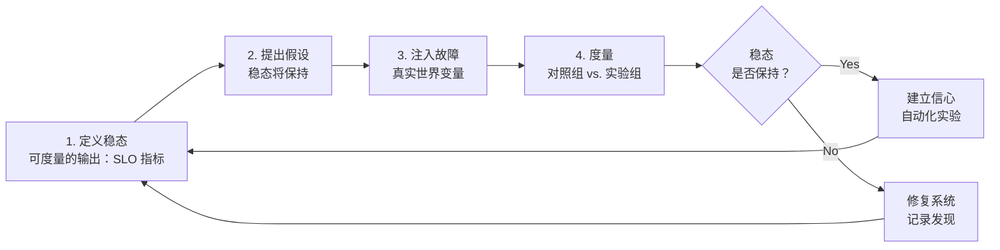
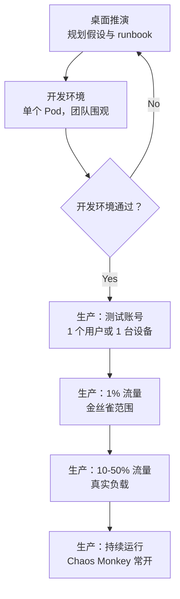
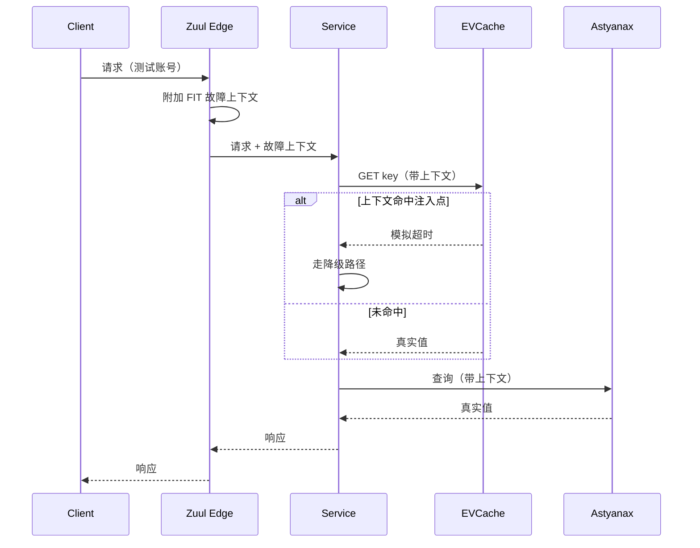

# 混沌工程：故意把系统搞坏

> **TL;DR**: 混沌工程不是为了好玩而砸东西。它是一套科学方法：对系统如何应对故障提出假设，注入受控故障，度量稳态是否仍然保持，然后要么建立信心，要么修复暴露出来的问题。Netflix 从 2011 年 7 月起就在生产环境持续运行 Chaos Monkey[^1]。2015 年 9 月，AWS DynamoDB 在 US-EAST-1 出了一次真实故障，并沿依赖链扩散到 SQS、EC2 Auto Scaling、CloudWatch 和 AWS 控制台等服务，Auto Scaling 的积压直到故障开始约 8.5 小时后才清空[^2]，而 Netflix 却“避开了任何显著影响”，因为 Chaos Kong 演练早已逼着他们做完了跨区域的故障切换修复[^3]。教训是：没在真实故障下验证过的韧性，不算韧性。爆炸半径控制是混沌工程与蓄意破坏的分界线。

## 学习目标

学完本章，你将能够：

- [ ] 解释混沌原则以及四步实验框架
- [ ] 为一次实验定义稳态指标、假设和回滚条件
- [ ] 在合适的爆炸半径和熔断开关条件下开展演练日
- [ ] 在 Chaos Monkey、Chaos Mesh、LitmusChaos、Istio 故障注入和托管服务（AWS FIS、Azure Chaos Studio）之间做选择
- [ ] 为“有意在生产环境注入故障”这件事争取组织支持

## 直觉理解

你有一栋带备用发电机的房子。电力公司多年来一直很可靠，所以你从来没试过那台发电机。某个冬夜，一场冰暴让整个街区停电。你扳下切换开关。什么也没发生。油路堵了。电瓶没电了。说明书在一个黑灯瞎火里根本翻不到的箱子里。

而你的邻居每个月都让发电机跑 30 分钟。她检查油量，试切换开关，还会掐表记录恢复供电要多久。冰暴来的时候，她家的灯 90 秒就亮了。

差别不在发电机。两家都有。差别在于邻居在真正的故障到来之前，已经在受控条件下测过自己那台。她在白天、周六、五金店还开着门的时候发现了堵塞的油路。而你是在凌晨两点、暴风雪里发现的。

混沌工程就是分布式系统的每月发电机测试。[韧性模式](./02-resilience-patterns.md) 给了你熔断器、重试和隔离舱。本章教你在冰暴到来之前，如何验证它们真的管用。

## 原理

### 起源故事

2008 年 8 月，一次数据库损坏让 Netflix 的 DVD 邮寄业务停了三天。管理层的结论是：唯一出路是横向扩展、可容错的云架构[^4]。从单体数据中心迁移到 AWS 的过程从 2008 年持续到 2011 年。问题在于：AWS 假定单个 VM 会不断故障。如果你的应用承受不了一个实例消失，那么当 AWS 意外终止该实例时，你迟早要吃苦头。

2011 年 7 月 19 日在 Netflix Tech Blog 上公布的方案就是 Chaos Monkey：一个“随机关掉我们的生产实例，以确保我们能扛住这类常见故障而客户毫无感知”的工具[^1]。名字来自“在你的数据中心里放出一只拿着武器的野猴子，让它随机打掉实例、咬断线缆”这个想法[^1]。

到 2012 年，Netflix 已经围绕 Chaos Monkey 建起了 Simian Army：

- **Latency Monkey** 向 RESTful 调用注入人为延迟
- **Conformity Monkey** 终止违反最佳实践的实例（例如不在自动扩缩组里）
- **Chaos Gorilla** 模拟整个可用区宕机

到 2015 年，这套体系进一步扩展：

- **Chaos Kong** 把所有流量导走，模拟整个 AWS 区域失联

2014 年，Netflix 公布了 FIT（Failure Injection Testing）：它在 Zuul 边缘代理上拦截请求，给请求打上故障上下文标记，再让这个上下文在 Hystrix、Ribbon、EVCache 和 Astyanax 内部的各个注入点之间传递[^5]。FIT 让实验可以先瞄准“某个特定测试账号或某台特定设备”，再放大到生产流量的某个百分比。

2015 年，Casey Rosenthal、Ali Basiri、Lorin Hochstein 和 Aaron Blohowiak 等 Netflix 工程师在 principlesofchaos.org 发布了混沌原则宣言，把 Netflix 的经验固化成一门通用的工程学科[^6]。

### 混沌原则

这份宣言（最后更新于 2019 年 3 月）规定了四步实验循环[^6]：

1. **定义稳态**：用某些可度量的输出来表示正常行为（吞吐量、错误率、延迟分位数）
2. **提出假设**：稳态在对照组和实验组中都会保持
3. **引入变量**：反映真实世界的事件（服务器崩溃、网络分区、磁盘故障）
4. **尝试证伪**：寻找稳态差异，设法推翻假设

五条进阶原则描述了理想实践：围绕稳态行为（看输出，不看内部实现）构建假设；变化真实世界事件（按影响或频率排优先级）；在生产环境做实验（“系统的行为会随环境和流量模式而变化”）；把实验自动化以持续运行；把爆炸半径压到最小[^6]。

关键区别在这里：混沌工程不是故障注入。故障注入测试的是单一条件。混沌工程是一种实证方法，用来从复杂系统中产生新信息[^7]。它的产物不是被发现的 bug，而是被持续重新验证的运维就绪度。

*混沌原则给出的四步实验循环：定义、假设、注入、度量。循环反复执行，要么建立信心，要么修复系统。*

### 实验框架

一次严谨的混沌实验包含六个要素：

**量化的稳态。** 不是“系统能用”，而是“Transaction Create API 的第 99 百分位请求在 100 ms 内返回”。AWS Well-Architected 框架的可靠性支柱提供了一个假设模板：“如果发生 `特定故障`，`工作负载名` 这个工作负载将通过 `描述缓解手段` 来维持 `业务或技术指标影响`”[^8]。

**明确的假设。** AWS 给出的具体例子是：“如果 Amazon EKS 节点组中 20% 的节点被下线，Transaction Create API 仍能在 100 ms 内服务第 99 百分位的请求。EKS 节点将在五分钟内恢复，Pod 将在八分钟内被调度并开始处理流量”[^8]。

**受控、可逆的故障注入。** 故障必须是你能够叫停的。AWS FIS 支持配置动作执行后的回滚，把目标“恢复到动作执行前的状态”[^8]。

**爆炸半径控制。** 从一个 Pod、一个账号、一个用户开始。每个阶段通过之后才扩大。

**熔断开关（kill switch）。** AWS FIS 每个实验模板最多支持五个基于 CloudWatch 告警的停止条件。任一告警触发，实验自动中止[^8]。没有熔断开关的实验不是混沌工程，是蓄意破坏。

**结论文档。** 稳态保持住了吗？如果没有，坏在哪里、怎么修、谁负责？

### 可注入的故障类型

可注入故障的分类包含七个类别：

| 类别 | 示例 | 工具 |
|----------|----------|-------|
| 计算 | 实例终止、Pod 杀停、容器杀停 | Chaos Monkey、Chaos Mesh PodChaos、kube-monkey |
| 网络 | 延迟、丢包、分区、DNS 故障 | Chaos Mesh NetworkChaos、Toxiproxy、Istio 故障注入 |
| 资源耗尽 | CPU 压力、内存压力、磁盘写满、文件描述符耗尽 | Chaos Mesh StressChaos、stress-ng |
| 依赖 | 下游返回 HTTP 500、超时、慢响应 | Istio VirtualService abort/delay、Toxiproxy |
| 状态 | 时钟偏移、证书过期、配置损坏 | Chaos Mesh TimeChaos、手工注入 |
| 可用区/区域 | 可用区失联、区域疏散 | Chaos Gorilla、Chaos Kong、AWS FIS 多可用区 |
| 有状态系统 | 主节点杀停、副本延迟注入、脑裂 | 手工 + 编排（需要了解复制拓扑） |

> [!IMPORTANT]
> 有状态故障（杀掉 Redis 主节点、Kafka 主节点、PostgreSQL 主库）的爆炸半径由复制拓扑决定，而不是由混沌工具决定。跑实验之前先搞清楚：复制模式（同步、异步、法定人数）、故障切换检测时间、提升时间，以及客户端重连行为。这几项里任何一项不清楚，实验就没准备好。

### 爆炸半径控制

混沌原则把这项义务说得很直接：“把实验造成的后果最小化并加以控制，是混沌工程师的责任和义务”[^6]。

实践中，爆炸半径分阶段扩大：

*爆炸半径分阶段扩大；每一道关卡都要求上一阶段信号全绿。多数团队根本不需要走到“持续运行”这一步就能获得价值。*

Netflix FIT 用 Zuul 把大部分故障测试限制在“某个特定测试账号或某台特定设备”上，之后才扩展到“生产请求的一小部分百分比”[^5]。LinkedIn 的 LinkedOut 框架用 LiX A/B 测试平台把故障收窄到“某个特定用户用某个特定 Rest.li 方法发起的某个特定请求”[^9]。Slack 的 Disasterpiece Theater 加了一道人审批关卡：每次演练都从开发环境开始，团队明确做出 go/no-go 决定之后才进入生产[^10]。

**什么时候跑。** 在工作时间开始，让工程师值班。绝不在周五傍晚。绝不在重大发布期间。Netflix 特意把 Chaos Monkey 安排在工作时间运行，就是为了让故障成为学习机会而不是事故[^1]。

### 演练日与组织推广

演练日（game day）是一场提前规划、团队全程围观的混沌演练。目标是同时给系统和人都加压：runbook、告警、值班响应和跨团队协作。

**Amazon GameDay** 起源于 2000 年代初，由 Jesse Robbins 主持，他的头衔是“Master of Disaster（灾难大师）”。ACM Queue 的圆桌讨论把它描述为“一项通过半定期向关键系统故意注入重大故障来提升韧性的计划，目的是发现缺陷和隐蔽依赖”[^11]。

**Google DiRT**（Disaster Recovery Testing，灾难恢复测试）约从 2006 年起每年在全公司范围举行。Kripa Krishnan 在 2012 年的 ACM Queue 论文中称其为“一场年度、全公司、持续多天的灾难恢复测试活动”[^12]。DiRT 的场景包括模拟地震和僵尸末日，但外壳包装的都是真实故障：数据中心断电、区域间网络分区、认证基础设施失联。戏剧化的包装逼着团队真正参与，而不是走过场打勾。

**Slack Disasterpiece Theater**（2018 年 1 月起）遵循一套固定格式：主持人要记录“他们究竟打算怎么制造故障，精确到要执行的命令”，公开写下自己的信心水平，先在开发环境跑，然后才为生产做 go/no-go 决定[^10]。

**推广时间线。** 多数组织从第一次演练日到能从容开展生产混沌，需要 6 到 18 个月。路径是：

1. 桌面推演（零风险，高收获）
2. 预发环境每月演练日
3. 范围收窄的定向生产实验
4. 持续的生产混沌（Chaos Monkey 常开）

文化前提比工具更重要。LinkedIn Waterbear 的行动手册包括“到其他工程团队和部门做路演、内部分享、在新人入职培训里安排韧性专题、用竞赛游戏鼓励大家去发现韧性问题”[^9]。没有免责文化的混沌只会制造怨气，不会带来韧性。

## 真实案例

### Netflix：从 Chaos Monkey 到 Chaos Kong

Netflix 的混沌工程体系是行业标杆，因为它覆盖了完整的成熟度谱系：随机终止实例（Chaos Monkey，2011）、请求级定向故障（FIT，2014）、可用区宕机模拟（Chaos Gorilla）、区域疏散演练（Chaos Kong，2015）。

**架构。** Chaos Monkey 是一个与 Spinnaker 集成的 Go 服务，它通过 API 调用向 Spinnaker 管理的任一云后端终止“运行在你生产环境里的虚拟机实例和容器”[^13]。它是选择退出（opt-out）而非选择加入：默认可被选中，让韧性成为默认假设。

FIT 提供细粒度的那一层。Zuul 在边缘给进入的请求打上故障上下文，这个上下文沿内部的服务间调用继续传递。每个注入点（Hystrix、Ribbon、EVCache、Astyanax）检查上下文，匹配时模拟故障[^5]。

*FIT 在 Zuul 边缘给请求打标记；故障上下文沿调用链传递，每个注入点自行决定是模拟故障还是放行。*

**Chaos Kong 的验证。** 2015 年 9 月 20 日，AWS 在 US-EAST-1 的一次真实 DynamoDB 服务事件扩散到了多个依赖服务。按 AWS 的事后总结，DynamoDB 错误率从太平洋时间 2:37 起稳定在约 55%，直到 7:10 才恢复（约 5 小时），多个依赖服务受影响：SQS 的缓存刷新从约 5:45 失败到 7:10；EC2 Auto Scaling 的 API 从 2:15 降级到 7:10，扩缩活动的积压直到 10:52 才清空（距事件开始约 8.5 小时）；CloudWatch 指标自 2:35 起延迟或缺失直到 7:29；AWS 控制台登录在 5:45 到 7:10 之间受影响。AWS 写道，除上述例子之外“还有若干其他使用 DynamoDB 的 AWS 服务在事件期间出现了问题”[^2]。Netflix“避开了任何显著影响”，因为 Chaos Kong 演练早已暴露并修掉了那些会让这次故障变成灾难的系统性弱点[^3]。把话说得诚实一点：在 2015 年 9 月之前，Chaos Kong 已经多次推翻 Netflix 对单区域运行的信心，逼出了那批让真实故障得以存活的跨区域故障切换修复。

**Subscriber 实验。** 2015 年，Netflix 向 50% 的 Subscriber 到缓存流量注入 30 ms 延迟。稳态是每秒视频播放数。流量打到 50% 时，稳态出现了偏差。根因不是代码 bug，而是上游服务的线程池配置[^3]。这正是混沌工程最常发现的东西：配置错误的超时、缺失的降级路径、过小的线程池、没有上限的重试。

## 纵深防御

成熟的混沌体系不是从菜单里挑一个做法。下表中的各层是在 6 到 18 个月里逐层叠加的：团队从预发环境起步，进阶到有边界约束的生产实验，再到持续的生产混沌，同时全程并行开展演练日。“何时加入这一层”这一列说的是每一层什么时候该上场，而不是该拿它替换其他层。

| 层次 | 优点 | 缺点 | 最适合 | 何时加入这一层 |
|----------|------|------|-----------|----------|
| 仅在预发环境做混沌 | 安全、阻力小、爆炸半径接近零 | 与生产流量和数据不匹配；若长期只有这一层会带来虚假信心[^6] | 起步阶段；培养团队肌肉记忆 | **项目第 1-3 个月** |
| 有界爆炸半径的生产混沌 | 信号真实；范围收窄可约束客户影响[^6] | 需要实验框架和可观测性[^8] | 已有 SLO 和可观测性的成熟团队 | **稳态指标、熔断开关和 runbook 就位之后** |
| 持续的生产混沌（Chaos Monkey 式） | 韧性成为默认状态，而不是一次性事件[^1] | 需要深度自动化和 SLO 纪律 | 自动化能力强、组织成熟 | **有界生产混沌稳定运行 6 个月以上之后** |
| 演练日（Google DiRT[^12]、Slack Disasterpiece[^10]） | 检验人、runbook、升级流程和跨团队协作，而不只是系统 | 单次成本高；无法持续 | 作为其他各层的补充，按季度节奏举行 | **从第一天起，与其他每一层并行** |

## 常见陷阱

> [!WARNING]
> **没有稳态定义。** 没有量化稳态指标就跑混沌实验，等于做科学实验却没有对照组。你没定义的东西无法度量。注入任何故障之前，先指名道姓说出哪个看板、哪个指标将确认或推翻你的假设。

> [!WARNING]
> **缺少熔断开关。** 一个只针对 1% 流量的实验，本该跑 1 分钟却意外跑了 15 分钟，就变成了真实事故。AWS FIS 每个模板最多支持五个基于告警的停止条件。把它们设上。每个实验都需要在 SLO 燃烧率突破时自动中止。

> [!WARNING]
> **第一次就把爆炸半径开太大。** 还没验证过单 Pod 韧性就直接“干掉一整个可用区”，顺序是反的。爆炸半径的渐进路线是有道理的：桌面推演、开发环境、测试账号、1% 流量，然后再扩大。

> [!WARNING]
> **没有可观测性的混沌。** [可观测性](./00-observability.md) 是前提条件，不是可有可无的加分项。如果你无法在 60 秒内从指标、日志和链路追踪里看到实验的影响，你就无法安全地叫停它。没有可观测性的混沌，就是多了几道工序的蓄意破坏。

> [!WARNING]
> **发现被忽略。** 实验发现 Redis 故障切换要 45 秒，而不是预期的 5 秒。团队提了张工单，没人排优先级，六个月后真实故障来了。行动项没有跟踪到闭环，混沌工程的价值就是零。把发现当成 [事件管理](./07-incident-management.md) 的行动项来处理：有人负责、有截止时间、有复盘。

## 练习

为你的团队设计一场演练日：Redis 主节点发生故障切换。定义稳态指标，写出假设，选择爆炸半径，规划熔断开关，写出实验的 runbook，并规划复盘。

提示

想一想“稳态”对你依赖 Redis 的服务意味着什么。它不是“Redis 还在跑”。它是 Redis 所支撑的面向用户的指标（例如商品页的 P99 延迟、缓存命中率、下单成功率）。你的假设里应该包含预期的故障切换时间。想清楚：你的 Redis 复制模式是什么（异步？半同步？），Sentinel/Cluster 的检测超时是多少，你的客户端库在故障切换期间会做什么（重试？抛错？重连？）？

参考解法

**稳态：** 商品页 P99 延迟 < 200 ms；缓存命中率 > 85%；下单接口零 5xx 错误。

**假设：** 如果 Redis 主节点被终止，Sentinel 在 30 秒内提升副本，客户端库在提升后 5 秒内重连，稳态指标在总计 60 秒内恢复。面向用户的错误不超过 [SLI、SLO、SLA 与错误预算](./01-sli-slo-sla-error-budgets.md) 的燃烧率阈值。

**爆炸半径：** 先在预发环境用接近生产的数据量验证。预发通过后，在生产针对单个分片（如果做了集群）或流量最小的副本集运行。

**熔断开关：** CloudWatch 告警：5xx 率 > 1% 持续 30 秒，或 P99 延迟 > 2 秒持续 30 秒。任一告警触发即中止实验并启动人工回滚（必要时把原来的主节点提回来）。

**Runbook：**

1. 在 #ops 频道公告：“混沌实验：Redis 主节点杀停，shard-3，5 分钟后开始”
2. 确认可观测性看板已打开，基线稳定
3. 用 `redis-cli DEBUG SLEEP 300`（模拟卡死）或直接终止实例，杀掉 Redis 主节点
4. 观察：Sentinel 检测到故障了吗？多久完成提升？客户端重连了吗？
5. 度量：稳态指标是否落在假设范围内？
6. 如果熔断告警触发：中止、恢复、记录
7. 如果假设成立：记录成功，安排下一次范围更大的实验

**复盘（24 小时内）：**

- 假设成立了吗？如果不成立，差距在哪？
- 告警及时吗？该被叫的人被叫到了吗？
- runbook 准确吗？漏了哪些步骤？
- 行动项：每个修复谁负责，截止时间是什么

**常见发现：** 客户端库的重连超时用的是默认值（通常是 30 秒），于是总的不可用窗口是 30 秒检测 + 30 秒重连 = 60 秒，而不是预期的 30 秒。修复方法：调整客户端配置里的 `retry_max_delay` 和 `reconnect_attempts`。

## 要点回顾

- 混沌工程是一套实证方法（假设、注入、度量、结论），不是随机破坏。
- 没在真实故障下验证过的韧性，不算韧性。只在预发环境做混沌只会带来虚假的信心。
- 爆炸半径控制是混沌工程与蓄意破坏的分界线：从一个 Pod 开始，每个阶段通过后再扩大。
- 每个实验都需要熔断开关。AWS FIS 每个模板最多支持五个基于告警的停止条件。
- 混沌工程最常发现的不是代码 bug，而是配置错误的超时、缺失的降级路径、过小的线程池和过期的 runbook。
- 演练日检验的是人（runbook、告警、升级流程），不只是系统。无论自动化多成熟，都按季度举行。
- 文化前提（免责复盘、管理层支持、被跟踪的行动项）比工具更重要。

## 延伸阅读

- [Principles of Chaos Engineering](https://principlesofchaos.org/) - 宣言本身。短小、权威，是每个混沌项目在选工具之前都该对齐的唯一一份文档。
- [Chaos Engineering: System Resiliency in Practice](https://www.oreilly.com/library/view/chaos-engineering/9781492043850/) by Rosenthal and Jones (O'Reilly, 2020) - 权威之作，收录 Slack、LinkedIn、Capital One、Microsoft 和 Google 的案例。
- [The Netflix Simian Army](https://netflixtechblog.com/the-netflix-simian-army-16e57fbab116) - 2011 年开启这门学科的那篇原始博客；重点看“选择退出而非选择加入”的设计决策。
- [Chaos Engineering Upgraded](https://netflixtechblog.com/chaos-engineering-upgraded-878d341f15fa) - Netflix 2015 年那篇，把实验框架正式化，并引入 Chaos Kong 区域疏散。
- [Disasterpiece Theater](https://slack.engineering/disasterpiece-theater-slacks-process-for-approachable-chaos-engineering/) - Richard Crowley 2019 年对 Slack 演练日流程的记述；对刚起步的团队是最好的指南。
- [Weathering the Unexpected](https://web.archive.org/web/20241220083626/https://queue.acm.org/detail.cfm?id=2371516) - Kripa Krishnan 2012 年关于 Google DiRT 的 ACM Queue 论文；关于全公司演练日最好的公开资料。
- [Resilience Engineering at LinkedIn with Project Waterbear](https://engineering.linkedin.com/blog/2017/11/resilience-engineering-at-linkedin-with-project-waterbear) - LinkedIn 的社会技术路径，涵盖 LinkedOut、FireDrill 和 D2Tuner；重点看文化推广手册。
- [Chaos Mesh documentation](https://chaos-mesh.org/docs/) - CNCF 孵化中的 Kubernetes 原生混沌平台；从 PodChaos 和 NetworkChaos 这两个 CRD 入手。

## 记忆卡片

**Q:** 混沌工程实验循环的四个步骤是什么？
**A:** （1）把稳态定义为可度量的输出；（2）假设发生故障时稳态仍会保持；（3）注入一个真实世界的故障变量；（4）度量对照组与实验组之间稳态是否出现偏差。

**Q:** 混沌工程与故障注入测试有什么区别？
**A:** 故障注入测试的是单一已知条件。混沌工程是一种实证方法，通过提出假设并设法证伪，从复杂系统中产生新信息。它的产物是被持续重新验证的运维就绪度，而不只是发现 bug。

**Q:** 混沌工程里的“稳态”是什么？
**A:** 系统的一个可度量输出，用来表示行为正常，例如每秒视频播放数、P99 延迟、错误率或吞吐量。它必须在实验开始前就被量化，这样才检测得到偏差。

**Q:** 为什么混沌实验必须在生产环境跑，而不只是预发环境？
**A:** 系统的行为随环境和流量模式而变化。预发环境没有生产的负载构成、数据量和真实用户行为。在预发通过、却从未在生产跑过的实验，给出的是虚假信心。

**Q:** 什么是爆炸半径控制，为什么它很关键？
**A:** 它是一组技术手段（收窄范围、停止条件、渐进放量），用来防止混沌实验变成真实事故。没有它，混沌工程就是蓄意破坏。从一个 Pod 或测试账号开始，每个阶段通过后再扩大。

**Q:** Netflix 的 Chaos Kong 演练在 2015 年 9 月 AWS DynamoDB 故障中避免了什么？
**A:** US-EAST-1 的 DynamoDB 服务事件从太平洋时间 2:19 开始，错误率峰值约 55%，直到 7:10 才恢复，依赖服务（SQS、EC2 Auto Scaling、CloudWatch、AWS 控制台等）降级数小时；Auto Scaling 的积压直到 10:52 才完全清空。Netflix 避开了显著影响，因为 Chaos Kong 的区域疏散演练早已暴露并迫使修复了那些会让故障变成灾难的跨区域故障切换弱点。

**Q:** 混沌工程里的熔断开关（kill switch）是什么？
**A:** 一个自动停止条件，当护栏指标突破阈值时叫停实验。AWS FIS 每个实验模板最多支持五个基于 CloudWatch 告警的停止条件。没有熔断开关的实验不算混沌工程。

**Q:** 混沌工程最常发现什么？
**A:** 不是代码 bug，而是运维弱点：配置错误的超时、缺失的降级路径、过小的线程池、没有上限的重试，以及已经与现实不符的 runbook。

**Q:** 演练日和持续混沌有什么区别？
**A:** 演练日是提前规划、团队围观的活动，同时检验系统和人员（runbook、告警、升级流程）。持续混沌（Chaos Monkey）不预先通知、长期运行。演练日检验的是面对意外时的响应和跨团队协作；持续混沌验证的是韧性没有退化。

**Q:** 举出三个 CNCF/开源混沌工程工具及其范围。
**A:** Chaos Mesh（CNCF 孵化中，Kubernetes 原生 CRD，可注入 Pod、网络、IO、压力、时钟和 DNS 故障）、LitmusChaos（CNCF 孵化中，Kubernetes 原生，带一个预置实验的 chaos hub）、Toxiproxy（Shopify 出品，TCP 层代理，用于在开发和测试中注入延迟、超时和带宽限制）。

**Q:** 在生产环境跑混沌之前必须具备哪些文化前提？
**A:** 免责复盘文化、管理层支持、带错误预算的 SLO 纪律、可观测性（指标、日志、链路追踪）、被跟踪到闭环的行动项，以及状态页沟通方案。只有工具没有文化，产出的是怨气而不是韧性。

**Q:** 组织推广混沌工程通常要多久？
**A:** 从第一次演练日到能从容开展生产混沌，需要 6 到 18 个月。路径是：桌面推演、预发环境每月演练日、范围收窄的定向生产实验，然后持续的生产混沌。

## 参考文献

[^1]: Yury Izrailevsky and Ariel Tseitlin, "The Netflix Simian Army", Netflix Tech Blog, July 19, 2011. https://netflixtechblog.com/the-netflix-simian-army-16e57fbab116
[^2]: AWS, "Summary of the Amazon DynamoDB Service Disruption and Related Impacts in the US-East Region", September 2015 post-event summary. https://aws.amazon.com/message/5467D2/
[^3]: Ali Basiri, Lorin Hochstein, Abhijit Thosar, Casey Rosenthal, "Chaos Engineering Upgraded", Netflix Tech Blog, September 25, 2015. https://netflixtechblog.com/chaos-engineering-upgraded-878d341f15fa
[^4]: Gremlin, "The Origin of Chaos Engineering" (Netflix's 2008 database outage context). https://www.gremlin.com/chaos-monkey/the-origin-of-chaos-monkey/
[^5]: Kolton Andrus, Naresh Gopalani, Ben Schmaus, "FIT: Failure Injection Testing", Netflix Tech Blog, October 23, 2014. https://netflixtechblog.com/fit-failure-injection-testing-35d8e2a9bb2
[^6]: Principles of Chaos Engineering, last updated March 2019. https://principlesofchaos.org/
[^7]: Casey Rosenthal, Lorin Hochstein, Aaron Blohowiak, Nora Jones, Ali Basiri, "Chaos Engineering" (O'Reilly, 2017). https://www.oreilly.com/library/view/chaos-engineering/9781491988459/ch01.html
[^8]: AWS Well-Architected Framework, Reliability Pillar, "REL12-BP05 Test resiliency using chaos engineering". https://docs.aws.amazon.com/wellarchitected/2024-06-27/framework/rel_testing_resiliency_failure_injection_resiliency.html
[^9]: Bhaskaran Devaraj and Xiao Li, "Resilience Engineering at LinkedIn with Project Waterbear", LinkedIn Engineering, November 10, 2017. https://engineering.linkedin.com/blog/2017/11/resilience-engineering-at-linkedin-with-project-waterbear
[^10]: Richard Crowley, "Disasterpiece Theater: Slack's process for approachable Chaos Engineering", Slack Engineering, August 1, 2019. https://slack.engineering/disasterpiece-theater-slacks-process-for-approachable-chaos-engineering/
[^11]: Jesse Robbins, Kripa Krishnan, John Allspaw, Tom Limoncelli, "Resilience Engineering: Learning to Embrace Failure", ACM Queue, November 2012. https://web.archive.org/web/20250108153902/https://queue.acm.org/detail.cfm?id=2371297
[^12]: Kripa Krishnan, "Weathering the Unexpected", ACM Queue and Communications of the ACM, November 2012. https://web.archive.org/web/20241220083626/https://queue.acm.org/detail.cfm?id=2371516
[^13]: Netflix, "chaosmonkey" GitHub repository README. https://github.com/Netflix/chaosmonkey
