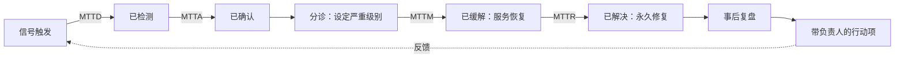
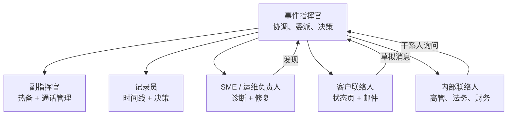
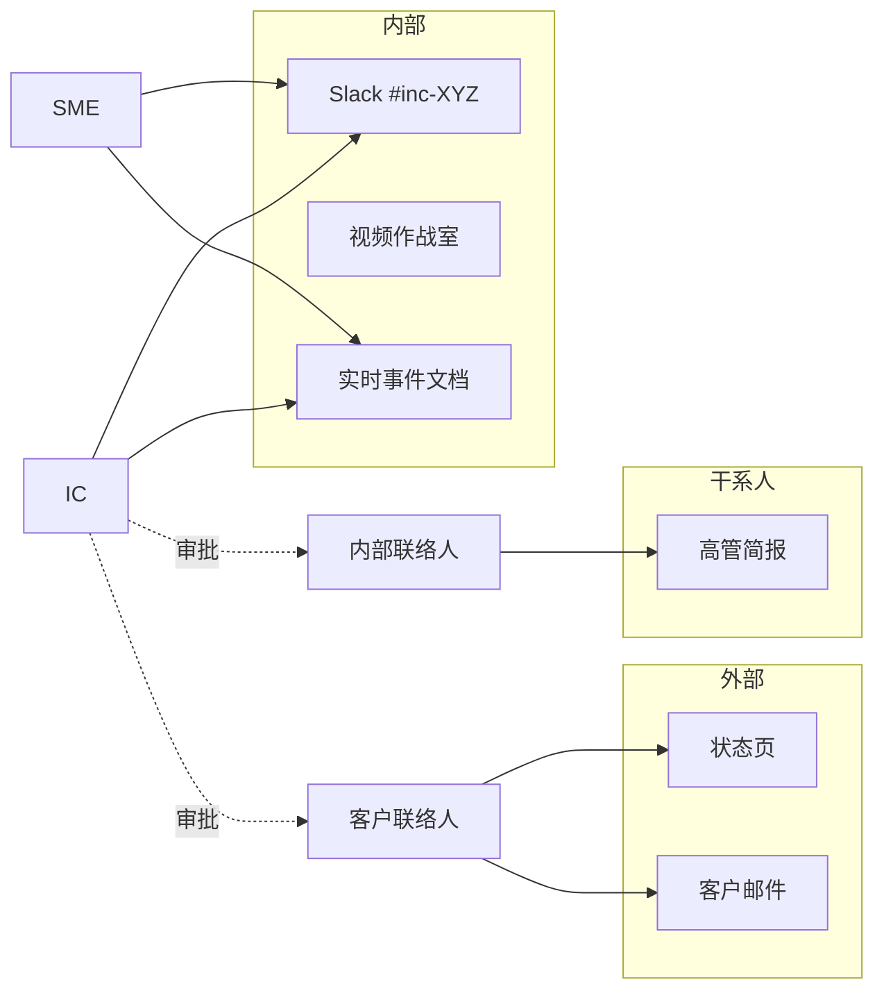
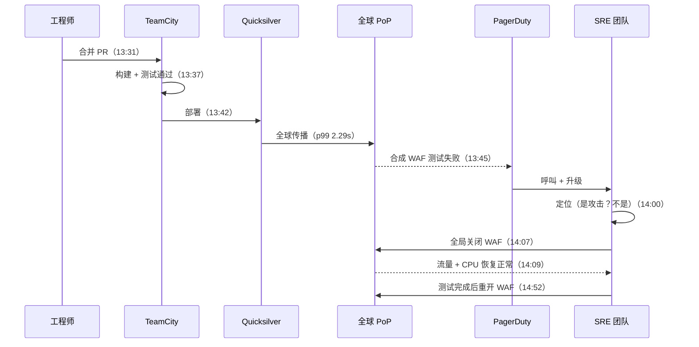

# 事件管理：从检测到无指责复盘

> **TL;DR**: 事件本身就是混乱的，所以唯一能冷静应对的办法，是预先搭好一套可以倚靠的结构。这套结构包含五个阶段（检测、分诊、缓解、解决、复盘），角色划分借鉴野外消防（事件指挥官负责协调，但绝不动手修），以及一种无指责的学习文化：把每次故障都当作系统失效，而不是人的过失。Google SRE 把值班负载上限定为每个 12 小时班次两次呼叫[^1]。Cloudflare 2019 年的 WAF 复盘列出了十一项促成因素，而不是一个“根因”[^2]。这套纪律描述起来简单，长期坚持却很难，所以要在真正需要它之前就开始演练。

## 学习目标

学完本章，你将能够：

- [ ] 设计一套长期可持续的值班轮转
- [ ] 定义严重级别及其对应的响应预期
- [ ] 用 ICS 角色体系以事件指挥官的身份指挥事件
- [ ] 写出能产出可执行改进的无指责复盘
- [ ] 把 MTTR 拆成四个组成部分，并判断该优化哪一段
- [ ] 把事件管理工具接入团队的工作流

## 直觉理解

你是一家餐厅的经理。一名服务员把一整托盘饮料洒在了客人身上。接下来发生什么，决定了你只是丢掉一桌客人，还是毁掉整个晚上。

错误的应对：主厨从厨房冲出来道歉，灶上六份订单正在烧糊。领位员丢下门口去拿拖把，门外排起了队。所有人都在帮忙，没有人统筹，三个问题变成五个。

正确的应对：经理（不是主厨）接手指挥。她派一个人照顾客人，一个人清理地面，一个人守领位台。她自己不碰拖把。她每两分钟确认一次：“客人处理好了吗？地面干了吗？队伍在动吗？”等尘埃落定，她写下发生了什么——不是为了开除服务员，而是为了问：托盘是不是装得太满？地面是不是本来就湿？过道是不是太窄？

这就是事件管理。经理是事件指挥官。主厨留在厨房（领域专家）。那份书面复盘就是 postmortem（事后复盘）。而“地面是不是本来就湿？”这个问题，就是从追责一个人转向修复一个系统。

[可观测性](./00-observability.md)给了你仪表，让你发现出事了。[SLI、SLO、SLA 与错误预算](./01-sli-slo-sla-error-budgets.md)给了你判断“有多糟”的算数。本章给你的是那套人的流程：把检测变成恢复，再把恢复变成学习。

## 原理

### 事件生命周期与 MTTR 拆解

事件会经过五个阶段：检测、分诊、缓解、解决、复盘[^3]。第一优先级永远是“止血、恢复服务、保留用于定位根因的证据”[^3]。缓解（回滚、流量摘除、功能开关）不需要你理解根因就能恢复服务。解决则是上线永久修复。把两者混为一谈是最常见的生命周期错误：客户还在受损，工程师却感到必须“上真修复”的压力。

从信号到关闭的总时长可以拆成四个可测量的部分：

- **MTTD**（平均检测时间）：从告警触发到人意识到。
- **MTTA**（平均确认时间）：从呼叫发出到有人确认。
- **MTTM**（平均缓解时间）：从确认到客户影响结束。
- **MTTR**（平均解决时间）：从事件宣告到完全关闭。

*事件的五个阶段，以及它们各自贡献的 MTTR 组成。优化错的阶段就是白费力气：如果 MTTD 是 45 分钟而 MTTM 是 5 分钟，就该投检测，而不是更快的回滚。*

每个组成部分对应不同的优化杠杆。MTTD 靠基于 SLO 的告警改善（见 [SLI、SLO、SLA 与错误预算](./01-sli-slo-sla-error-budgets.md)）。MTTA 靠值班设计改善。MTTM 靠运行手册和预先做好的缓解工具改善。MTTR 靠能防止复发的复盘行动项改善。

### 值班设计

值班（on-call）是让事件响应得以成立的人力可用层。做砸了，几周就把人熬垮；做好了，能撑好几年。

**轮转结构。** 一线值班处理呼叫。如果一线在 5 分钟内没有确认，就升级到二线[^4]。第三层在灾难性故障时升级到整个团队。跟日轮转（follow-the-sun）利用不同时区的站点实现 7×24 覆盖，且不用排夜班；对双站点团队，每个站点至少需要六名工程师[^5]。单站点 7×24 至少需要八名工程师，否则轮班频率难以持续[^5]。

**呼叫预算。** Google SRE 规定每个 12 小时班次最多两次独立事件，超过这条线就该采取纠正措施[^1]。再往上，工程师保不住 50% 的项目时间，响应质量下滑，人员流失加速。

**告警卫生。** 每次呼叫都必须可行动。如果一条告警写不出运行手册，它就不该触发呼叫。不可行动的告警转成工单。反复抖动的告警直接删掉。每季度审一遍呼叫规则，统计可行动呼叫与自动恢复呼叫的比例。

> [!TIP]
> 少于六人的轮转很脆。休假、生病，加上上下文切换的开销，实际上需要六到八名工程师才能撑起一个健康的单时区轮转。

### 严重级别与升级路径

严重级别把模糊的“这有多糟？”变成事先谈定的响应义务。PagerDuty 的公开方案是被引用最多的之一[^6]：

| 严重级别 | 定义 | 响应 |
|---|---|---|
| SEV-1 | 严重，需要对外通告并联络高管 | 重大事件：呼叫 IC，启动完整 ICS |
| SEV-2 | 严重，正在影响大量客户 | 重大事件：呼叫 IC |
| SEV-3 | 需要服务团队立即处理的稳定性问题 | 高优先级呼叫服务团队 |
| SEV-4 | 次要问题，无直接客户影响 | 低优先级呼叫 |
| SEV-5 | 外观问题或轻微缺陷 | 提交 Jira 工单 |

SEV-1 和 SEV-2 自动触发完整的 ICS 响应。SEV-3 可由 IC 酌情提升。

> [!TIP]
> “如果你不确定事件属于哪一级，就按更高级别处理。事件进行中不是讨论或争论严重级别的时候”[^6]。

### 事件指挥系统（ICS 角色）

事件指挥系统（Incident Command System，ICS）起源于 1970 年代的美国野外消防（2004 年并入 NIMS），后来由 Google SRE 和 PagerDuty 移植到软件领域[^3][^7]。它的核心不变量：**事件指挥官负责协调，但不负责修。** PagerDuty 的明文规定：“把所有修复动作都委派出去，事件指挥官不是修复者”[^7]。

角色分工如下：

- **事件指挥官（IC）：** 唯一的信息源。宣告事件、设定严重级别、委派工作、在共识卡住时拍板、批准对外沟通。
- **副指挥官（Deputy）：** IC 的热备。管理通话后勤。IC 需要喘口气时接手。
- **记录员（Scribe）：** 在实时事件文档里记录时间线事件、决策和动作。
- **领域专家（SME）/ 运维负责人：** 诊断并修复。可以多个 SME 并行工作。
- **客户联络人：** 起草并发布状态页更新和客户邮件。每一条对外消息发布前都要经 IC 批准。
- **内部联络人：** 对接高管、财务、法务和其他团队。

*IC 负责协调，SME 负责修，联络人把响应者从干系人的打断中隔开。信息向上汇到 IC，决策向下传达。*

为什么要把 IC 和 SME 分开？因为最强的排障手一旦打开终端，协调就停了。状态更新中断，没人应答的问题越堆越多。Google SRE 书里用“Mary”举例：这位值班工程师一头扎进日志，老板在喊要状态更新，同事上线了一个不安全的修复，把剩下的服务器一并打死[^3]。

小团队里角色会合并：副指挥官兼任记录员，一个人同时管两个联络岗。但对 SEV-3 以上的任何事件，IC 与 SME 的分离没有商量余地。

### 沟通纪律

内部和外部沟通渠道必须分开。响应者需要一个安静的空间干活；客户和高管需要定期更新，但不能把作战室淹掉。

*内部作战室的流量与客户、高管渠道隔离。每一条对外消息都经 IC 把关，避免猜测传到客户那里。*

**节奏：** SEV-1 期间每 15 到 30 分钟更新一次状态。每次更新遵循固定结构：什么坏了、我们在做什么、下一次更新什么时候来。这个节奏能提前消化“现在到底怎么了？”这类打断，不让他们去干扰响应者[^3]。

**对外消息规则：** 陈述事实，不做推测。“我们正在排查升高的错误率”是对的。“我们认为数据库坏了”不是。用预先写好的模板缩短关键路径。

**合规义务：** GDPR 要求 72 小时内通报数据泄露。HIPAA 和 SOC 2 各有自己的证据链要求。任何数据暴露事件，第一分钟就把法务拉进来。

**自托管依赖陷阱：** 不要把事件文档、聊天或仪表盘放在你正试图修复的那个服务后面。Cloudflare 2019 年的故障把工程师锁在了自家受 Access 保护的控制台外面[^2]。Facebook 2021 年撤回 BGP 路由，把调查这次撤回所需的内部工具也一起断了[^8]。要维护带外访问通道，并定期演练怎么用。

### 无指责复盘

John Allspaw 2012 年在 Etsy 的文章确立了无指责的框架，后来成了行业信条：“我们更愿意以学习的视角看待失误、错误、疏漏、遗忘等等”[^9]。Google 的第 15 章把它写成规范：复盘之所以无指责，是因为它“聚焦于找出事件的促成原因，而不起诉任何个人或团队”[^10]。

Richard Cook 的《How Complex Systems Fail》把论证推得更远：把事故归因于单一“根因”是“根本错误的”，因为显性失效需要多个贡献者，只有它们的组合才允许灾难发生[^11]。

**模板（Google SRE）：**

1. 摘要（三句话）
2. 时间线（从检测到解决的带时间戳事件）
3. 影响（受影响用户、持续时长、收入损失）
4. 促成因素（复数，永远不要单数的“根因”）
5. 做得好的地方（强化好做法）
6. 行动项（每项都有具名负责人、优先级和截止日期）

**触发条件：** 超过阈值的用户可见停机、任何数据丢失、值班工程师介入（回滚、流量改道）、解决时间超过阈值，或监控失效[^10]。

**5 Whys：** 一种强制深挖的简单方法。反复问“为什么？”，直到触达系统性原因。当答案落在流程或系统设计选择上、而不是人的某个动作时，就可以停。

**公开复盘：** Cloudflare、GitHub、Atlassian、Fastly 和 AWS 都会发布详细的事后回顾。这能建立行业信任，也加速集体学习。Cloudflare 2019 年的 WAF 复盘列出了十一项促成因素，公开了肇事正则，并在附录里解释了灾难性回溯[^2]。

## 真实案例

### Cloudflare WAF 正则故障（2019 年 7 月 2 日）

2019 年 7 月 2 日，一次 WAF 规则变更让 Cloudflare 全球流量的 80% 瘫痪了 27 分钟[^2]。这份复盘是公开透明度的黄金标准。

**发生了什么：** 一名工程师合并了包含新 XSS 检测规则的 PR。规则里的正则可能发生灾难性回溯：剥到病态核心就是 `.*.*=.*`。TeamCity 构建并测试了这些规则（测试套件里没有 CPU 消耗测试），随后通过 Cloudflare 的 Quicksilver KV 存储全球下发，把配置复制到 180 多个城市，p99 为 2.29 秒[^2]。

部署后 3 分钟内，每台边缘服务器的 CPU 都打满 100%。PagerDuty 触发。全球 502 错误接连涌出。SRE 团队定位原因（排除了攻击），商定全局关闭 WAF，并在 UTC 14:07 执行。14:09 流量恢复正常。

*Cloudflare 2019 年 WAF 故障：从合并规则到拉下全局关闭开关用了 36 分钟，部署后 3 分钟内被发现，首次影响后 27 分钟完全恢复。*

**为什么它对事件管理重要：**

1. **检测很快（3 分钟）**，因为合成 WAF 测试在持续运行。MTTD 不是瓶颈。
2. **缓解手段是全局关闭开关**，不是根因修复。团队又花了 43 分钟验证安全的重启路径，期间 WAF 一直关着。
3. **自托管依赖：** 工程师访问不了自家受 Cloudflare Access 保护的仪表盘。有些人的凭据已经失效，因为某项安全特性在长期不用后把它们禁用了。
4. **复盘列了十一项促成因素**，而不是一项：可回溯的正则、重构时误删 CPU 保护、PCRE 引擎没有复杂度保证、没有 CPU 消耗测试，以及一份允许非紧急全局推送的 SOP。
5. **行动项都是系统性的：** 换用线性时间的正则引擎（re2 或 Rust 的 `regex`）、人工审计 3,868 条规则、在测试套件里加性能剖析、非紧急规则改为分批灰度。

整份复盘从未点名那位提交规则的工程师。它点名的是那个允许一次合并就打瘫全球的系统。

## 权衡

可替换的决策是*如何组织响应*，它随团队规模和事件频率变化。是否公开复盘是另一个维度上的披露决策，前文正文和下面的延伸阅读已经涉及。

| 方案 | 优点 | 缺点 | 适用场景 | 我们的选择 |
|---|---|---|---|---|
| 临时响应 | 零开销，没有流程税 | 不一致、混乱、事后没有学习 | 单团队、SEV-1 之前、每年重大事件少于 1 次的组织 | 只适合单团队、SEV-1 之前的组织 |
| 基于严重级别的运行手册 | 响应有结构，事件中少吵严重级别[^6] | 运行手册维护负担、容易过期 | 已过首次重大事件、正在扩张的团队 | **多数团队的默认选择** |
| 专职事件指挥官（源自 ICS） | 响应专业化；IC 把修复动作委派出去，自己不是修复者[^7] | 需要人力；角色用得少，IC 技能会退化 | 7×24 或多区域运行的大规模服务 | 团队超过约 100 名工程师时 |

## 常见陷阱

> [!WARNING]
> **告警疲劳。** 真正的信号被忽略，因为值班的人已经被噪音磨钝了。统计每个班次的呼叫量。如果长期超过每 12 小时两次，该修剪的是告警，而不是让人更能扛[^1]。

> [!WARNING]
> **IC 自己动手（角色塌缩）。** IC 一打开终端，协调就停了。培养一批能当 IC 的人。SEV-1 强制配副指挥官。如果你的团队只有一个人能当 IC，那就是巴士因子问题。

> [!WARNING]
> **自托管依赖。** 你的排障工具依赖着已经挂掉的服务。维护带外访问：应急凭据、托管在故障域之外的监控，以及一条不依赖 Slack 的电话树。

> [!WARNING]
> **根因近视。** 只有一项促成因素、行动项全在补同一个文件的复盘，会让更宽的失效类别自由复发。把促成因素列全。Cloudflare 列了十一项[^2]。Atlassian 列了四条不同的经验教训，下面还有子项[^12]。

> [!WARNING]
> **行动项没有负责人或截止日期。** 复盘文档存在、看起来完整，却什么也没改变。每个行动项都要有具名的人（不是团队）、优先级和截止日期。每季度跟踪完成率。重复事件带着与旧复盘相同的促成因素，说明你的学习闭环断了。

## 练习

为一个 8 人的新工程师团队设计事件响应手册。该团队运行一款 B2B SaaS 产品，有 500 家企业客户，可用性 SLO 为 99.9%。要定义：严重级别矩阵（3 级）、值班轮转形态、IC 角色定义、状态页沟通节奏，以及复盘模板。每个选择都要给出理由。

提示

从 SLO 出发：30 天内 99.9% 意味着你有 43.2 分钟的停机预算。由此倒推，定义什么算 SEV-1（几分钟就烧完预算）、SEV-2（几小时烧完）、SEV-3（不烧预算但已降级）。轮转方面，8 个人正好是单站点 7×24 的下限。想清楚你是否真的需要 7×24，还是仅工作时间覆盖加一条升级路径就够——对 B2B 产品来说，后者往往够用。

解答

**严重级别矩阵：**

| 级别 | 定义 | 响应 | 示例 |
|---|---|---|---|
| SEV-1 | 完全不可用或数据丢失，影响任何客户 | 呼叫 IC，启动完整 ICS，10 分钟内更新状态页 | API 对所有请求返回 500 |
| SEV-2 | 明显降级，影响超过 10% 的客户 | 呼叫 IC，服务团队动员，30 分钟内更新状态页 | 延迟是正常值的 10 倍，部分功能不可用 |
| SEV-3 | 轻微降级、单个客户，或冗余丧失 | 呼叫服务团队，无需 IC | 一个副本挂了，故障切换正常 |

**值班轮转：** 8 名工程师，一线轮一周，二线轮一周。单站点团队做跟日轮转不现实。非工作时间的 SEV-1 走工作时间升级到全员（B2B 客户大多在工作时间活跃）。呼叫预算：每班次最多 2 次。连续两周超标，团队暂停功能开发，先修告警卫生。

**IC 角色：** 任何完成过 IC 培训的工程师（一次 2 小时工作坊加一次跟场事件）。一线值班并不自动等于 IC；谁宣告事件谁就是 IC。SEV-1 时始终拉第二名工程师当副指挥官。

**状态页节奏：** SEV-1：每 15 分钟更新。SEV-2：每 30 分钟。SEV-3：只做首次确认，解决时更新。所有对外消息用模板：“我们正在排查 [现象]。下次更新在 [N] 分钟后。”

**复盘模板：** 摘要、时间线、影响（受影响客户、时长、消耗的 SLO 预算）、促成因素（至少 2 项）、做得好的地方、行动项（负责人 + 截止日期 + 优先级）。触发条件：任何 SEV-1、任何持续超过 30 分钟的 SEV-2、任何数据丢失、任何监控失效。5 个工作日内开评审会。行动项完成情况在每周站会上跟踪。

**理由：** 99.9% 的 SLO 意味着每月 43 分钟预算。一次 30 分钟的 SEV-1 就吃掉 70%。这会逼出激进的检测（SLO 燃尽率告警）和快速的缓解（预先做好的回滚脚本）。B2B 语境意味着客户数量少但单客价值高，所以沟通质量比首次更新的速度更重要。

## 要点回顾

- 事件有五个阶段：检测、分诊、缓解、解决、复盘。缓解（恢复服务）在解决（修根因）之前。永远不要把两者混为一谈。
- 事件指挥官负责协调，但从不负责修。把 IC 与 SME 分开，是提升事件响应质量最有杠杆的结构性决策。
- 把值班负载上限定为每个 12 小时班次两次呼叫。超过之后，响应质量下降，工程师也会离职。
- 严重级别消除事件中的争论。拿不准时，往高级别升级。
- 无指责复盘能更早暴露问题，因为工程师不怕指出来。追责滋生掩盖。
- 宁用“促成因素”，不用“根因”。复杂系统的失效总有多个贡献者。
- 没有具名负责人和截止日期的行动项不会完成。跟踪完成率。重复事件带着相同的促成因素，说明学习闭环断了。

## 延伸阅读

- [Google SRE Book: Managing Incidents](https://sre.google/sre-book/managing-incidents/) - Andrew Stribblehill 对 ICS 的经典移植，含“Mary”那段无人管理的故障小故事，说明为什么 IC 与 SME 的分离至关重要。
- [Google SRE Book: Postmortem Culture](https://sre.google/sre-book/postmortem-culture/) - 行业大部分人照抄的模板、触发条件和评审实践。做第一套复盘流程就从这里开始。
- [Google SRE Workbook: On-Call](https://sre.google/workbook/on-call/) - “每 12 小时班次最多 2 次呼叫”的指导，加上轮转人数的算法。设计第一个轮转之前必读。
- [PagerDuty Incident Response](https://response.pagerduty.com/) - 开源文档，涵盖严重级别、IC/副指挥官/记录员/SME 角色和通话礼仪。最容易直接照搬的起点。
- [Blameless PostMortems and a Just Culture](https://www.etsy.com/codeascraft/blameless-postmortems) - John Allspaw 2012 年在 Etsy 的文章，把这个词带进了软件工程。短、有说服力，至今仍是最好的入门材料。
- [How Complex Systems Fail](https://how.complexsystems.fail/) - Richard Cook 的 18 个短论点。重点读第 7 点（“根因”的社会建构）和第 8 点（后见之明偏误）。
- [Details of the Cloudflare outage on July 2, 2019](https://blog.cloudflare.com/details-of-the-cloudflare-outage-on-july-2-2019/) - 公开复盘的黄金标准：十一项促成因素、完整公开的肇事正则，以及一篇讲灾难性回溯的附录。
- [Howie: The Post-Incident Guide](https://howie-guide.pagerduty.com/) - Nora Jones、Laura Maguire、Vanessa Huerta Granda 和 Jeli 团队的事后调查指南（Jeli 被收购后迁到 PagerDuty）。想比本章走得更远，从这里开始。

## 记忆卡片

**Q:** 事件生命周期的五个阶段是什么？
**A:** 检测、分诊、缓解（恢复服务）、解决（永久修复）、复盘（学习并固化）。缓解在解决之前，因为恢复服务比理解根因更紧急。

**Q:** MTTR 的四个组成部分是什么？
**A:** MTTD（检测时间）、MTTA（确认时间）、MTTM（缓解时间）、MTTR（完全解决时间）。每个都有不同的优化杠杆：MTTD 靠更好的告警，MTTA 靠值班设计，MTTM 靠运行手册，MTTR 靠复盘行动项。

**Q:** IC 的定义性规则是什么？
**A:** 事件指挥官负责协调，但不负责修。PagerDuty 的明文规定：“把所有修复动作都委派出去，事件指挥官不是修复者。”IC 宣告、委派、决策、记录、沟通。

**Q:** Google SRE 推荐的呼叫预算是多少？
**A:** 每个 12 小时班次最多两次独立事件。超过就该采取纠正措施（修告警、加人手，或缩小运维面）。

**Q:** 为什么“根因”是个有问题的说法？
**A:** Richard Cook 的《How Complex Systems Fail》认为，归因于单一根因是“根本错误的”，因为复杂系统的失效需要多个贡献者。宁用“促成因素”（复数），强制深挖，避免过早收尾。

**Q:** 什么让复盘成为无指责的？
**A:** 它假定每个参与者都出于好意，并在当时掌握的信息下做了正确的事。它聚焦于找出促成原因，而不起诉任何个人。目标是学习，不是惩罚。

**Q:** 可持续的单站点 7×24 值班，团队规模下限是多少？
**A:** 按 Google SRE 书，8 名工程师。跟日轮转（双站点）每个站点至少六人。任何轮转少于六人，都会因休假和生病而变脆。

**Q:** 事件中什么时候该升级严重级别？
**A:** 拿不准时，一律按更高级别处理。事件进行中不是讨论或争论严重级别的时候。事后随时可以降级。

**Q:** 什么是自托管依赖陷阱？
**A:** 你的排障工具、仪表盘或沟通渠道依赖着已经挂掉的服务。Cloudflare 的工程师在 2019 年故障中访问不了受 Access 保护的仪表盘。Facebook 的工程师在 2021 年 BGP 故障中用不了内部工具。要维护带外访问通道。

**Q:** 每个复盘行动项都应包含什么？
**A:** 一个具名的个人负责人（不是团队）、一个优先级、一个截止日期。每季度跟踪完成率。重复事件带着与旧复盘相同的促成因素，说明学习闭环断了。

**Q:** 举出三个应自动要求复盘的触发条件。
**A:** （1）超过阈值的用户可见停机；（2）任何数据丢失；（3）值班工程师介入，例如回滚或流量改道。另有：解决时间超过阈值，或监控失效（系统坏了但告警没响）。

**Q:** Cloudflare 2019 年的 WAF 复盘如何体现了无指责文化？
**A:** 它从未点名提交规则的工程师。它列出了十一项促成因素（正则回溯、缺失的 CPU 保护、没有性能测试、全局推送的 SOP）。它把故障归因于系统设计而非人为失误，并且公开的行动项全是系统性修复。

## 参考文献

[^1]: Ollie Cook et al., "On-Call," Google SRE Workbook Chapter 8. https://sre.google/workbook/on-call/
[^2]: John Graham-Cumming, "Details of the Cloudflare outage on July 2, 2019," Cloudflare blog, 12 July 2019. https://blog.cloudflare.com/details-of-the-cloudflare-outage-on-july-2-2019/
[^3]: Andrew Stribblehill, "Managing Incidents," Google SRE Book Chapter 14. https://sre.google/sre-book/managing-incidents/
[^4]: PagerDuty, "Being On-Call." https://response.pagerduty.com/oncall/being_oncall/
[^5]: Andrea Spadaccini, "Being On-Call," Google SRE Book Chapter 11. https://sre.google/sre-book/being-on-call/
[^6]: PagerDuty, "Severity Levels." https://response.pagerduty.com/before/severity_levels/
[^7]: PagerDuty, "Different Roles" (IC, Deputy, Scribe, SME, Customer Liaison, Internal Liaison). https://response.pagerduty.com/before/different_roles/
[^8]: Santosh Janardhan, "More details about the October 4 outage," Meta Engineering, 5 October 2021. https://engineering.fb.com/2021/10/05/networking-traffic/outage-details/
[^9]: John Allspaw, "Blameless PostMortems and a Just Culture," Etsy Code as Craft, 22 May 2012. https://www.etsy.com/codeascraft/blameless-postmortems
[^10]: John Lunney and Sue Lueder, "Postmortem Culture: Learning from Failure," Google SRE Book Chapter 15. https://sre.google/sre-book/postmortem-culture/
[^11]: Richard I. Cook, "How Complex Systems Fail." https://how.complexsystems.fail/
[^12]: Atlassian Engineering, "Post-Incident Review on the Atlassian April 2022 outage," Inside Atlassian, 29 April 2022. https://www.atlassian.com/engineering/post-incident-review-april-2022-outage
