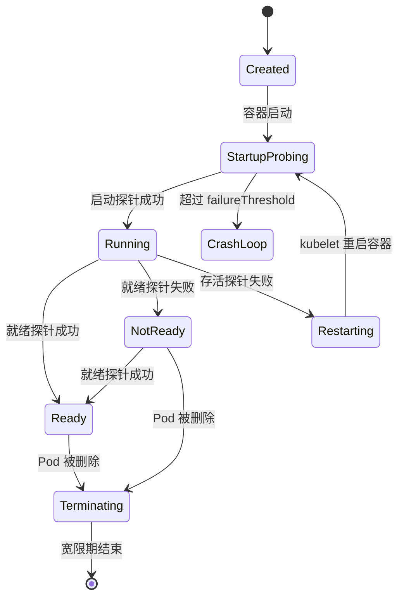
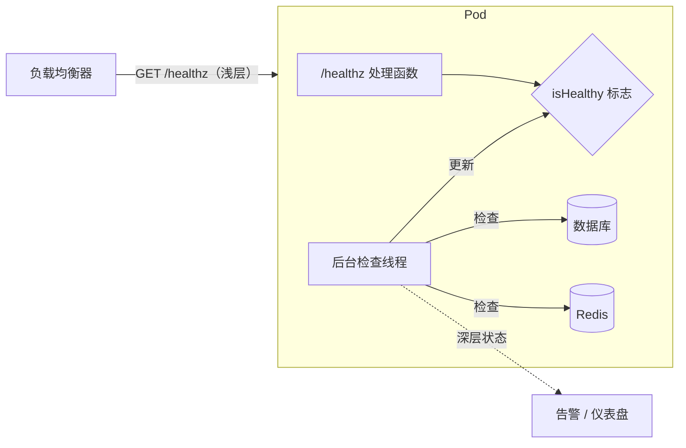
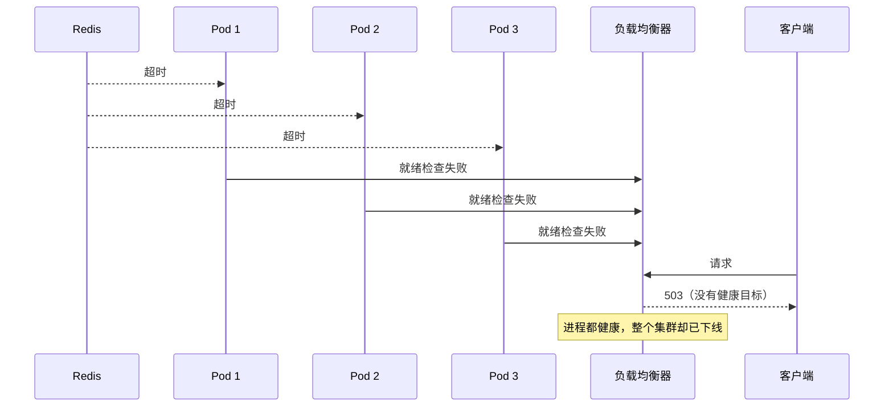
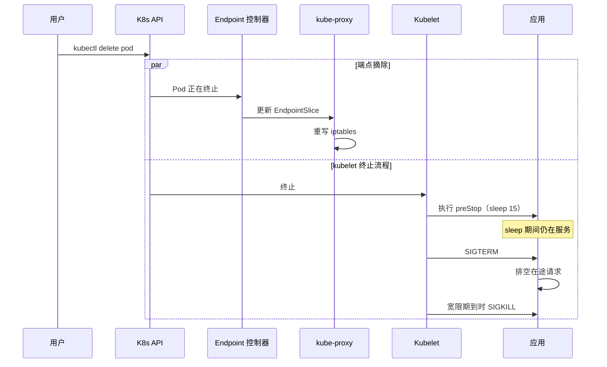

# 健康检查与就绪：如实回答服务是否在线

> **TL;DR**: 健康检查只回答一个问题：“这个实例现在该不该收流量？”答错了，它制造的故障比你避免的还多。一台服务器用 2 ms 吐出空白错误页，而同伴渲染真实响应要 200 ms，对延迟敏感的负载均衡器就会给它派去过量的流量，它随即变成黑洞，把自己的故障越放越大[^1]。解法是三个彼此独立的信号：存活（我死锁了就把我重启）、就绪（我服务不了就把我摘出去）、启动（给我时间开机）。外部负载均衡器的检查要保持浅层；深层的依赖检查在本地跑，结果喂给告警，不参与路由。

## 学习目标

学完本模块，你将能够：

- [ ] 区分存活、就绪、启动三种探针，并正确使用每一种
- [ ] 设计能反映真实服务能力的健康检查
- [ ] 避开深层检查引发的级联故障陷阱
- [ ] 用启动探针处理慢启动的服务
- [ ] 把健康检查接入负载均衡器、服务网格与编排系统

## 直觉理解

你是餐厅的领位。每隔几秒，脑子里要过三个问题：

1. **后厨还活着吗？** 灶是冷的、厨师晕过去了，那就关门打 911（重启）。这是存活。
2. **现在还能再放客人进来吗？** 后厨活着，但每个灶眼都占着。你先停止带位，等空出一个灶眼。后厨不需要重启，它只需要喘口气。这是就绪。
3. **后厨还在预热吗？** 餐厅刚开门，烤箱要 20 分钟才到温度。早上 7:01 做不出舒芙蕾，你不会因此判定后厨已死。你等着。这就是启动探针。

再想象领位每 10 秒给海鲜供应商打个电话确认就绪：“你有三文鱼吗？”供应商的电话线断了 30 秒，领位就宣布全店所有桌子都不可用，把客人全打发走——哪怕后厨的鸡肉、牛肉、意面堆得满满的。这就是把深层健康检查放在负载均衡器上的级联故障陷阱。

本章余下的部分要把这三个信号讲精确，讲清怎么把它们接到 Kubernetes 和负载均衡器上，并教你那条能避免全集群故障的规则：外部检查保持浅层，深层检查放在本地。

## 原理

### Kubernetes 的三种探针类型

Kubernetes 定义了三种探针，由 kubelet 对每个容器执行。失败时各自触发的动作不同[^2]：

- **启动探针。** 只在初始化阶段运行。成功之前会压住存活探针与就绪探针。一旦超过 `failureThreshold`，kubelet 杀掉容器并重启。适用于 JVM、Python 模型加载，或任何启动时间超出存活预算的容器。
- **存活探针。** 在容器整个生命周期里周期性运行。失败时 kubelet 杀掉容器并重启。Kubernetes 文档明确警告：“存活探针必须小心配置，确保它真的只反映不可恢复的应用故障，例如死锁。”[^2]
- **就绪探针。** 周期性运行。失败时 EndpointSlice 控制器把该 Pod 的 IP 从所有选中它的 Service 中移除。容器不重启。就绪是可逆的：探针重新成功后 Pod 回到池子里。

可用的检查机制有四种：`httpGet`（2xx-3xx 算成功）、`tcpSocket`（连接能建立）、`exec`（退出码 0）、`grpc`（自 Kubernetes 1.27 起稳定，检查 `grpc.health.v1.Health/Check`）[^2]。

配置字段与默认值：`initialDelaySeconds`（0）、`periodSeconds`（10，最小 1）、`timeoutSeconds`（1）、`successThreshold`（1，存活与启动探针必须是 1）、`failureThreshold`（3）。

**平均检测时间（MTTD，mean time to detection）** = `periodSeconds` x `failureThreshold`。用默认值算，要 30 秒才会触发任何动作。周期越短检测越快，但整个集群的探针负载也随之上升。



*启动探针在开机阶段压住存活与就绪；它一旦成功，就绪管流量路由，存活管重启。*

### 浅层检查与深层检查

浅层检查只确认进程还在跑：TCP 能 accept、一个微不足道的 handler 返回 HTTP 200。深层检查确认进程真能干活：连得上数据库、解得开密钥、写得了磁盘。

AWS Builders' Library 把检查分成三层[^1]：

1. **存活检查（liveness checks）**：TCP accept、基本 HTTP 响应。
2. **本地健康检查（local health checks）**：磁盘可写、关键线程存活、没有解密失败。
3. **依赖健康检查（dependency health checks）**：能连上 DB、缓存、对端服务。

建议说得很直白：“Amazon 的团队倾向于把快速反应的负载均衡器健康检查限制在本地健康检查，深层依赖健康检查交给集中式系统去谨慎处理。”[^1]

为什么？因为负载均衡器上的依赖检查会把那个依赖变成硬依赖。如果每个实例每次探针都去查 Redis，Redis 抖 30 秒就会同时摘掉所有实例。负载均衡器看到零个健康目标，对每个客户端返回 503——哪怕每个应用进程都完全有能力吐缓存数据或降级响应。



*LB 调的是从不碰共享依赖的浅层端点；深层检查在后台线程里跑，结果喂给告警，不参与路由决策。*

推荐的模式：深层检查放在本地，供仪表盘和告警使用；浅层检查放在外部负载均衡器上。如果深层检查非得放在 LB，那就用 fail-open（失败即放行）的负载均衡器。AWS ALB 在设计上就是 fail-open：“如果一个目标组里只有不健康的已注册目标，负载均衡器仍然把请求路由到所有这些目标，不管它们的健康状态如何。”[^3]



*Redis 抖 30 秒，所有实例同时就绪失败；没有 fail-open，端点列表被清空，客户端拿到 503。*

### 启动探针与慢启动服务

典型的重灾区：JIT 预热 30 到 90 秒的 JVM 应用、.NET 的分层 JIT、加载大型 ML 模型的 Python 应用、需要预热本地缓存的服务。

没有启动探针时，存活探针配成 `initialDelaySeconds: 10, periodSeconds: 10, failureThreshold: 3` 会在约 40 秒时杀掉 Pod。一个要 60 秒才起得来的 JVM 于是掉进 CrashLoopBackOff，永远起不来。

解法是给启动探针一个宽松的预算，让它压住存活探针：

```yaml
startupProbe:
  httpGet:
    path: /healthz
    port: 8080
  failureThreshold: 30
  periodSeconds: 10       # 最长 5 分钟启动时间
livenessProbe:
  httpGet:
    path: /healthz
    port: 8080
  periodSeconds: 5
  failureThreshold: 3     # 跑起来之后可以激进
```

Kubernetes 文档给了这条公式：“如果你的容器启动时间通常超过 `initialDelaySeconds + failureThreshold * periodSeconds`，就应该配置启动探针。”[^2] 启动探针运行期间，存活与就绪检查都暂停。JVM 拿到完整的预热窗口，而启动一旦成功，存活探针就可以保持很紧。

### 优雅关闭与连接排空

Kubernetes 删除 Pod 时，两件事并行发生[^4]：

1. 端点从 EndpointSlice 中移除（再传播到 kube-proxy、Ingress、CoreDNS、服务网格）。
2. kubelet 向容器发送 SIGTERM。

竞态就在这里：如果 SIGTERM 在端点摘除传播到位之前到达，Pod 已经停止接受连接，而 kube-proxy 还在往它转发流量。滚动更新期间客户端就会拿到 TCP RST。

业界的标准解法是 `preStop` 钩子：

```yaml
lifecycle:
  preStop:
    exec:
      command: ["sleep", "15"]
```

这 15 秒的 sleep 正好覆盖传播竞态。只有 `preStop` 执行完，kubelet 才发 SIGTERM。应用随后停止接受新连接，把在途请求排空。到了 `terminationGracePeriodSeconds`（默认 30 秒），kubelet 发 SIGKILL。



*preStop 的 sleep 让端点摘除先传播到 kube-proxy、Ingress 和服务网格，SIGTERM 才可能到达应用。SIGKILL 是宽限期（默认 30 s）到点后的最后兜底。*

在负载均衡器这一层，AWS ALB 的 `deregistration_delay.timeout_seconds` 默认是 300 秒[^5]。这段时间里 ALB 不再发新请求，但会等已有连接排空。想要快速蓝绿发布，把它降到 30-60 秒。

Google 内部的 RPC 系统把它固化为 **lame duck**（跛鸭）状态：“后端任务仍在监听自己的端口、也能服务，但明确请求客户端停止发送请求。”[^6] SIGTERM 把任务切进跛鸭状态；不活跃的客户端通过周期性 UDP 健康检查在 1-2 个 RTT 内发现这一状态。排空窗口为 10-150 秒，取决于请求时长。

### 负载均衡器与服务网格集成

**AWS ALB/NLB。** ALB 目标组的健康检查按 `HealthCheckIntervalSeconds` 运行（默认 30 s，范围 5-300），配合 `UnhealthyThresholdCount`（默认 2）与 `HealthyThresholdCount`（默认 5）[^3]。NLB 在某个可用区内所有目标都不健康时会 fail-open。

**Envoy 主动 + 被动。** Envoy 把健康检查拆成两套机制。主动探针（HTTP、gRPC、TCP）按配置的间隔运行。被动离群检测（outlier detection）盯着真实流量：连续 5 次 5xx 响应后，该主机被摘除，基础窗口 30 秒，每被再摘一次就延长，上限是 `max_ejection_percent`（默认集群的 10%）。这样单个坏主机不会引发级联，同时爆炸半径有界。

**Istio sidecar 带来的麻烦。** 开启严格 mTLS 后，kubelet 没有 Istio 签发的证书，HTTP 探针会失败。Istio 会把探针改写为经由 sidecar 的 pilot-agent（端口 15020）走。TCP 探针则变成同义反复，因为 sidecar 截走了所有 TCP。启动竞态是另一个坑：应用容器可能先起来，而 Envoy 还没从控制面拿到配置。解法是在 ProxyConfig（属于网格配置）里设 `holdApplicationUntilProxyStarts: true`。

**Consul。** 支持 HTTP（2xx 为通过，429 为警告，其余为严重）、TCP、gRPC、UDP、TTL（被动式，由服务主动上报状态）、Docker 与脚本检查。当服务自己最清楚自己健不健康时，TTL 模式很好用。

## 真实案例

### 数据中心规模下的 Google 跛鸭模式

Google 内部负载均衡系统（SRE 书第 20 章有描述）管理的服务规模从几个到一万多个后端任务不等，典型是 100 到 1,000 个[^6]。健康不是二值。每个后端上报三种状态：Healthy、Refusing connections、Lame duck。

关键洞察是：后端在每一个 RPC 响应里都嵌入利用率数据（CPU、QPS、错误率），健康检查响应也不例外。客户端拿这些信号做加权轮询（Weighted Round Robin），而不只是做上下线路由。CPU 90% 的后端收到的请求就比 30% 的少，全程不需要任何中心协调者。

后端收到 SIGTERM 后切换到跛鸭状态。它继续服务在途请求，但告诉客户端别再发新的过来。不活跃的客户端通过周期性 UDP 健康检查在 1-2 个 RTT 内发现跛鸭状态[^6]。排空窗口 10-150 秒，取决于预期最长的请求时长。

Google 刻意规避的一个关键反模式：把错误算成“快速响应”。一个用 1 ms 返回错误的后端，会被对延迟敏感的均衡器灌进更多流量，变成黑洞。Google 的系统把错误计为活跃请求，从而切断这条放大回路[^6]。

这套架构体现了本章的核心原则：健康不是布尔值，而是一个谱系（健康、降级、排空中、死亡），采取的动作（少路由、停止路由、重启）必须与信号的含义对应。

## 权衡

这里可替换的决策是*外部负载均衡器检查做到多深，深层检查放在哪里*。以前摆在这一节的反模式行（“只做深层”和“不做健康检查”）挪到了下面的常见陷阱里——反模式本来就该待在那儿。

| 方案 | 优点 | 缺点 | 适用场景 | 我们的选择 |
|---|---|---|---|---|
| 只在 LB 做浅层检查 | 简单，没有相关性故障级联的风险 | 漏掉内部状态坏掉的情况（线程池卡死、磁盘写满、后台 worker 卡住） | 外部 LB 前置的数据面服务，快速反应比依赖感知更重要 | 快速响应的 LB 检查的默认做法[^1] |
| 拆分：LB 浅层，本地深层 | 两类故障都能抓到；爆炸半径解耦，依赖抖一下只在本地摘掉一个实例，不会全集群同步 | 两条代码路径，配置更多 | 大规模生产服务 | **AWS 推荐的默认做法**[^1] |
| LB 深层检查 + fail-open | 所有实例都报不健康时的安全网：LB 不摘掉整批实例，而是照样把流量发往所有目标 | fail-open 很难测；原生只有 AWS NLB 和 ALB 支持[^1] | 仅在 fail-open 已验证的环境（ALB、NLB） | LB 支持时的可接受退路 |

## 常见陷阱

> [!WARNING]
> **存活探针里查数据库。** 数据库抖一下，所有 Pod 的存活检查同时失败。kubelet 逐个杀掉重启，等数据库恢复时又涌来一大波新连接。存活检查只该看本地状态：HTTP 服务器还能响应吗？依赖检查放到就绪探针或后台告警里。

> [!WARNING]
> **没有启动探针却把存活探针设得很激进。** JVM 启动要 60 秒，存活探针是 `failureThreshold: 3, periodSeconds: 10`，kubelet 在 30 秒时就杀掉 Pod。Pod 掉进 CrashLoopBackOff，永远起不来。加一个 `failureThreshold: 30, periodSeconds: 10` 的启动探针，给出 5 分钟启动预算。

> [!WARNING]
> **同义反复的健康端点。** `app.get('/health', (_, res) => res.send('OK'))` 不反映任何真实状态。坏掉的实例一直留在轮转里。要维护一个 `isHealthy` 标志，由后台线程检查本地状态（连接池还活着、上次请求成功）来更新。Builders' Library 把这叫“带标志的后台线程”模式[^1]。

> [!WARNING]
> **就绪探针在每个实例上都查共享依赖。** 共享的 Redis 抖 30 秒，每个实例的就绪检查整齐划一地失败。Service 的 EndpointSlice 被清空。没有 fail-open 的话，LB 无处可路由。共享依赖检查不要放进数据面的就绪路径。

> [!WARNING]
> **缺 preStop 钩子，丢掉在途请求。** 滚动发布发出 SIGTERM；应用立刻退出；kube-proxy 还没把这个 Pod 从 iptables 里摘掉；客户端拿到 TCP RST。加上 `preStop: sleep 15`，并在应用里捕获 SIGTERM 做优雅排空[^4]。

## 练习

为一个依赖 PostgreSQL、Redis 和第三方支付 API 的服务设计健康检查。给出存活、就绪、启动三种探针的配置，说明每种探针检查什么、阈值怎么定，以及你如何避免 Redis 抖一下就把所有实例踢出轮转。

<details>
<summary>提示</summary>

想一想哪些依赖是本地、哪些是共享的。支付 API 是外部的、不可靠的。Redis 被所有实例共享。PostgreSQL 是真相来源。这三种里，哪些该被存活探针碰到？哪些该被就绪探针碰到？如果把支付 API 放进就绪检查，会发生什么？

</details>

<details>
<summary>参考答案</summary>

**启动探针：** `httpGet /healthz`，`failureThreshold: 30`，`periodSeconds: 10`。给连接池预热和 schema 迁移检查留出 5 分钟。

**存活探针：** `httpGet /healthz`，`periodSeconds: 5`，`failureThreshold: 3`。`/healthz` 处理函数只检查两件事：(1) HTTP 服务器能不能分配出响应缓冲区；(2) 主事件循环是否还能响应（没有死锁）。它不碰任何外部依赖。

**就绪探针：** `httpGet /ready`，`periodSeconds: 5`，`failureThreshold: 1`，`successThreshold: 1`。`/ready` 处理函数读取一个由后台 goroutine 维护的 `isReady` 标志。那个 goroutine 每 10 秒 ping 一次 PostgreSQL 并更新标志。它不检查 Redis，也不检查支付 API。

**为什么 Redis 不进就绪检查？** Redis 被所有实例共享。抖 30 秒会让每个 Pod 同时翻成 NotReady，端点列表被清空。改法是把 Redis 的健康状况喂给 Prometheus 指标和一个[优雅降级](./03-graceful-degradation.md)熔断器：应用返回降级响应（缓存未命中就回退到 DB），而不是宣布自己未就绪。

**为什么支付 API 哪儿都不该放？** 它是带自己 SLA 的第三方依赖。它的可用性不该决定你的服务可用性。用告警盯着它，用[弹性模式](./02-resilience-patterns.md)（熔断器、超时）优雅地处理它的失败。

**优雅关闭：** `preStop: sleep 15`，`terminationGracePeriodSeconds: 45`。应用捕获 SIGTERM，停止接受新连接，最多用 30 秒排空在途请求。

</details>

## 要点回顾

- 存活探针负责重启；就绪探针负责摘流量；启动探针保护慢启动。搞混它们就会出故障。
- 把深层检查放在负载均衡器上，等于把每个依赖都变成硬依赖。外部检查保持浅层。
- MTTD = `periodSeconds` x `failureThreshold`。用 Kubernetes 默认值（10 x 3），检测要 30 秒。
- 检查共享依赖的就绪探针会让整批实例整齐划一地抖动。
- 优雅关闭需要 `preStop` 的 sleep 来覆盖端点传播竞态，还需要应用捕获 SIGTERM。
- 健康不是二值。Google 的跛鸭模式说明“排空中”是“健康”与“死亡”之间的一个独立状态。
- 糟糕的健康检查造成的故障比它们发现的 bug 还多。审它们要像审应用代码一样仔细。

## 延伸阅读

- [Implementing health checks](https://aws.amazon.com/builders-library/implementing-health-checks/) - David Yanacek，AWS Builders' Library。浅层与深层检查、带标志的后台线程模式的经典参考。
- [Liveness, Readiness, and Startup Probes](https://kubernetes.io/docs/concepts/configuration/liveness-readiness-startup-probes/) - Kubernetes 官方文档；权威语义、默认值，以及关于级联故障的警告。
- [SRE book Chapter 20: Load Balancing in the Datacenter](https://sre.google/sre-book/load-balancing-datacenter/) - Google 的跛鸭模式、加权轮询，以及黑洞反模式。
- [Graceful shutdown in Kubernetes](https://learnk8s.io/graceful-shutdown) - Learnk8s 对端点传播竞态与 preStop 钩子模式的深入剖析。
- [Envoy Outlier Detection](https://www.envoyproxy.io/docs/envoy/latest/intro/arch_overview/upstream/outlier) - 通过观察真实流量做被动健康检查；摘除算法与调参项。
- [Details of the Cloudflare outage on July 2, 2019](https://blog.cloudflare.com/details-of-the-cloudflare-outage-on-july-2-2019/) - “全局推送导致全局故障”的经典复盘；一条 WAF 正则让流量在 27 分钟内掉了 80%。
- [Health Checking of Istio Services](https://istio.io/latest/docs/ops/configuration/mesh/app-health-check/) - 探针改写、mTLS 豁免，以及 `holdApplicationUntilProxyStarts`。
- [gRPC Health Checking Protocol](https://github.com/grpc/grpc/blob/master/doc/health-checking.md) - 服务级健康信号的最小 `Check`/`Watch` 协议规范。

## 记忆卡片

**Q:** 在 Kubernetes 里，存活探针失败会触发什么动作？
**A:** kubelet 杀掉并重启容器。存活失败意味着不可恢复的状态（死锁、挂起），而不是暂时性的负载。

**Q:** 就绪探针失败会触发什么动作？
**A:** EndpointSlice 控制器把 Pod 的 IP 从所有 Service 中移除。流量停过来，但容器不重启。就绪是可逆的。

**Q:** 为什么绝不能把数据库检查放进存活探针？
**A:** 数据库抖一下会让所有 Pod 的存活检查同时失败。kubelet 把它们全部重启，引发新连接的风暴。DB 检查属于就绪探针或后台告警。

**Q:** Kubernetes 探针的平均检测时间（MTTD）公式是什么？
**A:** MTTD = `periodSeconds` x `failureThreshold`。用默认值（10 x 3），检测大约要 30 秒。

**Q:** AWS 推荐的健康检查深度怎么拆？
**A:** 浅层检查放在外部负载均衡器（绝不碰共享依赖）。深层检查在本地后台线程里跑，喂给告警和仪表盘，不参与 LB 的路由决策。

**Q:** 启动探针解决什么问题？
**A:** 它保护慢启动的容器（JVM 预热、模型加载）不被存活探针在初始化完成前杀掉。启动探针运行期间，存活与就绪检查都暂停。

**Q:** 带 `sleep 15` 的 preStop 钩子起什么作用？
**A:** 它覆盖端点摘除经 kube-proxy/Ingress/服务网格传播与 SIGTERM 送达之间的竞态。没有它，Pod 可能在还被 LB 目标组收录时就停止服务，导致连接被重置。

**Q:** 对负载均衡器的健康检查来说，“fail-open”是什么意思？
**A:** 所有目标都报不健康时，LB 照样把请求路由到它们，而不是返回 503。AWS ALB 默认如此。它能避免共享依赖抖一下就把整个服务下线。

**Q:** Google 的“跛鸭”（lame duck）状态是什么？
**A:** 一个仍在监听、也能服务的后端，但明确请求客户端别再发新请求。它在关闭前用 10-150 秒排空在途工作。客户端通过周期性 UDP 健康检查在 1-2 个 RTT 内发现跛鸭状态。

**Q:** 注入 Istio sidecar 后，为什么 TCP socket 探针不可靠？
**A:** Istio 通过 sidecar 拦截所有 TCP 流量。只要 sidecar 在跑，任何 `tcpSocket` 探针都会成功，不管应用是否真在监听。Istio 会改写探针、让它经 pilot-agent 走，以拿到准确结果。

## 参考文献

[^1]: David Yanacek, "Implementing health checks", AWS Builders' Library. https://aws.amazon.com/builders-library/implementing-health-checks
[^2]: "Liveness, Readiness, and Startup Probes", Kubernetes documentation (v1.36). https://kubernetes.io/docs/concepts/configuration/liveness-readiness-startup-probes/
[^3]: "Health checks for Application Load Balancer target groups", AWS documentation. https://docs.aws.amazon.com/elasticloadbalancing/latest/application/target-group-health-checks.html
[^4]: Daniele Polencic, "Graceful shutdown in Kubernetes", Learnk8s, April 2024. https://learnk8s.io/graceful-shutdown
[^5]: "Edit target group attributes for your Application Load Balancer: deregistration delay", AWS documentation. https://docs.aws.amazon.com/elasticloadbalancing/latest/application/edit-target-group-attributes.html
[^6]: Alejandro Forero Cuervo, "Load Balancing in the Datacenter", Google SRE Book, Chapter 20. https://sre.google/sre-book/load-balancing-datacenter/
