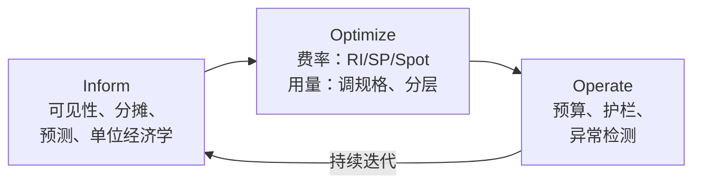
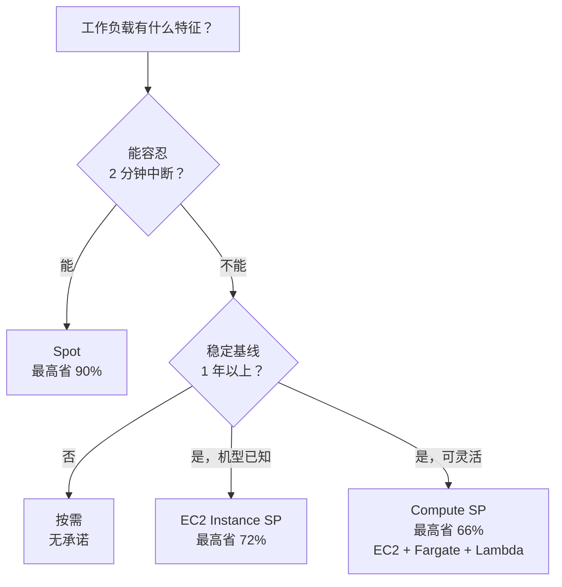
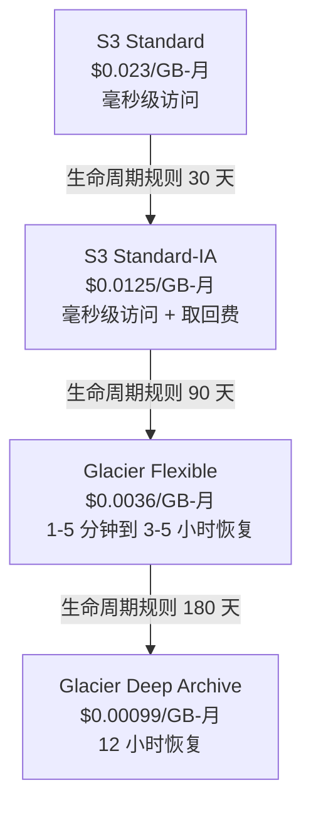
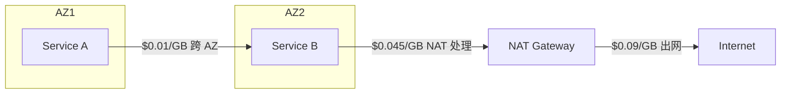

# 成本优化与 FinOps

> **TL;DR**: 云厂商的定价是刻意做成多维的：仅 AWS 一家就有 750+ 种实例类型、四种购买模式，而且每一个跨越可用区（AZ）边界（每个方向 $0.01/GB）或离开区域的字节都要单独计费（$0.09/GB）[^1]。FinOps 就是把这种复杂度变成可管理 KPI 的运营模型。这门实践按三个阶段循环（Inform、Optimize、Operate）[^2]，而影响最大的文化转变，是让成本对每个团队、每笔业务交易都可见。能看见自己成本的工程师会去优化它；看不见的工程师不会。

## 学习目标

学完本模块，你将能够：

- [ ] 计算一个服务的单位经济学（每用户成本、每笔交易成本）
- [ ] 运用三大折扣杠杆：Spot、预留实例（Reserved Instances）、Savings Plans
- [ ] 设计既照顾成本又照顾可靠性的自动扩缩容策略
- [ ] 在热、温、冷三层之间实现存储分层，并配上可度量的 SLO
- [ ] 识别并消除五种最常见的成本反模式（僵尸资源、跨 AZ 高频互调、未打标的支出、过度配置的数据库、Spot 机型不够分散）

## 直觉理解

你经营一家餐厅。每天晚上你要为明天备料。备多了，食材在冷库里烂掉（预留冗余）；备少了，客人只能被拒之门外（限速）。聪明的厨师会记录每晚的客数，知道周五会翻倍，于是在周三就预订周五多出来的量（承诺折扣），还会在当天从农夫市集买特价食材，打七折——因为农夫宁愿便宜卖掉也不愿扔掉（Spot 定价）。

但厨师看不见的东西就优化不了。如果副厨师长拿着餐厅的卡去买松露油却不告诉任何人，月度损益表上就会出现一笔神秘的“杂项”支出。解决办法不是换一套更花哨的订货系统，而是把每笔采购关联到某道菜，算出每盘成本，写在厨房白板上。一旦团队看到松露烩饭每盘成本 $14、售价 $16，他们要么涨价，要么砍掉这道菜。

云成本是同一回事。你的“食材”是计算小时、存储字节和网络传输；你的“菜品”是面向用户的功能；你的“白板”是成本分摊仪表盘；而你的“农夫市集特价”是随时可能在 2 分钟通知后消失的 Spot 实例。本章余下部分会把每个杠杆讲精确、把节省量化，并指出每个杠杆在哪里会失效。

## 原理

### FinOps 生命周期

FinOps Foundation 把这门实践定义为：通过工程、财务和业务团队之间数据驱动的协作，从技术中最大化业务价值[^3]。2024 年的框架修订把范围从“云”扩展到任何按用量计费的技术（公有云、SaaS、数据中心、AI 服务），并正式确立了三个迭代阶段[^2][^4]：

*FinOps Foundation 的 Inform-Optimize-Operate 循环；团队持续迭代，而不是做一次性的成本项目。*

**Inform** 指可见性与分摊。每个资源在创建时就打上标签（团队、服务、环境、成本中心）。标签流入账单导出数据。FOCUS 规范（v1.3 于 2025 年 12 月批准，建立在 2023 年 11 月的 v1.0 之上）把 AWS、Azure、GCP 的账单数据统一格式，使“这个服务上个月花了多少”成为一条可移植的查询，而不是针对某个厂商的取证式排查[^5]。Showback 把按团队的账单公示出来；chargeback 则真的在内部向他们收费。通常光靠 Showback 就足以改变行为。

**Optimize** 指拉动费率杠杆（承诺、Spot）和用量杠杆（调规格、分层、删掉浪费）。工程工作主要在这里。

**Operate** 指持续治理：预算、异常告警、强制执行打标的自动化，以及定期检查承诺利用率。

### 单位经济学：真正重要的指标

没有分母的原始云支出毫无意义。当 Airbnb 开始追踪“每间夜预订成本”、Lyft 追踪“每单行程成本”时，优化就不再是周期性项目，而变成了一个持续交付的指标[^6][^7]。这种从“项目”到“KPI”的转变，就是实践中“做 FinOps”的含义。

尽早定义你的单位指标：

- **SaaS**：每个活跃用户每月的成本
- **Marketplace**：每笔交易的成本（预订、行程、订单）
- **API 产品**：每 1,000 次 API 调用的成本
- **ML 平台**：每次推理的成本

把它和延迟、错误率放在一起追踪。当单位成本在没有对应新功能上线的情况下走高，就说明有问题。

### 折扣杠杆

云厂商提供三种基于承诺的定价模式，用灵活性换折扣：

*按工作负载形态选购买模式：灵活性、承诺、中断容忍度三者取一。*

**Spot 实例**使用 EC2 的空闲容量，价格最多比按需低 90%。代价是：AWS 可以在提前 2 分钟通知后收回[^8]。Spot 适合批处理任务、ML 训练、CI/CD 集群和无状态的 Kafka 消费者。Lyft Level 5 把其自动驾驶计算集群的 77% 跑在 Spot 上[^9]。关键的工程要求是跨 3 个以上 AZ、5 种以上实例类型做分散，并在 SIGTERM 信号上挂一个优雅退出处理器。

**预留实例（Reserved Instances）**承诺在某个区域使用特定实例族 1 年或 3 年，最高省 72%[^10]。它不灵活：中途迁到 Graviton，你仍要为用不到的容量付钱。

**Compute Savings Plans** 承诺每小时一定金额的支出，1 年或 3 年，最高省 66%。它自动适用于任何区域、任何实例族的 EC2、Fargate 和 Lambda[^10]。这种灵活性使它成为成熟工作负载的默认推荐。行业调研显示，承诺覆盖率的中位数仍远低于 80% 到 85% 的推荐目标，等于白白放着不少钱没捡[^11]。

### 规格调整、Karpenter 与 Graviton

[自动扩缩容与容量规划](../part-6-reliability-and-operations/04-auto-scaling-capacity.md)介绍了 HPA、VPA 和 Cluster Autoscaler。成本优化在它之上加了一个更紧的闭环：Karpenter 监视无法调度的 Pod，开出能装下的最便宜实例类型，并持续做合并。当 20 个 Pod 缩到 10 个时，Karpenter 驱逐一个节点，把 Pod 重新调度到剩余节点上。各组织报告通过合并显著降低了节点成本，常见区间是 20% 到 60%[^12][^13]。

**Graviton**（AWS 基于 ARM 的芯片）比同等 x86 实例的性价比高 20% 到 40%[^14]。Pinterest 到 2024 年中把 25%+ 的计算迁到 Graviton，其核心 API 集群实现了 47% 的工作负载成本下降和 38% 的计算资源减少[^15]。迁移需要重新编译原生依赖（大多数 JVM、Python 和 Go 工作负载可原样运行）。

**调规格（right-sizing）**指让资源请求匹配实际用量。Duolingo 发现一些服务在分配内存的 90% 到 95% 上跑得很轻松，也就是说他们一直在为从未用到的余量付钱[^16]。VPA 可以自动化这件事，但人工季度评审仍然常见。

### 存储分层

S3 各存储类之间的每 GB-月价格跨度达 23 倍：

*S3 存储类的价格跨度达 23 倍；越便宜，访问延迟和取回费越高。*

S3 Intelligent-Tiering 根据访问模式在热、温、冷层之间自动搬移对象，冷数据最多省 95%，且不收取出费[^17]。权衡是：每个对象有一笔很小的监控费，对极小的对象来说这笔费用反而占了大头。

数据库方面，DynamoDB 按需模式按请求计费（us-east-1 中强一致读约 $0.125/百万次、最终一致读约 $0.0625/百万次、写约 $0.625/百万次），而配置模式加预留容量，在利用率稳定高于约 40% 时最多便宜 77%[^18]。当 I/O 支出占比超过约 25% 时，Aurora I/O-Optimized 比 Aurora Standard 更便宜——这让 Duolingo 在单个数据库上“一年省下几十万美元”[^16]。

块存储方面，EBS gp3 提供 3,000 IOPS 和 125 MB/s 的基线，成本比 gp2 低 20%，对大多数工作负载没有性能损失。

### 网络成本：藏得最深的那一项

出网流量在 Cost Explorer 里藏在“EC2-Other”下面，Corey Quinn 称它是最常见的 5 万到 50 万美元级成本意外类别[^19]。这笔费用出现在：

| 传输类型 | 成本 | 缓解手段 |
|---|---|---|
| 跨 AZ（同区域） | 每个方向 $0.01/GB | AZ 亲和路由，把高频互调的服务放在一起 |
| 互联网出网（前 10 TB） | $0.09/GB | CDN（CloudFront $0.085/GB，带缓存） |
| NAT Gateway 处理 | $0.045/GB | 为 S3/DynamoDB 用 VPC 端点 |
| 跨区域复制 | $0.02/GB（视区域对而定） | 复制前先压缩，降低频率 |

Duolingo 发现一个遗留服务每天发起 21 亿次不必要的跨服务 API 调用[^16]。按每个方向 $0.01/GB 算，哪怕载荷很小，累积起来也很快。

*每个字节都要花钱：跨 AZ 每个方向 $0.01/GB、NAT 处理 $0.045/GB、互联网出网 $0.09/GB——这些费用会叠加在同一次出站请求上[^1][^19]。*

**零出网费的厂商**如 Cloudflare R2 对出网收 $0，在出网密集的工作负载上可省 99%（100 TB 每月 $1,500，而把出网算进去的 S3 要 $4,600 以上）[^20]。权衡是：生态集成和合规认证不如 S3 多。

Netflix 用 Open Connect 在极端规模上解决了出网问题：数千台定制缓存设备免费嵌在 1,000 多个位置的 ISP 网络里，以数十 Tbps 承载 Netflix 全部视频流量，过境成本实际为零[^21]。

## 真实案例

### Duolingo：几个月内云支出降低 20%

2024 年，Duolingo 的基础设施团队实现了云支出年化降低 20%，“一年省下数百万美元”[^16]。做法有条理，而不是靠拼命：

**阶段一（Inform）：** 他们部署 CloudZero 做逐条明细拆分，把覆盖范围扩展到非 AWS 支出（OpenAI API 费用），把云成本接入现有的指标体系，并每周向工程团队发送成本报告。

**阶段二（Optimize）：** 三条工作流并行推进：

1. **删除闲置资源** —— 老旧的 ElastiCache 集群、整个数据库，以及一个完整的微服务，它的负责人早已忘了这些技术债的价钱。
2. **减少为数据付的钱** —— 关掉不必要的 S3 版本备份，给 DynamoDB 加 TTL 让陈旧记录自动过期，缩短冗长的 CloudWatch 日志保留期。
3. **调规格、调参数** —— 降低内存分配以贴合 90% 到 95% 的实际用量，减少 ECS 任务数，把 ETag 缓存 TTL 从 1 分钟延长到 1 小时（下游服务流量因此减少 60% 以上）。

**阶段三（Operate）：** 为无法跑在 Spot 上的基线 EC2、RDS 和 ElastiCache 计算购买预留实例，并把一个高 I/O 数据库切到 Aurora I/O-Optimized。

关键洞察：把云成本变成和延迟、错误率并列的工程可见指标，行为就变了，不需要任何强制命令。

## 权衡

| 杠杆 | 节省 | 风险 | 适用场景 | 我们的选择 |
|---|---|---|---|---|
| Spot/抢占式实例 | 最高 90% | 2 分钟收回通知 | 批处理、无状态、可做检查点 | 所有容错工作负载的默认选择 |
| Compute Savings Plans | 最高 66% | 1-3 年承诺 | 成熟、灵活的工作负载 | 默认承诺载体（优先于 RI） |
| 预留实例 | 最高 72% | 机型锁定、不灵活 | 机型已知、基线稳定 | 仅当机型锁定 3 年以上时 |
| 自动扩缩容 + Karpenter | 20-60% | 延迟尖峰、Pod 频繁重建 | 负载波动、无状态 Pod | 常开并启用合并 |
| 存储分层 | 冷数据最高 95% | 取回延迟（分钟到小时） | 合规归档、备份、日志 | 访问模式不确定时用 Intelligent-Tiering |
| Graviton 迁移 | 20-50% | 需重新编译原生库 | API 服务、JVM、Python、Go | 新工作负载的默认实例族 |
| 避免出网（R2、CDN、VPC 端点） | 视情况，最高 99% | 生态缺口 | 高频互调的服务、出网密集的存储 | VPC 端点始终用；非受监管出网用 R2 |

## 常见陷阱

> [!WARNING]
> **僵尸资源。** 老旧的 ElastiCache 集群、未挂载的 EBS 卷、没人记得扩过容的预发环境，仍然按小时全额计费。在 IaC 层强制必填标签（OPA、cloud-custodian），并定期跑清理审计。Duolingo 发现过整个微服务的负责人都已经离职了[^16]。

> [!WARNING]
> **跨 AZ 高频互调。** 默认的服务发现会挑任意一个健康实例，不管它在哪个 AZ。峰值时一条 10 Gbps 的跨 AZ 流量每小时约 $2,600。在服务网格里用 AZ 亲和路由，并把高频互调的服务成对部署在一起。

> [!WARNING]
> **未打标的支出。** 如果 20% 到 40% 的支出无法归属到团队，优化就是瞎猜。用 Service Control Policies 阻止不带必填标签的资源创建。目标：资源创建后 7 天内标签覆盖率达到 95%+。

> [!WARNING]
> **承诺利用率不足。** 买了 3 年期 m5.4xlarge 的 EC2 Instance Savings Plan，6 个月后迁到 Graviton，等于为用不到的容量付钱。默认用 Compute Savings Plans（跨实例族、区域、Fargate、Lambda 都灵活），并把承诺做成阶梯，让每个月有 1/12 到期。

> [!WARNING]
> **什么时候不该先优化成本。** 不要在可靠性关键路径上（支付处理、认证）优化成本，不要在还在找产品市场契合的早期创业公司里做，也不要对不重复的一次性工作负载做。花在一个每月 $200 的服务上的工程师工时，比省下的钱更值钱。

## 练习

你的服务在 100 万 DAU 下每月花 $50K，线性关系为每百万 DAU $50。管理层希望下个季度在同样的可靠性下做到每月 $30K。请走一遍优化方案：先量什么、按什么顺序拉哪三个杠杆、什么不碰（以及为什么），以及你会向管理层汇报哪个指标来证明可靠性 SLO 守住了。为每项改动估算工程师工时。

提示

从可见性开始（按服务、按资源类型的支出拆分是什么样？）。ROI 最高的杠杆通常是承诺覆盖率，因为它不需要任何架构改动。然后找僵尸资源。最后才考虑 Spot 或分层这类架构动作。

解答

**第 1 步：度量（第 1 周，约 20 工程师工时）。** 部署成本分摊打标。把 $50K 拆成计算、存储、网络和数据库。找出前 3 个成本中心。算出当前的承诺覆盖率。

**第 2 步：承诺覆盖（第 2 周，约 10 工程师工时）。** 如果覆盖率低于 80%，购买 Compute Savings Plans 覆盖稳定基线。被覆盖部分打 66% 折扣，覆盖 $30K 计算账单的 60% 大约每月省 $12K。这是无聊但高回报的第一步。

**第 3 步：删除与调规格（第 3-4 周，约 40 工程师工时）。** 审计僵尸资源（14 天内 CPU < 5%）。对过度配置的 RDS 实例做压测后降一档规格。典型节省：剩余支出的 10% 到 20%。

**第 4 步：不要碰。** 不要把支付服务迁到 Spot（可靠性关键）。不要在只有 4 周流量数据的情况下，为 DynamoDB 按需模式还是配置模式去重构数据模型。不要优化每月 $200 的预发环境。

**SLO 证明：** 每次改动前后都汇报同样的 p99 延迟、错误率和可用性百分比。每周发布仪表盘，展示每 DAU 成本从 $0.05 降到 $0.03，而 SLI 指标持平。

**总计：4 周内约 70 工程师工时，预计每月省 $20K（每年 $240K）。** ROI 很清楚，但前提是先度量。

## 要点回顾

- 看不见的东西优化不了。打标和成本分摊要先于任何其他动作。
- 单位经济学（每用户成本、每笔交易成本）是那个把成本从财务问题变成工程 KPI 的指标。
- Compute Savings Plans 是无聊但高回报的第一步：最高省 66%，零架构改动，跨实例族完全灵活。
- Spot 实例最高省 90%，但要求容错架构：跨 5 种以上实例类型分散、处理 2 分钟的 SIGTERM、绝不把有状态服务放在裸 Spot 上。
- 对归档数据来说，存储分层是“白捡的钱”，因为各 S3 存储类的持久性完全相同。
- 出网是藏得最深的那一项。跨 AZ 流量每个方向 $0.01/GB，在高频互调的微服务架构里累积得很快。
- FinOps 是一种文化纪律，不是一个季度项目。能看见自己团队成本的工程师会去优化它；看不见的就不会。

## 延伸阅读

- [FinOps Foundation：什么是 FinOps](https://www.finops.org/introduction/what-is-finops/) —— 运营层面的定义与治理模型；如果你刚接触 FinOps，从这里开始。
- [FOCUS 规范 v1.3](https://focus.finops.org/focus-specification/v1-3/) —— 跨云账单归一化标准，让多云成本查询可以移植。
- [Duolingo：我们如何把云支出降低 20%](https://blog.duolingo.com/reducing-cloud-spending/) —— 近期最好的实操手册，具体列出该删什么、调什么、承诺什么。
- [DHH：退出云，五年可省 700 万美元](https://world.hey.com/dhh/we-stand-to-save-7m-over-five-years-from-our-cloud-exit-53996caa) —— 稳定可预测的 SaaS 工作负载回迁自建的理由；要批判性地读，注意让它成立的那些狭窄条件。
- [Pinterest Graviton 案例](https://aws.amazon.com/solutions/case-studies/pinterest-graviton3-case-study/) —— 集群规模的 ARM 迁移，成本降 47%，每请求碳排放降 62%。
- [Corey Quinn：理解 AWS 的数据传输计费](https://www.duckbillgroup.com/understanding-data-transfer-in-aws/) —— 出网问题最权威的梳理；下次多 AZ 架构评审前先读一遍。
- [Cloud FinOps（第 2 版，O'Reilly）](https://www.oreilly.com/library/view/-/9781492098348/) —— J.R. Storment 与 Mike Fuller 的教科书式著作；涵盖组织模型与成熟度框架。
- [OpenCost 项目](https://www.opencost.io/) —— CNCF 孵化中的开源 Kubernetes 成本分摊工具；配合 Kubecost 可做按命名空间的实时成本。

## 记忆卡片

**Q:** FinOps 生命周期的三个阶段是什么？
**A:** Inform（可见性与分摊）、Optimize（费率与用量杠杆）、Operate（预算、护栏、异常检测）。团队持续迭代。

**Q:** Spot 实例相对按需实例的最大折扣是多少？
**A:** 相对按需价格最高省 90%，但实例可能在 2 分钟通知后被收回。要求工作负载容错、可做检查点。

**Q:** Compute Savings Plans 和 EC2 Instance Savings Plans 有什么区别？
**A:** Compute Savings Plans（最高省 66%）灵活适用于 EC2、Fargate、Lambda、任意区域、任意实例族。EC2 Instance Savings Plans（最高省 72%）锁定在特定区域的特定实例族。

**Q:** 在 AWS 上跨 AZ 数据传输要多少钱？
**A:** 每个方向 $0.01/GB（往返即 $0.02/GB）。对部署在多个 AZ 的高频互调微服务来说，这笔钱涨得很快。

**Q:** S3 各存储类之间的价格跨度是多少？
**A:** 23 倍：从 $0.023/GB-月（Standard）到 $0.00099/GB-月（Glacier Deep Archive）。价格越低，访问延迟和取回费越高。

**Q:** DynamoDB 配置模式在什么利用率阈值上胜过按需模式？
**A:** 峰值利用率高于约 40% 时，配置模式加自动扩缩容更划算。高于约 70% 时，配置模式加预留容量更划算（最多便宜 77%）。

**Q:** FOCUS 规范是什么？
**A:** FOCUS v1.3（2025）是 FinOps Foundation 的开放标准，用来把 AWS、Azure、GCP 的账单数据归一化，使一套查询就能分析各厂商的成本。

**Q:** 为什么单位经济学（每用户成本、每笔交易成本）比原始云支出更有用？
**A:** 原始支出会随着业务成功而增长。单位经济学揭示效率：如果每用户成本在没有新功能上线的情况下上升，就有问题。它把成本变成与延迟、错误率并列的工程 KPI。

**Q:** Pinterest 迁到 Graviton 取得了什么成果？
**A:** 到 2024 年中，其核心 API 集群实现工作负载成本降 47%、计算资源减少 38%、每个 API 请求的碳排放降 62%。

**Q:** 举三个云成本可见性工具。
**A:** AWS Cost Explorer（原生）、OpenCost/Kubecost（Kubernetes 原生，CNCF）、CloudZero 或 Vantage（第三方，支持多云与按服务归属）。

**Q:** 什么时候不该先优化成本？
**A:** 在可靠性关键路径上（支付、认证）、在还在寻找产品市场契合的早期创业公司、以及在工程师工时超过潜在节省的不重复一次性工作负载上。

**Q:** 推荐的承诺覆盖率目标是多少？
**A:** 稳态支出的 80% 到 85% 应由 Savings Plans 或预留实例覆盖。行业调研显示，覆盖率中位数仍远低于这个目标，等于白白放着不少钱没捡。

## 参考文献

[^1]: AWS, "Optimizing data transfer costs when using AWS Network Load Balancer". https://aws.amazon.com/blogs/networking-and-content-delivery/optimizing-data-transfer-costs-when-using-aws-network-load-balancer/
[^2]: FinOps Foundation, "FinOps Phases". https://framework.finops.org/framework/phases/
[^3]: FinOps Foundation, "What is FinOps". https://finops.org/introduction/what-is-finops
[^4]: FinOps Foundation, "Evolving the Framework with the Practice of FinOps (2024 revisions)". https://www.finops.org/insights/2024-finops-framework/
[^5]: FOCUS, "FOCUS Specification v1.3". https://focus.finops.org/focus-specification/v1-3/
[^6]: Jennifer Rice and Anna Matlin, Airbnb Engineering, "Our Journey Towards Cloud Efficiency". https://web.archive.org/web/20241203120646/https://medium.com/airbnb-engineering/our-journey-towards-cloud-efficiency-9c02ba04ade8
[^7]: AWS, "Lyft Uses AWS Cost Management to Cut Costs by 40% in 6 Months". https://web.archive.org/web/20230522183609/https://aws.amazon.com/solutions/case-studies/lyft-cost-management/
[^8]: AWS, "Best practices for Amazon EC2 Spot". https://docs.aws.amazon.com/AWSEC2/latest/UserGuide/spot-best-practices.html
[^9]: AWS, "Lyft Level 5 Case Study (77% Spot)". https://web.archive.org/web/20240119193008/https://aws.amazon.com/solutions/case-studies/Lyft-level-5-spot/
[^10]: AWS, "Compute Savings Plans". https://aws.amazon.com/savingsplans/compute-pricing/
[^11]: FinOps Foundation, "State of FinOps 2024: Top Priorities Shift to Reducing Waste and Managing Commitments". https://www.finops.org/insights/key-priorities-shift-in-2024/
[^12]: AWS Containers Blog, "Applying Spot-to-Spot consolidation best practices with Karpenter". https://aws.amazon.com/blogs/compute/applying-spot-to-spot-consolidation-best-practices-with-karpenter/
[^13]: Lukonde Mwila, AWS Containers Blog, "Optimizing your Kubernetes compute costs with Karpenter consolidation". https://aws.amazon.com/blogs/containers/optimizing-your-kubernetes-compute-costs-with-karpenter-consolidation/
[^14]: AWS, "How potential performance upside with AWS Graviton helps reduce your costs further". https://aws.amazon.com/blogs/compute/how-potential-performance-upside-with-aws-graviton-helps-reduce-your-costs-further/
[^15]: AWS, "Improving Sustainability and Price Performance Using AWS Graviton-Based Instances with Pinterest". https://aws.amazon.com/solutions/case-studies/pinterest-graviton3-case-study/
[^16]: Julie Wang and Virginia Cheng, Duolingo Engineering, "How we reduced our cloud spending by 20%". https://blog.duolingo.com/reducing-cloud-spending/
[^17]: AWS, "Automatically archive and restore data with Amazon S3 Intelligent-Tiering". https://aws.amazon.com/blogs/storage/automatically-archive-and-restore-data-with-amazon-s3-intelligent-tiering/
[^18]: AWS Database Blog, "Choose the right throughput strategy for Amazon DynamoDB applications". https://aws.amazon.com/blogs/database/choose-the-right-throughput-strategy-for-amazon-dynamodb-applications/
[^19]: Corey Quinn, The Duckbill Group, "Understanding Data Transfer in AWS". https://www.duckbillgroup.com/understanding-data-transfer-in-aws/
[^20]: Vantage, "Storage Wars: Cloudflare R2 vs Amazon S3". https://www.vantage.sh/blog/cloudflare-r2-aws-s3-comparison
[^21]: Netflix, "Open Connect overview". https://openconnect.netflix.com/en/
