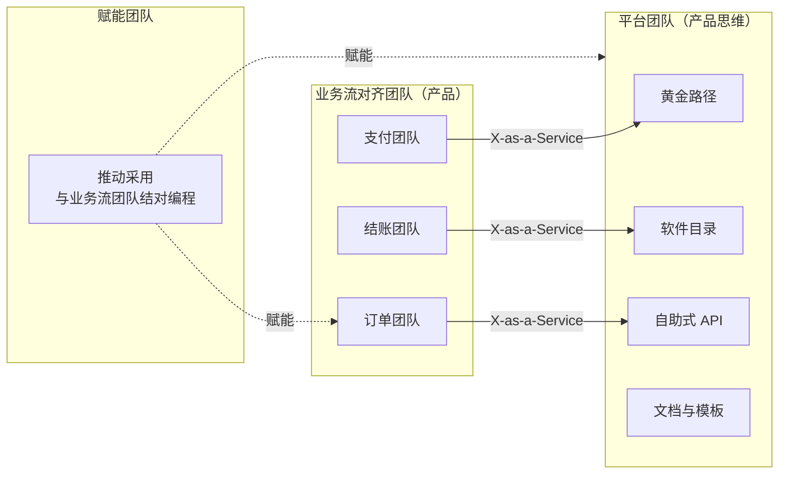
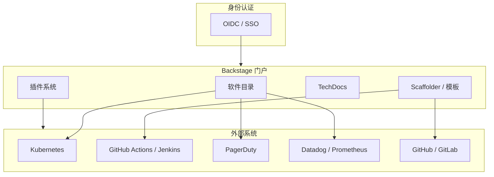
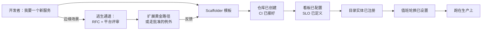
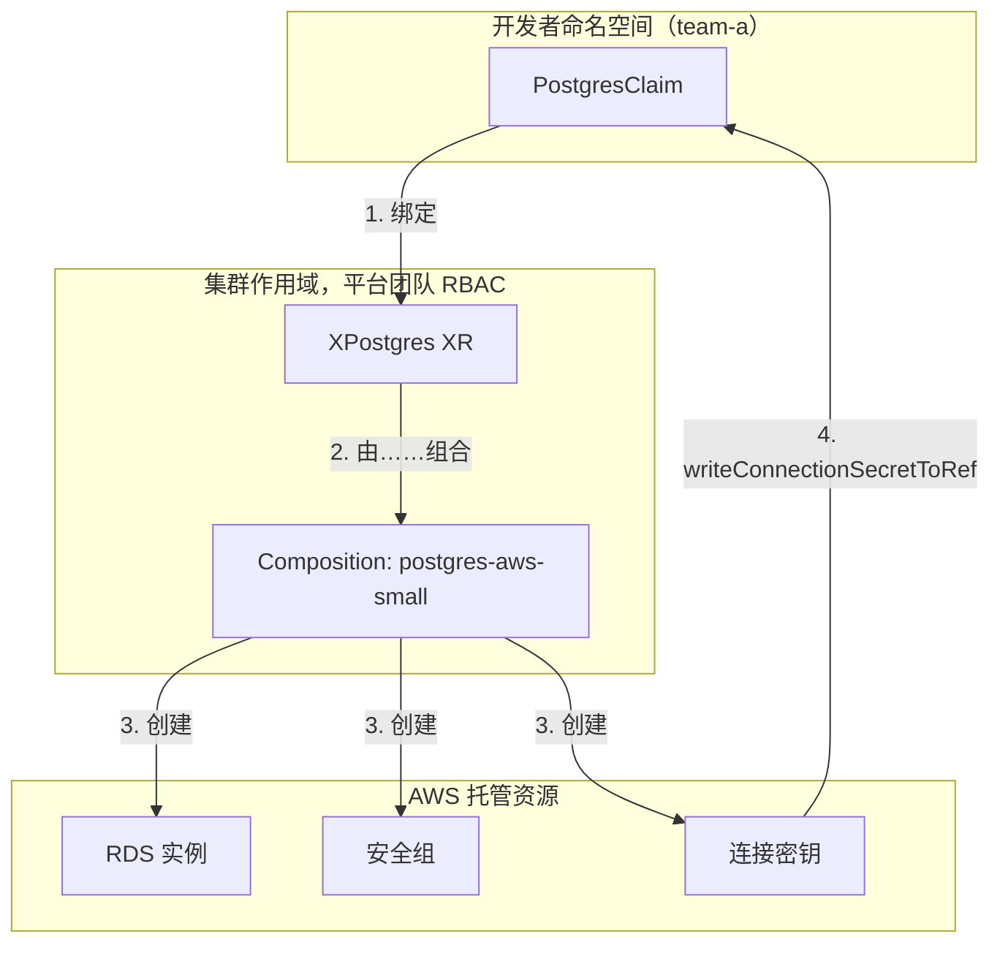

# 平台工程：IDP、黄金路径与 DX

> **TL;DR**: 平台工程把内部开发者平台（internal developer platform，IDP）当产品来经营：工程师是客户，自助服务是默认的交付方式。CNCF 平台工作组把平台定义为“按平台用户的需求来定义和组织的一组集成能力”[^1]。黄金路径（golden path，Spotify 的说法）为 80% 的常见场景提供有明确主张、有官方支持的默认做法；剩下的走逃生通道（escape hatch）。衡量结果用 DORA 的四项指标，衡量人的体验用 SPACE。Gartner 在 2023 年预测，到 2026 年 80% 的大型软件工程组织都会拥有平台团队[^2]；行业调研显示采用率正朝这个目标靠拢。真正难的不是选 Backstage 还是 Port，而是目录纪律、模板维护，以及那套产品管理心态——没有它，平台迟早沦为一个工单队列。

## 学习目标

学完本章，你将能够：

- [ ] 区分 DevOps（共担责任）与平台工程（专职团队、平台即产品）
- [ ] 根据组织规模判断该上 Backstage，还是脚本加文档就够了
- [ ] 设计一条带逃生通道的黄金路径，且不会把平台分叉出无数变体
- [ ] 针对团队所处阶段选对开发者体验指标（DORA、SPACE、首次提交时间）

## 直觉理解

你搬进一栋新公寓楼。楼里有个礼宾台。你不用自己去找水管工、电工、开锁师傅。走到台前说一句“我家水槽漏水”，一小时内就有经过审核的水管工上门。你当然也可以自己叫人来修，但那样施工就不在物业保修范围内了。

再想象礼宾台被压垮了：三天才回一句话。住户开始自己找人，电工没经过任何审核就进楼，整栋楼的线路很快变成一堆互不兼容的乱摊子。礼宾台失败不是因为“设礼宾台”这个想法错了，而是因为这栋楼把它当成本中心，而不是一项服务。

平台工程就是软件团队的礼宾台。平台团队把自助工具（黄金路径）做出来，产品工程师就不必同时兼任 Kubernetes 专家、CI/CD 专家和合规审计员。平台是产品，工程师是它的客户。做得好，认知负荷下降，团队交付变快；做砸了，它变成一个工单队列，比没有平台还糟。

[单体 vs 微服务](../part-5-architecture-patterns/00-monolith-vs-microservices.md) 讲清了微服务带来的组织复杂度。[可观测性](../part-6-reliability-and-operations/00-observability.md) 说明了埋点如何横穿每一条服务边界。本章处理的是上一层的问题：所有团队都依赖的共享基础设施，由谁来建、谁来养？以及，怎么把这摊事当成产品来运营，而不是做成一个衙门？

## 原理

### 平台工程与 DevOps 的区别

DevOps 是一种文化实践：构建系统的人负责运行系统。“你构建，你运行”把责任均摊到每个团队。这套做法在技术栈只有单体应用、一台 CI 服务器和一台虚拟机的时候很管用。可当每个团队都得同时精通 Kubernetes、Terraform、CI/CD 流水线、OTLP 埋点、SBOM 生成、OIDC 联邦和 SOC 2 合规时，它就不成立了。

平台工程加的是一个专职团队，它的产物是“给其他所有团队用的开发者体验”。差别不在态度，而在组织架构这个客观事实：平台团队有产品经理、有路线图、做用户调研、看采用率指标、还有 NPS 分数。Team Topologies（Skelton 与 Pais，2019）明确把这种团队归类为 **平台团队（Platform team）**，它以 **X-as-a-Service** 模式与业务流对齐的产品团队交互[^3]。平台对外提供自助式 API 和黄金路径，不接“帮我部署一下”这种单子。

Team Topologies 警告的反模式，是那种退化成工单队列的“DevOps 团队”——每一处变更都要过它，结果比纯 DevOps 还糟[^3]。一个团队连申请个数据库都要提 Jira 工单，那不叫平台，那叫运维换了个名字。



*业务流对齐团队通过自助服务消费平台（X-as-a-Service 交互模式）。赋能团队推动采用，但不会变成永久依赖。平台团队永远不会退化成一个工单队列。*

### Backstage：事实上的开源 IDP

Spotify 在内部用了 Backstage 好几年，直到 2020 年 3 月 16 日才将其开源[^4][^5]。2020 年 9 月捐给 CNCF，成为 Sandbox 项目[^6]，2022 年 3 月进入孵化（Incubation）阶段[^5]。到 2025 年 4 月，Spotify 称已有 3000 多家公司用 Backstage 搭建自己的 IDP[^4]；公开的 `ADOPTERS.md` 里点名了 200 多家公司，包括 American Airlines、Netflix、LinkedIn、LEGO、Zalando、Monzo（收录了 2000 多个微服务）、HelloFresh（500 多名工程师）和 Expedia[^7]。

Backstage 有四大支柱：

- **软件目录（Software Catalog）**——每个服务、库、数据管道和 ML 模型都登记在册，带上负责人、生命周期、依赖关系、SLO 和各类集成注解。这是整个平台的骨架。没有它，谁都回答不了“这个服务谁负责、出事了该找谁”。
- **软件模板（Scaffolder）**——“新建一个 Go 微服务”就能生成一个仓库，CI、可观测性、部署流水线、目录实体和值班登记全都预先配好。
- **TechDocs**——基于 MkDocs 的文档即代码，直接从服务仓库渲染。文档就住在它所描述的那份代码旁边。
- **插件架构**——对接 Kubernetes、PagerDuty、Datadog、SonarQube、GitHub Actions、Jenkins，社区插件有 150 多个。



*Backstage 是框架，不是成品。软件目录是核心，插件把它接到开发者日常接触的每个系统上。缺了目录纪律，它就会退化成一个谁都不信的 wiki。*

替代品也不少：Port（商业产品，无代码门户搭建器）、OpsLevel、Cortex、Humanitec Portal、Roadie（托管版 Backstage）、Kratix（Kubernetes 原生的平台即产品框架）。选哪个其实没那么重要，重要的是纪律：你有没有一个带产品经理的平台团队在运营它？

### 黄金路径与逃生通道

黄金路径（Spotify 的叫法[^8]）或铺好的路（paved road，Netflix 的叫法[^9]），指的是从“我要一个新服务”到“带着 CI/CD、监控和基础设施跑在生产上”这条有明确主张、有官方支持的路。Spotify 公开介绍过七条黄金路径：后端工程、客户端开发、数据工程、数据科学、机器学习、Web，以及最近新增的音频处理[^8]。新工程师入职头两周要完成黄金路径的教程，这是入职流程的固定环节。

最要命的设计约束是：逃生通道必须有。Spotify 说得很直白：“如果你是个爱冒险的人，当然可以离开黄金路径自己搞，但这样你就得不到同样的支持”[^8]。CNCF 白皮书把这称为“可选且可组合”（optional and composable）[^1]。Netflix 的铺好的路不强制，而是把它做得比替代方案好太多，让团队自愿选它[^9]。

没有逃生通道的黄金路径，会带来怨气、影子 IT 和消极服从。没有维护的黄金路径，会在工具跑得比文档快的时候变成谎话。



*黄金路径把开发者从“我要一个服务”带到生产，只需几小时而不是几周。边缘场景走一条明确的逃生通道流程，其结论再回流成黄金路径的改进。*

### 开发者体验指标：DORA 与 SPACE

**DORA 的四项指标**（Forsgren、Humble、Kim，出自《Accelerate》）衡量软件交付的结果：部署频率、变更前置时间、变更失败率、失败部署恢复时间（以前叫 MTTR）[^10]。2024 年 DORA 报告调研了 39000 多名技术从业者，把团队分成精英、高、中、低四档[^10][^11]。Google 2024 年的报告确认“内部开发平台确实能提升开发者生产力”，但同时提醒平台成熟过程中会出现一段暂时的效率下滑[^12]。

**SPACE**（Forsgren、Storey 等，ACM Queue 2021）主张没有任何单一指标能刻画生产力。它定义了五个维度：满意度与身心健康（Satisfaction and well-being）、绩效（Performance）、活动量（Activity）、沟通与协作（Communication and collaboration）、效率与心流（Efficiency and flow）[^13]。SPACE 用满意度和心流，抵消那些一味追求活动量的反模式指标（代码行数、部署次数）。

**DevEx 框架**（Noda、Storey、Forsgren，2023）把开发者体验浓缩成三个维度：反馈回路、认知负荷、心流状态。

用 DORA 看结果，用 SPACE 看产出这些结果的人。CNCF 平台白皮书明确把两者并列使用[^1]。平台还该补几个专属指标：开通一个服务要多久、新人第一次提交生产变更要多久、平台 NPS。

要避开的有害指标：人均代码行数、把故事点当生产力、脱离上下文的裸“速率”。2024 年 DORA 报告指出，高绩效团队的变更失败率反而比中等绩效团队更高，因为这份报告考核的是改进趋势，而不是稳态水平[^10][^11]。

### 基础设施抽象：Crossplane 与 Score

两个项目很好地体现了“开发者声明意图，平台负责落地”这一模式：

**Crossplane**（2025 年 11 月成为 CNCF 毕业项目）用托管资源（managed resources）和 Composition 扩展 Kubernetes。平台团队定义 CompositeResourceDefinition（XRD）和一份 Composition，把前者映射到底层云资源。开发者创建带命名空间的 Claim：“给我一个 Postgres。”只有平台团队拥有 RBAC 权限，能直接创建集群级的复合资源[^14]。



*开发者只操作带命名空间的 Claim；只有平台团队有 RBAC 权限创建集群作用域的 XR。Composition 把 XR 映射为云上的托管资源，连接信息再回流到开发者的命名空间 [^14]。*

**Score** 是一个 CNCF Sandbox 的工作负载规范。开发者写 `score.yaml` 描述运行时需求（容器、资源、依赖）。Score 的实现 CLI 或平台编排器（Platform Orchestrator）再按部署环境把它翻译成 Kubernetes manifest、Helm、Docker Compose 或 Cloud Run[^15]。Humanitec 声称这套动态配置管理（Dynamic Configuration Management）能把一个十服务、四环境的应用从 300 多个静态配置文件压到十个左右[^15]。

两者的原则一致：开发者描述自己要什么，而不是怎么去开通。平台团队把“怎么开通”沉淀成可复用的 composition 和资源定义。

### 什么情况下不该建 IDP

十个工程师的初创公司去建 IDP，那是在模仿 Gartner 报告里的样子。那个规模下的诚实答案是：一个 monorepo、一个 Makefile、一份 README。差不多过了 20 名工程师，专职平台工作才开始回本。

| 组织规模 | 平台深度 | 团队 | 示例 |
|---|---|---|---|
| < 20 名工程师 | 脚本 + 文档，共享基础设施 | 没有平台团队 | 种子轮初创公司 |
| 20 到 100 | 有明确主张的 monorepo + 模板 | 1 到 3 名平台工程师 | B 轮 |
| 100 到 1000 | 完整 IDP（Backstage + 评分卡 + 自助服务） | 工程人数的 2-5% | 成长期 |
| 1000+ | 元平台（多个专业化平台） | 多个平台团队 | FAANG 量级 |

根据 Humanitec 2023 年的基准调研，成熟 IDP 的平台团队人数通常是工程总人数的 2% 到 5%[^17]。企业级规模上完整落地 Backstage，据称要 6 到 18 个月才能见到价值[^16]。别在 50 人的阶段上 1000 人规模的方案。

## 真实案例

### Spotify：Backstage 与黄金路径

Spotify 是教科书级的案例。Spotify 的第一条黄金路径教程（后端工程）最早是 Hack Week 项目，比 2020 年 8 月那篇把这个概念公开的博客早了大约六年[^8]。2020 年 3 月 16 日，Spotify 开源了 Backstage[^4][^5]。到 2020 年，Spotify 已有数百个微服务、几十个内部工具，以及一个碎片化难题：每个团队解决 CI、可观测性和部署的方式都不一样。Backstage 把开发者体验统一进一个门户。

软件目录成了骨架。每个服务在自家仓库里注册为一个 YAML 实体：

```yaml
apiVersion: backstage.io/v1alpha1
kind: Component
metadata:
  name: orders-service
  annotations:
    github.com/project-slug: acme/orders-service
    pagerduty.com/service-id: PX123
spec:
  type: service
  lifecycle: production
  owner: team-orders
  system: commerce
  dependsOn:
    - component:inventory-service
    - resource:orders-db
```

这个实体驱动评分卡（这个服务有负责人吗？有 runbook 吗？定义了 SLO 吗？）、依赖关系图，并贯穿所有插件。软件模板从一开始就把 CI、可观测性和部署接好再生成新仓库。新工程师入职头两周完成黄金路径教程[^8]。

Spotify 把 Backstage 捐给 CNCF，而不是留作单一厂商的项目，这既建立了生态信任，也避开了“企业开源项目被弃养”的坑[^6]。到 2025 年 4 月，Spotify 称已有 3000 多家公司采用 Backstage[^4]，公开的 `ADOPTERS.md` 上点名 200 多家[^7]。American Airlines 用 Backstage 搭了内部门户 Runway[^18]。Zalando 正在其上构建第二代内部开发门户。

诚实的教训是：Backstage 是框架，不是产品。没有平台团队维护模板、强制目录纪律、运行逃生通道流程，它就会退化成一个谁都不信的 wiki。Spotify 自己的团队也承认，那些教程“只是如实反映当前的黄金路径”，想保持简短就得持续维护[^8]。

## 权衡

| 平台深度 | 优点 | 缺点 | 适用场景 | 我们的选择 |
|---|---|---|---|---|
| 无平台（脚本 + 文档） | 零额外开销，迭代快 | 无法扩展；经验靠口口相传 | 不足 20 人的初创公司 | 从这里起步 |
| 轻量（有主张的 monorepo + 模板） | 成本低，覆盖 80% 的需求 | 集成能力有限，留有人工缺口 | 20 到 100 人 | 第一个平台岗 |
| 完整 IDP（Backstage + 评分卡 + 自助式 API） | 自助服务，几小时完成入职，合规内建 | 工程人力 2-5% 投在平台上，6-18 个月才见价值 | 100 到 1000 人 | 成长期公司的默认选项 |
| 元平台（多个专业化平台） | 各领域做到极致（基础设施、数据、ML、前端） | 协调开销大，集成接缝多 | 1000+ 人 | 只在 FAANG 量级考虑 |

## 常见陷阱

> [!WARNING]
> **平台变王国。** 平台团队卡住所有变更，产品团队为一个工单等上几周。这发生在交互模式从 X-as-a-Service 滑向对每个请求都做协作（Collaboration）的时候[^3]。解法：做真正的自助服务，度量“从提出需求到交付”的时长，并把它列为平台团队的 OKR。

> [!WARNING]
> **黄金路径没有逃生通道。** 有合理边缘需求的团队无法偏离，只能分叉。有人干脆跑去搭影子基础设施。解法：把逃生通道政策写明白（RFC 流程、平台评审、批准的例外）。Spotify 说得很直接：“如果你是个爱冒险的人，当然可以离开黄金路径”[^8]。

> [!WARNING]
> **闭门造平台。** 平台解决的是平台团队想象出来的问题，而不是产品团队真实的痛。解法：第一天就配产品经理，做用户访谈，OKR 盯采用率和 NPS，而不是功能数量[^1]。

> [!WARNING]
> **度量错了东西。** DORA 数字很漂亮，开发者却很痛苦。解法：把 DORA（结果）和 SPACE（体验）结合起来。2024 年 DORA 报告指出高绩效团队的变更失败率高于中等绩效团队[^10][^11]，正说明没有哪个单一指标能讲清全貌。

> [!WARNING]
> **平台团队人手不足。** 5 个人服务 500 名工程师，根本忙不过来。CNCF 白皮书警告，那些“把 IT 基础设施看作一笔开销”的领导者会给平台投不够钱，最终导致“承诺落空、士气低落”[^1]。按工程人数的 2-5% 配人，并给出独立的预算科目。

## 练习

为一个 200 名工程师、横跨 3 朵云、有 80 多个微服务的金融科技公司设计平台。第一个季度你要交付的 MVP 平台是什么？先做哪条黄金路径，为什么？两年路线图长什么样，你向管理层承诺哪些开发者体验指标，以及第一年明确不做什么？

<details>
<summary>提示</summary>

从最痛、最高频的开发者工作流开始。对一家有 80 多个服务的金融科技公司来说，“新建一个服务”和“部署到生产”很可能排在前两位。MVP 不是一个门户，而是一条能跑通的、覆盖单个工作流的黄金路径。想想第二季度你拿什么数据向管理层证明价值。

</details>

<details>
<summary>参考答案</summary>

**Q1 的 MVP：一条“新建服务”的黄金路径。**

上线一个 Backstage 实例，只带一个软件模板，它能生成新的服务仓库，并内置：CI 流水线（GitHub Actions）、Kubernetes manifest（Helm chart）、可观测性（OpenTelemetry SDK + Datadog exporter）、目录实体 YAML、PagerDuty 值班登记。目标：新服务从零到生产不超过 4 小时。

**为什么先做这条：** 它是杠杆最高的工作流。每个不走黄金路径创建的服务都在累积技术债（缺可观测性、没有目录条目、没人值班）。对金融科技公司来说，把合规要求（SBOM、依赖扫描）内建进模板本身就是监管层面的收益。

**平台团队：** 4 名工程师 + 1 名平台产品经理。正好是 200 名工程师的 2.5%。

**向管理层承诺的开发者体验指标：**

- DORA 变更前置时间（目标：第三季度前 < 1 天）
- 新人首次生产部署耗时（目标：第四季度前 < 5 天）
- 平台 NPS（季度调研，目标：> 40）
- 黄金路径采用率（目标：第四季度前 70% 的新服务用模板创建）

**第一年明确不做：** 不做自助式数据库开通门户。底层用 Crossplane 的 Claim，但只通过模板暴露，不单独做界面。在目录和黄金路径扎实之前，不要把手伸进基础设施自动化，防止范围蔓延。

**两年路线图：**

- Q2：加评分卡（生产就绪清单：SLO 已定义、有 runbook、值班已安排、有 SBOM）。发布采用率看板。
- Q3：第二条黄金路径“新增一个 API 端点”（schema 优先，自动生成客户端 SDK）。接入 OPA 策略做合规门禁。
- Q4：通过 Crossplane Claim 做自助式数据库开通。扩展到数据管道黄金路径。
- 第二年：多云抽象层（Score 或按云划分的 Crossplane composition）。平台级 DORA 看板。逃生通道 RFC 流程正式化。接受产品团队贡献的第三方插件。

</details>

## 要点回顾

- 平台工程不是 DevOps 换包装。它加的是一个专职团队，配产品经理，把平台当产品经营：有客户、有路线图、有采用率指标。
- 黄金路径只有在逃生通道可信时才成立。没有逃生通道，团队要么分叉，要么投向影子 IT。
- DORA 衡量交付结果；SPACE 衡量产出结果的人的体验。两个都要用。
- 平台深度必须匹配组织规模。把 1000 人规模的 IDP 硬塞给 50 人团队，那是收税，不是平台。
- Backstage 只是起点，不是答案。难的是目录纪律、模板维护和逃生通道政策。
- 平台团队按工程人数的 2-5% 配人，给独立预算，并且第一天就有产品经理。
- “最薄可行平台”可以只是一个带链接的 wiki 页面加几个脚本。只在某个具体团队有具体痛处的地方扩展它。

## 延伸阅读

- [CNCF Platforms White Paper](https://appdelivery.cncf.io/whitepapers/platforms) - 关于“什么是平台”“平台团队该度量什么”最清晰的公开定义，以及防止平台变王国的“可选且可组合”设计原则。
- [Team Topologies](https://teamtopologies.com/) by Skelton and Pais (2019) - 业务流对齐团队、平台团队、赋能团队、复杂子系统团队的经典框架，外加各种交互模式。组建平台团队之前的必读。
- [Spotify: How We Use Golden Paths](https://engineering.atspotify.com/2020/08/how-we-use-golden-paths-to-solve-fragmentation-in-our-software-ecosystem/) - 这个词的起源故事；成功要素清单和对维护负担的坦率承认都极有价值。
- [Netflix: Full Cycle Developers](https://netflixtechblog.com/full-cycle-developers-at-netflix-a08c31f83249) - 关于铺好的路与“你构建你运行”的经典文章。展示了集中式工具团队如何成为力量倍增器，而不变成工单队列。
- [The SPACE of Developer Productivity](https://queue.acm.org/detail.cfm?id=3454124) - Forsgren、Storey 等，ACM Queue 2021。对付“代码行数”式生产力指标的解毒剂；定义了每个平台团队都该度量的五个维度。
- [DORA State of DevOps 2024](https://dora.dev/research/2024/) - 基于 39000 多名受访者的年度基准。用它对照行业分档来校准你的 DORA 目标。
- [Backstage Documentation](https://backstage.io/) - 从 Software Catalog 和 Software Templates 两节读起。翻翻 ADOPTERS.md，看 200 多家在生产环境跑它的公司（Spotify 称截至 2025 年 4 月总采用者超 3000 家）。
- [CNOE (Cloud Native Operational Excellence)](https://cnoe.io/) - 用 CNCF 工具（ArgoCD、Backstage、Crossplane）搭 IDP 的多厂商参考架构。由 AWS、Adobe、Salesforce 等共同维护。

## 记忆卡片

**Q:** 平台工程与 DevOps 的区别在哪？
**A:** DevOps 是一种文化实践，让每个团队共担开发与运维责任。平台工程加的是一个专职团队，把平台当产品做，配产品经理、路线图、用户调研和采用率指标。平台提供自助服务，不接工单。

**Q:** Backstage 的四大支柱是什么？
**A:** 软件目录（带负责人、依赖、生命周期的服务登记表）、软件模板（新服务的脚手架）、TechDocs（从服务仓库生成的文档即代码），以及插件架构（Kubernetes、PagerDuty、Datadog 等 150 多个集成）。

**Q:** 什么是黄金路径，谁提出的？
**A:** 黄金路径（Spotify 的说法）是从“我要一个新服务”到“带着 CI/CD、监控和基础设施跑在生产上”的有主张、有支持的默认路线。它降低认知负荷，但边缘场景必须有明确的逃生通道政策。

**Q:** DORA 的四项关键指标是什么？
**A:** 部署频率、变更前置时间、变更失败率、失败部署恢复时间（以前叫 MTTR）。它们把团队分成精英、高、中、低四档。

**Q:** SPACE 在开发者生产力里代表什么？
**A:** 满意度与身心健康、绩效、活动量、沟通与协作、效率与心流。它用满意度和心流这两个维度，抵消那些一味追求活动量的反模式。

**Q:** 为什么黄金路径必须有逃生通道？
**A:** 没有逃生通道，有合理边缘需求的团队就会分叉平台，或者投向影子 IT。CNCF 白皮书要求平台“可选且可组合”。强制路线又不给偏离通道，只会带来怨气和消极服从。

**Q:** 平台团队规模相对工程人数应该是多少？
**A:** 成熟 IDP 下占工程总人数的 2-5%。200 名工程师的组织大致需要 4-10 名平台工程师，外加一名专职的平台产品经理。

**Q:** 什么时候不该建内部开发者平台？
**A:** 大约 20 名工程师以下，或者服务数量很少时。那个规模下 monorepo、Makefile 加一份 README 就够。托管 PaaS（Heroku、Railway、Render、Fly.io）也可能让自建 IDP 变得没必要。

**Q:** “平台变王国”这个反模式是什么？
**A:** 平台团队卡住所有变更，产品团队为工单等上几周。交互模式从 X-as-a-Service 滑向对每个请求都做协作，平台于是成了瓶颈，比没有平台还糟。

**Q:** Crossplane 的 Claim 如何把开发者和平台团队的关注点分开？
**A:** 开发者用简单参数创建带命名空间的 Claim（“给我一个 Postgres”）。只有平台团队有 RBAC 权限创建集群作用域的复合资源。Composition 把 Claim 映射到底层云资源（RDS、安全组、密钥），连接信息再回流到开发者的命名空间。

**Q:** 除了 DORA，还该跟踪哪些平台专属指标？
**A:** 开通一个服务或环境所需时间、新人提交第一次生产变更所需时间、黄金路径采用率，以及平台 NPS（开发者满意度调研）。

**Q:** 2024 年 DORA 报告发现高绩效团队在变更失败率上有什么特点？
**A:** 高绩效团队的变更失败率高于中等绩效团队。这说明没有任何单一 DORA 指标能讲清全貌，也印证了要把它和 SPACE 配对使用才有完整图景。

## 参考文献

[^1]: CNCF Platforms Working Group, "CNCF Platforms White Paper", April 2023. https://appdelivery.cncf.io/whitepapers/platforms
[^2]: Gartner, "Platform Engineering Empowers Developers to be Better, Faster, Happier"（付费墙；可访问摘要见 [^16]）. https://www.gartner.com/en/experts/top-tech-trends-unpacked-series/platform-engineering-empowers-developers
[^3]: Team Topologies, "Revisiting Team Topologies: Misuses of Platform Teams", newsletter, Nov 2024. https://teamtopologies.com/news-blogs-newsletters/2024/11/24/revisiting-team-topologies-misuses-of-platform-teams
[^4]: Spotify Engineering, "Celebrating Five Years of Backstage", April 2025. https://engineering.atspotify.com/2025/4/celebrating-five-years-of-backstage
[^5]: Backstage project README, CNCF Incubation status and pillars. https://github.com/backstage/backstage/blob/master/README.md
[^6]: Spotify Engineering, "Cloud Native Computing Foundation Accepts Backstage as a Sandbox Project", Sep 2020. https://engineering.atspotify.com/2020/9/cloud-native-computing-foundation-accepts-backstage-as-a-sandbox-project
[^7]: Backstage ADOPTERS.md, public adopters list. https://github.com/backstage/backstage/blob/master/ADOPTERS.md
[^8]: Niemen, G., "How We Use Golden Paths to Solve Fragmentation in Our Software Ecosystem", Spotify Engineering, Aug 17 2020. https://engineering.atspotify.com/2020/08/how-we-use-golden-paths-to-solve-fragmentation-in-our-software-ecosystem/
[^9]: Fisher-Ogden, P., Burrell, G., Marsh, D., "Full Cycle Developers at Netflix: Operate What You Build", Netflix Tech Blog, May 17 2018. https://netflixtechblog.com/full-cycle-developers-at-netflix-a08c31f83249
[^10]: DORA Research 2024 overview, dora.dev. https://dora.dev/research/2024/
[^11]: Matusov, L., "What are the latest benchmarks for the DORA four key metrics? (2024 DORA Report)", Research-Driven Engineering Leadership, Nov 12 2024. https://rdel.substack.com/p/rdel-68-what-are-the-latest-benchmarks
[^12]: Harvey, N. and DeBellis, D., "Highlights from the 10th DORA report" (2024 Accelerate State of DevOps), Google Cloud Blog, Oct 23 2024. https://cloud.google.com/blog/products/devops-sre/announcing-the-2024-dora-report
[^13]: Forsgren, N., Storey, M.-A., Maddila, C., Zimmermann, T., Houck, B., Butler, J., "The SPACE of Developer Productivity", ACM Queue, 2021. https://queue.acm.org/detail.cfm?id=3454124
[^14]: Crossplane docs v1.20, "Claims" and "Composite Resources". https://docs.crossplane.io/v1.20/concepts/claims/
[^15]: von Grunberg, K., "Implementing Dynamic Configuration Management with Score and Humanitec", Humanitec blog, Feb 16 2023. https://humanitec.com/blog/implementing-dynamic-configuration-management-with-score-and-humanitec
[^16]: Signisys, "Gartner Says 80% of Software Orgs Will Have Platform Teams by 2026", summarizing Gartner Hype Cycle for Platform Engineering 2024. https://www.signisys.com/blog/gartner-says-80-of-software-orgs-will-have-platform-teams-by-2026/
[^17]: Humanitec, "DevOps Benchmarking Study 2023", whitepaper (93% top performers use an IDP). https://humanitec.com/whitepapers/devops-benchmarking-study-2023
[^18]: "Implementing a developer portal at American Airlines" (interview on building the Runway Backstage portal at American Airlines), Engineering Enablement podcast. https://getdx.com/podcast/building-a-developer-portal/
