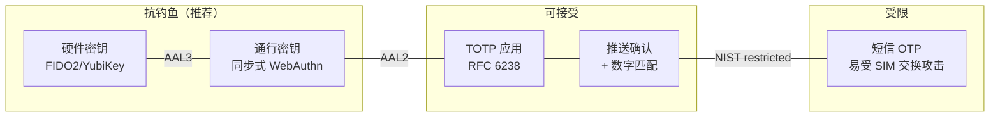
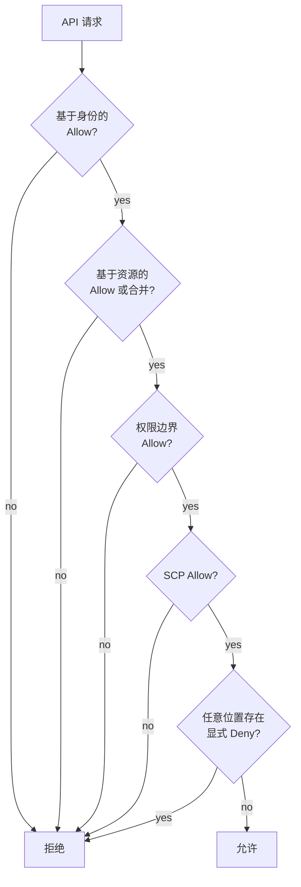
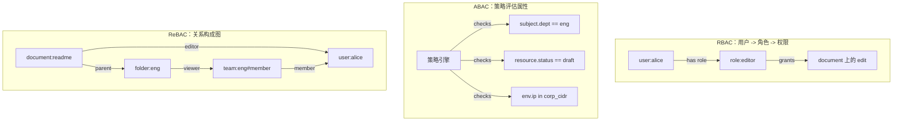
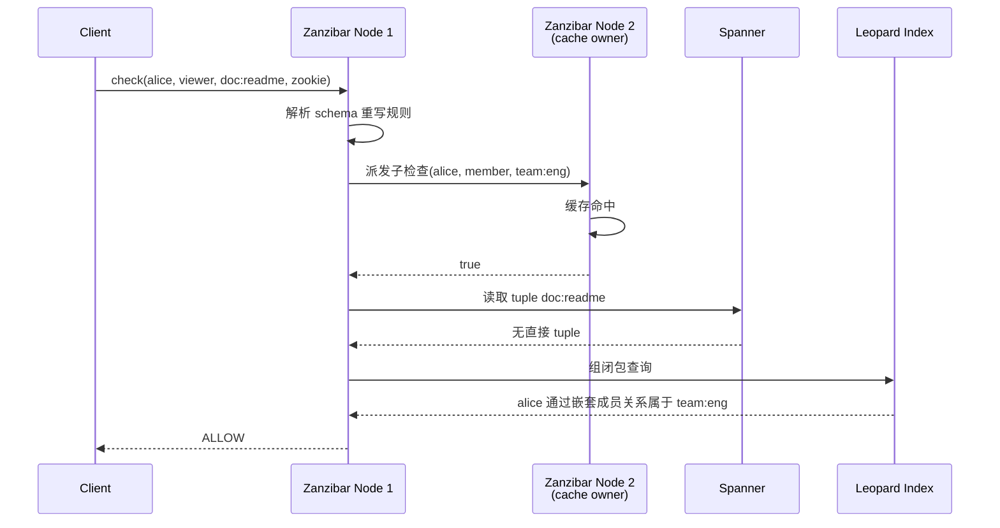

# 认证 vs 授权：权限与访问模型

> **TL;DR**: 认证（AuthN）回答“你是谁？”，授权（AuthZ）回答“你能做什么？”。这是两个不同的问题，失败模式也各不相同，而把它们混为一谈，正是 OWASP Top 10（2021 与 2025）里排名第一的 Web 应用漏洞类别。AuthN 这一侧，密码仍会长期存在，但必须搭配抗钓鱼的 MFA（用 WebAuthn，不要用短信）。AuthZ 这一侧，RBAC 在团队职责高度交叉、规模上去之后会撞上角色爆炸，这时基于关系的访问控制（ReBAC）才是正确的默认选择。Google 的 Zanzibar 每秒处理 1240 万次 check 与 read 请求，p95 低于 10 ms[^1]，而它的开源后裔（SpiceDB、OpenFGA）把这套模型带给了所有人。

## 学习目标

学完本章，你将能够：

- [ ] 区分 AuthN 与 AuthZ，并独立设计这两套机制
- [ ] 比较基于会话与基于令牌的认证方式，并做出正确选择
- [ ] 在给定产品中于 RBAC、ABAC、ReBAC 之间选型
- [ ] 用关系来建模权限（Zanzibar 风格的 tuple 与 userset 重写）
- [ ] 把 SpiceDB、OpenFGA 或自研方案集成进服务架构

## 直觉理解

想象一家夜店。门口的保镖查你的身份证，这是认证：证明你确实是你自称的那个人。进去以后，一道天鹅绒围栏隔出 VIP 区，领位在放你过去之前先看你的手环颜色。这是授权：在你已验证的身份基础上，决定你被允许做什么。

现实里没人会把保镖和 VIP 领位搞混。但在代码里，开发者天天犯这个错。中间件校验完 JWT（保镖），设置 `req.user`，路由处理器就默认：身份有效，就有权操作任何资源。服务端从不问“这个用户对*这个*文档有访问权吗？”，它直接把数据返回了。这就是失效的访问控制（broken access control），从 2021 年起它在 OWASP Top 10 里一直排第一（2025 版再次确认）。

解法是架构上的分离。身份提供方（IdP）负责 AuthN：校验凭证、签发令牌、管理会话。独立的授权服务负责 AuthZ：判断已认证的主体能否对目标资源执行所请求的操作。Google 把这两者跑成完全独立的系统。他们的 AuthZ 层 Zanzibar 就摆在每一次 Drive 分享、每一个 Calendar 邀请、每一次 Cloud IAM 校验的热路径上，管理着数万亿条已存储的权限，每秒做出数百万次判定[^1]。

本章两半都讲。先讲如何验证身份（密码、MFA、SSO、会话与令牌之别），再讲如何建模和执行权限（RBAC、ABAC、ReBAC）。读完之后，你会知道每种模型在什么情况下占优，以及如何避开那些规模化之后才咬人的坑。

## 原理

### AuthN 基础：密码与现代指引

密码是一种记忆型秘密，校验时对照服务端存储的加盐哈希。服务端永不保存明文。注册时用刻意放慢的算法算出 `hash = KDF(salt, password, cost)`，登录时重算一次，并以常量时间比较。

哈希算法一路演进，就是为了对抗硬件性能的提升：

- **bcrypt**（1999）：基于 Blowfish，成本因子可自适应。“任何安全的密码方案，其计算成本都必须随硬件进步而提高”[^2]。
- **scrypt**（2009）：内存硬（memory-hard），能挡住 GPU 与 ASIC 攻击者。
- **Argon2id**（2015）：从 24 个候选方案中胜出，成为密码哈希竞赛（Password Hashing Competition）的冠军[^3]。今天的默认选择。

NIST SP 800-63B-4（2025）把你公司安全培训里教的那套规则全改了[^4]：

- 单因子最少 15 个字符，MFA 最少 8 个
- 不要组合规则（大小写混用、数字、符号）
- 不要定期轮换
- 必须对照泄露口令库做检查

这些改动反映的是现实：撞库（把已泄露的用户名/密码对灌进登录表单）在各类组织中占认证尝试次数的中位数是 19%，在企业规模下最高能到 25%[^5]。FBI 把金融行业 41% 的安全事件归因于撞库[^6]。

### MFA：从短信到通行密钥

多因素认证要求两种不同类型的因素：你知道的东西（密码）、你拥有的东西（手机、硬件密钥）、你本身的特征（生物识别）。

**TOTP**（RFC 6238）用预共享密钥和当前 30 秒时间窗做哈希。便宜、离线、不依赖网络。对多数消费级应用够用。

**短信 OTP** 通过 PSTN 下发验证码。它挡不住 SIM 交换攻击：攻击者用社会工程手段让运营商把受害者的号码转走。Twitter CEO Jack Dorsey 的 `@jack` 账号在 2019 年 8 月就是这样被接管的[^7]。NIST 现在把短信归为“受限”认证器，要求另配替代方案[^4]。

**FIDO2/WebAuthn** 做的是绑定到依赖方源（origin）的公钥挑战-应答。钓鱼站点的源不对，就拿不到有效的断言。Google 在 2017 年初要求全部 85,000 多名员工使用硬件安全密钥；此后确认的账号接管为零[^8]。

**通行密钥（passkey）** 是同步型 WebAuthn 凭证（经由 iCloud Keychain、Google Password Manager）。它把抗钓鱼能力带给普通消费者，不需要额外配一个硬件令牌。NIST 把可同步认证器（AAL2）与不可导出的硬件密钥（AAL3）区分开来。



*MFA 各方式按抗钓鱼能力排序；高价值账号优先用左侧。*

### 会话认证与令牌认证

AuthN 成功后，服务端要为后续请求签发一个凭证。两种模型：

**会话 Cookie。** 服务端把随机会话 ID 存在 Redis 或 Memcached 里。浏览器收到一个不透明 Cookie，标记 `HttpOnly; Secure; SameSite=Lax`。登出时删除服务端记录，吊销即刻生效。

**JWT。** 一个签名的声明载荷（`sub`、`exp`、`iat`、`roles`）。服务端验证签名和过期时间，不需要任何查表。可以横向扩展。但除非维护一份拒绝名单，否则你没法吊销 JWT，而那份名单又把你想避开的查表状态请了回来。

**混合模式**（推荐）：短期 JWT 访问令牌（5 到 15 分钟）加长期刷新令牌，刷新令牌存在 HttpOnly Cookie 里。吊销发生在刷新时。常见路径上你是无状态校验，需要的时候又能吊销。

> [!TIP]
> Chrome 在 2020 年把 `SameSite=Lax` 设为 Cookie 的默认值[^9]，挡住了大部分 CSRF 攻击面。但应用在敏感表单上仍应显式下发反 CSRF 令牌，因为 Lax 的 2 分钟例外允许顶级 POST 导航。

[OAuth 2.0 与 OpenID Connect](./01-oauth2-oidc.md) 讲的是架在这些会话模型之上的 SSO 协议（SAML、OIDC）。[JWT 深入剖析](./02-jwt-deep-dive.md) 则详细讨论签名算法、`alg: none` 攻击与令牌生命周期。

### AuthZ 模型：从 ACL 到 ReBAC

各种授权模型的差别，在于如何表示和评估权限。每一种都是“正确性-灵活性-延迟”这一空间里的不同取点。

**ACL（访问控制列表）。** 为每个资源存一份 `(subject, permission)` 元组列表。UNIX 的 `rwxrwxrwx` 是经典例子。按资源看很简单，但想表达“给工程团队授予全部 500 个仓库的读权限”，不做组展开就做不到。

**RBAC（基于角色的访问控制）。** 用户挂角色，角色挂权限。检查就一句：这个用户有没有授予该权限的角色？NIST 在 2004 年把 RBAC 标准化[^10]。它适合岗位职责清晰的企业。但角色爆炸是真实且可度量的：一份业界实例描述说，从 12 个角色起步，18 个月后涨到 287 个，其中 62% 的权限被判定为不恰当或过度授权[^11]。在职责高度交叉的团队里上规模之后，角色数量能超过人数。

**ABAC（基于属性的访问控制）。** 策略评估主体、资源、动作和环境的属性。例如：`allow if resource.owner == subject.id AND env.time in business_hours`。AWS IAM 的 `Condition` 块就是 ABAC。OPA/Rego 和 Cedar 是现代的策略引擎。它极其灵活，但你没法高效回答“谁能访问 X？”，因为没有反向索引。



*AWS IAM 的策略评估是分层的：每个请求都要过基于身份、基于资源、权限边界、SCP 四道检查。任何策略里的显式 Deny 都覆盖所有 Allow。跨账号访问要求调用方的身份策略与目标资源的策略里同时存在匹配的 Allow。*

**ReBAC（基于关系的访问控制）。** 把权限表达成主体与对象之间的关系，再用图遍历算出结果。检查的问题是：从（用户）到（资源、权限），关系图上有没有一条路径？这直接对应产品里的概念：“共享给”、“文件夹成员”、“团队拥有仓库”。Google 的 Zanzibar 是经典实现。



*同一个权限（“Alice 可以编辑 readme”）的三种建模方式。ReBAC 在查询时遍历关系图算出权限。*

### Zanzibar 及其后继实现

Google 的 Zanzibar（USENIX ATC 2019）是 Drive、Calendar、Cloud IAM、YouTube、Photos 和 Maps 共用的全局授权系统[^1]。三个核心概念：

1. **命名空间配置（schema）** 按对象类型定义关系与 userset 重写。例如 `document.viewer = reader OR editor OR owner OR parent->viewer`。
2. **关系元组（relation tuple）** 是原子事实：`document:readme#editor@user:alice`、`document:readme#parent@folder:eng`。
3. **API**：`check(user, permission, object)`、`expand(object, permission)`、`lookupResources(user, permission, type)`。

userset 重写是表达力的核心。`tuple_to_userset` 先跟一条关系，再在目标上评估另一条关系。集合运算（并、交、差）把简单关系组合成复杂策略。

**一致性模型。** Zanzibar 用 Spanner 的 TrueTime 实现外部一致性。“Zookie”（不透明的一致性令牌）用来避免“新敌人问题”：用户把文档设为私有，但过期的缓存仍然放行读取。Zookie 为检查所用的快照设定下界[^12]。

**开源后继实现：**

- **SpiceDB**（Authzed）：Go 写的 gRPC 服务，用一致性哈希分派请求换取缓存局部性，存储层可插拔（CockroachDB、PostgreSQL、Spanner）[^13]。
- **OpenFGA**（Auth0/Okta，2025 年 10 月起为 CNCF 孵化项目）：DSL 优先的 schema、流式 ListObjects API，最近通过 Thompson 采样的策略规划把 P99 降了 98%[^14]。
- **其他**：Warrant、Oso、Cerbos（带 ReBAC 能力的策略引擎）。

## 真实案例

Google Zanzibar 负责每一次 Google Drive 分享、每一个 YouTube 可见性设置、每一次 Cloud IAM 校验的授权。2019 年那篇论文给出的数字[^1]：

- 峰值每秒 **1240 万**次权限检查与读取请求
- **3 ms** p50 检查延迟，**20 ms** p99
- 三年生产使用中可用性 **> 99.999%**
- **超过 10,000 台服务器**，分布在数十个集群里
- 由 Spanner 支撑的**数万亿**条已存储访问控制列表

架构靠三项关键技术拿到这些数字：

**一致性哈希路由。** 每次权限检查都会分解成子问题（沿 userset 重写展开）。相同的子请求通过一致性哈希落到同一台服务器上，从而积累起缓存局部性。一次“Alice 能看 document:readme 吗？”的检查，可能扇出到“Alice 在 team:eng 里吗？”，而后者总是落到同一台持有该缓存的服务器上。

**请求对冲（request hedging）。** 如果 Spanner 或 Leopard 索引（针对深层嵌套组的内存传递闭包缓存）响应慢，服务端就再发一份重复请求，取先回来的那个响应。这是用来压长尾延迟的。

**Zookie 保正确性。** 内容写入会生成一个 Zookie。后续授权检查把它带回来，确保检查看到的快照至少和它保护的内容一样新。没有这一层，“把文档设为私有”和“检查 Bob 能否读取”之间的竞态就可能泄露数据。



*一次 Zanzibar 检查会扇出成多个带缓存的子问题。一致性哈希路由确保重复的子问题命中热缓存。*

## 权衡

| 方案 | 优点 | 缺点 | 适用场景 | 我们的选择 |
|---|---|---|---|---|
| 集中式 RBAC | 清晰、可审计、单一管理入口 | 超过约 100 个角色就会爆炸，且是静态的 | 内部工具、管理后台、职责清晰的组织 | 从这里起步，疼了再迁移 |
| ABAC（OPA、Cedar） | 策略即代码、灵活、可版本控制、合规友好 | 没有反向索引、策略复杂、调试痛苦 | 合规压力大的领域（医疗、金融、受监管行业） | 叠在 RBAC/ReBAC 之上处理条件 |
| ReBAC（SpiceDB、OpenFGA） | 能扩展到社交与共享场景、支持反向查询、贴合产品语义 | 新的心智模型、热路径上有状态服务、运维负担 | 带共享、团队、文件夹、嵌套组织的现代 SaaS | 新的共享型产品的默认选择 |
| ABAC + ReBAC 混合 | 关系管结构，属性管条件 | 要学、要运维两套模型 | 既有共享又有环境规则的应用 | 复杂产品最终会收敛到这里 |

## 常见陷阱

> [!WARNING]
> **角色检查硬编码散落在各个处理器里。** `if user.role == "admin"` 撒满路由，交付快，审计无门。等你要改“谁能删发票？”时，只能全局 grep 然后祈祷。在检查点数量超过 20 个之前，就把判定收敛到 AuthZ 服务后面（哪怕只是个薄库）。

> [!WARNING]
> **把“已认证”当成“已授权”。** 中间件校验 JWT 并设置 `req.user`。路由处理器从 URL 里拿到资源 ID 直接读，从不检查“这个用户对*这个*资源有权限吗？”。每个处理器在进入业务逻辑前都必须显式调用一次 AuthZ 检查。

> [!WARNING]
> **只上短信 MFA。** SIM 交换攻击劫持手机号，攻击者就能收到一次性验证码。Jack Dorsey 的 Twitter 账号就是这样被接管的[^7]。始终提供 TOTP 或 WebAuthn 作为替代。把短信当兜底，不要当主因子。

> [!WARNING]
> **角色爆炸。** 从 12 个干净角色起步，企业 18 个月后可能变成 287 个，其中 62% 的权限不恰当[^11]。如果你的角色比人还多，那你就有问题了。把 RBAC 与 ReBAC 结合来处理数据范围的权限，或者干脆全迁到 ReBAC。

> [!WARNING]
> **JWT 没有吊销策略。** 被偷的 JWT 在过期前一直有效。“用户点登出时发生了什么？”如果答案是“什么也没发生，等令牌过期”，那就改用短期访问令牌（5 到 15 分钟）加服务端刷新令牌吊销。

> [!WARNING]
> **没有护栏的上帝模式管理员。** 一个 `is_admin = true` 布尔值就给了不受限的访问。按范围拆分管理权限（计费、内容、用户管理）。管理操作强制 MFA。把每一次管理操作写进不可篡改的审计日志。

## 练习

为一个 SaaS 产品设计权限模型：它有组织、团队、项目、资源、共享和访客用户。选一种模型，设计 schema，为三个典型操作画出权限检查路径，并说明你如何审计访问。

<details>
<summary>提示</summary>

想想哪些操作是“角色式”的（组织管理员、计费管理员），哪些是“关系式”的（把某文档共享给访客）。混合模型能同时处理两者。先从列出核心实体以及它们之间的关系开始。

</details>

<details>
<summary>参考答案</summary>

**模型选型：** ReBAC（Zanzibar 风格），RBAC 角色以关系形式表达。

**Schema（OpenFGA DSL）：**

```text
type user

type team
  relations
    define member: [user, team#member]

type organization
  relations
    define owner: [user]
    define admin: [user] or owner
    define member: [user] or admin

type project
  relations
    define org: [organization]
    define admin: [user, team#member] or org_admin from org
    define editor: [user, team#member] or admin
    define viewer: [user, team#member] or editor or guest
    define guest: [user]
    define org_admin: admin from org

type resource
  relations
    define project: [project]
    define owner: [user]
    define editor: [user, team#member] or owner or project_editor from project
    define viewer: [user, team#member] or editor or project_viewer from project
    define project_editor: editor from project
    define project_viewer: viewer from project
```

**三个检查：**

1. “guest@example.com 能查看 resource:report-q4 吗？”沿 `resource:report-q4#viewer` 走 → 检查 `project_viewer from project` → 跟到 `project` 关系 → 在项目上检查 `viewer` → 检查 `guest` → 找到元组 `project:analytics#guest@user:guest@example.com`。结果：ALLOW。

2. “alice 能编辑 resource:design-doc 吗？”沿 `resource:design-doc#editor` 走 → 检查 `project_editor from project` → 跟到 `project:frontend#editor` → 检查 `team:design#member` → 找到 `user:alice` 是成员。结果：ALLOW。

3. “bob 能删除 organization:acme 吗？”只有 `owner` 能删。检查 `organization:acme#owner` → bob 没有对应元组。结果：DENY。

**审计：** 每一次关系元组写入都是可审计事件，带时间戳、操作者和新旧状态。要回答“谁给 project:analytics 授了访客权限？”，就按 `object=project:analytics, relation=guest` 过滤元组变更日志。SpiceDB 和 OpenFGA 都提供 Watch API，可以把变更流式推送到审计存储。

</details>

## 要点回顾

- AuthN 与 AuthZ 是两个不同的问题，失败模式也不同。把两者当独立关注点来设计和部署。
- NIST 800-63B-4（2025）禁止密码轮换和组合规则。单因子要求 15 个以上字符，并对照泄露口令库检查。
- WebAuthn/通行密钥是唯一抗钓鱼的 MFA。Google 给 8.5 万名员工部署硬件密钥后“零钓鱼事件”的统计已经证明了这一点[^8]。
- 用短期 JWT（5 到 15 分钟）加刷新令牌，兼顾无状态校验与可吊销性。
- RBAC 在角色爆炸（约 100+ 角色、大量交叉团队）之前都够用。Zanzibar 风格的 ReBAC 是共享密集型现代产品的正确默认。
- Zanzibar 靠一致性哈希缓存、请求对冲和保正确性的 Zookie，每秒完成 1240 万次检查与读取请求，p95 为 10 ms[^1]。
- 每一次权限变更都需要不可篡改的审计日志。如果你答不出“谁在什么时候把 Y 的访问权授给了 X？”，那就是缺口。

## 延伸阅读

- [Zanzibar: Google's Consistent, Global Authorization System](https://www.usenix.org/conference/atc19/presentation/pang) - 奠基性论文（USENIX ATC 2019）。在动手做任何细粒度授权系统之前先读它。
- [Zanzibar-Annotated by AuthZed](https://zanzibar.tech/) - 论文加上 SpiceDB 作者的逐段批注，把 userset 重写和 Leopard 那些难啃的段落讲清楚了。
- [SpiceDB Architecture Deep Dive](https://authzed.com/blog/spicedb-architecture) - 这个开源 Zanzibar 克隆如何用 Go 实现请求分派、缓存和一致性哈希路由。
- [OpenFGA Documentation](https://openfga.dev/docs) - 建模语言、Check/Expand/ListObjects API，以及 Auth0/Okta 版实现的集成指南。
- [NIST SP 800-63B-4](https://pages.nist.gov/800-63-4/sp800-63b.html) - 现行的数字身份标准，覆盖密码、AAL 等级与认证器要求。
- [AWS IAM Policy Evaluation Logic](https://docs.aws.amazon.com/IAM/latest/UserGuide/reference_policies_evaluation-logic.html) - 显式拒绝优先的语义，以及分层策略（身份、资源、边界、SCP）如何在世界上最大的 ABAC 系统里组合。
- [Krebs: Google Security Keys Neutralized Employee Phishing](https://krebsonsecurity.com/2018/07/google-security-keys-neutralized-employee-phishing/) - 硬件密钥最经典的成败故事，8.5 万多名员工、零确认接管。
- [Airbnb Himeji](https://medium.com/airbnb-engineering/himeji-a-scalable-centralized-system-for-authorization-at-airbnb-341664924574) - Google 之外的 Zanzibar 风格生产系统，用写入期物化换掉了读取期扇出。

## 记忆卡片

**Q:** 认证和授权有什么区别？
**A:** 认证（AuthN）验证身份（“你是谁？”）。授权（AuthZ）评估权限（“你能做什么？”）。这是两个独立的关注点，失败模式也不同：AuthN 的失败是凭证被盗，AuthZ 的失败是失效的访问控制。

**Q:** 为什么 NIST 800-63B-4 禁止定期轮换密码？
**A:** 强制轮换会逼用户挑更弱的密码（把某一位数字加一、套用固定模式）。新指引改为要求更长的密码（单因子 15 个字符以上）、对照泄露口令库检查，并且不要组合规则。

**Q:** WebAuthn 为什么能抗钓鱼？
**A:** 浏览器把密码学断言绑定到依赖方的源上。钓鱼站点的源不同，即使受害者点了确认，也拿不到有效签名。

**Q:** 什么是角色爆炸，什么时候发生？
**A:** 当每一个产品例外（区域访问、项目范围、临时外包）都催生一个新角色时。一份实例描述说，从 12 个初始角色出发，18 个月后涨到 287 个，其中 62% 的权限不恰当。它在团队职责高度交叉、规模上去之后发作。

**Q:** Zanzibar 里的 Zookie 是什么？
**A:** 一个不透明的一致性令牌，写入时返回、检查时回传。它为所用的 Spanner 快照设定下界，避免“新敌人问题”——吊销与内容读取发生竞态。

**Q:** Zanzibar 如何在 1240 万 QPS 下做到低于 10 ms 的延迟？
**A:** 三项技术：（1）一致性哈希路由把相同的子请求送到同一台服务器，换取缓存局部性；（2）请求对冲发重复请求来压长尾延迟；（3）Leopard 索引在内存里预先算好传递性的组闭包。

**Q:** 什么时候该选 ABAC 而不是 ReBAC？
**A:** 当权限取决于环境属性（时段、来源 IP、MFA 状态、资源标签）而不是关系时。AWS IAM 的 Condition 块是经典的 ABAC 例子。实践中，复杂系统大多用混合模式：ReBAC 管结构，ABAC 管条件。

**Q:** 为什么“JWT 有效所以已授权”是个安全漏洞？
**A:** JWT 只能证明身份（AuthN），对“这个身份在所访问的特定资源上有没有权限”一无所知。每个请求在令牌校验之后都必须过一次显式的 AuthZ 检查。

**Q:** 会话与令牌的混合模式是什么？
**A:** 短期 JWT 访问令牌（5 到 15 分钟）用于每个请求的无状态校验，加上服务端存储的长期刷新令牌用于吊销。访问令牌过期后，客户端打刷新端点，该端点在签发新访问令牌之前先查吊销名单。

**Q:** 举出三个开源的 Zanzibar 实现。
**A:** SpiceDB（Authzed，Go，gRPC，存储可插拔）、OpenFGA（Auth0/Okta，Go，DSL 优先的 schema，流式 ListObjects），以及 Warrant（现已并入 WorkOS）。它们都实现了关系元组、userset 重写，以及 Check/Expand/LookupResources 这套 API 模式。

## 参考文献

[^1]: Pang et al., "Zanzibar: Google's Consistent, Global Authorization System", USENIX ATC 2019. https://research.google/pubs/zanzibar-googles-consistent-global-authorization-system/
[^2]: Provos and Mazieres, "A Future-Adaptable Password Scheme", USENIX ATC 1999. https://www.usenix.org/conference/1999-usenix-annual-technical-conference/presentation/future-adaptable-password-scheme
[^3]: Password Hashing Competition official site announcing Argon2 as the 2015 winner. https://www.password-hashing.net/
[^4]: NIST Special Publication 800-63B-4 (2025), "Digital Identity Guidelines: Authentication and Authenticator Management". https://pages.nist.gov/800-63-4/sp800-63b.html
[^5]: Verizon 2025 Data Breach Investigations Report, credential-stuffing research article. https://www.verizon.com/business/resources/articles/credential-stuffing-attacks-2025-dbir-research
[^6]: FBI Private Industry Notification as reported by Bitdefender, "41% of Financial Sector Cyber Attacks Come from Credential Stuffing". https://www.bitdefender.com/en-gb/blog/businessinsights/fbi-41-of-financial-sector-cyber-attacks-come-from-credential-stuffing/
[^7]: The Guardian, "Jack Dorsey: Twitter CEO's account briefly hacked", 30 August 2019. https://www.theguardian.com/technology/2019/aug/30/twitter-ceo-jack-dorsey-account-hacked
[^8]: Brian Krebs, "Google: Security Keys Neutralized Employee Phishing", KrebsOnSecurity, 23 July 2018. https://krebsonsecurity.com/2018/07/google-security-keys-neutralized-employee-phishing/
[^9]: web.dev (Chrome team), "SameSite cookies explained". https://web.dev/articles/samesite-cookies-explained
[^10]: NIST Computer Security Resource Center, "Role Based Access Control FAQ and history". https://csrc.nist.gov/Projects/Role-Based-Access-Control
[^11]: Action1 blog, "RBAC Implementation: Best Practices & Checklist" citing typical enterprise role-sprawl numbers. https://www.action1.com/blog/rbac-implementation-best-practices/
[^12]: Jake Moshenko (AuthZed), "Understanding Google Zanzibar: A Comprehensive Overview". https://authzed.com/blog/what-is-google-zanzibar
[^13]: Jake Moshenko (AuthZed), "Google Zanzibar Open Source: The Architecture of SpiceDB". https://authzed.com/blog/spicedb-architecture
[^14]: Yamil Asusta and Yissell Garma (Auth0/OpenFGA), "Taming P99s in OpenFGA: How We Built a Self-Tuning Strategy Planner". https://auth0.com/blog/self-tuning-strategy-planner-openfga
