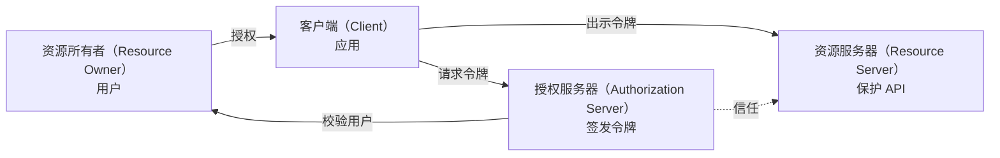
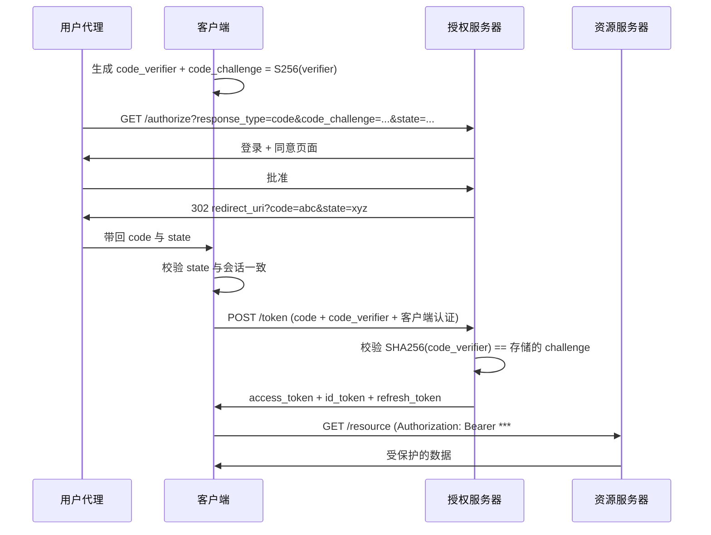
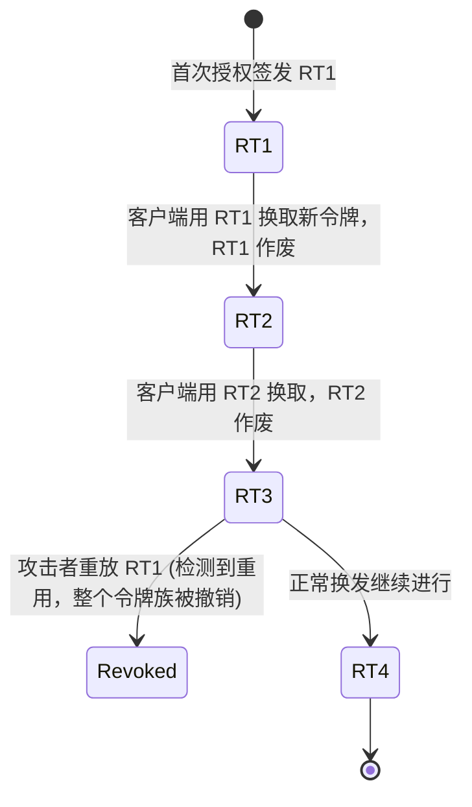
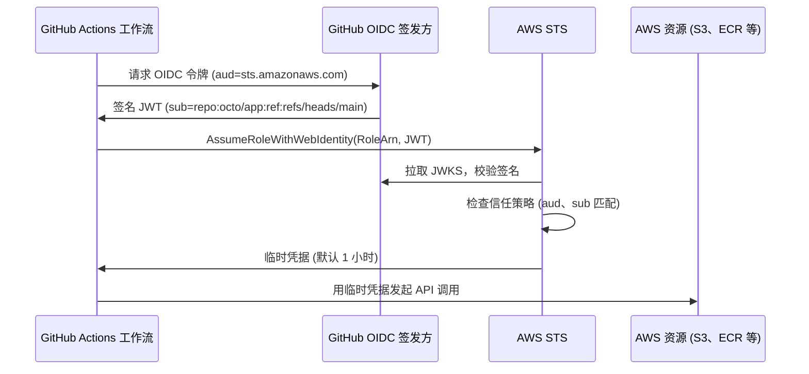

# OAuth 2.0 与 OpenID Connect：正确实现委派授权与身份

> **TL;DR**: OAuth 2.0（RFC 6749，2012）让用户在不交出密码的前提下，把对自身资源的作用域化访问权授予某个应用。[^1] OpenID Connect 在其上叠加一层身份，让应用同时知道用户 *是谁*。新代码只该用授权码 + PKCE 这一种流程：SPA、移动端、服务端应用都一样。OAuth 2.1 把这件事定成规范：彻底删掉 Implicit 与 ROPC 授权类型，并对所有客户端强制要求 PKCE。[^2] 规范当初的灵活性正是它最大的弱点（其主编辑辞职时称它是“我职业生涯中最大的职业失望”[^3]），但十年积累的安全最佳实践已经把它收紧成一个只要正确实现就可靠的协议。

## 学习目标

学完本章，你将能够：

- [ ] 区分 OAuth 2.0（授权）与 OpenID Connect（认证）
- [ ] 选对授权类型：授权码 + PKCE、客户端凭证，还是设备码
- [ ] 说明访问令牌、刷新令牌、ID 令牌各自的作用
- [ ] 设计带轮换、撤销与发送方约束的安全令牌生命周期
- [ ] 识别常见的 OAuth 配置错误（开放重定向、缺少 state、令牌泄露）
- [ ] 为 CI/CD 落地 OIDC 联合身份，摆脱长期密钥

## 直觉理解

你在租一辆车。租车公司不需要你家的钥匙。它需要两张东西：你能开车的证明（你的驾照），以及一份限定范围的授权（租车协议），让你在*这几个具体日期*使用*这一辆具体的车*。你从头到尾没交出家门钥匙、银行卡密码或护照。租车协议是可以撤销的：一旦你把车撞了，公司立刻作废它。

在 OAuth 之前，Web 上的做法相当于把家门钥匙交出去。想让第三方应用读取你的 Gmail 联系人？把你的 Google 密码给它就行。于是这个应用能读你的邮件、删你 Drive 里的文件、改你的密码。没有作用域，没有撤销，没有审计轨迹。2006 年底，Blaine Cook 在做 Twitter 的 OpenID 实现时撞上一个缺口：OpenID 能把用户登录进来，但要让第三方在不拿密码的前提下访问受限 API，并没有开放标准。他和 Chris Messina、David Recordon、Larry Halff 等人开始勾画后来成为 OAuth 的方案，就是为了补上这个缺口。OAuth Core 1.0 最终草案于 2007 年 10 月发布。[^4]

OAuth 就是 Web 上的租车协议。用户（资源所有者）来到授权服务器（租车柜台），批准一组具体权限（作用域），应用拿到一个有期限的令牌（租车协议）。应用永远看不到密码。令牌可以撤销。被盗造成的损失有边界。

本章承接[认证与授权](./00-authn-authz.md)——那篇讲的是如何校验身份、如何施加权限。这里聚焦于跨越信任边界委派授权的那套协议。

## 原理

### 密码反模式与 OAuth 的起源

在 OAuth 之前，委派访问就意味着共享凭据。这种做法叫“密码反模式”：用户把自己的用户名和密码交给第三方应用，由应用代替他登录。应用拿到的是全部权限。用户不改密码就撤不回来（而改密码会连带弄坏其他所有应用）。应用到底干了什么，也没有任何审计记录。

OAuth 1.0（2007）用签名请求令牌解决了这个问题。它能用，但每个请求都要做复杂的密码学签名。OAuth 2.0（RFC 6749，2012 年 10 月）用 TLS 上的持有者令牌（bearer token）取代签名，实现简单了，但把安全责任推给了传输层。[^1]

这份规范刻意做成“框架”而不是严丝合缝的协议。它的主编辑 Eran Hammer 于 2012 年 7 月辞职，把名字从规范里撤掉，并称它是“一个糟糕的协议”，只有靠实现者极高的水平才“能变成好协议”。[^3] 他说对了：这份灵活性带来了十年的漏洞利用史。但 IETF 的回应是 RFC 9700（OAuth 2.0 安全最佳当前实践，2025 年 1 月）[^5]，以及仍在推进中的 OAuth 2.1 草案——把 PKCE、原生应用规则、浏览器应用规则并进一份文档，同时删掉那些反复出事的流程。[^2]

### OAuth 2.0 的角色与授权类型

每个 OAuth 流程里都有四个角色在互动：

*OAuth 的四个角色以及它们之间的令牌流向。客户端始终看不到用户的凭据。*

**资源所有者（Resource Owner）**：拥有数据的用户。**客户端（Client）**：请求访问的应用。**授权服务器（Authorization Server，AS）**：认证用户、收集同意、签发令牌。**资源服务器（Resource Server，RS）**：校验令牌并提供受保护数据的 API。

授权类型（流程）决定了客户端如何拿到令牌：

| 授权类型 | 使用场景 | 状态 |
|---|---|---|
| 授权码 + PKCE | SPA、移动端、服务端 Web | OAuth 2.1 强制要求 |
| 客户端凭证（Client Credentials） | 机器对机器、CI/CD | 仍在使用 |
| 设备码（RFC 8628） | 智能电视、CLI、IoT | 仍在使用 |
| 授权码（无 PKCE） | 仅限遗留服务端场景 | 不带 PKCE 即已弃用 |
| Implicit | （原本给 SPA 用） | OAuth 2.1 中移除 |
| ROPC（密码授权） | （客户端能看到密码） | OAuth 2.1 中移除 |

Implicit 授权把令牌直接放在 URL 片段里返回，于是令牌会经由浏览器历史、Referer 头和 JavaScript 泄露。ROPC 把用户密码交给了客户端，彻底背离了 OAuth 的初衷。两个都已死亡。别用它们。[^5]

### 授权码 + PKCE

这是你要实现的那个流程。PKCE（RFC 7636，读作“pixy”）在授权请求与令牌交换之间加了一道密码学绑定，挡住授权码拦截攻击。[^6]

机制是这样的：流程开始前，客户端生成一个随机的 `code_verifier`（43 到 128 个 URL 安全字符；RFC 7636 第 7.1 节建议至少 256 位熵，通常由 32 个随机字节做 base64url 编码得到）。它算出 `code_challenge = BASE64URL(SHA256(code_verifier))`，把 challenge 放进授权请求。等拿授权码去换令牌时，客户端再发原始 verifier。AS 重算哈希，不匹配就拒绝。攻击者即使截获了授权码，没有 verifier 也换不出令牌。[^6]

*授权码 + PKCE 的端到端流程。code_verifier 从不离开客户端，所以单截获授权码毫无用处。*

这个流程里的关键安全参数：

- **`state`**：一次性的、密码学随机的值，与用户会话绑定。用于防 CSRF。AS 原样返回，客户端发现不一致就拒绝。[^5]
- **`nonce`**（OIDC）：嵌在 ID 令牌里，防重放。客户端校验 ID 令牌的 `nonce` 声明与自己发出的值一致。
- **`redirect_uri`**：必须精确注册（不允许通配符，不允许子串匹配）。RFC 9700 强制要求字符串精确比较。[^5]

OAuth 2.1 把 PKCE 变成所有客户端的硬性要求，机密客户端也不例外，因为 PKCE 还能挡住授权码注入攻击——攻击者诱导受害者使用攻击者自己的授权码。[^2]

### OpenID Connect

OAuth 回答的是“这个应用能做什么”，而不是“这个用户是谁”。用访问令牌做登录是众所周知的反模式：访问令牌的 `aud = resource_server`，而不是 `aud = client`。为某个客户端签发的令牌，只要另一个客户端共享同一资源服务器，就能被拿去重放。

OpenID Connect（OIDC，2014）通过增加以下几样东西来补上这一层：

- **ID 令牌**：一个签名 JWT，`aud = client_id`，携带身份声明（`sub`、`iss`、`email`、`name`）。客户端用 AS 的 JWKS 校验签名，检查 `iss`、`aud`、`exp` 和 `nonce`。
- **`openid` 作用域**：触发 ID 令牌签发。
- **发现文档**：`/.well-known/openid-configuration` 公布全部端点、支持的算法与能力。客户端在启动时拉取一次即可。
- **UserInfo 端点**：返回已认证用户的额外资料声明。
- **JWKS 端点**：公布 AS 用于验签的公钥。

关键规则：**访问令牌给 API 用，ID 令牌给登录用。**永远不要用访问令牌判断用户是谁，也永远不要把 ID 令牌发给资源服务器。

[JWT 深入解析](./02-jwt-deep-dive.md)详细讲了令牌格式、签名算法和 `alg: none` 攻击。

### 令牌生命周期与安全

**访问令牌**是短命的（5 到 60 分钟）。它们通常是持有者令牌（RFC 6750）：只要持有就能调用。这意味着一个被盗的访问令牌在过期前拥有全部访问权。

**刷新令牌**是长期凭据，在令牌端点换取新的访问令牌，无需用户参与。RFC 9700 要求公开客户端的刷新令牌必须二选一：要么做发送方约束（mTLS 或 DPoP），要么做带重用检测的轮换。[^5]

*带重用检测的刷新令牌轮换。旧令牌被重放就说明失窃，触发整个令牌族撤销。*

**DPoP（RFC 9449，2023 年 9 月）**把令牌绑定到客户端持有的一对密钥上。每次 API 调用都带上一个由客户端私钥签名的 DPoP 证明 JWT。访问令牌里带 `cnf.jkt` 确认声明（密钥指纹）。盗来的访问令牌没有私钥就是废纸。这一步让语义从持有者令牌走向发送方约束令牌。

**撤销（RFC 7009）**和**内省（RFC 7662）**补齐了生命周期的另一半。撤销让客户端或管理员能立刻作废令牌。内省让资源服务器实时检查令牌有效性（对无法本地校验的不透明令牌尤其有用）。

### SPA 的令牌存储与 BFF 模式

单页应用该把令牌存在哪？这个问题重要，因为 XSS 是 Web 上最主要的漏洞，而任何跑在页面源下的脚本都能读 `localStorage`。

**`localStorage` 不适合存令牌。**任何一次成功的 XSS 都会把访问令牌、刷新令牌和 ID 令牌全部带走。攻击者在令牌有效期内拥有完整的 API 访问权。IETF 的“OAuth 2.0 for Browser-Based Apps”最佳实践和 Auth0 的文档都明确反对这么做。

**后端换前端（Backend-for-Frontend，BFF）**模式是推荐做法：由与 SPA 同一团队维护的薄服务端完成 OAuth 流程，把令牌存在服务端的加密会话里，只对浏览器下发 `HttpOnly; Secure; SameSite=Lax` 的会话 cookie。SPA 只调自己的 BFF，BFF 拿真正的访问令牌去调上游 API。令牌永远到不了 JavaScript 手里。

> [!IMPORTANT]
> 今天再做 SPA，就用 BFF 模式。不要把 OAuth 令牌存进 `localStorage` 或 `sessionStorage`。那点便利不值得承担 XSS 风险。

## 真实案例

GitHub Actions 的 OIDC 联合身份接入 AWS，把长期云凭据从 CI/CD 流水线里彻底清掉。自 2021 年起，每次 GitHub Actions 工作流运行都能签出一个短期 OIDC 令牌，由 GitHub 的身份提供方（`https://token.actions.githubusercontent.com`）签名。AWS STS 校验这个令牌并返回临时凭据，有效期通常 1 小时。

流程如下：

*GitHub Actions OIDC 联合身份。仓库里不再放长期 AWS 访问密钥。每次工作流运行都拿到全新的、限定范围的短期凭据。*

JWT 的 `sub` 声明编码了调用方身份：`repo:octo/app:ref:refs/heads/main`。AWS IAM 角色的信任策略拿它做匹配，所以其他仓库的工作流无法扮演这个角色。

**最典型的配置错误**：Datadog Security Labs 在 2023 年 7 月记录了真实世界的信任策略失误——组织在 `sub` 上用了 `StringLike` 却没有锚定到具体仓库，或者干脆省掉了 `aud` 检查。[^7] 结果是 github.com 上任何仓库都能扮演受害者的角色。修复方法：始终把 `aud` 钉死为 `sts.amazonaws.com`，把 `sub` 钉死为精确的 `repo:org/name:ref:refs/heads/branch` 模式。

这个模式不限于 GitHub。GitLab CI、CircleCI、Bitbucket Pipelines 都提供类似的 OIDC 令牌。原则一致：用短期的、可密码学验证的身份断言，替换长期密钥。[密钥管理](./04-secrets-management.md)讲了从基础设施中彻底移除静态凭据的更大图景。

## 权衡

| 方案 | 优点 | 缺点 | 适用场景 | 我们的选择 |
|---|---|---|---|---|
| 授权码 + PKCE | 对所有客户端类型都安全；防授权码拦截、注入和 CSRF；OAuth 2.1 强制要求 | 握手稍复杂；不保护令牌存储 | 所有新应用 | 是，始终使用 |
| 客户端凭证 | M2M 简单；支持 mTLS 与 private_key_jwt | 没有用户上下文；当心 `sub` 混淆 | 服务间调用、CI/CD 批处理 | 仅用于机器身份 |
| 设备码 | 设备上无需浏览器；电视端体验好 | 轮询式；易遭设备码钓鱼 | 智能电视、CLI、IoT | 没有浏览器可用时 |

## 常见陷阱

> [!WARNING]
> **使用 Implicit 授权。**`response_type=token` 把访问令牌放在 URL 片段里返回，于是它落进浏览器历史、Referer 头和服务端日志。这种流程没有刷新令牌，而且已被正式从 OAuth 2.1 中删除。如果还有遗留客户端在用它，先把它迁到授权码 + PKCE，其他事往后放。

> [!WARNING]
> **自己造授权服务器。**RFC 9700（OAuth 2.0 安全最佳实践）列举了混淆攻击（mix-up）、回调上的 CSRF、PKCE 降级、隐蔽重定向，以及另外几十种攻击，手写的服务器一定会漏掉一些。用经过审查的实现（Keycloak、Auth0、Okta、Ory Hydra、AWS Cognito），把精力放在把它配置正确上。

> [!WARNING]
> **把令牌存进 localStorage。**任何 XSS 都能把所有令牌带走。用 BFF 模式配 HttpOnly cookie。如果你接手了一个用 localStorage 的 SPA，下次安全评审前就迁到 BFF。

> [!WARNING]
> **redirect_uri 校验马虎。**通配符或子串匹配会让攻击者借开放重定向器收割授权码。RFC 9700 强制字符串精确比较。每个重定向 URI 都要显式注册。没有例外。

> [!WARNING]
> **缺少 state 参数。**没有与会话绑定的 `state`，攻击者就能对 OAuth 流程做 CSRF，把自己的资源和受害者的会话关联起来。始终生成密码学随机的 state，绑定到会话，并在回调时拒绝不匹配的值。

> [!WARNING]
> **用 OAuth 做认证（没有 OIDC）。**访问令牌不是身份断言。它们的 `aud = resource_server`，而不是 `aud = client`。一个客户端的令牌可以被重放到另一个客户端。登录请用 OIDC 的 ID 令牌，它的受众被明确限定为你的 client_id。

> [!WARNING]
> **PKCE 降级。**如果你的 AS 支持 PKCE 却不强制，攻击者就能从请求里剥掉 `code_challenge`，再把自己的授权码注入受害者会话。全站强制 PKCE。OAuth 2.1 通过对所有客户端强制 PKCE 堵上了这个口子。[^5]

## 练习

为一个 SaaS 产品设计认证体系，包含：一个 Web SPA、iOS/Android 移动应用、一个公开开发者 API、内部微服务，以及面向企业客户（Okta、Azure AD）的 SSO。针对每种客户端，说明：用哪种 OAuth 授权、令牌存储策略、令牌有效期、刷新轮换策略，以及用户被停用时如何撤销全部令牌。

提示

想想哪些客户端是公开的（SPA、移动端），哪些是机密的（后端服务）。公开客户端存不了密钥，所以需要 PKCE 和谨慎的令牌存储。企业 SSO 就是 OIDC 联合身份。撤销必须有服务端机制，因为 JWT 一旦签发就无法召回。

参考答案

**Web SPA**：通过 BFF 使用授权码 + PKCE。BFF 完成 OAuth 流程，把令牌存进服务端加密会话，只向浏览器下发 HttpOnly/Secure/SameSite=Lax 的会话 cookie。访问令牌有效期 15 分钟。刷新令牌 7 天，带轮换和重用检测。

**移动应用（iOS/Android）**：用系统浏览器走授权码 + PKCE（遵循 RFC 8252）。令牌存在操作系统安全区（iOS 用 Keychain，Android 用 Keystore）。访问令牌 15 分钟。刷新令牌 30 天，带轮换。

**公开开发者 API**：开发者注册 OAuth 客户端。他们的服务端应用用授权码 + PKCE（机密客户端，带 client_secret）。受速率限制。访问令牌 1 小时。刷新令牌 90 天。

**内部微服务**：客户端凭证授权，配 mTLS 客户端认证（参见 [mTLS 与服务间认证](./03-mtls-service-auth.md)）。访问令牌 5 分钟。不需要刷新令牌，因为服务随时可以再要一个。

**企业 SSO**：OIDC 联合身份。企业客户把他们的 IdP（Okta、Azure AD）配置成你 AS 里的外部身份提供方。你的 AS 信任他们签发的 ID 令牌。你把他们的 `sub` 声明映射到本地用户记录。

**用户停用时撤销**：(1) 在 AS 上撤销该用户的所有刷新令牌（立即生效）。(2) 短期访问令牌会在 15 分钟内自然过期。(3) 需要立即吊销时，把用户的 `sub` 加入拒绝名单，由资源服务器在每次请求时检查。(4) 终止 BFF 会话存储中该用户的所有活跃会话。

## 要点回顾

- OAuth 2.0 委派授权，OpenID Connect 补上认证。凡是“用某账号登录”的场景，用 OIDC。
- 授权码 + PKCE 是新面向用户的应用唯一该用的授权类型。OAuth 2.1 把这一点正式化。[^2]
- 访问令牌短命（5 到 60 分钟）且面向 API。ID 令牌面向登录，受众绑定到客户端。两者绝不能混。
- 带重用检测的刷新令牌轮换能抓住失窃：旧令牌被重放就撤销整个令牌族。
- 永远不要把令牌存在 localStorage。SPA 用 BFF 模式。
- OIDC 联合身份（GitHub Actions 到 AWS、GitLab 到 GCP）让 CI/CD 不再需要长期密钥。信任策略要钉死精确的 `sub` 和 `aud` 值。
- Facebook 2018 年的数据泄露暴露了约 2900 万账号的访问令牌，换来爱尔兰数据保护委员会 2024 年 12 月开出的 2.51 亿欧元罚单。[^8][^9] 令牌安全不是可选项。

## 延伸阅读

- [RFC 6749: The OAuth 2.0 Authorization Framework](https://datatracker.ietf.org/doc/html/rfc6749) —— 核心规范。即使做 OAuth 2.1 相关的事，也仍然从这里起步。先读第 4.1 节（授权码）和第 10 节（安全考量）。
- [RFC 7636: Proof Key for Code Exchange (PKCE)](https://datatracker.ietf.org/doc/html/rfc7636) —— 把授权码流程从公开客户端手里救回来的那个扩展。篇幅短，好读，必读。
- [RFC 9700: OAuth 2.0 Security Best Current Practice](https://datatracker.ietf.org/doc/html/rfc9700) —— 合并后的安全最佳实践（2025 年 1 月）。任何要在生产环境上 OAuth 的人都该读。
- [RFC 9449: OAuth 2.0 Demonstrating Proof of Possession (DPoP)](https://datatracker.ietf.org/doc/html/rfc9449) —— 在应用层把令牌绑定到客户端密钥对。发送方约束令牌的未来。
- [OpenID Connect Core 1.0](https://openid.net/specs/openid-connect-core-1_0.html) —— OIDC 规范。重点看第 2 节（ID 令牌）和第 3.1 节（授权码流程）。
- [Eran Hammer, "OAuth 2.0 and the Road to Hell"](https://gist.github.com/nckroy/dd2d4dfc86f7d13045ad715377b6a48f) —— 2012 年那篇塑造了 OAuth 2.1 的批评。理解当年错在哪，才能体会最佳实践为何存在。
- [Datadog Security Labs: GitHub-to-AWS Keyless Authentication Flaws](https://securitylabs.datadoghq.com/articles/exploring-github-to-aws-keyless-authentication-flaws/) —— 真实世界的 OIDC 联合身份配置错误。配置任何 CI/CD 信任策略之前先读。
- [oauth.net](https://oauth.net/2/) —— Aaron Parecki 维护的可读性极好的参考站。了解 OAuth 概念与流程时最好的非 RFC 入门读物。

## 记忆卡片

**Q:** OAuth 解决了 2007 年之前存在的什么问题？
**A:** “密码反模式”：用户把密码直接交给第三方应用，授予的是没有作用域的全部访问权，而且没有撤销机制。

**Q:** OAuth 2.0 的四个角色是什么？
**A:** 资源所有者（用户）、客户端（应用）、授权服务器（在用户同意后签发令牌）、资源服务器（保护 API，校验令牌）。

**Q:** 为什么机密客户端也需要 PKCE？
**A:** PKCE 能挡住授权码注入攻击——攻击者诱导受害者使用攻击者自己的授权码。OAuth 2.1 对所有客户端强制 PKCE，不只是公开客户端。

**Q:** 访问令牌和 ID 令牌的区别是什么？
**A:** 访问令牌用于授权 API 调用（aud = 资源服务器）。ID 令牌用于断言身份（aud = client_id）。绝不要用访问令牌做登录；绝不要把 ID 令牌发给资源服务器。

**Q:** Implicit 授权为什么被弃用？
**A:** 它把令牌直接放在 URL 片段里返回，经由浏览器历史、Referer 头和 JavaScript 泄露。它也无法支持刷新令牌或发送方约束。

**Q:** 什么是带重用检测的刷新令牌轮换？
**A:** 每用一次刷新令牌就签发新的并作废旧的那个。如果已作废的令牌再次出现，AS 就撤销整个令牌族，说明发生了失窃。

**Q:** SPA 为什么不该把令牌存在 localStorage？
**A:** 任何 XSS 漏洞都能从 localStorage 把全部令牌带走。BFF 模式把令牌留在服务端加密会话里，浏览器只能看到 HttpOnly cookie。

**Q:** DPoP（RFC 9449）比持有者令牌多给了什么？
**A:** DPoP 把访问令牌绑定到客户端持有的密钥对。每个请求都带一个签名的证明 JWT。盗来的访问令牌没有私钥就毫无用处。

**Q:** GitHub Actions 的 OIDC 联合身份如何消除长期 AWS 凭据？
**A:** 每次工作流运行都签出一个短期 JWT，由 GitHub 的 OIDC 提供方签名。AWS STS 校验签名与信任策略（检查 sub 和 aud），然后返回约 1 小时有效的临时凭据。

**Q:** 最危险的 OIDC 联合身份配置错误是什么？
**A:** 信任策略里省略 `sub` 约束，或用过宽的通配符。没有锚定到具体仓库和分支时，任何 GitHub 仓库都能扮演该 IAM 角色。

**Q:** `state` 参数在 OAuth 里防什么？
**A:** 授权流程上的 CSRF 攻击。没有与会话绑定的随机 state，攻击者可以发起流程，骗受害者在攻击者的会话里完成它。

**Q:** OAuth 2.1 从规范里删掉了什么？
**A:** Implicit 授权和资源所有者密码凭据（ROPC）授权。它还对所有客户端强制 PKCE，并要求 redirect_uri 精确匹配。

## 参考文献

[^1]: IETF, "RFC 6749: The OAuth 2.0 Authorization Framework", 2012 年 10 月. https://datatracker.ietf.org/doc/html/rfc6749
[^2]: IETF, "The OAuth 2.1 Authorization Framework" (draft-ietf-oauth-v2-1-15), 2026 年 3 月. https://datatracker.ietf.org/doc/draft-ietf-oauth-v2-1/
[^3]: Eran Hammer, "OAuth 2.0 and the Road to Hell", 2012 年 7 月（存档）. https://gist.github.com/nckroy/dd2d4dfc86f7d13045ad715377b6a48f
[^4]: Eran Hammer-Lahav, "Introduction"（OAuth 起源史）, oauth.net, 2007 年 9 月. https://oauth.net/about/introduction/
[^5]: IETF, "RFC 9700: OAuth 2.0 Security Best Current Practice", 2025 年 1 月. https://datatracker.ietf.org/doc/html/rfc9700
[^6]: IETF, "RFC 7636: Proof Key for Code Exchange by OAuth Public Clients", 2015 年 9 月. https://datatracker.ietf.org/doc/html/rfc7636
[^7]: Datadog Security Labs, "No keys attached: Exploring GitHub-to-AWS keyless authentication flaws", 2023 年 7 月 27 日. https://securitylabs.datadoghq.com/articles/exploring-github-to-aws-keyless-authentication-flaws/
[^8]: Meta (Facebook newsroom), "An Update on the Security Issue", 2018 年 10 月 12 日. https://about.fb.com/news/2018/10/update-on-security-issue/
[^9]: The Hacker News, "Meta Fined 251 Million EUR for 2018 Data Breach Impacting 29 Million Accounts", 2024 年 12 月 17 日. https://thehackernews.com/2024/12/meta-fined-251-million-for-2018-data.html
