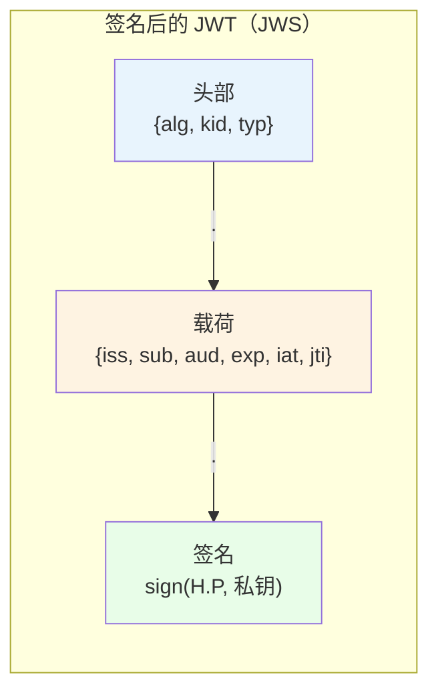
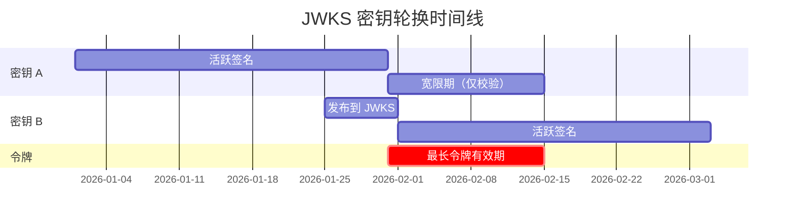
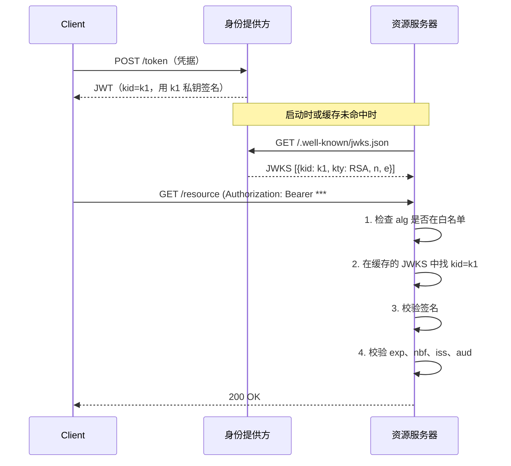
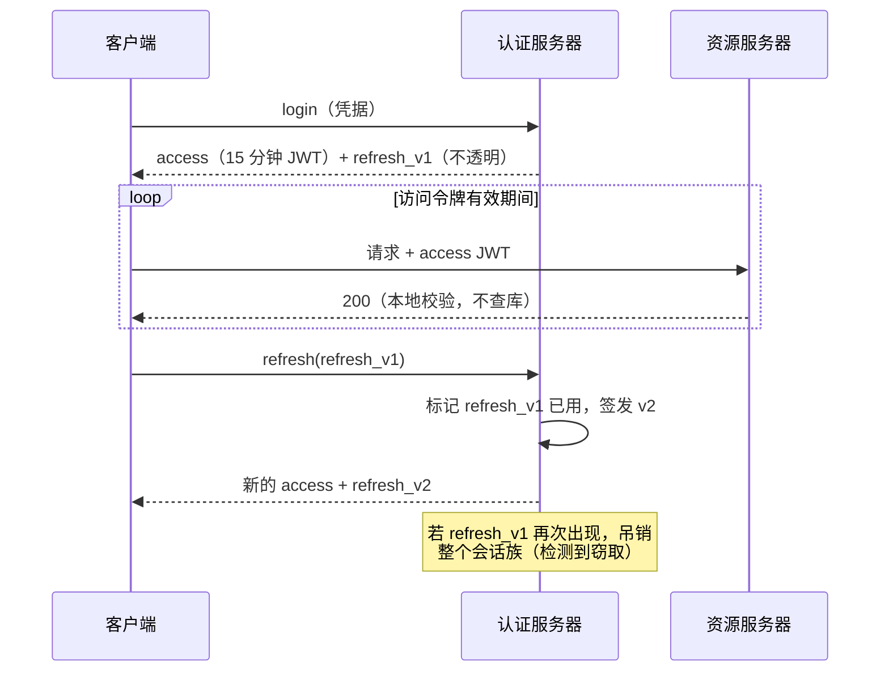

# JWT 深入解析：签名令牌、声明与吊销难题

> **TL;DR**: JSON Web Token（JWT）是一段带签名的 JSON 载荷，任何服务都能在不开查数据库的前提下完成校验。这种无状态是它的超能力，也是它的诅咒：要想吊销一个 JWT，你就得把服务端状态重新引回来。这个格式的灵活性（头部里的算法协商、密钥 URL、`none` 算法）从 2015 年起已经造出一连串 CVE [^1]。业界通行的缓解手段是：短时效访问令牌（5 到 15 分钟）、刷新令牌轮换、固定的算法白名单、基于 JWKS 的密钥分发。RFC 8725（BCP 225）把这些教训写成了规范 [^2]。

## 学习目标

学完本章，你将能够：

- [ ] 解码一个 JWT，并解释它三个 base64url 编码段的作用
- [ ] 选择签名算法（RS256、ES256、EdDSA），并说清 `none` 为什么危险
- [ ] 校验必需声明：`iss`、`aud`、`exp`、`nbf`、`sub`
- [ ] 用 JWKS 端点加 `kid` 头部设计密钥轮换
- [ ] 用短时效、刷新令牌和黑名单应对吊销难题

## 直觉理解

你去酒店办入住。前台核验你的身份证和信用卡，然后递给你一张房卡。接下来的 48 小时里，酒店里每一扇门都信任这张卡，不会回头去问前台。卡上直接写着你的房间号和退房时间，任何读卡器都能在本地验证卡上的磁条签名。

现在设想你把卡弄丢了。你打电话给前台说“把卡作废”。但门锁不会回拨电话，它们在退房时间到来之前根本不知道这张卡已经被吊销。酒店只剩下两条路：把所有门锁重新编程，或者发一种每小时就过期、逼你回来换新卡的房卡。

这就是 JWT 的权衡。令牌是自包含的：任何持有签发方公钥的服务都能瞬间完成校验，不用发起网络调用。但“自包含”也意味着“收不回来”。整个安全模型建立在三件事上：短时效、谨慎的声明校验，以及绝不信任令牌自己的头部来告诉你该用哪个算法。

[认证与授权](./00-authn-authz.md) 介绍了短时效 JWT 加刷新令牌的混合模式。[OAuth 2.0 与 OpenID Connect](./01-oauth2-oidc.md) 讲的是产出 JWT 的那些协议。本章钻进令牌内部：它的结构、它的密码学、它的攻击面，以及让它保持安全的那些运维机制。

## 原理

### JWT 结构解剖与 base64url 编码

一个签名 JWT（严格说，按 RFC 7515 是一个 JWS）是由点号分隔的三段 [^3]:

```text
base64url(header) . base64url(payload) . base64url(signature)
```

**头部（header）** 声明算法和密钥标识：

```json
{"alg": "RS256", "kid": "2026-04-key", "typ": "JWT"}
```

**载荷（payload）** 承载声明（claim，也就是真正的数据）：

```json
{"iss": "https://auth.example.com", "sub": "user-42", "aud": "api.example.com", "exp": 1714500000, "iat": 1714499100}
```

**签名（signature）** 是对 `base64url(header).base64url(payload)` 的 ASCII 字节，用头部指定的算法和密钥计算出来的。

三段用的都是 **base64url**（RFC 4648），不是标准 base64。差别在于：`+` 变成 `-`，`/` 变成 `_`，末尾的填充 `=` 被去掉。这样 JWT 就能安全地塞进 URL、HTTP 头部和查询参数，不需要百分号编码 [^3]。

有一个关键点：base64url 是编码，不是加密。任何看到令牌的人都能解码载荷、读出任一条声明。JWT 是明信片，不是密封信封。如果确实需要机密性，用 JWE（五段：头部、加密密钥、IV、密文、认证标签），或者干脆依赖 TLS 提供传输层机密性。实践中，几乎所有生产环境的 JWT 都是走 TLS 的 JWS 而不是 JWE，因为传输层已经提供了机密性 [^2]。



*一个 JWT 就是三个 base64url 段用点号连起来。签名把头部和载荷绑定在一起，但两者对任何人都仍然可读。*

**注册声明（registered claim）** 由 RFC 7519 标准化：`iss`（签发方）、`sub`（主体）、`aud`（受众）、`exp`（过期时间，Unix 秒）、`nbf`（生效时间）、`iat`（签发时间）、`jti`（令牌唯一 ID，用于重放检测）。按规范它们全是可选的，实践中却全是必需的。私有声明由应用自定义；公共声明在 IANA 注册 [^3]。

### 签名算法与“none”灾难

RFC 7518（JWA）与 RFC 8037 定义了这些算法标识 [^4]:

| 算法 | 类型 | 签名长度 | 使用场景 |
|---|---|---|---|
| HS256 | HMAC-SHA256（对称） | 32 字节 | 单服务，双方共享密钥 |
| RS256 | RSA PKCS#1 v1.5 | 256 字节（2048 位密钥） | OIDC ID token、跨组织校验 |
| PS256 | RSA-PSS（优于 RS256） | 256 字节 | 必须用 RSA 时的现代选择 |
| ES256 | ECDSA P-256 | 64 字节（原始 P1363 格式） | 紧凑令牌、头部空间受限的服务 |
| EdDSA | Ed25519 | 64 字节 | 现代默认：确定性签名，无 RNG 侧信道 |
| none | 不签名 | 0 字节 | **生产环境绝对不要用** |

**`alg: none` 漏洞。** RFC 7519 定义了签名段为空的“不签名 JWT”。早期库会从不受信任的头部里读出 `alg`，然后据此分发处理。攻击者把 `"alg":"none"` 写上，随意编造载荷，附一个空签名，库就收下了。这个问题在 Tim McLean 2015 年针对 `node-jsonwebtoken` 的研究中被公开。七年之后，同一个库又被一个相关变体咬了一口，CVE-2022-23540（版本 <= 8.5.1）：如果调用方调用 `jwt.verify()` 时既没有传 `algorithms` 选项，secret 或 key 又是个假值（null、false、undefined），库就会退化成 `none`，接受未签名的令牌。两者的攻击路径不同（一个是不受信任的头部驱动分发，一个是不安全的默认值），根因却是同一个：在验证链路的任何环节放行了 `none` 算法 [^5]。

**RS256/HS256 混淆攻击。** 服务器用 RSA 公钥验证 RS256 令牌。攻击者伪造一个 `"alg":"HS256"` 的令牌，把 RSA 公钥（本来就是公开的）当作 HMAC 密钥来签。有漏洞的库读到 `alg: HS256`，就把校验密钥当成 HMAC 密钥用，伪造的令牌被接受。这是 `node-jsonwebtoken` 里的 CVE-2015-9235 [^1]。

**通灵签名（CVE-2022-21449）。** Java 15 到 18 用纯 Java 重写了 ECDSA 校验，漏掉了 `r` 和 `s` 必须落在 `[1, n-1]` 区间的检查。一个 64 字节的全零签名，能通过任意 P-256 公钥的验证。任何 ECDSA 签名的 JWT 都能在受影响服务器上被伪造 [^6]。

这三类问题的修法是同一个：**在验证方固定允许的算法。** RFC 8725 第 3.1 节说得很硬：“Libraries MUST enable the caller to specify a supported set of algorithms and MUST NOT use any other algorithms” [^2]。永远给 verify 函数传上 `algorithms: ['RS256']`（或你自己选定的集合）。

> [!IMPORTANT]
> 绝不要让令牌自己的头部决定用哪个算法。头部是攻击者可控的。决定算法的是你的验证方，不是令牌。

### 密钥管理与 JWKS

JSON Web Key Set（JWKS）是一份 JSON 文档，列出某个签发方当前使用的公钥，每把钥匙由一个 `kid` 标识。它发布在一个约定俗成的 URL 上（通常是 `/.well-known/jwks.json`），让验证方能取到密钥而不必预先共享配置 [^2]。

流程是这样的：

1. 签发方生成一对密钥，给它分配 `kid`，把公钥那半发布到 JWKS。
2. 签发 JWT 时，签发方把 `kid` 写进头部。
3. 验证方取 JWKS（启动时或缓存未命中时），找到匹配的 `kid`，校验签名。

**密钥轮换** 需要重叠期。签发方先把新密钥发布到 JWKS，再开始用它签名。旧密钥至少还要在 JWKS 里多待一个“最长令牌有效期”（也就是宽限期）。过渡期间，用旧密钥签出的令牌照样能通过校验。



*密钥至少重叠一个最长令牌有效期，这样过渡期间用旧密钥签出的令牌仍然能通过校验。*

**JWKS 缓存规则：**

- 缓存 JWKS 响应并设置 TTL（典型值 5 到 60 分钟）。
- `kid` 未命中时（说明发布了新密钥），重新拉取一次 JWKS。
- 对重新拉取做限流，防止攻击者用伪造的 `kid` 把签发方打爆。
- 绝不要在没有严格白名单的情况下跟随令牌头部里的 `jku` 或 `x5u` URL。CVE-2024-21643（Microsoft IdentityModel Extensions for .NET）的 SignedHttpRequest 协议实现默认信任 `jku`，使得密钥替换成为可能。

### 声明校验流水线

RFC 7519 第 7.2 节定义了强制的校验步骤，RFC 8725 又加上了 BCP 的加固要求 [^2]。标准顺序如下：

1. **解析头部。** 如果 `alg` 不在你固定的白名单里，直接拒。
2. **定位密钥。** 在缓存的 JWKS 里按 `kid` 查找。未命中就重取（只取一次，且限流）。
3. **校验签名。** 对 `base64url(header).base64url(payload)` 的确切字节做密码学验证。任何失败都拒。
4. **校验 `exp`。** 当前时间必须早于 `exp`。允许 30 到 90 秒的时钟偏移（60 秒是最常见的默认值）[^3]。
5. **校验 `nbf`。** 当前时间必须在 `nbf` 或之后（同样允许偏移）。
6. **校验 `iss`。** 与你的签发方白名单做精确字符串匹配。
7. **校验 `aud`。** 你的服务标识必须出现在 `aud` 里（字符串或数组）。这能阻止令牌在服务之间被复用 [^3]。
8. **校验 `typ`。** 如果启用了显式类型（RFC 8725 第 3.11 节），拒掉跨 JWT 的混淆。
9. **校验应用声明。** 角色、scope、租户 ID，你的服务需要什么就查什么。



*验证方从签发方取一次 JWKS 并缓存，之后所有令牌都在本地校验。每个请求都不用回源到 IdP。*

> [!TIP]
> 严格校验 `aud`。签发给 `billing-service` 的令牌，绝不能在 `admin-service` 上生效。受众混淆是一种替代攻击向量，在多份 CVE 分析里都出现过 [^2]。

### 吊销难题

JWT 是无状态的。服务端没法“忘掉”一个令牌。用户登出、被停用，或者会话被窃，JWT 都会一直有效到 `exp`。这是该格式的根本矛盾。

**缓解策略（选一种，或者组合使用）：**

| 策略 | 延迟代价 | 复杂度 | 吊销速度 |
|---|---|---|---|
| 短 TTL（5-15 分钟）+ 刷新 | 热路径上无额外开销 | 低 | 下次刷新时（分钟级） |
| `jti` 黑名单（Redis / 布隆过滤器） | 每请求一次查询 | 中 | 立即 |
| 版本声明与 DB 比对 | 每请求一次查询 | 中 | 立即 |
| 不透明令牌 + 令牌内省（RFC 7662） | 每请求一次网络调用 | 高 | 立即 |
| 轮换签名密钥 | 轮换后无额外开销 | 仅限紧急情况 | 所有令牌一起失效 |

**业界标准答案：** 用 5 到 15 分钟的访问令牌，配上存在服务端的不透明刷新令牌。访问令牌过期后，客户端拿刷新令牌换一对新的。吊销发生在刷新时：认证服务器在签发新令牌之前会先确认用户是否还有效。遇到紧急吊销（管理员停用账号、怀疑被入侵），再维护一份很小的 `jti` 黑名单，每个请求都查一次。黑名单里的条目只需要留到 `exp` 过期为止，所以它一直很小。

**带重用检测的刷新令牌轮换：** 每个刷新令牌只能用一次。被兑换时，服务器签发一个新刷新令牌，并把旧的标记为已消费。如果旧令牌再次出现，整个令牌族全部吊销。这就是窃取检测：攻击者和合法用户都拿同一个刷新令牌来用，第二次使用就会触发该会话下所有令牌的吊销。



*短时效 JWT 访问令牌加上刷新令牌轮换，能在不做每请求内省的前提下实现可用的吊销能力。访问令牌每个请求都在本地校验；吊销发生在刷新时，靠拿刷新令牌去服务端存储里比对。*

> [!WARNING]
> **长时效 JWT 是负债。** 24 小时的访问令牌意味着被盗的凭据能安安稳稳用满 24 小时，你毫无办法。如果你的访问令牌活得比 15 分钟长，你就得每请求查一次黑名单，那无状态就白搭了。

## 真实案例

GitHub Actions 的 OIDC 令牌展示了 JWT 最佳实践在大规模下的样子。每个 GitHub Actions workflow job 都可以向 GitHub 的令牌端点申请一个短时效 OIDC JWT。workflow 把这个 JWT 出示给 AWS、GCP、Azure 或 HashiCorp Vault，换取云上凭据，全程不需要存放长效密钥 [^7]。

**令牌特征：**

- **有效期：** 从观测到的 `exp - iat` 值看约为 5 分钟（官方并未承诺）
- **算法：** RS256
- **签发方：** `https://token.actions.githubusercontent.com`
- **JWKS：** `https://token.actions.githubusercontent.com/.well-known/jwks`
- **关键声明：** `sub` 编码了安全边界（例如 `repo:octo-org/octo-repo:environment:prod`）

**云厂商如何校验：**

1. 配置 OIDC 信任策略，把 `iss` 钉死为 GitHub 的签发方 URL。
2. 把 `aud` 钉死为预期的受众（可按 workflow 配置）。
3. 用模式匹配把 `sub` 限定在允许值上（例如 `repo:myorg/myrepo:ref:refs/heads/main`）。
4. 从 GitHub 的端点取 JWKS，校验签名，校验 `exp`。
5. 全部匹配，就签发一个短时效的云访问令牌。

**这个设计为什么成立：**

- 不需要把长效云凭据存成 GitHub secret。整类密钥轮换难题被直接消掉。
- 每个 job 都拿到一个全新的 JWT，自动生成、自动过期。令牌被窃的时间窗被压缩到 5 分钟。
- `sub` 声明就是安全边界。信任策略必须写得具体：钉住仓库、分支、环境。像 `sub: repo:myorg/*:*` 这种过宽的策略，等于让任何分支或 fork 都能领到生产凭据。

这个模式——短时效 JWT 加受限声明，再到 JWKS 端点校验——是所有“想要无状态校验、又不想留长效密钥”的服务间认证的模板。Kubernetes 的绑定服务账号令牌（默认 1 小时有效期、限定受众、绑定 Pod）走的是同一套模型 [^8]。

## 权衡

| 方案 | 优点 | 缺点 | 适用场景 | 我们的选择 |
|---|---|---|---|---|
| JWT（无状态） | 每请求不用查库；靠公钥做跨服务校验 | 吊销困难；每个令牌 400 到 1,200 字节 | API、微服务、OIDC | API 的默认选择 |
| 会话 Cookie（有状态） | 吊销极其简单（删掉那行记录）；ID 只有约 32 字节 | 每请求都要查；需要会话保持或共享会话存储 | 单域名的传统 Web 应用 | 没有 API 消费方的 Web 应用 |
| 不透明令牌 + 内省（RFC 7662） | 可吊销；体积小；权威始终在服务端 | 每请求一次网络调用；签发方成为每请求的瓶颈 | 银行、需要即时吊销的管理后台 | 吊销 SLA < 1 分钟时 |
| JWE（加密 JWT） | 载荷即使放在浏览器存储里也是私密的 | 双重密码学开销；密钥管理更难；无效曲线漏洞 | 声明含 PII，且绝不能泄露给中间方 | 仅当 TLS 本身不够时 |
| PASETO v4 | 没有 alg 头部；没有 `none`；有版本；强制算法明确性 | 生态更小；没有 JWKS 标准；不是 OIDC 原生 | 签发方和验证方都归你，且想少踩坑 | 全新的内部服务 |

## 常见陷阱

> [!WARNING]
> **没有白名单就信任 `alg` 头部。** 令牌头部是攻击者可控的。如果你的库不设限地按它分发，你就有 `alg: none` 和 RS256/HS256 混淆的风险。永远给 verify 函数传一个显式的 `algorithms` 参数。

> [!WARNING]
> **把密钥或 PII 放进 JWT 声明。** base64url 是编码，不是加密。任何截获令牌的人（浏览器 DevTools、代理日志、URL 查询串）都能以明文读出每一条声明。用 JWE，或者把敏感数据留在服务端，只在令牌里放一个不透明 ID。

> [!WARNING]
> **跳过 `aud` 校验。** 签发给 `billing-service` 的令牌不该在 `admin-service` 上生效。没有受众校验，一个被攻陷的低权限服务就能拿令牌去高权限端点上重放。

> [!WARNING]
> **用弱 HMAC 密钥。** 用字典词或短字符串做 HS256 签名密钥的 JWT，能被 hashcat 在几秒内离线爆破出来。RFC 8725 明确要求人脑可记的密码不得用作 HMAC 密钥 [^2]。至少用 64 字节随机值，跨服务场景直接换非对称算法。

> [!WARNING]
> **把 JWKS 永久缓存。** 如果从不重取，一旦轮换密钥，所有新令牌都验不过。如果每次 `kid` 未命中都重取又不限流，攻击者随便发点 `kid` 乱填的令牌就能 DDoS 你的签发方。带 TTL 缓存（5 到 60 分钟），并允许未命中时限流重取一次。

## 练习

为一个 SaaS API 设计 JWT 策略：有效期、声明结构、签名算法、JWKS 轮换策略，以及你如何在 1 分钟内完成用户停用。每一项选择都要用无状态与可吊销之间的权衡来解释。

<details>
<summary>提示</summary>

想想管理员点下“停用用户”到该用户下一次 API 调用被拒之间发生了什么。15 分钟的访问令牌意味着最多还有 15 分钟的持续访问。什么机制能补上这段空窗，又不至于让每个请求都变成有状态？

</details>

<details>
<summary>解答</summary>

**签名算法：** ES256。64 字节的紧凑签名在 HTTP 头部里放得很舒服。非对称，所以 API 服务器只需要公钥。避开了 RSA 的 256 字节签名。

**令牌有效期：** 10 分钟访问令牌。短到大多数停用都能在下次刷新时生效，又长到不至于产生过量的刷新流量。

**声明结构：**

```json
{
  "iss": "https://auth.saas.com",
  "sub": "user-42",
  "aud": "api.saas.com",
  "exp": 1714500600,
  "iat": 1714500000,
  "jti": "abc-123-def",
  "org_id": "org-7",
  "roles": ["editor"],
  "token_version": 14
}
```

**JWKS 轮换：** 每 30 天轮换一次签名密钥。新密钥在首次使用前 7 天发布。旧密钥在最后一次使用后继续留在 JWKS 里 15 天（宽限期比最长令牌有效期多 5 分钟）。

**1 分钟内停用：** 维护一份 Redis 支撑的 `jti` 黑名单。管理员停用用户时，把该用户所有活跃的 `jti`（在签发时记录）推入黑名单，TTL 设为令牌剩余寿命。每个 API 请求查一次黑名单（一次 Redis GET，亚毫秒级）。黑名单始终很小，因为条目会自动过期。

**备选方案：** 用 `token_version` 声明。在数据库里存一个按用户计数的版本号。停用时把计数器加一。API 服务器每个请求检查 `token_version >= stored_version`。这是每请求一次 DB 读，但省掉了单独维护黑名单。

**接受的权衡：** 黑名单给每个请求加了一跳网络往返，部分抵消了无状态的好处。但黑名单极小（只有被停用用户的令牌，且自动过期），所以又快又有界。99.9% 的请求，这个检查在微秒级就返回“没找到”。

</details>

## 要点回顾

- JWT 是 base64url 编码，不是加密。除非用 JWE，否则绝不要把密钥或敏感 PII 放进载荷。
- 在验证方固定允许的算法。`alg: none` 和 RS256/HS256 混淆攻击，一行配置就能防住。
- 先校验签名，再校验 `exp`、`iss`、`aud`，顺序就是这个。跳过 `aud` 会打开跨服务令牌重放的口子。
- 短时效访问令牌（5 到 15 分钟）加刷新令牌轮换是业界标准。长时效 JWT 是负债。
- JWKS 端点把密钥分发和令牌校验解耦。带 TTL 缓存，`kid` 未命中时重取，并对重取限流。
- 密钥轮换需要重叠：先用新密钥发布，再用它签名；旧密钥留到所有在途令牌过期。
- 需要即时吊销（管理员停用、入侵响应）时，维护一份带自动过期条目的小 `jti` 黑名单，接受那一跳的开销。

## 延伸阅读

- [RFC 7519: JSON Web Token](https://datatracker.ietf.org/doc/html/rfc7519) - 规范本身。第 4 节（声明）和第 7 节（校验）是实现者必读的核心。
- [RFC 8725: JWT Best Current Practices](https://datatracker.ietf.org/doc/html/rfc8725) - BCP 225。上线任何 JWT 实现之前先读它。覆盖了所有已知攻击类型和对应的缓解手段。
- [Tim McLean, "Critical vulnerabilities in JSON Web Token libraries"](https://auth0.com/blog/critical-vulnerabilities-in-json-web-token-libraries/) - 2015 年的那次披露，点名了 `alg: none` 和 RS256/HS256 混淆。至今仍是解释“算法固定为什么重要”的最好单篇材料。
- [Neil Madden, "CVE-2022-21449: Psychic Signatures in Java"](https://neilmadden.blog/2022/04/19/psychic-signatures-in-java/) - ECDSA r=s=0 的披露。展示了一个密码学实现里漏掉的一处边界检查，如何击穿下游所有 JWT 校验。
- [GitHub Actions OIDC documentation](https://docs.github.com/en/actions/deployment/security-hardening-your-deployments/about-security-hardening-with-openid-connect) - 生产环境用短时效 JWT 替代长效密钥做 CI/CD 云访问的范例。
- [PASETO specification](https://github.com/paseto-standard/paseto-spec) - 彻底干掉算法协商的 JWT 替代品。全新的内部服务值得评估一下。
- [OWASP JWT Cheat Sheet](https://web.archive.org/web/20260606011649/https://cheatsheetseries.owasp.org/cheatsheets/JSON_Web_Token_for_Java_Cheat_Sheet.html) - 实用安全指南，覆盖弱密钥、令牌存储和校验顺序。
- [RFC 9449: OAuth 2.0 DPoP](https://datatracker.ietf.org/doc/html/rfc9449) - 发送方约束令牌，把 JWT 绑定到客户端的密钥上，被窃的令牌换一个客户端就用不了。

## 记忆卡片

**Q:** 一个签名 JWT 由哪三部分组成？
**A:** 头部（算法和密钥 ID）、载荷（声明）、签名。三段都是 base64url 编码，用点号分隔。

**Q:** 为什么用 base64url 而不是标准 base64？
**A:** base64url 把 `+` 换成 `-`、`/` 换成 `_`，并去掉填充 `=`。这样 JWT 放进 URL、HTTP 头部和查询参数都不用百分号编码。

**Q:** `alg: none` 攻击是什么？
**A:** 攻击者把头部设成 `{"alg":"none"}`，随意编造载荷，附一个空签名。按不受信任的 `alg` 头部分发处理的库会认为它有效。修法：永远在验证方固定允许的算法。

**Q:** RS256/HS256 混淆攻击是怎么做的？
**A:** 攻击者伪造一个 `alg: HS256` 的令牌，把服务器的 RSA 公钥当作 HMAC 密钥来签。有漏洞的库读到 `alg: HS256`，把校验密钥当 HMAC 密钥用，于是接受了伪造的令牌。

**Q:** JWKS 端点是什么，为什么重要？
**A:** 一个发布在约定 URL 上的 JSON 文档，列出签发方当前的公钥及其 `kid` 标识。它把密钥分发和令牌校验解耦：验证方通过 HTTPS 取密钥，不需要预共享秘密。

**Q:** 如何在轮换 JWT 签名密钥时不破坏已有令牌？
**A:** 先在新密钥发布到 JWKS，再用它签名。开始用新 `kid` 签名。旧密钥至少继续留在 JWKS 里一个最长令牌有效期（宽限期）。等用它签的所有令牌都过期后，再移除旧密钥。

**Q:** JWT 吊销的标准做法是什么？
**A:** 短时效访问令牌（5 到 15 分钟）加服务端刷新令牌。吊销在刷新时发生。需要即时吊销时，维护一份 `jti` 黑名单，条目在令牌 `exp` 时自动过期。

**Q:** 为什么必须校验 `aud` 声明？
**A:** 不做受众校验的话，签发给低权限服务的令牌就能在高权限服务上重放。`aud` 声明保证令牌只被预期的接收方接受。

**Q:** CVE-2022-21449（“通灵签名”）是什么？
**A:** Java 15 到 18 认为 64 字节的全零 ECDSA 签名对任意公钥都有效。重写的 Java ECDSA 实现漏掉了 `r` 和 `s` 必须非零且小于曲线阶的检查。

**Q:** 什么时候该用 JWE 而不是 JWS？
**A:** 当声明里的敏感数据即使在 TLS 之外被截获也必须保密时（例如存进浏览器 localStorage、流经分析管道、被中间方记入日志）。大多数情况下，走 TLS 的 JWS 就够了。

**Q:** JWT 和 PASETO 的区别是什么？
**A:** PASETO 彻底取消了算法协商。没有 `alg` 头部，没有 `none` 算法，也不可能发生算法混淆。每个 PASETO 版本对每种用途（签名或加密）只规定一种算法。代价是：生态更小，不支持 OIDC/JWKS 标准。

**Q:** GitHub Actions OIDC 如何用 JWT 消除存储密钥？
**A:** 每个 workflow job 向 GitHub 申请一个 5 分钟的 RS256 JWT，出示给云厂商；云厂商的信任策略校验 `iss`、`aud`、`sub`（钉死到具体仓库和分支）。校验通过就签发短时效凭据。GitHub 里不存任何长效密钥。

## 参考文献

[^1]: Tim McLean, "Critical vulnerabilities in JSON Web Token libraries", Auth0 blog, 2015 (republished 2020). https://auth0.com/blog/critical-vulnerabilities-in-json-web-token-libraries/
[^2]: Sheffer, Hardt, Jones, "RFC 8725: JSON Web Token Best Current Practices", IETF BCP 225, February 2020. https://datatracker.ietf.org/doc/html/rfc8725
[^3]: Jones, Bradley, Sakimura, "RFC 7519: JSON Web Token (JWT)", IETF, May 2015. https://datatracker.ietf.org/doc/html/rfc7519
[^4]: Jones, "RFC 7518: JSON Web Algorithms (JWA)", IETF, May 2015. https://datatracker.ietf.org/doc/html/rfc7518. EdDSA added by Liusvaara, "RFC 8037: CFRG Elliptic Curve Diffie-Hellman (ECDH) and Signatures in JOSE", IETF, January 2017. https://datatracker.ietf.org/doc/html/rfc8037
[^5]: Auth0, "CVE-2022-23539, CVE-2022-23541, CVE-2022-23540: Security Update for jsonwebtoken", December 21 2022. https://auth0.com/docs/secure/security-guidance/security-bulletins/2022-12-21-jsonwebtoken
[^6]: Neil Madden, "CVE-2022-21449: Psychic Signatures in Java", ForgeRock, April 19 2022. https://neilmadden.blog/2022/04/19/psychic-signatures-in-java/
[^7]: GitHub, "About security hardening with OpenID Connect" (GitHub Actions OIDC). https://docs.github.com/en/actions/deployment/security-hardening-your-deployments/about-security-hardening-with-openid-connect
[^8]: Kubernetes, "Managing Service Accounts", Kubernetes Documentation. https://kubernetes.io/docs/reference/access-authn-authz/service-accounts-admin/#bound-service-account-token-volume-mechanism
