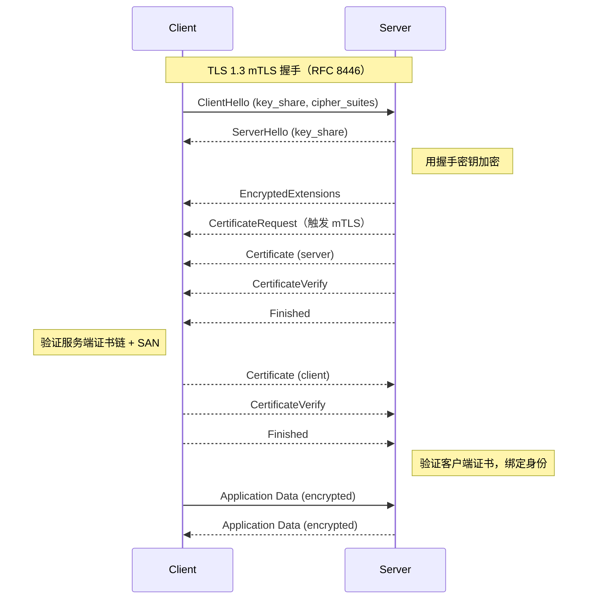
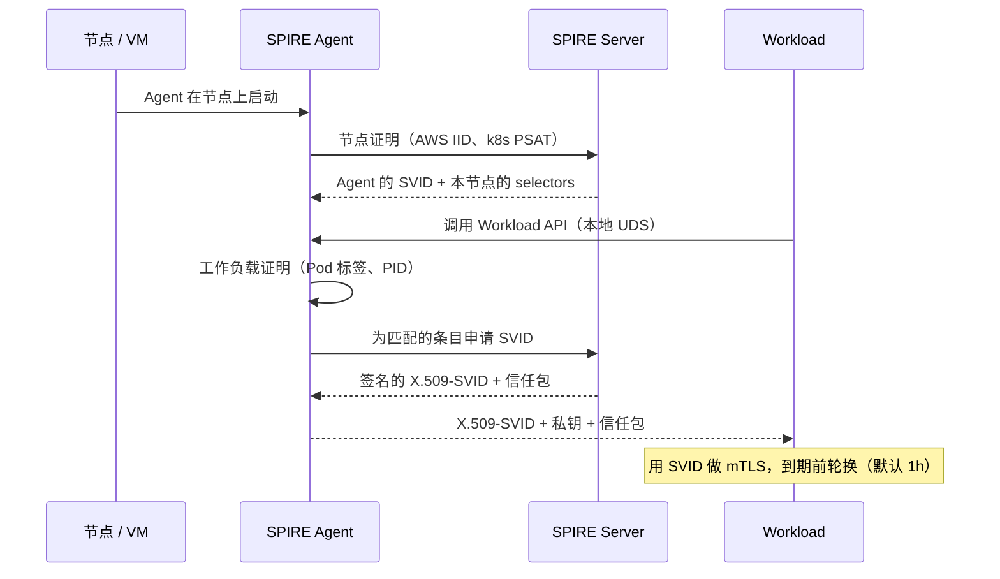
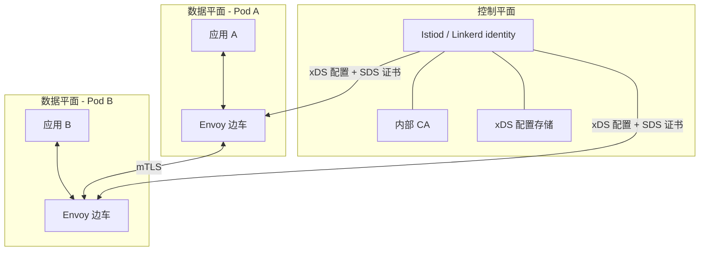

# mTLS 与服务间认证：SPIFFE、服务网格与零信任

> **TL;DR**: 在传统数据中心里，服务靠网络位置来判断调用方可信。这个模型崩得非常彻底（2013 年 Target：一名 HVAC 供应商的凭据一路无阻抵达 POS 系统，4000 万张卡被窃 [^1]）。零信任的主张是“每一次调用都要认证”。mTLS 就是落地手段：客户端和服务端都出示 X.509 证书，在任何一个应用字节流动之前互相验证。手工做 mTLS 是一份全职工作。服务网格（Istio、Linkerd）和 SPIFFE/SPIRE 把证书签发、轮换和吊销自动化掉，你的应用代码永远不接触密钥。Google 的 ALTS 就是用这种方式保护每秒 O(10^10) 次 RPC [^2]。

## 学习目标

学完本模块，你将能够：

- [ ] 解释 mTLS 握手的流程，以及它与仅服务端认证的 TLS 有什么不同
- [ ] 为短生命周期的工作负载身份设计证书签发、轮换与吊销方案
- [ ] 比较手工 mTLS、服务网格 mTLS（Istio、Linkerd）与 SPIFFE/SPIRE
- [ ] 把 mTLS 与授权策略（谁能调用什么）结合起来
- [ ] 判断 mTLS 在什么场景下是过度设计，什么场景下不可或缺

## 直觉理解

你住在一栋公寓楼里，整栋楼只有一扇上锁的大门。任何能进这道门的人都能敲开任意一户的门，而住户会开门，因为“他一定是邻居”。这就是城堡加护城河模型：一道边界，边界内默认可信。

现在设想攻击者尾随一名快递员进了大门。他已经在楼里了。他可以敲遍每一户，自称是维修人员，住户就放他进去。2013 年 Target 的遭遇正是如此：攻击者从一家 HVAC 承包商那里偷到凭据，穿过网络边界，横向移动到 Target 全美约 1800 家门店中几乎每一家的 POS 系统，因为网络内部没有任何东西质询他们的身份 [^1]。

零信任就是针对这一点的架构回应：每户都装上自己的死锁，每位访客开门前都必须出示带照片的证件。换到网络语言里，每个服务在每次调用时都出示一张密码学证书，接收方在处理任何一个字节之前先做验证。这就是双向 TLS（mutual TLS，mTLS）。

难点在运维。想象一下每小时为每位住户签发、续期并吊销一次带照片的证件。这就是证书生命周期问题。服务网格和 SPIFFE/SPIRE 存在的意义就是把它自动化，让你专注做功能，而不是运行一套 PKI。

## 原理

### 零信任模型

NIST SP 800-207（2020 年 8 月）把零信任定义为一组范式：防御重心从静态网络边界移向用户、资产和资源，访问企业资源的每一个会话之前都要完成认证与授权 [^3]。核心信条是：网络位置不再决定安全态势。

Google 的 BeyondCorp 论文（Ward 和 Beyer，;login: 2014）取消了公司应用的专享内网。生产侧的对应实践记录在 BeyondProd 白皮书里，把同一原则用在服务间 RPC 上：“服务信任应当取决于代码来源、可信硬件、服务身份这类特征，而不是它在生产网络中的位置” [^4]。

边界并没有消失。Google 仍然运行 Google Front End（GFE）来终结公网 TLS 并吸收流量型 DDoS。但 GFE 不是信任闸门。内部每一跳都要重新认证。

> [!IMPORTANT]
> 零信任不是能买到的产品。它是一种威胁模型：假设攻击者已经在内网里。然后照着这个假设去做设计。

### mTLS 握手机制

[系统设计中的网络基础](../part-0-prerequisites/00-networking-fundamentals.md) 介绍过 TLS 1.3（RFC 8446）和它的 1-RTT 握手。在标准 TLS 里，只有服务端出示证书。客户端验证服务端身份，自己保持匿名。

mTLS 只多一步：服务端发出 `CertificateRequest` 消息，客户端必须用自己的证书和一个 `CertificateVerify` 持有证明来回应 [^5]。至此双方都知道对方是谁。



*TLS 1.3 的 mTLS 握手在一个往返内完成；相比标准的仅服务端认证 TLS，唯一的差别是服务端发出的 CertificateRequest。*

TLS 1.3 用于 mTLS 的几个关键特性：

- **1-RTT**（往返次数是 TLS 1.2 的一半）。前向保密是强制要求，不是可选项 [^5]。
- **证书加密传输。** 与 TLS 1.2 不同，客户端证书从不明文发送。窃听者看不出是哪个服务在调用。
- **mTLS 不用 0-RTT。** 0-RTT 的“早期数据”模式可被重放，不适合会改变状态的调用。Google 的 ALTS 正是出于这个原因跳过 0-RTT [^2]。

身份声明放在证书的 Subject Alternative Name（SAN）扩展里。在支持 SPIFFE 的系统里，SAN 是一个 URI，例如 `spiffe://prod.example.com/ns/default/sa/checkout`。验证方沿链验证到受信任的根，确认 SAN 与预期调用方一致，再把该身份绑定到会话上。

### 证书生命周期：签发、轮换、吊销

每张 mTLS 证书都有生命周期：通过证书签名请求（CSR）生成，由内部 CA 签名，分发到工作负载，在有限的时间窗内使用，到期前轮换，泄露时作废。

规模化手工做 mTLS 很痛苦，因为对每个工作负载来说，这四个阶段都是持续进行的运维。你必须：

1. 运行一个内部 CA（或者交给 Vault、cert-manager、SPIRE）
2. 为每个服务签发 SAN 唯一的证书
3. 在不中断服务的前提下于到期前轮换（优雅排空旧连接）
4. 分发信任包（对端用来验证的 CA 证书）
5. 密钥泄露时执行吊销

**吊销是最难的部分。** CRL 会涨到几 MB。OCSP 让每次握手多一个往返。OCSP stapling 又不是普遍支持。现代的答案是：把证书做得足够短命，短到吊销变成不必要。一张 1 小时有效期的证书没有多少可利用的时间。Linkerd 的工作负载证书默认 24 小时。SPIRE 默认 1 小时轮换 [^6]。Google 的 ALTS 大约每 48 小时重新签发一次工作负载握手证书，CRL 则压成一个几 MB 的文件推送到每台机器 [^2]。

> [!TIP]
> 短生命周期证书（以小时计，而不是以年计）彻底消除了吊销问题。密钥泄露了，等到攻击者能真正利用时证书已经过期。

### SPIFFE 与 SPIRE

SPIFFE（Secure Production Identity Framework For Everyone）是一套 CNCF 毕业级（2022 年 9 月 20 日毕业）的开放标准，用短生命周期、可密码学验证的凭据来标识软件工作负载，且不绑定任何特定运行时 [^7]。SPIRE 是它的参考实现。

SPIFFE ID 是一个 URI：`spiffe://<trust-domain>/<workload-identifier>`。示例：

```text
spiffe://prod.example.com/ns/default/sa/checkout
spiffe://acme.com/billing/payments
spiffe://staging.example.com/node/us-east-1/vm/i-0abc123
```

身份以 SVID（SPIFFE Verifiable Identity Document）的形式交付，有两种格式：

- **X.509-SVID**：把 SPIFFE ID 放进 SAN 的 X.509 证书。mTLS 的首选格式。
- **JWT-SVID**：携带 SPIFFE ID 的签名 JWT。只在路径上有 L7 代理、无法转发客户端证书的场景使用 [^8]。

最关键的特性：SPIFFE 不要求工作负载事先持有任何秘密。身份通过证明（attestation）从平台信号里自举出来：

1. **节点证明**证明 agent 运行在哪台主机上（AWS 实例身份文档、Kubernetes Projected Service Account Token，或 Intel SGX quote）。
2. **工作负载证明**证明是哪个进程或 Pod 在发起调用（Linux PID 信息、Kubernetes Pod 标签）。

工作负载通过 Unix Domain Socket 从本地的 SPIFFE Workload API 获取 SVID。没有网络调用，没有预共享秘密。



*SPIRE 不需要预共享秘密就能自举出工作负载身份：节点证明确认是哪台主机，工作负载证明确认是哪个进程，随后工作负载通过本地 Unix Domain Socket 拿到 X.509-SVID。*

生产环境的使用者包括 Uber（“保护所有生产交互的北极星基石”）、Pinterest、Bloomberg、ByteDance（数十万个工作负载）、Netflix、GitHub 和 HPE [^7]。

### 服务网格：务实的答案

服务网格把网络层面的关注点从应用里剥离出来，变成由控制面配置的数据面代理层。Envoy 的作者 Matt Klein（在 Lyft，2016 年 9 月发布）这样划界：“边车代理是数据面……负责对进出服务实例的每一个网络包做有条件的翻译、转发和观测。”控制面则“把一组彼此隔离的无状态边车代理变成一个分布式系统”。

数据面负责 mTLS 终结、服务发现、负载均衡、重试、熔断和分布式追踪。控制面（Istio 是 Istiod，Linkerd 是 identity 组件）通过 xDS API 下发配置，并通过内部 CA 签发证书。



*在服务网格里，应用只和本地的边车代理通信；控制面负责配置代理，并通过工作负载 CA 为它们签发身份。*

**Istio 的身份签发流程：** 启动时 pilot-agent 生成私钥（放在 tmpfs 里，绝不落盘），发出绑定 Kubernetes ServiceAccount 身份的 CSR，从 Istiod 的 CA 拿到签名后的 X.509 证书。agent 通过 Secret Discovery Service（SDS）API 把它交给 Envoy，并监控有效期以便轮换 [^9]。

**Linkerd** 使用 Rust 实现的 `linkerd2-proxy`，对所有 TCP 默认开启 mTLS。默认证书有效期 24 小时，默认密码套件是 TLS 1.3 上的 `TLS_CHACHA20_POLY1305_SHA256`。注意：自 2024 年 2 月起，Buoyant 不再发布开源稳定版构建产物；稳定版（当前 2.19）需要 Buoyant 企业订阅，源代码仍保持 Apache 2.0 许可。

**边车成本：** 每个 Pod 都要多跑一个代理进程（Envoy 通常 50-200 MB RSS；linkerd2-proxy 几十 MB）。延迟开销按配置不同，常见报告是每跳 0.5-5 ms。Istio 的 ambient 模式（Istio 1.24 正式可用，2024 年 11 月）把 L4 mTLS 移入每节点一个用 Rust 写的 `ztunnel`；Istio 的 GA 公告称在某些场景下“节省可以超过 90% 甚至更多” [^10]。Cilium Service Mesh 用 eBPF 实现 L4，数据路径上不需要任何代理。

### 从认证到授权

mTLS 告诉你谁在调用。授权策略告诉你是谁被允许调用。[认证与授权](./00-authn-authz.md) 讲的是面向用户的系统里的这个分工。同一原则也适用于服务之间。

在 Istio 里，两个 CRD 分层承担这些控制：

- **PeerAuthentication** 设定 mTLS 模式：`STRICT`（拒绝明文）、`PERMISSIVE`（两者都接受，用于迁移），或 `DISABLE`（关闭）。
- **AuthorizationPolicy** 把身份与允许的操作绑定。`principals` 字段引用从 mTLS 推导出的 SPIFFE 身份。

```yaml
apiVersion: security.istio.io/v1
kind: AuthorizationPolicy
metadata:
  name: httpbin
  namespace: foo
spec:
  selector:
    matchLabels:
      app: httpbin
  action: ALLOW
  rules:
  - from:
    - source:
        principals: ["cluster.local/ns/default/sa/curl"]
    to:
    - operation:
        methods: ["GET"]
```

更复杂的逻辑可以交给 Open Policy Agent（OPA）：通过 Envoy 的 `ext_authz` 过滤器把决策卸载出去，由 OPA 拿着 SPIFFE principal 和请求属性去评估 Rego 策略。把 OPA 作为边车跑在 Unix Domain Socket 上，可以免掉每个请求的 TCP/TLS 开销。

> [!NOTE]
> 在 Istio 里 DENY 规则先于 ALLOW 规则评估。一旦某个工作负载挂上任何 ALLOW 策略，未匹配请求的默认结果就变成全部拒绝。迁移计划要照这个来排。

### mTLS 何时是过度设计

不是每个系统都需要网格。mTLS 带来的运维复杂度必须被证明值得：

- **单机应用**，服务之间没有网络调用，什么也得不到。
- **可信 VPC 加简单 token**，合规允许只做单向 TLS、服务数量不多。
- **网关后面的 serverless**，身份由平台处理（AWS Lambda + IAM、Cloud Run + 服务账号）。

当你有多租户 Kubernetes 集群、跨信任区共享算力、合规要求（PCI-DSS、HIPAA、FedRAMP），或者跨区域通信而网络不归你管时，mTLS 就是不可或缺的。

## 真实案例

Google 的 Application Layer Transport Security（ALTS）保护着生产集群中每秒 O(10^10) 次 RPC [^2]。开发始于 2007 年，早于 TLS 1.3 出现，因为当时的 TLS 携带的遗留选项太多，达不到 Google 的安全标准。

**身份模型。** ALTS 把身份绑定到实体（用户、机器、工作负载），而不是主机名。“同一个身份可以用在多种命名方案下。这层间接性带来了更大的灵活性，也极大简化了微服务复制、负载均衡和跨主机重新调度的过程” [^2]。这正是 SPIFFE 后来标准化下来的洞见。

**凭据类型。** ALTS 用 Protocol Buffers 而不是 X.509：

- **主证书（master certificate）**：由 Signing Service 签发，本质上是一个受约束的中间 CA
- **握手证书（handshake certificate）**：短生命周期（由 Borgmaster 约每 48 小时重新签发），携带 DH 参数
- **恢复密钥（resumption key）**：用于不经过完整握手的会话恢复

**握手。** 一次 1-RTT 的认证 Diffie-Hellman：`ClientInit -> ServerInit + ServerFinished -> ClientFinished`。AES-128-GCM 是主要的记录协议。当工作负载处于同一物理边界内时只做完整性保护；WAN 流量自动启用认证加密。

**吊销。** CRL 数据库有“几百 MB”，但推送到每台机器上的压缩文件只有几 MB [^2]。

**关键设计决策：**

- 不用 0-RTT：“Google 的 RPC 连接通常是长连接。降低通道建立延迟，不足以抵消 0-RTT 握手带来的额外复杂度和安全性下降” [^2]。
- 默认关闭 PFS，用频繁轮换静态 DH 密钥来补偿。支持按连接启用 PFS。
- 2022 年 7 月，Google 披露 ALTS 已在使用带后量子算法的混合密钥交换来保护内部流量，成为后量子密码最早的大规模部署之一 [^11]。

BeyondProd 白皮书记录了推行的纪律：新服务接入时只记录违规、不做拦截（审计模式），等审计干净后再切换到强制执行 [^4]。这和 Istio 从 PERMISSIVE 到 STRICT 的迁移路径如出一辙。

## 权衡

| 方案 | 优点 | 缺点 | 适用场景 | 我们的选择 |
|---|---|---|---|---|
| JWT 服务 token | 不需要 CA 基础设施；验证无状态 | 承载型 token（可重放）；需要仔细设计 exp/aud | 跨组织、mTLS 不可行的 L7 网关 | 作为 mTLS 的补充，而不是替代 |
| 手工 mTLS | 双向身份强 | 证书管理是全职工作；任何失误都是故障 | 少量高价值的点对点链路 | 只有在跑不起网格时才用 |
| 服务网格（Istio、Linkerd） | 自动 mTLS；策略 CRD；统一遥测 | 网格运维负担；边车延迟与内存；新增故障域；Linkerd 自 2024 年 2 月起稳定版需商业许可 | 大型 Kubernetes 部署、多语言栈 | K8s 上服务数超过 20 时的默认选择 |
| SPIFFE/SPIRE（不用网格） | 平台无关（K8s、VM、裸金属）；基于证明 | 仍需自己做传输层粘合；SPIRE 是要运维的新系统 | 多平台、多云、联邦信任 | 单集群已经不够用时 |

## 常见陷阱

> [!WARNING]
> **服务之间共享密钥或 API key。** 轮换变成一次需要各方协调的停机，泄露是无声的（密钥照旧生效），而且这个 token 不携带任何密码学身份。A 服务的密钥被偷，任何人都能冒充 A，且无法把合法流量区分出来。任何新的服务间链路都应该转向 mTLS、SPIFFE SVID 或签名的服务 JWT；共享密钥只留给那些不给你别的选择的遗留厂商。

> [!WARNING]
> **长期证书，没有吊销方案。** 团队默认用 1 年期证书，因为轮换脚本写起来痛苦，然后发现自己根本没办法让一张已泄露的密钥失效。用短有效期（小时或天）加自动轮换。如果你的证书 `notAfter` 在 90 天以外，就该查一查了。

> [!WARNING]
> **生产环境一直留着 PERMISSIVE 模式。** PERMISSIVE 会同时接受明文和 mTLS。如果它活得比迁移窗口更长，Pod 网络上的攻击者不亮任何身份就能访问工作负载，而基于 `source.principal` 的策略在明文流量上会被绕过。定一个截止日期，对生产环境里的 PERMISSIVE 告警，然后强制 STRICT。

> [!WARNING]
> **多个服务共用同一张证书。** 共用证书意味着身份模糊。授权无法区分是哪个服务在调用。一个服务被攻破，所有服务的身份一起被攻破。为每个工作负载签发 SAN 唯一的证书。

> [!WARNING]
> **通过 hostNetwork 或特权容器绕过边车。** 带 `hostNetwork: true` 的 Pod 会绕过把流量重定向到边车的 iptables 规则。代理看不到流量，mTLS 不会生效，对端也无法验证这个 Pod 的身份。用 PodSecurityAdmission 或 OPA 策略在非系统命名空间里禁止 hostNetwork。

> [!WARNING]
> **为“管理”或“应急”路径绕过 mTLS。** 运维人员为了调试开了一个非 mTLS 端口。这个端口一旦存在，就会被用起来。依赖 mTLS 身份的那些授权规则被完全跳过。要求应急路径也必须用一张单独的短生命周期管理 SVID 完成认证。

## 练习

为一家电商公司的 40 服务 Kubernetes 平台设计服务间认证。平台跑在两个区域，承载 PCI 范围内的支付链路，服务用 Java、Go、Python 混合编写。在 Istio、Linkerd、SPIRE + 自研粘合、JWT 服务 token 之间做选择，并明确：身份格式、证书轮换节奏、授权策略引擎，以及新服务如何接入。

<details>
<summary>提示</summary>

PCI-DSS 要求持卡人数据在传输中加密，并要求强访问控制。两个区域意味着你需要一个共享的信任锚。想一想从无 mTLS 到全量 mTLS 的迁移过程中会发生什么（PERMISSIVE 模式）。再考虑哪些服务在 PCI 范围内，哪些不在。

</details>

<details>
<summary>参考答案</summary>

**选择：Istio，STRICT mTLS，SPIFFE 身份。**

**为什么 Istio 而不是 Linkerd：** 跨区域加 PCI 合规需要细粒度的 AuthorizationPolicy（Linkerd 的策略在跨命名空间 deny 规则上还不够成熟）。Istio 基于 SPIFFE 的身份（`cluster.local/ns/<ns>/sa/<sa>`）能干净地映射到 Kubernetes ServiceAccount。

**身份格式：** SPIFFE URI 作为 X.509 SAN。每个服务独占一个 Kubernetes ServiceAccount，生成形如 `spiffe://cluster.local/ns/payments/sa/checkout` 的身份。

**证书轮换：** 用 Istio 默认轮换（工作负载证书 24 小时）。`payments` 命名空间里 PCI 范围内的服务通过网格级配置覆盖为 1 小时。信任锚由 cert-manager 管理，10 年根证书、1 年中间证书，每年轮换。

**授权策略：**

```yaml
apiVersion: security.istio.io/v1
kind: AuthorizationPolicy
metadata:
  name: payment-gateway
  namespace: payments
spec:
  selector:
    matchLabels:
      app: payment-gateway
  action: ALLOW
  rules:
  - from:
    - source:
        principals:
          - "cluster.local/ns/checkout/sa/checkout-service"
          - "cluster.local/ns/orders/sa/order-service"
    to:
    - operation:
        methods: ["POST"]
        paths: ["/api/v1/charge"]
```

到支付网关的其他所有流量默认拒绝。

**新服务接入：**

1. 为该服务创建 Kubernetes ServiceAccount。
2. 部署时开启 Istio 边车注入（命名空间标签 `istio-injection=enabled`）。
3. 边车在启动时自动拿到 SVID。不用改代码。
4. 为它需要调用或被调用的服务添加 AuthorizationPolicy 规则。
5. 用 `istioctl authz check <pod>` 验证，并监控 `istio_requests_total` 里的被拒流量。

**迁移路径：** 先全集群 `PeerAuthentication: PERMISSIVE`。监控 `connection_security_policy` 指标。等所有流量都显示 `mutual_tls`，再逐个命名空间切到 STRICT，从 PCI 范围内的命名空间开始。

</details>

## 要点回顾

- 零信任把内网视为敌对环境。mTLS 是具体的实现机制，为服务之间提供逐次调用的认证。
- TLS 1.3 的 mTLS 在 1-RTT 内完成，证书是加密传输的。相比标准 TLS，唯一新增的是服务端的 `CertificateRequest` 消息。
- 短生命周期证书（1 小时到 24 小时）消除了吊销问题。密钥泄露了，等攻击者能有效利用之前证书就已过期。
- SPIFFE 提供平台无关的身份格式（`spiffe://trust-domain/path`）。SPIRE 从平台信号自举身份，不需要预共享秘密。
- 服务网格（Istio、Linkerd）把 mTLS 自动化，应用代码永不接触证书。边车代理负责终结、轮换和策略执行。
- mTLS 做认证（谁在调用）；AuthorizationPolicy 或 OPA 做授权（是否允许）。两层都必需，绝不要混为一谈。
- 没有合规要求的小型部署，mTLS 可能是过度设计。多租户 Kubernetes、PCI/HIPAA/FedRAMP 环境，以及跨区域流量，实际上必须上。

## 延伸阅读

- [NIST SP 800-207: Zero Trust Architecture](https://csrc.nist.gov/pubs/sp/800/207/final) - 零信任的美国联邦参考定义；篇幅短、可读，是七条信条的权威出处。
- [BeyondProd (Google Cloud)](https://cloud.google.com/docs/security/beyondprod) - Google 生产侧的零信任手册；规模化落地服务身份、代码来源与策略执行的最佳真实表述。
- [Application Layer Transport Security (ALTS)](https://cloud.google.com/docs/security/encryption-in-transit/application-layer-transport-security) - 一个每秒 10^10 次 RPC 的集群如何做双向认证；协议、凭据与设计权衡都写明了。
- [RFC 8446: TLS 1.3](https://datatracker.ietf.org/doc/html/rfc8446) - 规范原文；可读，理解 1-RTT、0-RTT 重放风险与 CertificateRequest 流程必读。
- [SPIFFE Concepts](https://spiffe.io/docs/latest/spiffe-about/spiffe-concepts/) - SPIFFE ID、SVID、信任包和 Workload API 一页讲清；任何 SPIFFE 落地的起点。
- [Istio Security Concepts](https://istio.io/latest/docs/concepts/security/) - PeerAuthentication、AuthorizationPolicy、SDS 与 secure naming，配具体 YAML 示例。
- [Linkerd Automatic mTLS](https://linkerd.io/2.19/features/automatic-mtls/) - 更简单的心智模型；讲清了“所有 TCP 默认开启 mTLS、零配置”的权衡。注意：自 2024 年 2 月起，Buoyant 不再产出开源稳定版构建产物，稳定版需要 Buoyant 企业订阅。
- [Uber: Our Journey Adopting SPIFFE/SPIRE at Scale](https://www.uber.com/blog/our-journey-adopting-spiffe-spire/) - 来自最终用户的大规模零信任迁移叙述；既讲“为什么”，也讲运维教训。

## 记忆卡片

**Q:** TLS 与 mTLS 的区别是什么？
**A:** 标准 TLS 里只有服务端出示证书，由客户端验证。mTLS 里双方都出示证书并互相验证。服务端通过发送 `CertificateRequest` 消息来触发客户端出示证书。

**Q:** SPIFFE ID 是什么，长什么样？
**A:** SPIFFE ID 是一个标识工作负载的 URI：`spiffe://<trust-domain>/<workload-path>`。例如 `spiffe://prod.example.com/ns/default/sa/checkout`。它出现在工作负载 X.509 证书的 SAN 里。

**Q:** SPIRE 如何在没有预共享秘密的情况下自举身份？
**A:** 通过两阶段证明。节点证明确认 agent 运行在哪台主机上（用 AWS 实例身份文档之类的平台证据）。工作负载证明确认是哪个进程在调用（用 Pod 标签或 PID 信息）。工作负载通过本地 Unix Domain Socket 拿到自己的 SVID。

**Q:** 为什么短生命周期证书可以取代 CRL？
**A:** 1 小时后过期的证书即使密钥泄露也没有多少利用窗口。等攻击者能用上偷来的密钥，证书已经过期了。这就不需要分发 CRL，也不需要 OCSP 往返。

**Q:** 边车代理在服务网格里承担什么角色？
**A:** 边车（Envoy 或 linkerd2-proxy）截获进出应用 Pod 的全部网络流量。它终结和发起 mTLS、执行授权策略、处理重试与超时，并上报遥测。应用代码对安全层毫无感知。

**Q:** Istio 的三种 PeerAuthentication 模式是什么？
**A:** STRICT（拒绝明文，强制 mTLS）、PERMISSIVE（mTLS 和明文都接受，用于迁移期间）、DISABLE（关闭 mTLS）。生产环境最终必须停在 STRICT。

**Q:** PERMISSIVE 模式制造的“新敌人问题”是什么？
**A:** 在 PERMISSIVE 模式下，依赖 `source.principal`（从 mTLS 推导的身份）的 AuthorizationPolicy 规则在明文流量上会被绕过，因为 principal 是空的。Pod 网络上的攻击者不亮任何身份就能访问工作负载。

**Q:** Google ALTS 与标准 mTLS 有何不同？
**A:** ALTS 用 Protocol Buffers 而不是 X.509；把身份绑定到实体（而非主机名）；在同一物理边界内只做完整性保护，WAN 上做完整加密；因为 Google 的 RPC 是长连接所以跳过 0-RTT。它保护每秒 O(10^10) 次 RPC。

**Q:** mTLS 什么时候是过度设计？
**A:** 单机应用；可信 VPC 里合规允许只做单向 TLS 的小型部署；平台网关代管身份的 serverless 函数（AWS Lambda + IAM）。如果服务数少于 5 个且没有合规强制要求，签名 JWT 可能就够了。

**Q:** mTLS 与授权是什么关系？
**A:** mTLS 提供认证（确认调用方身份）。授权是独立的一层，判断这个身份是否被允许执行所请求的操作。两者都必需。Istio 把它们拆成 PeerAuthentication（管 mTLS）和 AuthorizationPolicy（管谁能调什么）。

**Q:** Istio 的 ambient 模式是什么，为什么要有它？
**A:** ambient 模式把 L4 mTLS 从每 Pod 一个边车移到每节点一个 `ztunnel` 代理；Istio 称某些场景下相比边车可节省超过 90%。L7 策略仍需要一个可选的 waypoint 代理。ambient 在 Istio 1.24（2024 年 11 月）达到 GA。它存在的原因是边车开销（每 Pod 50-200 MB RSS）在规模下是真实成本。

**Q:** 说出三个 SPIFFE/SPIRE 的生产使用者和它们的规模信号。
**A:** Uber（称 SPIFFE 是“保护所有生产交互的北极星基石”）、ByteDance（数十万个工作负载）、Netflix。SPIFFE/SPIRE 于 2022 年 9 月 20 日从 CNCF 毕业，标志着生产成熟度。

## 参考文献

[^1]: Jaikumar Vijayan, "Target breach happened because of a basic network segmentation error", Computerworld, Feb 6, 2014. https://www.computerworld.com/article/2487425/target-breach-happened-because-of-a-basic-network-segmentation-error.html
[^2]: Google Cloud, "Application Layer Transport Security", whitepaper last updated October 2025. https://cloud.google.com/docs/security/encryption-in-transit/application-layer-transport-security
[^3]: NIST Special Publication 800-207, "Zero Trust Architecture", Rose, Borchert, Mitchell, Connelly, August 2020. https://csrc.nist.gov/pubs/sp/800/207/final
[^4]: Google Cloud, "BeyondProd", updated May 2024. https://cloud.google.com/docs/security/beyondprod
[^5]: E. Rescorla, "The Transport Layer Security (TLS) Protocol Version 1.3", RFC 8446, August 2018. https://datatracker.ietf.org/doc/html/rfc8446
[^6]: SPIRE Server Configuration Reference, default_x509_svid_ttl = 1h. https://spiffe.io/docs/latest/deploying/spire_server/
[^7]: CNCF Announcement, "SPIFFE and SPIRE Projects Graduate from Cloud Native Computing Foundation Incubator", Sep 20, 2022. https://www.cncf.io/announcements/2022/09/20/spiffe-and-spire-projects-graduate-from-cloud-native-computing-foundation-incubator/
[^8]: SPIFFE Concepts documentation. https://spiffe.io/docs/latest/spiffe-about/spiffe-concepts/
[^9]: Istio 1.29 documentation, "Security". https://istio.io/latest/docs/concepts/security/
[^10]: Lin Sun, "Fast, Secure, and Simple: Istio's Ambient Mode Reaches General Availability in v1.24", Istio Blog, Nov 7, 2024. https://istio.io/latest/blog/2024/ambient-reaches-ga/
[^11]: Google Cloud Blog, "How Google is preparing for a post-quantum world", Phil Venables, Jul 7, 2022. https://cloud.google.com/blog/products/identity-security/how-google-is-preparing-for-a-post-quantum-world
