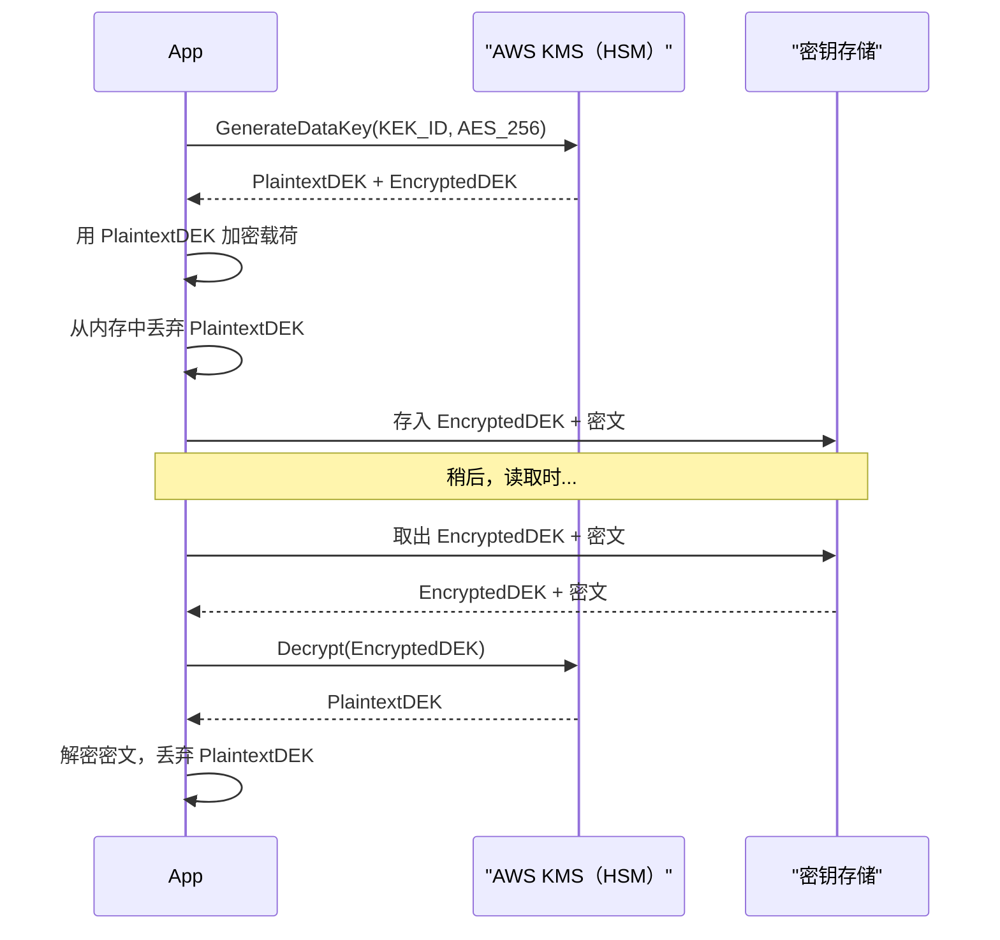
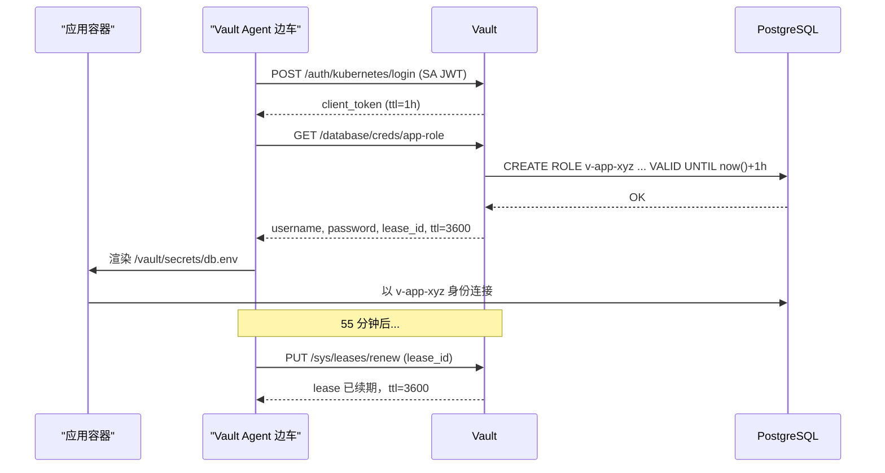
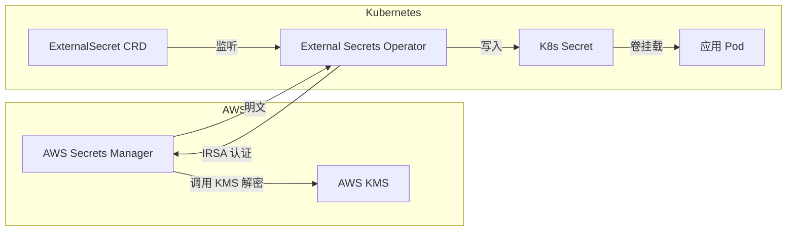

# 密钥管理：Vault、KMS，以及配置文件里密钥的终结

> **TL;DR**: 密钥（数据库密码、API key、TLS 私钥）在运行时必须是明文，除此之外的每一个地方都必须加密。硬编码在配置文件和环境变量里的密钥，是灾难性泄露的头号成因：Uber 2016 年泄露 5700 万用户记录，起点就是提交进私有 GitHub 仓库的 AWS 凭据 [^1]。解法是集中式密钥管理器（HashiCorp Vault、AWS Secrets Manager、GCP Secret Manager），底层靠信封加密（envelope encryption）：由 KMS 保护的主密钥加密每一条记录各自的数据密钥，而数据密钥从不离开内存。真正的杀手级能力是动态密钥：按请求签发、短时有效的凭据，在攻击者用上它之前就已过期。30 分钟就失效的东西，泄露了也无所谓。

## 学习目标

学完本章，你将能够：

- [ ] 把密钥从配置文件里搬进真正的密钥管理器
- [ ] 解释信封加密与 KMS 托管的数据密钥
- [ ] 为数据库和云凭据设计动态密钥签发
- [ ] 通过 External Secrets、CSI 或 Vault Agent 把密钥接入 Kubernetes
- [ ] 检测并响应密钥泄露（Gitleaks、GitHub secret scanning）

## 直觉理解

家门钥匙你随身带着。你不会把它用胶带贴在门上，还在上面写好地址，然后祈祷没人路过。可工程师对数据库密码干的就是这件事：提交进版本控制、粘进 CI 环境变量、在 Slack 里随手分享。

再想象一位锁匠，每天早上给你配一把新钥匙。每把钥匙管用 8 小时，之后锁就不认它了。如果有人午饭时偷拍了你的钥匙，到晚饭时那把钥匙已经作废。这就是动态密钥模型：按时自动销毁的凭据。

锁匠要配新钥匙，自己得有一把主钥匙。主钥匙放在保险库里（字面意义上的、用螺栓固定在地板上的保险柜）。没人会把主钥匙带在身上。你需要当天的钥匙时，先向锁匠证明身份，锁匠在保险库内用主钥匙配一把，再把一份限时副本交给你。主钥匙从不离开保险库。这就是信封加密：主密钥（KEK）加密短命的数据密钥（DEK），由 DEK 去干实际的活。

本章带你走完这段演进：从“密码写在配置文件里”到“按需签发、全程审计、自动吊销的临时凭据”。[认证与授权](./00-authn-authz.md) 讲的是如何证明身份，本章讲的是身份系统所保护的那些密钥，后来都怎么样了。

## 原理

### 密钥不该待的地方

提交进版本控制的密钥，会永远留在 git 历史里。在下一个 commit 里删掉文件没用：每一个克隆、每一个 fork、每一份备份里都躺着明文。环境变量会出现在 `/proc/<pid>/environ`、崩溃转储和 CI 构建日志里。Kubernetes 的 Secret 对象只是 base64 编码，不是加密，而且默认以未加密形式存放在 etcd 中 [^2]。

后果不是理论推演。2016 年，攻击者访问了 Uber 工程师使用的一个私有 GitHub 仓库，在代码里找到 AWS 访问密钥，并用它读取了一个 S3 存储桶，里面有 5700 万用户的姓名、邮箱、手机号，以及 60 万名司机的驾照号 [^1]。Uber 通过漏洞赏金项目付给攻击者 10 万美元要求封口，随后又因这起掩盖行为向美国各州总检察长支付 1.48 亿美元和解金 [^3]。

CircleCI 2023 年 1 月的入侵是同一套剧本。工程师笔记本上的恶意软件偷走了一个通过 2FA 之后的会话 cookie。攻击者用这个令牌从运行中的进程里提取加密密钥，解密 CircleCI 生产数据库中存放的客户密钥（环境变量、OAuth token、AWS key）。给全体客户的通告是：凡是在 2022 年 12 月 16 日（工程师笔记本被攻陷那天）到 2023 年 1 月 4 日之间存进 CircleCI 的密钥，全部轮换 [^4]。

教训是：密钥绝不能存放在这样一个位置——攻陷该位置就能拿到密钥，中间不需要再多一道认证。

### 信封加密与 KMS

如果每个密钥都直接用存放在 HSM 里的主密钥加密，那么每次读写都要往 HSM 跑一趟。规模一大，这既太慢也太贵。信封加密用两层密钥体系解决这个问题。

客户端调用 KMS 的 `GenerateDataKey`，指定主密钥（KEK）和密钥规格（例如 AES-256）。KMS 返回两样东西：一份明文数据密钥（DEK），以及该 DEK 用 KEK 加密后的副本。客户端在内存里用明文 DEK 加密载荷，随即丢弃明文 DEK，把加密后的 DEK 和密文一起存起来。读取时，客户端把加密的 DEK 送回 KMS 解密，用拿回的明文 DEK 解开载荷，然后再把 DEK 丢掉 [^5]。

AWS Secrets Manager 用的正是这个套路：“Secrets Manager 并不用 KMS 密钥直接加密密钥值。它用 KMS 密钥生成并加密一个 256 位 AES 对称数据密钥，再用这个数据密钥加密密钥值” [^5]。

*明文 DEK 在应用内存里只存在几微秒。KEK 从不离开 HSM。轮换 KEK 只需要重新包裹 DEK，不必重新加密 PB 级的数据。*

为什么这很重要：

- KEK 从不越过 HSM 的边界。攻陷存储只能拿到密文和被包裹的 DEK。
- 轮换 KEK 不需要重新加密全部载荷数据。你把 DEK 用新 KEK 重新包裹一遍即可。
- AWS KMS 的 HSM 于 2025 年 2 月通过 FIPS 140-3 安全三级认证 [^6]，满足银行与政府的合规要求。
- 成本可控：每个客户托管密钥每月 1 美元，每 1 万次对称 API 请求 0.03 美元。

### 动态密钥

静态凭据是负债，因为它的爆炸半径在时间上没有边界。一个泄露的数据库密码，在有人想起来轮换之前一直有效。动态密钥消灭了这类风险。

Vault 的数据库密钥引擎配置一条到数据库的特权 root 连接，以及一个把建号 SQL 语句做成模板的 role。应用来要凭据时，Vault 生成唯一的用户名和密码，执行 `CREATE ROLE ... WITH LOGIN PASSWORD ... VALID UNTIL ...`，连同一个 lease ID 和 TTL（通常 1 小时）一起返回。租约到期，Vault 执行吊销语句，把这个 role 删掉 [^7]。

*应用从头到尾看不到 Vault token，也看不到数据库的 root 凭据。它只是从共享的 tmpfs 卷里读一个渲染好的配置文件。泄露的凭据在排查开始之前就过期了。*

同一套模式也适用于云凭据。Vault 的 AWS 密钥引擎会扮演一个 IAM role，返回 STS 临时凭据，这些凭据“基于时间，并在 Vault 租约到期时自动吊销” [^8]。对 CI/CD 流水线来说，OIDC 联合身份（CircleCI 或 GitHub Actions 签发 JWT，AWS STS 直接信任）彻底消灭了长命的云密钥。

> [!IMPORTANT]
> 动态密钥要求应用能处理凭据续期。那种把凭据缓存到进程生命周期结束的朴素写法，会在租约到期时崩掉。用 Vault Agent 的模板渲染，或者在刷新时重绑连接池。

### Kubernetes 中的密钥

要把外部密钥送进 Pod，同时又不重新引入明文泄露，Kubernetes 上有三种主流做法。

**External Secrets Operator（ESO）** 是一个 CNCF sandbox 项目。控制器 watch `ExternalSecret` 这类 CRD，调用外部提供方（Vault、AWS Secrets Manager、GCP Secret Manager、Azure Key Vault 以及 20 多个其他后端），写出一个原生的 Kubernetes `Secret` 对象。应用照常消费这个 Secret。外部存储里的轮换会在下一个 `refreshInterval` 自动传导过来 [^9]。

**Secrets Store CSI Driver** 通过 CSI 驱动，把密钥以 tmpfs 卷的形式直接挂进 Pod 的文件系统。密钥从不写进 etcd。这彻底消除了“etcd 里的 base64”问题，但要求每个节点都支持这种 CSI 卷类型 [^10]。

**Vault Agent Injector** 是一个 mutating webhook，往打了注解的 Pod 里注入边车。边车用 Pod 的投射服务账号令牌向 Vault 认证，取回密钥，渲染成共享卷上的文件。租约续期和模板渲染它原生就会 [^11]。

*ESO 按计划拉取密钥。应用消费的是一个普通的 Kubernetes Secret。AWS 侧的轮换会在下一个刷新周期自动传导。*

**2026 年给 Kubernetes-on-AWS 团队的建议：** External Secrets Operator + AWS Secrets Manager + IRSA（IAM Roles for Service Accounts）+ CI 侧 OIDC。多云且受监管的团队：Vault Enterprise（现属 IBM，BSL 许可），用云 KMS 做自动解封；或者对许可证有宽松要求的团队，用 OpenBao（CNCF Sandbox 的开源分支）。

### 泄露检测与响应

预防注定有漏网，检测就是第二道防线。

**GitHub Secret Scanning** 在服务端对每次推送运行，覆盖数百种提供方专属的 token 格式，背后是一个庞大的合作伙伴计划。推送保护（push protection）在 git 协议层就拦下 commit，让它根本到不了服务器。检测到公开泄露时，GitHub 的合作伙伴计划会通知签发方（AWS、Stripe、Slack），后者能在数秒内自动吊销该 token [^12]。

**Gitleaks 和 TruffleHog** 是开源的“正则 + 熵”扫描器，可跑在 CI 里，也可作为 pre-commit 钩子。它们扫描 `git log -p` 的输出（CI 里需要 `fetch-depth: 0`），一旦命中就让构建失败。

**事件响应**必须严格按顺序：立刻轮换泄露的凭据，吊销由它派生的活动会话，审计日志找出泄露窗口内的所有使用，确定爆炸半径，通知受影响方。先轮换，再调查。耽误的每一分钟，都是攻击者能用上这把凭据的一分钟。

> [!TIP]
> 在蜜罐位置放金丝雀 token（假的 AWS key、假的数据库密码）。它们一旦被使用，你就知道有入侵者正在活动，而且准确知道是哪个位置被攻陷了。

## 真实案例

Adobe 把 HashiCorp Vault Enterprise 当作整个工程组织的平台即服务来运营。（注：HashiCorp 于 2023 年 8 月把 Vault 的许可从 MPL 2.0 切换为 Business Source License。IBM 于 2025 年 2 月 27 日完成对 HashiCorp 的收购。开源社区在 Linux 基金会下分叉出 OpenBao，该项目于 2023 年 12 月进入 CNCF Sandbox。）根据一次 HashiConf 演讲，这套部署横跨四个区域、约 10 万台主机，支撑 20 多个产品、每年数万亿次事务 [^13]。上线两年后，据称已有 130 多个内部团队接入这个共享 Vault 服务。

**架构决策：**

- **共享服务模式。** 一个 Vault 平台团队运营集群，各产品团队通过自助命名空间接入。这和“一个中央 Kubernetes 集群”对比“每个团队各跑一套”，是同一个集约化论证。
- **靠云 KMS 自动解封。** Vault 默认的 Shamir 封印要求 M-of-N 个人类操作员在每次重启后重建主密钥。凌晨三点、横跨 5 个区域，这就是一场可靠性危机。自动解封把解封操作委托给一把云 KMS 密钥，Shamir 只保留作为灾难恢复封印。
- **认证方式。** 容器化负载用 Kubernetes 服务账号 JWT，EC2 上的服务用 AWS IAM，遗留批处理任务用 AppRole。
- **密钥引擎。** 带版本的静态凭据用 KV v2；动态 PostgreSQL 与 MySQL 凭据用 database 引擎；内部 mTLS 证书用 PKI 引擎（见 [mTLS 与服务间认证](./03-mtls-service-auth.md)）；加密即服务用 transit 引擎，应用把明文发过去、拿回密文，全程不碰 DEK。

结果：密钥访问的审批时间从大约 1 小时（人工审批）降到秒级（基于策略）。平台团队管一个 Vault 集群，而不是让 20 个产品团队各管一套，同时全组织拥有统一的审计日志。

## 权衡

| 方案 | 优点 | 缺点 | 适用场景 | 我们的选择 |
|---|---|---|---|---|
| Kubernetes Secrets | 内置，消费方式简单 | 只是 base64，并非加密；默认在 etcd 中明文存放 | 已开启 etcd 静态加密的小集群 | 仅在 etcd 加密由 KMS 支撑时使用 |
| 云密钥管理器（AWS SM / GCP SM） | 托管、与 IAM 集成、可通过 Lambda 自动轮换 | 厂商锁定；每个密钥每月 0.40 美元，累积起来不少 | 单云团队、合规敏感负载 | 单云场景的默认选择 |
| HashiCorp Vault（2023 年 8 月起为 BSL 许可；2025 年 2 月起属 IBM） | 动态密钥、多云、transit/PKI 引擎 | BSL 许可（非开源）；运维负担：解封、高可用存储、升级 | 大型组织、多云、受监管行业 | 多云场景的默认选择 |
| OpenBao（CNCF Sandbox，Vault 的 Linux 基金会分叉） | 开源（MPL 2.0）、社区治理、API 与 Vault 兼容 | 生态更年轻，企业级集成较少 | 需要开源 Vault 替代品的团队 | 有开源强制要求时评估 |
| External Secrets Operator | 兼具云与 Kubernetes 之长；GitOps 原生 | 组件更多；最终仍然写进 etcd | Kubernetes + 云密钥管理器、团队众多 | K8s-on-cloud 的默认选择 |
| Secrets Store CSI Driver | 完全绕开 etcd，Pod 级挂载 | 每个节点都要支持 CSI；应用必须读文件 | 高合规要求的 Kubernetes 负载 | etcd 暴露不可接受时使用 |

## 常见陷阱

> [!WARNING]
> **把环境变量和 `.env` 文件当成密钥层。** 环境变量会通过 `/proc/<pid>/environ` 泄露给任何同 UID 的进程，会出现在崩溃转储里，脚本一执行 `set -x` 就被回显进 CI 日志。配置文件则会以“只是本地开发用”的名义被提交，轮换意味着每个服务都得重新部署。而且“谁在什么时候读过这个密钥”没有任何审计线索。第一次 commit 之后，就该上真正的密钥管理器（云 SM、Vault、ESO）。

> [!WARNING]
> **把明文密钥提交进版本控制。** 一个被提交的密钥，即便下一个 commit 就删掉，也会永远留在 git 历史和每一个克隆、每一个 fork 里。唯一安全的应对是立刻轮换。不要先去改写 git 历史。

> [!WARNING]
> **把 Kubernetes Secret 当成加密。** API 名字里有“Secret”，让人以为有保护，其实没有。值只是 base64 编码，不是加密。任何在该命名空间拥有 RBAC `secrets:get` 权限的人，一条 `base64 -d` 就解出来了。用 KMS 提供方开启 etcd 静态加密 [^2]。

> [!WARNING]
> **长命静态凭据且从不轮换。** “轮换排在下个季度。” 永远不会。2023 年 1 月，那些存了长命 AWS key 而没用 OIDC 联合身份的 CircleCI 客户，只能把每一个 key 都当作已泄露处理 [^4]。引擎支持动态密钥的地方就用动态密钥。

> [!WARNING]
> **生产环境手工解封 Vault。** Shamir 秘密共享要求每次重启后由 M-of-N 个人类操作员到场。凌晨三点、5 个区域，这是 on-call 的噩梦。日常封印用云 KMS 自动解封；Shamir 只留作灾难恢复的兜底。

> [!WARNING]
> **密钥混进日志行和错误响应。** 连接串、API key、token 会出现在堆栈跟踪、调试日志和 HTTP 错误体里。所有日志输出都要脱敏。返回给客户端的错误信息里绝不能带凭据。

## 练习

为一个平台设计密钥层：30 个微服务跑在 Kubernetes（AWS EKS）上，用 PostgreSQL 数据库，需要 Stripe 和 SendGrid 的 API key，CI/CD 走 GitHub Actions。请明确：(1) 哪类密钥由哪个工具管理；(2) 每类密钥的轮换节奏；(3) 开发者本地和生产环境取用密钥的体验；(4) 一旦发生密钥被提交的事件，响应预案是什么。

提示

按“能否动态”给密钥分类：数据库凭据可以动态，第三方 API key（比如 Stripe）只能是静态。静态密钥的轮换节奏取决于提供方支持到什么程度。对 CI 而言，要想办法用 OIDC 彻底消灭长命凭据。

解答

**工具选型：**

- **AWS Secrets Manager** 管 Stripe 和 SendGrid 的 API key（静态，通过 Lambda 每季度轮换）。
- **Vault database 引擎** 管 PostgreSQL 凭据（动态，1 小时 TTL，每个 Pod 独立用户名）。
- **External Secrets Operator** 把两者同步成 Kubernetes Secret，供 Pod 消费。
- **GitHub Actions OIDC** 在 CI 里直接扮演 AWS IAM role，彻底不需要存 AWS key。

**轮换节奏：**

| 密钥类型 | 轮换 | 机制 |
|---|---|---|
| PostgreSQL 凭据 | 每 1 小时（动态） | Vault database 引擎，自动 |
| Stripe API key | 每 90 天 | AWS Secrets Manager + Lambda 轮换函数 |
| SendGrid API key | 每 90 天 | AWS Secrets Manager + Lambda 轮换函数 |
| TLS 证书 | 每 30 天 | Vault PKI 引擎，自动续期 |
| CI 云凭据 | 每个 job（分钟级） | OIDC 联合身份，不存密钥 |

**开发者体验：**

- 本地开发：用 OIDC SSO 执行 `vault login`，再 `vault read database/creds/dev-role` 拿一份个人的短时数据库凭据。一个 `.env.vault` 包装脚本把这一切做掉，对开发者透明。
- 生产：Pod 通过 ESO 管理的 Kubernetes Secret 以文件形式拿到密钥。开发者永远看不到生产凭据。
- 新建密钥：向 Terraform 模块提 PR，声明 `ExternalSecret` CRD 和 Vault role。评审、合并、应用。

**密钥被提交事件的响应：**

1. 立刻轮换该密钥（Secrets Manager API 或 Vault revoke）。
2. 吊销由它派生的所有会话和 token。
3. 在 CloudTrail 和 Vault 审计日志里排查暴露窗口内的未授权使用。
4. 确定爆炸半径：这把凭据能碰到哪些数据？
5. 把该密钥的匹配模式加进 Gitleaks 配置，并为仓库开启 GitHub 推送保护。
6. 复盘：pre-commit 钩子为什么没拦住？

## 要点回顾

- 静态长命密钥是负债。动态、短命的凭据才是现代默认。
- 信封加密把主密钥留在 HSM 里，用逐条记录的数据密钥换性能。轮换 KEK 不需要重新加密数据。
- Kubernetes Secret 是 base64，不是加密。用 KMS 提供方开启 etcd 静态加密，或者用 CSI 驱动完全绕开 etcd。
- Kubernetes-on-AWS：External Secrets Operator + AWS Secrets Manager + IRSA。多云场景：Vault Enterprise（IBM/HashiCorp，BSL 许可）配自动解封，或者在对许可证有宽松要求时选 OpenBao（CNCF Sandbox，开源分支）。
- 密钥一旦泄露，先轮换，再调查。每晚一分钟，攻击者就多一分钟可动作。
- 密钥扫描（GitHub、Gitleaks、TruffleHog）是检测层，不是预防层。配合推送保护，在 commit 落地前就拦下来。
- 一切都留审计。Vault 和 KMS 产出的审计日志，是泄露事件里做取证的基础材料。

## 延伸阅读

- [HashiCorp Vault Architecture](https://developer.hashicorp.com/vault/docs/internals/architecture) - Vault 的 barrier、封印/解封与密钥引擎流水线的权威描述。在生产环境运营 Vault 之前先读这篇。
- [AWS Secrets Manager Encryption and Decryption](https://docs.aws.amazon.com/secretsmanager/latest/userguide/security-encryption.html) - 用 GenerateDataKey、EncryptionContext 和 CloudTrail 审计条目的完整信封加密流程。
- [CircleCI Incident Report, January 4, 2023](https://circleci.com/blog/jan-4-2023-incident-report/) - 公开复盘，展示一次会话 cookie 失窃如何级联成客户密钥的全面外泄。CI/CD 安全必读。
- [OWASP Secrets Management Cheat Sheet](https://cheatsheetseries.owasp.org/cheatsheets/Secrets_Management_Cheat_Sheet.html) - 从审计员视角给出的实操清单，覆盖存储、轮换与事件响应。
- [External Secrets Operator Documentation](https://external-secrets.io/) - CRD、SecretStore、ClusterSecretStore，以及 20 多个提供方插件与 Kubernetes 的集成方式。
- [Secrets Store CSI Driver](https://secrets-store-csi-driver.sigs.k8s.io/) - 由 SIG-Auth 维护的另一条路：把密钥当 tmpfs 卷挂载，彻底绕开 etcd。
- [GitHub Secret Scanning](https://docs.github.com/en/code-security/secret-scanning) - 扫描什么、合作伙伴自动吊销计划，以及推送保护的配置。
- [Gitleaks](https://github.com/gitleaks/gitleaks) - 本地与 CI 密钥扫描的开源参考实现。它的配置格式已被业界广泛采用。

## 记忆卡片

**Q:** 什么是信封加密？
**A:** 两层密钥体系：数据加密密钥（DEK）加密载荷，由 HSM 保护的密钥加密密钥（KEK）加密 DEK。KEK 从不离开 HSM，明文 DEK 只在加解密期间存在于内存。

**Q:** 为什么轮换 KEK 不需要重新加密全部数据？
**A:** 只需要用新 KEK 重新加密被包裹的 DEK。载荷密文保持不变，因为它是用 DEK 加密的，不是直接用 KEK 加密的。

**Q:** 什么是动态密钥？
**A:** 由密钥管理器按请求即时生成的短时凭据（例如 Vault database 引擎创建一个 TTL 1 小时的独立 Postgres 用户）。租约到期，凭据自动吊销。

**Q:** 为什么 Kubernetes Secret 默认并不真的保密？
**A:** 它只是 base64 编码，不是加密，而且在 etcd 中明文存放。任何在该命名空间有 RBAC 读权限的人都能解开。要真正保密，必须用 KMS 提供方开启 etcd 静态加密。

**Q:** 消费外部密钥的三种 Kubernetes 模式是什么？
**A:** (1) External Secrets Operator 把外部存储同步成原生 K8s Secret。(2) Secrets Store CSI Driver 把密钥以 tmpfs 卷挂载，绕开 etcd。(3) Vault Agent Injector 跑一个边车，向 Vault 认证并把密钥渲染成共享文件。

**Q:** Uber 2016 年泄露的根因是什么？
**A:** 提交进私有 GitHub 仓库的 AWS 访问密钥。攻击者找到密钥，用它访问了一个装着 5700 万用户 PII 的 S3 存储桶。这些密钥是长命的，而且 IAM 权限过宽。

**Q:** 密钥泄露时，事件响应的正确顺序是什么？
**A:** 立刻轮换，吊销派生会话，审计日志排查未授权使用，确定爆炸半径，通知受影响方。先轮换，再调查。

**Q:** Vault 自动解封解决了什么问题？
**A:** Vault 默认的 Shamir 封印要求每次重启后由 M-of-N 个人类操作员重建主密钥。自动解封把这件事委托给一把云 KMS 密钥，免去了凌晨三点跨多个区域拼装密钥分片的运维负担。

**Q:** GitHub Secret Scanning 的合作伙伴计划如何缩小爆炸半径？
**A:** 检测到公开泄露时，GitHub 通知签发方（AWS、Stripe、Slack），后者能在数秒内自动吊销 token，压缩从泄露到被滥用之间的窗口。

**Q:** 2026 年 Kubernetes-on-AWS 团队推荐的密钥栈是什么？
**A:** 运行时密钥用 External Secrets Operator + AWS Secrets Manager + IRSA（IAM Roles for Service Accounts），再加上 CI 侧（GitHub Actions 或类似工具）的 OIDC 联合身份，消除流水线里的长命云凭据。多云场景用 Vault Enterprise（属 IBM，2023 年起 BSL 许可）或 OpenBao（CNCF Sandbox 开源分支）配自动解封。

**Q:** 为什么动态数据库凭据优于静态密码？
**A:** 动态凭据每个实例都唯一（审计可归因），自动过期（限制爆炸半径），吊销是一个按计划跑的后台任务而不是一场事故。一份 1 小时就过期的凭据，在排查开始前已经失效。

**Q:** FIPS 140-3 安全三级认证对 KMS 意味着什么？
**A:** HSM 硬件具备防篡改痕迹和抗篡改的物理安全机制、基于身份认证的访问控制，且密钥材料无法以明文导出。AWS KMS 于 2025 年 2 月达标，满足银行与政府的合规要求。

## 参考文献

[^1]: Wired, "Uber tried to cover up a hack that hit 57 million customers." https://www.wired.co.uk/article/uber-hack-dara-khosrowshahi-bloomberg
[^2]: Kubernetes, "Good practices for Kubernetes Secrets." https://kubernetes.io/docs/concepts/security/secrets-good-practices/
[^3]: NPR, "Uber Pays $148 Million Over Yearlong Cover-Up Of Data Breach." https://www.npr.org/2018/09/27/652119109/uber-pays-148-million-over-year-long-cover-up-of-data-breach
[^4]: Rob Zuber (CircleCI CTO), "CircleCI incident report for January 4, 2023 security incident." https://circleci.com/blog/jan-4-2023-incident-report/
[^5]: AWS, "Secret encryption and decryption in AWS Secrets Manager." https://docs.aws.amazon.com/secretsmanager/latest/userguide/security-encryption.html
[^6]: AWS, "AWS KMS is now FIPS 140-3 Security Level 3." https://aws.amazon.com/blogs/security/aws-kms-now-fips-140-2-level-3-what-does-this-mean-for-you/
[^7]: HashiCorp, "Database secrets engine." https://developer.hashicorp.com/vault/docs/secrets/databases
[^8]: HashiCorp, "AWS secrets engine." https://developer.hashicorp.com/vault/docs/secrets/aws
[^9]: External Secrets Operator, project documentation. https://external-secrets.io/
[^10]: Kubernetes SIG-Auth, "Secrets Store CSI Driver." https://secrets-store-csi-driver.sigs.k8s.io/
[^11]: HashiCorp, "Vault Agent Injector." https://developer.hashicorp.com/vault/docs/platform/k8s/injector
[^12]: GitHub, "Supported secret scanning patterns." https://docs.github.com/code-security/secret-scanning/secret-scanning-patterns
[^13]: HashiCorp, "Secrets Management" (Adobe scale numbers). https://www.hashicorp.com/products/vault/secrets-management
