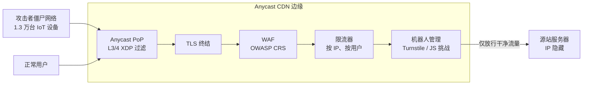
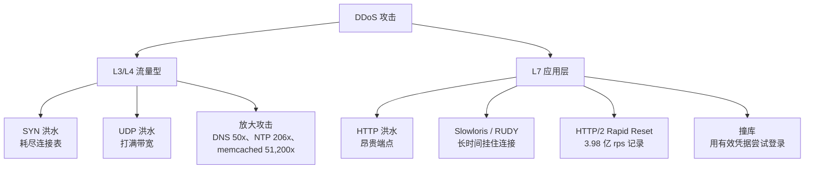
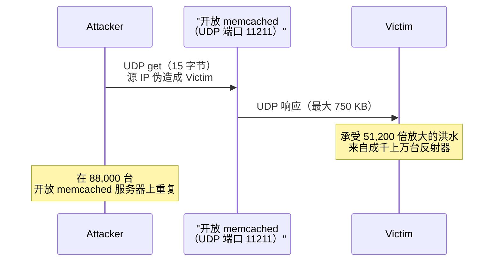
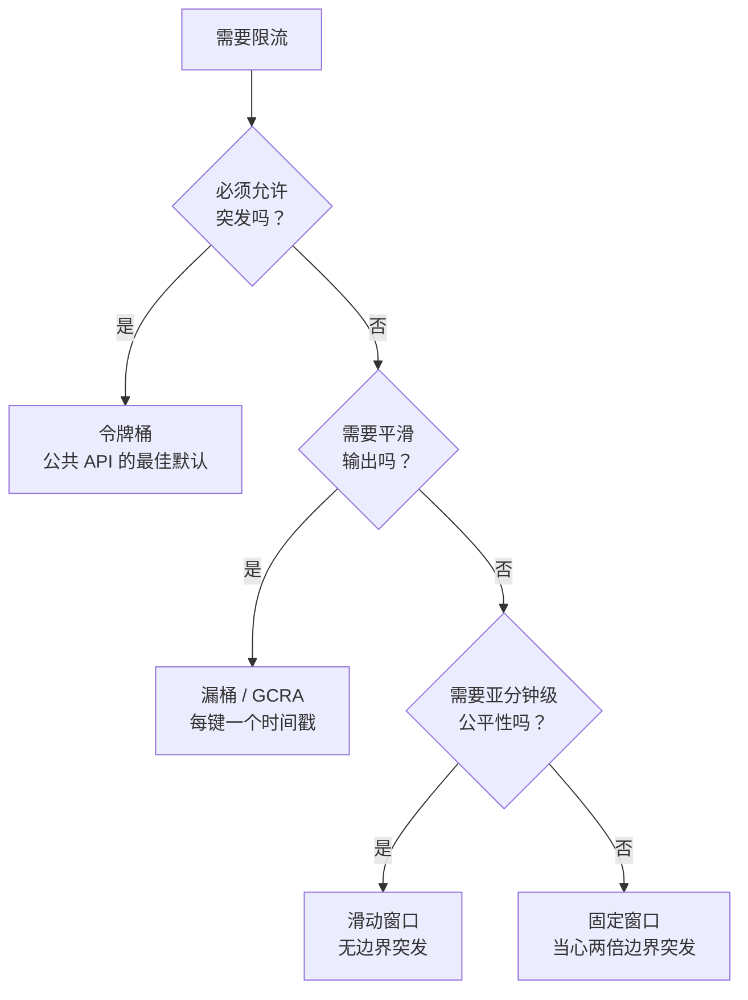

# DDoS 防护与 WAF：抵御流量型与应用层攻击

> **TL;DR**: DDoS 攻击可以分成两类问题：流量型的 L3/L4 洪水打满带宽，应用层的 L7 洪水则用协议合法的请求耗尽服务器资源。防御是分层的：具备数百 Tbps 容量的 anycast CDN 吸收原始流量，WAF 拦截已知的恶意模式，限流器压住单个客户端的吞吐量，机器人管理筛掉复杂的自动化流量。“直接扩容”算不上策略。如今最大的 DDoS 攻击已超过 30 Tbps：Aisuru-Kimwolf 僵尸网络（100 万到 400 万台受感染设备）在 2025 年底的一次 35 秒攻击中峰值达到 31.4 Tbps [^1]，而一个 Mirai 变种、由 13,000 台设备组成的僵尸网络在 2024 年第四季度的 80 秒内峰值达到 5.6 Tbps [^2]。没有哪个源站能靠自动扩容扛过这种攻击，账单本身就会变成攻击。

## 学习目标

学完本章，你将能够：

- [ ] 区分 L3/L4 与 L7 的 DDoS 攻击，并据此匹配防御手段
- [ ] 在边缘、网关和应用层分别设计限流
- [ ] 配置 WAF 拦截 OWASP Top 10 中的攻击类别
- [ ] 用机器人管理应对撞库和爬取
- [ ] 制定 DDoS 事件响应手册

## 直觉理解

想象你经营一家很火的餐厅。某天晚上，一千号人涌进来。他们不点菜。他们堵在门口，占满每一张桌子，把领位的注意力全占住。真正的客人进不来。这就是流量型攻击：用纯粹的数量压垮容量。

再想象一种更隐蔽的攻击。十个人走进来，看起来和普通食客没两样。他们点菜单上最复杂的那道菜，然后退掉，再点，再退。厨房忙着做没人吃的菜，被彻底拖垮。从外面看，餐厅一切正常。这就是应用层攻击：看起来完全合法的昂贵请求。

你的防御是分层的。门口的保安（anycast CDN）把明显的闹事人群挡在外面。领位（WAF）核对预订和着装要求。厨房经理（限流器）限制一桌每小时能下多少单。行为分析师（机器人管理）注意到那十个“食客”都是同一辆出租车来的，用的还是同一张信用卡。

没有任何单层能独立奏效。保安看不出衣着得体的攻击者。厨房经理拦不住门口的一千个人。在互联网规模上，分层防御是唯一可行的做法——攻击者每月花几十美元就能租到僵尸网络，而史上最大的攻击已达到 31.4 Tbps [^1]。

## 原理

### 攻击分类：L3/L4 与 L7

[网络基础](../part-0-prerequisites/00-networking-fundamentals.md)介绍过 OSI 分层。DDoS 攻击利用不同层次，机制也根本不同。

**L3/L4 攻击**打满网络带宽或内核的连接状态。SYN 洪水塞满服务器的半开连接表。UDP 洪水发送垃圾包的速度超过网卡的处理能力。这类攻击使用伪造的源 IP，受害者甚至无法识别真正的发送方。

**L7 攻击**用协议合法的请求耗尽应用资源。HTTP 洪水打向昂贵的端点（搜索、登录、结算）。Slowloris 用不完整的头部把连接一直挂着。HTTP/2 Rapid Reset 攻击（CVE-2023-44487）滥用流取消机制，把 Google 的基础设施推到每秒 3.98 亿次请求 [^3]。

关键认识在这里：WAF 规则对 SYN 洪水毫无用处，SYN cookie 对撞库也毫无用处。它们是不同的问题类别，需要不同的防御。

*每一层处理下一层处理不了的东西。Anycast XDP 过滤器在网卡处、进入代理流水线之前就丢弃 L3/L4 洪水。TLS 在边缘终结，WAF 才能检查 L7。限流器压住每个客户端的吞吐量；机器人管理筛掉复杂的自动化。只有干净的流量能到达源站，而源站 IP 必须始终保密。*

*L3/L4 攻击用原始流量压垮网络容量；L7 攻击用看起来像真实流量的、协议合法的请求消耗应用资源。*

### 放大与反射

放大是攻击者的力量倍增器。攻击者向一台公共服务器发出一个小小的 UDP 请求，源 IP 伪造成受害者的地址。那台服务器把大得多的响应发回给受害者。

放大倍数相当惊人：

| 协议 | 放大倍数 | 机制 |
|----------|---------------------|-----------|
| DNS | 约 50 倍 | 开放的递归解析器 |
| NTP | 最高 206 倍 | `monlist` 查询 [^4] |
| memcached | 最高 51,200 倍 | 15 字节请求，750 KB 响应 |

memcached 是目前已知最糟糕的 UDP 放大器。2018 年 2 月，攻击者利用了大约 88,000 台默认开启 UDP 的开放 memcached 服务器 [^5]。一个 15 字节、源 IP 伪造的 `get` 请求触发了 750 KB 的响应，直接打向受害者。Cloudflare 于 2018 年 2 月 27 日公开这一攻击向量（当时观测到 257 Gbps 的入向放大流量），一天之后的 2 月 28 日，GitHub 就承受了 1.35 Tbps [^5][^6]。

*向开放 UDP 服务发送一个小小的伪造请求，就会产生一个指向受害者的大得多的响应；memcached 的放大倍数最高可达 51,200 倍。*

协议层面的缓解：关闭 memcached 的 UDP（`-U 0`）、只绑定 localhost，并在网络边缘部署 BCP38（入向过滤）以阻止 IP 伪造。

### HTTP/2 Rapid Reset（CVE-2023-44487）

2023 年 8 月，一种新的 L7 攻击滥用了 HTTP/2 的流取消机制。客户端用 HEADERS 打开一个流，立刻发送 RST_STREAM，然后重复。由于已关闭的流不计入 `SETTINGS_MAX_CONCURRENT_STREAMS`，一条 TCP 连接每秒就能翻搅出成千上万个被取消的请求 [^7]。

一个 20,000 台设备的僵尸网络对 Cloudflare 打出了每秒 2.01 亿次请求。Google 观测到 3.98 亿 rps [^3]。AWS 观测到超过 1.55 亿 rps [^8]。此前的 L7 记录是 7100 万 rps，创于 2023 年 2 月，也就是大约半年前 [^9]。

Cloudflare 的缓解办法：按连接统计服务端主动发出的 RST_STREAM。正常客户端每条连接只会犯“一两次错”。当计数超过阈值，就发送 GOAWAY 并关闭 TCP 连接。他们还部署了“IP 监狱”，在全网封禁滥用 IP [^7]。

> [!IMPORTANT]
> Rapid Reset 完全符合协议规范。每一台 HTTP/2 服务器都是脆弱的。修复需要给所有 HTTP/2 实现打补丁，而不只是写一条 WAF 规则。

### 限流算法

限流通过压住每个客户端的吞吐量来保护源站。常见的算法有五种，各有不同的权衡：

**令牌桶（token bucket）**以速率 R 补充令牌，桶容量上限为 B。每个请求消耗一个令牌。允许最高 B 的突发流量。这是公共 API 的合适默认选择，因为真实用户本来就是突发的 [^10]。

**漏桶（leaky bucket）**以固定速率处理请求，让输出变得平滑。适合扛不住突发流量的下游服务。

**固定窗口（fixed window）**按对齐时钟的区间计数。简单但有缺陷：客户端可以跨窗口边界发出两倍限额的请求 [^10]。

**滑动窗口（sliding window）**在滑动区间内记录时间戳。比固定窗口公平，没有边界突发问题，但占用更多内存。

**GCRA（Generic Cell Rate Algorithm，通用信元速率算法）**为每个键只维护一个时间戳（理论到达时间）。它以极小的存储开销保证平滑的间隔。它是漏桶的内存高效规范形式，用于信元网络和现代限流器 [^11]。

*选哪种限流算法，取决于你是否允许突发、是否需要平滑输出，或者是否受内存限制。*

**分布式限流**更难。单实例计数器在多副本部署里会失效，因为没有副本能看到全部流量。标准做法：用 Envoy 的外部限流服务加 Redis 的 `INCR` + `EXPIRE` 来实现跨实例的公平。把本地的按实例限流作为第一道防线（零跳、不发网络请求），再用 Redis 支撑的全局限流保证跨实例的准确性。

### WAF：OWASP Top 10 与核心规则集

Web 应用防火墙（WAF）用规则集检查 HTTP 请求。有两种模式：

**负向安全（拦截已知恶意）：** OWASP ModSecurity 核心规则集（CRS）自带针对 SQL 注入、XSS、命令注入等的规则。它使用偏执等级（paranoia level）：PL1 很少误报，PL4 非常激进。偏执等级越高，“越容易产生误报” [^12]。异常评分会累计每条规则的命中分数；只有当总分超过阈值时才拦截请求。

**正向安全（只放行已知正常）：** 只允许匹配已校验 schema 的请求。信噪比高，但每次 API 变更都会挂掉。

OWASP Top 10（2021）是权威的风险清单：

| # | 风险 | 关键事实 |
|---|------|----------|
| A01 | 访问控制失效 | 94% 的受测应用至少存在一处 [^13] |
| A02 | 加密机制失效 | 弱 TLS、明文密钥 |
| A03 | 注入 | SQL、NoSQL、OS 命令、LDAP |
| A04 | 不安全设计 | 缺少威胁建模 |
| A05 | 安全配置错误 | 默认凭据、公开的 S3 桶 |
| A06 | 易受攻击的组件 | 未打补丁的库 |
| A07 | 身份认证失效 | 撞库、弱口令 |
| A08 | 软件与数据完整性失效 | 未签名的更新、CI/CD 被攻陷 |
| A09 | 日志与监控失效 | 没有审计记录 |
| A10 | SSRF | 服务端请求伪造 |

**WAF 部署方式：** 先以计数（监控）模式运行，测量误报率。从日志里量化比例。在 30 到 90 天内转为拦截模式。给计数模式设一个时限，否则它会永远停在那儿（见“常见陷阱”）。

### 机器人管理

老练的攻击者模仿真实浏览器来绕过 WAF 签名。机器人管理叠加被动和主动两类信号：

**被动信号：** TLS 指纹（JA3/JA4）、HTTP/2 SETTINGS 帧的顺序、User-Agent 的合理性、IP 信誉、ASN 分类，以及行为分析（鼠标轨迹、时序模式）。Cloudflare 2024 年第四季度的数据显示，User-Agent `HITV_ST_PLATFORM` 出现在 99.9% 的纯 DDoS 流量中 [^2]。

**主动挑战：** JavaScript 挑战验证客户端确实执行了代码。CAPTCHA（hCaptcha、reCAPTCHA）加上视觉谜题。Cloudflare Turnstile 用无侵入的浏览器挑战替代可见的 CAPTCHA，把真人用户的摩擦降到最低 [^14]。

**军备竞赛：** 老练的攻击者会购买住宅代理和能通过指纹检查的无头浏览器。防御从签名演进到基于机器学习的行为模型。目标不是完美识别，而是把攻击者的成本抬到他们不愿支付的水平。

## 真实案例

**GitHub，2018 年 2 月 28 日：1.35 Tbps 的 memcached 放大攻击。**

UTC 17:21，GitHub 的监控发现传输链路上进出流量出现异常不对称。攻击峰值达 1.35 Tbps、每秒 1.269 亿个包，来源覆盖 1,000 多个自治系统 [^6]。这是当时有记录以来最大的 DDoS 攻击，超过了 2016 年 10 月的 Mirai/Dyn 事件（Dyn 从未正式公布攻击规模）[^15]。

GitHub 的传输容量同比翻了一倍，但依然无法独自吸收 1.35 Tbps。UTC 17:26，一条 ChatOps 命令撤销了 GitHub 自有传输提供商的 BGP 通告，改为只向 Akamai Prolexic 通告 AS36459。Prolexic 的清洗中心在其边界应用 ACL，再把干净流量通过 GRE 隧道转回 GitHub。

UTC 17:30，GitHub 完全恢复。真正的硬停机时间：5 分钟。UTC 17:34，为防备第二波 400 Gbps 的尖峰，又撤销了若干互联网交换点的通告 [^6]。

关键的工程决策：

1. **在 BGP 层面切换到清洗服务商**，而不是在源站硬扛。任何单点部署的防御都无法匹敌清洗网络的聚合容量。
2. **ChatOps 驱动的操作手册。** 一名工程师就发出了撤销 BGP 通告的命令。路由重收敛只花了几分钟，而不是几小时。
3. **事后自动化。** GitHub 承诺把服务商切换自动化，进一步压缩 MTTR。

memcached 这个向量之所以存在，是因为公网上有 88,000 台服务器默认开启了 UDP。Cloudflare 提前一天（2018 年 2 月 27 日）公开了该漏洞；GitHub 遭到的攻击在 24 小时内就验证了这个预测 [^5]。

## 权衡

边缘防护的选择最终收敛为两个有实质差异的档位（自建清洗只是合规上的边缘情况；完全不做边缘防护属于“常见陷阱”，不算一种备选方案）。按处于风险中的收入和被攻击频率来选：

- **免费档（AWS Shield Standard、Cloudflare 免费版）。** 不限量的 L3/L4 防护，没有按客户的 SLA，没有专属响应团队。Shield Standard 在每个 AWS 账户上默认开启，不额外收费 [^16]。Cloudflare 免费套餐用的是同一套 anycast 骨干网。这是所有服务的起点（小企业、副业项目，以及那些“等我们成了目标再升级”的人）。
- **付费档（AWS Shield Advanced、Cloudflare Enterprise）。** 增加有保证的 SLA、7×24 的 DDoS 响应团队（DRT）、可退还攻击期间自动扩容费用的成本保护额度，以及 L7 的 WAF 托管规则集。Shield Advanced 标价每月 3,000 美元 [^16]；Cloudflare Enterprise 按报价，区间相近。当每小时停机的收入损失超过月费，或者你反复成为目标时，就该上这一档。

只有在监管禁止第三方终结 TLS 时，自建清洗才是一个选项。任何单点部署都比不上全球 anycast 网络；Cloudflare 公开披露其 2024 年网络容量为 449 Tbps [^2]。只有合规上别无选择时才自己建。

## 常见陷阱

> [!WARNING]
> **生产环境完全不设边缘防护。** 一个小源站集群背后的单个公网 IP，会被一波流量型洪水直接打下线，而 anycast CDN 吸收这种流量时甚至不会有感觉。上线之前就打开免费档（AWS 上 Shield Standard 是自动的；Cloudflare 免费版只改一条 DNS）。所谓“需要的时候再加防护”，实际含义是在第一次攻击的凌晨 3 点才加。

> [!WARNING]
> **靠自动扩容硬扛 DDoS。** 自动扩容组会把攻击的 RPS 当成真实需求。你的账单就变成了攻击。一台每小时 0.1 美元的实例会变成每天 10,000 美元的 ASG。给自动扩容设上限，把 anycast CDN 放到前面，永远不要暴露源站 IP。AWS Shield Advanced 提供 DDoS 成本保护额度，正是为了这个。

> [!WARNING]
> **WAF 永远停在计数模式。** 半年前“只记日志”上线的规则，因为怕误报，一直没切成拦截。设一个硬时限：计数模式 30 到 90 天，然后转拦截。切换前先从日志里量化误报。

> [!WARNING]
> **不做校验就信任 X-Forwarded-For。** 限流中间件默认会读 XFF。攻击者在每个请求里带上 `X-Forwarded-For: 1.2.3.4` 来轮换“源 IP”，绕过按 IP 的限流。Mastodon 的 GHSA-c2r5-cfqr-c553 记录的就是这个 bug。修法：在可信边缘剥离 XFF，限流按 TCP 对端 IP 做键。

> [!WARNING]
> **源站 IP 在 CDN 背后泄露。** 攻击者直接打源站 IP，就绕过了你的 anycast CDN。IP 会通过历史 DNS 记录（SecurityTrails、Censys）、邮件头，或者没有 CDN 覆盖的子域泄露。修法：源站防火墙只放行 CDN 的 IP 段；使用带认证的回源（authenticated origin pulls）；如果已泄露就更换 IP。

> [!WARNING]
> **攻击期间 CAPTCHA 服务商自己被限流。** 撞库时，你的 CAPTCHA 服务撞上自己的 QPS 上限开始失败。于是每一次登录都被拒绝，包括真实用户。修法：使用带静默降级的托管挑战（Turnstile 会自动轮换），缓存验证通过的令牌，并为已知正常的设备保留应急旁路。

## 练习

为一个电商网站设计 DDoS 与 WAF 防护：它会在新品发布时出现流量尖峰，并周期性地被竞争对手针对。选一家服务商，配置限流，选定 WAF 规则，并起草攻击发生时的应急处置手册。

提示

按层来想：什么在边缘吸收流量？什么在代理处检查 L7？什么保护源站不被单个客户端滥用？还有，凌晨 3 点呼机响起来的时候，会发生什么？

参考答案

**服务商：** Cloudflare Pro 或 Business 档，打包 CDN/WAF/DDoS。如果在 AWS 上，则用 CloudFront + AWS WAF + Shield Advanced，账单统一且能拿到 DRT 支持。

**分层防御：**

1. **边缘（Cloudflare/CloudFront）：** anycast 吸收 L3/L4。TLS 在这里终结。所有流量都走 CDN；源站 IP 隐藏，防火墙只放行 CDN 网段。
2. **WAF：** 部署 OWASP CRS，偏执等级 2。先在预发流量上以计数模式跑 30 天。确认误报率低于 0.1% 后转拦截。针对已知 CVE 加托管规则（虚拟补丁）。
3. **限流：** 边缘用令牌桶：`/api/*` 每 IP 每分钟 100 次请求，`/login` 每分钟 10 次。应用层用滑动窗口：`/checkout` 每个用户 ID 每小时 5 单。
4. **机器人管理：** 在登录和结算开启 Turnstile。通过已验证的 ASN 放行 Googlebot 和监控机器人。封禁已知的恶意 User-Agent。

**应急处置手册：**

1. **发现：** 对 5xx 比例 > 5% 持续 2 分钟、或边缘拦截请求数 > 基线 10 倍告警。
2. **判断：** 看攻击是 L3/L4（带宽饱和）还是 L7（源站 CPU/内存）。看板：Cloudflare Analytics 或 Shield Advanced 指标。
3. **升级：** 如果是 L7 且 WAF 拦不住，联系服务商的响应团队（Cloudflare Enterprise SOC 或 AWS SRT）。这需要 Business/Enterprise 级支持。
4. **缓解：** 临时收紧限流。开启“Under Attack”模式（对所有请求加 JS 挑战）。如果源站被打垮，在边缘启用维护页。
5. **沟通：** 10 分钟内在状态页更新。在 Slack 里开内部作战室。
6. **恢复：** 逐步放宽限流。确认正常流量在流动。48 小时内做复盘。

完整的手册框架见[事件管理](../part-6-reliability-and-operations/07-incident-management.md)。

## 要点回顾

- 纵深防御：边缘吸收流量，WAF 拦截已知恶意模式，限流器保护源站，机器人管理收拾剩下的复杂流量。
- “扩容扛过去”在经济上必输。账单会变成攻击。改用具备数百 Tbps 容量的 anycast CDN。
- L3/L4 和 L7 是不同的问题类别。SYN cookie 挡不住 HTTP 洪水；WAF 规则挡不住带宽饱和。
- L7 是增长点：Cloudflare 2024 年第四季度的 690 万次攻击中，51% 是 HTTP DDoS [^2]。
- 在多个层次限流（边缘、网关、应用），用不同的键（IP、用户 ID、端点）。
- WAF 必须在有限的时限内从计数模式毕业到拦截模式。没切的规则提供零保护。
- 藏好源站 IP。一旦泄露，整套 CDN 防御就被绕过了。

## 延伸阅读

- [Cloudflare 2025 Q4 DDoS Threat Report](https://blog.cloudflare.com/ddos-threat-report-2025-q4/)。当前创纪录的 31.4 Tbps 攻击、Aisuru-Kimwolf 僵尸网络（100 万到 400 万台 Android TV），以及 2025 年全年 4710 万次已缓解攻击。
- [Cloudflare 2024 Q4 DDoS Threat Report](https://blog.cloudflare.com/ddos-threat-report-for-2024-q4/)。2024 年 10 月的 5.6 Tbps 攻击、2024 年全年 2130 万次攻击，以及详细的 L7 趋势数据。
- [HTTP/2 Rapid Reset: deconstructing the record-breaking attack](https://blog.cloudflare.com/technical-breakdown-http2-rapid-reset-ddos-attack/)。关于 CVE-2023-44487 的权威协议级分析，含 Cloudflare 的缓解方案。
- [GitHub: February 28th DDoS Incident Report](https://github.blog/news-insights/company-news/ddos-incident-report/)。公开材料中最清晰的 L3/L4 事件叙述：发现、向 Akamai 做 BGP 故障切换、5 分钟恢复。
- [Google Cloud: 398 million rps mitigation](https://cloud.google.com/blog/products/identity-security/google-cloud-mitigated-largest-ddos-attack-peaking-above-398-million-rps/)。有记录以来最大的 L7 攻击，含协同披露的细节。
- [OWASP Top 10 (2021)](https://owasp.org/Top10/2021/)。权威的 Web 漏洞清单，附 CWE 映射和发生率数据。
- [OWASP ModSecurity Core Rule Set](https://coreruleset.org/)。开源的参考 WAF 规则集；偏执等级和异常评分都有文档。
- [RFC 4987: TCP SYN Flooding Attacks and Common Mitigations](https://www.rfc-editor.org/rfc/rfc4987.html)。SYN 洪水应对措施的权威目录，包括 SYN cookie。
- [AWS Shield Advanced Documentation](https://docs.aws.amazon.com/waf/latest/developerguide/shield-chapter.html)。定价（每月 3 千美元）、Shield 响应团队的使用权限，以及 DDoS 成本保护额度。

## 记忆卡片

**Q:** DDoS 攻击的两大类是什么，为什么它们需要不同的防御？
**A:** L3/L4 流量型攻击打满网络带宽或内核状态（SYN 洪水、UDP 洪水、放大攻击）。L7 应用层攻击用协议合法的请求耗尽服务器资源（HTTP 洪水、Rapid Reset）。L3/L4 靠包级过滤和 anycast 吸收来拦；L7 需要终结 TLS 并做 HTTP 感知的检查。

**Q:** memcached 的放大倍数是多少，为什么它如此危险？
**A:** 最高 51,200 倍。一个 15 字节的 UDP 请求触发 750 KB 的响应。配合 IP 伪造和 88,000 台开放 memcached 服务器，就造就了 2018 年 2 月 GitHub 那场 1.35 Tbps 的攻击。

**Q:** HTTP/2 Rapid Reset 是如何绕过 SETTINGS_MAX_CONCURRENT_STREAMS 的？
**A:** 客户端用 HEADERS 打开一个流，随即发送 RST_STREAM。已关闭的流不计入并发上限，于是一条连接每秒就能翻搅出成千上万个被取消的请求，永远碰不到限额。

**Q:** 有记录以来峰值最高的 L7 DDoS 攻击是多少，靠哪个漏洞实现？
**A:** 2023 年 8 月针对 Google 的 3.98 亿 rps，靠 HTTP/2 Rapid Reset（CVE-2023-44487）实现。一个 20,000 台设备的僵尸网络滥用了流取消的语义。

**Q:** 为什么“靠自动扩容扛过 DDoS”是危险的反模式？
**A:** 自动扩容会把攻击流量当成需求，开出成千上万台实例。攻击者的成本不变，你的账单爆炸。账单本身成了攻击。

**Q:** 对公共 API 来说，哪种限流算法是最佳默认，为什么？
**A:** 令牌桶。它允许最高到可配置容量 B 的突发（真实用户本来就是突发的），同时强制持续的速率 R。实现简单，也符合真实流量形态。

**Q:** 限流时应该怎样正确处理 X-Forwarded-For？
**A:** 在可信的边缘代理剥离 XFF 并重新设置。限流按可信代理看到的 TCP 对端 IP 做键，而不是 XFF 的第一跳。永远不要信任来自不可信来源的 XFF；攻击者可以伪造它来轮换表面上的 IP。

**Q:** WAF 的负向安全模型和正向安全模型有什么区别？
**A:** 负向安全拦截已知恶意模式（针对 SQLi、XSS 的 CRS 规则）。正向安全只放行已知正常的请求（schema 校验的 API）。负向更容易部署，但高偏执等级下会误报。正向信噪比更高，但每次 schema 变更都会挂。

**Q:** GitHub 是如何缓解 2018 年 2 月那场 1.35 Tbps memcached 攻击的？
**A:** UTC 17:26（发现后 5 分钟），一条 ChatOps 命令撤销了 GitHub 传输提供商的 BGP 通告，改为只向 Akamai Prolexic 通告。Prolexic 的清洗中心过滤攻击流量，通过 GRE 隧道转发干净流量。UTC 17:30 完全恢复。

**Q:** 按 OWASP 2021，有多大比例的受测应用至少存在一处访问控制失效漏洞？
**A:** 94%。访问控制失效（A01）是 OWASP Top 10 2021 的头号风险，在受测应用中对应 318,000 多条 CWE 发现。

**Q:** 说出机器人管理中用于给自动化客户端打指纹的三种被动信号。
**A:** TLS 指纹（JA3/JA4）、HTTP/2 SETTINGS 帧顺序、行为分析（鼠标轨迹、时序模式）。IP 信誉和 ASN 分类也很常用。

**Q:** Cloudflare 的网络总容量是多少，这个数字为什么对 DDoS 防御重要？
**A:** 330 多个城市、超过 500 Tbps 的外部互联容量（截至 2026 年 4 月）[^1]。重要的原因是：攻击者必须超过 anycast 网络的聚合容量才能压垮防御。史上最大的 DDoS 攻击（2025 年第三季度的 29.7 Tbps 和第四季度的 31.4 Tbps，都来自 Aisuru-Kimwolf 僵尸网络）消耗的仍不到这个容量的 10%。任何单点源站都比不了。

## 参考文献

[^1]: Yoachimik, O., Pacheco, J. & Cloudforce One. "2025 Q4 DDoS threat report: A record-setting 31.4 Tbps attack caps a year of massive DDoS assaults." Cloudflare blog, 2026-02-05. https://blog.cloudflare.com/ddos-threat-report-2025-q4/
[^2]: Yoachimik, O. & Pacheco, J. "Record-breaking 5.6 Tbps DDoS attack and global DDoS trends for 2024 Q4." Cloudflare blog, 2025-01-21. https://blog.cloudflare.com/ddos-threat-report-for-2024-q4/
[^3]: Kiner, E. & April, T. "Google mitigated the largest DDoS attack to date, peaking above 398 million rps." Google Cloud blog, 2023-10-11. https://cloud.google.com/blog/products/identity-security/google-cloud-mitigated-largest-ddos-attack-peaking-above-398-million-rps/
[^4]: Cloudflare. "NTP amplification DDoS attack." Cloudflare Learning Center. https://www.cloudflare.com/learning/ddos/ntp-amplification-ddos-attack/
[^5]: Majkowski, M. "Memcrashed - Major amplification attacks from UDP port 11211." Cloudflare blog, 2018-02-27. https://blog.cloudflare.com/memcrashed-major-amplification-attacks-from-port-11211/
[^6]: Kottler, S. "February 28th DDoS Incident Report." GitHub blog, 2018-03-01. https://github.blog/news-insights/company-news/ddos-incident-report/
[^7]: Pardue, L. & Desgats, J. "HTTP/2 Rapid Reset: deconstructing the record-breaking attack." Cloudflare blog, 2023-10-10. https://blog.cloudflare.com/technical-breakdown-http2-rapid-reset-ddos-attack/
[^8]: Scholl, T. & Ryland, M. "How AWS protects customers from DDoS events." AWS Security Blog, 2023-10-10. https://aws.amazon.com/blogs/security/how-aws-protects-customers-from-ddos-events/
[^9]: Yoachimik, O., Desgats, J. & Forster, A. "Cloudflare mitigates record-breaking 71 million request-per-second DDoS attack." Cloudflare blog, 2023-02-13. https://blog.cloudflare.com/cloudflare-mitigates-record-breaking-71-million-request-per-second-ddos-attack/
[^10]: Arcjet. "Token Bucket vs Sliding Window vs Fixed Window." https://blog.arcjet.com/rate-limiting-algorithms-token-bucket-vs-sliding-window-vs-fixed-window/
[^11]: Lao, J. "GCRA Rate Limiting." 2018-12-27. https://jameslao.com/post/gcra-rate-limiting/
[^12]: OWASP Core Rule Set. "False Positives and Tuning." https://coreruleset.org/docs/2-how-crs-works/2-3-false-positives-and-tuning/
[^13]: OWASP Foundation. "A01:2021 - Broken Access Control." https://owasp.org/Top10/A01_2021-Broken_Access_Control/
[^14]: Cloudflare. "Announcing Turnstile, a user-friendly, privacy-preserving alternative to CAPTCHA." 2022-09. https://blog.cloudflare.com/turnstile-private-captcha-alternative/
[^15]: Cloudflare. "Famous DDoS attacks: The largest DDoS attacks of all time." Cloudflare Learning Center. https://www.cloudflare.com/learning/ddos/famous-ddos-attacks/
[^16]: Amazon Web Services. "AWS Shield Pricing." https://aws.amazon.com/shield/pricing/
