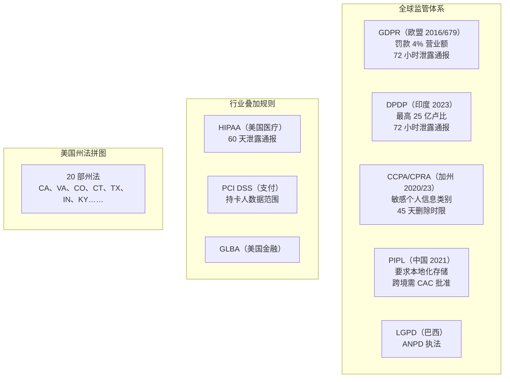
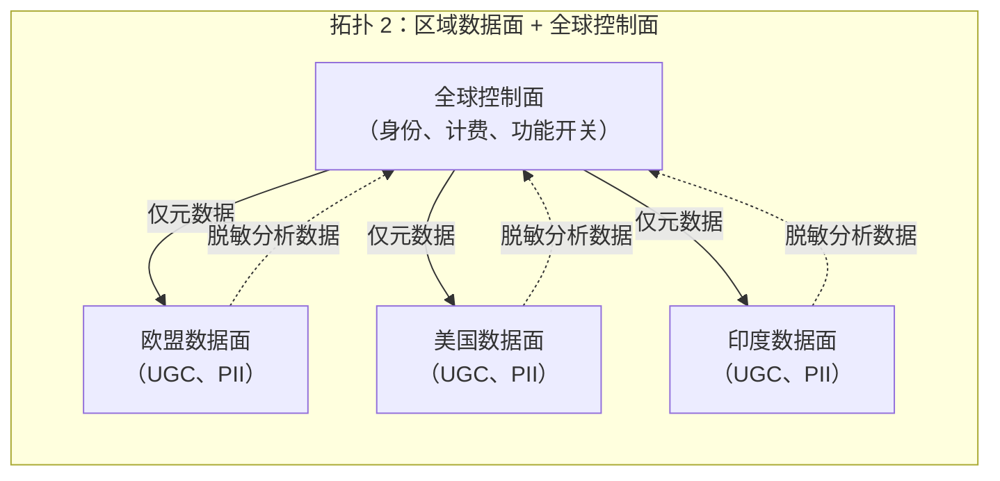
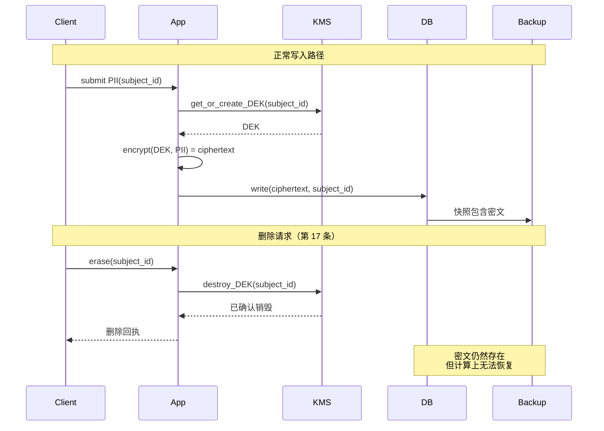
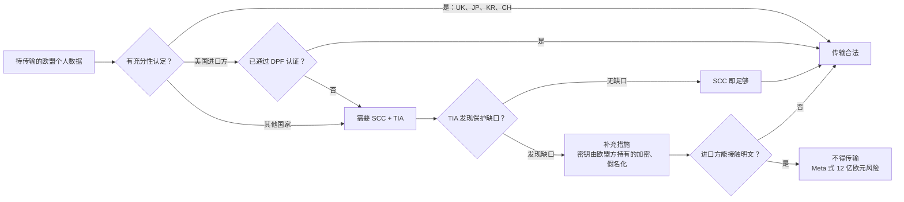

# 数据驻留与合规架构（GDPR、DPDP、CCPA、删除权）

> **TL;DR**: 数据保护法如今是一项架构约束，不再是纸面文书。一个全球服务至少同时踩进六套相互重叠的监管体系，它们对数据存放在哪、保留多久、删得多快各有各的规矩。仅 GDPR 的累计罚款在 2026 年 1 月就已超过 71 亿欧元 [^1]。标准架构是区域数据面（用户内容留在本辖区）+ 全球控制面（身份、计费、功能开关），并以加密销毁（crypto-shredding）作为删除原语：用每个数据主体专属的密钥加密其 PII，删除时销毁密钥。一次 KMS 操作就能让密文在主库、副本、备份和事件日志中全部无法恢复。

## 学习目标

学完本模块，你将能够：

- [ ] 把数据类别（PII、敏感 PII、金融、健康、行为）映射到存储、加密与保留策略
- [ ] 在按区域孤岛、区域数据面加控制面、全局加脱敏这三种拓扑之间做出选择
- [ ] 即使在事件溯源和备份密集的系统中，也能通过加密销毁实现删除权
- [ ] 在 Schrems II 之后选对跨境传输机制（SCC、充分性认定、EU-US DPF）
- [ ] 搭出足以向监管机构证明合规的审计、血缘与同意基础设施

## 直觉理解

你在五个国家经营连锁保险箱保管库。每个国家对谁能开箱、记录保存多久、客户说“全部销毁”时该怎么办都有自己的规矩。德国要求 30 天内粉碎。印度要求配有政府指派的审计员。中国说箱内物品一律不得出楼，没有例外。

现在一位客户走进来：“我要一个箱子，从任何分行都能访问，但我的文件绝不能物理离开法兰克福。”这做得到。把文件放在法兰克福，给客户一把钥匙，让其他分行去查一个中央目录，目录上写着“4217 号箱在法兰克福”。目录是全球的，文件是本地的。这就是区域数据面加全球控制面的拓扑。

客户说“全部销毁”时，你不需要跑遍每个分行、每盘备份磁带、每份复印件。你销毁钥匙。没有钥匙，锁着的箱子只是一块金属。这就是加密销毁：密钥是数据是否存在的唯一真相来源。

难的不是某一条规则。难的是你有 20 多个国家，每个国家的销毁时限不同、对“个人信息”的定义不同、罚则也不同。本章给你一套能同时应付所有国家的架构，而不必建 20 套系统。

## 原理

### 监管全景

六套体系定义了大多数全球服务的约束边界：

**GDPR（欧盟，2016/679，2018 年适用）** 是基准。六种合法性基础（第 6 条），第 15 至 22 条规定数据主体权利，跨境传输受第五章约束，第 33 条要求 72 小时内通报泄露，罚款最高可达全球年营业额的 4% 或 2000 万欧元（取较高者）[^2]。第 3 条的域外效力意味着：任何处理欧盟居民数据的服务都受约束，与公司总部在哪无关。

**DPDP（印度，2023）** 引入“重要数据受托人”（Significant Data Fiduciary）分级，附带更重的义务：强制 DPIA、年度审计、独立数据审计员。每次违规最高罚 25 亿卢比（约 3000 万美元）。2025 年 11 月 14 日通告的最终规则要求 72 小时内报告泄露，合规期限分阶段推进，2027 年 5 月 14 日为最后节点 [^3]。

**CCPA/CPRA（加州，2020/2023）** 赋予知情、删除、更正以及退出出售/共享的权利。CPRA 定义了敏感个人信息（民法典 SS1798.140(ae)），包括政府标识、金融账户凭证、精确地理位置、邮件/电子邮件/短信内容、基因数据、生物特征、健康、性生活/性取向、种族/族裔出身，并赋予限制其使用的权利 [^4]。

**PIPL（中国，2021）** 要求关键信息基础设施运营者以及超过数据量阈值的实体境内存储。跨境传输需要 CAC 安全评估、标准合同或认证 [^5]。实践中，这迫使受监管数据单独做一套中国部署。

**LGPD（巴西）** 与 **PIPEDA（加拿大）** 在结构上与 GDPR 相似。魁北克的第 25 号法案又叠加一层省级规定，有自己的同意要求。

美国没有联邦层面的综合立法。截至 2026 年 1 月，已有 20 个州的综合隐私法生效 [^6]，另有行业规则（医疗领域的 HIPAA，要求发现泄露后 60 天内通报；金融领域的 GLBA；持卡人数据领域的 PCI DSS）。不存在单一的“美国合规”模式。

*每套体系都有自己的数据主体权利、泄露通报时限和罚款上限。全球服务必须同时满足全部要求。*

### 数据分类是一个分布式系统问题

分类是地基。没有它，你回答不了“哪些字段必须留在欧盟”，也回答不了“用户援引第 17 条时该删什么”。

五个类别可以覆盖大多数系统：

- **PII**：姓名、邮箱、电话、IP 地址、设备 ID、user-agent 指纹。
- **敏感 PII**（CPRA 下的 SPI）：SSN、护照、生物特征、精确地理位置、基因数据、种族/族裔、宗教、性取向、移民身份。
- **健康（HIPAA 下的 PHI）**：诊断、处方、化验结果、与标识符绑定的可穿戴设备数据。
- **金融**：PAN、银行账户、交易（持卡人数据叠加 PCI DSS）。
- **行为**：点击流、搜索查询、推断属性。监管机构在 CPRA 和 GDPR 下越来越倾向把它们视为敏感数据。

每个类别对应一套策略：加密要求、保留窗口、区域绑定、日志脱敏。敏感 PII 意味着按主体加密的密钥、取所有适用辖区中最短的保留期、硬性区域绑定。行为数据意味着入库时假名化、分析环节只做聚合。

三种分类策略，按健壮性从高到低：

1. **入库打标。** 生产方声明数据类别，schema registry 强制执行。最干净，但需要全组织的纪律。
2. **静态扫描 DLP。** 用模式匹配器（PAN/SSN 走正则，人名走 NER）扫遍存储来捕获漂移。能抓出错误，代价是几天到几周的延迟。
3. **ML 分类器。** 遗留数据湖的最后手段。自由文本字段上的误报率很高。

> [!TIP]
> 把分类当成 schema registry 的职责。如果 Kafka topic 或 Protobuf 消息没有声明自己的数据类别，就不允许发布。把约束前移。

### 数据驻留拓扑

[多区域架构](../part-5-architecture-patterns/08-multi-region-architecture.md) 讲过跨区域运行服务的机制。本节加上法律约束这一层。

**拓扑 1：按区域做孤岛。** 每个法律区域（欧盟、美国、印度、中国）一套完整技术栈。租户在注册时绑定。跨区域流量在网络层被阻断。审计故事最干净。基础设施成本按孤岛数量倍增，跨区域功能（全局搜索、共享看板、跨租户分析）则在结构上直接做不了。

**拓扑 2：区域数据面 + 全球控制面。** 用户生成内容和主体数据留在区域内。元数据（租户 ID、计费、认证锚点、功能开关）是全球的。这是 Atlassian 已上线的模型：“realm”把 AWS 区域分组，各服务把 UGC 放在区域专属分片里，中央的 Tenant Context Service（p90 低于 1ms，每分钟数百万请求）负责路由 [^7]。截至 2025 年 Atlassian 提供 11 个驻留位置 [^8]。

**拓扑 3：全局 + PII 脱敏。** 原始 PII 留在源区域。假名化或聚合后的衍生数据全球复制，供分析、ML 和备份使用。出口处的 DLP 在跨跳之前阻断或脱敏任何被判定为 PII 的内容。

*用户内容留在区域内，只有非 PII 元数据全球流动。这是多租户 SaaS 的默认形态。*

**建议：** 多租户 SaaS 默认用拓扑 2（区域数据面 + 全球控制面）。只有在监管强制时才用拓扑 1（完全孤岛）：医疗、金融、国防，以及 PIPL 下的中国。拓扑 3 只适合创业早期、数据敏感度不高的阶段。

### 删除权与加密销毁

GDPR 第 17 条要求“不得无故拖延”地删除，响应时限一个月，复杂请求可再延两个月 [^9]。CCPA 给 45 天（可再延 45 天）。印度 DPDP 的规则草案把时限留给数据保护委员会规定。

问题在于：现代系统不是单个数据库。用户的数据同时躺在主库、只读副本、搜索索引、缓存、特征存储、数据仓库、ML 训练集、可观测性日志、CDC 管道、备份和第三方处理方手里。软删除（把 `deleted_at = now()`）在以上每一个位置都留下了数据。监管机构把第 17 条读作“删除”，而不是“查询时看不到”。

**加密销毁（crypto-shredding）** 是唯一能扛住不可变备份和只追加日志的模式。机制如下：

1. 写入时，用每个主体专属的数据加密密钥（DEK）加密该主体的 PII 字段。
2. 把 DEK 存进 KMS（与 [密钥管理](./04-secrets-management.md) 相同的信封加密模式）。
3. 收到删除请求时销毁 DEK。密文仍存在于每个备份、副本和事件日志中，但在计算上无法恢复 [^10]。

*销毁一个按主体划分的密钥，就能让主库、副本、备份和事件日志中的全部密文无法恢复。一次 KMS 操作，删除彻底完成。*

对 [事件溯源](../part-5-architecture-patterns/03-event-sourcing.md) 系统，这个模式要变形：把 PII 放进事件内部可加密销毁的载荷里。非 PII 字段（事件类型、时间戳、聚合 ID）保持明文，供重放和分析使用。删除时销毁密钥，事件日志在结构上完好无损，但 PII 已经消失 [^10]。

删除 DAG 必须覆盖每一个衍生存储。搜索索引、缓存、特征存储、仓库、日志和第三方处理方都确认删除之后，源头的 DEK 才能销毁。这个拓扑排序能防止后续重放把如今已无法解密的密文重新灌回衍生存储。

> [!IMPORTANT]
> 加密销毁有一个关键失效模式：如果因为运维失误（而不是有意销毁）弄丢了 DEK，用户自己的数据就再也恢复不了。对待 DEK 的备份和访问控制，要和对待数据本身一样严格。

**删除原语：加密销毁 vs 仅打墓碑。** 加密销毁是任何面向用户或受监管数据的默认选择：一次 KMS 密钥销毁即可让密文在主库、副本、备份和事件日志中计算上不可恢复，代价是按主体管理密钥，以及上面那条“密钥丢失等于数据丢失”的风险。仅打墓碑的删除（`deleted_at = now()` 加查询过滤）简单、数据库原生，但不是真正的删除。行会留在每个备份、副本、搜索索引、特征存储和仓库副本里，而监管机构把第 17 条读作删除，不是藏起来。内部工具监管宽松、可以接受审计暴露的，用仅打墓碑；其余情况，上面任何一种拓扑都要配加密销毁。

### Schrems II 之后的跨境传输

2020 年 7 月，CJEU 在 C-311/18 案（Schrems II）中推翻了 EU-US 隐私盾，但维持了标准合同条款，并判定出口方必须评估进口方所在国是否提供“实质等同”的保护 [^11]。EDPB 发布《01/2020 补充措施建议》，认可强加密（密钥由出口方持有或存放在充分性认定的辖区）与假名化是有效的技术措施 [^12]。

**今天可用的机制：**

- **充分性认定：** 欧盟认定的具有等同保护水平的辖区名单（英国、日本、韩国、瑞士、以色列、新西兰、加拿大商业数据）。
- **EU-US 数据隐私框架（DPF）：** 2023 年 7 月 10 日通过的充分性认定，对已认证遵守 DPF 原则的美国进口方立即生效。2025 年 9 月 3 日挺过了第一次撤销挑战（Latombe, T-553/23）；2025 年 10 月 31 日提起上诉，目前在 CJEU 待审 [^13]。

- **标准合同条款（SCC，2021 现代化版本）：** 由出口方与进口方签署的预先批准的合同条款。需要配套传输影响评估（TIA）。
- **约束性企业规则（BCR）：** 用于集团内部传输。
- **第 49 条例外：** 明示同意、合同必需。为偶发传输设计，不适用于常规数据流。

**Meta 为什么被罚 12 亿欧元（2023 年 5 月）：** Meta 依赖 SCC 把欧盟的 Facebook 数据传到美国基础设施。Schrems II 之后，在没有任何有效补充措施的情况下，单靠 SCC 被判定不足——考虑到美国的监控法律（FISA 702）。教训是：“美国云的欧盟区域”+ SCC + 传输加密，并不自动合规。要满足 Schrems II，补充措施必须强到让美国进口方接触不到明文 [^14]。

*Schrems II 之后，每一笔欧盟到第三国的传输都必须满足至少一种合法机制；使用 SCC 时还要做传输影响评估。如果 TIA 发现缺口（例如 FISA 702 下的美国进口方），补充措施必须确保进口方永远接触不到明文。*

### 审计、数据血缘与同意记录

必须有三层东西存在，而且能按工单 ID 和主体 ID 查询：

**不可变审计日志。** 只追加、密码学链接（每条记录含上一条的哈希）、WORM 保护（S3 Object Lock 的 Compliance 模式、Azure 不可变 blob）。必须记录：谁读了什么、谁写了什么、谁删了什么、谁改了权限。金融通常保留七年，一般合规保留三年。

**数据血缘。** 追踪每个数据集的来源和全部下游消费方。工具：OpenLineage（Marquez 参考实现）、Apache Atlas、DataHub。它用来回答“如果删掉用户 X，我们要向哪些衍生存储传播？”

**同意记录。** 时间戳、策略版本、目的、合法性基础、采集方式。GDPR 第 6 条下，控制者必须能证明同意。专业厂商：OneTrust、TrustArc。IAB 的透明与同意框架（TCF v2.2）是广告技术行业的同意信号标准格式。

DSAR（数据主体访问请求）自动化在规模化之后不是可选项。一个月的时限乘以成千上万条衍生记录，人工处理根本不可能。模式是：请求进入工作流工具，一个感知血缘的编排器向每个记录系统扇出删除/导出命令，各系统回报完成，一条签名审计记录关闭工单。

## 真实案例

Atlassian 为 Jira、Confluence 和 Rovo 做的数据驻留架构，是拓扑 2 在规模化场景下的示范。工程博客里有完整的建设过程 [^7]。

**问题：** 企业客户要求他们的 Jira issue 和 Confluence 页面留在特定的法律边界内（欧盟、澳大利亚、印度），而 Atlassian 的身份、计费和功能开关系统仍保持全球。

**方案：** Atlassian 引入了“realm”，它是 AWS 区域之上的一层抽象，用来定义法律边界。每个租户在注册时被绑定到一个 realm。持有 UGC 的服务（Issue Service、Pages、媒体）按 realm 分片。元数据和身份保持全球。Catalogue Service 是租户到分片映射的记录系统。Tenant Context Service 是读优化的投影，以 p90 低于 1ms 的延迟承担每分钟数百万请求 [^7]。

**迁移：** 客户改变驻留绑定点（例如从美国改到欧盟）时，系统执行先复制后删除的流程。Issue Service 连最大的租户（500 万到 1000 万个 issue）也能在 60 分钟内完成跨区域迁移。关键设计决策：把“复制”和“删除”两个阶段分开，意味着回滚永远不比“在原分片把租户重新上线”做更多的事 [^7]。

**异步事件处理：** SQS/Kinesis 消费者在消费时重新检查分片位置，因为事件在队列里停留的时间可能比一次迁移还长。这避免了 realm 变更后的陈旧路由。

**规模：** 截至 2025 年有 11 个驻留位置（美国、欧盟、澳大利亚、德国、新加坡、加拿大、英国、日本、印度、韩国、瑞士）[^8]。把欧盟租户迁到 eu-west-1 之后，页面加载 p90 改善了约 500ms [^7]。

## 权衡

下表只比较驻留**拓扑**。删除原语（加密销毁 vs 仅打墓碑）是一项正交的决策，见上文 §删除权与加密销毁。每种拓扑都需要一个删除原语，两者不是互相替代的关系。

| 方案 | 优势 | 代价 | 适用场景 | 我们的选择 |
|---|---|---|---|---|
| 按区域孤岛 | 隔离干净、审计简单、网络层硬保证 | 基础设施成本 2 到 3 倍、跨区域功能做不了、租户绑定出错代价高 | 医疗、金融、国防、中国/PIPL | 仅当监管强制 |
| 区域数据面 + 全球控制面 | 可扩展、多数功能可用、身份图谱唯一 | 元数据泄露风险、路由复杂、迁移逻辑需定制 | 全球 SaaS（Atlassian、Stripe、HubSpot） | 多租户 SaaS 的默认 |
| 单一全局 + PII 脱敏 | 运维最简单、只有一套栈 | DLP 必须完美、仍需要 SCC、监管面前风险高 | 创业早期、低敏感数据 | 仅产品市场契合之前 |

## 常见陷阱

> [!WARNING]
> **PII 进了应用日志。** 主体数据落进 stdout，被送到日志后端（Splunk、Datadog、ELK），再传播到驻留边界之外的长保留存储。修法：在日志门面强制接入脱敏库，用类型化的日志 schema 禁止 PII 字段，并对日志索引跑 DLP 扫描。

> [!WARNING]
> **把软删除当成“删除”。** 设置 `deleted_at = now()` 会让行留在每个备份、副本和搜索索引里。监管机构把第 17 条读作删除，不是“查询时看不到”。对 PII 列用加密销毁，同时保留非 PII 的行骨架以维持引用完整性。

> [!WARNING]
> **衍生存储漂移。** 主库真删了用户，但搜索索引、ML 特征存储、CDC 管道和仓库副本还把陈旧记录留了几天甚至几个月。修法：为每个衍生存储定义明确的删除契约，通过 CDC 传播墓碑，跑周期性对账任务。

> [!WARNING]
> **迁移时丢掉同意记录。** 数据库迁移或更换供应商时，同意时间戳和策略版本没有保留下来，控制者再也无法证明第 6 条下的合法性基础。修法：把同意做成带策略版本哈希的不可变事件流，其保留期与主体删除解耦（同意记录基于法律义务基础，在删除之后依然保留）。

> [!WARNING]
> **跨境传日志却没签 SCC。** 应用日志放在本区域，可观测性后端总部在美国，日志就这样跨过大西洋，没有任何传输影响评估。修法：用区域化的可观测性租户（Datadog EU1、Splunk Cloud EU），传输前先清洗日志，维护 DPF 认证的处理方清单。

## 练习

为一个全球薪资 SaaS 设计驻留架构，客户分布在美国、欧盟、印度和巴西。针对每个辖区选出拓扑，画出包含备份和分析仓库的删除权流程，并明确说明一名德国员工被派往美国三个月时到底会发生什么。他的薪资数据是迁移、复制，还是原地绑定？同时向 GDPR 审计员和印度 DPDP 审计员为这个设计辩护。

提示

关键洞察是：驻留绑定的是雇主的主要辖区，不是员工的物理位置。德国员工在美国出差不会触发数据传输，因为数据根本没动。想一想哪些字段是 PII（薪资、税号、银行账户），哪些是元数据（人数、部门），以及加密销毁如何应付分析仓库。

解答

**拓扑选择：** 区域数据面 + 全球控制面（拓扑 2）。薪资数据（工资、税号、银行信息）留在雇主的主要 realm。全球控制面负责租户身份、计费和功能开关。

**区域映射：**

| 客户总部 | 数据面区域 | 适用法律 | 删除时限 |
|---|---|---|---|
| 德国（欧盟） | eu-central-1 | GDPR | 1 个月 |
| 美国 | us-east-1 | CCPA + 州法 | 45 天 |
| 印度 | ap-south-1 | DPDP | 按委员会规则 |
| 巴西 | sa-east-1 | LGPD | 按 ANPD 指引 |

**删除权流程：**

1. DSAR 到达，完成身份验证。
2. 血缘服务返回删除 DAG：主库 Postgres、Elasticsearch 索引、Redis 缓存、Snowflake 仓库、月度备份、第三方报税 API。
3. 各衍生存储按拓扑序确认删除。
4. KMS 最后销毁该员工专属的 DEK。
5. 一条签名审计记录关闭工单。
6. 备份里只剩下密钥已不存在的密文。不需要重写。

**德国员工在美国的边界情况：** 数据仍然绑定在欧盟 realm。员工的物理位置不改变数据的驻留地。美国办公室通过全球控制面访问该员工的记录，控制面把这个读请求路由到 eu-central-1。因为美国办公室只能通过加密通道拿到欧盟数据面的响应，PII 并没有发生跨境传输。这对 GDPR 审计员（数据从未离开欧盟）和 DPDP 审计员（这个模式可推广到出境的印度员工）都站得住。

**分析：** 仓库收到的是假名化的薪资聚合（部门级薪资区间、按区域的人头数），不含个人 PII。原始薪资数据永远不离开区域数据面。

## 要点回顾

- 合规是架构问题。你的 schema、区域布局、事件日志结构、备份策略本身就编码了监管决策。
- 分类必须在入库时完成。在 PB 级仓库上事后补救，是一个要跨几个季度的项目。
- 加密销毁是备份密集或只追加系统里唯一可信的删除模式。一次 KMS 密钥销毁，删除彻底完成。
- Schrems II 之后，“美国云 + 欧盟区域”并不自动合规。传输影响评估和补充措施（密钥由出口方持有的加密）是硬要求。
- 每个衍生存储（搜索索引、缓存、特征存储、仓库、日志、第三方处理方）都属于删除契约的一部分。多数审计就栽在这里。
- 区域数据面加全球控制面的拓扑是多租户 SaaS 的默认。只有在监管强制时才做完全孤岛。
- 同意记录必须在主体删除之后依然存在（基于法律义务），并包含策略版本、时间戳和目的。

## 延伸阅读

- [GDPR 全文（2016/679 号条例）](https://eur-lex.europa.eu/eli/reg/2016/679/oj) —— 权威来源。第 15 至 22 条讲权利，第 44 至 50 条讲传输，第 33 至 34 条讲泄露通报。设计任何跨境流程之前先读第五章。
- [EDPB 01/2020 补充措施建议](https://www.edpb.europa.eu/our-work-tools/our-documents/recommendations/recommendations-012020-measures-supplement-transfer_en) —— Schrems II 之后 SCC 加 TIA 的操作手册。它定义了“有效”加密的含义（密钥由出口方持有，而不只是传输加密）。
- [Atlassian：我们如何为 Atlassian Cloud 构建数据驻留](https://www.atlassian.com/engineering/how-we-build-data-residency-for-atlassian-cloud) —— 生产环境中区域数据面/全球控制面架构最好的公开记录。覆盖 realm 抽象、迁移流程和异步事件处理。
- [CJEU Schrems II 判决（C-311/18）](https://curia.europa.eu/juris/liste.jsf?num=C-311/18) —— 推翻隐私盾、重塑跨大西洋数据流的判决。在对美传输中依赖 SCC 之前必读。
- [DPF 充分性认定（EU 2023/1795）](https://eur-lex.europa.eu/eli/dec_impl/2023/1795/oj) —— 当前的对美传输依据。要理解它的适用范围，以及未来“Schrems III”挑战的风险。
- [Conduktor：Kafka 的加密销毁](https://conduktor.io/glossary/crypto-shredding-for-kafka) —— 在事件溯源系统中实现加密销毁的实战指南。展示了按主体划分 DEK 的模式以及 Kafka 特有的考量。
- [Apple：大规模隐私学习](https://machinelearning.apple.com/research/learning-with-privacy-at-scale) —— 生产环境的本地差分隐私。它展示了把数据最小化当作架构选择，从而彻底绕开驻留规则。
- [DLA Piper 2025 年 GDPR 罚款调查](https://www.dlapiper.com/en-fr/insights/publications/2025/01/dla-piper-gdpr-fines-and-data-breach-survey-january-2025) —— 执法情况的年度实证图景。适合用来校准风险，并向管理层论证合规投入。

## 记忆卡片

**Q:** 什么是加密销毁（crypto-shredding）？
**A:** 用每个数据主体专属的数据加密密钥（DEK）加密其 PII，删除时销毁该 DEK。密文仍留在备份和事件日志里，但没有密钥就无法在计算上恢复。

**Q:** 三种标准的驻留拓扑是什么？
**A:** （1）按区域做孤岛，完全隔离。（2）区域数据面加全球控制面（用户数据在区域，元数据全球）。（3）全局部署并在出口做 PII 脱敏/假名化。拓扑 2 是多租户 SaaS 的默认。

**Q:** Schrems II（2020 年 7 月）推翻了什么，什么又保留了下来？
**A:** CJEU 推翻了 EU-US 隐私盾，但维持了标准合同条款，并增加要求：出口方必须评估进口方所在国的法律环境（传输影响评估），在保护不“实质等同”时采取补充措施。

**Q:** 为什么软删除不足以满足 GDPR 第 17 条？
**A:** 软删除（设置 deleted_at）会把数据留在备份、副本、搜索索引和衍生存储里。监管机构把第 17 条解释为真正删除，而不是“查询时看不到”。需要加密销毁，或者硬删除并向所有衍生存储传播。

**Q:** GDPR 的删除响应时限是多少？
**A:** 收到请求起一个日历月，复杂请求可再延两个月（第 12(3) 条）。CCPA 给 45 天，可再延 45 天。

**Q:** EU-US 数据隐私框架（DPF）是什么？
**A:** 2023 年 7 月 10 日通过的充分性认定，为向已认证遵守 DPF 原则的美国进口方传输个人数据提供合法性基础。它取代了被推翻的隐私盾。它挺过了第一次撤销挑战（Latombe, T-553/23，2025 年 9 月），但仍面临在审上诉，以及 noyb 可能提出的更广泛的“Schrems III”挑战。

**Q:** Meta 为什么在 2023 年 5 月被罚 12 亿欧元？
**A:** Meta 依赖 SCC 把欧盟的 Facebook 数据传输到美国基础设施。Schrems II 之后，考虑到美国监控法律（FISA 702 允许情报机构获取美国电子通信服务商持有的数据），没有有效补充措施的 SCC 被裁定为不足。

**Q:** 事后证明合规靠哪三层？
**A:** （1）不可变审计日志（只追加、哈希链、WORM 保护）。（2）数据血缘（来源与每个下游消费方）。（3）同意记录（时间戳、策略版本、目的、合法性基础）。

**Q:** 什么是“删除 DAG”，为什么重要？
**A:** 它是有向无环图，包含所有持有某个主体数据的系统：主库、搜索索引、缓存、特征存储、仓库、日志、备份、第三方处理方。每个节点都确认删除之后，源头的 DEK 才能销毁。多数审计失败就发生在这里。

**Q:** Atlassian 的 Tenant Context Service 如何支撑数据驻留？
**A:** 它是租户到 realm 映射的读优化投影，以 p90 低于 1ms 的延迟承担每分钟数百万请求。每个服务的查询都会问它，从而把数据操作路由到正确的区域分片。

**Q:** 一名德国员工去美国出差三个月，他的薪资数据会怎样？
**A:** 数据仍绑定在欧盟 realm。驻留跟随雇主的辖区，不跟随员工的物理位置。美国办公室通过全球控制面访问该记录，控制面把请求路由到欧盟数据面。PII 没有发生跨境传输。

**Q:** 举出三种会导致合规失败的反模式。
**A:** （1）PII 进入应用日志，被送到美国的可观测性后端且没有 SCC。（2）只做软删除，数据无限期留在备份里。（3）没有数据血缘，删除请求传播不到所有衍生存储。

## 参考文献

[^1]: DLA Piper，“GDPR Fines and Data Breach Survey: January 2026”（累计 71 亿欧元）。https://www.dlapiper.com/en-sa/insights/publications/2026/01/dla-piper-gdpr-fines-and-data-breach-survey-january-2026
[^2]: Regulation (EU) 2016/679（GDPR）全文。https://eur-lex.europa.eu/eli/reg/2016/679/oj
[^3]: MeitY，“Digital Personal Data Protection Rules, 2025”（2025 年 11 月 14 日通告；72 小时泄露报告、分阶段合规至 2027 年 5 月 14 日）。https://www.pib.gov.in/PressNoteDetails.aspx?ModuleId=3&NoteId=156054

[^4]: California Attorney General，“California Consumer Privacy Act”（CPRA 修正案 2023 年 1 月 1 日生效）。https://oag.ca.gov/privacy/ccpa
[^5]: Pillsbury，“China Clarifies and Relaxes Cross-Border Data Transfer Controls”（CAC 安全评估、CIIO）。https://www.pillsburylaw.com/en/news-and-insights/china-cross-border-data-controls.html
[^6]: IAPP，“US State Comprehensive Privacy Laws Report 2025”。https://iapp.org/resources/article/us-state-privacy-laws-overview
[^7]: Atlassian Engineering，“How we build Data Residency for Atlassian Cloud”（2021 年 8 月 26 日）。https://www.atlassian.com/engineering/how-we-build-data-residency-for-atlassian-cloud
[^8]: Atlassian，“Data Residency: Manage Where Your Data is Hosted”（11 个驻留位置）。https://www.atlassian.com/software/data-residency
[^9]: GDPR 第 17 条（删除权）与第 12(3) 条（一个日历月响应）。https://gdpr-info.eu/art-17-gdpr/
[^10]: Conduktor，“Crypto Shredding for Kafka: GDPR-Compliant Data Deletion”。https://conduktor.io/glossary/crypto-shredding-for-kafka
[^11]: CJEU，C-311/18 案 “Data Protection Commissioner v Facebook Ireland and Maximillian Schrems”（Schrems II，2020 年 7 月 16 日）。https://curia.europa.eu/juris/liste.jsf?num=C-311/18
[^12]: EDPB，“Recommendations 01/2020 on measures that supplement transfer tools”（最终版，2021 年 6 月 18 日）。https://www.edpb.europa.eu/our-work-tools/our-documents/recommendations/recommendations-012020-measures-supplement-transfer_en
[^13]: Inside Privacy，“European Commission Adopts Adequacy Decision on the EU-U.S. Data Privacy Framework”。https://www.insideprivacy.com/united-states/european-commission-adopts-adequacy-decision-on-the-eu-u-s-data-privacy-framework/
[^14]: Reuters，“Meta hit with record $1.3 bln fine over data transfers”（2023 年 5 月 22 日）。https://www.reuters.com/technology/facebook-given-record-13-bln-fine-given-5-months-stop-eu-us-data-flows-2023-05-22/
