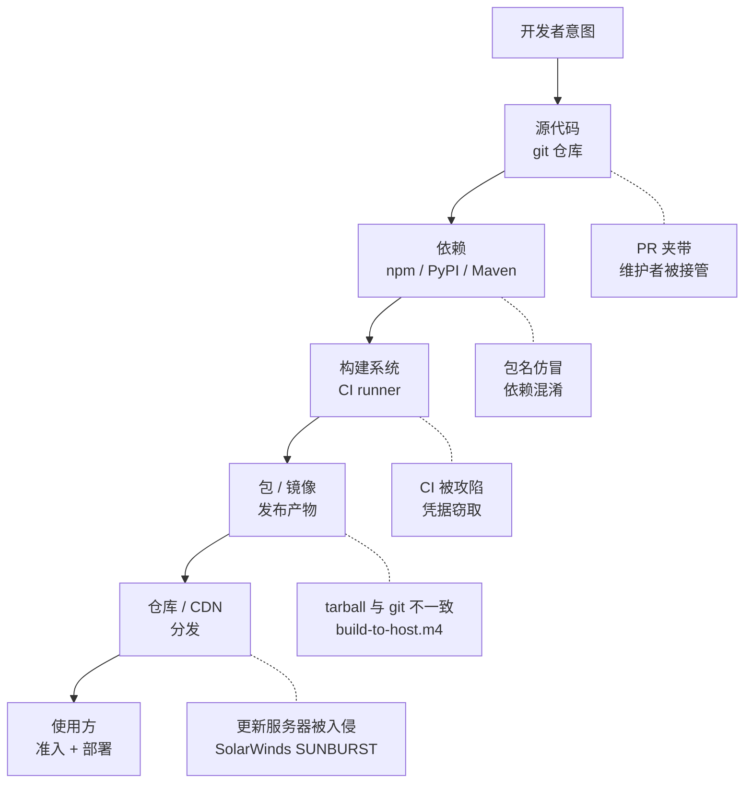
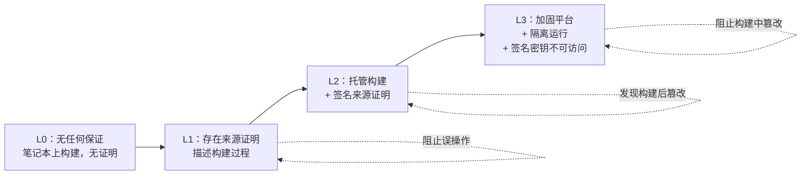
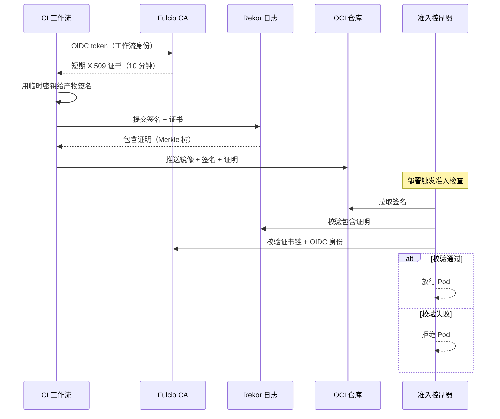
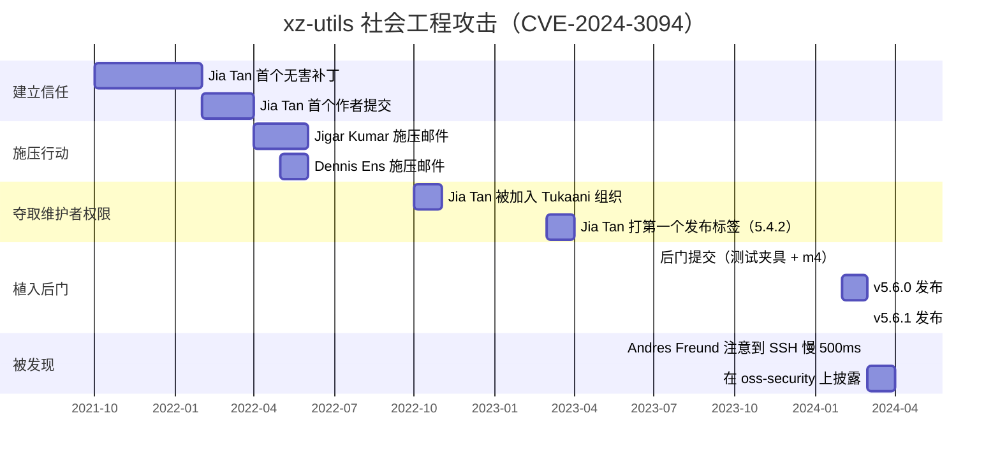

# 供应链安全：SBOM、SLSA、Sigstore，以及如何防御 xz-utils 式攻击

> **TL;DR**：你的应用绝大部分是别人写的代码。2024 年 npm 处理了约 4.5 万亿次包请求 [^1]，而 Sonatype 自 2019 年以来已识别出超过 704,102 个恶意包 [^2]。现代防御体系分四层：SBOM 负责透明（里面有什么），SLSA 负责来源（它是怎么被构建的），Sigstore 负责完整性（是谁签的），准入控制器负责执行（未经验证的一律拒绝）。xz-utils 后门（CVE-2024-3094，CVSS 10.0）没有被这套工具中的任何一个发现。是一位微软工程师注意到 SSH 登录慢了 500ms [^3]。维护者倦怠本身就是一种供应链漏洞，而没有任何框架能完全解决它。

## 学习目标

学完本章，你将能够：

- [ ] 梳理供应链威胁模型：包名仿冒、维护者账号被接管、CI 被攻陷、依赖混淆、构建期后门
- [ ] 生成并使用 CycloneDX 或 SPDX 格式的 SBOM
- [ ] 说明 SLSA 各等级（L0 到 L3）以及每一级要求哪些控制
- [ ] 用 cosign 给产物签名（通过 OIDC 免密钥），并在准入阶段校验
- [ ] 设计依赖卫生策略：锁文件、SCA 扫描、仓库白名单、出站流量过滤
- [ ] 讲清 xz-utils 后门的时间线，以及它对维护者倦怠的启示

## 直觉理解

你开了一家餐厅。食材来自几十个供应商：面粉来自一家磨坊，橄榄油来自另一家，香料来自第三家。你相信标着“有机小麦”的面粉袋里装的确实是有机小麦。你相信橄榄油从压榨厂到你厨房的路上没人动过手脚。

现在想象一下：一个供应商悄悄把你的橄榄油换成了便宜的调和油；另一个送来的面粉里掺了只在超过 200°C 才被激活的污染物；第三个供应商破产了，一个陌生人买下了品牌名，开始用同样的标签卖完全不同的东西。除非有客人吃出问题，或者你在收货时逐样检测，否则你永远不会知道。

软件供应链也是这么运作的。每一次 `npm install`、每一次 `docker pull`、每一次 `pip install`，都在从陌生人那里取代码。你相信叫 `lodash` 的包真的是 lodash，相信它从作者机器到你这儿的路上没人改过，也相信作者就是他自称的那个人。xz-utils 后门证明了：一个有耐心的攻击者可以花两年时间成为那个“值得信赖的供应商”，然后再往井里投毒。

本章给你那间食材检测实验室：用来搞清产物里有什么、证明它们从哪来、核实是谁构建的，并在厨房门口把检验不合格的东西全部挡回去。

## 原理

### 供应链攻击面

从开发者的意图到用户的部署，中间每一环都是攻击面。SLSA 威胁模型识别出五个关键卡口：



*从开发者意图到生产部署，一共五个攻击面；每个都有一次典型事故和一项对应的控制措施。*

每个卡口都在生产环境里被真实利用过：

- **包名仿冒与维护者账号被接管。** `event-stream` 包（2018 年 11 月）被移交给一位新维护者，他注入了一段偷比特币的载荷；在被发现之前，它累计了数百万次下载 [^4]。`ua-parser-js` 被劫持（2021 年 10 月）影响到的版本装机量极大 [^5]。
- **依赖混淆。** Alex Birsan（2021 年 2 月）把与内部包同名的包以 99.99.99 版本发布到公共仓库。npm、pip、Maven 的默认解析器都优先选高版本。这次依赖混淆在 35 家以上的组织内部被检出，Birsan 拿到了超过 13 万美元的漏洞赏金 [^6]。
- **构建系统被攻陷。** SolarWinds SUNBURST（2020 年 12 月）：攻击者改造了 Orion 的构建流水线，把后门注入每一个已签名的发布版本。约 18,000 家组织在九个月里安装了被污染的更新 [^7]。
- **Tarball 与源码不一致。** xz-utils 后门把恶意代码藏在发布 tarball 里，而 git 树中并不存在这些代码。审阅仓库的人看到的是干净的代码。
- **双重供应链。** 3CX（2023 年 3 月）之所以被攻陷，是因为它的一个上游依赖（X_Trader）本身已被攻陷，攻击穿过两层传递下来 [^8]。

### SBOM：搞清楚里面有什么

软件物料清单（Software Bill of Materials）是产物中每个组件的正式清单，相当于食品的成分标签。美国第 14028 号行政令（2021 年 5 月）把 SBOM 变成了联邦采购要求 [^9]。欧盟《网络韧性法案》（Regulation 2024/2847，2024 年 12 月生效）对投放欧盟市场的商业软件强制要求供应链网络安全控制，主要义务自 2027 年 12 月起适用 [^10]。

主流格式有两种：

- **CycloneDX**（OWASP，2018 年首发）：面向安全，紧凑，原生支持漏洞与 VEX（Vulnerability Exploitability eXchange）。可序列化为 JSON、XML 和 Protobuf。
- **SPDX**（Linux Foundation，ISO/IEC 5962:2021）：面向合规，许可证信息记录得很细。

监管机构两种都接受。真正的差别在工具链配套：Syft 生成 SBOM，Grype 拿它去比对漏洞库，Trivy 则把两者合在一个扫描器里。在构建时生成 SBOM 并把它附着到产物上（通过 OCI referrers 或 in-toto 证明），就形成了一份可长期追溯的审计记录。

> [!IMPORTANT]
> 没有扫描流水线的 SBOM 只是一个文件，不是一项控制。Sonatype 报告称，95% 的易受攻击下载在下载当时就已有更新的、不含该漏洞的版本可用 [^1]。数据一直都在，只是没人据此行动。

对于要大规模管理 SBOM 的组织，GUAC（Graph for Understanding Artifact Composition）是 OpenSSF 的孵化项目，它把 SBOM、SLSA 来源证明和漏洞数据摄入一张可查询的知识图谱，从而支持跨整个供应链的查询，比如“我的哪些服务传递依赖了这个有漏洞的库？”GUAC 于 2025 年 6 月发布 1.0。

### SLSA：证明它是怎么被构建的

SLSA（Supply-chain Levels for Software Artifacts）是 OpenSSF 的规范，为构建完整性定义逐级增强的要求 [^11]。1.0 版（2023 年 4 月）把要求组织成 Build 轨道，等级从 L0 到 L3。1.1 版（2025 年 4 月批准）在保持向后兼容的前提下，为威胁模型、证明模型和校验流程补充了澄清说明，并在验证摘要证明（VSA）格式中加入了验证者元数据。1.2 版（2025 年 11 月，当前版本）引入 Source 轨道，覆盖源代码编写与评审环节的威胁：



*每一级 SLSA 都加了一项具体控制：L1 增加来源证明，L2 把构建搬到托管基础设施并签名来源证明，L3 隔离每次运行、并让签名材料对用户自定义的构建步骤不可见。*

落到实践中的各级含义：

- **L1**：存在来源证明。有一份文档描述了构建平台、构建过程和顶层输入。它可以被绕过，但足以防住误操作。
- **L2**：构建在托管的专用基础设施上运行（不是笔记本）。来源证明经过签名，所以构建之后的篡改可以被发现。多数团队只要迁到 GitHub Actions、GCP Cloud Build 或 GitLab Shared Runners 就能达到。
- **L3**：加固的构建平台，把每次运行彼此隔离，并让签名密钥对用户自定义的构建步骤不可访问。想伪造来源证明，就得攻破构建平台本身。

> [!NOTE]
> v0.1 规范里曾有 L4 一层，在 v1.0 中被移除。设计文档里不要再引用 L4。SLSA v1.2（截至 2026 年 5 月的当前版本）增加了带自己等级体系的 Source 轨道；Build 轨道的等级（L0-L3）与 v1.0 保持一致。SLSA 是构建完整性框架，不是漏洞管理框架。一个 L3 的包照样可能内含 Log4Shell。

来源证明编码为 in-toto 证明，`predicateType: https://slsa.dev/provenance/v1`，描述构建者、构建类型、外部参数、解析出的依赖以及输出摘要。

### Sigstore：免密钥签名与透明日志

[密钥管理](./04-secrets-management.md)已经说明，长期存活的密钥是大多数凭据事故的根因。Sigstore 干脆把长期签名密钥彻底取消 [^12]。

流程如下：



*Sigstore 的免密钥签名把工作流身份绑定到透明日志中的一条记录上；准入控制器会拒绝任何无法同时通过 Fulcio 证书和 Rekor 包含证明校验的东西。*

三个组件：

- **Fulcio**：一个轻量 CA，签发短期 X.509 证书（有效期 10 分钟），把临时密钥对与 OIDC 身份（Google、GitHub Actions、Azure）绑定。
- **Rekor**：只追加的透明日志，底层是 Merkle 树。每个签名都被不可变地记录下来，攻击者没法悄悄改写历史。
- **cosign**：命令行工具与库。给容器和 blob 签名，按身份策略做校验。

校验命令会强制检查签名者身份：

```bash
cosign verify $IMAGE \
  --certificate-identity=$IDENTITY \
  --certificate-oidc-issuer=$OIDC_ISSUER
```

结论就是：任何一方都不再持有需要轮换、可能泄漏或丢失的长期密钥材料。npm（2023 年）、PyPI 以及 GitHub Artifact Attestations（2024 年 6 月正式可用）都已集成与 Sigstore 兼容的来源证明。

### 准入控制与依赖卫生

没有强制执行，签名毫无意义。Kubernetes 的准入 webhook 会拦截 Pod 创建，拒绝不符合策略的镜像。Kyverno 提供了原生的 `verifyImages` 规则：

```yaml
apiVersion: kyverno.io/v1
kind: ClusterPolicy
metadata:
  name: verify-image
spec:
  validationFailureAction: Enforce
  rules:
    - name: verify-cosign
      match:
        any:
          - resources:
              kinds: [Pod]
      verifyImages:
        - imageReferences: ["ghcr.io/myorg/*"]
          attestors:
            - entries:
                - keyless:
                    subject: "https://github.com/myorg/*"
                    issuer: "https://token.actions.githubusercontent.com"
```

OPA Gatekeeper 与 Ratify 组合可以达到同样目的。Google 的 Binary Authorization 在 GKE 和 Cloud Run 上提供了这套模式，强制要求 Cloud Build 产出的 SLSA 来源证明 [^13]。

除准入之外，还有四项成本很低的控制能降低依赖风险：

1. **带哈希校验的锁文件。** `package-lock.json`、`poetry.lock`、`go.sum`、`Cargo.lock`。锁定精确的传递版本和内容哈希。重装时无法悄悄换成另一个 tarball。
2. **SCA 扫描。** Snyk、Dependabot、Renovate 和 Semgrep SCA 会把锁文件与漏洞库比对，并自动提 PR。
3. **仓库白名单。** 让所有依赖拉取都走内部代理（Artifactory、Nexus、GCP Artifact Registry）。解析器只看得到内部包，依赖混淆就失效了 [^6]。
4. **CI 出站流量过滤。** 构建期间拒绝连接任意域名。这样就能抓住那些要往外回连的外泄载荷。

## 真实案例

GitHub Artifact Attestations（2024 年 5 月公测，2024 年 6 月正式可用）在生产里完整展示了这套栈。GitHub Actions 工作流中的一步调用 `actions/attest-build-provenance`，它会：

1. 用工作流的 OIDC token（签发方 `https://token.actions.githubusercontent.com`）换取 Fulcio 证书
2. 用临时密钥对 SLSA 来源证明签名
3. 把签名后的证明推送到 Rekor；对容器而言，还作为 referrer 推送到 OCI 仓库

证书身份精确编码了工作流：`https://github.com/ORG/REPO/.github/workflows/WORKFLOW.yml@REF`。使用方用 `gh attestation verify` 或 `cosign verify-attestation` 校验。

在强制执行方面，GitHub 给出了完整的准入控制路径：部署 Sigstore 的 policy-controller、注册 GitHub TrustRoot、应用一个 `ClusterImagePolicy`，并按命名空间划定执行范围。整个模型都依赖 OIDC 身份和短期证书，没有任何密钥需要轮换。

cosign bundle 格式（v2.4 标准化，v3.0+ 默认）在 npm 来源证明、GitHub Artifact Attestations、Homebrew 来源证明和 PyPI 证明之间通用，所以一个校验器就能跨生态工作。Rekor 中的记录是公开且永久的：任何人都能在事后审计一次构建的身份。

> [!TIP]
> 从对现有镜像跑 `gh attestation verify` 开始。如果它失败了，说明你压根没有来源证明。这就是你的基线。

## 纵深防御

这些控制是互相补充的层，而不是备选项。一个真正落地的供应链方案会全部采纳。本章 TL;DR 已经说得很直接：“现代防御体系分四层。”下面标为“Our Pick”的那一列，表达的是采纳优先级和威胁模型门槛，而不是在几行之间做选择。

| 控制 | 优点 | 缺点 | 适用场景 | 采纳优先级 |
|---|---|---|---|---|
| 锁文件 + 哈希模式 | 安装确定性；改造成本低；防住静默替换 | 锁文件维护开销；CI 变慢 | 所有环境 | 始终启用。今天就打开。 |
| SBOM + SCA 扫描 | 透明；漏洞可见；符合监管（EO 14028、EU CRA） | 噪声大（大量低危告警）；需要分诊流程 | 每个项目的基础项 | 始终启用。没有商量余地。 |
| Sigstore + 准入策略 | 免密钥（无密钥可轮换）；公开透明日志；开发体验简单 | 依赖 Fulcio/Rekor 网络；日志中含 PII（签名者邮箱） | 与 CNCF 对齐的 Kubernetes 环境 | 容器负载的默认选择 |
| SLSA L3 构建 | 来源证明强；抗篡改；堵住跨租户攻击 | 构建平台复杂；L3 工具链仍在成熟 | 敏感的生产产物 | 至少 L2；涉及认证或支付的产物上 L3 |
| 密闭构建（Bazel、Nix） | 可复现；与源码零漂移；支持独立重建校验 | 工具链有强主张；迁移成本高 | 高安全或国家级威胁模型 | 仅当合规或威胁模型要求时才做 |

把这张表从上往下读就是一条采纳顺序：锁文件只需要改一次 CI 配置，却能挡住最常见的一类攻击（依赖混淆、静默替换）；SBOM 增加可见性；Sigstore 在部署时增加完整性；SLSA L3 加固构建平台本身；密闭构建是最后一层，只有当威胁模型要求“从源码可复现地验证”时才值得上。

## 常见陷阱

> [!WARNING]
> **有 SBOM 却没人扫描。** 团队生成了 SBOM 并把它存起来，但没有任何东西去消费它。有漏洞的组件就这样无人知晓地上线了。把 SBOM 接进扫描器（Grype、Trivy），作为带严重级别阈值的 CI 门禁。如果你的 SBOM 存在，但 CVE 告警数是零，那说明流水线坏了。

> [!WARNING]
> **混合仓库导致的依赖混淆。** 你的解析器被配置成同时查公共 npm 和内部仓库。攻击者在公共 npm 上把 `@internal/payments` 以 99.99.99 版本发布出去。解析器选了更高的版本。修法：给私有包加作用域（npm 里的 `@org/`）、让拉取走内部代理、永远不要把解析器配置成对同一命名空间同时搜索公共和私有源。

> [!WARNING]
> **把维护者倦怠当成一个没打补丁的漏洞。** 关键的开源基础设施常常由一个人志愿维护。xz-utils 的攻击者正是利用了这一点：一批马甲账号连续几个月向一位精疲力竭的维护者施压，直到他交出提交权限。没有任何技术控制能发现这件事。资助关键维护者。要求发布必须有多人签名。把突然变得异常“热心”的贡献者当成黄色信号。



*在两年多的时间里，“Jia Tan”通过无害补丁积累信任，用马甲账号向精疲力竭的维护者施压，拿到提交权限，最终放出了一个后门——而发现它的不是任何安全工具，是一位工程师恰好注意到 500 ms 的 SSH 登录性能回退。*

> [!WARNING]
> **源码 tarball 与 git 树不一致。** 审计者检查的是公开的 git 仓库，那里是干净的。实际分发的 tarball 里多了一些文件（生成的 configure 脚本、m4 宏、测试夹具），里面有恶意内容。xz-utils 的后门只存在于发布 tarball 中。永远要把 tarball 与同一 tag 的 `git archive` 输出做一次 diff。

> [!WARNING]
> **准入控制器处于 fail-open 模式。** 一个配置错误的 webhook 如果失败即放行，那么 Fulcio 一次故障就会静默地关闭所有签名校验。要明确决策：fail-closed（故障期间阻断部署）还是 fail-open（放行未经验证的镜像）。生产环境里，正确答案是 fail-closed，同时配一条有文档的紧急通道（break-glass）。

## 练习

你的组织运行三个内部容器仓库，并从 50 多个公共依赖中拉取代码。请设计一个最小可用的供应链安全方案：SBOM 策略（何时生成、存在哪里）、签名要求（谁签、用什么身份签），以及一条拒绝未签名生产镜像的准入规则。如果凌晨 2 点一个关键生产镜像缺少来源证明，运维上会发生什么？

<details>
<summary>提示</summary>

想想那四层：透明（SBOM）、来源（SLSA）、完整性（Sigstore）、执行（准入）。对于凌晨 2 点的场景，考虑安全与可用性之间的张力。Google 的 Binary Authorization 正是为此提供了有文档的紧急通道。

</details>

<details>
<summary>参考答案</summary>

**SBOM 策略：**

- 在每个 CI 流水线里用 Syft 在构建时生成。以 referrer 形式附着到 OCI 镜像上（oras.land 格式）。
- 与镜像一起存放在仓库中。另外推送到一个集中的 Dependency-Track 实例做持续监控。
- CI 门禁：用 Grype 扫描，带 `--fail-on critical`，只要存在任意 critical CVE 就阻断构建。

**签名要求：**

- 所有生产镜像在 GitHub Actions（或等效 CI）里用 cosign 免密钥签名。证书身份就是工作流路径：`https://github.com/myorg/myrepo/.github/workflows/release.yml@refs/heads/main`。
- 没有任何人持有签名密钥。CI 工作流的 OIDC 身份本身就是签名者。
- 至少达到 SLSA L2：托管构建，并把签名后的来源证明作为 in-toto 证明附着上去。

**准入规则（Kyverno）：**

```yaml
apiVersion: kyverno.io/v1
kind: ClusterPolicy
metadata:
  name: require-signed-images
spec:
  validationFailureAction: Enforce
  rules:
    - name: verify-prod-images
      match:
        any:
          - resources:
              kinds: [Pod]
              namespaces: ["production", "payments"]
      verifyImages:
        - imageReferences: ["registry.internal.io/*"]
          attestors:
            - entries:
                - keyless:
                    subject: "https://github.com/myorg/*"
                    issuer: "https://token.actions.githubusercontent.com"
```

**凌晨 2 点的场景：**
一个关键热修复镜像是在本地构建的（没走 CI），因此没有来源证明。准入控制器拒绝了它。

应对：启用有文档的紧急通道。在 Kyverno 里，这意味着一个限定到该具体镜像 digest 的 `PolicyException` 资源，由具备提权 RBAC 的值班工程师应用，并由 CronJob 在 4 小时后自动回滚。这个例外会被记录日志、在 [可观测性](../part-6-reliability-and-operations/00-observability.md) 中触发告警，并要求在 48 小时内做复盘，把镜像通过正规流水线重建一遍。

紧急通道必须存在、必须有文档、必须被审计、必须极少使用。如果它一个季度被触发超过一次，说明你的 CI 流水线有可靠性问题。

</details>

## 要点回顾

- 你要为自己没写的代码负责。搞清产物里有什么（SBOM），以及它们从哪来（SLSA 来源证明）。
- 全部签名，在准入时校验。用 cosign 做免密钥签名，直接堵掉“但我们会轮换密钥”这个借口。
- 带哈希校验的锁文件是成本最低、杠杆最高的控制。今天就打开。
- 多数团队只要迁到 GitHub Actions 或等效的托管 CI，就能达到 SLSA L2（托管构建 + 签名来源证明）。
- xz-utils 后门是被 500ms 的性能回退发现的，不是被安全工具发现的。要有点敬畏心。
- 维护者倦怠是一种供应链漏洞。给上游项目出钱出人是安全工作，不是慈善。
- 仓库白名单加 CI 出站过滤，不需要引入任何新框架就能挡住依赖混淆和数据外泄。

## 延伸阅读

- [Andres Freund, "backdoor in upstream xz/liblzma leading to ssh server compromise"](https://www.openwall.com/lists/oss-security/2024/03/29/4) - 最初的披露帖；任何要就开源依赖风险做决策的人都该读。
- [Russ Cox, "Timeline of the xz open source attack"](https://research.swtch.com/xz-timeline) - 对那场长达两年的社会工程攻击最权威的逐月还原。
- [SLSA v1.0 specification](https://slsa.dev/spec/v1.0/) - Build 轨道、来源证明 schema，以及每一级的具体要求；搞清楚 L1/L2/L3 到底要求什么，以这里为准。另见[当前版本 v1.2](https://slsa.dev/spec/v1.2/)，它增加了 Source 轨道。
- [Sigstore documentation](https://docs.sigstore.dev/cosign/signing/overview/) - 用 cosign、Fulcio、Rekor 做免密钥签名的端到端说明；要从这里开始动手。
- [NIST SP 800-218 SSDF v1.1](https://csrc.nist.gov/pubs/sp/800/218/final) - 美国联邦的安全软件开发基线；它塑造了厂商的证明要求。
- [GitHub Artifact Attestations](https://docs.github.com/en/actions/how-tos/secure-your-work/use-artifact-attestations/enforce-artifact-attestations) - 在 GitHub 生态里如何生成并强制执行由 cosign 支撑的来源证明。
- [Sonatype State of the Software Supply Chain 2024](https://www.sonatype.com/state-of-the-software-supply-chain/2024/scale) - 关于仓库规模、恶意包趋势，以及供应链攻击同比 156% 增长的年度数据。
- [Alex Birsan, "Dependency Confusion"](https://medium.com/@alex.birsan/dependency-confusion-4a5d60fec610) - 依赖混淆技术的原始文章，该方法曾在 35 家以上组织内部被检出；它把解析器为什么会失效讲得清清楚楚。

## 记忆卡片

**Q：** 现代供应链防御体系分哪四层？
**A：** 透明（SBOM 描述里面有什么）、来源（SLSA 证明它是怎么构建的）、完整性（Sigstore 用密码学把签名者身份绑定到产物）、执行（准入控制器拒绝一切校验不通过的产物）。

**Q：** CycloneDX 和 SPDX 有什么区别？
**A：** CycloneDX（OWASP）面向安全，原生支持漏洞和 VEX。SPDX（Linux Foundation，ISO/IEC 5962:2021）面向合规，许可证信息更详尽。两者都能序列化为 JSON，监管机构都接受。

**Q：** SLSA v1.0 中 L0 以上的三个 Build 等级是什么？
**A：** L1：存在来源证明（描述构建过程）。L2：托管构建平台加签名来源证明（能发现构建后篡改）。L3：加固平台，运行相互隔离且签名密钥不可访问（阻止构建中篡改）。

**Q：** Sigstore 如何取消长期签名密钥？
**A：** 签名者通过 OIDC 认证。Fulcio 签发一张短期 X.509 证书（有效期 10 分钟），把临时密钥对绑定到该 OIDC 身份。签名者给产物签名后丢弃密钥，并把签名记入 Rekor 透明日志。全程不存在长期密钥。

**Q：** 什么是依赖混淆，怎么防？
**A：** 攻击者以更高版本号在公共仓库发布与内部包同名的包。解析器偏好高版本，于是装上攻击者的代码。防护：使用带作用域的包（npm 里的 `@org/`）、让拉取走内部仓库代理、永远不要把解析器配置成对同一命名空间同时搜索公共和私有源。

**Q：** xz-utils 后门（CVE-2024-3094）是怎么被发现的？
**A：** 微软工程师 Andres Freund 在做基准测试时注意到 SSH 登录比正常慢了约 500ms。他追查下去，在 liblzma 中发现了后门。没有任何安全扫描器、SBOM 工具或来源证明校验发现它。

**Q：** 为什么 xz-utils 后门只存在于发布 tarball 中，而不在 git 树里？
**A：** 恶意代码是通过一个被改过的 `build-to-host.m4` 宏注入的，这个文件只随发布 tarball 分发，没有提交进 git。审阅仓库的人看到的是干净代码。而真正被分发的产物是 tarball，很少有人会拿 tarball 和 git 做 diff。

**Q：** 什么是 VEX，它对 SBOM 为什么重要？
**A：** VEX（Vulnerability Exploitability eXchange）标注依赖中某个已知 CVE 在你的具体场景下是否真的可被利用：affected、not_affected、fixed 或 under_investigation。它能降低告警噪声，因为生产者可以声明“这个 CVE 确实出现在我们的 SBOM 里，但在我们的用法下不可达”。

**Q：** Kyverno 的 `verifyImages` 策略在准入时会做什么？
**A：** 它拦截 Pod 创建，从仓库拉取镜像的 cosign 签名，按指定的证明者（公钥或免密钥身份）校验，校验失败就拒绝该 Pod。开启 `mutateDigest: true` 时，它还会把镜像引用改写成 digest，防止在校验和拉取之间标签被替换。

**Q：** 准入控制中的紧急通道（break-glass）模式是什么？
**A：** 一条有文档、被审计的逃生通道，允许在紧急情况下部署未经验证的镜像。典型实现是带自动回滚的限时策略例外，配合提权 RBAC、告警和强制的复盘。它必须存在，因为 fail-closed 的准入在签名基础设施故障期间会阻断所有部署。

**Q：** 举三个真实的供应链攻击及其攻击向量。
**A：** SolarWinds SUNBURST（2020）：构建系统被攻陷，后门被注入已签名的发布版本，18,000 家客户受影响。依赖混淆（Birsan，2021）：用内部包名在公共仓库发布高版本包，35 家以上组织内部被检出。xz-utils（2024）：用两年时间对一位精疲力竭的维护者做社会工程，把后门塞进发布 tarball。

**Q：** 美国第 14028 号行政令对 SBOM 提出了什么要求？
**A：** EO 14028（2021 年 5 月）要求 NIST 定义安全软件开发实践（最终形成为 NIST SP 800-218 SSDF）。它把 SBOM 变成向美国联邦政府销售软件的必要条件，并确立了每份 SBOM 必须包含的最小要素。

## 参考文献

[^1]: Sonatype, "2024 State of the Software Supply Chain: scale and growth". https://www.sonatype.com/state-of-the-software-supply-chain/2024/scale
[^2]: Sonatype press release, "10th annual State of the Software Supply Chain Report: 156% surge in OSS malware", Oct 2024. https://www.sonatype.com/press-releases/sonatypes-10th-annual-state-of-the-software-supply-chain-report
[^3]: Andres Freund, "backdoor in upstream xz/liblzma leading to ssh server compromise", oss-security mailing list, 29 March 2024. https://www.openwall.com/lists/oss-security/2024/03/29/4
[^4]: Ars Technica, "Widely used open source software contained bitcoin-stealing backdoor" (event-stream), Nov 2018. https://arstechnica.com/information-technology/2018/11/hacker-backdoors-widely-used-open-source-software-to-steal-bitcoin/
[^5]: GitHub Advisory Database, "Embedded malware in ua-parser-js", CVE-2021-4229, Oct 2021. https://github.com/advisories/GHSA-pjwm-rvh2-c87w
[^6]: Alex Birsan, "Dependency Confusion: How I Hacked Into Apple, Microsoft and Dozens of Other Companies", Feb 2021. https://medium.com/@alex.birsan/dependency-confusion-4a5d60fec610
[^7]: Belfer Center, "The SolarWinds attack: 18,000 customers, compromised Orion updates". https://www.belfercenter.org/publication/solarwinds-attack
[^8]: Mandiant, "3CX Software Supply Chain Compromise Initiated by a Prior Software Supply Chain Compromise", April 2023. https://www.mandiant.com/resources/blog/3cx-software-supply-chain-compromise
[^9]: NIST SP 800-218, "Secure Software Development Framework (SSDF) Version 1.1". https://csrc.nist.gov/pubs/sp/800/218/final
[^10]: cyberresilienceact.eu, "Regulation (EU) 2024/2847 entered into force on 10 December 2024". https://www.cyberresilienceact.eu/commission-guidance-on-regulation-eu-2024-2847/
[^11]: SLSA v1.0 specification, "Security levels". https://slsa.dev/spec/v1.0/levels
[^12]: sigstore/cosign README (Quick Start, verify flags). https://github.com/sigstore/cosign/blob/main/README.md
[^13]: Google Cloud, "Binary Authorization documentation". https://cloud.google.com/binary-authorization/docs
