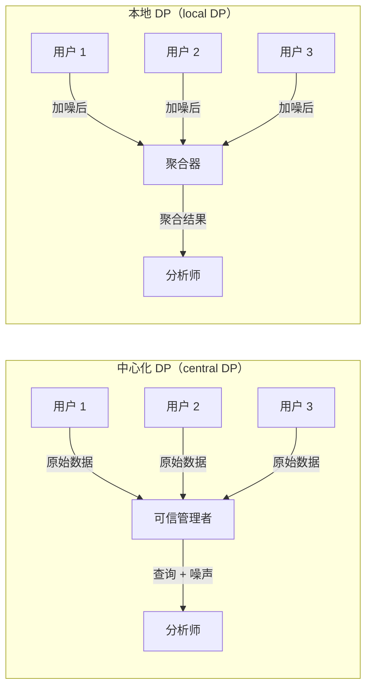
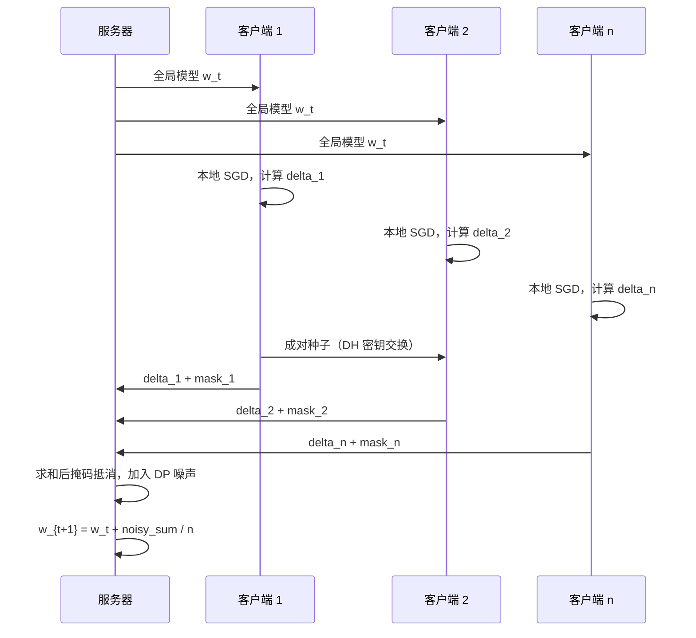
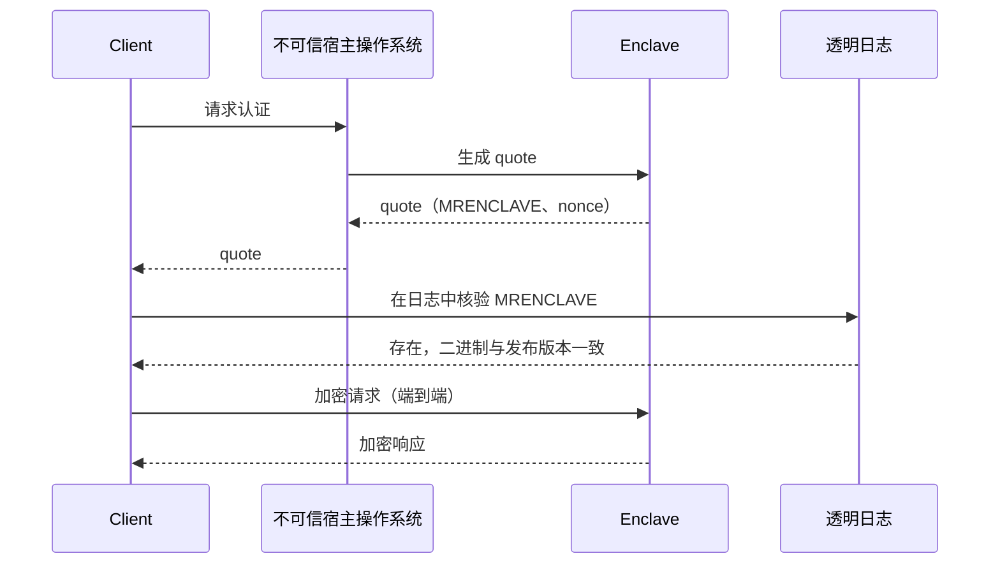
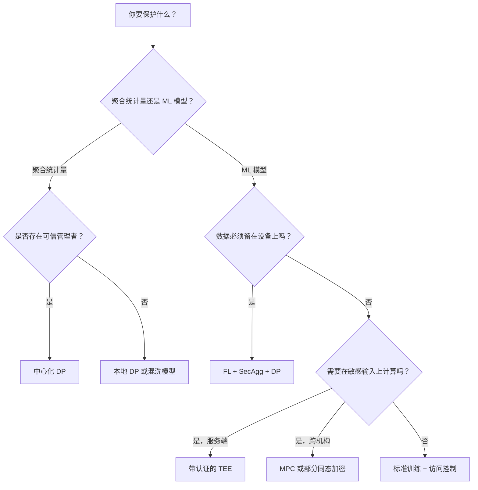

# 隐私保护系统（差分隐私、联邦学习）

> **TL;DR**: 隐私保护系统改变的是运营方究竟能看到什么这条边界，而不是把隐私当作事后补上的访问控制。生产环境里有五种技术占主导：差分隐私（differential privacy，加入校准过的噪声，让任何单条记录都无法实质性改变输出）、联邦学习（federated learning，原始数据留在设备端，只有模型更新上传）、安全聚合（secure aggregation，用密码学方式求和而不暴露个体值）、同态加密（homomorphic encryption，直接在密文上计算）、可信执行环境（trusted execution environment，硬件背书的隔离区）。Google 的 Gboard 技术栈把 FL、安全聚合和 DP-FTRL 组合在一起，做到用户级 zCDP rho = 0.81，比美国人口普查的 rho = 2.63 更强 [^1]。没有任何单一原语能同时满足合规义务和威胁模型。设计问题在于：怎么分层，才能让代价落在可接受的范围内。

## 学习目标

学完本模块，你将能够：

- [ ] 把差分隐私应用到一个真实的聚合查询上，并选出合适的 epsilon
- [ ] 描述联邦学习，以及它在通信与隐私之间的权衡
- [ ] 把安全聚合讲到足以自己设计一套联邦训练协议
- [ ] 判断同态加密在什么场景可用（以及什么时候它还是太慢）
- [ ] 借助决策树，针对给定威胁模型挑出正确的隐私原语
- [ ] 像真实生产系统那样把多种技术组合使用（DP + FL + SecAgg）

## 直觉理解

假设你运营一个医院联合体。十家医院都想知道肺炎患者的平均住院时长，但没有一家愿意把自己的病历分享给其他人。一种做法是：每家医院在报出自己的平均值之前，先往上加一个小的随机数。噪声足够大，你没法反推出任何一家医院的真实值；又足够小，合并后的平均值依然有用。这就是差分隐私。

再假设这些医院想联合训练一个肺炎风险预测的 AI 模型。没有任何一家医院把患者数据发出去。每家的做法是：下载当前模型，用本地病历训练几个小时，然后只把权重变化发回去。协调方把这些变化取平均，更新全局模型。这就是联邦学习。

但等一下。如果协调方能看见每家医院各自的权重更新，聪明的攻击者就能从这些梯度里重建出病历。于是各家医院加上成对的随机掩码，这些掩码在求和时会相互抵消。协调方只能看到聚合结果。这就是安全聚合。

最后，某家医院希望云服务能直接在自己的加密病历库上跑查询，全程不解密。这就是同态加密，而它比明文慢 1,000 倍到 100,000 倍 [^2]。对大多数负载来说，你会选一个更快的原语，并接受另一种信任模型。

本章余下的部分给你做出这些选择所需的形式化工具。

## 原理

### 差分隐私基础

随机化算法 M 满足 (epsilon, delta)-差分隐私，当且仅当对所有相邻数据集 D、D'（仅相差一条记录）和所有输出集合 S 都有：

```text
Pr[M(D) in S] <= e^epsilon * Pr[M(D') in S] + delta
```

Epsilon 控制隐私与可用性之间的权衡。epsilon 越小，隐私越强，但输出噪声越大。delta 是隐私发生灾难性失效的概率；把它设成小于 1/n，其中 n 是数据集大小 [^3]。

**机制。** 纯 DP（delta = 0）使用尺度为 L1 敏感度 / epsilon 的拉普拉斯噪声。近似 DP（delta > 0）使用按 L2 敏感度校准的高斯噪声。高斯机制给出的组合界更紧，这在你要跑大量查询时很关键。

**组合性。** 每对同一批数据做一次查询，就消耗一份隐私预算。基础组合定理说：k 次 epsilon 的查询，总代价是 k * epsilon。高级组合（Renyi DP、零集中差分隐私 zero-concentrated DP）给出更紧的记账。Google 的 DP-FTRL 用树状聚合加上负相关噪声，绕开了“通过采样放大”这一假设——而在设备人群不断流动的场景里，这个假设很难保证成立 [^1]。

**真实世界里的 epsilon。** 美国 2020 年人口普查整体用了 epsilon = 19.61（人口部分 17.14，住房部分 2.47）[^4]。Apple 部署的是每条数据 epsilon 为 1 到 2，但每日组合预算最高到 16 [^5]。Google 的 Gboard 在用户级做到 rho = 0.81 zCDP [^1]。不存在通用的“好 epsilon”。你要对照自己的可用性需求和威胁模型来校准。

**本地 DP 与中心化 DP。** 在中心化 DP 里，一个可信管理者看到原始数据，在查询输出上加噪声。在本地 DP 里，每个用户在数据离开设备之前就加好噪声。要达到同样的可用性，本地 DP 的 epsilon 大约要比中心化 DP 大 sqrt(n) 倍，因为噪声无法在用户之间摊薄。Apple 选择本地 DP，正是因为它拒绝扮演可信管理者 [^6]。



*在中心化 DP 里，管理者能看到原始数据，并被信任会正确地加噪声。在本地 DP 里，噪声在设备端注入，聚合器永远见不到原始值。*

**库。** Google 的 [differential-privacy](https://github.com/google/differential-privacy)（C++、Go、Java）、OpenDP（Rust/Python，哈佛）、Tumult Analytics（原生跑在 Spark 上）、Opacus（PyTorch 的 DP-SGD）、TensorFlow Privacy（moments accountant）。Google 的库把 builder 的输入（epsilon、delta、敏感度）与机制选择分开，这是所有生产级 DP 系统最终都会收敛到的 API 形态。

### 联邦学习与 FedAvg

联邦学习是一种分布式训练协议：协调方把模型发给大量客户端，每个客户端用本地数据训练，只有权重更新会回传用于聚合 [^7]。

经典算法是 FedAvg（McMahan 等，2017）：每一轮采样一部分可用客户端；每个客户端跑 E 个 epoch 的本地 SGD；服务器按本地数据集大小对客户端更新做加权平均。在非独立同分布（non-IID）的移动端数据上，FedAvg 相比同步 SGD 把通信轮数减少了 10 倍到 100 倍 [^7]。

**跨设备与跨机构。** 跨设备 FL 面对的是数以百万计、随时可能掉线、本地数据集很小的客户端（Gboard：每轮 6,500 台设备，2,000 轮，训练 6 天 [^1]）。跨机构 FL 面对的是几十个稳定参与方（医院、银行），本地数据量大、连接可靠。

**变体。** FedProx 增加一个近端项，惩罚非 IID 数据上的客户端漂移。FedOpt 使用服务器端的自适应优化器（Adam、Adagrad）。个性化层（FedPer、元学习）让每个客户端拥有定制的头部，同时共享全局骨干。

**框架。** Flower（截至 2025 年广泛使用的开源 FL 框架）、TensorFlow Federated、PySyft（OpenMined）、NVIDIA FLARE（面向企业的跨机构场景）。

> [!IMPORTANT]
> 光有 FL 并不等于隐私。能看到单个客户端梯度的服务器，可以用梯度反演攻击重建训练输入 [^8]。FL 必须与安全聚合和 DP 组合，才能提供有意义的隐私保证。

### 安全聚合

安全聚合让服务器能算出用户持有向量之和，却学不到其中任何单个向量 [^9]。

在 Bonawitz 等（2017）的方案里，每一对客户端 (i, j) 通过 Diffie-Hellman 协商出共享掩码。客户端 i 在自己的更新上加 +mask，客户端 j 加 -mask。服务器把所有 n 份更新求和时，成对的掩码相互抵消。对每个客户端的种子做 Shamir 秘密分享（阈值为 t），使服务器能在有客户端中途掉线时恢复相应的掩码 [^9]。



*每一轮：服务器广播模型，客户端本地训练并对更新做两两掩码，服务器聚合掩码后的和、加入 DP 噪声，再应用更新。*

每个客户端的通信开销是掩码的 O(n) 加上 Shamir 分片的 O(n)，整轮合计 O(n^2) [^9]。稀疏图变体（例如 Choi 等，2020）把完整的成对掩码图换成 Erdos-Renyi 随机图，使每客户端通信降到 O(log n)，总通信从 O(n^2) 降到 O(n log n)，同时保住可靠性和隐私保证 [^10]。Flamingo 通过一次性初始化把方案扩展到多轮聚合。

### 同态加密与 MPC

**同态加密（homomorphic encryption，HE）** 让密文上的特定运算，在解密后对应明文上的运算。部分同态只支持一种运算（Paillier：加法）。全同态（FHE）支持任意电路，代价是 1,000 倍到 100,000 倍的减速 [^2]。

现代 FHE 方案：BFV 与 BGV（精确整数运算，支持 SIMD 批处理）、CKKS（近似实数运算，适合 ML 推理）、TFHE（布尔门快，自举开销低）。库：Microsoft SEAL、OpenFHE、Zama 的 Concrete/TFHE-rs、Google HEIR（基于 MLIR 的编译器）。

**什么时候用 HE：** 范围窄、敏感度极高、且任何一方都不该看到明文的查询。微软的 Password Monitor 用 SEAL 检查泄露的凭据，而不把密码暴露给服务器 [^11]。对通用 ML 训练或实时推理来说，HE 太慢。此时应改用 TEE 或 MPC。

**安全多方计算（secure multi-party computation，MPC）** 让 n 方共同计算一个函数，每一方只能得到输出，看不到其他方的输入。Yao 的混淆电路（两方）、GMW（多方）和 Shamir 秘密分享是其基础。Meta 与 Mozilla 的可互操作私有归因（Interoperable Private Attribution，IPA）用三方 MPC 做广告归因，报告称每 100 万条记录的网络开销为 18 GB，云出口费用约 $1.44 [^12]。

### 可信执行环境

TEE 提供硬件隔离的执行环境，内存加密，并支持远程认证。客户端在发送数据之前，先验证里面跑的是什么代码。

**Intel SGX**（带加密内存的围圈）已在客户端 CPU 上被弃用（第 11 代及以后），部分原因是 Foreshadow 这类侧信道攻击 [^13]，但在 Xeon 服务器型号上仍然保留。**Intel TDX** 和 **AMD SEV-SNP** 提供虚拟机级别的机密计算。**AWS Nitro Enclaves** 通过 vsock 与父 EC2 实例隔离。**Apple Private Cloud Compute**（PCC，2024 年 6 月）是一整套跑在 Apple 自研芯片服务器上的栈，带 Secure Enclave、可度量的安全启动、生产二进制的透明日志，并通过不经意的 HTTP 路由实现不可定向性 [^14]。Apple 为在 PCC 节点上实现任意代码执行开出最高 $1,000,000 的赏金 [^14]。

Signal 的私有联系人发现用 SGX 围圈配合不经意哈希表构造，防止访问模式侧信道。客户端在发送通讯录哈希之前，先通过远程认证核验 MRENCLAVE 值 [^15]。



*客户端先把远程围圈的度量值与可信的透明日志比对，然后才发送任何敏感数据。Apple PCC 把这一模式进一步扩展，配合不经意的 HTTP 中继，使 Apple 无法特意把某个用户导向被攻陷的节点 [^14]。*

> [!WARNING]
> **TEE 的侧信道是真实存在的。** Foreshadow 通过推测执行泄漏了 L1 缓存内容 [^13]。加密内存能藏住内容，藏不住访问模式。缓解手段：不经意内存访问、最小化围圈代码、及时更新微码，以及把已部署二进制绑定到认证度量的透明日志。

### 选择合适的技术原语



*先从“是否存在可信管理者”这个问题出发。再由威胁模型和延迟预算推导出该用哪种原语。*

**什么时候不该用这些技术：**（1）敏感度低、访问控制就够的数据。（2）已经预先聚合、个体记录本就不存在的数据。（3）只为了合规、而假名化就能让监管方满意的场景。（4）紧到吃不下 FHE 或 MPC 开销的延迟预算。隐私工程有实打实的成本，用在威胁模型确实要求的地方。

## 真实案例

Google 的 Gboard 联邦学习栈，是把 FL、安全聚合和差分隐私三者结合起来的最完整生产部署 [^1]。

**问题：** 基于用户实际输入的内容训练一个下一词预测模型，同时不在服务器上收集他们的击键。

**方案：** 一个 1.3M 参数的循环神经网络，用 DP-FTRL（Differentially Private Follow-the-Regularized-Leader）训练。每轮采样 6,500 台设备。每台设备在自己的输入历史上本地训练，算出权重更新，通过安全聚合加以掩码，再把掩码后的更新发给服务器。服务器把掩码后的更新求和（成对掩码相互抵消），加入为 DP 校准的高斯噪声，再把加噪后的聚合结果应用到全局模型上。训练 2,000 轮，历时 6 天 [^1]。

**关键设计决策：**

- **用 DP-FTRL 而不是 DP-SGD：** DP-SGD 要求均匀随机的设备采样，而设备只在空闲、充电、连着 WiFi 时才上报，这个前提根本不成立。DP-FTRL 用带负相关噪声的树状聚合绕开了这个假设 [^1]。
- **用户级 DP：** 一台设备上的所有数据算作一个用户。形式化保证是用户级 rho = 0.81 zCDP，强于美国人口普查的 rho = 2.63 [^1]。
- **限制设备参与频次：** 每台设备最多每 24 小时参与一次，从而限定单个用户对聚合结果的贡献上限。
- **开源：** 生产参数发布在 TensorFlow Federated 和 TensorFlow Privacy 中，可供复现。

**Gboard 之外的部署：** Apple 在 iOS/macOS 遥测（emoji 使用、新词、Safari 域名）中使用本地 DP，配合 Count-Mean Sketch 和 Hadamard CMS [^6]。医院联合体通过 NVIDIA FLARE 做跨机构 FL，训练放射科模型而不共享患者影像。

## 权衡

| 方案 | 优点 | 缺点 | 适用场景 | 我们的选择 |
|---|---|---|---|---|
| 匿名化（哈希、k-匿名） | 简单，零基础设施 | 反复被链接攻击攻破；GDPR 仍视其为个人数据 | 作为纵深防御，垫在 DP 或 TEE 之下 | 只作为补充；真正的隐私保证要靠 DP 或 TEE |
| 差分隐私 | 可证明、可组合、抗任意后处理 | 精度损失；预算管理开销；epsilon 取值是政治问题 | 聚合遥测、官方统计、看板 | 分析场景的默认选择 |
| 联邦学习 + SecAgg + DP | 数据不出设备；契合 GDPR 第 25 条 | 通信开销；非 IID 数据；编排复杂 | 端侧 ML：键盘、语音、健康 | 端侧训练的默认选择 |
| MPC | 在非合谋假设下隐私可证明；不依赖硬件信任 | 网络开销高；协议复杂 | 广告归因（IPA）、跨机构分析 | 存在 2–3 个不串通参与方时使用 |
| 同态加密 | 在密文上计算；不信任服务商 | 慢 1,000 倍到 100,000 倍；密文体积巨大 | 窄范围高敏感查询（密码泄露检查） | 只用于小电路 |
| TEE（SGX、TDX、SEV-SNP、Nitro、PCC） | 接近原生速度；远程认证 | 依赖厂商信任；侧信道；CVE 频发 | 联系人发现、云端 AI 推理 | 延迟敏感且能接受厂商信任时使用 |

## 常见陷阱

> [!WARNING]
> **把 k-匿名或哈希化标识符当作隐私方案交差。** 链接攻击已反复重识别出通过 k-匿名检验的记录：Sweeney 从号称匿名的公开数据中重识别出马萨诸塞州州长的健康记录（1997）；Narayanan 和 Shmatikov 通过交叉比对 IMDb 评分，去匿名化了 Netflix Prize 数据集（2008）；AOL 搜索查询数据集（2006）在几天内就被重识别。GDPR 第 26 条鉴于条款仍将此类数据视为个人数据——只要重识别是合理可能的；第 29 条工作组第 05/2014 号意见也认定单靠 k-匿名不足够。匿名化只能作为纵深防御，垫在差分隐私（用于聚合发布）或 TEE（用于逐条计算）之下；真正的保证来自下面那一层原语。

> [!WARNING]
> **把 epsilon 当成一个固定旋钮，而不是累计预算。** 连续的查询会组合。工程师只报每次查询的 epsilon，却忽略每日总量。Tang 等人逆向分析了 Apple 的 macOS 10.12，发现每日组合后的 epsilon 是 16，而不是对外宣称的每条数据 1 到 2 [^5]。要用 RDP/zCDP 记账，并维护一份按用户计的预算台账。

> [!WARNING]
> **做联邦学习却不做安全聚合。** 服务器可以从单个客户端的梯度出发，用梯度反演攻击重建训练输入 [^8]。务必把 FL 与安全聚合（让服务器只看到和）以及 DP 噪声（让连和也不泄漏）组合使用。

> [!WARNING]
> **在 TEE 或 MPC 就够的地方上 FHE。** FHE 听起来隐私性最强，于是团队不看电路深度就直接上手。1,000 倍到 100,000 倍的减速会击穿任何实时延迟预算 [^2]。在承诺之前，先拿密文运算的实测数据对照你的 SLO。只做加法求和就用部分同态（Paillier）；能接受硬件信任就用 TEE；非合谋假设站得住就用 MPC。

> [!WARNING]
> **非 IID 的客户端数据毁掉 FedAvg 的收敛。** FedAvg 假设客户端梯度是全局梯度的无偏估计。当本地分布高度偏斜时，更新会漂移，全局模型随之退化。缓解手段：FedProx（近端项）、FedOpt（服务器端动量）或个性化层。

> [!WARNING]
> **TEE 认证的 TOCTOU 问题。** 拥有宿主操作系统权限的攻击者可以观察内存访问模式，或利用推测执行（Foreshadow [^13]）。缓解手段：不经意的内存访问模式、最小化围圈代码、微码更新，以及把已部署二进制绑定到认证度量的透明日志。

## 练习

为用户偏好数据设计一套匿名投票系统（“下一个该做哪个产品功能？”）。说明你选的隐私技术（聚合计数用 DP？按类别的投票用安全聚合？还是两者都用？）、epsilon 与隐私预算，以及你如何阻止单个用户投 10,000 票。威胁模型要写清楚。

<details>
<summary>提示</summary>

关键在于把身份认证（证明你是合法选民）和匿名性（藏住你选了哪一项）分开。想一想：对手是谁？服务器运营方？其他选民？还是两者都是？你选本地 DP 还是中心化 DP，取决于你是否信任服务器。

</details>

<details>
<summary>解答</summary>

**威胁模型：** 服务器运营方是诚实但好奇（会遵守协议，但会试图推断个体投票）。其他选民是被动的。

**架构：**

1. **认证层：** 每个用户通过 OAuth 认证，拿到一个一次性投票令牌（盲签名方案）。令牌证明投票资格，却不与身份关联。
2. **投票提交：** 客户端在提交之前，先给票面向量加入本地 DP 噪声（epsilon = 2 的随机化应答）。这样即使服务器被攻陷也仍然有保护。
3. **聚合：** 服务器把所有加噪票面向量求和。n = 10,000 名投票者、epsilon = 2 时，每个类别的期望误差是 sqrt(n) / (e^epsilon - 1)，大约 15 票，对功能优先级调研来说可以接受。
4. **防女巫：** 每个已认证用户在每个投票周期内只能有一个令牌。限流放在认证层而不是投票层，这样投票层永远看不到身份。

**隐私预算：** 每票 epsilon = 2，每用户每周期一票。不存在组合问题，因为每个用户只投一次。

**为什么不能只用安全聚合？** SecAgg 能把个体投票对服务器隐藏，但挡不住服务器把提交时间与身份关联起来。本地 DP 提供的是数学保证，与服务器观察到什么无关。

**接受的权衡：** 本地 DP 噪声意味着在 10,000 名投票者时，聚合结果大约有 0.15% 的误差。对功能优先级调研来说，这微不足道。如果是票差很小的选举，你需要带可信计票机构的中心化 DP，或者在多个不串通的计票方之间做 MPC。

</details>

## 要点回顾

- 差分隐私是唯一可证明、可组合、且能扛住任意后处理的隐私保证。epsilon 取多少是政策决策，不是技术决策。
- 联邦学习把数据留在设备上，但它本身并不构成隐私。梯度反演攻击能重建输入。FL 必须始终与安全聚合和 DP 搭配。
- 安全聚合（Bonawitz 等，2017）是让 FL 具备隐私性的密码学原语。原始协议的总开销为 O(n^2)；稀疏图变体（Choi 等，2020）把每客户端开销降到 O(log n)，总开销降到 O(n log n) [^10]。
- 对通用负载来说，同态加密太慢（1,000 倍到 100,000 倍）。把它留给密码泄露检查这类范围窄、敏感度高的查询。
- TEE 提供接近原生的速度，但把信任转移给了芯片厂商。侧信道的历史（Foreshadow、SGAxe）意味着你不能只依赖硬件。
- 生产系统会组合多种原语：Google 的 Gboard 同时使用 FL + SecAgg + DP-FTRL。没有哪种单一技术能同时覆盖合规和威胁模型。
- 隐私是系统属性，不是一次库调用。[数据驻留与合规](../part-7-security-at-scale/06-data-residency-compliance.md) 讲了催生这些技术的监管背景。

## 延伸阅读

- [The Algorithmic Foundations of Differential Privacy](https://www.cis.upenn.edu/~aaroth/Papers/privacybook.pdf) - Dwork 与 Roth 的 280 页经典参考，在线免费。在为任何生产系统选定 epsilon 之前，先读第 1 到 3 章。
- [Communication-Efficient Learning of Deep Networks from Decentralized Data](https://arxiv.org/abs/1602.05629) - McMahan 等人的 FedAvg 论文，联邦学习的基石。理解通信与计算权衡的必读。
- [Practical Secure Aggregation for Privacy-Preserving Machine Learning](https://eprint.iacr.org/2017/281) - Bonawitz 等人的 CCS 2017 协议。Google 生产环境所用的经典安全聚合构造。
- [Federated Learning with Formal Differential Privacy Guarantees](https://research.google/blog/federated-learning-with-formal-differential-privacy-guarantees/) - Google Research 博客，讲 Gboard 的 DP-FTRL 部署与生产参数。
- [Apple: Learning with Privacy at Scale](https://machinelearning.apple.com/research/learning-with-privacy-at-scale) - Apple 对 CMS、HCMS、SFP 及其实测参数的描述。规模化本地 DP 最好的公开资料。
- [Apple Private Cloud Compute Security Guide](https://security.apple.com/blog/pcc-security-research/) - Apple 为经过认证的云端 AI 推理设计的完整安全架构。它为 TEE 透明性立了标杆。
- [Signal: Private Contact Discovery](https://signal.org/blog/private-contact-discovery/) - Signal 关于 SGX 加不经意哈希表联系人发现的工程实录。TEE 威胁建模的教科书级范例。
- [Deep Learning with Differential Privacy](https://arxiv.org/abs/1607.00133) - Abadi 等人的 DP-SGD 与 moments accountant 论文。使用 Opacus 或 TF Privacy 之前的必读。

## 记忆卡片

**Q:** (epsilon, delta)-差分隐私的形式化定义是什么？
**A:** 随机化算法 M 对所有相邻数据集 D、D'（仅相差一条记录）和所有输出集合 S 都满足 Pr[M(D) in S] <= e^epsilon * Pr[M(D') in S] + delta 时，即为 (epsilon, delta)-DP。Epsilon 约束乘性隐私损失，delta 约束灾难性失效的概率。

**Q:** 本地 DP 与中心化 DP 的区别是什么？
**A:** 在中心化 DP 里，可信管理者看到原始数据并在查询输出上加噪声。在本地 DP 里，每个用户在数据离开设备前就加好噪声。本地 DP 不需要信任管理者，但要达到同样可用性需要大得多的 epsilon，因为噪声无法在用户之间摊薄。

**Q:** 为什么只有联邦学习并不构成隐私？
**A:** 单个客户端的梯度可以被反演，从而重建训练输入（梯度反演攻击）。FL 必须与安全聚合（让服务器只看到和）以及差分隐私（让连和也不泄漏个体信息）组合使用。

**Q:** 安全聚合大致是怎么工作的？
**A:** 每一对客户端通过 Diffie-Hellman 协商出共享的随机掩码。客户端 i 在自己的更新上加 +mask，客户端 j 加 -mask。服务器把所有更新求和时，成对掩码相互抵消，只露出聚合值。客户端掉线由 Shamir 秘密分享兜住。

**Q:** 主要生产部署用的是什么 epsilon 值？
**A:** 美国 2020 年人口普查：整体 epsilon = 19.61。Apple macOS：每条数据 epsilon = 1 到 2，每日组合后最高 16。Google Gboard：rho = 0.81 zCDP（用户级）。不存在通用的“好” epsilon，它取决于可用性需求和威胁模型。

**Q:** 什么时候用同态加密，什么时候用 TEE？
**A:** 当任何一方（包括硬件厂商）都不该看到明文、且计算范围窄（电路深度小）时用 HE。当延迟敏感、且你能接受厂商信任时用 TEE。HE 有 1,000 倍到 100,000 倍的减速；TEE 接近原生速度，但对侧信道脆弱。

**Q:** 什么是 DP-FTRL，Google 为什么在 Gboard 上用它而不是 DP-SGD？
**A:** DP-FTRL（Differentially Private Follow-the-Regularized-Leader）使用带负相关噪声的树状聚合。与 DP-SGD 不同，它不要求均匀随机的设备采样——而设备是根据充电和 WiFi 状态机会性上报的，那个要求无法满足。

**Q:** 原始 Bonawitz 安全聚合协议的通信开销是多少？
**A:** 一轮总计 O(n^2)（每客户端的成对掩码 O(n)，Shamir 分片再加 O(n)）。稀疏图变体（Choi 等，2020）用 Erdos-Renyi 随机图组织成对掩码，把每客户端通信降到 O(log n)，总开销降到 O(n log n) [^10]。

**Q:** 举出三个推动隐私保护系统的监管因素。
**A:** GDPR 第 25 条（默认与设计即保护数据）、HIPAA（健康数据未经去标识化不得共享）、CCPA/CPRA（有权退出个人信息的出售/共享）。GDPR 第 26 条鉴于条款把真正匿名的数据排除在适用范围之外，这激励了用 DP 做数学意义上的匿名化。

**Q:** Apple Private Cloud Compute 是什么，它如何实现不可定向性？
**A:** PCC 是 Apple 经认证的云端 AI 推理平台，使用带 Secure Enclave 的自研 Apple 芯片服务器。不可定向性通过不经意的 HTTP 中继实现，使 Apple 无法特意把某个用户导向被攻陷的节点。透明日志把每个生产二进制绑定到它的认证度量。

**Q:** FHE 的主要方案族及其适用场景是什么？
**A:** BFV/BGV 用于带 SIMD 批处理的精确整数运算，CKKS 用于近似实数运算（适合 ML 推理），TFHE 用于布尔门快、自举开销低的场景。库包括 Microsoft SEAL、OpenFHE 和 Zama Concrete。

**Q:** 什么时候不该用隐私保护技术？
**A:** （1）敏感度低、访问控制就够的数据。（2）已经预先聚合、个体记录本就不存在的数据。（3）只为了合规、假名化就能让监管方满意的场景。（4）紧到吃不下密码学开销的延迟预算。隐私工程有实打实的成本，用在威胁模型确实要求的地方。

## 参考文献

[^1]: McMahan and Thakurta, "Federated Learning with Formal Differential Privacy Guarantees", Google Research blog, February 2022. https://research.google/blog/federated-learning-with-formal-differential-privacy-guarantees/
[^2]: Viand, Jattke, Hithnawi, "SoK: Fully Homomorphic Encryption Compilers", IEEE S&P 2021. https://arxiv.org/abs/2101.07078
[^3]: Dwork and Roth, "The Algorithmic Foundations of Differential Privacy", Foundations and Trends in Theoretical Computer Science, 2014. https://www.cis.upenn.edu/~aaroth/Papers/privacybook.pdf
[^4]: US Census Bureau, "Census Bureau Sets Key Parameters to Protect Privacy in 2020 Census Results", June 9, 2021. https://www.census.gov/newsroom/press-releases/2021/2020-census-key-parameters.html
[^5]: Tang, Korolova, Bai, Wang, Wang, "Privacy Loss in Apple's Implementation of Differential Privacy on MacOS 10.12", arXiv 2017. https://arxiv.org/abs/1709.02753
[^6]: Apple Differential Privacy Team, "Learning with Privacy at Scale", Apple Machine Learning Journal, December 6, 2017. https://machinelearning.apple.com/research/learning-with-privacy-at-scale
[^7]: McMahan, Moore, Ramage, Hampson, Aguera y Arcas, "Communication-Efficient Learning of Deep Networks from Decentralized Data", AISTATS 2017. https://arxiv.org/abs/1602.05629
[^8]: Suliman and Leith, "Two Models are Better than One: Federated Learning Is Not Private For Google GBoard Next Word Prediction", ESORICS 2023 (arXiv:2210.16947). https://arxiv.org/abs/2210.16947
[^9]: Bonawitz, Ivanov, Kreuter, Marcedone, McMahan, Patel, Ramage, Segal, Seth, "Practical Secure Aggregation for Privacy-Preserving Machine Learning", ACM CCS 2017. https://eprint.iacr.org/2017/281
[^10]: Choi, Sohn, Han, Moon, "Communication-Computation Efficient Secure Aggregation for Federated Learning", arXiv:2012.05433, 2020. https://arxiv.org/abs/2012.05433
[^11]: Microsoft Research, "Password Monitor: Safeguarding passwords in Microsoft Edge", January 2021. https://www.microsoft.com/en-us/research/blog/password-monitor-safeguarding-passwords-in-microsoft-edge/
[^12]: Case, Jain, Koshelev, Leiserson, Masny, Sandberg, Savage, Taubeneck, Thomson, Yamaguchi, "Interoperable Private Attribution: A Distributed Attribution and Aggregation Protocol", IACR eprint 2023/437. https://eprint.iacr.org/2023/437
[^13]: Van Bulck et al., "Foreshadow: Extracting the Keys to the Intel SGX Kingdom with Transient Out-of-Order Execution", USENIX Security 2018. https://www.usenix.org/conference/usenixsecurity18/presentation/bulck
[^14]: Apple Security Engineering and Architecture, "Security research on Private Cloud Compute", Apple Security Research blog, October 24, 2024. https://security.apple.com/blog/pcc-security-research/
[^15]: Marlinspike, "Technology preview: Private contact discovery for Signal", Signal blog, September 26, 2017. https://signal.org/blog/private-contact-discovery/
