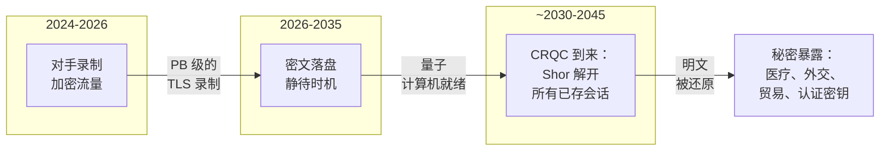
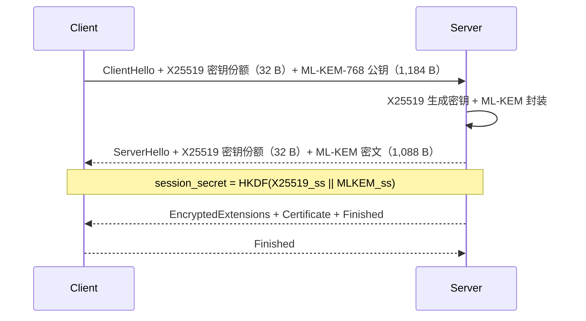
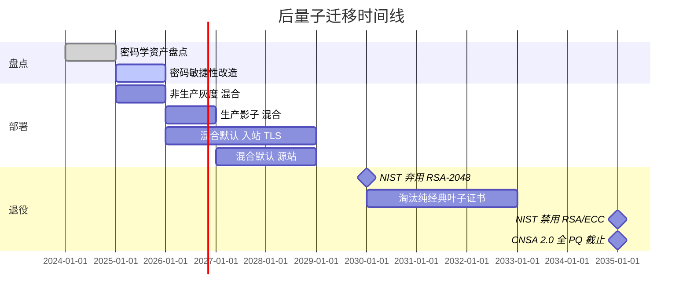

# 后量子密码学：迁移到 ML-KEM、ML-DSA 与密码敏捷的未来

> **TL;DR**: Shor 算法能打穿你今天部署的所有公钥原语：RSA、ECDH、ECDSA、Ed25519。威胁不在于“量子计算机什么时候造出来”，而在于“对手什么时候开始录你的流量”。先存后解（harvest-now-decrypt-later）意味着：任何需要在 2035 年之后仍然保密的秘密，现在就已经处在风险中。NIST 在 2024 年 8 月定稿了三项后量子标准：用于密钥交换的 ML-KEM（FIPS 203）、用于签名的 ML-DSA（FIPS 204），以及作为保守型哈希后备的 SLH-DSA（FIPS 205）[^1]。2025 到 2030 年正确的部署方式是混合模式（经典 + PQC）：只要其中一半没被攻破，会话密钥就是安全的。先做密码学资产盘点，为 TLS 部署 X25519MLKEM768，再为长期信任锚规划签名迁移。

## 学习目标

学完本模块，你将能够：

- [ ] 解释先存后解，并说明为什么 PQC 的时间表比 CRQC 的时间表更紧
- [ ] 比较 ML-KEM、ML-DSA、SLH-DSA 的参数规模，并判断各自适用的场景
- [ ] 设计混合（经典 + PQC）TLS 握手，并推断它的性能代价
- [ ] 搭出迁移框架：盘点、密码敏捷性、优先级排序、分阶段上线
- [ ] 区分 KEM 的紧迫性与签名的紧迫性，并据此排优先级

## 直觉理解

你有一本日记。每晚你写完之后上锁，然后把本子放在门口台阶上。你的邻居每天都来给这本锁着的日记拍照。今天这把锁很结实，但有一种新工具即将出现，能瞬间打开任何一把锁。邻居现在还用不上这种工具，他要的只是耐心和一台相机。

这就是先存后解。国家级对手此刻正在录制加密流量，把 PB 级的密文存起来，等着密码学相关量子计算机（CRQC）出现，然后一次性全部解开。数据不会过期。医疗记录、外交电报、商业机密、长期认证密钥，它们的保密期都延伸到未来 10 到 30 年。

解法不是等 CRQC 出现再慌，而是趁工具还没到、趁经典算法仍然有效，今天就把锁换掉；这样即便邻居手里攒了多年的照片，也毫无用处。用密码学的说法：现在就把密钥交换迁到后量子算法，录制下来的密文即使在 CRQC 存在之后也依然安全。

[网络基础](../part-0-prerequisites/00-networking-fundamentals.md) 介绍了 TLS 1.3 及其密钥交换机制，[mTLS 与服务间认证](../part-7-security-at-scale/03-mtls-service-auth.md) 讲了证书链与双向认证。本章把这两块延伸到后量子时代：什么会变、什么会坏、如何在不中断服务的前提下完成迁移。

## 原理

### 威胁时间线与 HNDL 模型

Shor 算法能在量子计算机上以多项式时间完成大整数分解和离散对数计算[^2]。这打穿了 RSA、有限域 Diffie-Hellman、ECDH（X25519、P-256）、ECDSA 和 EdDSA。Grover 算法对对称搜索只提供平方级加速，但 NIST 与已发表的资源分析都确认，AES-128 无需加倍密钥长度就已经安全[^3]。所以后量子迁移本质上是一次公钥迁移。

当前的量子硬件还称不上 CRQC。IBM Condor（1,121 个物理量子比特，2023 年）[^4] 和 Google Willow（105 个高保真量子比特，纠错已达阈值以下，2024 年 12 月）展示了扩展轨迹，但距离开动 Shor 算法去攻破生产级密钥长度，还差数百万个逻辑量子比特[^5]。对 CRQC 出现时间的估计，从 2030 年到 2045 年之后都有，取决于来源。

紧迫性来自攻击模型，而不是硬件时间表。今天录下你 TLS 会话的对手，可以在 CRQC 可用的那一刻把它解开。如果这个秘密需要保密 10 年，而 CRQC 可能在 10 年后到来，那你已经晚了。

*先存后解：对手今天抓走密文，等 CRQC 出现再解密。任何保密窗口延伸到 CRQC 到来之后的秘密，其实已经被攻破了。*

### NIST FIPS 203、204 与 205

2024 年 8 月 13 日，NIST 批准了三项后量子密码学的联邦信息处理标准。此前是一场历时 8 年的公开竞赛，最初收到 69 份提交[^1]：

- **ML-KEM（FIPS 203）** 是基于格的密钥封装机制，源自 CRYSTALS-Kyber。三套参数：ML-KEM-512、ML-KEM-768（生产环境默认）、ML-KEM-1024。
- **ML-DSA（FIPS 204）** 是基于格的数字签名，源自 CRYSTALS-Dilithium。三套参数：ML-DSA-44、ML-DSA-65、ML-DSA-87。
- **SLH-DSA（FIPS 205）** 是基于哈希的无状态签名，源自 SPHINCS+。风格保守：只依赖哈希的安全性，不引入格假设。

第四个算法 FN-DSA（Falcon）以 FIPS 206 草案形式在推进。基于编码的后备 KEM HQC 已于 2025 年 3 月入选，草案预计 2026 年发布。

反面教材是 SIKE：一个基于同源的 KEM，曾是 NIST 第四轮候选，2022 年 7 月被 Castryck 和 Decru 攻破——对 Category 1 参数集 SIKEp434 只用了单核约十分钟，更高参数集也只撑了几小时到一天[^6]。这正好印证了混合部署的直觉：绝不要把全部筹码押在单一新方案上。

| 原语 | 公钥 | 签名 / 密文 | 经典对应物 |
|---|---|---|---|
| X25519（经典） | 32 B | 32 B 密钥份额 | 基线 |
| ML-KEM-768 | 1,184 B | 1,088 B 密文 | 替代 X25519 做 KEM |
| Ed25519（经典） | 32 B | 64 B 签名 | 基线 |
| ML-DSA-65 | 1,952 B | 3,309 B 签名 | 替代 Ed25519/ECDSA |
| SLH-DSA-128s | 32 B | 7,856 B 签名 | 纯哈希后备 |
| SLH-DSA-128f | 32 B | 17,088 B 签名 | 快速变体，签名极大 |

ML-KEM-768 的公钥比 X25519 大 37 倍。ML-DSA-65 的签名比 Ed25519 大 51 倍。这些数字会重塑每一个在网络上传输公钥或签名的协议。

### 混合密钥交换与 X25519MLKEM768

混合密钥协商把一份经典密钥份额和一份 PQC 密钥份额拼在一次握手里。会话密钥由两者共同导出，所以只要有一半没被攻破，连接就是安全的[^7]。

在 TLS 1.3 里，客户端发送合并的 X25519 + ML-KEM-768 密钥份额（IETF 码点 0x11EC）[^8]。服务端做 X25519 密钥协商和 ML-KEM 封装，回传自己的 X25519 密钥份额与 ML-KEM 密文。HKDF-Extract 把两份共享秘密混入会话密钥。

*X25519MLKEM768 的混合 TLS 1.3 握手：会话密钥同时混入经典与后量子共享秘密，攻击者必须同时攻破两个算法才能还原明文。*

同样的混合模式也出现在消息应用里。Signal 在 2023 年 9 月上线 PQXDH，把 X3DH Diffie-Hellman 与 Kyber-768 的 KEM 封装结合[^9]。Apple iMessage 的 PQ3（2024 年 2 月）更进一步：混合式初始密钥建立，外加每 50 条消息或每 7 天一次的 Kyber KEM 棘轮[^10]。两家都拒绝纯 PQC，要等 ML-KEM 积累更多密码分析。

代价是：客户端密钥份额从 32 字节增长到 1,216 字节，经常把 ClientHello 顶出单个网络包。那些假设 ClientHello 尺寸固定的中间盒会直接断连。Cloudflare 实测，如果客户端先发 PQ 密钥份额，有 0.34% 的源站会直接挂掉[^7]。

### 签名与 KEM：紧迫程度不同

KEM 迁移属于 HNDL 紧迫型。录下今天的密钥交换，就足以留待日后解密。签名迁移没那么急，因为伪造一个经典签名需要攻击者在握手发生的那一刻就手握 CRQC 主动出击，而不是事后算账。

但长期存在的认证锚点等不了：

- 2022 年签发、有效期 10 年的根 CA，到了 2032 年仍然是信任库里的一把经典 RSA 密钥。CRQC 可以在它之下伪造签名，签发流氓证书。
- 固件签名密钥要保护设备 20 年以上，部署之后无法轮换。
- 包管理器和操作系统更新用的代码签名密钥，信任窗口都是多年。

签名还主导了 TLS 握手体积。仅 ML-DSA-44 一项，就能给完整证书链增加约 17 KB（六个签名加两个公钥）。Cloudflare 2021 年的实验显示，当证书链越过 10 KB 和 30 KB 这两个边界时，连接失败率明显上升[^11]。Google 在 Chrome 上走的是 Merkle Tree Certificates 路线，而不是 X.509 里的 PQ 签名，等于承认后量子证书对 Web PKI 来说还不够实用。

> [!IMPORTANT]
> 先做 KEM（HNDL 紧迫），再做长期签名锚点（根 CA、固件、代码签名），叶子证书与会话签名放最后。

### 密码敏捷性与迁移框架

密码敏捷性（crypto-agility）是一种架构属性：密码算法的更换可以通过配置、协议协商或库升级完成，不需要改写调用方。[JWT 深入](../part-7-security-at-scale/02-jwt-deep-dive.md) 用 `alg` 头和 JWKS 密钥轮换演示了这一点。TLS 密码套件协商、COSE 算法注册表、X.509 OID 都是在不同层次上提供同一种能力。

迁移框架：

1. **盘点。** 找出每一处经典密钥交换和签名：TLS、VPN、SSH、S/MIME、JWT 签名、服务间 mTLS、包签名、备份加密、HSM 密钥标签。OMB M-23-02 要求美国联邦机构产出带优先级的盘点清单，并在 2035 年之前每年更新[^12]。行业经验表明，人工盘点通常会漏掉相当一部分密码学使用点。
2. **按生命周期排优先级。** 需要在 2035 年之后仍然保密的秘密先迁。临时 Web 流量的会话密钥最后迁。
3. **做密码敏捷性改造。** 如果换一个算法需要重新部署应用，先把这件事解决。命名密码套件、算法注册表、抽象层都是前提。
4. **混合上线。** 先给入站 TLS 上 X25519MLKEM768，再做出站。先影子模式，再转默认。
5. **经典算法退场。** NIST IR 8547 规定 RSA-2048 和 ECC-256 在 2030 年之后弃用，2035 年彻底禁用。NSA CNSA 2.0 要求国家安全系统在 2035 年前完成纯 PQC[^12]。

*一条贴合 NIST IR 8547 与 NSA CNSA 2.0 截止日期的、现实可行的五年 PQC 迁移路径。盘点与密码敏捷性先行；中间几年铺混合部署；经典算法退场对齐监管时间点。*

**库的成熟度（2025 年）。** OpenSSL 3.5（2025 年 4 月 8 日发布，LTS）是第一个原生支持 ML-KEM、ML-DSA、SLH-DSA 的主流 TLS 栈[^13]。BoringSSL 从 Chrome 131 起支持 ML-KEM。Go 1.24（2025 年 2 月）把 `crypto/mlkem` 放进了标准库。AWS-LC、Rustls、wolfSSL 随后跟上。HSM 厂商（Thales、Entrust、AWS CloudHSM）在 2024 到 2025 年间陆续发布 ML-KEM 固件更新，但 FIPS 140-3 认证周期仍是瓶颈。

## 真实案例

Cloudflare 在自己的边缘节点为几百万个域名终结 TLS。2022 年 10 月，它为入站 TLS 启用了混合后量子密钥交换（最初叫 X25519+Kyber768，后更名为 X25519MLKEM768），此后一直在迭代[^7]。

**规模数据：**

- 截至 2026 年 4 月，发往 Cloudflare 的人类发起 TLS 连接中，超过 65% 使用后量子密钥协商（X25519MLKEM768）[^14]。
- 客户端密钥份额大小：混合模式 1,216 字节，纯 X25519 只有 32 字节。
- 吞吐量：在 Cloudflare 的硬件上，X25519+ML-KEM-768 客户端侧约 11,000 次/秒，纯 X25519 约 17,000 次/秒。
- 客户端先发 PQ 密钥份额时，0.34% 的源站会直接挂掉。

**架构决策：HelloRetryRequest 兜底。** 对出站连接（边缘到客户源站），Cloudflare 对外声明支持混合，但先发经典 X25519。支持混合的源站可以协商升级；不支持的源站永远看不到被拆包的 ClientHello。一个扫描器每 24 小时探测一次源站以了解其支持情况。这样就避开了那 0.34% 遇到超大 ClientHello 就崩的源站。

**KyberSlash（2023 年底）。** 一个计时侧信道影响了多个 Kyber 实现，包括 Cloudflare 的 Go 代码。TLS 部署本身不可利用，因为 TLS 只以临时方式复用 Kyber 密钥；但这件事强化了“混合优先”的姿势：假如 ML-KEM 是唯一的密钥交换，而出现的是更严重的漏洞，所有会话都会完蛋。混合意味着经典那一半仍然在保护你。

**目标：** Cloudflare 计划在 2029 年实现全 PQ（入站与出站）。

## 权衡

| 方案 | 优点 | 缺点 | 适用场景 | 我们的选择 |
|---|---|---|---|---|
| 纯经典（X25519、Ed25519） | 32 B 密钥、亚毫秒、成熟、无处不在 | CRQC 上被 Shor 攻破；当下就承受 HNDL 暴露 | 三年内下线的遗留服务 | 只对 2030 年前下线的临时服务可接受；否则上混合 |
| 混合（X25519MLKEM768） | 任一半未破即安全；可优雅回退 | 每次握手多 1.2 KB；ClientHello 被拆包 | 2024 到 2030 年所有公网 TLS | 今天所有面向公网 TLS 的默认选择 |
| 纯 PQC（仅 ML-KEM-768） | 量子安全，无经典对冲成本 | 密码学更新；ML-KEM 若被破则无后备 | 经典退场之后（CNSA 2.0、2035 年后） | 等 CNSA 2.0 强制经典退场后再规划，之前一直留在混合 |
| SLH-DSA（无状态哈希） | 保守，只依赖哈希假设 | 7.8 到 17 KB 签名，签名慢 | 超长生命周期或气隙签名 | 只用于小众场景 |
| LMS / XMSS（有状态哈希） | 签名小，NIST SP 800-208 | 状态管理危险（签两次即失守） | HSM 内的固件签名 | 今天的固件签就用它 |

## 常见陷阱

> [!WARNING]
> **跳过密码学资产盘点。** 很多组织在迁移到一半时才发现，RSA 或 ECDSA 硬编码在几十个意想不到的地方：备份加密、JWT 签名、服务间 mTLS、SSH 主机密钥、VPN 隧道。你不知道经典密码学藏在哪，就迁不动它。照抄 OMB M-23-02 的做法：产出带优先级的清单，每年更新。

> [!WARNING]
> **押注单一 PQC 方案而不用混合。** SIKE 曾是 NIST 第四轮候选，结果单核约十分钟就被攻破（SIKEp434）[^6]。如果 ML-KEM 哪天遭遇灾难性攻破，所有以纯 PQC 模式协商的会话立刻完蛋。混合部署至少做到 2030 年。

> [!WARNING]
> **低估 TLS 分片问题。** ClientHello 溢出一个包，那些假设尺寸固定的中间盒就会断连。证书链超过 10 KB 会跨越 TCP 拥塞窗口边界，多出一个完整 RTT。用 HelloRetryRequest 兜底（即 Cloudflare 的做法），并主动联系中间盒厂商。

> [!WARNING]
> **忽视固件与代码签名。** 这两块最难迁，因为 HSM 厂商在 FIPS 140-3 认证上比 NIST 标准晚 2 到 4 年。今天的固件签名请用 NIST SP 800-208 的有状态哈希签名（LMS、XMSS），NSA CNSA 2.0 已经认可。

> [!WARNING]
> **为了 Grover 把对称密钥加倍。** “Grover 把对称安全强度砍半”这个说法流传极广，但误读了该算法。Grover 需要深度串行计算，无法并行化。按 NIST、BSI 和已发表的资源分析，AES-128 是安全的[^3]。别把迁移预算烧在 AES-256 升级上，那些钱该花在 ML-KEM 部署。

## 练习

你所在组织的 TLS 用 X25519 做密钥交换，服务网格 mTLS 用 Ed25519（沿用的是 [mTLS 与服务间认证](../part-7-security-at-scale/03-mtls-service-auth.md) 的模式）。根 CA 是 2022 年签发的 10 年期证书。请设计向混合 PQC 的迁移：(1) 对库、配置、CA、叶子证书、客户端的改动顺序；(2) 在客户端兼容性、握手体积、HSM 支持上会有什么问题；(3) 对 p50 和 p99 握手延迟的 SLA 影响。**附加题：** 你有一把备份加密密钥，到 2040 年仍要能解密数据。今天你如何保护这把密钥？

提示

从盘点开始。哪些组件涉及密钥交换（HNDL 紧迫），哪些只涉及签名（没那么急）？2022 年的根 CA 在 2032 年到期，正落在 CRQC 窗口内。至于备份密钥，想一想今天就用 PQC KEM 把它包一层，这样即使原始密钥材料是经典的，被包裹的那份副本也是量子安全的。

解答

**阶段 1：盘点与密码敏捷性改造（第 1 到 3 个月）**

扫描所有 X25519、Ed25519、RSA、ECDSA 的使用点。按生命周期分类：备份密钥（2040）、根 CA（2032）、叶子证书（1 年）、临时 TLS 会话（分钟级）。确保 TLS 库支持命名组和算法协商，且不需要改应用代码。

**阶段 2：TLS 上混合 KEM（第 3 到 6 个月）**

升级到 OpenSSL 3.5+ 或等价物。把 `X25519MLKEM768` 配置为首选密钥协商组，X25519 作后备。先上非生产环境，再在生产做影子。监控 HelloRetryRequest 的突增（说明中间盒有问题）和握手失败率。

**阶段 3：服务网格 mTLS（第 6 到 12 个月）**

服务网格是内部的，两端都由你控制。把 sidecar 代理升级到支持混合 KEM。叶子证书上的 Ed25519 签名没那么急（临时 mTLS 没有 HNDL 风险），但要在第二年规划 ML-DSA 叶子证书。

**阶段 4：根 CA（第 12 到 18 个月）**

用混合签名（经典 + ML-DSA）签发新的根 CA，或者规划到 2028 年用纯 ML-DSA 根。2022 年的根在 2032 年到期；此后 CRQC 就能在它之下伪造。用旧根给新根做交叉签名，保证向后兼容。

**会坏的地方：**

- ClientHello 增大约 1.2 KB。内部服务没事（没有中间盒）。处在企业代理后面的外部客户端可能失败；HelloRetryRequest 可以兜住。
- HSM 可能还不支持 ML-KEM。临时密钥交换用软件 KEM（可接受，因为 KEM 密钥不是长期密钥），签名密钥等 HSM 固件。
- p50 延迟：可忽略（ML-KEM 封装是亚毫秒）。p99 延迟：如果对不兼容客户端触发了 HelloRetryRequest，最多多 1 个 RTT。

**附加题：今天如何保护备份密钥**

生成一对 ML-KEM-1024 密钥。用 ML-KEM 公钥封装备份加密密钥，得到一份 PQC 包裹的密文。同时保存经典备份密钥（供当前使用）和 ML-KEM 包裹副本（供量子安全恢复）。即便对手录下了传输备份密钥时用的经典密钥交换，ML-KEM 包裹的那份副本在 CRQC 之后依然安全。

## 要点回顾

- 先存后解让 PQC 成为今天的问题，尽管 CRQC 是明天的威胁。任何保密窗口越过 2035 年的秘密，现在就已经处在风险中。
- NIST 在 2024 年 8 月标准化了 ML-KEM（FIPS 203）、ML-DSA（FIPS 204）和 SLH-DSA（FIPS 205）。ML-KEM-768 是密钥交换的生产默认。
- 混合（经典 + PQC）是 2025 到 2030 年正确的部署方式。任一半没破，你就是安全的。
- KEM 属于 HNDL 紧迫；签名没那么急，但长期信任锚（根 CA、固件签名、代码签名）例外。
- ML-KEM-768 公钥 1,184 字节，X25519 只有 32 字节。这会把 TLS ClientHello 顶出一个包，触发中间盒故障。
- 密码敏捷性才是真正的前提。把算法硬编码的组织会迁两次。
- 别为 Grover 把预算浪费在加长 AES 密钥上。AES-128 是安全的，把那点力气花在 ML-KEM 部署上。

## 延伸阅读

- [NIST FIPS 203 (ML-KEM)](https://csrc.nist.gov/pubs/fips/203/final) - KEM 的最终标准；第 6、7 节规定了参数以及封装/解封装算法。
- [Cloudflare: The state of the post-quantum Internet](https://blog.cloudflare.com/pq-2024/) - 关于真实世界 PQC TLS 部署最好的一篇总览，带规模数据和中间盒故障数据。
- [Signal: Quantum Resistance and the Signal Protocol (PQXDH)](https://signal.org/blog/pqxdh/) - Signal 如何把 X3DH 与 Kyber-768 结合，在消息场景实现混合后量子前向保密。
- [Apple: iMessage with PQ3](https://security.apple.com/blog/imessage-pq3/) - 带周期性 Kyber 棘轮的 Level 3 消息架构，以及 Stebila 和 Basin 的形式化验证。
- [NIST IR 8547: Transition to Post-Quantum Cryptography Standards](https://csrc.nist.gov/pubs/ir/8547/ipd) - RSA/ECC 弃用时间线：2030 年弃用，2035 年禁用。
- [OpenSSL 3.5 Final Release](https://openssl-library.org/post/2025-04-08-openssl-35-final-release/) - 第一个原生支持 ML-KEM、ML-DSA、SLH-DSA 的主流 LTS TLS 栈。
- [Filippo Valsorda: Quantum Computers Are Not a Threat to 128-bit Symmetric Keys](https://words.filippo.io/128-bits/) - 关于 Grover 在现实中为何不会砍半 AES 安全强度的权威解释。
- [Castryck-Decru SIDH break (eprint 2022/975)](https://eprint.iacr.org/2022/975) - 那个反面教材：NIST 第四轮进行中，SIKEp434 被单核约十分钟攻破。

## 记忆卡片

**Q:** 什么是先存后解（HNDL）？
**A:** 对手今天录下加密流量并存起来，等密码学相关量子计算机（CRQC）能解开它。任何保密窗口延伸到 CRQC 到来之后的秘密，其实已经被攻破。

**Q:** Shor 算法会打穿哪些经典原语？
**A:** 所有基于整数分解或离散对数的公钥原语：RSA、有限域 DH、ECDH（X25519、P-256）、ECDSA、EdDSA。对称原语（AES、SHA）不受 Shor 影响。

**Q:** 2024 年 8 月定稿的三项 NIST PQC 标准是什么？
**A:** FIPS 203（ML-KEM，基于格的密钥封装）、FIPS 204（ML-DSA，基于格的数字签名）、FIPS 205（SLH-DSA，基于哈希的无状态签名）。

**Q:** 为什么 ML-KEM-768 是生产默认，而不是 ML-KEM-512 或 ML-KEM-1024？
**A:** ML-KEM-768 提供 NIST 类别 3 安全强度（约等于 192 位），在安全余量与密钥尺寸之间平衡。ML-KEM-512 是类别 1（余量更低）；ML-KEM-1024 是类别 5（CNSA 2.0 用于国家安全系统，但更大）。

**Q:** 什么是混合密钥交换，为什么要用？
**A:** 混合把经典密钥份额（X25519）与 PQC 密钥份额（ML-KEM-768）拼在一次握手里，会话密钥由两者共同导出。只要任一算法没被攻破，连接就安全。这是对 ML-KEM 未来被攻破的对冲（就像 2022 年的 SIKE）。

**Q:** X25519MLKEM768 的客户端密钥份额比纯 X25519 大多少？
**A:** 1,216 字节（32 B X25519 + 1,184 B ML-KEM-768 公钥）对纯 X25519 的 32 字节，增长 38 倍，会把 ClientHello 顶出一个网络包。

**Q:** 为什么 KEM 比签名更 HNDL 紧迫？
**A:** KEM 被攻破是被动的：录下今天的密钥交换，日后就能解开。伪造签名则要求攻击者在握手发生时就手握 CRQC 主动行动。不过长期签名锚点（根 CA、固件密钥）仍然需要迁移，因为它们必须在 CRQC 到来之后依然可信。

**Q:** 什么是密码敏捷性？
**A:** 一种架构属性：密码算法可以通过配置、协议协商或库升级来更换，不必改写应用代码。它是任何 PQC 迁移的前提。

**Q:** SIKE 出了什么事，为什么重要？
**A:** SIKE 是 NIST 第四轮的 KEM 候选，2022 年 7 月被 Castryck 和 Decru 攻破——类别 1 参数集（SIKEp434）单核约十分钟。它说明新的密码学假设可能灾难性失效，这正是过渡期混合部署（绝不只依赖 PQC）不可或缺的原因。

**Q:** NIST IR 8547 什么时候弃用 RSA-2048 和 ECC-256？
**A:** 2030 年之后弃用，2035 年禁用。NSA CNSA 2.0 要求美国国家安全系统在 2035 年前完成纯 PQC。

**Q:** PQC 迁移框架的第一步是什么？
**A:** 密码学资产盘点：找出 TLS、VPN、SSH、JWT、mTLS、包签名、备份加密、HSM 里每一处经典密钥交换与签名。你没找到的东西，就迁不动。

**Q:** Grover 算法需要把 AES 密钥长度加倍吗？
**A:** 不需要。Grover 提供平方级加速，但需要深度串行计算，无法并行化。NIST、BSI 与已发表的分析都确认 AES-128 仍然安全。CNSA 2.0 强制 AES-256 是为了策略统一，不是为了防 Grover。

## 参考文献

[^1]: NIST, "Announcing Approval of Three Federal Information Processing Standards (FIPS) for Post-Quantum Cryptography", Aug 13, 2024. https://www.nist.gov/news-events/news/2024/08/announcing-approval-three-federal-information-processing-standards-fips
[^2]: Peter W. Shor, "Polynomial-Time Algorithms for Prime Factorization and Discrete Logarithms on a Quantum Computer", SIAM J. Comput., 1997. https://arxiv.org/abs/quant-ph/9508027
[^3]: Filippo Valsorda, "Quantum Computers Are Not a Threat to 128-bit Symmetric Keys", Apr 2026. https://words.filippo.io/128-bits/
[^4]: IBM Research, "The hardware and software for the era of quantum utility is here" (IBM Condor: 1,121 superconducting qubit processor), Dec 4, 2023. https://research.ibm.com/blog/quantum-roadmap-2033
[^5]: Google, "Meet Willow, our state-of-the-art quantum chip", Dec 2024. https://blog.google/technology/research/google-willow-quantum-chip/
[^6]: Wouter Castryck and Thomas Decru, "An efficient key recovery attack on SIDH", IACR eprint 2022/975 (SIKEp434 broken in about 10 minutes on a single core). https://eprint.iacr.org/2022/975
[^7]: Cloudflare (Ahmad, Valenta, Westerbaan), "Cloudflare now uses post-quantum cryptography to talk to your origin server", Sep 29, 2023. https://blog.cloudflare.com/post-quantum-to-origins/
[^8]: Kwiatkowski, Kampanakis, Westerbaan, Stebila, "Post-quantum hybrid ECDHE-MLKEM Key Agreement for TLSv1.3", IETF draft-kwiatkowski-tls-ecdhe-mlkem-02, Sep 10, 2024 (assigns codepoint 0x11EC to X25519MLKEM768). https://www.ietf.org/archive/id/draft-kwiatkowski-tls-ecdhe-mlkem-02.html
[^9]: Signal, "Quantum Resistance and the Signal Protocol", Sep 19, 2023 (PQXDH). https://signal.org/blog/pqxdh/
[^10]: Apple Security Engineering and Architecture, "iMessage with PQ3: The new state of the art in quantum-secure messaging at scale", Feb 21, 2024. https://security.apple.com/blog/imessage-pq3/
[^11]: Cloudflare (Westerbaan), "Sizing Up Post-Quantum Signatures", Nov 8, 2021 (experiment showing connection failures at 10 KB and 30 KB certificate chain boundaries). https://blog.cloudflare.com/sizing-up-post-quantum-signatures/
[^12]: NIST IR 8547 (Initial Public Draft), "Transition to Post-Quantum Cryptography Standards", Nov 12, 2024 (comment period closed Jan 10, 2025). https://csrc.nist.gov/pubs/ir/8547/ipd
[^13]: OpenSSL Library, "OpenSSL 3.5 Final Release", Apr 8, 2025. https://openssl-library.org/post/2025-04-08-openssl-35-final-release/
[^14]: Cloudflare (Westerbaan), "Cloudflare targets 2029 for full post-quantum security", Apr 7, 2026 (reports "over 65% of human traffic" uses PQ encryption). https://blog.cloudflare.com/post-quantum-roadmap/
