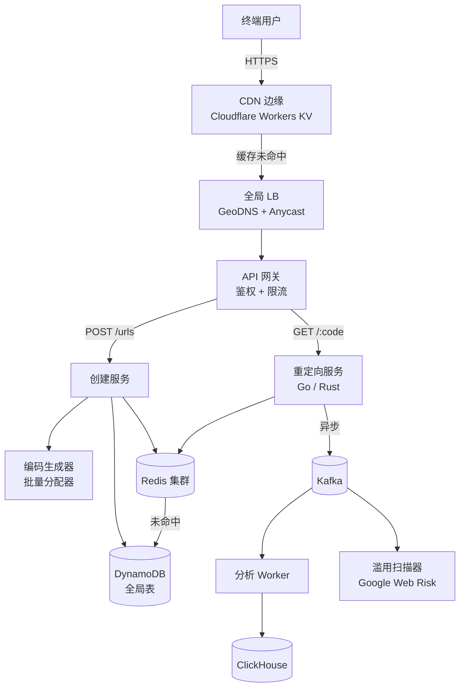
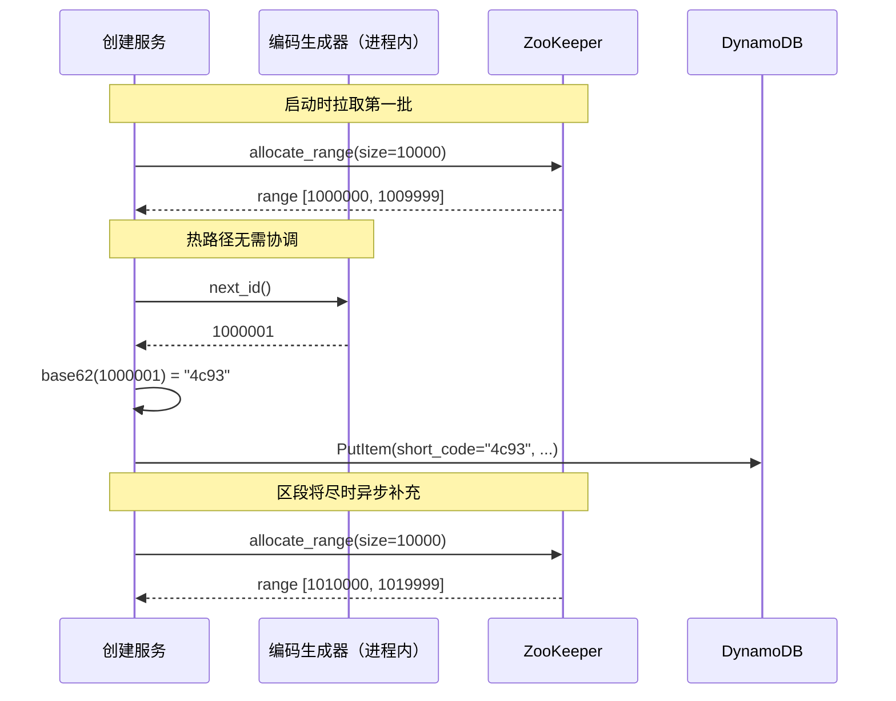
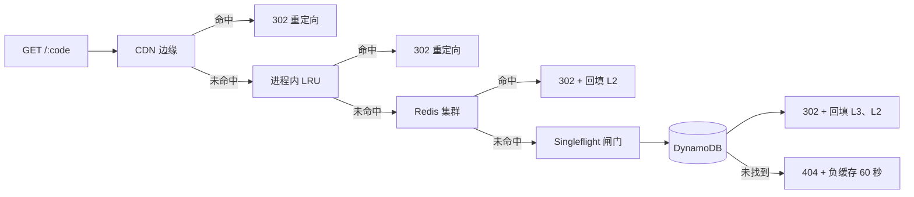
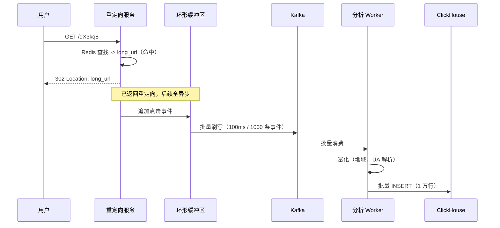

# 设计一个 URL 短链接服务（TinyURL / bit.ly）

> **TL;DR.** URL 短链接服务看起来是存储问题，本质是读多写少的缓存问题。重定向与创建的比例是 100:1，所以要先设计读路径：多层缓存（CDN 边缘、进程内 LRU、Redis）吸收 100K+ QPS，DynamoDB 只承接未命中的请求。预分配的批量 ID 消除了每次写入的协调开销。带缓冲的 Kafka 流水线把分析从重定向热路径上摘下来。Bitly 每月服务数十亿次重定向，可用性 99.99%[^1]，用的正是这套结构。

## 学习目标

学完本章，你将能够：

- [ ] 估算日创建 1000 万、日重定向 10 亿次的 URL 短链接服务的容量
- [ ] 比较四种短码生成策略，并论证为什么预分配批次是默认选择
- [ ] 设计多层缓存拓扑，用 singleflight 抵御缓存击穿
- [ ] 用带缓冲的 Kafka 生产者把分析从重定向热路径中解耦
- [ ] 论证带分析的短链接服务为何选 302（或配短 `Cache-Control` 的 301）
- [ ] 在不阻塞重定向路径的前提下接入滥用扫描

## 直觉理解

你在演唱会场地管一个衣帽寄存柜台。客人递来一件外套（长 URL），你回他一张带编号的票根（短码）。他拿着票根回来，你按号找到外套还给他（重定向）。就这么简单。

规模一上来，三个问题就冒出来了。第一，每分钟只有 100 位客人来存外套，却有 10,000 位回来取。取件路径比存件路径热 100 倍。你需要跑腿的人、排好序的货架，还要在前台备一份最热门外套的缓存。第二，你没法停下来慢慢想票号。你事先把整卷带编号的票根撕好，发一张不用动脑。第三，老板想知道哪些外套最常被取走，可计数绝不能拖慢交接。你在便签上划一道正字，事后再对账。

这就是 URL 短链接服务。货架是 DynamoDB，跑腿的人是 Redis，事先撕好的票根是批量分配的 ID，便签是 Kafka 缓冲区。朴素做法（一行 Postgres 记录、一台服务器、同步分析）撑 10 个用户没问题。到了每天 1000 万次写入、10 亿次读取，它会崩：读路径把单个数据库打满，写路径堵在全局计数器上，同步分析把重定向延迟翻了一倍。

解开整个设计的洞察只有一个：把读路径当 CDN 问题看，而不是数据库问题。映射一旦创建就不再变化，就该在每一层都狠狠地缓存。

## 需求

### 澄清问题

- **Q：只服务登录用户，还是也允许匿名？**
  假设：两者都要。匿名创建配严格限流（10 次/分钟）；注册用户给配额（1 万次/天）。

- **Q：需要点击分析吗？**
  假设：需要。按链接统计点击量、地域分布、来源（referrer）、user-agent。看板延迟落后实时几分钟可以接受。

- **Q：支持自定义别名（品牌短链）吗？**
  假设：付费用户支持。必须全局唯一，用条件写保证。

- **Q：需要多区域吗？**
  假设：需要。3 个区域双活读。写请求路由到最近的区域，异步复制。

- **Q：SLA 目标是多少？**
  假设：读可用性 99.99%，写可用性 99.9%，重定向全球 p99 < 50 ms。

- **Q：链接会过期吗？**
  假设：TTL 可选，默认永久。过期链接返回 410 Gone。

### 功能需求

- 用长 URL 创建短链接，返回短码。
- 对短码的 GET 请求以 HTTP 302 重定向到原始 URL。
- 支持可选的自定义别名，并强制唯一性。
- 记录点击事件用于分析（地域、来源、user-agent）。
- 支持删除链接，以及可选的基于 TTL 的过期。
- 对恶意目标 URL 拦截或告警。

### 非功能需求

- **负载：** 每天 1000 万次写入（均值约 115 写 QPS，峰值约 350），每天 10 亿次读取（均值约 11,500 读 QPS，峰值约 100K）。
- **延迟：** 全球重定向 p50 < 10 ms，p99 < 50 ms。
- **可用性：** 读路径 99.99%，写路径 99.9%。
- **一致性：** 跨区域读为最终一致（滞后 1-5 秒）；自定义别名的唯一性要求强一致。
- **持久性：** 短码映射一旦发布，除非显式删除，否则永不改变、永不消失。

## 容量估算

| Metric | Value | Derivation |
|--------|------:|------------|
| 总记录数（5 年） | 182.5 亿 | 1000 万/天 x 365 x 5 |
| 每条记录存储 | 约 500 B | short_code(8) + long_url(约 300) + metadata(约 192) |
| 原始存储总量 | 9.1 TB | 182.5 亿 x 500 B |
| 复制后存储（3 副本、3 区域） | 约 82 TB | 9.1 TB x 3 副本 x 3 区域 |
| 峰值读 QPS | 100K | 10 亿/天 / 86,400 x 约 8.6 突发系数 |
| 峰值写 QPS | 350 | 1000 万/天 / 86,400 x 3 |
| 热数据缓存内存 | 9 GB | 1800 万个键（前 0.1%）x 500 B |

关键比例：

- **读写比 = 100:1。** 这个比例决定了后面每一个架构决策。
- **缓存命中率目标：95%+。** 峰值 100K QPS 下做到 95% 命中，DynamoDB 每秒只看到 5K 次读，远在突发容量之内。
- **码空间：** 7 位 base62 = 62^7 = 3.52 万亿个槽位[^2]。按每天 1000 万算，约有 965 年余量。
- **带宽：** 100K 请求/秒 x 约 1 KB 响应（响应头 + 302）= 峰值出网约 100 MB/s。

## API 与数据模型

### API 设计

```http
POST /v1/urls
  Authorization: Bearer ***
  Idempotency-Key: <uuid>
  Body: { "long_url": "https://...", "custom_alias": "my-brand", "expires_at": "2027-01-01T00:00:00Z" }
  Returns: 201 { "short_code": "dX3kq8", "short_url": "https://sho.rt/dX3kq8", "created_at": "..." }
  Errors: 409 alias conflict, 429 rate limited, 400 invalid URL

GET /{short_code}
  Returns: 302 Found, Location: <long_url>, Cache-Control: private, max-age=0
           404 not found, 410 gone (expired)

GET /v1/urls/{short_code}/stats
  Returns: 200 { "clicks": 42000, "by_country": {...}, "by_day": [...] }

DELETE /v1/urls/{short_code}
  Returns: 204 No Content
```

为什么用 302（或配短 `Cache-Control` 的 301），而不是不限期的 301：浏览器可能把普通的 301 永久缓存下来、再也不回源[^3]，这既毁掉点击分析，也让撤销生效被拖到每个客户端各自的缓存过期时间。302 则强制客户端每次点击都回到服务端。Bitly 走了第三条路：直接对 `bit.ly` 发 HTTP 探测，返回的是 **`HTTP/2 301` 且带 `Cache-Control: private, max-age=90`**，用最多约 90 秒的单客户端分析滞后，换取浏览器缓存的友好性[^4]。两种模式都站得住脚；不带短 `Cache-Control` 的裸 301 站不住。

### 数据模型

```sql
-- 主存储：DynamoDB Global Table
-- 分区键：short_code（哈希分布）
-- 热路径上不建二级索引

table url_mappings (
  short_code     String    -- 分区键，7 位 base62
  long_url       String    -- 目标地址
  owner_id       String    -- 匿名创建时为 null
  created_at     Number    -- epoch 毫秒
  expires_at     Number    -- 可为 null，epoch 毫秒
  safety_status  String    -- "clean" | "warn" | "blocked"
)

-- 分析存储：ClickHouse
-- 按月分区，按 (short_code, event_time) 排序

table click_events (
  event_time     DateTime
  short_code     String
  country        FixedString(2)
  referrer_host  String
  ua_family      LowCardinality(String)
)
```

DynamoDB Global Tables 提供个位数毫秒的单点读、托管的多区域复制，热路径上不需要 join[^5]。单分区上限是 3,000 RCU 和 1,000 WCU[^5]，这没问题，因为 7 位 base62 短码会均匀分散到各个分区。

ClickHouse 的稀疏主索引让“查这个短码最近 30 天的点击”变成对单个磁盘段的连续范围扫描[^6]。

## 高层架构



*重定向路径很精简：CDN 边缘、网关、重定向服务、Redis、DynamoDB。分析扫描和滥用扫描都挂在 Kafka 总线上，谁都不阻塞一次点击。*

**写路径：** 客户端向 API 网关发 POST。创建服务调用编码生成器（进程内批量分配，无 RPC），用条件写写入 DynamoDB，预热 Redis，并向 Kafka 发出 `url.created` 事件。滥用扫描消费者异步地拿目标 URL 去查 Google Web Risk。

**读路径：** 客户端向 CDN 边缘发 GET。命中缓存（爆款短码）时，CDN 直接返回 302。未命中则落到重定向服务，依次查进程内 LRU、Redis、DynamoDB。重定向服务把点击事件追加到进程内缓冲区（绝不在 Kafka 上阻塞）。

**异步路径：** Kafka 消费者对点击事件做富化（由 IP 反查地域、解析 UA），再批量写入 ClickHouse。另有一个消费者重扫 URL，跟进安全状态变化。

## 深入探讨

### 深入探讨 1：ID 生成策略

编码生成器必须在峰值 350 写/秒下产出全局唯一、URL 安全、紧凑的短码，且每次请求零协调。

**方案 A：哈希截断（MD5 前缀，base62 编码）。** 确定性好，但生日悖论保证会碰撞。6 位 base62（62^6 = 568 亿个槽位）下，大约到 238,000 个 URL 就很可能碰撞[^7]。而且它泄露信息：任何人拿到长 URL 都能算出短码。

**方案 B：自增计数器（Flickr 的 ticket server 风格[^8]）。** 零碰撞、短码紧凑。Flickr 跑两台 MySQL，设 `auto_increment_increment=2`、偏移分别 1/2 来实现高可用。“自 2006 年 1 月 13 日星期五上线以来一直在生产环境运行”[^8]。但计数器是单点瓶颈，而且短码可枚举。

**方案 C：随机 + 条件写。** 短码不可猜。在 3.52 万亿的码空间里已有 180 亿个码的情况下，每次尝试的碰撞概率约 0.5%。每次写入要多一次 DB 往返。

**方案 D：预分配批次（胜出者）。** 一个协调者（ZooKeeper 或 Postgres 里的一行）把 10,000 个连续整数 ID 的区段发给每个创建服务实例。实例从内存里的区段中分配 ID，每次请求零协调。区段快用完时，异步取下一批。

这就是 Instagram 的分片 ID 模式[^9]：41 位时间戳、13 位分片 ID、10 位序列号，每个分片每毫秒产出 1,024 个 ID，无需跨分片协调。Twitter 的 Snowflake 用同样的原理，只是做到 64 位[^10]。



*每个创建服务实例在内存里握着一个预分配的 ID 区段。热路径生成 ID 不需要任何网络调用；只有区段快用完时才联系 ZooKeeper。*

**批次为什么胜出：** 无逐请求协调、吞吐随实例线性扩展、构造上零碰撞。实例崩溃时手上 9,000 个没用掉的 ID 就浪费了——在 3.52 万亿个槽位面前，这点浪费无关紧要。

### 深入探讨 2：100K QPS 的读路径

重定向路径要在全球以 p99 < 50 ms 扛住峰值 100K QPS。单个数据库做不到。解法是四层缓存：

| Layer | Cumulative hit rate | Latency | Notes |
|-------|--------------------:|---------|-------|
| CDN 边缘（Workers KV） | 15-30% | 5-20 ms | 只存爆款短码；TTL 短（30-60 秒） |
| 进程内 LRU | 50-65% | 约 0.1 ms | 接住“一条链接、N 次连续点击” |
| Redis 集群 | 92-97% | 1-2 ms | 每个区域 9 GB 工作集 |
| DynamoDB（源站） | 100% | 5-10 ms | 只有 3-8% 的请求走到这里 |

Cloudflare 报告称，不到 0.03% 的 Workers KV 键承担了几乎一半的 KV 请求，它们的内存缓存能在 1 ms 内响应这些最热的键[^11]。这种热键集中度和短链接服务的流量特征完全吻合。

**击穿问题：** 一个热缓存键过期，10,000 个客户端同时未命中，这 10,000 个查询全都冲着同一个键打到 DynamoDB。DynamoDB 的单分区上限是 3,000 RCU[^5]，一个爆款短码就能打满一个分区。

**防御：请求合并（singleflight）。** 每个重定向服务实例上，同一个键只允许一个在途的 DB 查询，其余调用者都订阅同一个在途 future。Go 的 `golang.org/x/sync/singleflight` 用一个文件（约 200 行）就实现了[^12]。Discord 在 Rust 数据服务层用了同样的模式，把数千次并发读合并成一次 DB 调用[^13]。



*任何一层未命中就落到下一层。DynamoDB 之前的 singleflight 闸门把同一个键上的并发未命中合并成一次 DB 调用。*

其他防御手段：**stale-while-revalidate**（返回过期值，同时后台刷新）、**预热**（创建时写入缓存并给长 TTL）、**负缓存**（把 404 缓存 60 秒，挡住随机短码扫描器）。

### 深入探讨 3：异步分析流水线

重定向绝不能阻塞在分析上。重定向路径上每多一毫秒，都是对 SLO 的直接违背。

重定向服务把点击事件追加到进程内的环形缓冲区，每 100 ms 或攒够 1,000 条就刷一次 Kafka，以先到者为准。缓冲区满了就丢弃事件。分析能容忍少量丢失（通常 < 0.1%），重定向不能容忍阻塞。

**Kafka 容量规划：** 峰值 100K 事件/秒 x 200 B/事件 = 20 MB/s。30 个分区（每个 < 1 MB/s）、保留 7 天，集群约存 12 TB。3 broker、3 副本的集群轻松应付。

**消费流水线：** 分析 Worker 批量消费、做富化（用 MaxMind IP 库反查地域、解析 UA），再批量写入 ClickHouse（每次插入 1 万行）。ClickHouse 的 `SummingMergeTree` 物化视图在写入时就预聚合每日计数，看板读取从不扫原始事件[^6]。



*重定向在任何分析 I/O 之前就已返回。Kafka 是一份可重放的日志：ClickHouse 写入失败时，事件会重新灌入，不丢数据。*

**为什么不直接写 ClickHouse？** ClickHouse 是为批量插入优化的，不适合低延迟的单行写入。从重定向处理程序里做同步插入，等于把重定向延迟和 OLAP 存储的健康状况绑在一起。ClickHouse 局部降级时，重定向就会超时。

## 真实案例

Bitly 每月处理数十亿次点击[^14]，覆盖 190 多个国家，为超过一半的《财富》500 强企业客户提供服务[^1]，重定向路径以 99.99% 可用性为目标[^1]。

**滥用检测流水线。** Bitly 的信任与安全系统分三个阶段，全都不碰重定向热路径[^4]：

1. **抓取。** 创建时（Bitly 术语叫“encoding”），Crawler 抓取目标 URL 并提取元数据：页面标题、重定向链、SSL 证书、托管服务商。
2. **分类。** 威胁检测服务拿这些元数据去比对 Google Web Risk 逾 100 万个已知恶意 URL 的库[^15]。Web Risk 每天扫描超过 100 亿个 URL，返回一个置信度评分（从低到极高）[^15]。
3. **执行。** Abuse API 是唯一权威。每次重定向（“decoding”）时，缓存记录里已带上安全状态。被标记的 URL 展示一个中间告警页；硬拦截的 URL 返回拦截页。标记就存在缓存记录里，所以执行环节零延迟开销。

**重扫。** 一个滚动运行的 Kafka 消费者会重新评估已有 URL，因为今天无害的页面明天可能变成钓鱼页[^4]。这也是安全扫描器做成消费者、而不是同步闸门的原因。

**Twitter 的 t.co** 走了另一条路：每条推文里的每个 URL 都被自动包装，用户不能退出[^16]。HTTPS 链接固定占 23 个字符[^17]，让链接长度与字数预算解耦。Twitter 的 Snowflake[^10] 提供每秒数万个 ID 的无协调生成能力，t.co 大概率用的就是这个或类似方案。

**Google goo.gl 关停。** Google 的短链接服务在 2018 年停止接受新 URL，2024 年开始展示中间页。他们自己的数据是：“超过 99% 的 [goo.gl 链接] 在过去一个月里没有任何活动”[^18]，但剩下的链接嵌在“数不清的文档、视频、帖子里”[^18]。Google 后来在 2025 年 8 月调整了方案，保留仍在使用的链接，只停用近期无活动的那些[^18]。教训是：短链接服务许下的是长期持久性承诺，一旦违约，代价会沿着每一个嵌入过该链接的载体层层传导。

## 权衡

| Approach | Pros | Cons | When to use |
|----------|------|------|-------------|
| 短码生成：哈希截断（MD5 前缀） | 确定性；天然去重 | 生日悖论导致碰撞；可猜 | 仅限原型和离线工具 |
| 短码生成：计数器（Flickr ticket server） | 零碰撞；紧凑 | 单点瓶颈；可枚举 | 写 QPS 低；可接受枚举 |
| 短码生成：随机 + 条件写 | 不可猜；简单 | 多一次 DB 往返；碰撞代价随规模上升 | 私有短码；码空间远大于总量 |
| 短码生成：预分配批次 | 无协调；线性扩展；零碰撞 | 崩溃时浪费 ID；仍可枚举 | 生产环境的**默认选择** |
| 存储：DynamoDB Global Tables | 托管多区域；毫秒级单点读 | 热分区上限（3K RCU）；规模上去成本高 | 托管运维；第一天就要多区域 |
| 存储：自建 ScyllaDB | 横向扩展；无 GC 停顿 | 运维负担；需要 DB 专精 | 链接 >1000 亿且有 DB 运维团队[^13] |
| 重定向：301 + 短 `Cache-Control`（Bitly） | 浏览器与中间层缓存；首点分析准 | 继承 SEO 信号；撤销被 max-age 拖延 | 能接受短暂缓存导致分析缺口的短链接服务 |
| 重定向：302 + `max-age=0` | 每次点击都到服务端；分析精确 | 无中间层缓存；每次点击一次 RTT | 带分析的短链接服务的**默认选择** |
| 分析：同步写 OLAP | 简单；不丢事件 | 重定向延迟受 OLAP 健康牵制 | 无突发容忍度的内部看板 |
| 分析：缓冲到 Kafka | 重定向延迟有界；可重放 | 缓冲区溢出时少量丢失 | 任何正经短链接服务的**默认选择** |

最大的单个权衡是 **302 vs 301**。返回 302 意味着每次点击都打到服务端，付出算力、增加延迟，换来精确分析和即时撤销。返回带默认 `Cache-Control` 的 301，浏览器可能把重定向缓存到永久，回访用户再也不回源：分析逐渐衰减，撤销要等几周。中间路线是 Bitly 在生产里实际跑的：**301 配 `Cache-Control: private, max-age=90`**（撰写时直接对 `bit.ly` 发 HTTP 探测验证过），首次点击仍落到服务端，同时允许浏览器在短暂有限的窗口内缓存。想要每一次点击都被统计、并且整条链路都由你掌控，就选 302；想要浏览器缓存友好、能接受约 max-age 秒的分析滞后与撤销延迟，就选配短 `Cache-Control` 的 301。

## 扩展与故障模式

**10 倍负载（日写 1 亿、日读 100 亿、峰值读 1M QPS）：**

- 每区域 Redis 内存涨到 90 GB。多分几个节点；Redis Cluster 原生支持。
- DynamoDB 热分区：某条名人推文让一个短码爆火。缓存层吸收了大部分流量，但泄漏出来的那部分仍可能撞上 3,000 RCU 的上限[^5]。缓解手段：写分片（把热键复制成 N 个不同分区键的变体，读时轮询）。
- Kafka 分区数增到 300，以维持每分区 < 1 MB/s。

**100 倍负载（日写 10 亿、日读 1000 亿）：**

- 存储进入 PB 级。DynamoDB 仍扛得住，但成本会促使你迁到自建 ScyllaDB。Discord 在数万亿条消息上验证过：p99 读从 40-125 ms（Cassandra）降到 15 ms（ScyllaDB），节点从 177 台减到 72 台[^13]。
- CDN 成为主读路径。DynamoDB 退化为纯源站，命中率 < 1%。

**1000 倍负载：** 架构转向 CDN 优先 + 边缘计算（Cloudflare Workers），大多数重定向在边缘就解析完成，根本不碰源站基础设施。

**故障模式：**

- **区域故障：** GeoDNS 把流量导到存活区域。DynamoDB Global Tables 对已提交写入提供 RPO < 1s。故障区域在最后一个复制窗口内创建的 URL，在其他区域可能短暂 404，直到复制追平。
- **Redis 集群故障：** 重定向服务直接穿到 DynamoDB。延迟从约 2 ms 升到约 8 ms。singleflight 防住击穿。CDN 无论如何都在吸收爆款流量。
- **Kafka broker 故障：** 进程内环形缓冲区继续接收事件。如果所有 broker 宕机超过缓冲区容量（峰值下约 10 秒），事件被丢弃。分析能忍，重定向不受影响。

## 常见陷阱

> [!WARNING]
> **用 MD5(long_url) 当短码生成策略。** 它泄露信息（拿到长 URL 的人都能算出短码），6 位短码在大约 23.8 万个 URL 时就会碰撞[^7]，而且无法撤销。用预分配批次。

> [!WARNING]
> **在重定向处理程序里同步写点击记录。** 哪怕只花 5 ms 也会让 p50 翻倍。第一条爆款链接就会打爆你的 SLO。永远走缓冲、异步刷写。

> [!WARNING]
> **返回 HTTP 301 却不带短 `Cache-Control`。** 按 RFC 7231，没有缓存指令（或写成 `Cache-Control: public, max-age=<很大>`）的 301 可能被浏览器和中间层近乎永久缓存[^3]。随着回访用户再也不回源，你的分析看板会看到点击量持续衰减，而链接撤销在每个客户端的缓存各自过期之前基本无效。要么用 302，要么（像 Bitly 那样）返回带 `Cache-Control: private, max-age=<较小值>` 的 301，把爆炸半径限住。

> [!WARNING]
> **忽略恶意 URL 扫描。** 上线没几天，垃圾推广者就会拿你的短链接服务洗白钓鱼链接。钓鱼是短链接服务最常见的滥用途径之一[^4]。第一天就把威胁情报接进来。

> [!WARNING]
> **单区域写入导致跨区域重定向失败。** 在 us-east-1 创建的 URL，在 ap-south-1 要等复制追平（1-5 秒）才可解析。把创建请求短暂绑定到它的源区域，或者在创建时同步预热本地缓存。

> [!WARNING]
> **为省一个字符选 6 位短码。** 62^6 = 568 亿个槽位，按每天 1000 万算约 15.6 年就用光。62^7 = 3.52 万亿个槽位能撑约 965 年。多那一个字符，买到的是几个世纪的余量。

## 追问

**1. 多区域双活写入怎么处理？**

DynamoDB Global Tables 用服务端时间戳做最后写入者获胜（last-writer-wins）。对自动生成的短码（按区域批量分配、区段互不重叠）来说不存在冲突。对自定义别名，把条件写路由到该别名前缀对应的“归属区域”，或者接受两个不同区域的用户抢同一别名时会一个成功、一个拿到 409。

**2. 如何发现并拦截创建后才变坏的钓鱼 URL？**

一个滚动运行的 Kafka 消费者按计划把语料重新拿去比对 Google Web Risk（例如每 24 小时复查过去 7 天被点击过的 URL）。状态变化时更新 DynamoDB 里的 `safety_status` 字段，并让 Redis 里对应缓存条目失效。下一次重定向就会看到更新后的标记。

**3. 如何做精确时刻过期（链接在 UTC 午夜失效）？**

把 `expires_at` 存进 DynamoDB 记录。重定向服务在每次缓存未命中时检查 `expires_at`。对已缓存的条目，把 Redis TTL 设为 `min(cache_ttl, expires_at - now)`。再由一个后台清扫任务从 DynamoDB 删除过期记录并发出缓存失效事件。

**4. 自定义域名（品牌短链）怎么实现？**

客户从 `yourbrnd.co` 建一条 CNAME 指向我们的边缘。我们通过 ACME（Let's Encrypt）签发 TLS 证书。在边缘，按 `Host` 头把请求路由到对应租户的命名空间。数据模型给 `url_mappings` 加一个 `domain` 字段，分区键变成 `(domain, short_code)`。

**5. 做 link-in-bio 产品（一个用户、多条链接、有顺序）需要改什么？**

加一个 `page_id` 概念，配一份有序的短码列表。页面本身是独立实体，存在 DynamoDB 里，用排序键表达顺序。重定向路径不变；新增的是一个读密集的页面渲染器，取有序列表并渲染 HTML。

**6. 如何提供高级分析（实时、逐次点击、可导出）？**

付费用户走专属的 Kafka 消费组，写入按租户隔离的 ClickHouse 表，粒度更细（逐次点击的行，而不是预聚合的日计数）。导出可以通过定时 S3 dump，或者一个客户直接消费的流式 Kafka topic。

## 练习

### 练习 1：自定义别名的冲突处理

一位付费用户申请 `sho.rt/my-brand`，但该别名已被别人占用。请设计这个流程：(1) 条件写如何检出冲突，(2) 如何回应第二位用户，(3) 如何缓存负向查询，避免热门别名的检查把 DB 压垮，(4) 如何做一套在结算期间锁定别名 5 分钟的预约机制。

<details>
<summary>提示</summary>

DynamoDB 的 `PutItem` 配 `attribute_not_exists(short_code)` 就是一次原子条件写。想一想 1,000 个用户同时检查 `taylor-swift` 是否可用时会发生什么。

</details>

<details>
<summary>解答</summary>

**条件写：** 用 `PutItem` 加 `ConditionExpression: attribute_not_exists(short_code)`。若别名已存在，DynamoDB 返回 `ConditionalCheckFailedException`，回 409 Conflict。

**负缓存：** 像 `taylor-swift` 这种热门别名会被查上千次。在 Redis 里把“别名已被占用”缓存 60 秒，DB 就不会反复看到条件写失败。

**预约：** 结算时写一条 5 分钟 TTL 的预约记录：`{ short_code: "my-brand", status: "reserved", owner_id: "...", expires_at: now+5min }`。条件写改为检查 `attribute_not_exists(short_code) OR (status = "reserved" AND expires_at < now)`。用户完成支付就转为永久；没完成，TTL 到期，别名重新可用。

**竞态：** 两个用户同时预约。条件写保证只有一个原子成功。输家立刻拿到 409。不需要分布式锁，因为 DynamoDB 的条件写本身就是锁。

</details>

## 要点回顾

- **读多写少的缓存问题。** 先设计重定向路径；创建路径在峰值 350 QPS 下微不足道。
- **预分配批量 ID。** 消除逐写协调。7 位 base62 按每天 1000 万算约有 965 年余量。
- **多层缓存 + singleflight。** CDN、进程内 LRU、Redis，最后才是 DynamoDB。singleflight 把击穿合并成一次 DB 调用。
- **302，或配短 `Cache-Control` 的 301。** 裸 301 会被浏览器永久缓存，毁掉分析。302 用每次点击一次 RTT 换精确分析；Bitly 的 301+`max-age=90` 是中间路线。
- **通过 Kafka 做异步分析。** 重定向处理程序永不阻塞在分析 I/O 上。容忍 < 0.1% 的事件丢失。
- **滥用扫描不是可选项。** 短链接服务会遮蔽目标地址。第一天就接入 Google Web Risk。

## 延伸阅读

- [Bitly Trust and Safety: An Overview of Our Abuse System](https://bitly.com/blog/trust-safety-abuse-system/)。Bitly 公开材料里最接近架构文章的一篇，端到端讲了 Crawler、威胁检测服务和 Abuse API。
- [How Discord Stores Trillions of Messages](https://discord.com/blog/how-discord-stores-trillions-of-messages/)。热分区级联故障与 Rust 数据服务层请求合并的经典参考。
- [Announcing Snowflake (Twitter, 2010)](https://blog.twitter.com/engineering/en_us/a/2010/announcing-snowflake)。最初的 64 位无协调 ID 方案，后来所有批量分配模式都源自它。
- [Sharding and IDs at Instagram](https://web.archive.org/web/20210112134155/https://instagram-engineering.com/sharding-ids-at-instagram-1cf5a71e5a5c)。PL/PGSQL 里 41+13+10 位的布局，带可运行代码。
- [Ticket Servers: Distributed Unique Primary Keys on the Cheap (Flickr, 2010)](https://code.flickr.net/2010/02/08/ticket-servers-distributed-unique-primary-keys-on-the-cheap/)。REPLACE INTO 加奇偶偏移的高可用套路。
- [We made Workers KV up to 3x faster (Cloudflare, 2024)](https://blog.cloudflare.com/faster-workers-kv/)。分层缓存架构，以及热键集中度数据（0.03% 的键 ≈ 50% 的请求）。
- [Designing robust and predictable APIs with idempotency (Stripe, 2017)](https://stripe.com/blog/idempotency)。幂等键、指数退避，以及惊群效应的缓解。
- [Google URL Shortener links will no longer be available (2024)](https://developers.googleblog.com/en/google-url-shortener-links-will-no-longer-be-available)。中间页的铺开，以及打破链接持久性承诺的代价。

## 记忆卡片

<details>
<summary><strong>Q：为什么预分配批量 ID 生成优于全局计数器或随机生成？</strong></summary>

A：全局计数器是单点瓶颈，生成的短码还可枚举。随机生成每次写入都要做唯一性检查。批量分配让每个实例从内存区段里发号，零协调，随实例数线性扩展。

</details>

<details>
<summary><strong>Q：7 位 base62 有多少个唯一短码？按每天 1000 万能用多久？</strong></summary>

A：62^7 ≈ 3.52 万亿个短码。按每天 1000 万算约 965 年。6 位（568 亿）约 15.6 年就用光。

</details>

<details>
<summary><strong>Q：短链重定向为什么返回 HTTP 302（或配短 `Cache-Control` 的 301），而不是裸 301？</strong></summary>

A：按 RFC 7231，裸 301 会被浏览器近乎永久缓存，回访用户再也不回源，点击分析衰减，撤销基本做不到。302 强制每次点击都往返服务端。Bitly 的生产行为是第三种：301 配 `Cache-Control: private, max-age=90`，把浏览器缓存窗口限制在约 90 秒，用一点分析滞后换浏览器缓存友好。

</details>

<details>
<summary><strong>Q：什么是请求合并（singleflight），为什么它对短链接服务重要？</strong></summary>

A：热缓存键过期时，成千上万个并发未命中会同时查 DB。singleflight 保证每个键只有一个在途查询，其余调用者等同一个结果。这样缓存击穿就不会打爆 DynamoDB 每分区 3,000 RCU 的上限。

</details>

<details>
<summary><strong>Q：分析流水线如何避免阻塞重定向？</strong></summary>

A：重定向服务把点击事件放进环形缓冲区，每 100 ms 批量刷到 Kafka。另一个消费者做富化并写入 ClickHouse。重定向在任何分析 I/O 发生之前就已返回。

</details>

<details>
<summary><strong>Q：DynamoDB 单分区的读上限是多少，为什么它对爆款 URL 有影响？</strong></summary>

A：每分区每秒 3,000 RCU。一个爆款短码只映射到一个分区键。没有缓存和 singleflight，一条爆款链接就能打满那个分区。

</details>

<details>
<summary><strong>Q：为什么滥用扫描从第一天起就是短链接服务的命门？</strong></summary>

A：短链接服务会遮蔽目标地址，而这正是钓鱼活动所利用的。不做扫描，域名几天内就会被邮件服务商拉黑。Bitly 用 Google Web Risk 评估每一个 URL，后者每天扫描超过 100 亿个 URL。

</details>

<details>
<summary><strong>Q：热键在缓存里过期、10,000 个客户端同时请求它，会发生什么？</strong></summary>

A：没有防护的话，10,000 个请求全都冲着同一个键打到 DynamoDB（缓存击穿）。防御手段：singleflight（每键只查一次）、stale-while-revalidate（返回旧值同时刷新）、预热（创建时写缓存并给长 TTL）。

</details>

<details>
<summary><strong>Q：Google 关停 goo.gl 给短链接设计留下了什么教训？</strong></summary>

A：超过 99% 的 goo.gl 链接在前一个月毫无活动，但剩下的链接嵌在互联网各处的文档、视频、帖子里。短链接服务许下的是持久性承诺；违约的代价会沿着每一个嵌入过该链接的载体层层传导。

</details>

<details>
<summary><strong>Q：Bitly 的滥用流水线如何避免给重定向路径增加延迟？</strong></summary>

A：安全状态就存在缓存记录自身里。重定向时，服务读取的缓存映射已经包含安全判定。扫描是异步的，由 Kafka 消费者在状态变化时更新记录。

</details>

## 参考文献

[^1]: Bitly, "Bitly Enters 2026 With Expanded Link and QR Code Solutions", 2025. https://web.archive.org/web/20260901170734/https://bitly.com/pages/resources/press/bitly-connection-layer-links-qr-codes-2026/

[^2]: 生日界分析：62^7 = 3.52 万亿个槽位；按每天 1000 万算约 965 年余量。

[^3]: RFC 7231 第 6.4.2 节：301 Moved Permanently。浏览器可能无限期缓存。

[^4]: Balan and Santos Rivera, "Trust and Safety: An Overview of Our Abuse System", Bitly blog, 2023-02-21. https://bitly.com/blog/trust-safety-abuse-system/

[^5]: AWS DynamoDB Developer Guide, "Best practices for designing and using partition keys effectively". https://docs.aws.amazon.com/amazondynamodb/latest/developerguide/bp-partition-key-design.html

[^6]: ClickHouse documentation, "A Practical Introduction to Sparse Primary Indexes". https://clickhouse.com/docs/en/guides/improving-query-performance/sparse-primary-indexes

[^7]: 生日界分析：6 位 base62 = 62^6 = 568 亿个槽位；在 sqrt(568 亿) ≈ 23.8 万个 URL 时很可能碰撞。Gupta 等人在 Bitly URL 数据集里记录了碰撞的边界情形（arXiv:1406.3687, 2014）。

[^8]: Kremerskothen, "Ticket Servers: Distributed Unique Primary Keys on the Cheap", Flickr code blog, 2010. https://code.flickr.net/2010/02/08/ticket-servers-distributed-unique-primary-keys-on-the-cheap/

[^9]: Instagram Engineering, "Sharding and IDs at Instagram", 2012. https://web.archive.org/web/20210112134155/https://instagram-engineering.com/sharding-ids-at-instagram-1cf5a71e5a5c

[^10]: King, "Announcing Snowflake", Twitter engineering blog, 2010. https://blog.twitter.com/engineering/en_us/a/2010/announcing-snowflake

[^11]: Gauvin, Sutter, Plunk, "We made Workers KV up to 3x faster, here's the data", Cloudflare blog, 2024-09-26. https://blog.cloudflare.com/faster-workers-kv/

[^12]: Go 的 `golang.org/x/sync/singleflight` 包。https://github.com/golang/sync/blob/master/singleflight/singleflight.go

[^13]: Ingram, "How Discord Stores Trillions of Messages", Discord engineering blog, 2023-03-06. https://discord.com/blog/how-discord-stores-trillions-of-messages

[^14]: Bitly press release, "Bitly Takes Action To Enhance The Future of User Safety With New IWF Partnership", 2023. https://web.archive.org/web/20260402060931/https://bitly.com/pages/resources/press/bitly-takes-action-to-enhance-the-future-of-user-safety-with-new-iwf-partnership/

[^15]: Google Cloud customer case study, "Bitly: Ensuring real-time link safety with Web Risk to protect people". https://cloud.google.com/customers/bitly

[^16]: X help center, "X link shortener (t.co) and how it works". https://help.twitter.com/en/using-x/url-shortener

[^17]: X Developer Platform, "Data Dictionary" (entities show t.co URLs occupy 23 characters). https://docs.x.com/x-api/fundamentals/data-dictionary

[^18]: Chandel and Babu, "Google URL Shortener links will no longer be available", Google Developers blog, 2024-07-18. https://developers.googleblog.com/en/google-url-shortener-links-will-no-longer-be-available
