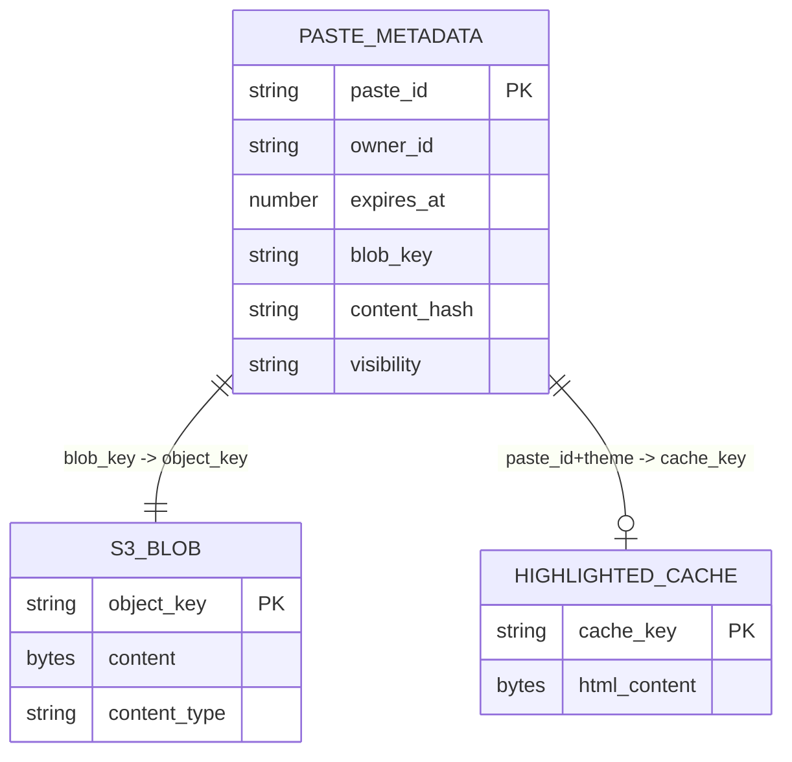
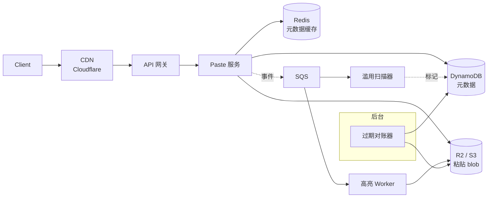
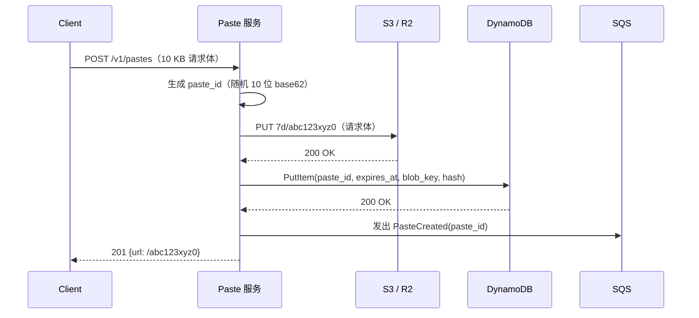
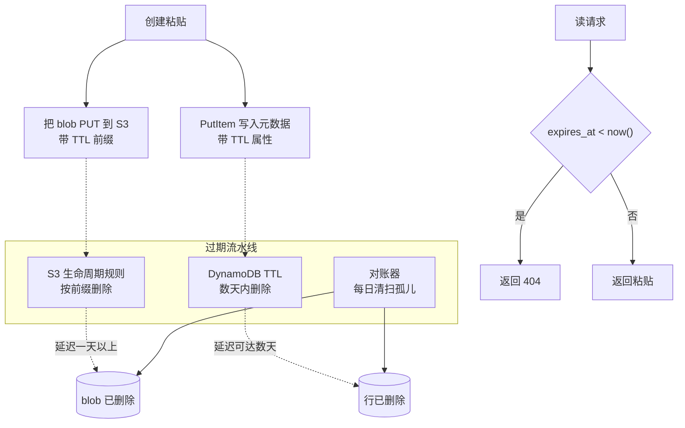

# 设计 Pastebin（粘贴分享服务）

> **TL;DR.** 粘贴服务看起来就是给 URL 短链服务挂了个载荷，但正是这个载荷（平均 10 KB、P99 1 MB、硬上限 10 MB）改变了一切。DynamoDB 单条记录硬顶 400 KB[^1]，所以 blob 必须落到对象存储，元数据留在 KV 表里。过期要靠三层流水线（S3 生命周期规则、DynamoDB TTL、对账器），因为 S3 生命周期删除可能要一天以上[^2]，而 DynamoDB TTL 也会在几天内才删掉[^3]。语法高亮应该放在渲染路径上并配缓存。Cloudflare R2 的零出网流量计价，让它成为 10:1 读多写少负载下成本最优的 blob 存储[^4]。

## 学习目标

学完本模块，你将能够：

- [ ] 设计 blob 与元数据的存储拆分，让 1 KB 到 10 MB 的载荷都不会撞上 DynamoDB 的 400 KB 单条上限
- [ ] 论证 S3 生命周期规则加 DynamoDB TTL 作为过期机制的合理性，并说清异步删除带来的权衡
- [ ] 比较写入时、渲染时与客户端三种语法高亮方案，给出具体的成本与延迟推理
- [ ] 为每天 1000 万次粘贴的服务估算存储、计算与出网流量成本
- [ ] 把滥用防护扫描实现成不阻塞写入的异步流水线
- [ ] 在零知识加密（PrivateBin 模式）与服务端扫描能力之间做权衡

## 直觉理解

粘贴服务看起来微不足道。收下文本，返回一个 URL，再把它发回去。一百个用户用一个 Postgres 表就够了。

到每天 1000 万次粘贴时它就崩了，原因在载荷大小。URL 短链服务存的是一行 500 字节的记录。粘贴服务存的 blob 平均 10 KB、P99 达到 1 MB、PRO 用户能到 10 MB[^5]。记录大小涨了三到五个数量级，意味着你没法把一条粘贴塞进 DynamoDB 的单条记录（上限 400 KB[^1]），没法负担每晚扫几十亿行来做过期，也没法在每次写入时同步跑一个 CPU 密集的语法高亮器而不烧掉 12 个核。

解开这套设计的唯一洞察：把系统拆成一个便宜、可扩展的 blob 存储（S3/R2）放载荷，和一个快、带索引的元数据存储（DynamoDB）做查找。然后把过期当成一条数据流水线，而不是数据库的某个功能。其余所有决策都从这个拆分长出来。

## 需求

### 澄清性问题

- **Q：粘贴最大能有多大？**
  假设：平均 10 KB、P99 1 MB、硬上限 10 MB（PRO 档）。标准账号封顶 512 KB[^5]。

- **Q：用户能选哪些 TTL？**
  假设：10 分钟、1 小时、1 天、7 天（默认）、30 天、永不。

- **Q：只服务登录用户，还是也允许匿名？**
  假设：两者都要。游客每 24 小时 10 条，免费账号 20 条，PRO 账号 250 条[^5]。

- **Q：有哪些可见性档位？**
  假设：公开（可被索引、可搜索）、不公开（只有拿到 URL 才能访问）、私有（需要鉴权令牌）。

- **Q：需要语法高亮吗？**
  假设：需要，服务端渲染并配缓存，支持 100 种以上语言。

- **Q：需要多区域吗？**
  假设：上线时单区域，但设计上要能扩展到多区域。

### 功能需求

- 创建粘贴（文本内容、语言提示、TTL、可见性），返回一个短 URL。
- 按 ID 取回粘贴，可选返回语法高亮后的渲染结果。
- 删除粘贴（属主或管理员）。
- 分页列出某个用户的粘贴，用游标分页。
- TTL 到期后自动过期粘贴。

### 非功能需求

- **负载：** 每天 1000 万次写（均值约 116 QPS，峰值约 1,000）；每天 1 亿次读（均值约 1,160 QPS，峰值约 10,000）。
- **延迟：** 读 P99 < 200 ms；写 P99 < 500 ms。
- **可用性：** 读路径 99.99%，写路径 99.9%。
- **一致性：** 读己之写走最终一致（CDN 缓存滞后可接受）；删除要强一致。
- **持久性：** 11 个 9（S3 标准）。

## 容量估算

| 指标 | 数值 | 推导 |
|--------|------:|------------|
| 写 QPS（均值） | 116/秒 | 1000 万 / 86,400 |
| 写 QPS（峰值） | 约 1,000/秒 | 约为均值的 10 倍 |
| 读 QPS（均值） | 1,160/秒 | 1 亿 / 86,400 |
| 读 QPS（峰值） | 约 10,000/秒 | 约为均值的 10 倍 |
| 每日写入量 | 约 100 GB | 1000 万 x 10 KB |
| 活跃存储（默认 7 天） | 约 700 GB | 7 x 100 GB |
| 年增长（“永不”过期的粘贴） | 约 10 TB | 约 10% 的粘贴设为“永不” |
| S3 成本（700 GB） | 约 $16/月 | $0.023/GB-月[^6] |
| R2 成本（700 GB，零出网流量） | 约 $10.50/月 | $0.015/GB-月[^4] |

- **读写比：** 10:1。热门粘贴的读请求 95% 以上被 CDN 吸收，所以源站在稳态下大约只承接 500 读 QPS。
- **出网流量主导成本。** 每天 1 亿次读 x 平均 10 KB = 每天 1 TB 出网流量。放在 S3（美东）按 $0.09/GB 算就是每天 $90；放在 R2 是 $0。这一个数字就足以支撑选 R2[^4]。
- **元数据行大小：** 约 200 字节。每天 1000 万行，DynamoDB 按需模式直接接住，不需要容量规划。

## API 与数据模型

### API 设计

```http
POST   /v1/pastes
       Idempotency-Key: <uuid>
       Body: { "content": "...", "language": "python", "ttl": "7d",
               "visibility": "unlisted", "password": null }
       Returns: 201 { "paste_id": "abc123xyz0", "url": "https://pb.io/abc123xyz0",
                       "expires_at": "2026-05-11T00:00:00Z" }
       Errors: 413 payload too large, 429 rate limited

GET    /v1/pastes/{paste_id}
       Query: ?format=raw|highlighted&theme=monokai
       Returns: 200 { "content": "...", "language": "python", "created_at": "...",
                       "expires_at": "...", "view_count": 42 }
       Errors: 404 not found or expired, 403 private paste

GET    /v1/pastes/{paste_id}/raw
       Returns: 200 text/plain (streaming for pastes > 1 MB)

DELETE /v1/pastes/{paste_id}
       Returns: 204 No Content

GET    /v1/users/{user_id}/pastes?cursor=...&limit=20
       Returns: 200 { "pastes": [...], "next_cursor": "..." }
```

限流：边缘层（Cloudflare WAF）做按 IP 的令牌桶，再加上 Redis 里的按账号计数。游客：10 条/24 小时。免费：20 条/24 小时。PRO：250 条/24 小时[^5]。

### 数据模型

**元数据表（DynamoDB）：**

```text
table paste_metadata (
  paste_id        String    -- PK, random 10-char base62
  owner_id        String    -- nullable for guest pastes
  created_at      Number    -- epoch seconds
  expires_at      Number    -- DynamoDB TTL attribute
  blob_key        String    -- S3 object key: "7d/abc123xyz0"
  content_hash    String    -- SHA-256 for dedup + integrity
  size_bytes      Number    -- for streaming decisions
  language_hint   String    -- lexer name
  visibility      String    -- public | unlisted | private
  scan_status     String    -- pending | clean | flagged
)

GSI: owner_id -> [paste_id, created_at]  (user's paste list)
```

**Blob 存储（S3/R2）：** 对象键为 `<ttl-bucket>/<paste_id>`。TTL 分桶前缀（`10m/`、`1h/`、`1d/`、`7d/`、`30d/`、`never/`）让 S3 生命周期规则可以按整个前缀批次做过期[^7]。



*每条粘贴对应一行元数据、一个原始 blob，以及零个或一个缓存的高亮 HTML blob。*

## 高层架构



*写路径先存 blob 再存元数据并发出事件；读路径先打 CDN，未命中落到 Redis，再未命中查 DynamoDB 和 S3。后台 Worker 异步处理高亮与滥用扫描。*

**写路径：** 客户端 POST 内容。Paste 服务生成一个随机的 10 位 base62 ID，把 blob PUT 到 S3 对应 TTL 前缀下，把元数据 PUT 到 DynamoDB，向 SQS 发出 `PasteCreated` 事件，返回 URL。总延迟约 100-200 ms（S3 PUT 约 40 ms + DynamoDB PutItem 约 10 ms + 其他开销）。

**读路径：** CDN 直接服务已缓存的公开/不公开粘贴。未命中时，服务先查 Redis 拿元数据（5 ms），Redis 未命中再落到 DynamoDB，校验 `expires_at < now()`，从 S3 流式取 blob，带上 `Cache-Control: public, max-age=<remaining_ttl>` 返回。

**异步路径：** 高亮 Worker 渲染出语法高亮 HTML，作为第二个 blob 存起来。滥用扫描器检查凭据特征（`AKIA` 前缀的 AWS 密钥[^8]、Stripe 的 `sk_live_`、SSH 私钥）。命中就把元数据行上的 `scan_status` 置为 `flagged`。

## 深入探讨

### 深入 1：存储拆分（元数据放 DynamoDB，blob 放 S3）

根本约束：DynamoDB 每条记录硬顶 400 KB（属性名加属性值合计）[^1]。1 MB 的粘贴物理上装不进去。就连 512 KB 的粘贴（pastebin.com 标准档的上限[^5]）也超了。AWS 自己的 Database Blog 就明确建议把大对象存 S3、在 DynamoDB 里留一个指针[^9]。

**写入顺序很关键。** 先写 blob，再写元数据。如果 blob PUT 成功而元数据 PUT 失败，你留下一个孤儿 blob，成本不到一分钱，由对账器清理掉。反过来先写元数据、blob PUT 失败，你就有一行指向空处，用户会看到 404。

**用内容哈希做去重。** `content_hash`（SHA-256）让可选去重成为可能：两条完全相同的粘贴可以共享同一个 blob。省存储，但把 TTL 搞复杂了（blob 必须活过寿命最长的那行元数据）。上线时先跳过去重，等存储成本真的涨起来再回头看。

**大对象流式读。** 10 MB 的粘贴绝不能整个缓冲在内存里。用 S3 的流式响应体直接管道到 HTTP 响应。100 个并发读 10 MB 粘贴，全缓冲会吃掉 1 GB 的进程常驻内存。流式处理让内存占用保持恒定。



*先写 blob 再写元数据：这样两步之间失败留下的是孤儿 blob（便宜、可对账），而不是悬空指针（用户可见报错）。*

### 深入 2：TTL 与过期流水线

过期是个数据流水线问题，不是数据库功能。三层并行工作：

**第一层：S3 生命周期规则。** 对象写入时带上 TTL 分桶前缀（`10m/`、`1h/`、`1d/`、`7d/`、`30d/`）。每个前缀配一条生命周期规则，到对应时长后过期对象。这一层零自定义代码就清掉了 90% 以上的 blob[^7]。坑在于：S3 生命周期过期是异步的。AWS 的说法是“Amazon S3 把对象排队等待删除，并异步删除它”[^7]，延迟可能一天以上[^2]。

**第二层：DynamoDB TTL。** `expires_at` 属性就是这张表的 TTL 属性。DynamoDB 会自动删除过期项，但“会在过期时间之后的几天内自动删除过期项”[^3]。这些删除不消耗写容量[^10]。

**第三层：对账器。** 一个每日后台任务处理孤儿。它列出那些 blob HEAD 返回 404 的元数据行并删掉；也列出超过某个时间阈值、其 paste_id 已无元数据行的 blob，一并删掉。

**关键洞察：** 服务层每次读都检查 `expires_at < now()`，一旦过期立刻返回 404，哪怕 blob 和行在物理上还在。从过期那一刻起，可观测行为就是对的；物理删除过几天再追上。

**为什么不用同步 cron？** dpaste 用 cron 跑一个 `cleanup_snippets` 的 Django 管理命令[^11]。在 dpaste 这种量级上没问题。每天 1000 万条粘贴，一年累积 36.5 亿条。每晚全表扫描根本不可行。生命周期 + TTL + 对账器这套模式之所以能扩，是因为每一层只管自己那块，都不需要全表扫描。



*TTL 是三条并行流水线：S3 生命周期管 blob，DynamoDB TTL 管行，对账器管孤儿。服务层在过期时立刻返回 404，不等物理删除完成。*

### 深入 3：语法高亮的放置位置

有三种方案，各有明确的适用场景。

**方案 A：写入时渲染（服务端）。** 创建粘贴时跑 Pygments（550 多个词法分析器[^12]），把 HTML blob 和原始 blob 一起存下来。dpaste 用的就是这个路子[^13]。好处：读的时候直接返回预渲染 HTML，对 CDN 友好。坏处：每条粘贴都要付 CPU。每天 1000 万条、每次渲染约 100 ms，光高亮就要约 12 个核持续跑。而大多数粘贴在作者确认过 URL 之后再没被读过。

**方案 B：渲染时加缓存（本章选择）。** 第一次有请求要高亮输出时渲染 HTML，作为第二个 blob 缓存到 S3（`highlighted/<paste_id>/<theme>`），后续读直接发缓存。好处：从没被读过的粘贴零 CPU 成本。坏处：第一个读者要承担延迟（10 KB 约 50-200 ms；1 MB 最多 2-5 秒）。缓解手段：SQS 事件触发高亮 Worker 异步预渲染。如果 Worker 在第一次读之前就跑完，高亮 blob 已经在那了。

**方案 C：客户端渲染。** 把 highlight.js（192 种语言、512 个主题[^14]）发到浏览器。PrivateBin 用它，因为它的零知识模型意味着服务端看不到明文[^15]。好处：服务端零 CPU，隐私友好。坏处：依赖 JavaScript，对 SEO 和无障碍不友好。

通用场景我们选**方案 B**。事件总线发出 `PasteCreated`，高亮 Worker 用 Pygments 渲染 HTML 并存进 S3。第一次读要么命中预渲染 blob（Worker 已完成），要么退回纯文本、用客户端高亮器做渐进增强。

## 真实案例

### PrivateBin：零知识粘贴架构

PrivateBin 是个开源粘贴服务（GitHub 约 8,300 星[^16]），信任模型完全不同：服务端永远看不到明文[^15]。它的架构展示了单一设计约束（零知识）如何逐层传导到每个组件。

**加密模型：** 浏览器生成一个 256 位 AES 密钥，用 Web Crypto API 以 AES-256-GCM 加密粘贴，把密钥作为片段标识符（URL 里 `#key` 那段）附在 URL 后[^15][^17]。因为 URL 片段从不出现在 HTTP 请求里，连终止 HTTPS 的代理或访问日志都泄露不了密钥。服务端只存不透明的密文。

**存储：** PrivateBin 的 `S3Storage` 后端把每条粘贴存成一个 S3 对象，键为 `<prefix>/<paste_id>`，加密载荷以 JSON 存放，部分元数据复制进 S3 对象元数据以便廉价地做 HEAD 查询[^18]。评论存在 `<prefix>/<paste_id>/discussion/<parent_id>/<comment_id>` 下。

**过期：** PrivateBin 没有依赖 S3 生命周期规则，而是自己实现了 `_getExpiredPastes` 方法：列出所有对象，用 `headObject` 读它们的 `expire_date` 元数据，把过期键批量删除[^18]。规模一大这里就成了瓶颈（要列出几百万个对象），这正是我们推荐的架构改用 TTL 分桶前缀加生命周期规则的原因。

**零知识带来的连锁权衡：**

- 没有服务端语法高亮（服务端看不到明文）。只能靠客户端的 `prettify.js`[^15]。
- 没有服务端搜索或索引。
- 没有服务端滥用扫描。被入侵的粘贴对运营者不可见。
- 被攻破的服务端可以注入恶意 JavaScript 窃取解密密钥。这就是残留的信任模型[^15]。

PrivateBin 证明了零知识对以隐私为卖点的部署是可行的，但它与公共服务要求的滥用扫描和服务端高亮不兼容。做通用粘贴服务，就在服务端存明文，把投入放在扫描流水线上。

## 权衡

| 决策 | 方案 A | 方案 B | 我们的选择 | 理由 |
|----------|----------|----------|------------|-----|
| Blob 存储 | S3（$0.023/GB） | R2（$0.015/GB，零出网流量） | R2 | 读多写少；每天 1 TB 出网流量下出网费用主导成本[^4] |
| 元数据存储 | DynamoDB（无服务） | PostgreSQL（托管） | DynamoDB | 原生 TTL、无需容量规划、自动扩缩[^3] |
| 高亮 | 写入时渲染 | 渲染时加缓存 | 渲染时渲染 | 90% 以上粘贴没被读过；避免白烧 CPU |
| ID 方案 | 顺序 base62 | 随机 10 位 base62 | 随机 | 防止枚举攻击[^19] |
| 过期 | 同步 cron | 生命周期 + TTL + 对账器 | 生命周期 + TTL | 无需全表扫描也能扩到几十亿[^7] |
| 信任模型 | 服务端见明文 | 零知识（PrivateBin） | 明文 | 换来滥用扫描、服务端高亮、搜索 |
| 大粘贴读 | 全量缓冲进内存 | 从 S3 流式读 | 流式 | 内存恒定；100 个并发 10 MB 读也不会 OOM |

最大的元决策是信任模型。零知识（PrivateBin）给了运营者合理的推诿空间，给了用户真正的隐私，但它抹掉了服务端扫描、高亮和搜索。对一个必须处理滥用举报和凭据泄露的公共服务，服务端明文是务实的选择。对隐私敏感的部署（医疗、法律、举报），零知识赢。

## 扩展与故障模式

**10 倍时（每天 1 亿条粘贴、每天 10 亿次读）：**

- 写 QPS 峰值到约 10,000/秒。S3 单个前缀能扛 3,500 PUT/秒；我们有 5 个以上 TTL 前缀分散写入。不是瓶颈。
- DynamoDB 按需模式自动扩缩。
- CDN 吸收读放大。源站只承接不到 5% 的读。
- 滥用扫描器队列变深。加横向 Worker。

**100 倍时（每天 10 亿条粘贴）：**

- 写入量涨到约每天 1 TB。年累积的“永不”粘贴超过 100 TB。分层存储（S3 Intelligent-Tiering）成为必需。
- 对账器必须按前缀分片，避免列出几十亿个对象。
- 滥用扫描要从正则匹配升级到基于 ML 的分类。
- 走向多区域：元数据用 DynamoDB Global Tables，blob 用 S3 Cross-Region Replication。

**故障模式：**

- **S3 区域级故障：** 缓存未命中的粘贴读失败。缓解：CDN 对公开粘贴继续发旧内容（设 `stale-while-revalidate`）。写全挂；返回 503 并在响应头带 retry-after。
- **DynamoDB 热分区限流：** 一条爆款粘贴造成热键。缓解：Redis 吸收重复的元数据读。DynamoDB 自适应容量会自动把吞吐挪给热分区。
- **对账器故障后孤儿堆积：** blob 越堆越多却没有对应元数据行，把存储成本吹大。检测：对 S3 对象数与 DynamoDB 条目数的偏离设 CloudWatch 告警。恢复：手工跑一次对账器。

## 常见陷阱

> [!WARNING]
> **把 blob 塞进 DynamoDB。** DynamoDB 400 KB 单条上限[^1]意味着任何超过 400 KB 的粘贴都会以 `ValidationException` 失败。这是工程师照抄 URL 短链设计、不考虑载荷大小时最常犯的错。

> [!WARNING]
> **写入时同步跑语法高亮。** 10 MB 的 Python 粘贴高亮要 2-5 秒。高亮若同步挂在写路径上，用户的 POST 会超时，工作线程会被饿死。把高亮挪到异步 Worker 或渲染时。

> [!WARNING]
> **顺序粘贴 ID 招致枚举。** 顺序的 8 位 base62 ID 让攻击者可以遍历近期 ID，把“不公开”的粘贴全扒下来。PasteHunter[^20] 这类工具干的就是这事。用至少 10 位的随机 ID（62^10 ≈ 8.4 x 10^17 种组合）。

> [!WARNING]
> **指望 S3 生命周期做到即时过期。** S3 生命周期规则是异步的，可能要一天以上[^2]。如果你的服务依赖“到期时 blob 已经在物理上消失”，而不是在读时检查 `expires_at`，用户就会在物理删除完成前一直看到“已过期”的粘贴。

> [!WARNING]
> **大粘贴读不做流式。** 10 MB 的粘贴在发给客户端前整个缓冲在内存里，每个并发请求吃 10 MB 常驻内存。100 个并发大粘贴读就是 1 GB。把 S3 的响应体直接流到 HTTP 响应。

## 追问

**1. 怎么支持端到端加密的粘贴（PrivateBin 模式）？**

在浏览器里生成 AES-256-GCM 密钥，上传前加密，把密钥附在 URL 片段上。服务端只存密文。权衡是丢掉服务端高亮、搜索和滥用扫描。可以作为可选项，与明文粘贴并存。

**2. 一条爆款粘贴引发缓存击穿，怎么处理？**

在源站用 singleflight（请求合并）。1000 个并发请求打向同一条未命中的粘贴时，只有一个去 S3 取，其余等同一个在途响应。设 `Cache-Control: public, max-age=<remaining_ttl>`，让 CDN 吸收后续所有读。

**3. 不做登录，怎么实现私有/不公开的可见性？**

不公开粘贴用熵足够的随机 ID（10 位以上 base62），URL 本身就是能力令牌。私有粘贴要密码：用 PBKDF2 从密码派生加密密钥，加密 blob，读的时候要求输密码。

**4. 怎么处理滥用举报和 DMCA 下架？**

加一个“举报滥用”端点，把 `scan_status` 置为 `flagged` 并进入人工审核队列。确认滥用后做软删除（把 `visibility` 设为 `deleted`，停止服务），并留 30 天硬删除窗口以应对法律保全。Pastebin.com 用的就是这个流程[^21]。

**5. 怎么在语法高亮之外加上 Markdown 渲染？**

把 Markdown 当成高亮流水线里的另一种“语言”。高亮 Worker 检测到 `language_hint: markdown`，改用 Markdown 库而不是 Pygments 渲染，存成 HTML blob。缓存模式完全一样。

**6. 改成多区域双活部署要动什么？**

DynamoDB Global Tables 跨区域复制元数据，冲突用 last-writer-wins 解决。S3 Cross-Region Replication 管 blob。每个区域写本地的表和桶，读都在本地。TTL 和生命周期规则在各区域独立触发。

## 练习

### 练习 1：攻击下的扫描器背压

你的滥用扫描器处理一条 10 MB 粘贴要 500 ms。攻击者用轮换 IP 每分钟灌进 1,000 条大粘贴。扫描器队列积压到 50,000 条消息。设计系统行为：新粘贴会怎样，你怎么保护正常用户，扫描器彻底挂掉时的故障模式是什么？

<details>
<summary>提示</summary>

想一想 fail-open（扫描完成前先放行）和 fail-closed（扫完才放行）的区别。各自的风险是什么？自适应限流与扫描器背压如何相互作用？考虑按大小分流。

</details>

<details>
<summary>参考答案</summary>

**高负载下的架构：**

1. **自适应限流。** 当 SQS 队列深度超过 5,000 条时，把游客的按 IP 限流从 10 条/24 小时收紧到 3 条/24 小时，并升级到 CAPTCHA。这样在不动已登录用户的前提下减少流入。

2. **按大小分流。** 100 KB 以下的粘贴走快路径正则扫描器（< 50 ms）。100 KB 以上的进独立的大粘贴队列，配更多 Worker。这样大粘贴不会饿死小粘贴的扫描。

3. **fail-open 加隔离区。** 超过 5 秒扫描 SLA 的粘贴先放行成 Active，但标记 `scan_status: pending`。容量恢复后由后台扫描补上。这保住了用户体验，代价是未扫描内容会短暂暴露。

4. **扫描器故障模式。** 扫描器彻底挂掉时，所有粘贴以 `scan_status: failed` 放行，同时触发告警。值班的人要么恢复扫描器，要么暂停游客写入。系统永远不阻塞已登录用户，因为滥用来源绝大多数是未登录的。

**接受的权衡：** fail-open 意味着凭据泄露内容可能被看见几秒到几分钟。这可以接受，因为 fail-closed 会造出一个 DoS 入口，而泄露的正确应对是轮换凭据。

</details>

## 要点回顾

- **按性质拆分存储：** blob 进对象存储（S3/R2），元数据进 DynamoDB。400 KB 单条上限没有商量余地。
- **先写 blob，后写元数据。** 孤儿 blob 便宜且可对账；悬空指针会变成用户可见的错误。
- **TTL 是流水线，不是 cron。** S3 生命周期 + DynamoDB TTL + 对账器，不用全表扫描就能扩到几十亿。
- **渲染时高亮胜出。** 大多数粘贴从没被读过；规模一大，写入时高亮就是白烧 CPU。
- **随机 ID 是安全需求。** 顺序 ID 让“不公开”粘贴可被枚举。
- **零出网流量的对象存储改变了成本模型。** R2 免出网费，让它成为读多写少 blob 负载的最优解。

## 延伸阅读

- [AWS S3 Lifecycle Configuration](https://docs.aws.amazon.com/AmazonS3/latest/userguide/object-lifecycle-mgmt.html)。基于 TTL 的对象过期的权威参考；“expiring objects” 那页讲异步删除的注意事项。
- [AWS DynamoDB TTL](https://docs.aws.amazon.com/amazondynamodb/latest/developerguide/time-to-live-ttl-before-you-start.html)。解释“几天内”的删除窗口、epoch 秒格式，以及 TTL 处理会忽略条目的情形。
- [Large Object Storage Strategies for DynamoDB](https://aws.amazon.com/blogs/database/large-object-storage-strategies-for-amazon-dynamodb/)。AWS 对超大条目走 S3 + DynamoDB 的官方立场；本章就是建在这个模式上。
- [Cloudflare R2 Pricing](https://developers.cloudflare.com/r2/pricing/)。零出网流量的定价细节；做读多写少负载的成本对比时必备。
- [PrivateBin](https://github.com/PrivateBin/PrivateBin)。生产级质量的零知识粘贴服务；读 `lib/Data/S3Storage.php` 看 S3 集成方式。
- [dpaste Source Code](https://github.com/DarrenOfficial/dpaste)。小规模参考实现，含 Pygments 流水线、Django ORM 元数据和 `cleanup_snippets` 这条 TTL cron。
- [GitHub Secret Scanning Patterns](https://docs.github.com/en/code-security/secret-scanning/introduction/supported-secret-scanning-patterns)。凭据正则模式的黄金标准清单（AWS、Stripe、GitHub PAT 等 500 多种）；构建滥用扫描器的正确参考。
- [Syntax Highlighting on the Web](https://joelgustafson.com/posts/2022-05-31/syntax-highlighting-on-the-web)。把基于正则的语法（Pygments、highlight.js）与 tree-sitter 的增量渲染做了细致对比。

## 记忆卡片

<details>
<summary><strong>问：为什么不能把 1 MB 的粘贴存进 DynamoDB 的单个条目？</strong></summary>

答：DynamoDB 每条记录硬顶 400 KB（属性名加属性值）。1 MB 的粘贴超限，会以 ValidationException 失败。

</details>

<details>
<summary><strong>问：规模化的粘贴服务推荐用什么存储模式？</strong></summary>

答：blob 存对象存储（S3/R2），键为 paste_id；元数据（属主、TTL、哈希、可见性）存 DynamoDB。先写 blob，后写元数据。

</details>

<details>
<summary><strong>问：S3 生命周期规则物理删除一个过期对象可能要多久？</strong></summary>

答：一天以上。S3 是异步排队删除。服务层必须在读时检查 `expires_at` 并立刻返回 404，不管物理状态如何。

</details>

<details>
<summary><strong>问：为什么用随机粘贴 ID 而不是顺序 ID？</strong></summary>

答：顺序 ID 招致枚举攻击。攻击者可以遍历近期 ID 把不公开的粘贴扒下来。10 位以上、62 字符表里的随机 ID 让枚举不可行（62^10 ≈ 8.4 x 10^17 种组合）。

</details>

<details>
<summary><strong>问：粘贴服务的语法高亮应该在哪跑？</strong></summary>

答：渲染时加缓存。大多数粘贴从没被读过，写入时高亮是白烧 CPU。第一次读时渲染 HTML，缓存到 S3，后续读直接发缓存。

</details>

<details>
<summary><strong>问：TTL 过期流水线有哪三层？</strong></summary>

答：(1) S3 生命周期规则按 TTL 前缀删 blob。(2) DynamoDB TTL 在过期后几天内自动删元数据行。(3) 每日对账器清扫前两层漏掉的孤儿 blob 和孤儿行。

</details>

<details>
<summary><strong>问：PrivateBin 怎么做到零知识加密？</strong></summary>

答：浏览器生成 AES-256-GCM 密钥，在客户端加密粘贴，把密钥作为片段标识符附在 URL 上。片段从不随 HTTP 请求离开浏览器，所以服务端只存密文。

</details>

<details>
<summary><strong>问：对读多写少的粘贴服务，为什么 Cloudflare R2 在成本上赢过 S3？</strong></summary>

答：R2 不收出网流量费。每天 1 亿次读 x 10 KB = 每天 1 TB 出网流量，S3 光出网费就约 $90/天。R2 是 $0。

</details>

<details>
<summary><strong>问：滥用扫描器挂掉会怎样？</strong></summary>

答：粘贴以 `scan_status: failed` 放行成 Active（fail-open），同时触发告警。另一种做法（fail-closed，阻塞所有写）会造出一个拒绝服务入口。

</details>

<details>
<summary><strong>问：创建路径上为什么先写 blob 再写元数据？</strong></summary>

答：如果 blob PUT 成功而元数据 PUT 失败，你得到孤儿 blob（便宜、用户不可见、由对账器清理）。若先写元数据而 blob PUT 失败，你就有一个悬空指针，造成用户可见的 404。

</details>

## 参考文献

[^1]: AWS DynamoDB - "Best practices for storing large items and attributes". https://docs.aws.amazon.com/amazondynamodb/latest/developerguide/bp-use-s3-too.html

[^2]: AWS Knowledge Center "Confirm that the lifecycle rule on my Amazon S3 bucket is working". https://aws.amazon.com/premiumsupport/knowledge-center/s3-lifecycle-rule-delay/

[^3]: AWS DynamoDB "Computing time to live (TTL)". https://docs.aws.amazon.com/amazondynamodb/latest/developerguide/time-to-live-ttl-before-you-start.html

[^4]: Cloudflare R2 Pricing documentation. https://developers.cloudflare.com/r2/pricing/

[^5]: "Pastebin Statistics and Facts" (Similarweb-aggregated). https://expandedramblings.com/index.php/pastebin-statistics-and-facts/

[^6]: AWS S3 pricing page. https://aws.amazon.com/s3/pricing/

[^7]: AWS S3 "Expiring objects" documentation. https://docs.aws.amazon.com/AmazonS3/latest/userguide/lifecycle-expire-general-considerations.html

[^8]: AWS re:Post - "Difference between AWS Access Key IDs and Secret Access Keys" (includes the AKIA regex from git-secrets). https://repost.aws/questions/QUX9b0juKPQGaR3VCYkCAajw/difference-between-aws-access-key-ids-and-secret-access-keys

[^9]: AWS Database Blog "Large object storage strategies for Amazon DynamoDB". https://aws.amazon.com/blogs/database/large-object-storage-strategies-for-amazon-dynamodb/

[^10]: AWS DynamoDB "Using time to live (TTL)". https://docs.aws.amazon.com/amazondynamodb/latest/developerguide/TTL.html

[^11]: DarrenOfficial/dpaste `cleanup_snippets` management command. https://github.com/DarrenOfficial/dpaste/blob/master/dpaste/management/commands/cleanup_snippets.py

[^12]: Pygments supported languages list. https://pygments.org/languages/

[^13]: DarrenOfficial/dpaste highlight.py. https://github.com/DarrenOfficial/dpaste/blob/master/dpaste/highlight.py

[^14]: highlight.js homepage (v11.11.1, 192 languages, 512 themes). https://highlightjs.org/

[^15]: PrivateBin README. https://github.com/PrivateBin/PrivateBin/blob/master/README.md

[^16]: PrivateBin organization on GitHub. https://github.com/PrivateBin

[^17]: PrivateBin FAQ (client-side encryption, key in URL fragment). https://github.com/PrivateBin/PrivateBin/wiki/FAQ

[^18]: PrivateBin S3Storage implementation. https://github.com/PrivateBin/PrivateBin/blob/master/lib/Data/S3Storage.php

[^19]: DarrenOfficial/dpaste models.py (Snippet model and generate_secret_id). https://github.com/DarrenOfficial/dpaste/blob/master/dpaste/models.py

[^20]: dibsy/pastehunter - "automated tool to fetch pastes from pastebin to find leaked information, credentials, or any sensitive data". https://github.com/dibsy/pastehunter

[^21]: Pastebin.com FAQ (report abuse workflow). https://web.archive.org/web/20241231210907/https://pastebin.com/faq
