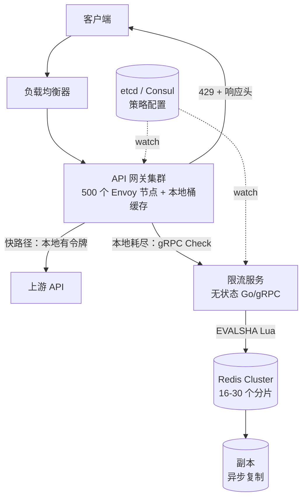
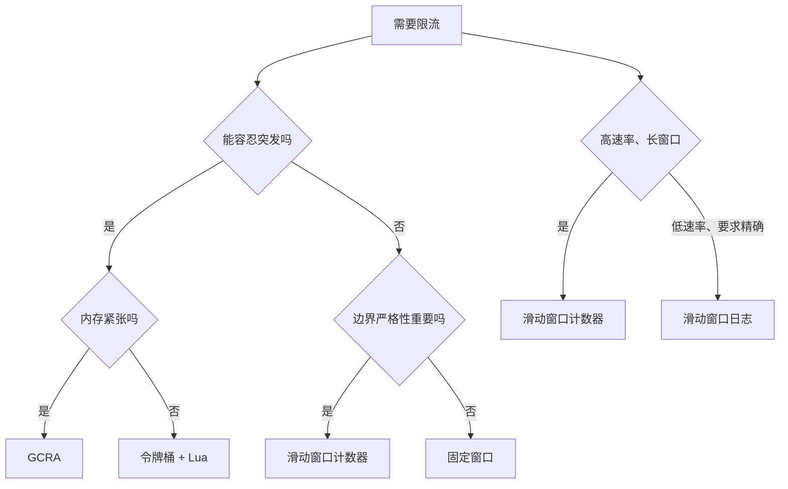
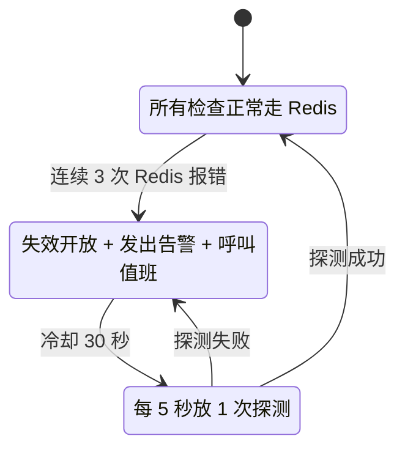
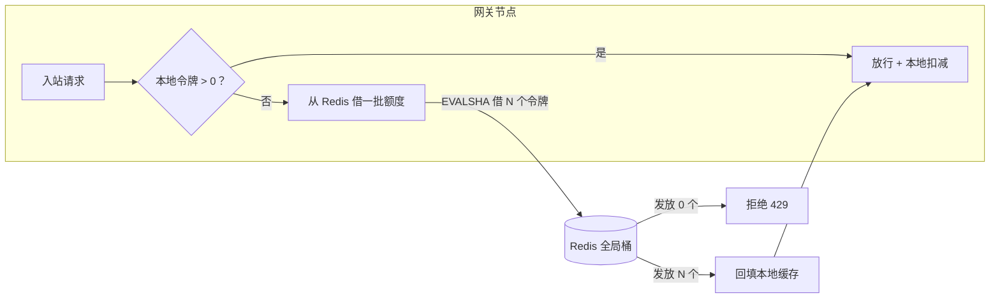

# 设计一个分布式限流器

> **TL;DR.** 算法是最简单的部分。令牌桶、滑动窗口计数器和 GCRA，都能用 O(1) 的状态解决计数问题。真正难的是：在 500 个网关节点组成的集群上执行同一条逻辑限额，又不让每个请求都变成一次网络往返。生产环境的答案是两层方案，Stripe[^1]、Cloudflare[^2] 和 Envoy[^3] 都在用：每个网关一个本地近似桶，加一份作为权威记录的共享 Redis，Redis 流量因此降到原来的十分之一，同时把精度控制在真实速率的 6% 以内[^2]。Staff 级别候选人最大的能力信号在故障行为上：限流器必须失效开放（fail open），绝不能反过来变成它本来要防的那场故障[^1]。

## 学习目标

学完这一节，你将能够：

- [ ] 对比令牌桶、滑动窗口计数器和 GCRA，并为给定负载论证该选哪个
- [ ] 设计本地加全局的两层架构，把 Redis 流量降到十分之一
- [ ] 用 Redis Lua 脚本实现原子限流检查，消除竞态
- [ ] 说清失效开放与失效关闭的权衡，并在计数器存储外围实现熔断器
- [ ] 接入幂等键，让重试的请求不白烧配额
- [ ] 为每秒 100 万次以上限流决策规划一个 Redis Cluster 的规模

## 直觉理解

你开了一家很火的烘焙店。每位顾客一张打卡卡：每月 10 杯免费咖啡。一个收银员、一条队、一人一张卡，很简单。

现在开 500 家分店。顾客走进任意一家下单，每家店都有自己的收银员。347 号店的收银员怎么知道这位顾客今天已经在别处打掉了 8 次卡？你可以每单都打电话问总部（集中式 Redis），但那样每笔交易都得等一通电话的时间。换个做法：每家店从总部预领一小把"已批准的打卡额度"。本地额度用完，再向总部要。总部的电话线断了，你照样把咖啡卖出去（失效开放），事后再对账。

这就是本地加全局的两层模式。打卡卡就是令牌桶。打给总部的那通电话就是 Redis 往返。"照样把咖啡卖出去"就是失效开放。接下来这一章把每一块都在每秒 100 万次请求的量级上做实。

## 需求

### 澄清问题

- **问：我们要执行哪几类限额？**
  假设：按用户的 API 限流（如 100 req/min）、按端点的上限，以及全集群的主动丢弃。每个请求都要评估多种限额，类似 GitHub 的主限额加次限额体系[^4]。
- **问：限流检查的延迟预算是多少？**
  假设：源站 p99 < 10 ms；边缘命中缓存决策时 < 1 ms。
- **问：计数器存储不可达时，失效开放还是失效关闭？**
  假设：默认失效开放。只有安全关键端点（登录、OTP、注册）才失效关闭。
- **问：多区域部署？**
  假设：是。每个区域有自己的 Redis 集群。按 IP 的限额是 PoP 本地的（anycast 保证落到同一 PoP），按用户的限额走区域 Redis。
- **问：重试的请求会消耗配额吗？**
  假设：不会。幂等键防止重复计数。
- **问：返回哪些响应头？**
  假设：`X-RateLimit-Limit`、`X-RateLimit-Remaining`、`X-RateLimit-Reset`、`Retry-After`（delay-seconds 形式并带抖动，参照 IETF 草案 draft-ietf-httpapi-ratelimit-headers-10[^14]）。

### 功能需求

- 根据调用方在当前窗口的剩余配额，接受或拒绝请求。
- 在响应头里返回剩余配额与重置时间。
- 每个请求支持多个限流维度（按用户 + 按端点 + 按 IP）。
- 配置变更（新增限额、套餐升级）不重启即生效。AWS API Gateway 的 usage plan 就是这种模式的例子：按 key 的限流设置和配额都能在运行时调整[^9]。
- 影子模式：新规则只记录决策、不实际拦截，支持暗发布[^1]。

### 非功能需求

- **负载：** 全集群每秒 100 万次以上限流决策；热点租户的单个限流键 10 万以上 RPS。
- **延迟：** 检查 p99 < 10 ms（源站路径）；命中缓存的超限决策 < 1 ms（边缘）。
- **可用性：** 99.99%。限流器绝不能成为 API 挂掉的原因。
- **精度：** 两层方案下与真实速率的偏差在 6% 以内[^2]；单层 Redis Lua 精确。
- **一致性：** 近似。借用额度期间，用户可能短暂超出限额一个批次的大小。

## 容量估算

| 指标 | 数值 | 推导 |
|--------|------:|------------|
| 网关节点数 | 500 | 大型 API 平台的集群规模 |
| 峰值决策数/秒（全集群） | 1M | 500 节点 × 每节点 2,000 RPS |
| Redis 操作/秒（无本地缓存） | 1M | 每次决策 1 次 EVALSHA |
| Redis 操作/秒（10 令牌一批） | 100K | 1M / 10 |
| 活跃的唯一限流键 | 5M | 1 分钟窗口内有 5M 活跃用户 |
| 每个键的内存（令牌桶） | ~80 B | 哈希：tokens(8B) + last(8B) + 键开销(~64B) |
| Redis 总内存 | ~400 MB | 5M × 80 B |
| Redis 集群分片数 | 16-30 | 100K 操作/秒 / 每分片约 6K 操作/秒（保守） |

单个 Redis 实例用 redis-benchmark（不开流水线）能跑到 10 万以上 `INCR` 操作/秒[^17]，而厂商测试里一个 Redis Cloud 集群配合激进流水线（pipeline=75）达到 120 万操作/秒[^18]。有了 10 令牌一批的借用，10 万操作/秒对 16 分片的集群来说远没到天花板。

## API 与数据模型

### API 设计

```http
POST /v1/ratelimit/check
  X-Idempotency-Key: <uuid>
  Body: { "user_id": "u_42", "endpoint": "/v1/charges", "cost": 1 }
  Returns: 200 { "allowed": true, "remaining": 87, "reset_at": 1714473660 }
           429 { "allowed": false, "remaining": 0, "retry_after": 27 }

GET /v1/ratelimit/status/{user_id}
  Returns: 200 { "limits": [ { "name": "api_rate", "limit": 100, "remaining": 87, "reset_at": ... } ] }

PUT /v1/ratelimit/config/{rule_id}
  Body: { "key_pattern": "user:{user_id}", "algorithm": "token_bucket", "rate": 100, "burst": 150, "window": "1m" }
  Returns: 200 { "rule_id": "r_abc", "status": "active" }
```

每个 API 响应都带这些响应头（网关在检查之后设置）。这种做法与 X/Twitter API v2 一致：它在每个响应上返回按端点的 `x-rate-limit-*` 头，让客户端在撞上 429 之前自己先降速[^19]：

```http
X-RateLimit-Limit: 100
X-RateLimit-Remaining: 87
X-RateLimit-Reset: 1714473660
Retry-After: 27
```

### 数据模型

```text
-- 每个限流键一个 Redis 哈希（令牌桶）
HSET ratelimit:user:u_42:api_rate
  tokens   87.0       -- 当前令牌数（浮点）
  last     1714473633000  -- 上次补充时间戳（毫秒）
PEXPIRE ratelimit:user:u_42:api_rate 120000  -- 2 倍窗口

-- 幂等缓存
SETEX idem:<idempotency_key> 86400 <cached_decision_json>

-- 配置（etcd / Consul，网关监听变更）
/ratelimit/rules/r_abc -> { "key_pattern": "user:{user_id}", "algorithm": "token_bucket", "rate": 100, "burst": 150, "unit": "minute" }
```

没有关系型数据库。计数器只存在 Redis 里。配置放在 etcd 或 Consul，靠文件系统 watch 实现热加载[^3]。固定窗口计数器那套 `INCR` + `EXPIRE` 的写法需要小心处理原子性；Redis 文档里记录了这个竞态：客户端在两次调用之间崩溃，键被 `INCR` 了，`EXPIRE` 却始终没执行[^12]。

## 高层架构



*网关集群先查本地桶，只有本地令牌不足时才打到共享 Redis；配置通过带外 watch 从 etcd 或 Consul 拉取。*

**写路径（限流检查）。** 每个入站请求都先到网关。网关先查本地令牌缓存。如果还有令牌，本地扣减后直接转发上游（快路径，亚微秒级）。本地缓存空了，就向限流服务发一个 gRPC `Check`，后者在 Redis 上执行原子 Lua 脚本，返回 `{allowed, remaining, reset_at}`。网关缓存结果，并带上相应响应头返回。

**配置路径。** 运维把规则写到 etcd/Consul。网关和限流服务都 watch 变更，无需重启即可热加载。新规则可以先以影子模式（只记日志）上线，再打开实际拦截[^1][^3]。

**故障路径。** Redis 不可达时熔断器跳闸。网关失效开放（放行全部流量），发出告警并呼叫值班。超限决策会被缓存在本地，这样已确认被拦的键在 Redis 恢复期间仍然被拦。

## 深入探讨

### 深入探讨 1：算法对比与选型

限流器设计里有六种主流算法，差异在内存、精度和突发处理上：

| 算法 | 每个键的状态 | 精度 | 突发行为 | 原子性代价 |
|---|---|---|---|---|
| 固定窗口 | 1 个计数器 | 2 倍边界突发[^6] | 不可控 | INCR + EXPIRE |
| 滑动窗口日志 | 有序集合 | 精确 | 无 | ZADD + ZRANGEBYSCORE |
| 滑动窗口计数器 | 2 个整数 | 误差约 0.003%[^2] | 无 | INCR + GET |
| 令牌桶 | 2 个字段 | 精确（配合 Lua） | 可配置 | EVALSHA（Lua） |
| 漏桶 | 队列 + 排水 | 输出平滑 | 基于队列 | 后台匀速滴漏[^11] |
| GCRA | 1 个标量（TAT） | 精确 | 可配置 | EVALSHA（Lua） |

**令牌桶**是面向用户的 API 的行业默认。Stripe 用它，理由是"客户每发一次请求，我们就从这个桶里拿走一个令牌"[^1]。它的突发参数能干净地映射到真实用法：客户端短暂冲一下（批量导入、webhook 重放），然后慢下来。

**滑动窗口计数器**是不能容忍突发的严格按端点上限的最佳选择。Cloudflare 的公式按重叠比例把两个固定窗口计数器混合：

```text
estimated = prev_count * ((60 - elapsed_in_current) / 60) + curr_count
```

在 4000 万次来自 27 万个不同来源的生产请求上，这种做法误放行或误拦截的比例只有 0.003%，零误杀[^2]。

**GCRA（Generic Cell Rate Algorithm，通用信元速率算法）** 只存一个标量（理论到达时间 TAT），答案靠几次算术运算就能算出来[^7]。它源自 ATM 网络，如今由 Rust 的 `governor` crate[^8] 和开源的 `throttled` Go 库（Stripe 生产在用）延续下来。如果边缘路径内存吃紧、每个字节都要算，就用它。



*面向用户、需要容忍突发的 API 选令牌桶；严格按端点上限选滑动窗口计数器；内存受限的边缘选 GCRA；规模上永远不要用滑动窗口日志。*

**我们的选择：** 按用户限额用令牌桶（Lua）。按端点上限用滑动窗口计数器。GCRA 留给内存极度紧张的边缘节点当备选。

### 深入探讨 2：Redis Lua 原子实现与故障模式

关键实现细节是原子性。少了它，两个并发请求可能同时读到 `tokens=1`，都做扣减，都成功。Figma 明确记录过这个 bug："如果只剩一个令牌，而两台服务器的 Redis 操作交错执行，两个请求都会被放过。"[^6]

Stripe 风格的 Lua 脚本通过 `EVALSHA` 原子执行[^1]：

```lua
-- KEYS[1]: 桶键；ARGV: rate, burst, cost, now_ms
local rate   = tonumber(ARGV[1])
local burst  = tonumber(ARGV[2])
local cost   = tonumber(ARGV[3])
local now    = tonumber(ARGV[4])

local state  = redis.call('HMGET', KEYS[1], 'tokens', 'last')
local tokens = tonumber(state[1]) or burst
local last   = tonumber(state[2]) or now

local elapsed = math.max(0, now - last)
tokens = math.min(burst, tokens + (elapsed * rate / 1000.0))

local allowed = 0
if tokens >= cost then
    tokens = tokens - cost
    allowed = 1
end

redis.call('HMSET', KEYS[1], 'tokens', tokens, 'last', now)
redis.call('PEXPIRE', KEYS[1], 2 * math.ceil(burst * 1000 / rate))
return { allowed, tokens }
```

**为什么不用 WATCH/MULTI/EXEC？** 热点键一旦有争用，乐观锁的重试就会形成风暴，自己变成瓶颈。Lua 天生原子，零重试[^1][^6]。

**时钟偏移。** 令牌桶的补充计算依赖时间差。如果网关传自己的时间戳，偏移的时钟会污染桶状态。修法：在 Lua 脚本里调用 `redis.call('TIME')`，让 Redis 做权威时钟。

**故障模式：Redis 不可用。** 熔断器长这样：



*熔断器保证 Redis 故障不会级联成 API 故障；网关失效开放并呼叫值班。*

**单分片故障。** 30 个分片时，一个分片挂掉影响 3.3% 的键。Redis Cluster 大约 10 秒内提升副本。这段空档里只有那个分片的熔断器跳闸，其他分片照常服务。

### 深入探讨 3：本地 + 全局两层模式（Cloudflare / Envoy）

每个请求都打 Redis，意味着每秒 100 万次 gRPC 调用压到集群上。Cloudflare[^2] 和 Envoy 的 ratelimit 服务[^3] 用的生产模式是两层：

1. 每个网关从全局 Redis 桶里借一批（**chunk**）令牌（例如一次 10 个）。
2. 网关在本地消耗，直到这批用完或过期（5 秒 TTL）。
3. 本地批次用尽就再借一批。如果全局桶空了，借失败，网关在本地直接拒绝。

**流量下降的算术：**

```text
Without local cache: 1M QPS * 1 Redis call = 1M Redis ops/sec
With 10-token chunks: 1M QPS / 10         = 100K Redis ops/sec
Reduction: 10x
```

**精度代价：** 限额 100/min 的用户，如果额度在网关之间分得不巧，可能短暂看到 110/min。Cloudflare 在生产流量上测到的偏差平均约 6%，且零误杀（没有任何合法用户被错误限速）[^2]。

**热点键的动态批次大小：** 一个限额 10,000/min 的企业客户应该拿到更大的批次（50-100 个令牌），以减少同时在外的借出笔数。Envoy 的 ratelimit 用 `LocalCacheSizeInBytes` 把已确认超限的键缓存在本地，后续拒绝直接走节点缓存，直到 TTL 到期[^3]。

**Cloudflare 的 anycast 优化：** anycast 路由保证一个客户端 IP 总是落到同一个 PoP。每个 PoP 就成了独立的计数域，配自己的 memcache 集群。按 IP 的限额完全不需要跨 PoP 协调[^2]。对基于 IP 的规则来说，这把分布式协调问题整个消掉了。



*每个网关按批次借令牌，Redis 往返减少 10 倍，同时精度保持在真实速率的 6% 以内。*

**另一种做法：CRDT g-counter。** 对地理复制的边缘系统，连一次共享 Redis 往返都嫌贵时，可以用 CRDT 的只增计数器（grow-only counter）：每个节点在 gossip 通道上广播自己的增量，计数最终收敛[^16]。权衡是分区期间超限漂移没有上界，换来的是零协调成本。

## 真实案例

### Stripe：四道限流器保护每一个 API 请求

Stripe 在每一次 API 请求上同时跑四道限流器[^1]：

1. **请求速率限流器**（按用户的令牌桶）：对用户的主力限流器。每个用户的桶存为一个 Redis 哈希，通过 Lua 原子更新。
2. **并发请求限流器**：限制每个用户的在途请求数，防止单个客户端把工作线程全占住。
3. **集群用量降载器**：整体集群利用率超过阈值时触发，丢掉低优先级流量（批处理任务、webhook），保住交互式请求。
4. **工作线程利用率降载器**：每个 worker 自己的熔断器。某个 worker 过载，就在本地丢弃。

**关键工程决策：**

- **暗发布。** 每道新限流器先跑影子模式，先记录它"会拦下什么"，再真正拦截。"给每道限流器做暗发布，观察它到底会拦掉哪些流量。"[^1]
- **开关。** "一定要有 kill switch，万一它开始误伤就能关掉。"[^1]
- **失效开放。** "即使限流代码有 bug（或者 Redis 挂了），请求也不该受影响。"[^1]
- **与幂等集成。** 带同一个 `Idempotency-Key` 的重试请求返回缓存的决策，不再消耗新令牌[^20]。

集群用量降载器"这个月只在极小比例的请求上触发过"，工作线程降载器"这个月只拒了 100 个请求"[^1]，说明这套系统在极低的误拒率下扛住了巨大吞吐。

**Cloudflare 的互补打法：** Stripe 在应用层干活，拿得到完整用户身份；Cloudflare 在边缘层干活，只有 IP 级可见性。它的滑动窗口计数器每天处理"几十亿请求"、覆盖"数百万个域名"，2017 年缓解过打到单个域名 40 万 req/s 的攻击，同时没有拖累合法用户[^2]。

**Discord 的按路由桶：** Discord 在响应头里给出按路由的限流和桶标识，客户端因此能分别跟踪每个 API 资源的限额[^13]。它返回 `X-RateLimit-Bucket` 哈希，机器人开发者不用硬编码"路由到限额"的映射，也能提前避开 429。

## 权衡

| 方案 | 优点 | 缺点 | 适用场景 |
|----------|------|------|-------------|
| 令牌桶 + Lua | 容忍突发；语义干净；原子[^1] | 两个状态字段；需要 Lua | 按用户的 API 限额；套餐分档 |
| 滑动窗口计数器 | O(1) 状态；误差 0.003%；不需要 Lua[^2] | 边界附近会略微少算 | 严格按端点的上限 |
| GCRA | 单个 TAT 标量；CPU 周期最少[^7] | 不够直观；实现较少 | 内存受限的边缘 |
| 固定窗口 | 最简单；一次 INCR | 2 倍边界突发[^6] | 内部、低风险的限额 |
| 每请求都走集中式 Redis | 真正全局；精确 | 每请求一次往返（约 1 ms） | 小集群；计费关键场景 |
| 本地 + 全局批次 | Redis 操作少 10 倍[^2][^3] | 5-10% 的超限漂移 | 大集群（500+ 节点） |
| CRDT g-counter（gossip） | 无中心存储；最终一致[^16] | 分区期间漂移无上界 | 地理复制的边缘 |

最大的一个元决策：**失效开放还是失效关闭**。Stripe 的立场毫不含糊：默认失效开放[^1]。限流器是保护性基础设施，它挂了，API 应该继续服务。只有当限额本身就是安全边界（登录尝试、OTP、注册），而且缺失它就会立刻被滥用时，才失效关闭。

## 扩展与故障模式

- **10 倍负载（每秒 1000 万次决策）：** 本地缓存吃掉大部分增长。批次大小从 10 提到 50 个令牌。Redis 集群从 16 分片扩到 60 分片。把 Envoy 的 `REDIS_PIPELINE_WINDOW` 设成 150-500 微秒，把并发写攒成更少的往返[^3]。
- **100 倍负载（每秒 1 亿次决策）：** 单个 Redis 集群饱和。按区域分片（每个区域一个集群）。按 IP 的限额用 Cloudflare 那种每 PoP anycast 的模型，可以把跨区域协调彻底消掉[^2]。按用户的限额，路由到用户所在的主区域。
- **1000 倍负载：** 转向边缘原生限流（Cloudflare Workers[^15]、Fastly Compute）。计数器放在边缘 KV 存储里，接受最终一致性。用 10-15% 的更高漂移，换 330+ 个 PoP 上的亚毫秒决策。

**故障模式：**

- **区域 Redis 集群挂掉：** 熔断器跳闸。该区域所有网关失效开放，告警触发。副本提升前的 10-30 秒里流量等于没计量。爆炸半径：一个区域的限流失效。
- **热点键所在分片饱和：** 一个热门租户把 500 个网关的流量全压到一个分片上，该分片 p99 从 0.5 ms 涨到 50 ms。缓解：动态批次大小（热点键给更大批次）、本地缓存超限决策，或给头部租户单独的 Redis 实例。
- **重置时刻的惊群：** 固定窗口配额重置的那一秒，所有被限速的客户端同时重试。缓解：用令牌桶（持续补充，没有硬重置），并把 `Retry-After` 返回成带抖动的 delay-seconds[^14]。

## 常见陷阱

> [!WARNING]
> **默认失效关闭。** 挂掉的限流器绝不该拖垮它保护的 API。要失效开放、记日志、告警。只有当限额是唯一的滥用防线时（登录、OTP、注册），才对那些端点失效关闭。[^1]

> [!WARNING]
> **GET+SET 没有原子性。** 经典竞态：两个并发请求都看到 `tokens=1`，都扣减，都成功。用 Lua 脚本。Figma 详细记录过这个 bug。[^6]

> [!WARNING]
> **重试请求被重复计数。** 网络抖一下引发重试；没有幂等键的话，重试又烧掉一个令牌。把 `(idempotency_key, decision)` 缓存 24 小时。[^20]

> [!WARNING]
> **高规模下的滑动窗口日志。** 它为每个键每个窗口内每个被放行的请求存一条有序集合记录。Figma 算过：10,000 个用户、每天 500 次的限额，滑动窗口日志方案的 ZSET 开销合计约 20 MB[^6]。改用滑动窗口计数器：同样精度，内存只要百分之一。

> [!WARNING]
> **热点键分片饱和。** 一个热门租户把所有网关都引到一个 Redis 分片上。修法：动态批次大小、本地缓存超限决策（Envoy 的 `LocalCacheSizeInBytes`[^3]），或给头部租户单独的 Redis 实例。

> [!WARNING]
> **拿关系型数据库当计数器存储。** 用 Postgres 存限流计数器，每次检查多花 10-50 ms，争用一上来就崩。每个用户一行，那一行就成了全库最热的行。用 Redis。[^6]

## 追问

**1. 多维度限流（同时按用户 + 按端点 + 按 IP）怎么实现？**

用 Envoy 基于描述符的匹配[^3]。网关每个请求发一组 `(key, value)` 元组，限流服务按层级匹配，取最严格的那条限额。每个维度有自己的 Redis 键和独立桶。一次 gRPC 调用评估所有维度，返回最严格的结果。Kubernetes 的 API Priority and Fairness（APF）更进一步：用 flow-schema 分类和优先级档位，在各类请求之间做加权公平排队[^10]。

**2. CRDT 计数器在地理复制的边缘限流器上怎么工作？**

每个 PoP 维护本地的 g-counter（只增 CRDT）[^16]。每 1-5 秒，节点通过 gossip 把增量广播给其他节点，全局计数就是所有副本之和。权衡：分区期间两边各自计数，有效限额成了 `limit * num_partitions`。软限额可以接受，计费相关的硬上限不行。

**3. 按代价限速（像 Shopify 的 GraphQL 查询代价）怎么做？**

每个请求带 `cost` 字段，而不是固定为 1。简单 GET 算 1 点；复杂 GraphQL mutation 按字段复杂度分析算 5-50 点[^5]。Lua 脚本里令牌桶的 `cost` 参数本来就支持。Shopify 的 GraphQL Admin API 恢复点数：Standard 100/秒、Advanced 200/秒、Shopify Plus 1000/秒、Shopify for Enterprise（Commerce Components）2000/秒[^5]。

**4. 什么时候该封禁，什么时候该限速？**

合法客户端超配额：限速（429 + Retry-After）。确认的滥用模式（撞库、爬取）：封禁（403 + 封 N 分钟）。把它做成独立的滥用检测层，向限流器的黑名单输送数据。Figma 用影子封禁（返回 200 但静默丢弃动作），防止攻击者察觉限制后换账号[^6]。

**5. 怎么采用 IETF 的 RateLimit 头标准？**

draft-ietf-httpapi-ratelimit-headers-10（2025 年 9 月）把 `RateLimit-Policy` 和 `RateLimit` 定义为结构化字段[^14]。过渡期同时返回旧的 `X-RateLimit-*` 和新的标准头。该标准引入了多维度限额的分区键，以及机器可读策略的结构化字段语法。

**6. 限流逻辑改成 WASM 之后有什么变化？**

把限流逻辑作为 WASM 模块部署到 Envoy 或 Cloudflare Workers 里。模块在进程内运行（不用再跳到独立服务的 gRPC），本地决策延迟降到亚微秒。WASM 模块仍然要问 Redis 拿全局状态，但本地缓存这一层就嵌在代理里了。

## 练习

### 练习 1：诊断额度借用造成的浪费

一个多档 SaaS API 有三档套餐：免费（100 req/min）、付费（1,000 req/min）、企业（10,000 req/min）。系统有 200 个网关节点，按 10 令牌一批借用。某企业客户反馈自己被错误限速在约 8,500 req/min，而不是 10,000。诊断问题并给出修法。

<details>
<summary>提示</summary>

想想 200 个网关各自为一个限额 10,000/min 的客户借 10 令牌批次时会发生什么。任一时刻有多少批次在外面？有效的"已预留但未使用"容量是多少？

</details>

<details>
<summary>解答</summary>

**诊断：** 200 个网关各借 10 令牌批次，最多可能 200 * 10 = 2,000 个令牌处于"在途"状态（借出但还没消耗）。如果客户流量呈突发型、且集中在少数网关上，其余网关持有的未用令牌会在 5 秒后过期。有效限额于是变成 10,000 -（过期批次浪费的令牌）= 约 8,500。

**修法：** 按客户的限额和正在服务该客户的有效网关数，动态调整批次大小。

1. 记录每个键在哪些网关上有活跃批次（Redis 里一个轻量计数器）。
2. 对企业客户（10,000/min），把批次大小提到 50-100 个令牌。在途批次从 200 降到 20-40，浪费随之下降。
3. 对高限额键把批次 TTL 从 5 秒缩到 2 秒，未用令牌更快回到全局池。
4. 另一种做法是"退还"机制：网关的批次过期时还有剩余令牌，就把余额写回 Redis。

**接受的权衡：** 批次更大意味着精度略降（用户可能短暂超出限额一个批次的大小）。对一个 10,000/min 的企业客户来说，几秒钟多放 50 个令牌是可以接受的。

</details>

## 要点回顾

- **算法是最简单的部分。** 面试里真正拉开差距的是集群内的协调和故障行为。
- **面向用户的 API 用令牌桶**（能容忍突发），**严格按端点上限用滑动窗口计数器**（误差 0.003%，O(1) 状态）[^2]。
- **Redis 加原子 Lua 脚本**是并发下保证正确性的行业标准[^1][^6]。
- **本地 + 全局两层**把 Redis 流量降 10 倍，同时精度保持在 6% 以内[^2]。
- **默认失效开放。** 限流器保护 API，绝不能成为 API 挂掉的原因[^1]。
- **接入幂等键**避免重试请求白烧配额[^20]。

## 延伸阅读

- [Scaling your API with rate limiters](https://stripe.com/blog/rate-limiters)。Paul Tarjan 的 Stripe 经典文章，讲生产里四种限流器类型，附开源 Lua 代码；这个主题最好的入门起点。
- [How we built rate limiting capable of scaling to millions of domains](https://blog.cloudflare.com/counting-things-a-lot-of-different-things/)。Cloudflare 的滑动窗口计数器算术、每 PoP anycast 的分解思路，以及对 4 亿次请求做出 0.003% 精度的分析。
- [An alternative approach to rate limiting](https://www.figma.com/blog/an-alternative-approach-to-rate-limiting/)。Figma 对令牌桶、固定窗口、滑动窗口日志、滑动窗口计数器的对比，有具体的内存算术和竞态解释。
- [Rate Limiting, Cells, and GCRA](https://brandur.org/rate-limiting)。Brandur Leach 用大白话讲 GCRA；面试里"我比一般候选人懂得多"的那个信号。
- [Envoy ratelimit service](https://github.com/envoyproxy/ratelimit)。开源 Go/gRPC 实现，带基于描述符的匹配、本地缓存、影子模式和 Redis 流水线配置。
- [IETF draft-ietf-httpapi-ratelimit-headers-10](https://datatracker.ietf.org/doc/html/draft-ietf-httpapi-ratelimit-headers)。`RateLimit-Policy` 与 `RateLimit` HTTP 头的成文标准；第 10 版（2025 年 9 月）引入了分区键。
- [Designing robust and predictable APIs with idempotency](https://stripe.com/blog/idempotency)。幂等键集成的必读材料，正是它让重试请求不白烧配额。
- [GitHub REST API rate limits](https://docs.github.com/en/rest/using-the-rest-api/rate-limits-for-the-rest-api)。文档最完整的真实主限额加次限额体系，按资源分桶，用点数计代价。

## 记忆卡片

<details>
<summary><strong>问：为什么规模上去之后滑动窗口计数器优于滑动窗口日志？</strong></summary>

答：日志对每个键每个窗口内每个被放行的请求存一条记录（O(N) 内存）。计数器只存两个整数（O(1)），用上窗口与当前窗口的加权插值，精度到 0.003%。同样精度，内存少 100 倍。[^2][^6]

</details>

<details>
<summary><strong>问：本地 + 全局两层模式解决的是什么问题？</strong></summary>

答：成本。每个请求都打 Redis 很准但很贵（全集群每秒 100 万次操作）。把令牌按批次借到本地缓存，Redis 流量降 10 倍，精度仍能保持在 6-10% 以内。[^2][^3]

</details>

<details>
<summary><strong>问：为什么限流器默认应该失效开放？</strong></summary>

答：限流器是保护性基础设施。它挂了，API 应该继续服务。只有当限额本身就是安全边界（登录尝试、OTP、注册），而且缺失它就会立刻被滥用时，才失效关闭。[^1]

</details>

<details>
<summary><strong>问：幂等键和限流怎么相互作用？</strong></summary>

答：带同一幂等键的重试请求不能多消耗一个令牌。把决策按这个键缓存在 Redis 里 24 小时，后续重试直接返回缓存决策，不碰桶。[^20]

</details>

<details>
<summary><strong>问：Redis 上的令牌桶为什么用 Lua 脚本，而不是带 WATCH 的 MULTI/EXEC？</strong></summary>

答：Lua 天生原子、零重试。MULTI+WATCH 在并发修改时要重试，热点键争用下串行化表现很差。EVALSHA 是一次网络往返、一次服务端原子执行。[^1][^6]

</details>

<details>
<summary><strong>问：什么是 GCRA，什么时候用它代替令牌桶？</strong></summary>

答：通用信元速率算法只存一个标量（理论到达时间），而不是两个字段。它在数学上等价于漏桶，但 CPU 周期和内存都更省。用在内存受限的边缘路径或高吞吐网关上。[^7]

</details>

<details>
<summary><strong>问：Cloudflare 是怎么做到按 IP 限流却不需要全局共享计数器的？</strong></summary>

答：anycast 路由保证一个客户端 IP 落到同一个 PoP。每个 PoP 成为独立计数域，配自己的 memcache 集群。按 IP 的限额不需要任何跨 PoP 协调。[^2]

</details>

<details>
<summary><strong>问：限流重置时的惊群问题是什么？</strong></summary>

答：固定窗口在已知时间戳重置，所有被限速的客户端会同时重试。缓解：用令牌桶（持续补充，没有硬重置），并把 Retry-After 返回成带抖动的 delay-seconds，而不是绝对时间戳。[^14]

</details>

<details>
<summary><strong>问：Envoy 基于描述符的匹配是怎么支撑多维度限流的？</strong></summary>

答：网关每个请求发一组 (key, value) 元组，限流服务拿它们按层级去匹配一棵 YAML 配置树，套用最具体的限额。一次 gRPC 调用就同时评估按端点 + 按用户 + 按区域的限额。[^3]

</details>

<details>
<summary><strong>问：滑动窗口计数器的公式是什么？</strong></summary>

答：`estimated = prev_count * ((window - elapsed_in_current) / window) + curr_count`。它按重叠比例把上一个和当前的固定窗口计数器混合，状态 O(1)，生产上误差 0.003%。[^2]

</details>

## 参考文献

[^1]: Paul Tarjan，"Scaling your API with rate limiters"，Stripe 博客，2017。https://stripe.com/blog/rate-limiters
[^2]: Julien Desgats，"How we built rate limiting capable of scaling to millions of domains"，Cloudflare 博客，2017 年 6 月 7 日。https://blog.cloudflare.com/counting-things-a-lot-of-different-things/
[^3]: envoyproxy/ratelimit README，"Overview" 与 "Redis" 章节。https://github.com/envoyproxy/ratelimit
[^4]: GitHub，"Rate limits for the REST API"，GitHub Docs。https://docs.github.com/en/rest/using-the-rest-api/rate-limits-for-the-rest-api
[^5]: Shopify，"Shopify API limits"（GraphQL Admin、Storefront、Payments Apps、Customer Account）。https://shopify.dev/docs/api/usage/limits
[^6]: Nikrad Mahdi，"An alternative approach to rate limiting"，Figma 博客，2017 年 4 月 12 日。https://www.figma.com/blog/an-alternative-approach-to-rate-limiting/
[^7]: Brandur Leach，"Rate Limiting, Cells, and GCRA"，brandur.org，2015 年 9 月 18 日。https://brandur.org/rate-limiting
[^8]: governor（Rust），基于 GCRA 的限流库。https://lib.rs/crates/governor
[^9]: AWS，"Usage plans and rate limits for API keys"，Amazon API Gateway 开发者指南。https://docs.aws.amazon.com/apigateway/latest/developerguide/api-gateway-api-usage-plans.html
[^10]: Kubernetes，"API Priority and Fairness"，Kubernetes 文档。https://kubernetes.io/docs/concepts/cluster-administration/flow-control/
[^11]: Nginx，"Module ngx_http_limit_req_module"，nginx.org。http://nginx.org/en/docs/http/ngx_http_limit_req_module.html
[^12]: Redis，"INCR command"，Redis 文档（INCR + EXPIRE 竞态的原子性章节）。https://redis.io/commands/incr/
[^13]: Discord，"Rate Limits"，Discord 开发者文档。https://discord.com/developers/docs/topics/rate-limits
[^14]: R. Polli, A. Martinez, D. Miller，"RateLimit header fields for HTTP"，draft-ietf-httpapi-ratelimit-headers-10，IETF，2025 年 9 月 27 日。https://datatracker.ietf.org/doc/html/draft-ietf-httpapi-ratelimit-headers
[^15]: Cloudflare，"Rate Limit binding"，Cloudflare Workers 运行时 API。https://developers.cloudflare.com/workers/runtime-apis/bindings/rate-limit/
[^16]: arXiv:1307.3207v1，"Scalable Eventually Consistent Counters over Unreliable Networks"（对 CRDT 计数器的形式化处理）。https://arxiv.org/abs/1307.3207v1
[^17]: Redis，"Redis benchmark"，Redis 文档（官方 redis-benchmark 工具的结果与方法）。https://redis.io/docs/latest/operate/oss_and_stack/management/optimization/benchmarks/
[^18]: High Scalability，"The 1.2M Ops/Sec Redis Cloud Cluster Single Server Unbenchmark"，2014。https://highscalability.com/the-12m-opssec-redis-cloud-cluster-single-server-unbenchmark/
[^19]: X/Twitter，"Rate limits"，X API v2 文档。https://developer.x.com/en/docs/x-api/rate-limits
[^20]: Brandur Leach，"Designing robust and predictable APIs with idempotency"，Stripe 博客，2017。https://stripe.com/blog/idempotency
