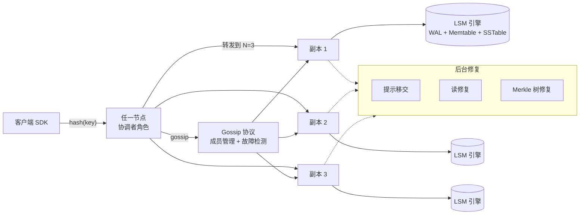
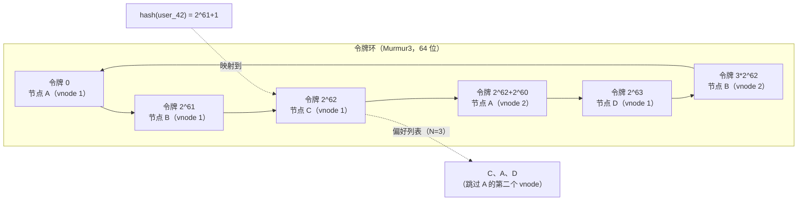
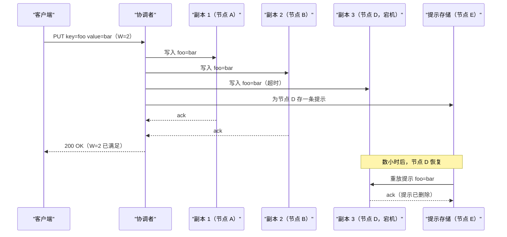
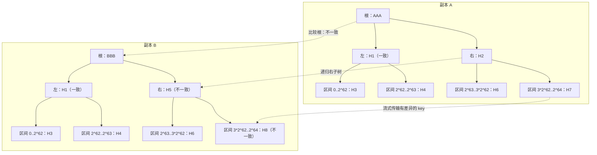
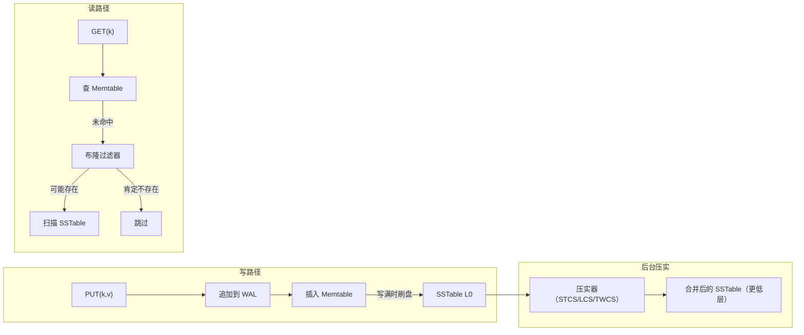

# 设计一个分布式键值存储（Dynamo / Cassandra / Riak）

> **TL;DR.** Dynamo 风格的分布式键值存储把不透明的 key 映射到不透明的 value，铺在一整片通用服务器组成的集群上，没有单点故障。2007 年的 Amazon Dynamo 论文[^1]定下了模板：用一致性哈希切分数据，复制到 N 个节点，用 R 与 W 法定人数按操作调一致性（强读要求 R + W > N），用 gossip 检测故障，用反熵修复分叉。DynamoDB 在 2025 年 Prime Day 峰值冲到每秒 1.51 亿次请求，延迟仍是毫秒的一位数量级[^20]。核心张力，是把 CAP 权衡摆到明面上：分区期间写入永不拒绝，但副本可能分叉，需要事后和解。

## 学习目标

学完本章，你将能够：

- [ ] 设计一个带虚拟节点的一致性哈希环，在拓扑变化时能平滑再平衡
- [ ] 用法定人数算式（R + W > N）按操作调一致性，并说清代价
- [ ] 比较向量时钟与最后写入者胜（LWW）两种冲突解决方式，并给出各自的实测失效率
- [ ] 解释提示移交、读修复与 Merkle 树反熵为何是三层互补的修复机制
- [ ] 描述 LSM 树的写路径，并在 STCS、LCS、TWCS 三种压实策略之间做选择
- [ ] 为一个 10M+ ops/sec 的负载做容量估算，并找出 10 倍、100 倍规模下的瓶颈

## 直觉理解

单机键值存储简单得没什么可讲：内存里一张哈希表，磁盘上一个 WAL，收工。10 个用户它能伺候得很好。到每秒一千万次操作它就塌了，因为一台机器装不下 1000 亿条记录，磁盘坏了必然丢数据，也没法用个位数毫秒的延迟同时服务三大洲的用户。

最朴素的修法是 `server = hash(key) % N`。它在八台服务器的集群里一直好用，直到你加了第九台：几乎每个 key 都要重新映射，逼出一次 PB 级的数据迁移[^3]。一致性哈希解决了这个问题，拓扑变化时只搬动 1/N 的 key。但现在每个 key 有 N 份副本散在不同机器上，而这些机器会对当前值产生分歧。这个分歧，就是整个设计问题所在。

2007 年的 Dynamo 论文[^1]做了一个明确的选择：Amazon 的购物车绝不能拒绝一次“加入购物车”，因为被拒的写入就是丢掉的收入。系统接受任何活着的副本上的写入，把冲突解决推到读时交给应用。本章每一个设计决策，都从这一条优先级流出来：**永远可写，哪怕在分区期间**。2022 年的 DynamoDB 论文[^2]选了相反的角落：每个分片一套 Paxos，线性一致性读，分区期间写入直接拒绝。同一个血统，相反的权衡。本章讲无主节点（AP）的设计，并与基于主节点（CP）的替代方案做对照。

## 需求

### 澄清问题

- **Q：系统提供什么一致性模型？**
  假设：按操作可调。默认最终一致性；通过法定人数配置（R + W > N）可获得强一致性。
- **Q：value 的大小范围是多少？**
  假设：key 最多 256 字节，value 最多 1 MB。value 中位数约 500 字节。
- **Q：需要多地域双活吗？**
  假设：需要，3 个地域，每个地域持有一整套副本。跨地域复制是异步的。
- **Q：SLA 目标是什么？**
  假设：读可用性 99.99%，写可用性 99.9%。地域内 p99 < 10 ms，跨地域 p99 < 100 ms。
- **Q：需要范围扫描，还是只要点查？**
  假设：以点查为主（按 key 做 GET/PUT/DELETE）。范围扫描作为后续扩展。
- **Q：并发写带来的冲突怎么处理？**
  假设：应用按 bucket 自选：向量时钟 + 应用侧合并，或者对不可变数据用 LWW。

### 功能需求

- PUT(key, value)：写入一个键值对，复制到 N 个节点
- GET(key)：取回最新值（若存在并发写，则返回多个兄弟节点）
- DELETE(key)：在所有副本上给该 key 打墓碑
- 可调一致性：调用方按操作指定 R 与 W

### 非功能需求

- **负载：** 聚合 10M+ ops/sec，单节点 100K ops/sec（容量规划用的假设值）
- **延迟：** 地域内 p50 < 5 ms、p99 < 10 ms；p999 < 15 ms（本章练习的设计目标）
- **可用性：** 读 99.99%，写 99.9%
- **存储：** 100B+ 条记录，集群整体 PB 级
- **持久性：** 单节点故障不丢数据；单地域故障时丢数据有界（RPO < 3 小时）

## 容量估算

| 指标 | 数值 | 推导 |
|--------|------:|------------|
| 记录总数（5 年） | 100B | 55M 次写/天 x 365 x 5 |
| 每条记录存储 | 600 B | key(64) + value(500) + 元数据(36) |
| 原始存储总量 | 60 TB | 100B x 600 B |
| RF=3 时 | 180 TB | 60 TB x 3 个副本 |
| 读 QPS 峰值 | 8M | 10M ops/sec 的 80% |
| 写 QPS 峰值 | 2M | 10M ops/sec 的 20% |
| 节点数（按 100K ops/节点） | 100 | 10M / 100K |
| 热 key 缓存（前 1%） | 600 GB | 1B 个 key x 600 B |

- **读写比：** 4:1（会话存储、商品目录的典型比例）
- **复制带宽：** 每次写复制到 N=3 个节点，所以集群范围的有效写负载是 6M ops/sec
- **布隆过滤器内存：** 每 key 10 位 x 每节点 1B 个 key = 每节点约 1.2 GB 内存[^4]
- **压实余量：** STCS 需要 50% 的空闲磁盘；每节点按原始存储的 2 倍预留[^4][^5]

## API 与数据模型

### API 设计

```http
PUT /v1/kv/{key}
  Headers: Consistency: QUORUM, Idempotency-Key: <uuid>
  Body: { "value": "<base64-encoded blob>", "context": "<vector-clock>" }
  Returns: 201 { "key": "...", "version": "...", "timestamp": "..." }
  Errors: 503 insufficient replicas, 429 rate limited

GET /v1/kv/{key}
  Headers: Consistency: QUORUM
  Returns: 200 { "key": "...", "value": "...", "context": "<vector-clock>", "siblings": [...] }
  Errors: 404 not found

DELETE /v1/kv/{key}
  Headers: Consistency: QUORUM
  Body: { "context": "<vector-clock>" }
  Returns: 204 No Content
```

`context` 字段携带上次读到的向量时钟（或 DVV）。写入时，协调者比较 context 来判断是否存在并发写。客户端不传 context，就会产生一个新的兄弟节点。

### 数据模型

```sql
-- Per-node LSM storage (Cassandra-style)
-- Partition key: hash(key) determines ring placement
-- Clustering: none (single value per key)
table kv_store (
  key_hash    bigint,       -- Murmur3 token
  key         blob,         -- original key bytes
  value       blob,         -- opaque payload
  vector_clock blob,        -- serialized VC/DVV
  timestamp   bigint,       -- HLC for LWW fallback
  tombstone   boolean,      -- soft delete marker
  PRIMARY KEY (key_hash)
)

-- Hint store (per-node, for hinted handoff)
table hints (
  target_node_id  uuid,
  hint_id         timeuuid,
  key_hash        bigint,
  mutation        blob,
  created_at      timestamp,
  PRIMARY KEY (target_node_id, hint_id)
) WITH default_time_to_live = 10800  -- 3 hours
```

## 高层架构



*任何节点都能协调任何请求；客户端 SDK 先对 key 做哈希，挑一个具备数据本地性的协调节点，协调者再把写转发给 N 个副本并等待 W 个确认。*

**写路径。** 客户端对 key 做哈希，选一个协调节点（可以是任何节点，但优先选偏好列表里靠近数据的那个）。协调者把写并行转发给全部 N=3 个副本。每个副本追加自己的 WAL、插入 memtable，然后回 ack。协调者收到 W 个 ack 就返回成功。慢副本走异步接收这笔写。

**读路径。** 协调者向全部 N 个副本发读请求，等 R 个响应，比较版本，返回最新的那份（若有并发写则返回多个兄弟节点）。如果某个副本返回了旧版本，协调者在后台发起一次读修复写入，把它追平。

**故障路径。** 如果偏好列表里的某个副本不可达，协调者顺时针写到下一个活着的节点（提示移交）。那个节点把数据当作提示存下来，等故障节点恢复后重放。如果提示过期（默认 3 小时[^6]），就靠完整的 Merkle 树修复来收敛分叉。

## 深入探讨

### 深入探讨 1：一致性哈希与虚拟节点

问题：把 1000 亿个 key 分到 100+ 个节点上，并且保证增删一个节点时搬动的数据最少。

**环。** key 和节点映射到同一个环形哈希空间。Cassandra 在 [-2^63, 2^63) 上使用 64 位 Murmur3 令牌[^7]。一个 key 的协调者是 hash(key) 顺时针方向的第一个节点。再顺时针取 N-1 个不同的物理节点，构成偏好列表（preference list）[^1]。

**虚拟节点。** 每个物理节点在环上占多个位置（Cassandra 从 4.0 起默认每节点 16 个 vnode[^7]）。这让负载分布变平滑：没有虚拟节点时，一个 8 节点的集群死掉一台，1/8 的流量会整个压到唯一后继上。每节点 16 个 vnode 时，死掉的节点在环上的位置与其它节点交错，它的负载会摊到全部 7 个幸存者身上。

**再平衡。** 加一个带 16 个 vnode 的节点，就是从 16 个不同来源拉 16 条小数据流，把 bootstrap 并行化了。代价是：vnode 越多，修复时要维护的 Merkle 树也越多。Cassandra 文档里的默认值从 256（4.0 之前）改成 16（4.0+）[^7]，就是为了给修复和流式传输的开销封顶[^8]。ScyllaDB 在近期版本里干脆放弃了 vnode，改用“tablet”——按表独立调度和迁移的数据单元[^9]。

**跳跃一致性哈希（Lamping 与 Veach，2014）[^10]。** 另一种方案，用 O(ln N) 时间算出分桶结果，零内存占用。五行代码。但它处理不了异构的节点权重，也不支持 vnode，所以生产上的 Dynamo 后继者们仍然用环。



*key 哈希到环上的一个位置；偏好列表是顺时针方向接下来 N=3 个不同的物理节点，属于同一台主机的 vnode 会被跳过。*

### 深入探讨 2：法定人数复制与冲突解决

**算式。** N=3、R=2、W=2 时：R + W = 4 > N = 3。每次读至少与每次写在一个副本上重叠，保证读能看到该 key 最近一次已提交的值[^1]。R=1、W=1 时：R + W = 2 < 3，读可能完全错过刚发生的写。

**松散的法定人数。** 某个副本不可达时，协调者把写落到一个替补节点。法定人数凑够了，但这笔写可能一个主副本都没落着。Jepsen 的测试显示，启用松散法定人数的 Riak 在一次分区中丢掉了 91% 的已确认写入[^11]。严格的法定人数（PR + PW > N）能防住这个，代价是写可用性下降。

**向量时钟 vs. LWW。** 向量时钟能检出真正的并发：两个浏览器标签页写同一个 key，会产生兄弟节点，由应用在读时合并[^12]。LWW 用墙上时钟的时间戳，戳大的赢。有时钟偏移时，因果上更晚但时间戳更早的写会被静默丢弃。Jepsen 在分区期间测到 Cassandra 配 QUORUM 有 28% 的写丢失[^13]。Riak 的 LWW 结果更强，也更让人不安：Kingsbury 在一个全连通、健康、毫无分区、锁也完美的集群上测到 71.7% 的丢失率，纯粹是并发写在墙上时钟时间戳上抢跑造成的[^11]。而 Riak 配松散法定人数加 LWW 的分区场景更糟（约 91% 丢失[^11]）。这两个数字测的是不同的失效模式：Cassandra 那个隔离出了分区行为，Riak 的 71% 隔离出的是 LWW 在并发写下本身就不安全，与分区无关。

点分版本向量（dotted version vector，DVV）给每个 value 打上产生它的那个 (replica-id, counter) 点，从而细化了向量时钟，消除了 2.0 之前 Riak 饱受困扰的兄弟节点爆炸[^12]。



*写入在收到 W=2 个 ack 后就返回；第三个副本在恢复后通过提示移交拿到数据。提示在 3 小时后过期[^6]。*

### 深入探讨 3：LSM 存储引擎与 Merkle 树反熵

**LSM 写路径。** 每次写都追加到 commit log（WAL），并插入 memtable（一个有序的内存结构）。memtable 写满后，刷成磁盘上一个不可变的 SSTable。写是顺序的：一次追加加一次内存插入。相比之下，B 树可能弄脏索引里的任意一个页[^14]。

**读路径。** 先查 memtable，再按时间倒序查各层 SSTable。布隆过滤器（每 key 10 位，假阳性率 1%[^4]）能跳过那些不可能包含该 key 的 SSTable。读放大随 SSTable 数量增长，靠压实把它压住。

**压实策略：**

- **STCS（按大小分层）：** 合并 4 个大小相近的 SSTable。写放大低，但需要 50% 的空闲磁盘，空间放大高[^4][^5]。
- **LCS（分层）：** 每一层是上一层的 10 倍。读放大有界（log N），但写放大约 10 倍[^4][^5]。
- **TWCS（时间窗口）：** 按时间窗口分组。几乎不需要大范围重新压实，适合带 TTL 的负载[^4]。

**Merkle 树反熵。** 两个副本各自在自己的令牌区间上建一棵哈希二叉树。先比根哈希；不同就递归进子节点。只有哈希对不上的子树需要细比。两个各持 1 TB 数据的副本，交换几 KB 哈希就能确认彼此一致[^1][^8]。



*两个副本自上而下比较哈希树，只递归进对不上的子树。有差异的 key 区间按 O(差异量) 的带宽流式传输。*

修复必须在 `gc_grace_seconds` 内跑完（Cassandra 默认 10 天[^6]）。如果某个副本离线更久，在活副本已经清掉墓碑之后才回来，读修复会把已删除的数据复活（“僵尸复活”问题）。



*写是顺序的（WAL 追加 + memtable 插入）；读先查 memtable，再靠布隆过滤器决定要不要查 SSTable；压实合并 SSTable 以压住读放大。*

## 真实案例

### Discord：从 177 个 Cassandra 节点到 72 个 ScyllaDB 节点

Discord 把一个 177 节点的 Cassandra 集群用来存数万亿条消息[^15]。Apple 公开讲过自己在多 PB 规模上跑着数万个 Cassandra 节点[^16]。运维的现实把 Dynamo 模型在规模下的每一个弱点都暴露了出来：

**热点分片。** 一个几十万成员的大服务器产生的流量，比一个小型好友群高好几个数量级。某个热门频道的全部流量打在一个 vnode 上，把它的 CPU 打满，而集群其余部分闲着[^15]。

**GC 停顿。** Cassandra 跑在 JVM 上。在 phi-accrual 故障检测器看来，一次 full GC 停顿和节点死亡没有区别[^17]（phi 阈值 = 8，约 18.4 秒[^18]）。值班工程师花了大量时间用来分辨真故障和 GC 引发的误判[^15]。

**压实风暴。** 压实的进度追不上写入。运维把节点轮流摘出、放回集群（“gossip dance”），让它们在不承接应用流量的情况下拿到压实算力[^15]。

**迁移。** Discord 迁到 ScyllaDB，一个用 C++ 重写、采用每核一分片（shard-per-core）架构、没有垃圾回收器的实现[^9]。结果：

| 指标 | Cassandra（迁移前） | ScyllaDB（迁移后） |
|---|---|---|
| 节点数 | 177 | 72 |
| p99 读延迟 | 40-125 ms | 15 ms |
| p99 写延迟 | 5-70 ms | 5 ms（稳定） |
| 迁移速度 | - | 约 3.2M 条消息/秒 |

每核一分片的模型把热点分片限制在单个 CPU 核上，不会拖住其它核上的查询。没有 GC 就没有故障误判。Discord 还部署了一层 Rust 写的请求合并层，对同一个热 key 的并发读做去重[^15]。

## 权衡

| 方案 | 优点 | 缺点 | 适用场景 |
|---|---|---|---|
| 可调法定人数，AP（Dynamo） | 永远可写、没有主节点瓶颈、一致性按操作调 | 应用必须自己和解冲突，LWW 对可变数据不安全 | 会话存储、购物车、可用性优先 |
| 每分片 Paxos，CP（DynamoDB） | 线性一致性读、客户端契约简单 | 分区期间写被拒，主节点是每分片的单点故障 | 元数据、财务记录、配置中心 |
| 向量时钟 / DVV | 能检出并发写，不丢任何数据 | 客户端要写合并逻辑，VC 体积随写者数增长 | 数据丢失不可接受的不可变/可变对象 |
| 最后写入者胜（LWW） | API 简单、无兄弟节点、延迟更低 | 时钟偏移或分区下静默丢数据；Jepsen 在分区的 Cassandra 集群上（即便锁是完美的）测到约 28% 的写丢失[^13] | 不可变数据、只追加日志、缓存 |
| 无主节点 + CRDT | 永远可写、自动合并、无需应用侧解决 | 数据类型受限（计数器、集合、映射） | 协同状态、计数器、最终一致的集合 |
| STCS 压实 | 写放大低 | 需要 50% 空闲磁盘，空间放大高 | 写密集的追加型负载 |
| LCS 压实 | 读放大有界，空间放大低 | 写放大约 10 倍 | 读密集的 OLTP 负载 |

最大的一处权衡：**分区期间，可用性与一致性之争**。2007 年的 Dynamo 论文选了可用性（购物车绝不能拒绝）。2022 年的 DynamoDB 论文选了一致性（每分片 Paxos，在 151M RPS 下提供线性一致性读[^20]）。你的选择取决于：一笔被拒的写和一次读到旧值，哪个对你的业务更贵。

## 扩展与故障模式

**10 倍规模（100M ops/sec）：** 环靠加节点线性扩展。瓶颈转向跨地域复制带宽，以及爆款 key 带来的热点分片。缓解手段：请求合并（Discord 的做法[^15]）、按 key 限流、自动分片切分（DynamoDB 的做法[^2]）。

**100 倍规模（1B ops/sec）：** 单集群在几千个节点上 gossip 收敛会变慢。缓解手段：分层 gossip（机架内 gossip，机架代表之间再 gossip）。压实成为硬约束；转向分层存储（热 SSTable 放 NVMe，冷数据放对象存储）。

**1000 倍规模（10B ops/sec）：** 环模型本身成了瓶颈（环的元数据会膨胀）。缓解手段：把环按 keyspace 切成子环，各自独立管理。DynamoDB 的分区组架构本质上就是干这个[^2]。

**故障：单节点死亡。** 提示移交能兜住最多 3 小时的空档[^6]。读修复在被访问时顺手修复。全量修复在 gc_grace_seconds 内把数据对齐。只要修复及时跑完，就不丢数据。

**故障：整个地域挂掉。** 跨地域异步复制意味着 RPO 受复制延迟约束（通常是秒到分钟级）。客户端切到最近的健康地域。分区期间产生的分叉写入由冲突解决机制处理。

**故障：脑裂（地域内网络分区）。** 松散法定人数允许两侧都接受写入。网络恢复后，向量时钟检出并发版本，把兄弟节点呈现出来。用 LWW 的话，一侧的写入会被静默丢掉。

## 常见陷阱

> [!WARNING]
> **分区键选得不好导致热点分片。** 单调递增的 key（自增 ID、当天的时间戳）会哈希到环上相近的位置，把一个 vnode 打满。用带高基数前缀的复合分区键。Discord 的热频道问题就是标准案例[^15]。

> [!WARNING]
> **N=3 却配 R=1、W=1，等于没有任何一致性保证。** R + W = 2 < N = 3，读写可能永远不重叠。工程师为了压延迟会直接这么配，而不去算这个式子。在配置层强制 R + W > N[^1]。

> [!WARNING]
> **过了 gc_grace_seconds 的墓碑复活。** 如果副本离线的时间超过 gc_grace_seconds（10 天[^6]），并且在墓碑已被清理之后才回来，读修复会把删除的数据复活。每个副本的修复频率都要高于 gc_grace_seconds[^8]。

> [!WARNING]
> **松散法定人数制造虚假的持久性。** 一笔按 W=2 确认的写，如果两个目标副本都宕了，它可能一个主副本都没落着。Jepsen 显示 Riak 在分区期间配松散法定人数丢掉了 91% 的已确认写入[^11]。持久性重要时，用严格法定人数（PR + PW > N）。

> [!WARNING]
> **压实风暴把磁盘填满。** STCS 在合并期间需要 50% 的空闲磁盘。一旦写入速度超过压实吞吐量，SSTable 数量暴涨，读放大上升，节点把自己踢出集群。按原始存储的 2 倍预留磁盘，并监控待处理压实的数量[^4][^5]。

## 追问

**1. 你会怎么加二级索引？**

本地二级索引（每个节点只索引自己的数据）不需要跨节点协调，但查询要做 scatter-gather。全局二级索引（单独一套分区索引）让查询能落到单个节点，但维持索引一致需要分布式写。DynamoDB 用的是全局二级索引，从基表异步复制[^2]。

**2. 多地域双活下，全局表是怎么工作的？**

每个地域持有一整套副本。写入在本地被接受，再异步复制到其它地域。冲突按 key 用向量时钟解决，或者用带混合逻辑时钟的 LWW。DynamoDB 的 Global Tables 用的是带地域标记时间戳的最后写入者胜[^19]。

**3. 你会怎么提供一个强一致性的选项？**

把强一致读路由到分片主节点（先用 Paxos 或 Raft 选出一个主）。DynamoDB 就是这么做的：每个分片有一个 Paxos 选出的主节点来服务一致性读[^2]。代价是主节点选举期间，强一致读不可用。

**4. 备份和时间点恢复（PITR）怎么做？**

SSTable 是不可变的，所以快照很便宜（给当前的 SSTable 集合建硬链接）。做 PITR 时，把 commit log 持续流式推到对象存储。恢复时，从目标时间戳开始，把 WAL 重放到最新的快照上。

**5. 你需要哪些可观测性？**

节点级指标（SSTable 数量、待处理压实、memtable 大小、布隆过滤器假阳性率）、操作级指标（按一致性级别分的协调者延迟、超时率）、集群级指标（gossip 收敛时间、提示积压量、修复进度）。对“待处理压实超过阈值”和“提示队列增长”告警。

**6. 规模上你会怎么优化成本？**

分层存储（热数据放 NVMe，温数据放 SSD，冷数据放对象存储按需回温）。按需容量（DynamoDB 模式）还是预置容量（Cassandra 模式）。用 LZ4 或 Zstandard 压缩 value。对非关键数据降低副本数（缓存用 N=2，持久状态用 N=3）。

## 练习

### 练习 1：范围扫描扩展

产品团队想支持 `GET /v1/kv/range?start=K1&end=K2&limit=100`。一致性哈希在设计上就毁掉了 key 的局部性。请设计一个扩展，在支持范围扫描的同时，不让点操作的写吞吐受损。

<details>
<summary>提示</summary>

考虑为可范围扫描的数据单独维护一套结构（或单独一套分区方案）。Cassandra 在单个分片内部是怎么做的？Bigtable 在跨分片时又是怎么做的？

</details>

<details>
<summary>参考答案</summary>

**方案 A：范围分区（Bigtable/HBase 模型）。** 按顺序存 key，切成连续区间分配给节点。范围扫描只打到一两个节点。代价是热区间（“今天”的所有写入都打到一个节点）需要自动切分。写吞吐受最热区间的那个节点限制。

**方案 B：一致性哈希 + 全局二级索引。** 主存储继续哈希，保证写入均匀。再建一个按 key 前缀分区的二级索引，把（范围）映射到（主键列表）。范围扫描先查索引，再逐个取 key。读放大 = 一次索引查找 + N 次点查。

**方案 C：Cassandra 的折中。** 分区键之间用一致性哈希，但分片内部的聚类列是有序的。单个分区键内的范围扫描很高效（顺序读 SSTable）。跨分区的范围扫描仍要 scatter-gather。

**结论：** 大多数负载先上方案 C。如果跨分区范围扫描是主要访问模式，就用范围分区加自动切分/合并（接受热区间风险，用预切分缓解）。面试时把这个权衡明说出来：均匀分布与局部性，本质上是互相冲突的。

</details>

## 要点回顾

- **带虚拟节点的一致性哈希**是地基；其余的一切都是在让副本保持诚实。
- **R + W > N** 不需要主节点就能给单个 key 提供强一致性，代价是写延迟等于第 W 慢的那个副本。
- **三层修复**（提示移交、读修复、Merkle 树反熵）互相补位，任何一层单独都不够。
- **LWW 对可变数据不安全。** Jepsen 在分区期间测到 Cassandra 配 QUORUM 有 28% 的写丢失[^13]。
- **2007 年的 Dynamo 论文和 2022 年的 DynamoDB 是表亲，不是一个系统。** DynamoDB 用每分片 Paxos，在 151M RPS 下提供线性一致性读[^20]。
- **运维现实和理论同样重要：** 凌晨三点把你叫醒的，是 GC 停顿、压实风暴和热点分片。

## 延伸阅读

- [Dynamo: Amazon's Highly Available Key-value Store (SOSP 2007)](https://www.amazon.science/publications/dynamo-amazons-highly-available-key-value-store)。定义这套模板的原始论文；读 4.1、4.4、4.5 和 4.7 节看核心机制。
- [Amazon DynamoDB: A Scalable, Predictably Performant, and Fully Managed NoSQL Database Service (USENIX ATC 2022)](https://www.usenix.org/conference/atc22/presentation/elhemali)。记录了 DynamoDB 从 2007 年论文到 Paxos 支撑的线性一致性的演进（2021 年 Prime Day 峰值：89.2M RPS）。
- [How Discord Stores Trillions of Messages](https://discord.com/blog/how-discord-stores-trillions-of-messages)。规模下 Cassandra 运维最清晰的案例研究，附迁移到 ScyllaDB 前后的具体数字。
- [Jepsen: Cassandra](https://aphyr.com/posts/294-call-me-maybe-cassandra)。Kingsbury 2013 年的测试，显示分区下 QUORUM 有 28% 的写丢失；理解 LWW 为何危险必读。
- [Jepsen: Riak](https://aphyr.com/posts/285-call-me-maybe-riak)。配套测试，显示松散法定人数下 91% 的写丢失；严格法定人数为何重要的最干净演示。
- [Riak Causal Context Documentation](https://docs.riak.com/riak/kv/latest/learn/concepts/causal-context/)。教科书之外对向量时钟、DVV 和兄弟节点解决最好的实战讲解。
- [A Fast, Minimal Memory, Consistent Hash Algorithm (Lamping and Veach 2014)](https://arxiv.org/abs/1406.2294)。五行代码的跳跃一致性哈希；同构分片系统的最优解。
- [The Log-Structured Merge-Tree (O'Neil et al. 1996)](https://www.cs.umb.edu/~poneil/lsmtree.pdf)。本章每个系统脚下的存储引擎地基。

## 记忆卡片

<details>
<summary><strong>Q：往 hash(key) % N 里加一个节点，key 的分布会怎样？</strong></summary>

A：模数变了，几乎每个 key 都要重映射到另一台服务器。一致性哈希修好了这点：节点加入或离开时只搬动约 1/N 的 key。

</details>

<details>
<summary><strong>Q：R + W > N 保证了什么，又没保证什么？</strong></summary>

A：它保证对单个 key，每次读都与最近一次写重叠。它不保证跨 key 的顺序、事务，也不保证跨会话的读己之写。

</details>

<details>
<summary><strong>Q：为什么最后写入者胜对可变数据是危险的？</strong></summary>

A：有时钟偏移时，因果上更晚但时间戳更早的写会被静默丢弃。Jepsen 在分区期间测到 Cassandra 配 QUORUM 有 28% 的写丢失。

</details>

<details>
<summary><strong>Q：Dynamo 风格的存储里有哪三种反熵机制？</strong></summary>

A：提示移交（短期，应对瞬时故障）、读修复（每次法定人数读时做）、完整的 Merkle 树修复（后台定期跑）。三者都不能少，任何一个单独都不够。

</details>

<details>
<summary><strong>Q：phi-accrual 故障检测器比固定超时强在哪？</strong></summary>

A：它输出的是一个连续的怀疑度分数，且会按观测到的网络抖动调整，所以网络繁忙时判定门槛自动抬高，而不是让节点在死活之间来回抖。

</details>

<details>
<summary><strong>Q：Discord 为什么从 Cassandra 迁到 ScyllaDB？</strong></summary>

A：JVM 垃圾回收停顿造成了故障误判，高负载下压实跟不上，热点分片把个别节点打满。ScyllaDB 每核一分片的 C++ 架构消除了 GC 停顿，把热点分片隔离在单个核上。结果：177 个节点降到 72 个，p99 读从 40-125 ms 降到 15 ms。

</details>

<details>
<summary><strong>Q：什么是墓碑复活问题？</strong></summary>

A：如果副本离线的时间超过 gc_grace_seconds，并且在活副本上的墓碑已被清理之后才回来，读修复会把已删除的数据复活——因为这个刚回来的副本上还留着原始值。

</details>

<details>
<summary><strong>Q：Merkle 树怎么让反熵修复变高效？</strong></summary>

A：两个副本自上而下比较一棵哈希树，只递归进有差异的子树。这样用 O(log N) 次比较就能定位到有差异的 key 区间，只流式传输差异数据，而不是整个数据集。

</details>

<details>
<summary><strong>Q：STCS 和 LCS 压实有什么区别？</strong></summary>

A：STCS 合并大小相近的 SSTable，写放大低，但需要 50% 的空闲磁盘。LCS 把每层限制为上一层的 10 倍，读放大有界，但写放大约 10 倍。写密集选 STCS，读密集选 LCS。

</details>

<details>
<summary><strong>Q：DynamoDB 和 2007 年的 Dynamo 论文差在哪？</strong></summary>

A：DynamoDB 用每分片 Multi-Paxos 做线性一致性读，配合自适应分片切分和准入控制。2007 年的论文用的是松散法定人数、向量时钟和永远可写的语义。同一个血统，相反的一致性权衡。

</details>

## 参考文献

[^1]: DeCandia et al., "Dynamo: Amazon's Highly Available Key-value Store", SOSP 2007. https://www.amazon.science/publications/dynamo-amazons-highly-available-key-value-store

[^2]: Elhemali et al., "Amazon DynamoDB: A Scalable, Predictably Performant, and Fully Managed NoSQL Database Service", USENIX ATC 2022. https://www.usenix.org/conference/atc22/presentation/elhemali

[^3]: Wikipedia, "Consistent hashing"（Karger 等 1997 年的背景）. https://en.wikipedia.org/wiki/Consistent_hashing

[^4]: Apache Cassandra 文档，"Compaction". https://cassandra.apache.org/doc/latest/cassandra/managing/operating/compaction/index.html

[^5]: ScyllaDB 文档，"Choose a Compaction Strategy". https://docs.scylladb.com/manual/stable/architecture/compaction/compaction-strategies.html

[^6]: Apache Cassandra 文档，"Hints". https://cassandra.apache.org/doc/latest/cassandra/managing/operating/hints.html

[^7]: Apache Cassandra 文档，"Adding, replacing, moving and removing nodes"（4.0 起默认 num_tokens = 16）. https://cassandra.apache.org/doc/stable/cassandra/managing/operating/topo_changes.html

[^8]: Apache Cassandra 文档，"Repair". https://cassandra.apache.org/doc/latest/cassandra/managing/operating/repair.html

[^9]: ScyllaDB 技术概览. https://www.scylladb.com/product/technology/

[^10]: Lamping and Veach, "A Fast, Minimal Memory, Consistent Hash Algorithm", 2014. https://arxiv.org/abs/1406.2294

[^11]: Kyle Kingsbury, "Jepsen: Riak", 2013. https://aphyr.com/posts/285-call-me-maybe-riak

[^12]: Riak KV 文档，"Causal Context"（向量时钟与点分版本向量）. https://docs.riak.com/riak/kv/latest/learn/concepts/causal-context/

[^13]: Kyle Kingsbury, "Jepsen: Cassandra", 2013. https://aphyr.com/posts/294-call-me-maybe-cassandra

[^14]: O'Neil, Cheng, Gawlick, O'Neil, "The Log-Structured Merge-Tree (LSM-Tree)", Acta Informatica 1996. https://www.cs.umb.edu/~poneil/lsmtree.pdf

[^15]: Bo Ingram, "How Discord Stores Trillions of Messages", Discord Engineering Blog, March 2023. https://discord.com/blog/how-discord-stores-trillions-of-messages

[^16]: InfoQ, "Discord Migrates Trillions of Messages from Cassandra to ScyllaDB", 2023；Apple 的 Cassandra 规模数字来自 2015 年 Cassandra Summit 的演讲. https://www.infoq.com/news/2023/06/discord-cassandra-scylladb/

[^17]: Hayashibara, Defago, Yared and Katayama, "The phi Accrual Failure Detector", IEEE SRDS 2004. https://ieeexplore.ieee.org/document/1353004

[^18]: Digitalis 博客，"Understanding phi_convict_threshold in Apache Cassandra". https://digitalis.io/post/understanding-phi-convict-threshold-in-apache-cassandra-a-deep-dive-into-failure-detection

[^19]: Amazon Science, "Amazon's DynamoDB 10 years later". https://www.amazon.science/latest-news/amazons-dynamodb-10-years-later

[^20]: Channy Yun, "AWS services scale to new heights for Prime Day 2025: Key metrics and milestones", AWS News Blog, 2025. https://aws.amazon.com/blogs/aws/aws-services-scale-to-new-heights-for-prime-day-2025-key-metrics-and-milestones/
