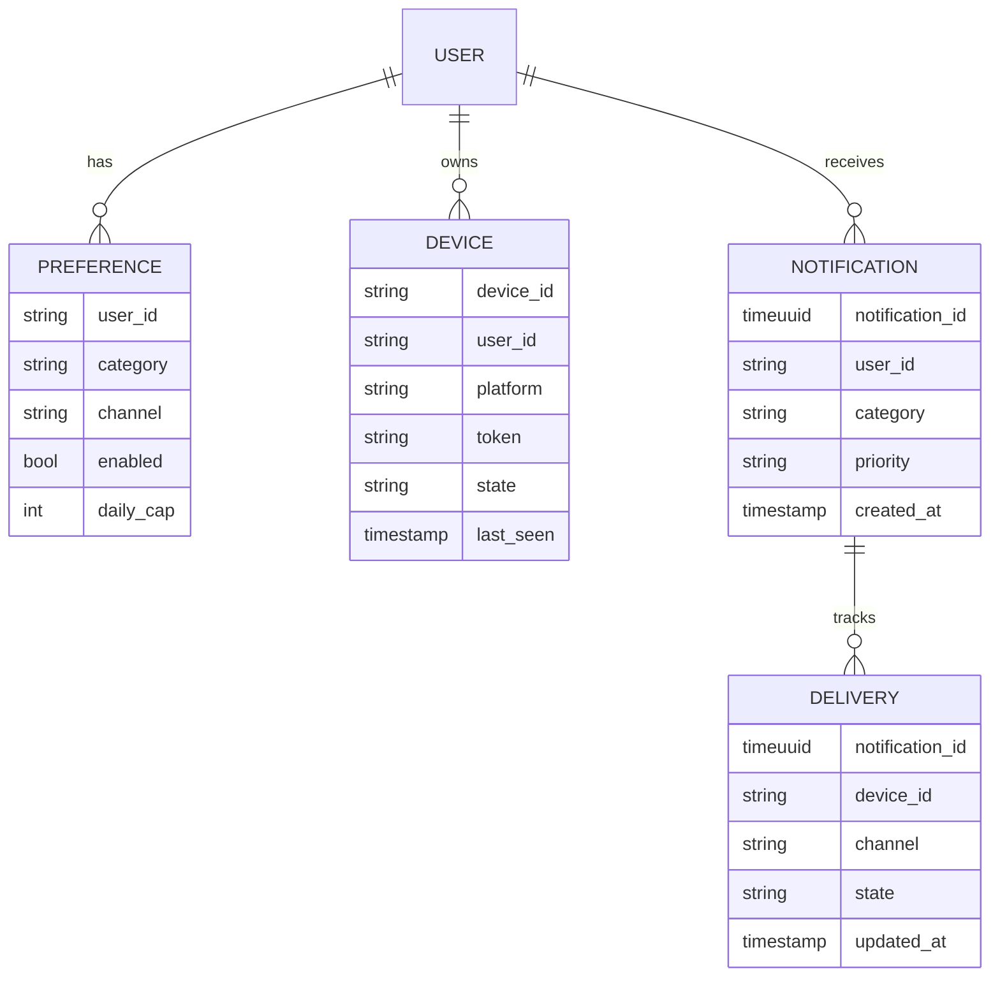
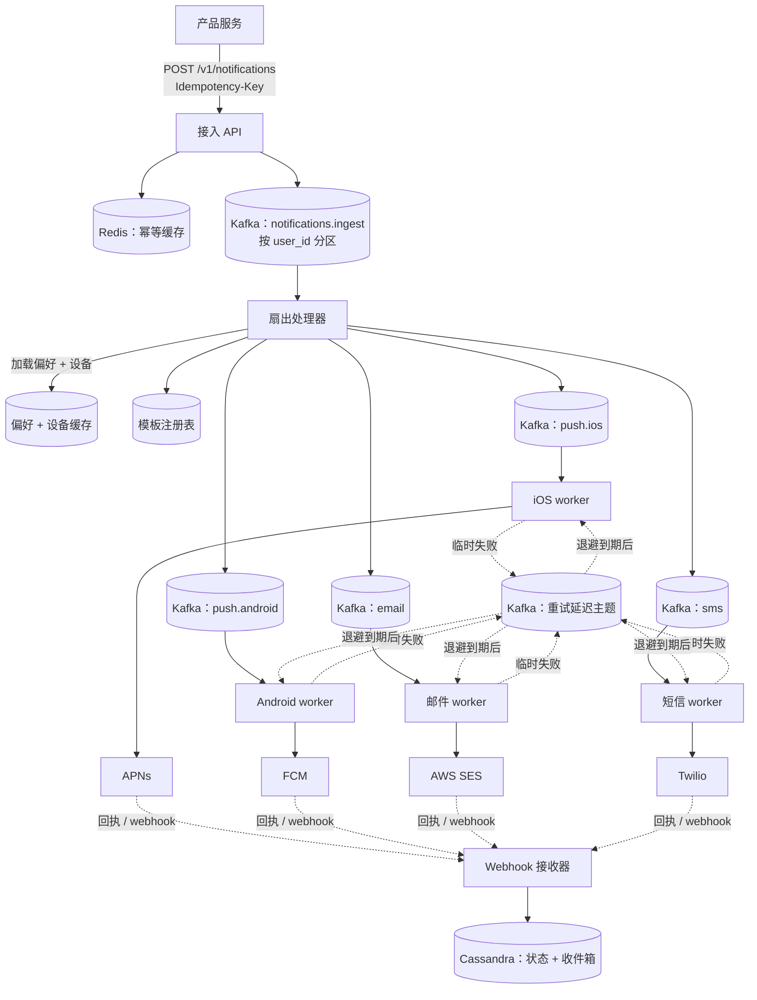
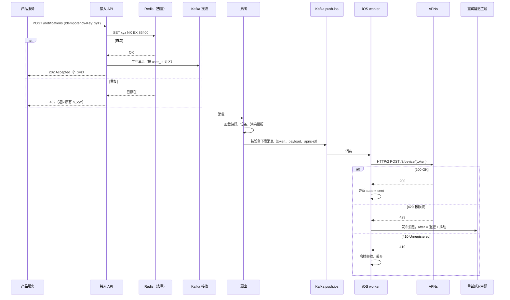
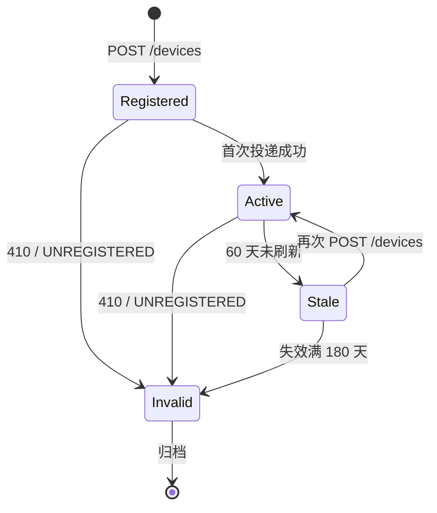
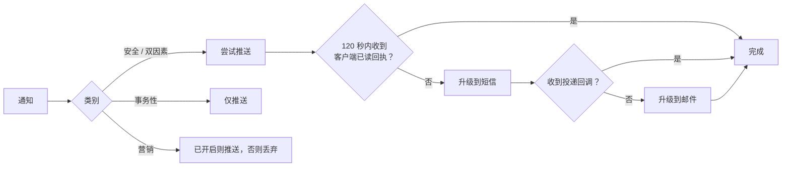

# 设计一个通知系统（大规模推送、短信与邮件）

> **TL;DR.** 通知系统是三个问题套在同一件风衣里：扇出（fan-out，一个事件要为 K 台设备、跨 M 个渠道产生 N 次投递）、服务商接入（APNs、FCM、Twilio、SES 各有不同的限流、载荷大小和错误语义），以及投递语义（至少一次加去重，因为跨外部服务商做到精确一次根本不可能）。LinkedIn 的 Air Traffic Controller 每天处理超过 10 亿次请求[^1]，靠集中式编排把会员投诉减半。最关键的权衡：在异构的服务商约束下，吞吐量与正确性怎么取舍。

## 学习目标

学完本章，你将能够：

- [ ] 设计一套扇出架构，隔离各渠道的故障，并让每个服务商的 worker 集群独立扩展
- [ ] 实现由服务商反馈（APNs 410、FCM UNREGISTERED）驱动的设备令牌生命周期
- [ ] 在调用方和服务商两侧同时做幂等，达到"有效一次"投递
- [ ] 用延迟主题配合指数退避与抖动，论证重试策略的合理性
- [ ] 为每天跨 4 个渠道投递 100 亿条通知的平台做容量估算
- [ ] 在推送转短信的兜底瀑布里权衡投递延迟与成本

## 直觉理解

用户只有 10 个的时候，通知平台看起来就是个普通的 CRUD 应用：收下事件，调 APNs，结束。到了每天 100 亿条，它就塌了，原因在于渠道之间的异构性。

APNs 通过多路复用的 HTTP/2 连接，几乎能吸收无限量的推送。Twilio 的短信短号上限是每秒 100 条[^2]。FCM 的默认配额是每个项目每分钟 60 万条[^3]。把所有渠道塞进一个队列，短信的背压就会卡住推送投递。哪个服务商一挂，整条管道都堵。

解开这个设计的关键洞察：把每个渠道当成独立的投递系统，各有自己的 worker 集群、自己的队列、自己的限流、自己的故障域。前面只放一层很薄的编排层，负责去重、偏好和扇出。LinkedIn 的 Air Traffic Controller 做的正是这件事[^1]，Uber 为营销推送做的是同一件事[^4]，Slack 在 2026 年重建通知偏好时也是[^5]。

第二个洞察：发得更多不等于更好。每一条低质量通知都在消耗用户的信任。ATC 之前的 LinkedIn 让每个团队自己定通知策略，结果是"无节制、过量、低质量的会员通知体验"[^1]。集中化之后投诉减半，参与度还实现了两位数增长。这个平台是守门人，不只是投递管道。

## 需求

### 澄清问题

- **问：第一天必须支持哪些渠道？**
  假设：推送（iOS + Android）、短信、邮件、站内信收件箱。Web 推送属于加分项。

- **问：事务性通知和营销通知的延迟 SLA 是多少？**
  假设：事务性通知（重置密码、安全告警）端到端 p99 < 5 秒。营销通知可以在 1 小时的时间窗内择机发送。

- **问：需要投递确认吗？**
  假设：事务性通知需要。APNs 不提供正向回执[^6]，所以推送的确认只能依赖客户端的已读回执。

- **问：多区域吗？**
  假设：两个区域双活。用 Kafka MirrorMaker 跨区域复制通知状态。

- **问：调用方是谁？**
  假设：内部产品服务（司机已到达、新消息、营销活动）。外部 webhook 触发不在范围内。

- **问：适用哪些合规框架？**
  假设：美国短信适用 TCPA，欧洲经济区适用 GDPR，邮件适用 CAN-SPAM，美国 10 位长号码适用 A2P 10DLC[^7]，批量邮件适用 RFC 8058 一键退订[^8]。

### 功能需求

- 接收产品服务的通知请求，带幂等键
- 扇出到用户所有已注册设备的所有已开启渠道
- 强制执行按用户、按类别、按渠道的偏好设置与频次上限
- 临时性失败按指数退避重试；永久性失败进死信队列
- 按"每条通知 × 每台设备"跟踪投递状态（accepted、sent、delivered、read）
- 支持定时发送，以及营销类别的摘要批量合并

### 非功能需求

- **负载：** 每天 100 亿条，峰值接收 10 万/秒，峰值服务商调用 30 万/秒（扇出之后）
- **延迟：** 事务性推送 p99 < 5 秒；邮件/短信 p99 < 60 秒
- **可用性：** 接收路径 99.95%；投递路径 99.9%（取决于服务商）
- **一致性：** 至少一次投递，通过去重达成有效一次语义
- **持久性：** 通知不能被静默丢弃；永久性失败落到 DLQ 等待人工处理

## 容量估算

| 指标 | 数值 | 推导 |
|--------|------:|------------|
| 每日通知量 | 100 亿 | 需求给定 |
| 平均接收 QPS | 115K | 100 亿 / 86,400 |
| 峰值接收 QPS | 300K | 平均值的 2.5 倍（营销洪峰） |
| 扇出系数 | 1.8 | 平均每用户 1.8 台设备 |
| 峰值服务商 QPS | 540K | 300K × 1.8 |
| 幂等缓存（24 小时 TTL） | ~170 GB | 100 亿个键 × 平均 17 字节 |
| 通知状态存储（1 年） | ~36 TB | 100 亿/天 × 365 × 10 字节元数据 |
| 短信成本上限 | 每天 $83K | 1000 万条短信 × 约 $0.0083/段（Twilio 美国价，2025 年）[^2] |

- **读写比：** 1:10（写占主导；读主要是收件箱查询和管理后台）
- **热点分片风险：** 大 V 用户或病毒式活动，单个触发就能产生 10 万以上的扇出
- **带宽：** 峰值出口约 50 Gbps（每秒 54 万条消息 * 平均 12 KB 渲染后载荷）
- **短信吞吐天花板：** A2P 10DLC 的 MMS 在 2026 年 3 月之前按账户限制为 1 MPS[^9]；短号可保底 100 MPS[^2]

## API 与数据模型

### API 设计

```http
POST /v1/notifications
  Idempotency-Key: <uuid>
  Body: {
    "user_id": "u_abc",
    "category": "security",
    "priority": "high",
    "channels": ["push", "sms"],
    "template_id": "password_reset_v2",
    "params": { "code": "482910", "expires_min": 10 },
    "ttl_seconds": 300
  }
  Returns: 202 { "notification_id": "n_xyz", "status": "accepted" }
  Errors: 409 duplicate (returns original notification_id), 429 rate limited

GET /v1/notifications/{id}/status
  Returns: 200 {
    "notification_id": "n_xyz",
    "deliveries": [
      { "channel": "push", "device": "d_1", "state": "delivered", "at": "..." },
      { "channel": "sms", "state": "sent", "at": "..." }
    ]
  }

GET /v1/users/{id}/inbox?cursor=...&limit=50
  Returns: 200 { "items": [...], "next_cursor": "..." }

PUT /v1/users/{id}/preferences
  Body: { "category": "marketing", "channel": "push", "enabled": false }
  Returns: 200
```

分页使用不透明游标（base64 编码的 `notification_id`）。限流：每个调用方服务 1,000 请求/秒，在 API 网关上执行。注意：AWS SES 沙箱限制为每天 200 条、每秒 1 条；生产账户可以扩到每天数百万条[^10]。

### 数据模型

```sql
-- Notification state (Cassandra, partitioned by user_id)
CREATE TABLE notifications (
  user_id       text,
  notification_id timeuuid,
  category      text,
  priority      text,
  template_id   text,
  params        map<text, text>,
  created_at    timestamp,
  ttl_seconds   int,
  PRIMARY KEY (user_id, notification_id)
) WITH CLUSTERING ORDER BY (notification_id DESC);

-- Delivery tracking (Cassandra, partitioned by notification_id)
CREATE TABLE deliveries (
  notification_id timeuuid,
  device_id     text,
  channel       text,
  state         text,   -- accepted | sent | delivered | read | failed
  updated_at    timestamp,
  provider_id   text,   -- apns-id, twilio-sid, ses-message-id
  PRIMARY KEY (notification_id, device_id)
);

-- Device registry (Cassandra, partitioned by user_id)
CREATE TABLE devices (
  user_id       text,
  device_id     text,
  platform      text,   -- ios | android | web
  token         text,
  state         text,   -- registered | active | stale | invalid
  last_seen     timestamp,
  PRIMARY KEY (user_id, device_id)
);
```



*核心实体：一个用户拥有偏好和设备；每条通知按"设备-渠道"组合各生成一条投递记录。*

## 高层架构



*每个渠道的 worker 集群独立扩展；Twilio 出故障也拖不住 APNs 的投递。延迟主题让重试不必阻塞 worker 线程。*

**写入路径。** 产品服务 POST 一条通知。接入 API 在 Redis 里检查幂等键（SET NX，24 小时 TTL）。首次出现就按 `user_id` 分区写入 `notifications.ingest`，返回 202。扇出处理器消费消息，从 Redis 缓存加载偏好和设备令牌，渲染模板，然后按每个（设备、渠道）组合向对应的渠道主题各发一条消息。

**投递路径。** 渠道 worker 从各自主题消费，调用服务商 API，对响应分类。成功就更新 Cassandra 状态。临时性失败（429、5xx）带着指数退避进延迟主题。永久性失败（410、UNREGISTERED）让设备令牌失效并丢弃消息。

**回执路径。** 服务商的 webhook（FCM 投递回执、Twilio 状态回调、SES 事件）喂给 webhook 接收器，后者更新 Cassandra 里的投递状态。APNs 不提供正向投递回执[^6]；要真正确认推送到达，只能靠客户端埋点。

**优先级隔离。** 每个优先级各用一组 Kafka 主题（`push.ios.transactional`、`push.ios.promotional`）。worker 优先消费事务性主题。一封重置密码的邮件永远不会排在 1000 万条营销推送后面。

## 深入探讨

### 深入 1：异构渠道之间的扇出、顺序与背压

扇出处理器是系统的大脑。它吃进一条接收消息，吐出 N 条投递消息。难点在于：各渠道的延迟和吞吐天花板天差地别。

**吞吐不对称。** APNs 通过多路复用的 HTTP/2 连接接受几乎无限量的推送（一条连接，多条并发流）。FCM 允许每个项目每分钟 60 万条[^3]。Twilio 短号上限 100 MPS；免费号码基线只有 3 MPS[^2]。一次面向 1000 万用户的营销活动会产出 1000 万条推送（几秒钟就消化掉），但同时还有 1000 万条短信（单个短号按 100 MPS 要跑 28 小时）。

**单用户顺序。** Kafka 按 `user_id` 分区，保证一个用户的所有通知都由扇出处理器按序处理[^1]。跨渠道的顺序就弱了：短信 worker 更快的话，用户可能先收到短信再收到推送。这可以接受，因为各渠道承担的是不同用途。

**背压。** 服务商返回 429 时，worker 绝不能阻塞。它把消息连同退避时间戳发布到延迟主题。调度器消费者在退避到期时把消息重新注入。按 2 万 QPS、进程内重试 30 秒算，你需要 60 万个被阻塞的线程[^11]。延迟主题不花这个代价。

**熔断。** 如果服务商连续 30 秒以上返回 429，熔断器会干脆暂停消费该渠道的主题。恢复时流量逐步爬升（1% → 5% → 25% → 100%），避免放大成惊群[^11]。



*从接收到扇出再到 APNs 的热路径流程，展示了幂等检查、单次投递尝试，以及通过延迟主题完成的重试。*

上面时序图里的 410 响应会触发设备令牌的状态迁移。每个令牌都走这条生命周期：



*令牌生命周期由客户端重新注册和服务商反馈驱动；Invalid 是终止状态，用于止住白发的投递。*

### 深入 2：热路径上的去重、偏好与免打扰时间引擎

每条通知在真正发出前都要过三道闸：去重、偏好检查、时间规则。三道都必须跑在热路径上，还不能带来明显的延迟。

**分层去重。** （1）调用方提供的 `Idempotency-Key`，在接收时于 Redis 校验（SET NX，24 小时 TTL，沿用 Stripe 的做法[^12]）。（2）服务商侧幂等：APNs 在其窗口内接受 `apns-id` 去重[^6]；Twilio 支持幂等头。（3）内容哈希去重：对（template_id + params + user_id）做哈希，捕获不同调用方带来的语义重复。（4）时间窗去重：同一用户在 5 分钟内收到完全相同的内容就直接丢弃，作为最后一道防线。

按每天 100 亿条、24 小时 TTL 算，幂等缓存要存约 100 亿条记录。前面加一层布隆过滤器，Redis 内存从约 170 GB 降到约 17 GB：99% 的检查由过滤器直接判定"肯定不是重复"，只有疑似重复的才落到 Redis。

**偏好执行。** 扇出处理器从以 `(user_id, category, channel)` 为键的 Redis 缓存加载偏好。偏好模型表达：开/关、每日频次上限、免打扰时段（按用户所在时区的起止时间）、摘要窗口，以及同意标记（短信的 TCPA 选择同意、欧洲经济区的 GDPR 同意）[^7]。Slack 在 2026 年的重建把"通知什么"和"怎么接收"拆成两组独立字段，上线后设置页的互动量涨了 5 倍[^5]。

**免打扰时段。** 处理器拿用户存储的时区跟当前 UTC 时间比对。如果通知落在免打扰时段内，且优先级不是 `time-sensitive`，就延后到调度主题，在免打扰结束时重新注入。时区数据过期（用户出差了）是主要的失效模式；1 小时的宽限窗口可以缓解。

**iOS 中断级别。** 从 iOS 15 起，服务端优先级会映射到客户端的门控：`passive` 通知静默送达，`active` 尊重专注模式，`time-sensitive` 能穿透专注模式，`critical`（需要 Apple 授权）可以越过勿扰模式[^13]。Apple 的邮件隐私保护还会预取跟踪像素，导致对 MPP 用户的邮件打开率指标不可信[^14]。扇出处理器按通知类别设置 `apns-priority` 和 `interruption-level`。

**RFC 8058 合规。** 每封营销邮件都带上 `List-Unsubscribe` 和 `List-Unsubscribe-Post: List-Unsubscribe=One-Click` 头，用 DKIM 签名，且该请求无需 cookie 或认证即可 POST[^8]。从 2024 年起，Gmail 和 Yahoo 要求批量发件人（每天 >5,000 封）必须这么做[^8]。

### 深入 3：投递跟踪、重试与兜底瀑布

投递子系统要回答的问题是："用户真的看到这条通知了吗？" 答案因渠道而异，差别极大。

**服务商响应分类。** worker 把响应归成三类：临时性（重试）、永久性（丢弃或进 DLQ）、策略性（TTL 已过）。FCM 建议首次重试至少间隔 10 秒，使用带抖动的指数退避，约 60 分钟后放弃[^11]。`UNREGISTERED`、`INVALID_ARGUMENT` 这类 FCM 错误码需要走不同的处理分支[^15]。APNs 在接受时返回 200，但不提供正向投递回执[^6]。Twilio 提供状态回调（queued、sent、delivered、undelivered、failed）。SES 通过 SNS 提供退信、投诉和投递事件[^10]。

**重试机制。** 延迟主题让重试不必阻塞 worker。worker 带着 `deliver_after` 时间戳发布到延迟主题。调度器消费者（或 Kafka 自带的延迟投递，如果有的话）在退避到期时重新注入。退避节奏：10 秒、30 秒、60 秒、120 秒、300 秒，然后落 DLQ。抖动是强制的，防止服务商恢复时的惊群[^11]。

**兜底瀑布。** 对安全攸关的类别（重置密码、双因素、欺诈告警），如果 120 秒内没有收到客户端已读回执确认推送，系统就升级到短信。短信也失败，就升级到邮件。营销通知永远不会兜底到付费渠道。



*只有安全攸关的类别才会兜底到付费渠道；兜底由客户端已读回执驱动，而非服务商接受状态。*

**成本控制。** 无脑的短信兜底很危险。因为 APNs 不给正向回执，那句想当然的"5 分钟没收到 APNs 确认就发短信"会在每一次推送上都触发。按约 $0.0075/段（Twilio 美国价）[^2]，每天一百万用户就是每天约 $7,500 的短信浪费。解法：兜底要由真实的客户端已读回执驱动（应用内分析 SDK 上报"通知已展示"），而不是服务商响应码。

**可观测性。** Slack 把每条通知建模成一条独立的 OpenTelemetry trace（`trace_id = notification_id`），在 `trigger`、`notify`、`sent`、`received`、`opened`、`read-in-app` 处埋 span[^16]。span link 指回发送方的消息 trace，从而不必产生十亿个 span 的扇出 trace。通知类 trace 采样率 100%（客户体验工程师需要保真度），消息发送只有 1%。这一套把排查时间缩短了 30%[^16]。

## 真实案例

### LinkedIn 的 Air Traffic Controller

LinkedIn 的 Air Traffic Controller（ATC）是生产环境通知编排器的经典范本。截至 2018 年，它为 5.46 亿以上会员每天处理超过 10 亿次请求[^1]。

**架构。** ATC 跑在 Apache Samza 上，状态放在 RocksDB，传输走 Kafka[^17]。各服务把通知请求写进一个 Kafka 主题。分区器按收件人 `member_id` 的哈希分发，这样一个会员的所有状态都落在同一个 Samza task 上。相关性处理器用离线任务推送下来、存在 RocksDB 里的 ML 模型给每个请求打分。管道处理器汇总分数做最终决策：丢弃、仅站内信、站内信 + 推送、摘要，或者发送时机优化[^1]。Facebook Messenger 的 Iris 系统在移动端同步上用了类似的按消费者指针模型——每台设备各自维护指向一条全序队列的读游标[^18]。

**关键决策：**

- **按收件人分区。** 一个会员的全部状态（历史、设备、设置、偏好）都放在一起。查询变成 RocksDB 本地读，"几毫秒"就能出结果，而远程调用要 10-100ms[^1]。
- **ML 模型放进 RocksDB。** 离线模型输出经 Kafka 流式导入本地 RocksDB，热路径上就不必远程调用。
- **Samza 异步 API。** 线程级并行把无法避免的发送方查询的远程延迟藏起来。这把端到端推送的 P90 延迟从约 12 秒降到约 1.5 秒[^1]。
- **发送时机优化。** 投递时机优化（Delivery Time Optimization）从历史数据里挑出每个会员互动率最高的那个小时，顺带削平尖峰。

**成效。** ATC "把会员投诉减半，并在全站带来两位数的会员互动增长"[^1]。ATC 之前是碎片化的：每个团队自己定通知策略。集中化就是那个解药。

**Uber 的平行演进。** Uber 的 RAMEN 平台支撑 150 万条并发长连接和每秒 25 万条消息的站内状态推送[^19]。2022 年的重构转向 gRPC/QUIC 双向流，解决了 HTTP/1.1 下 SSE 在移动端的局限[^20]。营销推送方面，Uber 推出了 Consumer Communication Gateway（CCG），解决通知"彼此相隔几分钟到几小时"发出、信息互相矛盾的乱象——这时的推送量在 2020 年底已涨到每月数十亿条[^4]。他们的调度器用 XGBoost 模型配合整数线性规划求解器，在每用户频次上限和发送时间窗的约束下，联合决定每个用户的发送时间与通知选择[^4]。

## 权衡

| 决策 | 方案 A | 方案 B | 我们的选择 | 理由 |
|---|---|---|---|---|
| worker 拓扑 | 按渠道分集群 | 单体 worker | 按渠道分集群 | 各渠道的吞吐（APNs 远高于短信）、限流和失效模式都不同；可避免队头阻塞[^1] |
| 投递保证 | 至少一次 + 去重 | 精确一次 | 至少一次 | 跨外部服务商做精确一次不可能；靠分层去重达到有效一次是业界标准[^12] |
| 队列底座 | Kafka（按 user_id 分区） | SQS / RabbitMQ | Kafka | 按用户分区保住了顺序；LinkedIn 和 Uber 都用 Kafka[^1][^4] |
| 重试机制 | 延迟主题 | 进程内 sleep | 延迟主题 | 2 万 QPS × 30 秒 = 60 万个阻塞线程；延迟主题不花钱[^11] |
| 幂等存储 | Redis + 布隆过滤器 | 数据库唯一约束 | Redis + 布隆 | 热路径亚毫秒检查；布隆把 170 GB 压到约 17 GB；数据库唯一约束会锁住热点键 |
| 发送时机策略 | 基于 ML 的 STO（营销） | 全部立即发送 | ML STO | Uber 在每月数十亿的量级上见过相隔几分钟的互相冲突推送；未削平的尖峰会招来 FCM 429[^4][^11] |
| 兜底触发条件 | 客户端已读回执 | 服务商接受状态 | 客户端回执 | APNs 不提供正向投递回执[^6]；服务商接受不等于用户看到 |

## 扩展与故障模式

**10 倍负载（每天 1000 亿、峰值 100 万/秒）：**
扇出处理器成为瓶颈。缓解手段：横向扩展 Samza/Flink task；增加渠道主题的 Kafka 分区数。幂等布隆过滤器涨到约 170 GB（仍然装得进一个 Redis 集群）。服务商配额变成硬天花板：申请提高 FCM 配额，加更多 Twilio 短号。

**100 倍负载（每天 1 万亿、峰值 1000 万/秒）：**
单区域 Kafka 撑不住每秒 1000 万次写。缓解手段：多区域 Kafka 集群加地理路由（通知在用户的归属区域处理）。模板渲染变成 CPU 密集，改为在创建活动时预渲染模板。这个量级下短信成本（每天 $750K）会逼你采取激进的推送优先策略，短信只留给安全类。

**1000 倍负载：**
架构转向边缘优先：通知决策在边缘 PoP 完成，本地带偏好缓存，只把状态更新复制回核心。服务商 API 成为根本瓶颈；跟 Apple 和 Google 谈专属容量。

**故障模式：服务商宕机（FCM 挂 30 分钟）。**
熔断器暂停 Android 推送主题的消费。消息在 Kafka 里堆积（可留存数小时）。恢复时逐步爬坡，避免惊群。超过 TTL 的消息被丢弃。用户收到的是用 `collapse_key` 合并成的一条通知，而不是 40 条过期推送。

**故障模式：偏好缓存被污染。**
一次糟糕的发布写入了错误的偏好。用户收到了自己已经退订的通知。检测：对退订率的突增做异常检测。恢复：回滚缓存，从权威数据库重放，发一条致歉通知。爆炸半径：受缓存 TTL（5 分钟）限制。

**故障模式：Kafka 消费延迟暴涨。**
病毒式活动期间扇出处理器跟不上。事务性通知（安全告警）被拖慢。检测：消费延迟指标 > 10K。缓解：优先级主题保证事务性流量有专属消费组，永远不会被营销流量饿死。

## 常见陷阱

> [!WARNING]
> **服务商恢复时的惊群。** FCM 从故障中恢复时，所有等待中的 worker 步调一致地重试。FCM 明确称之为"重试放大"（retry amplification），并把它列为级联故障的首要成因[^11]。修法：指数退避加随机抖动（FCM 至少 10 秒），恢复时流量逐步爬坡（1% → 5% → 25% → 100%）。

> [!WARNING]
> **无脑短信兜底导致的成本爆炸。** APNs 不提供正向投递回执[^6]。如果兜底条件是"5 分钟内没有 APNs 确认"，那每一次事务性推送都会变成推送 + 短信。按约 $0.0075/段算，每天一百万用户就是每天约 $7,500 的短信浪费。兜底要由客户端已读回执驱动。

> [!WARNING]
> **队列载荷泄露 PII。** 手机号、邮箱、设备令牌躺在留存多日的 Kafka 主题里，是 GDPR 的隐患。队列上只存引用（`notification_id`），让 worker 去加密存储里取渲染后的内容。缩短 Kafka 留存时间；租户下线时轮换主题密钥。

> [!WARNING]
> **后端恢复时的通知风暴。** 8 小时的故障把所有通知都推迟了；恢复时给每个用户在凌晨 3 点推 40 条。修法：每条通知都设 TTL（APNs 用 `apns-expiration`，FCM 用 `ttl`），对恢复路径加每用户限速（每 10 分钟最多 5 条），并用 `apns-collapse-id` / FCM `collapse_key` 合并。

> [!WARNING]
> **死令牌的浪费。** 向已卸载应用的令牌发送，在大规模下会浪费相当可观的量。worker 必须在收到 `410 Gone` / `UNREGISTERED` 时同步让令牌失效[^3][^6]。在设备表里把令牌标记为失效，并在写入时把该用户的设备缓存剔除。

> [!WARNING]
> **邮件 IP 信誉崩塌。** 用一个全新的专用 IP 发营销活动，会被 Gmail 批量扔进垃圾箱好几周。修法：4-8 周的预热计划[^21]，先发给互动最活跃的订阅者，监控投诉率（<0.1%），并确保支持 RFC 8058 一键退订[^8]。

## 追问

**1. 高频类别下，摘要和实时怎么取舍？**

扇出处理器检查该类别配置的投递模式。对适合摘要的类别（社交动态、营销），写入 Redis 里每用户一个的摘要缓冲区，窗口可配（1 小时、4 小时、每天）。调度器在窗口结束时冲刷缓冲，渲染成一封邮件或一条推送来汇总 N 个事件。事务性类别永远立即投递。

**2. 通知历史怎么满足 GDPR 的删除权？**

收到删除请求时，把 Cassandra 里以 `user_id` 为键的所有记录打成墓碑（依赖 TTL 压缩清除）。把该用户从幂等缓存、偏好存储、设备注册表中清除。Kafka 这边：通知载荷只包含 `notification_id` 引用（不含 PII），所以日志留存是安全的。审计记录用假名化 ID 保留。

**3. 多语言模板怎么支持？**

模板注册表按 `(template_id, locale)` 存各语言变体。扇出处理器从用户档案里解析出 locale，选出对应变体。兜底链：用户 locale → 区域默认 → 英文。模板渲染是无副作用的纯函数（Mustache/Handlebars）。

**4. iOS 专注模式怎么影响架构？**

把通知类别映射到 iOS 中断级别（`passive`、`active`、`time-sensitive`、`critical`）[^13]。扇出处理器按类别优先级在 APNs 载荷里设置 `apns-push-type` 和 `interruption-level`。只有安全攸关的类别才用 `time-sensitive` 穿透专注模式。滥用 `time-sensitive` 有被 Apple 收回授权的风险。

**5. 端到端加密的推送通知怎么做？**

通知载荷在客户端用收件人公钥加密后再存储。服务端只中转密文，读不到内容。难点：模板渲染必须在设备上完成（服务端无法个性化加密载荷）。务实的折中：只加密数据载荷，通知的标题和正文用通用文案（"你有一条新消息"），解锁后再展示细节。

**6. Apple Intelligence 的通知摘要会影响设计吗？**

Apple Intelligence（iOS 18+）在设备端对通知堆栈做摘要。你控制不了摘要内容，但可以通过把通知标题写得清晰简洁、并用 APNs 的 `relevance-score` 字段给通知排序来施加影响。别用那种被摘要后就变味的标题党。可以用 Apple 的通知摘要模拟器做测试。

## 练习

### 练习 1：网约车应用的扇出容量

一个网约车应用要发司机匹配通知。峰值每小时 20 万次叫车请求。每个请求通知最近的 50 名司机。每名司机平均 1.5 台设备。设计扇出路径，并估算峰值服务商 QPS。如果 FCM 返回 429 持续 30 秒会怎样？

<details>
<summary>提示</summary>

先算扇出系数（50 名司机 * 1.5 台设备 = 每个叫车请求 75 条推送）。再算峰值 QPS。至于 FCM 429 场景，想想延迟主题里会堆积多少消息，以及 TTL 如何避免恢复时投递过期消息。

</details>

<details>
<summary>答案</summary>

**扇出计算：**

- 每小时 20 万次叫车请求 = 接收端约每秒 56 次
- 每个请求扇出到 50 名司机 * 1.5 台设备 = 75 条推送
- 峰值服务商 QPS = 56 * 75 = 每秒 4,200 条推送（约 60% 走 FCM，约 40% 走 APNs）

**FCM 429 的处理：**
FCM 停摆的 30 秒里，4,200 *0.6* 30 = 约 75,600 条消息积压在延迟主题里。恢复时：

1. worker 使用带抖动的指数退避（按 FCM 指引最少 10 秒[^11]）。
2. 连续 5 次 429 后，熔断器暂停消费 Android 推送主题。
3. 收到恢复信号（第一个 200 响应）后逐步爬坡：2 分钟内 1% → 10% → 50% → 100%。
4. 超过 TTL（司机通知为 60 秒）的消息直接丢弃，因为这单很可能已经被别的司机接走了。

结果：积压约 75,600 条，但大部分被 TTL 丢掉。真正投递的只有恢复前那 60 秒里的约 4,200 条。没有惊群。

</details>

## 要点回顾

- **三个问题，一个平台：** 扇出、服务商接入、投递语义。用按渠道划分的 worker 集群加 Kafka 主题把它们各自独立解决。
- **幂等没有商量余地：** 接收时在 Redis 校验调用方提供的键、服务商侧去重（APNs 的 `apns-id`）、内容哈希兜底。
- **设备令牌是一份你要维护的数据集：** 收到 410/UNREGISTERED 时同步失效，能挡掉大量白发的投递。
- **重试应该放在延迟主题里：** 退避带抖动，尊重 TTL，永久性失败进 DLQ 等人工处理。
- **偏好执行要集中：** LinkedIn 的碎片化做法导致通知泛滥；集中化后投诉减半[^1]。
- **APNs 是只写的：** 真正确认投递只能靠客户端埋点，不是服务商响应码。

## 延伸阅读

- [Air Traffic Controller: Member-First Notifications at LinkedIn](https://engineering.linkedin.com/blog/2018/03/air-traffic-controller--member-first-notifications-at-linkedin)。最经典的阐述：按收件人分区、RocksDB 优先的架构，以及集中式通知编排对互动率的影响。
- [Tracing Notifications at Slack](https://slack.engineering/tracing-notifications/)。把通知建模成带 span link 的 OpenTelemetry trace；解释了为什么通知类 100% 采样值得这个成本，以及它如何把排查时间缩短 30%。
- [How Uber Optimizes the Timing of Push Notifications using ML](https://www.uber.com/blog/how-uber-optimizes-push-notifications-using-ml/)。用 ML + 线性规划做发送时机优化；记录了推送量如何涨到每月数十亿，以及互相冲突、背靠背发出的通知如何促成了 Consumer Communication Gateway 的重设计。
- [How Slack Rebuilt Notifications](https://slack.engineering/how-slack-rebuilt-notifications/)。偏好模型重构：把"通知什么"和"怎么接收"分开；为了可回滚而采用的读时迁移。
- [FCM: Best Practices at Scale](https://firebase.google.com/docs/cloud-messaging/scale-fcm)。流量尖峰的分类学、指数退避的硬性要求，以及 Google 官方给出的爬坡计划。
- [APNs Provider API Reference](https://developer.apple.com/library/archive/documentation/NetworkingInternet/Conceptual/RemoteNotificationsPG/CommunicatingwithAPNs.html)。HTTP/2 头、状态码、4 KB 载荷上限，以及关键的正向投递回执缺失。
- [RFC 8058: One-Click Unsubscribe](https://www.rfc-editor.org/rfc/rfc8058)。基于 POST 的退订机制，2024 年起 Gmail 和 Yahoo 要求批量发件人必须支持。
- [Stripe: Designing Robust APIs with Idempotency](https://stripe.com/blog/idempotency)。幂等接收 API 的基础范式，通知系统几乎原样照搬。

## 记忆卡片

<details>
<summary><strong>问：为什么用按渠道划分的 Kafka 主题，而不是一个共享的通知主题？</strong></summary>

答：每个渠道的吞吐上限不同（APNs 几乎无限，Twilio 短信只有 100 MPS[^2]）、失效模式不同、限流行为也不同。分开的主题能在某个服务商劣化时避免队头阻塞。

</details>

<details>
<summary><strong>问：worker 向 APNs 发推送收到 HTTP 410，接下来该做什么？</strong></summary>

答：这个令牌已经彻底死了。worker 在设备表里把该设备标为 Invalid，剔除用户设备缓存，丢弃消息不再重试。之后的扇出会跳过这个令牌。

</details>

<details>
<summary><strong>问：精确一次不可能，那怎么做到有效一次投递？</strong></summary>

答：叠三层去重机制：接收时在 Redis 校验调用方提供的幂等键、服务商侧幂等（APNs 的 `apns-id`、Twilio 的幂等头），以及作为最后防线的内容哈希去重。

</details>

<details>
<summary><strong>问：为什么重试要用延迟主题而不是进程内 sleep？</strong></summary>

答：2 万 QPS 加上 30 秒的重试等待，你需要 60 万个被阻塞的 worker 线程。延迟主题让 worker 立刻确认；调度器在退避到期时把消息重新注入。

</details>

<details>
<summary><strong>问：FCM 每个项目的默认配额是多少？</strong></summary>

答：每个项目每分钟 60 万条[^3]。单设备层面：每分钟 240 条、每小时 5,000 条。可折叠消息单设备突发上限 20 条，每 3 分钟回补 1 条。

</details>

<details>
<summary><strong>问：从成本角度看，无脑短信兜底为什么危险？</strong></summary>

答：APNs 不提供正向投递回执。如果兜底条件是"5 分钟内没有 APNs 确认"，那每一次事务性推送都会变成推送 + 短信。按每条 Twilio 段约 $0.0075 算，一百万用户就是每天约 $7,500 的短信浪费。

</details>

<details>
<summary><strong>问：LinkedIn 的 ATC 如何做到低延迟的偏好查询？</strong></summary>

答：按收件人 `member_id` 分区，所有状态都落在同一个 Samza task 上。查询变成 RocksDB 本地读，"几毫秒"就出结果，而远程调用要 10-100ms[^1]。

</details>

<details>
<summary><strong>问：LinkedIn 为什么要把 ATC 做成集中式通知平台？</strong></summary>

答：ATC 之前每个团队自己定通知策略，产出大量低质量通知。集中化把会员投诉减半，并在全站带来两位数的互动增长[^1]。

</details>

<details>
<summary><strong>问：Slack 如何做到端到端的通知可观测性？</strong></summary>

答：每条通知一条独立的 OpenTelemetry trace（trace_id = notification_id），在 trigger、notify、sent、received、opened、read-in-app 处埋 span。span link 连到发送方的消息 trace。通知采样率 100%，消息发送只有 1%[^16]。

</details>

<details>
<summary><strong>问：设备令牌状态机的终止状态是什么？</strong></summary>

答：Invalid。令牌一旦收到 410（APNs）或 UNREGISTERED（FCM）响应，就迁到 Invalid，之后永不再用。唯一回到 Active 的路径是客户端应用重新 POST /devices。

</details>

## 参考文献

[^1]: Changji Shi and Adriel Fuad, "Air Traffic Controller: Member-First Notifications at LinkedIn," LinkedIn Engineering, March 2018. https://engineering.linkedin.com/blog/2018/03/air-traffic-controller--member-first-notifications-at-linkedin

[^2]: "Account Based Throughput Overview," Twilio Docs. https://www.twilio.com/docs/messaging/guides/account-based-throughput-overview

[^3]: "FCM Throttling and Quotas," Firebase Cloud Messaging docs. https://firebase.google.com/docs/cloud-messaging/throttling-and-quotas

[^4]: "How Uber Optimizes the Timing of Push Notifications using ML and Linear Programming," Uber Engineering, November 2022. https://www.uber.com/blog/how-uber-optimizes-push-notifications-using-ml/

[^5]: Frances Coronel and Shilpa Kannan, "How Slack Rebuilt Notifications," Slack Engineering, March 2026. https://slack.engineering/how-slack-rebuilt-notifications/

[^6]: "Communicating with APNs," Apple Developer Documentation Archive. https://developer.apple.com/library/archive/documentation/NetworkingInternet/Conceptual/RemoteNotificationsPG/CommunicatingwithAPNs.html

[^7]: "Programmable Messaging and US A2P 10DLC," Twilio Docs. https://www.twilio.com/docs/sms/a2p-10dlc

[^8]: John Levine and Tobias Herkula, "Signaling One-Click Functionality for List Email Headers," RFC 8058, IETF, January 2017. https://www.rfc-editor.org/rfc/rfc8058

[^9]: "Increased MMS rate limits for A2P 10DLC Phone Numbers in the U.S. starting March 18, 2026," Twilio changelog. https://www.twilio.com/en-us/changelog/increased-mms-rate-limits-for-a2p-10dlc-phone-numbers-in-the-u-s0

[^10]: "Service quotas in Amazon SES," AWS SES Developer Guide. https://docs.aws.amazon.com/ses/latest/dg/quotas.html

[^11]: "Best practices when sending FCM messages at scale," Firebase Docs. https://firebase.google.com/docs/cloud-messaging/scale-fcm

[^12]: Brandur Leach, "Designing robust and predictable APIs with idempotency," Stripe Blog. https://stripe.com/blog/idempotency

[^13]: "iOS: Focus modes and interruption levels," OneSignal Documentation. https://documentation.onesignal.com/docs/ios-focus-modes-and-interruption-levels

[^14]: "Apple Mail Privacy Protection and bot activity," Brevo Help. https://help.brevo.com/hc/en-us/articles/4406537065618-About-Apple-Mail-Privacy-Protection-MPP-and-bot-activity-in-Brevo

[^15]: "FCM error codes reference (UNREGISTERED, INVALID_ARGUMENT)," Firebase Docs. https://firebase.google.com/docs/cloud-messaging/error-codes

[^16]: Suman Karumuri and George Luong, "Tracing Notifications," Slack Engineering, April 2023. https://slack.engineering/tracing-notifications/

[^17]: "Air Traffic Controller with Samza at LinkedIn," Apache Samza case studies. https://samza.apache.org/case-studies/linkedin

[^18]: Jeremy Fein, "Building Mobile-First Infrastructure for Messenger," Meta Engineering, October 2014. https://engineering.fb.com/production-engineering/building-mobile-first-infrastructure-for-messenger/

[^19]: Anirudh Raja, Uday Kiran Medisetty, and Madan Thangavelu, "Uber's Real-Time Push Platform," Uber Engineering, December 2020. https://www.uber.com/blog/real-time-push-platform/

[^20]: "Uber's Next Gen Push Platform on gRPC," Uber Engineering. https://www.uber.com/blog/ubers-next-gen-push-platform-on-grpc/

[^21]: "Twilio SendGrid's Email Guide to IP Warm Up," Twilio Resource Center. https://www.twilio.com/en-us/resource-center/email-guide-ip-warm-up
