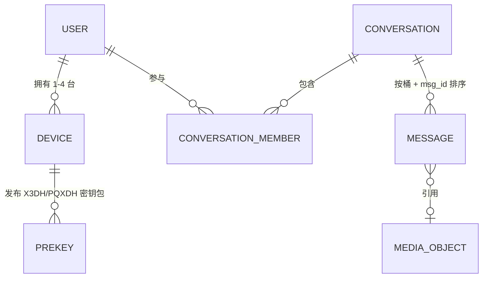
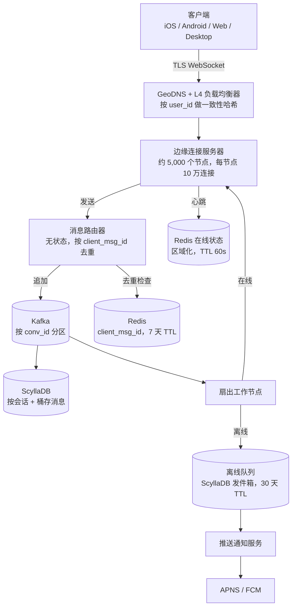
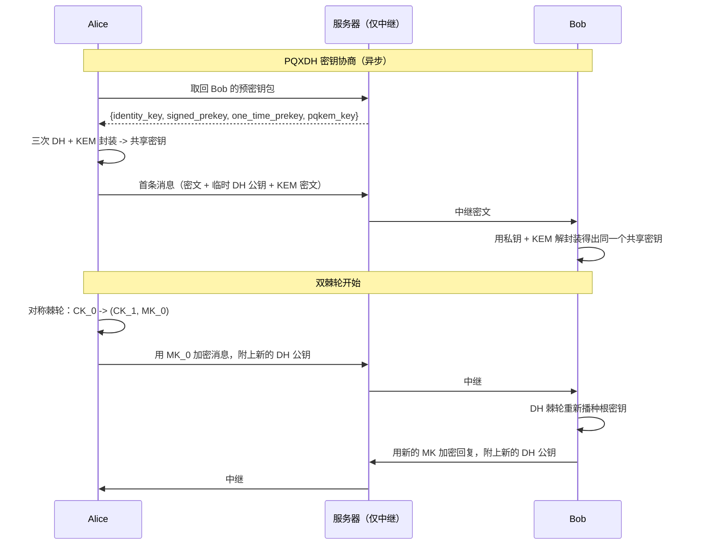
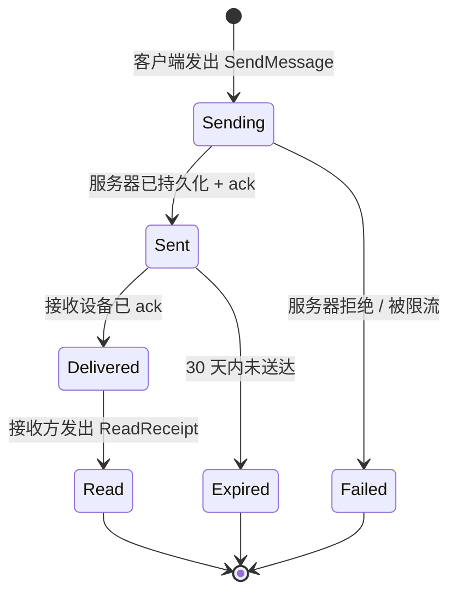
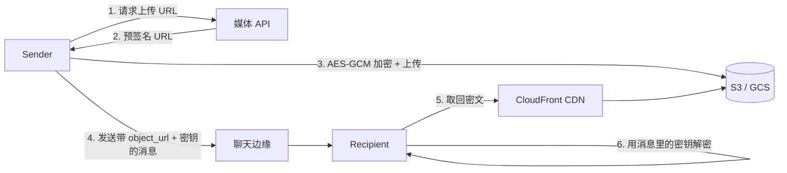

# 设计聊天系统（WhatsApp / Messenger / Signal）

> **TL;DR.** 聊天系统在一个界面背后其实是三个松耦合的问题：扛住数亿条持久连接；按会话对消息定序，并以至少一次（at-least-once）语义投递；加密消息体，让服务器只看得到密文。WhatsApp 服务 30 亿 MAU、每天发出超过 1000 亿条消息[^1][^2]，而被收购时只有约 32 名工程师[^3]。关键的权衡在于：把工作推到服务器端（丰富的多设备同步、搜索、内容治理），还是推到客户端（更强的隐私、更小的服务器占用）。本章讨论 1:1 与小群聊（最多 1,024 人）。频道级扇出（Discord/Slack）见[设计频道级聊天（Discord / Slack）](../../../hld/part-8-case-studies/55-channel-scale-chat.md)。

## 学习目标

- 设计一个连接层，用一致性哈希粘附扛住 5 亿条并发 WebSocket 连接
- 用混合逻辑时钟（HLC）与 Kafka 分区实现按会话的消息定序
- 把 Signal 协议（X3DH/PQXDH + 双棘轮 + 发送者密钥）应用到 1:1 与群组加密
- 说清“投递后即删”“永久历史”“加密中继”三种存储模型各自的取舍理由
- 估算峰值每秒投递量，要把群组扇出算进去，而不是只看平均逻辑发送量
- 在 WhatsApp、Messenger、Signal 三种架构之间权衡隐私、多设备同步与服务器端功能

## 直觉理解

聊天系统看上去就是个简单的 CRUD 应用。收下消息、存起来、投出去。10 个用户毫无压力。到了 5 亿并发连接它就崩了，而原因不在消息处理本身，而在连接层。

每台设备都必须与服务器保持一条打开的 socket，消息才能被推下去，而不必轮询。5 亿用户每 5 秒轮询一次，就会产生每秒 1 亿个请求，其中绝大多数是空转流量[^4]。WebSocket 消掉了这份浪费，但代价是你得同时握住 5 亿条持久 TLS 连接。这是第一个硬问题。

第二个硬问题是定序。同一会话里的两条消息，必须对双方以相同顺序到达。如果要做跨所有会话的全局定序，就需要一个单一序列器，那是个不可接受的瓶颈。只要分区切得对，按会话定序其实很便宜。

第三个硬问题是加密。用户期待服务器读不到自己的消息。Signal 协议用前向保密（forward secrecy）与妥协后安全（post-compromise security）解决了这一点，但代价是服务器不经额外的协议机制就无法搜索、治理或同步历史消息。

天真的单机设计会同时在三个维度上失败。真正可行的架构是一批边缘服务器（负责连接）、一个无状态路由器（负责定序）、以及客户端侧的加密层（负责加密），三者各自独立扩展。

## 需求

### 澄清问题

- **Q：只做 1:1，还是也要群聊？**
  假设：都要。1:1 加最多 1,024 人的小群。频道级（1 万+）属于另一套系统。
- **Q：需要端到端加密吗？**
  假设：需要，用 Signal 协议。服务器只见密文。
- **Q：支持多设备吗？**
  假设：支持，每个账号最多 4 台伴随设备，每台都有独立的身份密钥。
- **Q：消息持久化模型？**
  假设：永久加密的服务器历史（Messenger 的 Labyrinth 模型），用于多设备同步。
- **Q：支持媒体吗？**
  假设：支持。图片、视频、语音、文档。与文本走不同管道。
- **Q：可用性与延迟目标？**
  假设：99.99% 可用性，在线接收方的 P99 投递延迟 < 100 ms。
- **Q：地理分布？**
  假设：全球部署，多区域双活，区域边缘服务器。

### 功能需求

- 在 1:1 与群会话中收发文本消息（群聊最多 1,024 人）
- 对所有消息内容做端到端加密；服务器只存密文
- 把消息投递到接收方全部设备，并给出已发送/已送达/已读状态
- 通过独立管道上传与下载媒体（图片、视频、语音）
- 展示在线状态（在线/离线/最后上线）与输入中提示
- 支持阅后即焚媒体，首次查看后由服务器强制删除

### 非功能需求

- **用户量：** 30 亿注册用户，峰值 5 亿并发连接[^1][^2]
- **负载：** 每天 1000 亿条消息，平均约每秒 120 万次逻辑发送，峰值约 360 万次[^1]
- **延迟：** 在线到在线投递 P50 < 30 ms，P99 < 100 ms
- **可用性：** 读/投递路径 99.99%
- **一致性：** 会话内全序；在线状态最终一致
- **持久性：** 服务器 ack 之后不丢消息；离线队列保留 30 天

## 容量估算

| 指标 | 数值 | 推导 |
|--------|------:|------------|
| 每天消息数 | 1000 亿 | WhatsApp 公布的数字[^1] |
| 平均每秒逻辑发送 | 116 万 | 1000 亿 / 86,400 |
| 峰值每秒发送（3 倍） | 350 万 | 跨年与世界杯期间的尖峰[^5] |
| 峰值每秒投递 | 700 万+ | 350 万 × 平均 2 个接收方（1:1 加小群） |
| 平均消息大小 | 500 B | 文本 + 元数据 + 端到端加密开销 |
| 每日存储（文本） | 50 TB | 1000 亿 × 500 B |
| 5 年存储 | 约 90 PB | 50 TB × 365 × 5 |
| 每日媒体量 | 约 2.5 PB | 按实测比例折算的图片、视频、语音 |
| 并发连接 | 5 亿 | 峰值在线设备 |
| 所需边缘服务器 | 约 5,000 台 | 5 亿 / 每节点 10 万连接（对通用 WebSocket 栈取保守值；Erlang/BEAM 单节点可达 100–200 万[^12]） |

关键比例：

- **读写比** 在 1:1 聊天中大致是 1:1（每次发送对应一次投递），但群组扇出会把实际写入推到逻辑发送量的 2–4 倍。
- **在线状态流量** 约为消息流量的 5 倍（心跳、输入中、上下线事件）。
- **媒体带宽：** 每天 2.5 PB，媒体必须完全绕开聊天服务器。

## API 与数据模型

### API 设计

```http
POST /v1/messages
  Body: { "conversation_id": "...", "client_msg_id": "<uuid>",
          "ciphertext": "<base64>", "device_id": "..." }
  Returns: 201 { "message_id": "<snowflake>", "hlc": "..." }
  Idempotent on client_msg_id (dedup window: 7 days)

GET /v1/conversations/{id}/messages?before=<cursor>&limit=50
  Returns: 200 { "messages": [...], "next_cursor": "..." }

POST /v1/messages/{id}/ack
  Body: { "type": "delivered" | "read" }
  Returns: 204

GET /v1/keys/{user_id}/prekey-bundle
  Returns: 200 { "identity_key": "...", "signed_prekey": "...",
                  "one_time_prekey": "...", "pqkem_key": "..." }

POST /v1/media/upload-url
  Body: { "content_type": "image/jpeg", "size_bytes": 2048000 }
  Returns: 200 { "upload_url": "<pre-signed S3>", "object_id": "..." }
```

### 数据模型

```sql
-- Messages (ScyllaDB, partitioned for time-bounded reads)
CREATE TABLE messages (
    conversation_id bigint,
    bucket          int,          -- 滚动 10 天窗口
    message_id      bigint,       -- Snowflake，聚簇键
    sender_id       bigint,
    ciphertext      blob,
    media_ref       text,         -- 可空，S3 object_id
    created_at      timestamp,
    PRIMARY KEY ((conversation_id, bucket), message_id)
) WITH CLUSTERING ORDER BY (message_id DESC);

-- Conversation members (PostgreSQL, strong consistency)
CREATE TABLE conversation_members (
    conversation_id bigint,
    user_id         bigint,
    joined_at       timestamp,
    role            text,         -- admin | member
    PRIMARY KEY (conversation_id, user_id)
);

-- Prekey bundles (PostgreSQL, per-device)
CREATE TABLE prekeys (
    user_id         bigint,
    device_id       int,
    identity_key    bytea,
    signed_prekey   bytea,
    one_time_prekeys bytea[],     -- 使用时消耗
    pqkem_key       bytea,        -- PQXDH (ML-KEM/Kyber)
    PRIMARY KEY (user_id, device_id)
);
```



*一个用户最多 4 台设备；每台设备发布预密钥包；消息归属于按桶切分的会话分区，并可选地引用存放在 S3 的媒体对象。*

## 高层架构



*客户端通过粘附式 L4 负载均衡连到边缘服务器；消息经无状态路由器进入 Kafka，再由扇出工作节点推给接收方的边缘服务器，或进入离线队列走推送通知。*

**写路径：** 客户端通过 WebSocket 把密文发到它粘附的边缘服务器。边缘转发给无状态路由器。路由器查 Redis 对 `client_msg_id` 去重，分配 HLC 时间戳，追加到以 `conversation_id` 为键的 Kafka 分区，并向发送方返回 ack（单勾）。Kafka 消费者把消息落到 ScyllaDB 并触发扇出。

**读路径：** 扇出工作节点查出会话成员（边缘有缓存），找到每个接收方的边缘服务器，把消息推过去。接收方离线时，消息进入离线队列（ScyllaDB 发件箱，30 天 TTL），并经 APNS/FCM 发出一条推送通知。

**在线状态路径：** 边缘服务器把心跳写进区域 Redis，TTL 60 秒。输入中提示是易失的（TTL 5 秒，从不持久化）。

## 深入探讨

### 深入 1：端到端加密（Signal 协议）

Signal 协议提供三层机制，合起来给出前向保密、妥协后安全与高效的群组消息。

**X3DH（扩展三重 Diffie-Hellman）** 实现异步密钥协商[^6]。每个用户把一份预密钥包（身份密钥、签名预密钥、一次性预密钥）上传到服务器。发送方取回目标的密钥包，通过三次 DH 运算（DH1–DH3）算出共享密钥；若还有一次性预密钥可用，再加第四次 DH（DH4），全程不需要接收方在线。**PQXDH**（2023 年 9 月）把 X3DH 换成混合方案，让经典 DH 与后量子 KEM（ML-KEM/Kyber）结合，用来防“先存后解”（harvest-now-decrypt-later）攻击——今天的密文被存下来，等未来的量子计算机来解[^7][^8]。

**双棘轮（Double Ratchet）** 在初始握手之后运行[^9]。对称密钥棘轮（KDF 链）为每条消息派生出新的消息密钥（前向保密：拿到当前密钥也解不开过去的消息）。DH 棘轮则在每次往返时生成新的临时密钥对，并把它混进根密钥（妥协后安全：即使当前密钥被偷，一次交换之后未来的消息也能恢复安全）。



*PQXDH 以异步方式引导出共享密钥（经典 DH 叠加后量子 KEM）；随后双棘轮单向推进，每次发送都产出一把独有的消息密钥。*

**群组的发送者密钥（Sender Keys）** [^10]。每个发送方为每个群持有一把对称发送者密钥，通过两两之间的双棘轮会话分发给所有成员。一条群消息只需用发送者密钥加密一次，而不是给 N 个接收方各加密一次。这套机制能撑到约 1,024 人，但每次成员变动都要轮换密钥，这也是 WhatsApp 历史上限制群规模的原因之一（先 256，后 512，直到 Communities 才到 1,024）[^11]。

### 深入 2：连接管理器的分片与离线投递

连接层是最贵的组件。5 亿并发连接、单节点 10 万，全球就需要约 5,000 台边缘服务器[^4][^12]。

**一致性哈希粘附。** L4 负载均衡器（Envoy、HAProxy）按 `user_id` 做哈希，重连的用户会落回同一台边缘服务器。这样边缘就能缓存会话成员关系与连接状态，热消息不必每条都往 Redis 跑一趟[^4]。

**至少一次投递。** 在通用的异步场景下精确一次是不可能的[^13]。服务器按 `client_msg_id`（UUID）对入站发送去重，重试时返回同一个 `message_id`。接收方在客户端按 `message_id` 去重。系统跟踪三种用户可见状态：



*每条消息随着 ack 沿同一条 socket 回流，依次经历已发送（单勾）、已送达（灰色双勾）、已读（蓝色双勾）。*

**离线存储。** 接收方离线时，扇出工作节点把消息写进按用户划分的发件箱（ScyllaDB，分区键 = `user_id`，聚簇键 = `message_id`，TTL 30 天）。重连后客户端按会话发送 `SyncRequest{last_seen_message_id}`。服务器以每批 100 条、从新到旧地流式下发。推送通知只发一次（不是每条消息一次），走 APNS/FCM。

**摘流与发布。** WebSocket 的粘附性与滚动发布天然冲突。每次发布都优雅摘流：边缘停止接受新连接，向现有客户端发送 `RECONNECT` 帧，带 30 秒抖动窗口，客户端重连到新节点。连接状态（会话成员关系、最后读取游标）在重连时从 Redis 重建。

### 深入 3：不做流量放大的已读回执与输入中提示

256 人的群，一次已读会产生 256 个“用户 Y 已读消息 X”事件。一个人打字会触发 256 个“正在输入”事件。在线状态流量是消息流量的约 5 倍。

**批处理。** 已读回执按会话批量发送：不再每条消息发一个回执，客户端每 2 秒发一次“我在会话 Y 已读到 message_id X”。服务器把它作为一个事件扇出给其他成员。

**TTL 与背压即丢。** 输入中提示带 5 秒 TTL，从不持久化。扇出管道压力大时，输入中事件是第一批被丢掉的。用户看到的“正在输入…”会稍旧一点，这可以接受。

**区域边缘缓存（Flannel 模式）。** Slack 的 Flannel 服务[^14][^15] 是标准答案：每个区域一个边缘缓存，订阅团队级 pub/sub，持有一份紧凑的在线状态副本。每台边缘服务器维护本地在线状态表，更新通过边缘之间的 gossip 传播，而不是打到中心 Redis 集群。

**Signal 的做法。** Signal 有意把在线状态压到最少：他们根本不向网络暴露“在线”或“最后上线”，输入中提示也用了 sealed sender 式的元数据保护[^7]。

### 深入 4：媒体管道与阅后即焚

媒体每天 2.5 PB，任何让媒体字节流经聊天服务器的系统都会把自己的骨干打满。解法是完全解耦的管道：

1. 客户端向一个轻量 REST 端点申请预签名上传 URL
2. 客户端用 AES-256-GCM 加密媒体（密钥在本地生成）
3. 客户端凭预签名 URL 把密文直传 S3/GCS
4. 客户端发一条聊天消息，在端到端加密的载荷里带上对象 URL 与 AES 密钥
5. 接收方从 CDN（CloudFront/Fastly）取回密文，本地解密



*媒体字节从不经过聊天服务器；CDN 缓存的是密文，解密密钥随端到端加密的聊天消息一起走。*

**阅后即焚媒体。** 服务器在媒体对象上设 `view_once` 标记。第一个接收方取回之后，服务器删除该 S3 对象（或标记为立即过期）。客户端侧的防护会禁用截屏（不是密码学意义上的强制，但抬高了门槛）。WhatsApp 在上传前就在客户端生成缩略图，让服务器在这条管道上零接触[^10]。

**密文的 CDN 缓存。** 因为 CDN 只看得到密文，边缘缓存照常工作。热门媒体（群里的照片）能吃到 CDN 缓存命中，而不用牺牲隐私。密钥是每条消息各自的，所以即使 CDN 被攻破，内容仍然是加密的。

## 真实案例

**WhatsApp：32 名工程师、550 台服务器、190 亿美元。**

WhatsApp 的架构是小团队高密度聊天的范本。2014 年被收购时，大约 32 名工程师用约 550 台服务器服务了 4.5 亿用户[^3][^12]。到 2025 年，WhatsApp 公布 30 亿 MAU、每天超过 1000 亿条消息[^1][^2]。

技术栈是 FreeBSD 上的 Erlang/BEAM。每条连接是一个 Erlang 进程（初始堆约 2 KB），调优后的服务器单机能扛 200 万连接[^4][^12]。Rick Reed 在 2014 年的演讲里提到，整个集群超过 11,000 个核、每秒 7000 万条 Erlang 消息[^12]。选 FreeBSD 而非 Linux，源于早期团队更深的 BSD 内核经验，以及对其 SMP 网络实现的偏好[^16]。

历史上，消息只存到投递为止[^17]。2021 年 WhatsApp 上线多设备：每台伴随设备（最多 4 台）用自己的 Signal 协议会话独立连接，去掉了“手机当代理”的瓶颈[^18]。2022 年 11 月他们推出 Communities，把群上限提到 1,024 人[^11]。

2023 年协议层面接连三件事，展示了同一个问题的三种生产答案：Messenger 在 2023 年 12 月默认开启端到端加密，用 Labyrinth 加密存储协议[^19][^20]；Signal 在 2023 年 9 月部署 PQXDH[^7][^8]；Discord 从 177 节点的 Cassandra 迁到 72 节点的 ScyllaDB，把 P99 读延迟从 40–125 ms 降到约 15 ms[^21]。

2021 年 10 月 4 日那次故障（持续 6 小时，波及全球的 WhatsApp、Facebook 与 Instagram）源于一条 BGP 配置错误撤回了 Meta 的权威 DNS，不是聊天系统本身的故障[^22]。

## 权衡

| 决策 | 方案 A | 方案 B | 我们的选择 | 原因 |
|---|---|---|---|---|
| 传输 | WebSocket / HTTP/3 | HTTP 长轮询 | WebSocket | 5 亿用户按 5 秒间隔轮询会产生每秒约 1 亿个几乎全空的请求[^4] |
| 负载均衡 | 按 user_id 的 L4 一致性哈希 | 每连接随机 | 一致性哈希 | 边缘能缓存热元数据，每条消息省掉一次 Redis 访问 |
| 存储模型 | 永久加密历史 | 投递后即删 | 永久历史 | 多设备同步需要它；内容治理也受益 |
| 存储引擎 | ScyllaDB | Cassandra | ScyllaDB | 没有 GC 停顿；Discord 借此从 177 台减到 72 台[^21] |
| 消息定序 | 每会话 HLC | 全局序列器 | HLC | 没有单点瓶颈；时间戳可读[^23] |
| 投递语义 | 至少一次 + 客户端去重 | 精确一次 | 至少一次 | 精确一次不可能；客户端去重很简单[^13] |
| 端到端协议 | Signal 协议（libsignal） | 自研加密 | Signal 协议 | 经过审计，有前向保密与妥协后安全[^9] |
| 群组加密 | 发送者密钥 | 逐接收方两两会话 | 发送者密钥 | 能撑到约 1,024 人；每条消息只加密一次[^10] |
| 在线状态 | 区域边缘缓存 + gossip | 全局 Redis | 区域化 | 全局 Redis 在每秒数百万事件时会成为瓶颈[^14] |
| 媒体 | 预签名 URL + CDN | 经聊天服务器 | 预签名 URL | 聊天服务器永不接触每天 2.5 PB 的媒体字节 |

最大的那个元决策是存储模型。WhatsApp 选了投递后即删（隐私最大、成本最低）。Messenger 选了永久服务器历史（便利最大，代价是十年后才补端到端加密）。Signal 选了最小中继（元数据保护最大）。三种都站得住；这是产品决策，不是纯工程决策。

## 扩展与故障模式

**10 倍负载（每天 1 万亿条消息）：** Kafka 集群成为瓶颈。缓解：加分区（每个热会话一个分区也没问题，Kafka 能扛数百万分区）、加 broker，并按会话哈希区间拆分扇出工作节点。

**100 倍负载（每天 10 万亿条）：** 边缘连接服务器打满。缓解：换到 HTTP/3（QUIC）以获得更好的连接多路复用，在 50+ 个 PoP 部署边缘节点，并做连接合并——同一网络下的多个用户共用一条上行连接。

**1000 倍负载：** 架构转向 CDN 优先模型，边缘节点成为主要的消息中继，中心 Kafka 集群从实时路径退化为异步持久层。

**故障模式：区域级宕机。** 整个区域挂掉时，GeoDNS 把客户端改路由到最近的健康区域。客户端在 30 秒内（带抖动）重连。失败区域 Kafka 里排队的消息，等区域恢复后从跨区域复制（MirrorMaker 2）回放。RPO：已复制的分区 < 1 秒。

**故障模式：边缘服务器崩溃。** 客户端通过漏掉心跳（10–30 秒）察觉，经负载均衡器重连到新的边缘。重连窗口期内发出的消息由离线队列接住。服务器 ack 之后不丢消息。

**故障模式：Kafka 分区主节点故障。** ISR（同步副本集合）在数秒内选出新主。生产者以幂等写入重试。消费者从已提交位点继续。投递延迟短暂尖起，但不丢数据。

## 常见陷阱

> [!WARNING]
> **按平均速率设计，忘了峰值和扇出。** 那个“每秒 120 万条”的平均值掩盖了一个更接近每秒 350 万次逻辑发送、群组扇出后每秒 700 万+ 次投递的峰值。要按峰值投递量定容量，不是平均发送量。WhatsApp 报告跨年夜常年出现 2 倍尖峰[^5]。

> [!WARNING]
> **用全局 Redis 存在线状态。** 在线状态更新的量是消息流量的约 5 倍。单个 Redis 集群在每秒数百万事件时就是瓶颈。用区域分片加边缘本地状态表与 gossip，像 Slack 的 Flannel 那样[^14]。

> [!WARNING]
> **让媒体字节走聊天管道。** 每天 2.5 PB 的媒体，任何让它流经聊天服务器的系统都会把自己的骨干打满。上传用 S3 预签名 URL，下载用 CDN。聊天消息只携带对象 URL 和端到端加密的密钥[^10]。

> [!CAUTION]
> **自己实现端到端加密。** 每一个自研协议都出过严重 bug（nonce 重用、密钥泄露导致的冒充、元数据泄漏）。用 Signal 协议（实现在开源的 libsignal 库中；已被 WhatsApp、Google Messages RCS 与 Signal 采用）。即使是经过审计的协议，学术分析也还在不断发现细微问题[^24]。

> [!WARNING]
> **Cassandra 表结构不做分桶。** 一个活跃的长寿群会话会变成 100+ GB 的分区。按 `(conversation_id, time_bucket)` 分区。Discord 2023 年的迁移文章把这点称为 Cassandra 最大的痛点[^21][^25]。

> [!WARNING]
> **试图做精确一次投递。** 这么干的团队最后都在网络分区下拿到细微的重复或丢消息 bug。服务器端至少一次，客户端按 `message_id` 去重。两将军问题让通用的精确一次不可能[^13]。

## 追问

**1. 新增设备时怎么做多设备同步？**

每台新设备生成自己的身份密钥对并注册到服务器。已有设备收到通知，与新设备建立两两之间的双棘轮会话。至于历史消息，Labyrinth 协议用一棵以用户 PIN 为根的密钥树加密服务器端存储的历史；新设备只要知道 PIN，就能重建这棵密钥树[^19]。没有 PIN，就只看得到设备注册之后发出的消息。

**2. 在欧盟 DMA 要求下，怎么做 RCS/iMessage 互通？**

暴露一个网关 API，在 Signal 协议密文与互通方的加密格式之间转换。网关不持有明文；它在协议边界上重新加密。关键挑战：互通方可能不支持前向保密，从而降低跨平台消息的安全保证。会话处于“互通模式”时，在界面上给出明确提示。

**3. 把 PQXDH 推给 30 亿用户要改什么？**

Signal 的混合方案[^7][^8] 在预密钥包里，于经典 DH 密钥之外再加一把后量子 KEM 密钥。支持 PQXDH 的客户端两者都用；老客户端回落到经典 X3DH。服务器同时存两类密钥。铺开是渐进的：新的预密钥包带上 KEM 密钥，旧包被用完后替换掉。不需要统一切换日。

**4. 端到端加密下，定时消失的消息怎么实现？**

发送方在消息元数据里（密文内部）设定 TTL。接收方客户端在 TTL 到期后执行删除。服务器没法强制，因为它读不到元数据。这是一个协作式协议：恶意客户端可以无视 TTL。服务器可以兜底，在最大 TTL（例如 90 天）之后强制删除密文块。

**5. 如何在这套架构上加语音/视频通话？**

通话走独立的实时媒体路径（WebRTC + SRTP）。聊天系统的信令通道（现有的 WebSocket）承载呼叫建立消息（offer/answer/ICE candidate）。媒体尽可能点对点直连，否则经 TURN 中继。Signal 协议会话协商出 SRTP 主密钥，所以通话音频与消息共用同一套信任模型，也是端到端加密的。

**6. 什么是 sealed sender，Signal 为什么用它？**

sealed sender[^26] 向服务器隐藏发送方身份。发送方用接收方的身份密钥加密整个消息信封（含自己的身份）。服务器按接收方地址路由，但看不到是谁发的。这就阻止了服务器从消息元数据里构建社交图谱。权衡：滥用检测变难了，因为服务器在没有接收方配合的情况下无法把垃圾信息归因到某个发送方。

**7. 群视频通话怎么扩到 32 人？**

超过 3–4 人之后，点对点网状结构就不现实了（N^2 条流）。用选择性转发单元（SFU）：每个参与者的流只上行一份，由它转发给其他所有人。SFU 看到的是加密媒体（SRTP），它根据音频活动（主导说话人）决定转发哪些流，而无需解密。WhatsApp Communities 的视频通话最多支持 32 人[^11]。

## 练习

### 练习 1：离线队列的容量设计

你要为 5 亿 DAU 设计离线消息队列。用户的设备可能离线长达 30 天。设计这个队列：用什么存储支撑它，怎么给它设上限，以及一个用户离线 2 周后带着 5 万条排队消息重连时会发生什么？

<details>
<summary>提示</summary>

想想“用户从没见过的消息”和“用户可以从历史里拉取的消息”之间的区别。队列不需要装下所有东西，它只需装够重连引导所需的部分。考虑用不同 TTL 的两层方案。

</details>

<details>
<summary>答案</summary>

用两层方案：

1. **热队列（每用户一个 Redis list，上限 1,000 条）。** 面向几分钟内就会重连的用户。到达时 `LPUSH`，投递时 `RPOP`。列表超过 1,000 条就裁掉最旧的，并把该用户标记为“需要全量同步”。

2. **冷存储（ScyllaDB 发件箱表，分区键 = user_id，聚簇键 = message_id，TTL 30 天）。** 面向离线超过 5 分钟的用户。重连后客户端按会话发送 `SyncRequest{last_seen_message_id}`。

3. **5 万条排队消息的重连流程：** 客户端连上，按会话发送最后读取游标。服务器按会话从新到旧、每批 100 条流式下发。客户端渐进渲染。推送通知只发一次，不是 5 万次。每连接的发送缓冲上限 1 MB；客户端跟不上时，服务器暂停，由客户端按需拉取。

4. **30 天之后：** 消息从发件箱过期。客户端在用户主动上翻时，从永久历史（ScyllaDB 的 messages 表）拉取。

接受的权衡：离线 30 天以上的用户，旧消息不再享受推送式投递，但仍可浏览历史。

</details>

## 要点回顾

- **连接层的成本占大头。** 握住 5 亿条持久连接需要约 5,000 台边缘服务器；这是最贵的组件，而不是消息处理。
- **按会话定序就够了。** Kafka 按 `conversation_id` 分区 + HLC，能在会话内给出全序，而不用引入全局序列器这个瓶颈。
- **至少一次是唯一正确的契约。** 通用的精确一次投递不可能；客户端按 `message_id` 去重既简单又正确。
- **存储模型是产品决策。** WhatsApp（易失）、Signal（最小中继）、Messenger（永久加密）各自的理由都不同。
- **用 libsignal，不要自研加密。** Signal 协议（X3DH/PQXDH + 双棘轮 + 发送者密钥）是黄金标准；自己撸必有 bug。
- **在线状态是消防水管。** 5 倍于消息量，需要独立的区域化系统、激进的 TTL，以及愿意在背压时丢弃。
- **媒体必须绕开聊天服务器。** 每天 2.5 PB，预签名 URL + CDN 是唯一负担得起的设计。

## 延伸阅读

- [The WhatsApp Architecture Facebook Bought For $19 Billion](https://highscalability.com/the-whatsapp-architecture-facebook-bought-for-19-billion/)。包含 Rick Reed 2012/2014 年演讲里那个经典的“单台 Erlang/FreeBSD 服务器 200 万连接”细节；聊天系统设计中被引用最多的一个数字。
- [How Discord Stores Trillions of Messages](https://discord.com/blog/how-discord-stores-trillions-of-messages)。从 177 节点 Cassandra 迁到 72 节点 ScyllaDB，P99 改善，以及每秒 320 万条消息的 Rust 迁移器。
- [The Double Ratchet Algorithm](https://signal.org/docs/specifications/doubleratchet/)。Signal 的官方规范；好读、精确，是现代每套端到端聊天协议的基础。
- [Quantum Resistance and the Signal Protocol (PQXDH)](https://signal.org/blog/pqxdh/)。Signal 2023 年 9 月的后量子升级，把经典 DH 与 ML-KEM/Kyber 结合；第一个上线后量子防护的主流通讯应用。
- [How WhatsApp enables multi-device capability](https://engineering.fb.com/2021/07/14/security/whatsapp-multi-device/)。2021 年那次从“手机当代理”到“设备对等”的重写；解释了每设备身份密钥模型。
- [Building end-to-end security for Messenger](https://engineering.fb.com/2023/12/06/security/building-end-to-end-security-for-messenger/)。Meta 2023 年默认端到端加密的上线，其中包含用于多设备历史同步的 Labyrinth 加密存储协议。
- [Flannel: An Application-Level Edge Cache to Make Slack Scale](https://slack.engineering/flannel-an-application-level-edge-cache/)。吸收在线状态与团队状态流量的那层边缘缓存；解决“在线状态消防水管”问题的标准范式。
- [How Discord Stores Billions of Messages](https://discord.com/blog/how-discord-stores-billions-of-messages)。2017 年的前作，给出最初的 Cassandra 表结构与分桶策略，Discord 一路沿用到了 ScyllaDB。

## 记忆卡片

<details>
<summary><strong>Q: 聊天系统为什么用 WebSocket 而不是 HTTP 轮询？</strong></summary>

A: 5 亿用户按 5 秒间隔轮询会产生每秒 1 亿个几乎全空的请求。WebSocket 为每台设备保持一条持久 TLS 连接，只在需要时发字节，消掉了浪费的往返。

</details>

<details>
<summary><strong>Q: WhatsApp 单机达到了多少连接密度，靠什么实现的？</strong></summary>

A: 单台 Erlang/FreeBSD 服务器 200 万条 TCP 连接（2012 年）。靠的是 BEAM 的轻量进程模型（每进程约 2 KB）、定制的虚拟机补丁，以及针对文件描述符和 TCP 内存的 FreeBSD 内核调优。

</details>

<details>
<summary><strong>Q: 为什么精确一次投递对聊天来说不是个现实目标？</strong></summary>

A: 两将军问题让通用的异步场景下精确一次不可能。生产系统用至少一次投递，加上客户端按服务器分配的 message_id 去重。

</details>

<details>
<summary><strong>Q: Signal 的双棘轮比静态共享密钥多提供了什么？</strong></summary>

A: 前向保密——靠每消息一把的对称棘轮，当前密钥被偷也不影响过去消息的加密；以及妥协后安全——靠 DH 棘轮在每次往返时重新播种根密钥，一次交换之后未来的消息就能恢复安全。

</details>

<details>
<summary><strong>Q: PQXDH 是什么，Signal 为什么在 2023 年部署它？</strong></summary>

A: PQXDH 是一种混合密钥协商，把经典 Diffie-Hellman 与后量子 KEM（ML-KEM/Kyber）结合起来。它防的是“先存后解”攻击：对手今天录下密文，等未来用量子计算机解开。

</details>

<details>
<summary><strong>Q: WhatsApp 和 Signal 为什么把群规模卡在 256 到 1,024 人？</strong></summary>

A: 发送者密钥在每次成员变动时都要重新分发给所有成员。256 人还能接受；超过约 1,024 人，密钥分发开销与逐设备扇出对于实时交互式聊天就不现实了。

</details>

<details>
<summary><strong>Q: 媒体管道怎么避免打满聊天服务器？</strong></summary>

A: 客户端本地加密媒体，凭预签名 URL 把密文直传 S3，只在端到端加密的聊天消息里带对象 URL 与 AES 密钥。接收方从 CDN 取。聊天服务器从不接触媒体字节。

</details>

<details>
<summary><strong>Q: 什么是“在线状态消防水管”问题，怎么解决？</strong></summary>

A: 在线状态事件（上下线/输入中/最后上线）比消息流量多约 5 倍。一个人在 256 人群里打字会触发 256 个事件。解法：区域边缘缓存（Slack 的 Flannel 模式）、激进的 TTL、批处理，以及愿意在背压时丢弃。

</details>

<details>
<summary><strong>Q: Discord 为什么按 (channel_id, bucket) 分区消息，而不是只按 channel_id？</strong></summary>

A: 不分桶的话，一个长寿的活跃频道会变成 100+ GB 的分区，把读性能毁掉并导致无休止的压实。滚动的时间桶（约 10 天）能限制分区大小，让读保持快。

</details>

<details>
<summary><strong>Q: Signal 的 sealed sender 是什么？</strong></summary>

A: 发送方用接收方的身份密钥加密消息信封（含自己的身份）。服务器按接收方地址路由，但看不到是谁发的，从而阻止服务器从元数据构建社交图谱。

</details>

## 参考文献

[^1]: Backlinko, "How Many People Use WhatsApp?", 2024. https://www.backlinko.com/whatsapp-users
[^2]: Statista, "WhatsApp: number of monthly active users 2025". https://www.statista.com/statistics/260819/number-of-monthly-active-whatsapp-users/
[^3]: Rick Reed, "Scaling to Millions of Simultaneous Connections", Erlang Factory SF Bay 2012. https://www.erlang-factory.com/conference/SFBay2012/speakers/RickReed
[^4]: HighScalability, "The WhatsApp Architecture Facebook Bought For $19 Billion", 2014. https://highscalability.com/the-whatsapp-architecture-facebook-bought-for-19-billion/
[^5]: Demandsage, "Latest WhatsApp Statistics 2026". https://www.demandsage.com/whatsapp-statistics/
[^6]: Signal Specifications, "The X3DH Key Agreement Protocol". https://signal.org/docs/specifications/x3dh/
[^7]: Signal Blog, "Quantum Resistance and the Signal Protocol", Sept 19, 2023. https://signal.org/blog/pqxdh/
[^8]: Signal Specifications, "The PQXDH Key Agreement Protocol". https://signal.org/docs/specifications/pqxdh/
[^9]: Signal Specifications, "The Double Ratchet Algorithm". https://signal.org/docs/specifications/doubleratchet/
[^10]: WhatsApp, "WhatsApp Encryption Overview" (Signal Protocol applied to groups and multi-device). https://faq.whatsapp.com/820124435853543
[^11]: TechCrunch, "WhatsApp officially launches its new discussion group feature, Communities", Nov 3, 2022. https://techcrunch.com/2022/11/03/whatsapp-officially-launches-its-new-discussion-group-feature-communities/
[^12]: HighScalability, "How WhatsApp Grew to Nearly 500 Million Users, 11,000 cores, and 70 Million Messages a Second", 2014. https://highscalability.com/how-whatsapp-grew-to-nearly-500-million-users-11000-cores-an/
[^13]: Kleppmann, "Designing Data-Intensive Applications", Ch. 11 (Stream Processing), at-least-once and idempotence. https://dataintensive.net
[^14]: Slack Engineering, "Flannel: An Application-Level Edge Cache to Make Slack Scale", 2017. https://slack.engineering/flannel-an-application-level-edge-cache/
[^15]: Slack Engineering, "Real-time messaging", 2023. https://slack.engineering/real-time-messaging/
[^16]: Rick Reed, "WhatsApp: Half a billion unsuspecting FreeBSD users", MeetBSD California 2014. https://archive.org/details/bsdtalk250
[^17]: WhatsApp FAQ, "About end-to-end encryption", historical store-until-delivered model. https://faq.whatsapp.com/820124435853543
[^18]: Meta Engineering, "How WhatsApp enables multi-device capability", July 14, 2021. https://engineering.fb.com/2021/07/14/security/whatsapp-multi-device/
[^19]: Meta Engineering, "Building end-to-end security for Messenger", Dec 6, 2023. https://engineering.fb.com/2023/12/06/security/building-end-to-end-security-for-messenger/
[^20]: Meta Newsroom, "Launching Default End-to-End Encryption on Messenger", Dec 6, 2023. https://about.fb.com/news/2023/12/default-end-to-end-encryption-on-messenger/
[^21]: Discord Engineering, "How Discord Stores Trillions of Messages", 2023. https://discord.com/blog/how-discord-stores-trillions-of-messages
[^22]: Cloudflare Blog, "Understanding How Facebook Disappeared from the Internet", Oct 4, 2021. https://blog.cloudflare.com/october-2021-facebook-outage/
[^23]: Kulkarni et al., "Logical Physical Clocks and Consistent Snapshots in Globally Distributed Databases", 2014. https://cse.buffalo.edu/tech-reports/2014-04.pdf
[^24]: Fiedler and Gunther, "Security Analysis of Signal's PQXDH Handshake", IACR ePrint 2024/702 (PKC 2025). https://eprint.iacr.org/2024/702
[^25]: Discord Engineering, "How Discord Stores Billions of Messages", 2017. https://discord.com/blog/how-discord-stores-billions-of-messages
[^26]: Signal Blog, "Technology preview: Sealed sender for Signal", 2018. https://signal.org/blog/sealed-sender/
