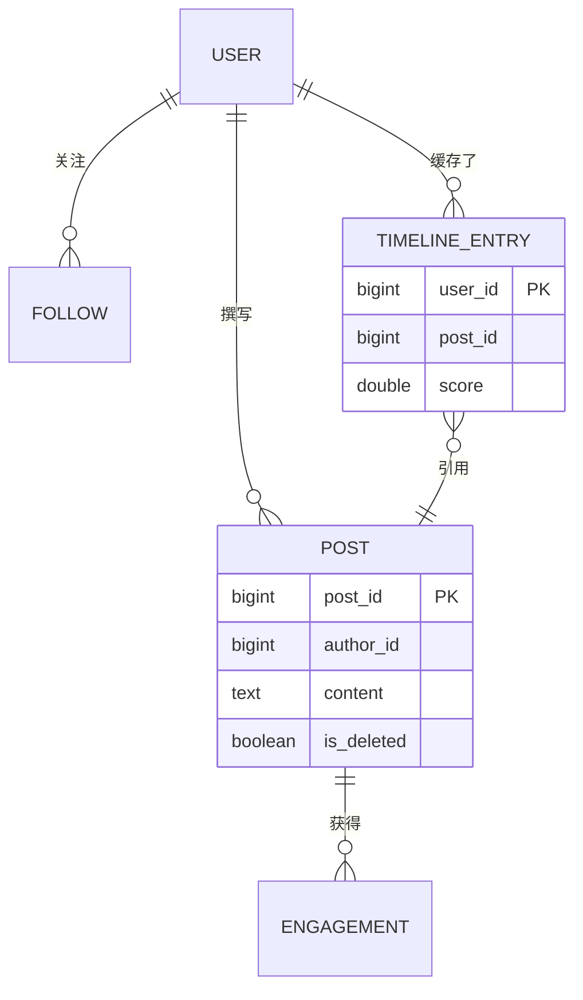
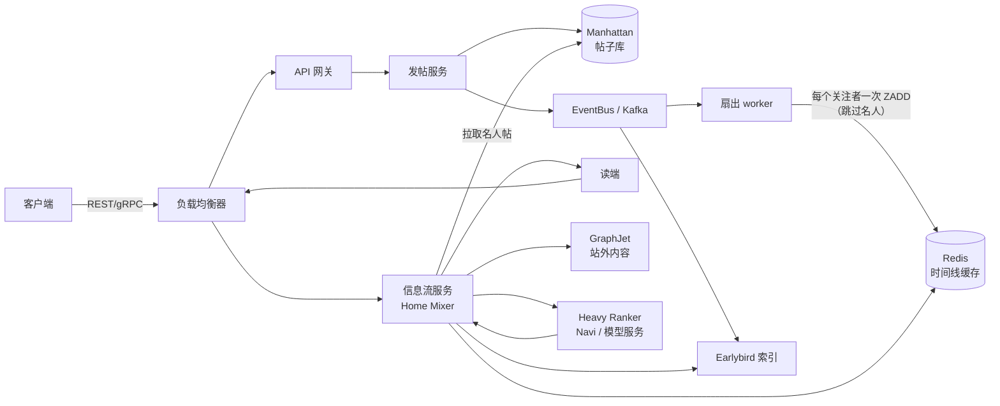
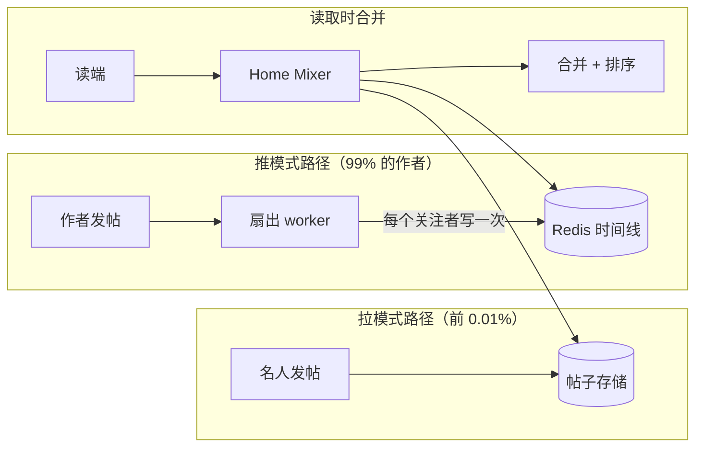
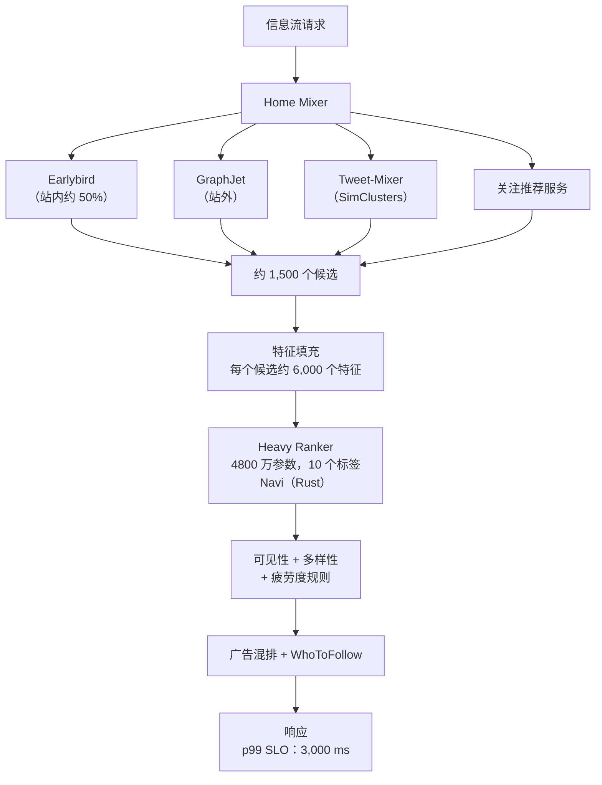
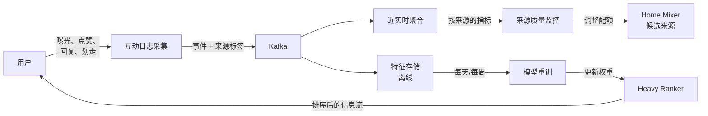

# 设计社交媒体信息流（Twitter / Instagram / LinkedIn）

> **TL;DR.** 首页信息流是"读多写少"的教科书级案例：Twitter 在 2013 年公布的数字是 30 万 QPS 的时间线读取，对应仅 6 千 QPS 的推文写入，读写比达到 50:1 [^1]。纯写时扇出（fan-out-on-write）在一个账号拥有 1 亿以上关注者时会崩塌；纯读时扇出（fan-out-on-read）在每秒数百万次信息流读取时同样崩塌。业界的答案是混合：普通作者用推、名人用拉，读取时合并，再用多任务神经网络排序器打分。Twitter 用这套混合架构跑了十年，直到 2023 年下线 Fanout Service，改由 Home Mixer 内部基于 Earlybird 做候选召回 [^2]。关键的权衡是写放大与读延迟之争，而调停者是幂律的关注者分布。

## 学习目标

- 设计一套混合扇出系统，支撑 5 亿以上 DAU 且信息流加载在亚秒级完成
- 判断在给定的关注者分布下，何时该用推、何时该用拉、何时该用混合扇出
- 为长尾社交关系图估算写放大，并推导出名人阈值
- 论证两阶段排序流水线（候选生成 + 重排序器）优于暴力打分
- 在多地域部署中权衡最终一致性与信息流新鲜度
- 比较图关系优先的信息流（Twitter）、推荐优先的信息流（TikTok）与算法市场化的信息流（Bluesky）

## 直觉理解

想象你经营一份拥有 5 亿订户的报纸。每天早上，5 万名记者交稿。对大多数记者，你会把稿子印出来，然后给他们的 300 名订户各送一份实体报纸。这就是写时扇出：投递时很贵，但每个订户醒来时邮箱里已经塞满了。

现在想象某一位记者有 1 亿订户。印一篇文章再投递 1 亿份，要好几个小时。与此同时，另外 49,999 名记者的稿子都在印刷队列里排在它后面。普通记者的订户迟迟收不到报纸，就因为一个名人把印刷机堵死了。

解法是：名人的稿子干脆不投递。把它贴到市中心广场的公告栏上。订户打开邮箱时，看到的是早已投递到位的普通文章，外加一张便条："今日名人文章请到公告栏查看。"公告栏很小（每位名人只有一份），所有人都来读，而且每个街角都缓存了一份。

这就是混合扇出模型。99% 的作者关注者数量可控，走推；剩下 1% 的关注者数量会把投递系统烧穿，走拉。读取时合并。然后按相关性对合并后的这一堆排序——用机器学习排序器，因为按时间排序大约从 2011 年 Facebook 用 ML 取代 EdgeRank 起就不再是正确答案了 [^3]。

朴素方案（一个数据库、一台服务器）服务 10 个用户毫无问题。到了 5 亿 DAU、关注者呈幂律分布时，三股力量撞在一起：名人带来的写放大、拉取带来的读放大、每次请求给数千个候选打分带来的排序延迟。本章的每一个架构决策，都是在化解这三重压力之一。

## 需求

### 澄清问题

- **问：关注者分布是什么形状？**
  假设：幂律。中位用户约 300 个关注者；前 0.01% 的账号有 5000 万到 2.37 亿以上（截至 2026 年，Elon Musk 以约 2.37 亿保持纪录）[^24][^25]。
- **问：信息流按时间还是按排序？**
  假设：主标签页（For You）由 ML 排序，次标签页（Following）按时间倒序。
- **问：多地域？**
  假设：是，3 个以上地域双活。信息流读取可以接受最终一致性。
- **问：实时还是准实时？**
  假设：可推的作者发帖后 5 秒内出现在关注者信息流中；名人帖在下次刷新信息流时拉取，30 秒内可见。
- **问：内容类型？**
  假设：文本、图片、视频链接、转发/转推。媒体二进制走 CDN，不内联在信息流载荷里。
- **问：个性化范围？**
  假设：既有站内（你关注的账号），也有站外（来自你未关注账号的推荐内容）。

### 功能需求

- 发帖：文本 + 媒体引用、分布式 ID 生成、持久化落盘
- 首页信息流：每页约 50 条帖子的排序列表，游标分页，站内与站外内容混合
- 关注流：仅来自已关注账号的帖子，按时间倒序
- 互动行为：点赞、回复、转发、收藏（作为排序信号使用）
- 实时投递：已关注账号的新帖无需手动刷新即可出现

### 非功能需求

- **负载：** 5 亿 DAU，写入 10 万帖/秒，读取峰值 500 万次/秒
- **延迟：** 信息流加载 p50 < 200 ms、p99 < 500 ms（Following 标签页）；排序信息流 p99 < 3,000 ms [^4]
- **可用性：** 读路径 99.99%，写路径 99.9%
- **一致性：** 信息流读取最终一致；用户自己的帖子通过会话保持实现读己之写
- **持久性：** 帖子不丢；存储持久性 11 个 9

## 容量估算

| 指标 | 数值 | 推导 |
|--------|------:|------------|
| 写 QPS（发帖） | 10 万 | 5 亿 DAU *日均 2 帖 / 86,400* 10 倍峰值 |
| 扇出写/秒（推模式） | 3000 万 | 10 万帖 × 平均 300 个关注者（非名人） |
| 信息流读 QPS | 500 万 | 5 亿 DAU *每天打开 50 次 / 86,400* 17 倍峰值 |
| 读写比 | 50:1 | 500 万次读 / 10 万次写 [^1] |
| 每用户时间线缓存 | 24 KB | 800 条 × 30 字节（推文 ID + 元数据） |
| 时间线缓存总量 | 6 TB | 2 亿活跃用户 × 30 KB（含额外开销） |
| 每年帖子存储 | 15 TB | 10 万/秒 *86,400* 365 × 平均 500 字节 |
| 每天排序计算量 | 约 50 亿次 | 每次信息流加载调用一次 Heavy Ranker [^2] |

关键比例：50:1 的读写不对称意味着优化读路径才是主线。6 TB 的时间线缓存可以装进约 200 个节点的 Redis 集群（每节点 32 GB，含副本）。名人扇出（关注者 5000 万以上的账号）仅 10 条帖就会带来每秒 5 亿次以上的写入，这正是混合方案绕过它们的原因。

## API 与数据模型

### API 设计

```http
POST /v1/posts
  Idempotency-Key: <uuid>
  Body: { "text": "...", "media_ids": [...] }
  Returns: 201 { "id": "1780234567890001", "created_at": "..." }

GET /v1/feed/for-you?cursor=<snowflake_id>&limit=50
  Returns: 200 { "posts": [...], "next_cursor": "1780234567889500" }

GET /v1/feed/following?cursor=<snowflake_id>&limit=50
  Returns: 200 { "posts": [...], "next_cursor": "..." }

POST /v1/posts/{id}/like
  Returns: 200 { "liked": true, "like_count": 4521 }

GET /v1/users/{id}/posts?cursor=...&limit=20
  Returns: 200 { "posts": [...], "next_cursor": "..." }
```

游标分页基于 Snowflake ID [^5][^6][^29]：41 位毫秒时间戳（纪元 2010-11-04）、10 位机器 ID、12 位序列号。可按时间排序、64 位（UUID 的一半大小）、单机每秒 400 万个 ID 且无需协调。游标对客户端不透明，但内部就是最后一条的 Snowflake ID。

### 数据模型

```sql
-- 帖子表（Manhattan 宽列存储，按 post_id 分区）
table posts (
  post_id       bigint primary key,   -- Snowflake ID
  author_id     bigint,
  text          text,
  media_ids     list<uuid>,
  created_at    timestamp,            -- 由 Snowflake 推导
  is_deleted    boolean default false  -- 软删除
)

-- 时间线缓存（每个活跃用户一个 Redis 有序集合）
-- Key：timeline:{user_id}
-- 成员：post_id（score = Snowflake 时间戳位）
-- 容量：800 条，溢出时淘汰最旧的

-- 社交关系图（按 follower_id 分片，便于扇出读取）
table follows (
  follower_id   bigint,
  followee_id   bigint,
  created_at    timestamp,
  primary key (follower_id, followee_id)
)
-- 反向索引：followee_id -> [follower_ids]，用于扇出写入
```



*核心实体：用户撰写帖子，社交关系图驱动扇出，时间线条目就是让读取变成 O(1) 的预计算缓存。*

## 高层架构



*写路径：帖子持久化到 Manhattan 并投递到 Kafka；扇出 worker 写入 Redis 时间线（跳过名人）。读路径：Home Mixer 从时间线缓存、Earlybird 索引和 GraphJet 取内容，再由 Heavy Ranker 打分。*

写路径从作者视角看是发后不管：发帖服务写入 Manhattan、投递 Kafka，然后返回。扇出 worker 消费事件，查出作者关注者列表，检查名人阈值，把 `ZADD` 命令流水线化写入每个关注者的 Redis 有序集合。只有活跃用户（30 天内登录过）会收到扇出写入 [^1]。

For You 标签页的读路径由 Home Mixer 编排：从 Redis 取预计算的时间线，从 Manhattan 拉名人帖，从 GraphJet 和 Earlybird 取站外候选，填充特征（每个候选约 6,000 个），交给 Heavy Ranker 打分，再做可见性过滤和多样性规则，混入广告，返回约 50 条帖子。整条流水线 p99 为 3,000 ms [^4]。

Following 标签页更简单：取 Redis 时间线，填充帖子正文，过滤已删除的帖子，按时间倒序返回。p99 约 100 ms [^1]。

## 深入探讨

### 深入探讨 1：扇出策略（推 vs 拉 vs 混合）

扇出决策是信息流系统里最重要的一个架构选择。它决定了写放大、读延迟、存储成本和运维复杂度。

**推（写时扇出）：** 每发一条帖，就给每个关注者写一条时间线条目。Twitter 把每个活跃用户的 Redis 有序集合时间线限制在 800 条 [^1]。读路径是 O(1)：一次缓存读取，p50 为 5 ms。失败模式：一个 1 亿关注者的账号发一条帖就产生 1 亿次写。如果每天有 5 条来自 100 个这样的账号，那就是每天 500 亿次写，来自 0.0002% 的作者。

**拉（读时扇出）：** 每次读信息流时，查询所有已关注账号的近期帖子。写成本为零。失败模式：一个关注了 10,000 个账号的用户，每次加载信息流要发 10,000 次查询。按每秒 500 万次信息流读取算，下游要承受 500 亿 QPS。不可行。

**混合（Twitter 跑了十年的方案）：** 关注者数量低于阈值的作者走推（据估计在数百万量级），高于阈值的走拉。读取时合并。Krikorian 2013 年的说法是："对 Taylor Swift 这类账号就别再扇出了，读取时把她的时间线合并进来" [^1][^7]。名人帖的缓存局部性极强（所有人读的都是同样那几条），所以拉取一侧很便宜。



*推模式为普通作者物化时间线；名人完全跳过扇出，在读取时拉取，从而利用缓存局部性。*

阈值是个产品决策。定得太低：读取时的拉取查询太多。定得太高：半热门账号引发扇出风暴。Twitter 从未公布确切数字，但从架构可推断，它落在这样一点上——再多一次扇出写的边际成本，超过了把这次拉取摊销到该作者所有关注者的信息流加载后的成本。

### 深入探讨 2：ML 排序流水线

现代信息流不是按时间排序的。Twitter 的 For You 流水线（2023 年 3 月开源）每次请求从四个来源取约 1,500 个候选 [^2]：

1. **Earlybird 站内（约占最终时间线的 50%）：** 基于 Lucene 的实时搜索索引，覆盖已关注账号的近期帖子
2. **UTEG / GraphJet（站外）：** 基于图的协同过滤（"和你相似的用户互动过这个"）
3. **Tweet-Mixer（站外）：** 通过 SimClusters 做基于内容的召回（14.5 万个社群，每 3 周刷新一次）[^2]
4. **关注推荐服务：** 推荐账号的头部帖子

Heavy Ranker 是一个约 4800 万参数的神经网络，为每个候选输出 10 个互动概率（点赞、回复、转推、主页点击、视频观看等）[^2][^8]。它每天运行约 50 亿次，每次执行消耗约 220 CPU 秒 [^2]。双塔（dual-encoder）模式负责候选召回：一个塔编码用户，另一个塔编码物品，近似最近邻检索（FAISS/ScaNN）在 1 亿条物品的目录里 10 ms 内取回 top-K [^9][^10]。



*Home Mixer 从四个来源取约 1,500 个候选，为每个候选填充 6,000 个特征，交给 4800 万参数的 Heavy Ranker 打分，并在 3 秒 p99 SLO 内返回。*

开源代码 `ForYouProductPipelineConfig.scala` 里的生产 SLO 是：p99 在 2,800 ms 告警、3,000 ms 严重告警；成功率低于 99.9% 告警；吞吐量 70,000 QPS 告警、80,000 QPS 严重告警 [^4]。系统设计讨论里说 "Twitter 的 p99"，应该指 For You 流水线的 3,000 ms，而不是那个 5 ms 的数字（那是 2013 年老版 Timeline Service 的 p50）。

### 深入探讨 3：读路径、时间线缓存与冷用户预热

Following 标签页的读路径看似简单得可疑：`ZREVRANGE timeline:{user_id} 0 49` 在约 5 ms 内返回最近 50 条帖子 ID [^1]。帖子正文通过对帖子库（Manhattan/Tweetypie）的一次 multiget 填充。已删除的帖子在组装阶段过滤掉（软删除 + 读时过滤）。

**冷用户**（30 天以上未登录）的时间线缓存是空的，因为扇出 worker 跳过了他们 [^1]。用户回来时，系统必须预热其时间线：

1. 取用户的关注列表
2. 查询每个已关注账号的近期帖子（限定最近 7 天）
3. 合并、排序、填充缓存
4. 用这条刚建好的时间线服务第一次加载

这对冷用户来说实质上是一次性拉取。延迟更高（1-3 秒），但可以接受，因为每次重新激活只发生一次。30 天活跃窗口省下了巨额扇出成本：如果 40% 的注册用户处于休眠状态，你就砍掉了全部扇出写入的 40%。

**热 key 缓解：** 一条病毒式传播的名人帖会对单个 Redis 分片产生 100 万以上 QPS。缓解手段：把热 key 影子复制到多个分片、在 CDN 边缘缓存帖子正文、在信息流服务进程内为 top-N 热帖维护 LRU。Twitter 的缓存层在数百个集群上聚合了每秒 3.2 亿个数据包、超过 120 GB/s 的流量 [^11]。

### 深入探讨 4：为排序器重训记录互动日志

Heavy Ranker 的水平取决于它的训练数据。每个用户动作（曝光、点赞、回复、转发、停留时长、划走、隐藏、举报）都必须带着候选来源标记回流到训练流水线。

**候选来源反馈：** 每条被下发的帖子都带有元数据，标明是哪个来源提名了它（Earlybird、GraphJet、Tweet-Mixer、FRS）。当用户互动（或不互动）时，反馈事件里包含这个来源标签。这样就可以做按来源的质量指标：如果 GraphJet 的候选互动率持续低于 Earlybird，系统就可以压低 GraphJet 的候选配额。

**日志流水线：** 互动事件经 Kafka 流向特征存储（离线）和近实时聚合层。离线重训每天/每周在完整互动语料上跑一次。TikTok 的 Monolith 框架更进一步：用无冲突嵌入做在线训练，随着用户滑动近实时更新模型，实现亚分钟级的反馈闭环 [^12][^13]。Twitter 的 SimClusters 每 3 周刷新一次 [^2]，节奏慢得多，是用新鲜度换稳定性。



*互动事件带着候选来源标记经 Kafka 回流，既进实时质量监控，也进离线重训，从而闭合反馈回路。*

**反馈回路与信息茧房：** 如果排序器只看到它本来就排得高的内容的互动，它就会收敛到一个狭窄的内容分布上。Instagram 的 Constrained Exploration 系统 [^14] 在严格关注图之外注入内容，同时把相关性回退的风险控制住，让排序器在探索新内容类型时不至于把互动指标打崩。

## 真实案例

**Twitter/X：从 Fanout Service 到 Home Mixer（2013-2023）**

Twitter 的时间线架构是现存公开资料最详尽的信流系统。2013 年，这套系统承受着 30 万 QPS 的时间线读取，对应 6 千 QPS 的推文写入 [^1]。Fanout Service 把推文 ID 推入活跃用户的 Redis-Haplo 时间线，每条上限 800 条。名人账号跳过扇出；他们的帖子在读取时拉取并合并。

这套混合方案跑了十年。然后在 2023 年 3 月，Twitter 开源了 the-algorithm，同时披露了 Fanout Service 的下线 [^2]。替代方案是：Earlybird（基于 Lucene 的搜索索引）在读取时直接提供站内候选，For You 标签页的推路径被彻底取消。Home Mixer 编排整条流水线：从四个服务做候选召回、特征填充、通过 Navi（Rust 模型服务框架）调用 Heavy Ranker 打分、可见性过滤、作者多样性、广告混排 [^8]。

"Castle in the Sky"事件（2013-08-03）验证了 JVM/Finagle 重写的价值：吸收了 143,199 TPS 而没有宕机，约为稳态 5,700 TPS 的 25 倍 [^15]。2010 年世界杯时，老的 Rails 技术栈曾反复出现短暂宕机。教训是：混合扇出的决策是必要的，但不充分。你还需要一个能吸收 25 倍尖峰而不倒下的运行时。

Manhattan 在 2014 年取代 Cassandra 成为 Twitter 的多租户最终一致 KV 存储，如今承载"Twitter 上所有核心名词，包括 Tweets、Users 和 Direct Messages" [^16]。截至 2017 年，缓存层在数百个集群上聚合了每秒 3.2 亿个数据包、超过 120 GB/s 的流量 [^11]。

**对比：TikTok 的 Monolith（推荐优先）。** TikTok 把模型倒过来了。关注图是弱信号；候选来自内容信号嵌入和短窗口互动。用无冲突哈希嵌入做在线学习，意味着模型几分钟就能适应，而不是几周 [^12]。与 Twitter 在结构上不同：每晚重训变成持续在线训练；图关系优先变成推荐优先。

**对比：Bluesky 的信息流生成器（算法即市场）。** AT Protocol 把信息流的所有权倒过来了：自定义信息流生成器消费 firehose（每秒 300-700 个事件 [^17]），输出排好序的 URI 列表，用户像订阅播放列表一样订阅它们 [^18][^19]。算法不归平台所有。Bluesky 的用户从 2025 年初的 2594 万增长到年末的 4141 万，仅 2025 年就产生了 14.1 亿条帖子 [^20]。

## 权衡

| 方案 | 优点 | 缺点 | 适用场景 | 我们的选择 |
|----------|------|------|-------------|----------|
| 写时扇出（推） | 读取 O(1)，p50 5 ms；组装简单 | 写放大 = 关注者数量；名人会打崩；删除代价高 | 关注者数量有界、小规模应用 | 否（单独使用） |
| 读时扇出（拉） | 写放大为零；删除免费；适合联邦 | 读成本 = 关注数量；每秒 500 万次读时不可行 | 联邦式系统（Bluesky、Mastodon） | 否（单独使用） |
| 混合（推 + 拉） | 99% 的情况下读取 O(1)；写放大有界；名人缓存局部性好 | 两套代码路径；读时合并的正确性陷阱；阈值调参 | 长尾关注图且有名人 | 是（主方案） |
| 推荐优先的拉模式（TikTok） | 与关注图解耦；在线学习几分钟内响应 | 嵌入基础设施庞大；冷启动难；没有"关注"标签页 | 内容发现压过社交信号 | 用于发现标签页 |
| TAO 图缓存（Meta） | 对象 + 关联统一；每秒 10 亿以上读 [^21] | 工程投入巨大；关联列表上有写放大 | 行星级社交图读取 | 用于图关系层 |
| 信息流生成器市场（Bluesky） | 用户可选算法；无锁定 | 质量参差；运营方商业模式不明 | 去中心化 / 用户主权平台 | 用于开放协议 |

最大的一个权衡：**写放大与读延迟**。推把读延迟压到最低，但写成本最高。拉把写成本压到最低，但读延迟最高。在平台规模上，混合是唯一能在幂律关注者分布下活下来的架构。每个大平台（Twitter、Instagram、LinkedIn）最终都收敛到它的某个变体。LinkedIn 的 FollowFeed 通过 Kafka 索引动态（截至 2016 年，1,400 多个 broker 上每天 1.4 万亿条消息），并按垂直领域配置初排排序器 [^27][^28]。Facebook 的 News Feed 从 2021 年起就跑多任务神经网络，在数千个特征上给候选打分 [^26]。

## 扩展与故障模式

**10 倍负载（相当于 50 亿 DAU）：** Redis 时间线缓存饱和。缓解：给缓存分层（热用户放 Redis，温用户放 SSD 缓存，冷用户按需重建）。按作者 ID 范围给扇出 worker 分片，把接近名人的扇出并行化。

**100 倍负载：** Heavy Ranker 成为瓶颈。每天 500 亿次排序调用，即便有 GPU 服务，算力成本也会压过来。缓解：用轻量模型（从重排序器蒸馏而来）先做粗排，只把 top 200 送进完整模型。两阶段蒸馏能把算力降低 5-10 倍。

**1000 倍负载：** 架构转向 CDN 优先：在边缘为互动率最高的那部分用户预渲染个性化信息流页面。源站变成慢路径兜底。这正是 TikTok 的推荐优先模型占优的地方：没有逐用户的状态需要物化。

**故障模式：地域 Redis 集群故障。** 影响：该地域所有用户看到陈旧或空的信息流。应对：切换到副本集群（异步复制延迟约 100 ms）。降级模式：直接从 Earlybird 索引服务 Following 标签页（延迟更高，没有预计算时间线）。恢复：从 Kafka 事件日志重建时间线。

**故障模式：Heavy Ranker 超时级联。** 影响：For You 标签页报错或回退到按时间排序。应对：对排序器加熔断；从时间线缓存下发未排序的候选。检测：p99 延迟超过 3,000 ms 严重阈值 [^4]。恢复：缩小候选池（1,500 降到 500）来减载，直到排序器恢复。

**故障模式：超级事件期间扇出 worker 滞后。** 影响：普通作者的帖子延迟数分钟。检测：Kafka 消费滞后超过 60 秒。应对：临时提高名人阈值（更多作者跳过扇出），降低写入量。恢复：worker 排空积压，时间线在几分钟内追平。

## 常见陷阱

> [!WARNING]
> **在平台规模上做纯写时扇出。** 一个 1 亿关注者的名人，每条帖产生 1 亿次时间线写入。小账号的帖子排在后面，要几分钟才能投递出去。头部账号超过几百万关注者时，混合方案就是必须的。

> [!WARNING]
> **删帖时级联删除时间线条目。** 把一条帖从 1 亿条时间线里清掉，是一场巨大的写放大风暴。在权威存储上软删除，读取时过滤。从 Twitter 早期的 Redis 时代起这就是标准做法 [^1]。

> [!WARNING]
> **对关注图里的每个候选都跑 Heavy Ranker。** 一个关注 1 万的用户，每次加载信息流就会触发 1 万次排序器调用。两阶段召回才是生产模式：先做便宜的候选生成（约 1,500 个候选），只对这一小撮跑昂贵模型 [^2]。

> [!CAUTION]
> **把信息流当强一致来用。** 跨地域同步读会击穿亚秒级延迟预算。正确做法是最终一致性 + 会话保持带来的读己之写。Manhattan 明确是用一致性换延迟 [^16]。

> [!WARNING]
> **病毒式传播的帖子引发热 key 风暴。** 一条名人帖会对单个 Redis 分片产生 100 万以上 QPS。把热 key 影子复制到多个分片、在 CDN 边缘缓存帖子正文、在信息流服务进程内为 top-N 热帖用 LRU。

> [!WARNING]
> **忽视休眠用户的扇出成本。** 给几个月没登录的用户写时间线，浪费 30-40% 的扇出容量。Twitter 的 30 天活跃窗口 [^1] 是标准缓解手段。

## 追问

**1. 如何处理信息流位置的多设备同步？**

在轻量 KV 存储里按用户、按设备保存最后看到的游标（Snowflake ID）。切换设备时从存储的游标取。不要试图实时做跨设备"阅读位置同步"，那会带来一致性麻烦而 UX 收益极小。多数平台把每台设备的信息流位置独立对待。

**2. 如何解决没有关注图的新用户冷启动？**

用基于热度的信息流引导（热门帖子、编辑精选账号）。用引导流程收集话题兴趣，给推荐模型做种子。Instagram/Threads 复用了已有的 Instagram 关系图，实现即时冷启动 [^22]。经过 10-20 次互动后，排序器就有足够的信号做个性化。

**3. 如何插入广告而不损害信息流质量？**

为广告候选预留固定位置（例如第 3、8、15 位）。广告排序器与自然内容排序器并行运行。一个投放节奏层保证用户每看 5 条自然帖最多看到 1 条广告。广告候选按混合分数竞争（出价 * 预测互动），但有上限以防广告疲劳。

**4. 如何在信息流流水线里做内容审核？**

两层。排序前：轻量分类器在内容进入候选池之前就标记违规内容（阻断分发）。排序后：可见性过滤按观看者上下文（国家、年龄、偏好）移除边界内容。Twitter 的流水线在排序之后有一个专门的"Visibility"过滤阶段 [^2]。

**5. 你会怎么构建群组信息流（例如 Facebook Groups）？**

群组信息流是有界扇出问题。群成员通常少于 100 万，所以纯推就够。时间线缓存按 `(group_id, user_id)` 分区。排序更简单（时间新鲜度 + 群内互动）。难的部分是通知量管理，不是扇出。

**6. Threads 为什么能这么快起步？**

Meta 什么新东西都没建。Threads 组合了已有基础设施：ZippyDB（分布式 KV）、Async（无服务器扇出）、TAO（社交关系图），以及 Instagram 的关系图做即时冷启动 [^22][^23]。一个小团队五个月交付；基础设施团队在发布前两天才收到通知。这里的教训是架构复用，不是创新。

**7. Bluesky 的联邦模型如何处理信息流排序？**

AT Protocol 把数据（Personal Data Servers）、聚合（Relays）、索引（AppViews）和算法（Feed Generators）拆成互相独立的层 [^18]。信息流生成器是第三方服务，消费 firehose 并返回排好序的 URI 列表。用户像订阅播放列表一样订阅生成器。平台不拥有算法。

## 练习

### 练习 1：名人阈值计算

你的平台有 5 亿 DAU。扇出 worker 集群对 Redis 能持续承受每秒 5000 万次写。前 1,000 个账号平均各有 8000 万关注者，每天发 5 条帖。计算：(a) 仅这 1,000 个账号带来的扇出写负载；(b) 在剩余写预算留给其他 4.99999 亿用户的情况下，你还能承受推模式的最大关注者数量是多少。

<details>
<summary>提示</summary>

对 (a)，用账号数 *平均关注者数* 每天发帖数，再换算成每秒写入。对 (b)，从总容量里减去名人负载，然后看还剩多少预算能给那些日均 2 帖、300 关注者的"普通"用户。

</details>

<details>
<summary>答案</summary>

**(a) 名人扇出负载：**
1,000 个账号 *8000 万关注者* 每天 5 帖 = 每天 4000 亿次写 = 持续每秒 460 万次写。

按峰值（3 倍）算，就是来自 0.0002% 用户的每秒 1380 万次写。仅这一项就吃掉集群每秒 5000 万次写容量的 28%。

**(b) 留给普通用户的预算：**
5000 万 - 460 万 = 每秒 4540 万次写可用。
4.99 亿普通用户 *每天 2 帖* 300 关注者 = 每天 2994 亿次写 = 持续每秒 350 万次写。
按峰值（3 倍）：每秒 1040 万次写。远在 4540 万预算之内。

阈值：任何账号，若其扇出单独就会吃掉集群 0.1% 以上的容量，就应跳过推模式。在每秒 5000 万次写容量下，0.1% = 每秒 5 万次写。一个每天发 5 帖、有 N 个关注者的账号，产生 N *5 / 86,400 次写/秒。令其等于 5 万：N = 5 万* 86,400 / 5 = 8.64 亿。这比任何真实账号都高，说明阈值其实是被突发（峰值）行为而非持续负载驱动的。单条帖 10 倍突发时：N * 1 /（扇出排空时间）= 5 万。如果你希望 60 秒内排空扇出：N / 60 = 5 万，于是 N = 300 万。这与业界对阈值在数百万量级的估计吻合 [^1][^7]。

</details>

## 要点回顾

- **50:1 的读多写少：** 读路径主导每一个架构决策。先优化读，再给写放大设上界。
- **混合扇出是必须的：** 纯推在名人身上失败；纯拉在平台级读 QPS 下失败。每个大平台都收敛到混合。
- **两阶段排序不可妥协：** 先做便宜的候选生成（约 1,500 个候选），再做昂贵的神经网络打分。在完整关注图上跑重排序器在算力上是不可能的。
- **p99 要说实话：** Twitter 的 For You p99 是 3,000 ms，不是 5 ms。5 ms 是 2013 年老版 Timeline Service 的 p50。面试时别搞错。
- **软删除 + 读时过滤：** 从 1 亿条时间线里级联删除是不可行的。所有生产系统都用读时过滤。
- **跳过休眠用户能省 30-40% 的扇出成本：** 只推给 30 天内登录过的用户。

## 延伸阅读

- [Timelines at Scale (Raffi Krikorian, QCon 2013)](https://www.infoq.com/presentations/Twitter-Timeline-Scalability/)。首次公开提出混合扇出的经典演讲；每个社交信息流设计面试都会引用它。
- [Twitter's Recommendation Algorithm (2023)](https://blog.x.com/engineering/en_us/topics/open-source/2023/twitter-recommendation-algorithm)。Home Mixer、Heavy Ranker、候选来源，以及 Fanout Service 下线的来龙去脉。
- [twitter/the-algorithm on GitHub](https://github.com/twitter/the-algorithm)。Home Mixer、Product Mixer、Navi 和 SimClusters 的生产 Scala 源码；读 ForYouProductPipelineConfig.scala 看真实 SLO。
- [TAO: Facebook's Distributed Data Store for the Social Graph (USENIX ATC 2013)](https://www.usenix.org/conference/atc13/technical-sessions/presentation/bronson)。取代 memcache+MySQL 的对象 + 关联模型；理解 Meta 图关系层的必读材料。
- [Monolith: Real Time Recommendation with Collisionless Embedding Table (arXiv 2022)](https://arxiv.org/abs/2209.07663)。字节跳动/TikTok 的在线训练推荐基础设施；与 Twitter 每周重训的结构性对照。
- [How Meta built the infrastructure for Threads (2023)](https://engineering.fb.com/2023/12/19/core-infra/how-meta-built-the-infrastructure-for-threads/)。架构复用的范本：ZippyDB + Async + TAO + Instagram 关系图，五个月拼出一个新产品。
- [The Infrastructure Behind Twitter: Scale (2017)](https://blog.x.com/engineering/en_us/topics/infrastructure/2017/the-infrastructure-behind-twitter-scale)。Manhattan、Haplo、缓存层的数字（每秒 3.2 亿数据包、120 GB/s）。
- [Announcing Snowflake (Twitter 2010)](https://blog.twitter.com/engineering/en_us/a/2010/announcing-snowflake)。经典的分布式 ID 方案；在任何信息流设计面试之前先搞懂它的位布局。

## 记忆卡片

<details>
<summary><strong>Q: 2013 年 Twitter 公布的时间线系统读写比是多少？</strong></summary>

A: 50:1。30 万 QPS 的时间线读取，对应 6 千 QPS 的推文写入。

</details>

<details>
<summary><strong>Q: 为什么纯写时扇出在平台规模下会失败？</strong></summary>

A: 拥有 1 亿以上关注者的名人账号，每条帖会产生 1 亿次时间线插入。这种写放大打满缓存层，并拖慢普通用户帖子的投递。

</details>

<details>
<summary><strong>Q: Twitter 的混合扇出策略是什么？</strong></summary>

A: 对普通作者（低于数百万量级的关注者阈值）推送时间线条目。对名人跳过扇出。读取时拉取名人帖，与预计算的时间线合并，然后排序。

</details>

<details>
<summary><strong>Q: Twitter For You 流水线的 p99 延迟 SLO 是多少？</strong></summary>

A: 3,000 ms（ForYouProductPipelineConfig.scala 里的严重告警阈值）。5 ms 是 2013 年老版 Timeline Service 的 p50。

</details>

<details>
<summary><strong>Q: Twitter 的 For You 流水线每次请求给多少个候选打分？</strong></summary>

A: 来自四个候选来源（Earlybird 站内、UTEG/GraphJet、Tweet-Mixer、关注推荐服务）的约 1,500 条推文，由 4800 万参数的 Heavy Ranker 打分，输出 10 个互动标签。

</details>

<details>
<summary><strong>Q: 信息流系统如何处理删帖？</strong></summary>

A: 在权威帖子存储上软删除。在信息流组装时过滤已删除帖子。引用已删除帖子的时间线条目从不主动从缓存里清除。

</details>

<details>
<summary><strong>Q: 2023 年是什么取代了 Twitter 的 Fanout Service？</strong></summary>

A: Earlybird（基于 Lucene 的搜索索引）现在在 Home Mixer 内部于读取时提供站内候选，For You 标签页的推路径被取消。

</details>

<details>
<summary><strong>Q: 什么是 Snowflake ID，为什么它对信息流有用？</strong></summary>

A: 一个 64 位 ID：41 位毫秒时间戳、10 位机器 ID、12 位序列号。无需协调即可按时间排序，从而支持游标分页和帖子表上的高效范围扫描。

</details>

<details>
<summary><strong>Q: TikTok 的信息流架构与 Twitter 有何不同？</strong></summary>

A: TikTok 用推荐优先模型（Monolith），关注图只是弱信号。候选来自内容信号嵌入，在线训练几分钟内即可适应。Twitter 是图关系优先，模型按周/三周重训。

</details>

<details>
<summary><strong>Q: 扇出 worker 为什么要跳过休眠用户？</strong></summary>

A: 30 天以上未登录的用户短期内不太可能读自己的时间线。跳过他们能省掉 30-40% 的扇出写入。他们回来时按需重建时间线（冷用户预热）。

</details>

## 参考文献

[^1]: Raffi Krikorian, "Timelines at Scale" (QCon SF 2012), analyzed in High Scalability. https://highscalability.com/the-architecture-twitter-uses-to-deal-with-150m-active-users/
[^2]: Twitter Engineering, "Twitter's Recommendation Algorithm", 2023-03-31. https://blog.x.com/engineering/en_us/topics/open-source/2023/twitter-recommendation-algorithm (archived: https://web.archive.org/web/20241231203139/https://blog.x.com/engineering/en_us/topics/open-source/2023/twitter-recommendation-algorithm)
[^3]: EdgeRank (Wikipedia), documenting Facebook's retirement of EdgeRank circa 2011 in favor of ML. https://en.wikipedia.org/wiki/EdgeRank
[^4]: twitter/the-algorithm, ForYouProductPipelineConfig.scala (p99 2,800/3,000 ms, success-rate 99.9%, throughput 70k/80k QPS). https://github.com/twitter/the-algorithm/blob/main/home-mixer/server/src/main/scala/com/twitter/home_mixer/product/for_you/ForYouProductPipelineConfig.scala
[^5]: Twitter Engineering, "Announcing Snowflake", 2010-06-01. https://blog.twitter.com/engineering/en_us/a/2010/announcing-snowflake
[^6]: X Docs, "X IDs" (Snowflake bit layout). https://docs.x.com/resources/fundamentals/x-ids
[^7]: Raffi Krikorian, "Timelines at Scale", InfoQ presentation, 2013. https://www.infoq.com/presentations/Twitter-Timeline-Scalability/
[^8]: twitter/the-algorithm (GitHub), README and home-mixer/README.md. https://github.com/twitter/the-algorithm
[^9]: Google Cloud, "Scaling deep retrieval with TensorFlow 2 and two-tower architecture", 2023. https://cloud.google.com/blog/products/ai-machine-learning/scaling-deep-retrieval-tensorflow-two-towers-architecture
[^10]: Shaped.ai, "The Two-Tower Model for Recommendation Systems: A Deep Dive". https://www.shaped.ai/blog/the-two-tower-model-for-recommendation-systems-a-deep-dive
[^11]: Twitter Engineering, "The Infrastructure Behind Twitter: Scale", 2017-01-19. https://blog.x.com/engineering/en_us/topics/infrastructure/2017/the-infrastructure-behind-twitter-scale
[^12]: Liu et al., "Monolith: Real Time Recommendation System With Collisionless Embedding Table", arXiv:2209.07663, 2022. https://arxiv.org/abs/2209.07663
[^13]: bytedance/monolith on GitHub. https://github.com/bytedance/monolith
[^14]: Instagram Engineering, "Designing a Constrained Exploration System", 2020-12. https://about.instagram.com/blog/engineering/designing-a-constrained-exploration-system
[^15]: Twitter Engineering, "New Tweets per second record, and how!", 2013-08-16. https://blog.twitter.com/engineering/en_us/a/2013/new-tweets-per-second-record-and-how/ (archived: https://web.archive.org/web/20240422132107/https://blog.x.com/engineering/en_us/a/2013/new-tweets-per-second-record-and-how)
[^16]: Twitter Engineering, "Data transfer in Manhattan using RocksDB", 2022. https://blog.twitter.com/engineering/en_us/topics/infrastructure/2022/data-transfer-in-manhattan-using-rocksdb (archived: https://web.archive.org/web/20240418144109/https://blog.twitter.com/engineering/en_us/topics/infrastructure/2022/data-transfer-in-manhattan-using-rocksdb)
[^17]: Kuba's Journal, "Speeding up the firehose" (300-700 events/sec aggregate), 2025-03. https://journal.mackuba.eu/2025/03/18/speeding-up-the-firehose/
[^18]: AT Protocol, "Write a Custom Feed" tutorial. https://atproto.com/guides/custom-feed-tutorial
[^19]: Bluesky Docs, "Custom Feeds" tutorial. https://docs.bsky.app/docs/starter-templates/custom-feeds
[^20]: Bluesky, "2025 Transparency Report" (25.94M -> 41.41M users in 2025; 1.41B posts), 2026-01-29. https://bsky.social/about/blog/01-29-2026-transparency-report-2025
[^21]: Bronson et al., "TAO: Facebook's Distributed Data Store for the Social Graph", USENIX ATC 2013. https://www.usenix.org/conference/atc13/technical-sessions/presentation/bronson
[^22]: Meta Engineering, "How Meta built the infrastructure for Threads", 2023-12-19. https://engineering.fb.com/2023/12/19/core-infra/how-meta-built-the-infrastructure-for-threads/
[^23]: Pragmatic Engineer, "Building Meta's Threads App", 2023-09. https://newsletter.pragmaticengineer.com/p/building-metas-threads-app
[^24]: "Most Followed Twitter (X) Accounts", Useqwitter (2026 snapshot, Musk ~237M). https://useqwitter.com/most-followed-twitter-accounts/
[^25]: New York Post, "Musk passes Obama to become most followed account on Twitter", 2023-03-31. https://nypost.com/2023/03/31/musk-passes-obama-to-become-most-followed-account-on-twitter/
[^26]: Meta Engineering, "News Feed ranking, powered by machine learning", 2021-01-26. https://engineering.fb.com/2021/01/26/core-infra/news-feed-ranking/
[^27]: LinkedIn Engineering, "FollowFeed: LinkedIn's Feed Made Faster and Smarter", 2016-03. https://engineering.linkedin.com/blog/2016/03/followfeed--linkedin-s-feed-made-faster-and-smarter
[^28]: LinkedIn Engineering, "Kafka Ecosystem at LinkedIn" (1.4T messages/day, 1,400+ brokers). https://engineering.linkedin.com/blog/2016/04/kafka-ecosystem-at-linkedin
[^29]: Snowflake ID (Wikipedia), bit layout and epoch details. https://en.wikipedia.org/wiki/Snowflake_ID
