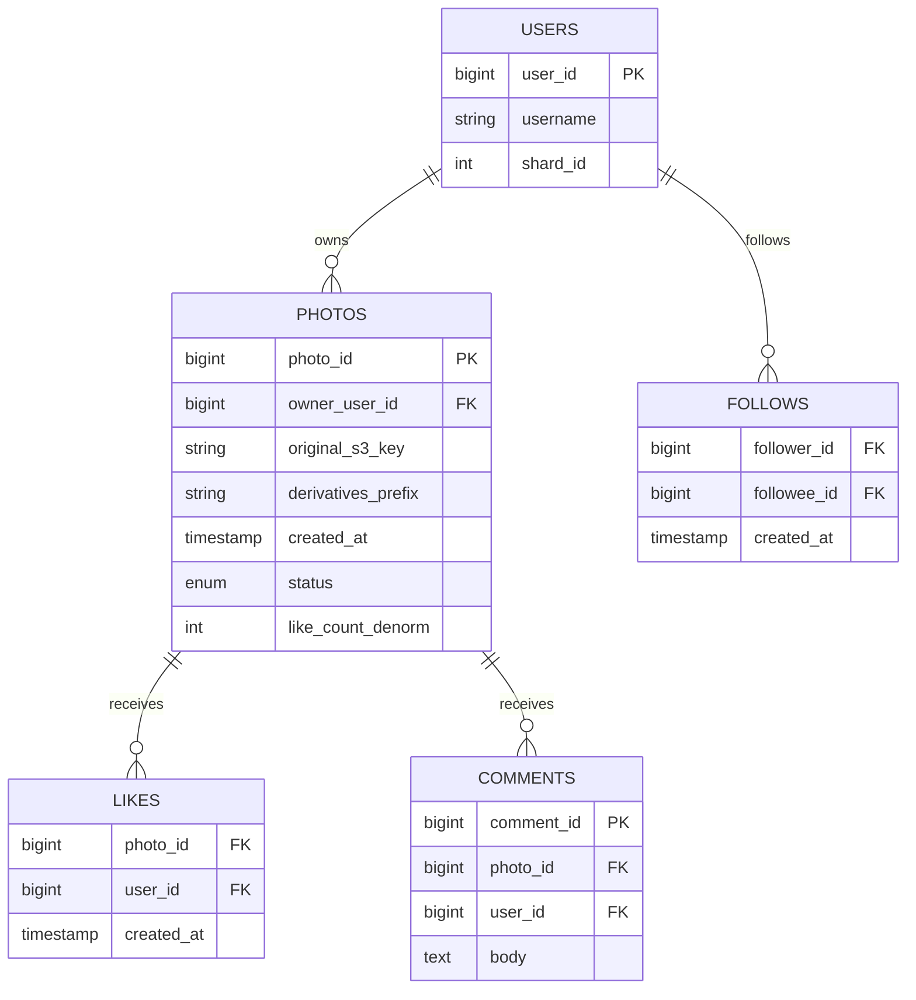
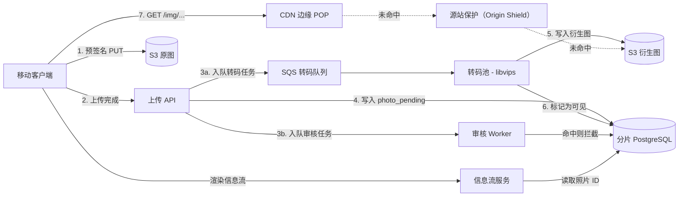
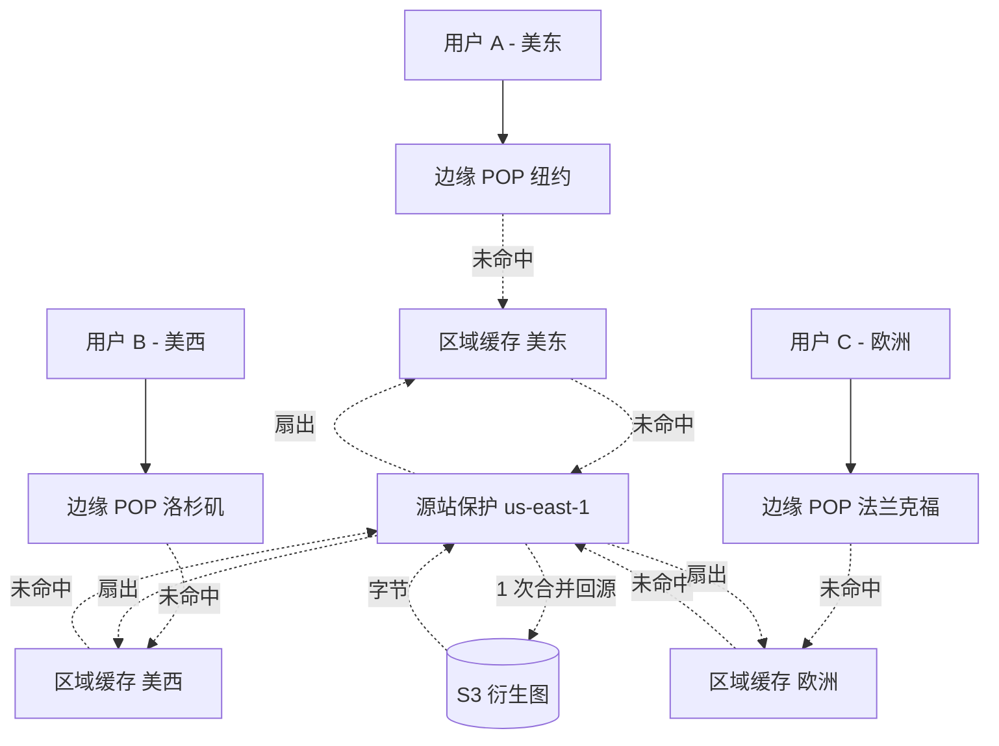
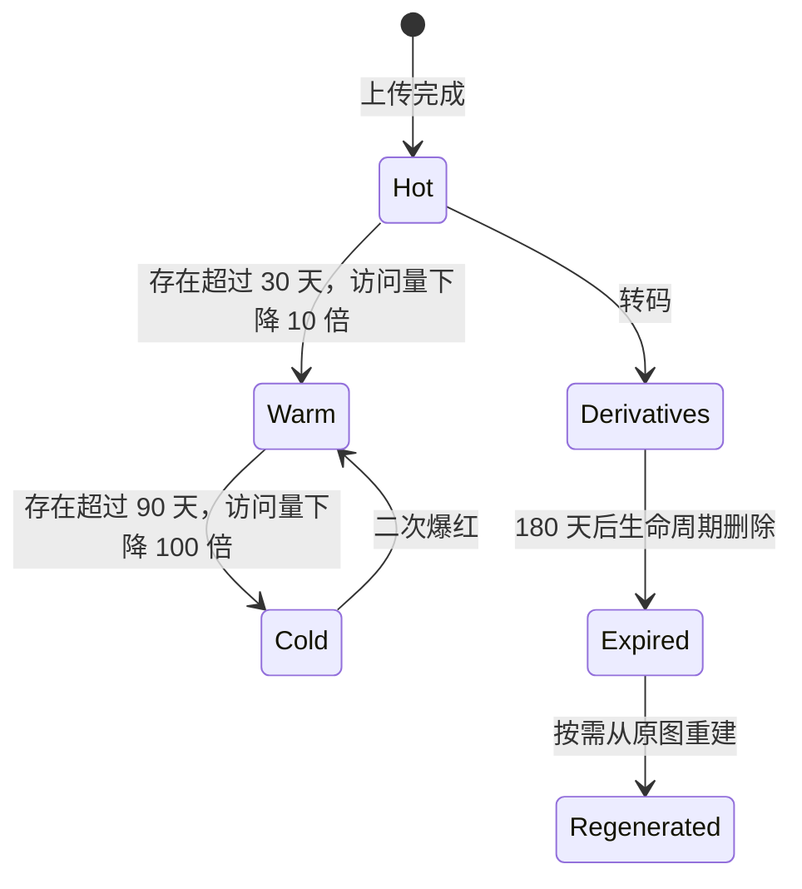
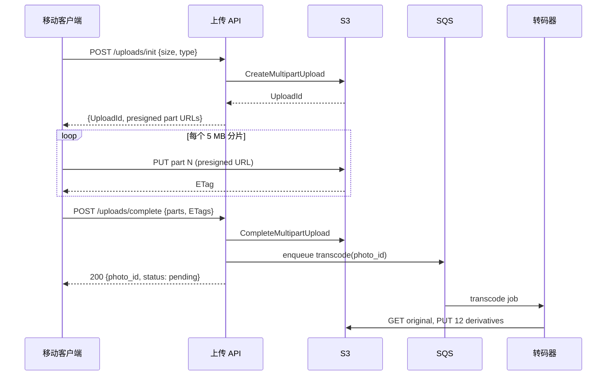

# 设计照片分享服务（Instagram）

> **TL;DR.** Instagram 规模的照片分享服务，是三个解耦的子系统共享同一个照片 ID：上传流水线（预签名直传 S3、可断点续传的分片上传）、转码流水线（libvips 生成固定档位的衍生图，共 3 种格式），以及读取流水线（带源站保护的 CDN，把病毒式传播的突发流量收敛成一次源站回源）。Instagram 每月服务 3B+ 活跃用户，每天上传 100M 张照片，而读写比在 100:1 到 1,000:1 之间 [^1][^2][^6]。最关键的权衡是：把上传成本一次性付掉（提前把所有衍生图都转好），这样之后的每一次浏览都是一次缓存命中。

## 学习目标

学完本章，你将能够：

- [ ] 用预签名 URL 设计一条可断点续传的上传流水线，让照片字节流绕过 API 层
- [ ] 论证在规模化场景下，为什么预生成固定档位的衍生图优于按需缩放
- [ ] 用 CDN 源站保护（origin shielding）让对象存储免受爆款内容的流量冲击
- [ ] 为每天 100M 次上传的照片服务估算存储、算力和带宽
- [ ] 把照片存储与信息流分发拆开，并说清两者之间的耦合契约
- [ ] 根据规模，在 Haystack 式自建 blob 存储与托管对象存储之间做选择

## 直觉理解

照片分享服务看起来不过是个 CRUD 小应用：收一张 JPEG，存下来，再发回去。撑 10 个用户毫无压力。可一旦到了每天 1 亿次上传、100 亿次读取，它就崩了，原因在于读写的不对称。

每张照片的上传只触发一次昂贵的写（在时好时坏的移动网络上传几 MB、耗 CPU 转码、必须过一遍审核扫描），但在最初一周里会被读上几百到几千次 [^3]。最朴素的做法——只存一份原图、每次请求时现缩放——意味着每次读都是一次 CPU 密集的冷计算。每天 100 亿次读，那已经不是照片服务了，那是一个假装成照片服务的算力集群。

打开这个设计的钥匙是：一次性、提前把上传成本付掉，把一个规模无上限的读问题变成一次缓存查询。在上传时就把所有衍生尺寸生成好，从 CDN 分发出去，再让源站隐藏在保护层后面，由它合并重复请求。于是读路径变成一次静态文件获取，写路径变成后台任务——后者容忍几秒延迟，用户根本察觉不到。

第二重压力来自存储的“温度”。今天上传的照片，热一周、温一个月，之后永远冷下去 [^3]。把所有字节一视同仁，是让服务最快破产的方式。Facebook 从 NFS 走到 Haystack 再走到 f4，就是因为这一个经济事实 [^4][^5]。

## 需求

### 澄清问题

- **Q：只允许登录用户上传，还是也支持匿名？**
  假设：需要登录。匿名浏览可以，但有限流；注册用户有上传配额。
- **Q：SLA 目标是什么？**
  假设：上传可用性 99.9%，全球图片加载 p99 < 200 ms，读取可用性 99.99%。
- **Q：需要多区域吗？**
  假设：需要。写入主备（主区域承担写），读取通过 CDN 做到双活。
- **Q：要存视频还是只存照片？**
  假设：本设计只做照片。视频是另一条流水线（见追问部分）。
- **Q：照片最大多大？**
  假设：单次上传 20 MB。更大的文件在预签名阶段就被拒。
- **Q：需要实时接入信息流吗？**
  假设：需要。转码和审核通过后，照片 5 秒内出现在关注者的信息流里。

### 功能需求

- 上传照片（JPEG、PNG、HEIC、WebP），上限 20 MB，可带文案和标签
- 按请求设备的合适分辨率查看照片
- 删除照片（软删除，30 天可恢复窗口）
- 点赞、评论、分享照片
- 浏览用户的照片墙和个性化首页信息流

### 非功能需求

- **负载：** 每天 100M 次上传（均值约 1,200/秒，峰值 3,600/秒）；每天 5B+ 次读取
- **延迟：** 图片加载（CDN 边缘）p50 < 50 ms、p99 < 200 ms；上传完成 p99 < 2s
- **可用性：** 读路径 99.99%，写路径 99.9%
- **一致性：** 信息流可见性最终一致（< 5s）；归属元数据强一致
- **持久性：** 原图 11 个 9；衍生图可重新生成

## 容量估算

| 指标 | 数值 | 推导 |
|--------|------:|------------|
| 日活（DAU） | 500M | 约为 2B 月活的 25%（2021 年数据）[^6]；Instagram 到 2025 年 Q3 已达 3B 月活 [^24] |
| 每天上传 | 100M | 均值约 1,200/秒，峰值 3,600/秒 [^2] |
| 每天读取 | 5B+ | 相对上传 50:1（保守估计） |
| 原图平均大小 | 3 MB | 典型手机 JPEG |
| 每张照片衍生图数量 | 12 | 4 种尺寸 x 3 种格式（JPEG、WebP、AVIF） |
| 每张照片衍生图存储 | 1.5 MB | 小尺寸经过压缩 |
| 每天新增存储 | 450 TB | 100M x (3 + 1.5) MB |
| 5 年存储量 | ~800 PB | 450 TB/天 x 1,825 天（分层之前） |
| CDN 回源 QPS（95% 命中后） | ~2,900/秒 | 5B / 86,400 x 0.05 |
| CDN 回源峰值 QPS | ~8,700/秒 | 均值的 3 倍 |

关键比例：

- **读写比：** 50:1 到 1,000:1，取决于照片的受欢迎程度 [^1][^7]
- **CDN 边缘命中率目标：** 95%+（衍生图不可变，对缓存友好）
- **分层后的存储增长：** 对 90 天以上未访问的原图，通过 Intelligent-Tiering 的 Archive Instant Access 层最高可省 68% 存储成本（实际节省取决于访问模式）[^8]

## API 与数据模型

### API 设计

```http
POST /v1/uploads/init
  Body: { "content_type": "image/jpeg", "size_bytes": 3145728 }
  Response: 201 { "upload_id": "...", "key": "originals/{user_id}/{uuid}",
                  "presigned_part_urls": ["..."], "expires_in": 3600 }

POST /v1/uploads/{upload_id}/complete
  Idempotency-Key: <client-uuid>
  Body: { "parts": [{"part": 1, "etag": "..."}], "caption": "...", "tags": [...] }
  Response: 200 { "photo_id": "...", "status": "pending" }

GET /v1/photos/{photo_id}
  Accept: image/avif, image/webp, image/jpeg
  Response: 200 { "photo_id": "...", "owner_id": "...", "derivatives": {...},
                  "status": "visible", "like_count": 42 }

DELETE /v1/photos/{photo_id}
  Response: 204 No Content (soft-delete, recoverable for 30 days)

GET /v1/users/{user_id}/photos?cursor=...&limit=50
  Response: 200 { "items": [...], "next_cursor": "..." }
```

分页用基于游标的 keyset 分页，按 `(created_at, photo_id)` 降序。限流：每用户 100 次上传/小时，每 IP 1,000 次读取/秒。

### 数据模型



*照片元数据按所有者 user_id 分片；点赞和评论按 photo_id 分片；关注关系按 follower_id 分片。*

| 表 | 主键 | 分片键 | 存储 |
|---|---|---|---|
| photos | photo_id（编码了分片号） | owner_user_id | 分片 PostgreSQL |
| likes | (photo_id, user_id) | photo_id | 分片 PostgreSQL |
| comments | comment_id | photo_id | 分片 PostgreSQL |
| follows | (follower_id, followee_id) | follower_id | 分片 PostgreSQL |
| feeds | (user_id, photo_id) | user_id | Redis / Cassandra |

Instagram 的 64 位 ID 方案把 41 位时间戳 + 13 位分片号 + 10 位序列号直接编进 photo_id，因此路由时不需要查目录服务 [^9]。

## 高层架构



*三个解耦的子系统（上传、转码、读取）只通过 S3 存储桶和元数据库共享状态。*

**写路径：** 客户端从上传 API 拿到预签名 URL，把字节流直接写到 S3（完全绕过 API 层 [^10]），然后上报完成。API 写一行 `photo_pending` 记录，并把转码和审核任务入队。两者都通过之后，照片才变成 `visible`。

**读路径：** 客户端解析出 CDN URL。边缘命中时（95% 的请求），字节在 50 ms 内返回。未命中时，请求升级到源站保护层，由它把并发的未命中合并成一次 S3 取回 [^11]。信息流服务返回照片 ID 和元数据，图片字节则由客户端另外从 CDN 取。



*源站保护把 N 个并发的边缘未命中合并成一次 S3 取回，让源站免遭爆款内容引发的流量冲击——那种流量会冲破单前缀的请求上限。*

**异步路径：** 转码 Worker 从 SQS 消费任务、下载原图、产出 12 个衍生图（4 种尺寸 x 3 种格式）、写入衍生图桶，并向信息流服务发出一个 `photo_visible` 事件。

## 深入探讨

### 深入探讨 1：存储分层（从 Haystack 到 f4 再到 S3 Intelligent-Tiering）

照片的访问曲线很陡：第一周有几百次读取，此后每老一个年龄段，访问量大致掉一个数量级 [^3]。但一年内被删除的只有约 25% [^4]，所以存储量单调增长。

**NFS 的问题（2009 年之前）。** Facebook 最初的照片层用的是普通服务器上的 NFS。仅仅为了走目录元数据，读一张照片就要多达 3 次磁盘 I/O [^12][^13]。峰值 550,000 张图片/秒时，文件系统成了瓶颈。

**Haystack（2010 年）。** 一个跑在 XFS 上的日志结构、只追加存储。每个存储节点运行约 100 个“物理卷”（预分配的 100 GB 文件）。内存索引把 photo_id 映射到字节偏移，把读操作压缩成一次磁盘 I/O [^4]。据 OSDI 2010 论文，Facebook 用这种方式存了 2,600 亿张图片（20 PB），峰值每秒服务 1 百万张图片 [^4]。

**f4（2014 年）。** 在 Haystack 里放满 90 天后，blob 迁移到 f4 的温层。f4 在数据中心内使用 Reed-Solomon (10,4) 纠删码，并可选择跨数据中心做 XOR 编码，把有效副本系数从 Haystack 的 3.6x 降到 2.8x（跨数据中心 XOR）或 2.1x（仅单数据中心 Reed-Solomon）。截至 2014 年那篇论文，f4 以这些更低的副本系数存了超过 65 PB 的逻辑 BLOB [^3][^5]。

**对云原生服务（AWS/Meta 基础设施上的 Instagram）：** 用不同生命周期的独立存储桶。原图在 30 天后转入 S3 Intelligent-Tiering（自动在热/温/冷之间迁移）。衍生图留在 S3 Standard，过期后可从原图重新生成 [^8]。



*照片在温度层级之间流动；衍生图可以从原图重新生成，因此可以被激进地过期以节省成本。*

### 深入探讨 2：缩略图流水线与格式协商

每天 100M 次上传、每张产出 12 个衍生图，转码流水线每天要处理 12 亿张图片。吞吐量就是约束条件。

**为什么用 libvips？** 它是一个需求驱动、横向多线程的库，在多核硬件上做缩放类负载时，基准测试吞吐量比 ImageMagick 高约 7-8 倍（16 核基准下 libvips 0.57s 对 ImageMagick 4.44s），即便把 libvips 限制为单工作线程，仍然快约 5-6 倍 [^14][^15]。到了这个规模，这点吞吐差距就是 AWS 账单上肉眼可见的一行。libvips 支撑着 Mastodon、sharp（Node.js）、imgproxy、Rails Active Storage 和 MediaWiki [^15]。

**衍生图档位：**

| 尺寸 | 宽度 | 格式 | 用途 |
|---|---|---|---|
| 缩略图 | 150 px | JPEG、WebP、AVIF | 网格视图、搜索 |
| 小图 | 320 px | JPEG、WebP、AVIF | 低端设备上的信息流 |
| 中图 | 640 px | JPEG、WebP、AVIF | 标准手机信息流 |
| 大图 | 1080 px | JPEG、WebP、AVIF | 旗舰机全屏 |

同等视觉质量下，AVIF 比 WebP 小 20-30% [^16]。客户端通过 `Accept` 头协商格式；CDN 按 `Accept` 区分缓存键。

**剥离 EXIF 里的 GPS 是强制项。** 手机给每张照片都嵌了 GPS 坐标。如果衍生图保留这份元数据，任何浏览者都能提取出拍摄者的精确位置。在转码阶段剥离全部 EXIF，只保留方向信息以保证正确显示 [^15]。这是隐私事故，不是功能需求。

**两阶段发布：** 信息流永远不展示 `pending` 的照片。审核 Worker 异步处理照片（AWS Rekognition 或同类服务）。通过则翻成 `visible` 并发出信息流事件；不通过则翻成 `blocked` 并通知用户。这样就把上传延迟与审核延迟解耦了。

### 深入探讨 3：基于预签名 URL 直传 S3 的上传路径

上传 API 从不接触照片字节。这是整篇里最重要的一个带宽决策。

**为什么用预签名 URL？** AWS 明确推荐这种模式："By directly uploading these files to Amazon S3, you can avoid proxying these requests through your application server. This can significantly reduce network traffic and server CPU usage" [^10]。按每天 100M 次上传、平均每次 3 MB 算，就是每天 300 TB 带宽，API 层一点都看不到。

**可续传的分片上传：** S3 支持 5 MiB 到 5 GiB 的分片（最多 10,000 片），对象最大 48.8 TiB [^17]。对典型 3 MB 的照片，一次单片的预签名 PUT 就够。对更大的文件或不可靠网络，用 5 MiB 分片的多段上传，失败后可以续传。



*带续传的分片上传：客户端直接把字节流写到 S3，API 只负责编排元数据和派发任务。*

**垃圾回收：** 启动了却永远不完成的客户端会留下孤儿分片。S3 的 `AbortIncompleteMultipartUpload` 生命周期规则会在 7 天后清掉它们 [^18]。

**幂等性：** 客户端为每次上传尝试生成一个 UUID。如果它在超时后重试 `complete` 调用，API 通过幂等键识别出重复，返回已有的 photo_id。

## 真实案例

**Instagram：从 EC2 上的 Django 到三个数据中心、400 亿张照片。**

Instagram 在 2010 年上线时是纯 Django + EC2 技术栈：PostgreSQL 存元数据，Redis 存信息流和会话，Memcached 做缓存，S3 存图片字节，CloudFront 做 CDN [^19]。照片从第一天起就通过预签名 URL 由客户端直传 S3，Django 应用从不处理图片字节。

到 2012 年初，Instagram 有 3,000 万用户，用 41+13+10 位的 ID 方案按 user_id 分片 PostgreSQL，实现方式是每个分片上的一个 PL/pgSQL 函数 [^9]。这样就完全不需要中心化的 ID 服务（不同于 Flickr 的 ticket server 方案 [^20]）。

2012 年被 Facebook 收购后，Instagram 从 AWS 迁到 Facebook 的数据中心，把 EC2 换成 Tupperware 容器，并接入了 TAO、Scuba 和 Haystack [^2]。到 2015 年，它们在三个数据中心每秒服务超过 1 百万次请求，存了 400 亿张照片 [^21]。

跨区域一致性用 PgQ 失效 Memcached 条目，memcache lease 机制把热点计数器上的缓存击穿（thundering herd）收敛掉 [^1][^2]。Instagram 接受写操作上 60 ms 的跨区域延迟惩罚 [^21]。

关键的架构洞见是：照片服务拥有字节和元数据，信息流服务拥有时间线（见[设计社交媒体信息流](./06-social-media-feed.md)）。照片 ID 在信息流里流转，照片字节从不流转。正是这种解耦，让 Instagram 后来能把 Reels（一个视频服务）塞进同一套信息流而无需重构 [^1]。

## 权衡

| 方案 | 优点 | 缺点 | 适用场景 | 我们的选择 |
|---|---|---|---|---|
| 预签名直传 S3 | 把 API 从带宽路径上移除 [^10] | 无法在上传前执行内容策略 | 大文件、可信客户端 | 是 |
| 预生成完整档位 | 每次读都是缓存命中，延迟可预测 [^21] | 1.5-2.5 倍存储放大 | 读多写少、尺寸可预测 | 是 |
| 边缘按需缩放 | 只存原图，尺寸无限 | 冷请求 CPU 长尾，延迟不可预测 | 长尾、极少访问的照片 | 否（除回填外） |
| libvips 转码器 | 多核上比 ImageMagick 快约 7-8 倍 [^14] | 插件生态较小 | 规模化的缩放密集型负载 | 是 |
| 带请求合并的源站保护 | 把爆款流量收敛成 1 次回源 [^11] | 冷请求多一跳延迟 | CDN 承载主要读流量的路径 | 是 |
| 内嵌分片的 64 位 ID | 零延迟路由，无需目录 [^9] | 13 位分片空间上限 8,192 | 分片关系型存储 | 是 |
| Haystack 自建 blob 存储 | 读取只需一次磁盘 I/O [^4] | 得自己造并运维一套定制系统 | 超大规模（数百 PB）、自建基础设施 | 仅在 Facebook 量级下 |

最大的元决策：托管对象存储（S3）还是自建 blob 存储（Haystack）。对任何不自建数据中心的团队，S3 加 Intelligent-Tiering 就能替代整个 Haystack/f4 栈。极端规模下按请求计费的成本是真实的，但对 99% 的组织来说，自建存储系统的运维成本更高。

## 扩展与故障模式

**10 倍负载（每天 1B 次上传）：** 转码池被打满。缓解办法：横向自动扩展转码 Worker（无状态、由队列驱动）。S3 的单前缀上限开始变成真问题，把键分散到更多哈希前缀上。

**100 倍负载（每天 10B 次上传）：** S3 请求费用主导账单。单区域的源站保护容量扛不住 CDN 回源流量。缓解办法：多区域源站保护、区域化衍生图桶，只对热内容做跨区域复制。

**1,000 倍负载：** 架构转向 CDN 优先。对高关注者账号，衍生图预先推送到边缘 POP。S3 只作为冷源站。可以给温数据考虑 Haystack 式自建存储，以消除按请求计费。

**故障模式：区域级 S3 中断。** 读取优雅降级（CDN 继续服务缓存中的旧衍生图）。受影响区域的上传失败。缓解办法：多区域上传端点配 DNS 故障切换；原图通过 S3 跨区域复制在 15 分钟内完成跨区域同步。

**故障模式：转码队列积压。** 照片停留在 `pending` 状态，用户看到的“处理中”从几秒变成几分钟。缓解办法：死信队列加告警；按队列深度自动扩展 Worker；优雅降级——在衍生图生成期间先用降低质量的原图顶上。

**故障模式：爆款照片冲破 S3 单前缀限流。** S3 返回 503 Slow Down [^22][^23]。缓解办法：源站保护做请求合并、基于哈希的前缀分散、对高关注者账号的上传提前预热保护层缓存。

## 常见陷阱

> [!WARNING]
> **把原图和衍生图放在同一个桶里、用同一套生命周期。** 原图是归档资产，衍生图是可再生的。一条生命周期规则要么把衍生图归档到 Glacier（CDN 读取直接崩），要么让原图永远留在 S3 Standard（白烧钱）[^8]。

> [!WARNING]
> **同步审核阻塞上传路径。** 审核服务的一个延迟毛刺会直接放大成上传失败。用两阶段发布：立刻返回成功、异步审核、通过后再翻成可见。

> [!WARNING]
> **单一尺寸流水线（“让客户端自己缩一下就行了”）。** 每台设备都下载全分辨率原图。移动流量账单爆炸，信息流渲染变慢，CDN 命中率崩塌。预生成 4 种尺寸、3 种格式的固定档位。

> [!WARNING]
> **忽视 S3 的单前缀请求上限。** S3 每个前缀支持 3,500 PUT/秒和 5,500 GET/秒 [^22]。朴素的键结构会把爆款照片的读集中到一个前缀上。用基于哈希的前缀把负载摊开。

> [!WARNING]
> **在衍生图里泄漏 EXIF GPS 坐标。** 手机给每张照片都嵌了 GPS。如果衍生图保留这份数据，任何浏览者都能提取出拍摄者的精确位置。这是隐私事故，不是 bug [^15]。

> [!WARNING]
> **对废弃的分片上传不做垃圾回收。** 启动了却永远不完成的客户端会在 S3 里留下孤儿分片。没有 `AbortIncompleteMultipartUpload` 生命周期规则，存储成本会悄悄长起来 [^18]。

## 追问

**1. 你会怎么扩展它来支持视频上传（Reels）？**

视频需要一条完全不同的转码流水线（FFmpeg、HLS/DASH 自适应码率切片、音频归一化）。上传路径类似（预签名分片直传 S3），但转码的 CPU 开销高 100 倍，且每个视频会产出几十个切片文件。把视频流水线彻底独立出去，只共享信息流事件契约和 CDN 基础设施。

**2. 你会怎么给照片做端到端加密（类似 iCloud Advanced Data Protection）？**

上传前用每张照片的对称密钥加密原图，把加密后的 blob 存进 S3。密钥用用户设备密钥包一层，存进密钥管理服务。衍生图无法在服务端生成（服务端永远看不到明文）。要么在设备上先加密前生成衍生图，要么接受端到端加密的照片没有服务端缩略图这个事实。

**3. 你会怎么在上传时对照片去重？**

上传时计算原图的感知哈希（pHash 或 dHash），拿去比对布隆过滤器或哈希索引。若命中，就让新的 photo_id 指向已有原图的 S3 键（写时复制的语义）。这节省存储，但给删除增加了复杂度（需要引用计数）。

**4. 你会怎么用感知哈希检测侵权？**

维护一个已知版权图片的哈希库（类似 YouTube 的 Content ID）。上传时计算感知哈希，用汉明距离小于阈值的方式与库比对，命中则标记待审。误报率必须谨慎调优，否则会拦掉合法的合理使用内容。

**5. 你会怎么检测 AI 生成图片和深度伪造？**

在审核流水线里跑一个分类器（在合成图像数据集上微调过），同时看 C2PA/IPTC 元数据的来源信号。两种手段单独用都不可靠，需要和被举报机制、人工复审结合。这是一个活跃的研究领域，目前没有 100% 准确率的生产级方案。

**6. 对短视频（Reels、Stories 和 Feed 照片）来说，架构会在哪些地方分岔？**

信息流照片是永久性的、高分辨率、提前转码的。Stories 是临时的（24 小时 TTL）、分辨率更低，可以完全跳过温/冷分层。Reels 是长生命周期的视频，自适应码率，需要基于切片的存储，以及一个专为字节范围请求优化的独立 CDN 源站。三者共享信息流事件总线，但存储和转码流水线完全分开。

## 练习

### 练习 1：格式迁移回填

你的照片服务已经跑了两年，衍生图档位是 4 种尺寸、只出 JPEG。产品团队想加上 WebP 和 AVIF 来省带宽。你存了 400 亿张照片。请设计迁移策略。

<details>
<summary>提示</summary>

400 亿张照片不需要立刻全部有 WebP/AVIF 版本。先想想现在究竟哪些照片真的在被 CDN 分发。URL 方案应当让你能在不改动已有缓存 URL 的前提下分发正确格式。

</details>

<details>
<summary>解答</summary>

**按访问新鲜度排优先级。** 只有最近 30 天被访问过的照片需要立即回填（按 Instagram 的访问曲线，大约占全量的 5-10%）。剩下 90% 可以惰性回填，或者等第一次以新格式请求时再生成。

**给回填限速。** 让回填 Worker 跑在一条独立的 SQS 队列上，优先级低于实时转码队列。用令牌桶限流器把回填占用限制在转码总容量的 30%。实时上传永远优先。

**不改 URL 的格式协商。** 用 `Accept` 头做内容协商。CDN 按 `Accept` 区分缓存键（CloudFront 在缓存策略里支持这一点）。同一个 URL `/img/{photo_id}/medium` 会根据客户端能力返回 AVIF、WebP 或 JPEG。已缓存的 JPEG URL 依然有效。

**成本估算：** 4B 张照片（10% 是热的）x 8 个新衍生图（4 种尺寸 x 2 种新格式）x 平均 200 KB = 6.4 PB 新存储。按约 $0.023/GB/月算，就是约 $150K/月。而每天数十亿次浏览下，文件小 20-30% 带来的带宽节省远超这个数。

</details>

## 要点回顾

- **三个解耦的子系统：** 上传、转码、读取各自独立扩展。把它们糅在一起，是面试中最快暴露“初级水平”的做法。
- **预签名直传 S3：** API 从不接触照片字节。在每天 300 TB 上传量面前，这是没有商量余地的架构决策 [^10]。
- **预生成，而不是按需缩放：** 固定档位的衍生图（4 种尺寸 x 3 种格式）把读问题变成一次缓存查询。多核硬件上 libvips 的基准表现比 ImageMagick 快约 7-8 倍 [^14]。
- **源站保护是 CDN 侧的关键优化：** 请求合并把爆款流量收敛成一次回源，避免 S3 冲破单前缀上限 [^11]。
- **存储分层是生存问题：** 把原图（归档）和衍生图（可再生）分开，该分层就分层。Facebook 的 f4 用纠删码把温 BLOB 的有效副本系数从 3.6x 降到 2.1x，作用在 65+ PB 的数据体量上 [^3]。

## 延伸阅读

- [Sharding and IDs at Instagram](https://web.archive.org/web/20210112134155/https://instagram-engineering.com/sharding-ids-at-instagram-1cf5a71e5a5c)。关于 41+13+10 位 ID 方案的经典博文；解释了为什么把分片编进 ID 就能省掉一次目录查询。
- [Instagration Pt 2: Scaling to Multiple Data Centers](https://web.archive.org/web/20210112134648/https://instagram-engineering.com/instagration-pt-2-scaling-our-infrastructure-to-multiple-data-centers-5745cbad7834)。Instagram 如何用 PgQ 处理跨区域 Memcached 失效，并扩展到三个数据中心、400 亿张照片。
- [Finding a Needle in Haystack (OSDI 2010)](https://www.usenix.org/conference/osdi10/finding-needle-haystack-facebooks-photo-storage)。Facebook 的日志结构照片存储，把每次读的 I/O 从 3 次磁盘寻道降到 1 次。
- [f4: Facebook's Warm BLOB Storage System (OSDI 2014)](https://research.facebook.com/publications/f4-facebooks-warm-blob-storage-system/)。面向温照片数据的纠删码，在 65+ PB 的数据体量上把有效副本系数从 3.6x 降到 2.8x 或 2.1x。
- [CloudFront Origin Shield documentation](https://docs.aws.amazon.com/AmazonCloudFront/latest/DeveloperGuide/origin-shield.html)。AWS 的这个功能通过请求合并，让源站免遭爆款内容的流量冲击。
- [AWS S3 performance guidelines](https://docs.aws.amazon.com/AmazonS3/latest/userguide/optimizing-performance.html)。单前缀 3,500/5,500 RPS 的上限，正是源站保护和前缀分散这两个设计决策的由来。
- [libvips Speed and Memory Use benchmarks](https://github.com/libvips/libvips/wiki/Speed-and-memory-use)。多核吞吐量比 ImageMagick 高约 7-8 倍背后的数字。
- [Flickr: Ticket Servers](http://code.flickr.com/blog/2010/02/08/ticket-servers-distributed-unique-primary-keys-on-the-cheap/)。那个 REPLACE INTO 生成 ID 的技巧，Instagram 明确考虑过，但最终选择了内嵌分片的 ID。

## 记忆卡片

<details>
<summary><strong>Q：为什么上传 API 从不直接处理照片字节？</strong></summary>

A：预签名 URL 让客户端直接把字节流写到 S3，从而把 API 层从带宽路径上摘出去。按每天 100M 次上传、平均每次 3 MB 算，就是每天 300 TB 完全不经过 API。AWS 明确推荐这种模式来降低网络流量和服务器 CPU 消耗 [^10]。

</details>

<details>
<summary><strong>Q：Instagram 规模下的读写比是多少，为什么它在架构上重要？</strong></summary>

A：在 100:1 到 1,000:1 之间。这种极端不对称意味着你应当一次性付掉上传成本（提前转好所有衍生图），把读问题变成一次缓存查询。每一个设计决策都由这个比例推出来。

</details>

<details>
<summary><strong>Q：规模化转码为什么用 libvips 而不是 ImageMagick？</strong></summary>

A：多核硬件上做缩放类负载时，libvips 的基准吞吐量比 ImageMagick 高约 7-8 倍，因为它需求驱动、横向多线程。在每天 12 亿个衍生图的量级上，这点吞吐差距就是 AWS 账单上肉眼可见的一行 [^14][^15]。

</details>

<details>
<summary><strong>Q：CDN 源站保护为照片服务解决了什么问题？</strong></summary>

A：它把同一对象的并发缓存未命中合并成一次回源。没有它，一张爆款照片能对 S3 打出 80,000+ RPS，冲破单前缀 5,500 GET/秒 的上限并导致 503 [^11][^22]。

</details>

<details>
<summary><strong>Q：为什么把原图和衍生图放进不同的 S3 桶？</strong></summary>

A：两者的生命周期根本不同。原图是归档资产（30-90 天后转 Glacier，永不删除）。衍生图可再生（可以过期后按需重建，留在 S3 Standard 以便 CDN 快速分发）[^8]。

</details>

<details>
<summary><strong>Q：Instagram 的 64 位 ID 方案如何实现零延迟的分片路由？</strong></summary>

A：这个 ID 编码了 41 位时间戳 + 13 位分片 ID + 10 位序列号。分片直接内嵌在 photo_id 里，应用只要做个位运算就能取出分片号、路由到正确的 PostgreSQL 分片，不需要任何目录查询 [^9]。

</details>

<details>
<summary><strong>Q：什么是两阶段发布，为什么它对上传路径至关重要？</strong></summary>

A：上传立即返回，状态为 "pending"。审核 Worker 异步处理照片，通过后状态翻成 "visible" 并触发信息流事件。这样把上传延迟与审核延迟解耦，避免审核服务抖动导致上传失败。

</details>

<details>
<summary><strong>Q：Facebook 的 Haystack 如何把照片读取 I/O 从 3 次磁盘寻道降到 1 次？</strong></summary>

A：Haystack 用日志结构、只追加的存储取代了 NFS 文件系统（后者需要逐层遍历目录）。内存索引把 photo_id 直接映射到预分配卷文件里的字节偏移，于是每次读只需一次磁盘寻道 [^4][^12]。

</details>

<details>
<summary><strong>Q：为什么必须剥离照片衍生图里的 EXIF GPS 元数据？</strong></summary>

A：手机默认给每张照片嵌入 GPS 坐标。如果衍生图保留这份数据，任何浏览者都能提取出拍摄者的家庭或工作地点的精确位置。这是隐私与人身安全事故，不只是功能缺失 [^15]。

</details>

<details>
<summary><strong>Q：爆款照片冲破 S3 单前缀请求上限时会发生什么？</strong></summary>

A：S3 返回 503 Slow Down 错误。缓解手段：(1) 源站保护把重复请求合并成一次回源；(2) 基于哈希的键前缀把负载分散到相互独立的前缀分区上（每个分区各自能扩到 5,500 GET/秒）；(3) 对高关注者账号的上传提前预热保护层缓存 [^22][^23]。

</details>

## 参考文献

[^1]: ByteByteGo, "How Instagram Scaled Its Infrastructure To Support a Billion Users", 2025. https://blog.bytebytego.com/p/how-instagram-scaled-its-infrastructure

[^2]: ByteByteGo, "How Instagram Scaled Its Infrastructure", with cache lease mechanism and denormalised counters detail, 2025. https://blog.bytebytego.com/p/how-instagram-scaled-its-infrastructure

[^3]: Muralidhar, Lloyd, Roy, Hill, Lin, Liu, Pan, Shankar, Sivakumar, Tang, Kumar, "f4: Facebook's Warm BLOB Storage System", OSDI 2014. https://www.usenix.org/conference/osdi14/technical-sessions/presentation/muralidhar

[^4]: Beaver, Kumar, Li, Sobel, Vajgel, "Finding a Needle in Haystack: Facebook's Photo Storage", OSDI 2010. https://www.usenix.org/conference/osdi10/finding-needle-haystack-facebooks-photo-storage

[^5]: Chris Mellor, "Facebook storage techies: We sift through your family snaps to find warm BLOBs", The Register, October 2014. https://www.theregister.com/2014/10/13/facebook_codes_warm_erasure_blobs_storage/

[^6]: CNBC, "Instagram surpasses 2 billion monthly users", December 2021. https://www.cnbc.com/2021/12/14/instagram-surpasses-2-billion-monthly-users.html（历史数据；Instagram 到 2025 年 Q3 已达 3B 月活 [^24]）

[^7]: Sujeet Jaiswal, "Facebook TAO: The Social Graph's Distributed Cache" (summary of TAO paper Bronson et al ATC 2013). https://sujeet.pro/articles/facebook-tao-social-graph

[^8]: AWS, "Amazon S3 Intelligent-Tiering Storage Class". https://aws.amazon.com/s3/storage-classes/intelligent-tiering/

[^9]: Instagram Engineering, "Sharding and IDs at Instagram", 2012. https://web.archive.org/web/20210112134155/https://instagram-engineering.com/sharding-ids-at-instagram-1cf5a71e5a5c

[^10]: AWS, "Uploading to Amazon S3 directly from a web or mobile application", AWS Compute Blog, 2020. https://aws.amazon.com/blogs/compute/uploading-to-amazon-s3-directly-from-a-web-or-mobile-application/

[^11]: AWS, "Use Amazon CloudFront Origin Shield", CloudFront Developer Guide. https://docs.aws.amazon.com/AmazonCloudFront/latest/DeveloperGuide/origin-shield.html

[^12]: Stephen Holiday, "Finding a needle in Haystack: Facebook's photo storage" notes on the 2010 OSDI paper. https://stephenholiday.com/notes/haystack/

[^13]: Peter Vajgel, Doug Beaver, Jason Sobel, "Needle in a haystack: efficient storage of billions of photos", Facebook Engineering blog, April 2009. https://engineering.fb.com/core-data/needle-in-a-haystack-efficient-storage-of-billions-of-photos/

[^14]: libvips maintainers, "Speed and Memory Use" benchmarks, 2025. https://github.com/libvips/libvips/wiki/Speed-and-memory-use

[^15]: libvips maintainers, README.md - libvips used by Mastodon, sharp, imgproxy, Ruby on Rails, MediaWiki; format support list. https://github.com/libvips/libvips/blob/master/README.md

[^16]: Bulk Image Pro, "AVIF vs WebP: Which Next-Gen Format Should You Use?" (2024 benchmarks, 20-30% smaller than WebP). https://bulkimagepro.com/compare/avif-vs-webp/

[^17]: AWS, "Amazon S3 multipart upload limits", S3 User Guide (object max 48.8 TiB, part 5 MiB to 5 GiB, up to 10,000 parts). https://docs.aws.amazon.com/AmazonS3/latest/userguide/qfacts.html

[^18]: AWS, "Download and upload objects with presigned URLs", S3 User Guide. https://docs.aws.amazon.com/AmazonS3/latest/userguide/using-presigned-url.html

[^19]: Instagram Engineering, "What Powers Instagram: Hundreds of Instances, Dozens of Technologies", 2011. https://web.archive.org/web/20230529003539/https://instagram-engineering.com/what-powers-instagram-hundreds-of-instances-dozens-of-technologies-adf2e22da2ad

[^20]: Flickr Code Blog (Kay Kremerskothen), "Ticket Servers: Distributed Unique Primary Keys on the Cheap", February 2010. http://code.flickr.com/blog/2010/02/08/ticket-servers-distributed-unique-primary-keys-on-the-cheap/

[^21]: Instagram Engineering, "Instagration Pt 2: Scaling our Infrastructure to Multiple Data Centers", 2015. https://web.archive.org/web/20210112134648/https://instagram-engineering.com/instagration-pt-2-scaling-our-infrastructure-to-multiple-data-centers-5745cbad7834

[^22]: AWS, "Best practices design patterns: optimizing Amazon S3 performance", S3 User Guide. https://docs.aws.amazon.com/AmazonS3/latest/userguide/optimizing-performance.html

[^23]: AWS repost, "5,500 GET requests/sec and 3,500 PUT/POST/DELETE requests/sec per prefix" confirmation, 2025. https://www.repost.aws/ja/questions/QUm1b7F1CNTxiw-UNQSecIYg/how-to-model-or-determine-io-throughput-requests-sec-capacity-for-s3-buckets

[^24]: CNBC, "Instagram now has 3 billion monthly active users", September 2025. https://www.cnbc.com/2025/09/24/instagram-now-has-3-billion-monthly-active-users.html
