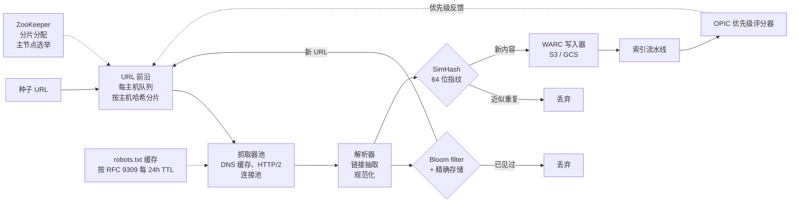
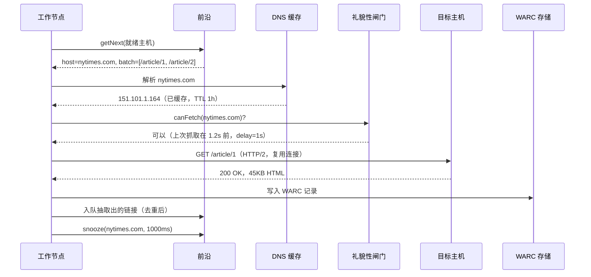
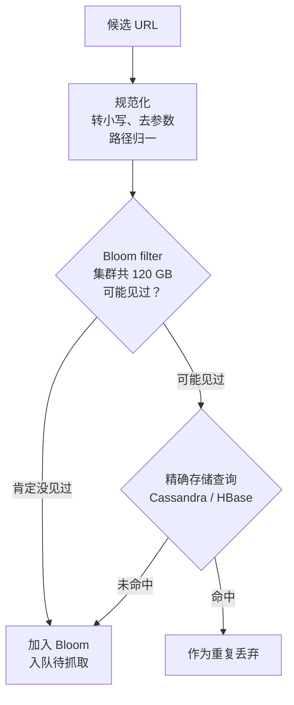
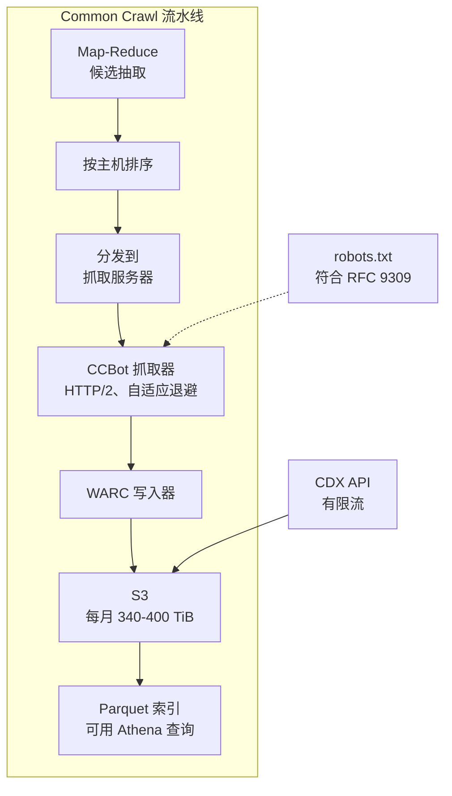

# 设计一个网络爬虫（Googlebot 风格）

> **TL;DR.** 网络爬虫首先是一个调度问题，其次才是抓取问题。每天 10 亿个页面时，URL 前沿里存着 10 TB 状态[^1]，按主机的礼貌性要求整个机群对同一个主机名最多只有一个在途请求，而重复检测需要两层互补机制：Bloom filter 做 URL 去重（1000 亿个 URL、1% 假阳性率下约 120 GB[^2]），SimHash 做内容去重（64 位指纹，汉明距离阈值 3[^3]）。Mercator 1999 年的参考架构[^1]确立了这套组件拆分，此后各大爬虫都在复用。最关键的权衡：抓取速率与礼貌性合规。

## 学习目标

学完本模块，你将能够：

- [ ] 设计一个 URL 前沿，在数百万个域名上并行执行按域礼貌性
- [ ] 为 1000 亿 URL 的去重规划 Bloom filter 容量，并讲清 Bloom + 精确存储这一生产模式
- [ ] 把 URL 去重与内容去重分开，并论证两层为何都不可少
- [ ] 实现符合 RFC 9309 的 robots.txt 解析，并说清它为什么是硬约束
- [ ] 用量级估算（back-of-the-envelope estimation）为每天 10 亿页面的抓取系统估容量
- [ ] 论证按主机名哈希对前沿分片，为何能实现全局礼貌性

## 直觉理解

网络爬虫看起来很简单：抓一个页面，抽出链接，重复。一个带队列的 `while` 循环加一个 `set`，处理 100 个页面毫无压力。到了每天 10 亿页面就崩了，而崩的原因不是带宽或 CPU，是调度。

朴素做法（一个大 FIFO 队列）立刻就会出事。如果队列里接下来 1 万个 URL 全属于 `example.com`，你就用 1 万个并发请求把对方服务器轰了一遍。站点被打挂，你被封，你的 IP 段被 Cloudflare 标记——而且从 2025 年 7 月起，Cloudflare 上所有站点默认屏蔽 AI 爬虫，除非得到明确许可[^4]。

真正打开设计思路的洞察是：爬虫本质上是一个跑在客户端侧的分布式限流器。从前沿分区到 DNS 缓存再到 WARC 存储，每一个架构决策都源自同一条不变量：**对每个主机名，全局最多只有一个在途请求，横跨你拥有的所有抓取器。** 一旦你吃透这条约束，Mercator 的两级前沿、按主机哈希分片、礼貌性闸门就全都顺理成章。

## 需求

### 澄清问题

- **Q: 目标抓取规模是多少？**
  假设：每天 10 亿个页面（平均约 11,500 页/秒，峰值 3 万-5 万）。与 Common Crawl 每月 20-30 亿页[^5]相当。

- **Q: 需要渲染 JavaScript 吗？**
  假设：主链路只处理 HTML。对高优先级 SPA 页面有选择地做 headless-Chrome 渲染（据估每页成本高 100-1000 倍[^6]）。

- **Q: 提供什么样的礼貌性保证？**
  假设：每个主机每秒最多 1 个请求。按 RFC 9309 遵守 robots.txt[^7]。遵守作为事实惯例的 `Crawl-delay`。

- **Q: 抓到的内容怎么存？**
  假设：WARC 格式（ISO 28500），放在对象存储（S3/GCS）里。可压缩 3-5 倍[^5][^8]。

- **Q: 活跃前沿有多大？**
  假设：待抓池里有 1000 亿个 URL。按每个 URL 约 100 字节（URL + 元数据）算，就是 10 TB 的前沿状态[^1]。

- **Q: 多地域还是单集群？**
  假设：单集群，但抓取器 pod 按地理分布以降低延迟。前沿集中部署（分片）。

### 功能性需求

- 从种子 URL 出发递归跟踪链接，发现新页面
- 通过 HTTP/1.1 和 HTTP/2 抓取页面，遵守 robots.txt 与 Crawl-delay
- 对 URL 去重（规范化 + Bloom filter），对内容去重（SimHash）
- 把原始响应以 WARC 格式存下来，带元数据（时间戳、摘要、状态）
- 按重要性（OPIC/PageRank）和新旧程度（变化率调度）给 URL 排优先级
- 提供重抓循环：变化率高的页面更频繁地被回访

### 非功能性需求

- **吞吐量：** 持续每天 10 亿页；峰值 3 万-5 万页/秒
- **礼貌性：** 每个主机每秒 <=1 个请求；robots.txt 合规率 99%+
- **去重准确度：** URL 去重 1% 假阳性率（Bloom），内容去重在汉明距离 3 的阈值上（SimHash）
- **存储：** 每天约 500 TB 原始数据（压缩后 100 TB）；保留 5 年
- **可用性：** 前沿与去重服务 99.9%；抓取器机群容忍单节点故障
- **延迟：** 不面向用户；优化吞吐量，而不是 P99

## 容量估算

| 指标 | 数值 | 推导 |
|--------|------:|------------|
| 每日页面数 | 10 亿 | 目标规模 |
| 平均页面大小 | 500 KB | HTML + 内嵌资源 |
| 每日原始入流量 | 500 TB | 10 亿 x 500 KB |
| 每日压缩存储 | 100-125 TB | WARC 压缩 4-5 倍[^5] |
| 5 年存储量 | ~180 PB | 100 TB/天 x 365 x 5 |
| 峰值抓取 QPS | 5 万 | 平均 11,574/秒的 3-5 倍 |
| 前沿活跃 URL | 1000 亿 | 累计发现数减去已抓取数 |
| 前沿状态 | 10 TB | 1000 亿 x 100 字节/URL[^1] |
| Bloom filter 内存（1% 假阳性率） | 120 GB | 1000 亿 x 9.6 位/元素[^2] |
| SimHash 索引 | ~600 MB/十亿页面 | 每文档 64 位 + 4 张排列表，每张 150 MB[^3] |
| DNS 缓存条目 | ~5000 万 | 每个活跃主机一条 |

关键比例：

- 前沿上的**读写比**大致是 1:1（每次抓取都会产生新的 URL 入队）
- **Bloom filter 命中率：** 约 60-70% 的候选 URL 是重复的（以前见过）
- **内容去重率：** 据估约 25-30% 抓到的页面与已有内容近似重复[^3]
- **单次抓取覆盖的主机数：** Common Crawl 报告每月抓取涉及 4300 万-4600 万主机[^5]

## API 与数据模型

### API 设计

爬虫不面向用户，但前沿对外暴露 gRPC API（遵循 Crawler-Commons 的 URL Frontier 规范[^9]）：

```http
POST   /frontier/v1/urls          # 注入种子 URL 或新发现的 URL
GET    /frontier/v1/next           # 拉取下一个就绪主机 + URL 批次
PUT    /frontier/v1/urls/{id}      # 更新 URL 状态（已抓取、失败、被屏蔽）
PUT    /frontier/v1/hosts/{host}/rate  # 设置单主机抓取速率
GET    /frontier/v1/hosts          # 列出活跃主机及其队列深度
GET    /frontier/v1/stats          # 前沿健康度：队列深度、吞吐量、假阳性率
```

去重服务暴露：

```http
POST   /dedup/v1/url/check         # Bloom + 精确存储的 URL 查询
POST   /dedup/v1/content/check     # SimHash 指纹比对
```

### 数据模型

```sql
-- URL 前沿状态（按 host_hash 分片）
table frontier_urls (
  host_hash       int,          -- 分区键（主机名的一致性哈希）
  url_id          uuid,         -- 聚簇键
  url             text,
  priority        float,        -- OPIC 分数
  state           enum,         -- queued、fetching、parsed、blocked、retired
  last_fetch_at   timestamp,
  retry_count     int,
  crawl_delay_ms  int           -- 来自 robots.txt
)

-- 内容指纹（用于 SimHash 去重）
table content_fingerprints (
  fingerprint_block  bigint,    -- 16 位前缀块（分区键）
  fingerprint        bigint,    -- 完整 64 位 SimHash
  url_id             uuid,
  fetched_at         timestamp
)

-- WARC 元数据索引
table warc_records (
  url_id          uuid,
  warc_file       text,         -- S3 key
  offset          bigint,       -- WARC 文件内的字节偏移
  content_length  int,
  content_digest  text,         -- SHA-256
  fetch_status    int,
  fetched_at      timestamp
)
```

## 高层架构



*端到端抓取流水线：种子进入 Mercator 式前沿，抓取器通过礼貌性闸门从每主机队列取活，两层去重过滤重复内容，WARC 记录落到对象存储，OPIC 评分器把优先级反馈给前沿。*

写入路径：抓取器从前沿取出一个就绪主机，解析 DNS（走缓存），检查礼貌性闸门（上次抓取时间戳 + Crawl-delay），通过 HTTP/2 抓取页面，把响应交给解析器。解析器抽出链接、做规范化，提交给 URL 去重服务。新 URL 重新进入前沿。原始响应再走 SimHash 内容去重，如果是新内容，就写进 S3 里的 WARC 文件。

反馈路径：索引流水线计算 OPIC 分数（PageRank 的在线近似[^10]），更新前沿里的优先级权重。高优先级页面会更早被重抓。

ZooKeeper 负责前沿分片的分配和主节点选举。某个前沿节点挂掉时，它负责的主机哈希区间会通过带虚拟节点的一致性哈希重新分配给存活节点。

## 深入探讨

### 深入探讨 1：URL 前沿与礼貌性调度器

前沿是最难的组件。它必须同时满足三个约束：（1）在整个机群范围内做按主机限流，（2）全局优先级排序，让重要页面先抓，（3）持久化，让持续数周的抓取能扛住节点故障。

**Mercator 的两级设计[^1]**用每主机后队列（back queue）加一个全局前队列（front queue）解决这个问题。URL 按主机名分配到后队列。工作节点从前后列里挑一个就绪主机（按优先级选），从该主机的后队列拉一批 URL，然后把主机挂到延迟定时器上。只有过了 `Crawl-delay` 秒，这个主机才重新可抓。

Heritrix 把它实现为 `BdbFrontier`，每主机工作队列在几个集合之间流转：`inProcessQueues`、`readyClassQueues`、`snoozedClassQueues`（另有 `snoozedOverflow` 映射应对极端情况）、`inactiveQueuesByPrecedence` 和 `retiredQueues`[^11]。`classKey` 就是主机名。Berkeley DB JE 提供落盘持久化，并对那些生命周期短、根本不会落盘的 URL 用延迟写模式。

**自适应回访调度。** 并非所有页面的变化速度相同。OPIC（Adaptive On-Line Page Importance Computation，Abiteboul 等，2003）把每个已抓页面的“现金”（cash）分配给它的出链；累计现金即可近似 PageRank，而无需把完整链接矩阵放在内存里[^10]。把 OPIC 优先级与观测到的变化率结合：最近 N 次访问都发生变化的页面，重抓间隔更短。

**为什么 BFS 在规模上会失效。** 从种子出发的广度优先遍历会均匀铺开。没有按主机闸门，它会引发 DNS 踩踏（数百万个未缓存的解析请求把上游解析器打满[^1]），并对小站点造成意外 DDoS。Mercator 的每主机队列就是解药。



*单次抓取周期：前沿让每个请求都经过按主机的延迟定时器，从而保证无论机群多大，礼貌性都在全局成立。*

### 深入探讨 2：大规模内容去重（SimHash + URL 规范化）

两层去重从不同角度打击重复：

**URL 规范化**处理语法层面的重复：`http://A.com/` 与 `http://a.com`、结尾斜杠、会话 ID（`?PHPSESSID=abc`）、跟踪参数（`?utm_source=twitter`）、协议归一。这一层很便宜（就是字符串处理），能在进 Bloom filter 之前去掉 30-40% 的候选 URL。

**SimHash** 处理语义层面的重复：同一篇文章被发布到另一个 URL，或者页面只有细小的样板内容变化（广告、时间戳、导航条）。Charikar 2002 年的局部敏感哈希[^12]把文档映射到 64 位指纹，余弦相似度被保留为汉明距离。Google 的 Manku 等人（2007）证明，在 64 位指纹上取 3 位汉明阈值，对网页能取得不错的准确率和召回率[^3]。

构造方式：

1. 把文档切成相互重叠的 3 词 shingle
2. 把每个 shingle 哈希到 64 位
3. 对每个比特位，在所有 shingle 上累加 +1（该位为 1）或 -1（该位为 0）
4. 最终指纹：取每个累加器的符号

**亚线性的候选查找。** 逐个扫描所有指纹算汉明距离是 O(N)。排列表技巧：把 64 位切成 B 个块。两个指纹的差异若不超过 3 位，那么至少有 B-3 个块必须完全一致。按每种分块方式各建一张索引。Manku 等人在每十亿指纹上用了 4 张表，每张约 150 MB[^3]。

**URL 去重的 Bloom + 精确存储模式：**



*Bloom filter 在无磁盘 I/O 的情况下完成 99%+ 的检查。只有 Bloom 判为阳性（1% 假阳性）的结果才会触发昂贵的精确存储查询，这样既不产生假阳性，又不必为每个 URL 付磁盘代价。*

### 深入探讨 3：分布式协调与前沿分片

**不变量：** 同一个主机名的所有 URL 必须落在同一个前沿分片上。这一点没有商量余地。如果两个分片各自独立地为 `nytimes.com` 调度抓取，礼貌性就破了。

**按主机哈希分区。** 对主机名（而不是完整 URL）做哈希来决定前沿分片。`nytimes.com` 的所有 URL 都落到 7 号分片（举例）。在 7 号分片内部，两级调度器执行本地礼貌性。由于没有别的分片持有 `nytimes.com` 的 URL，本地礼貌性就等于全局礼貌性[^13]。

**带虚拟节点的一致性哈希。** 某个分片故障时，它负责的主机哈希区间必须重新分配。有了虚拟节点，只有 1/N 的键空间会移动。在 10 TB 的前沿状态下，移动 1/N 依然昂贵（数百 GB），所以系统必须频繁做检查点，并尽量减少在途状态。

**Crawler-Commons 的 URL Frontier gRPC API[^9]** 把抓取器与前沿服务解耦。抓取器调用 `getNext` 拉活，调用 `update` 回报结果。这让抓取器池和前沿可以各自独立扩展。StormCrawler 用 Apache Storm 的 spout 做抓取器，共享一个 URL-Frontier 服务[^14]。

**ZooKeeper 的角色：** 分片分配（哪个前沿节点拥有哪段哈希区间）、主节点选举（由一个协调者分发配置变更）、robots.txt 规则分发（被封域名、自定义 Crawl-delay 覆盖）。故障检测必须快：一个死掉的分片会让它负责的所有主机的 URL 全部搁浅，直到重新分配。

**跨分片优先级。** OPIC 分数是按分片计算的（每个分片知道自己主机上的现金）。全局优先级需要分片之间的轻量 gossip 协议，把整个集群里优先级最高的主机暴露出来。实践中按分片优先级就够了：任何分片内排名靠前的主机，很可能全局也重要[^10]。

## 真实案例

**Common Crawl：唯一公开、可审计的万维网级爬虫。**

Common Crawl 2026 年 4 月的那次抓取归档了 21.9 亿个页面，覆盖 4320 万个主机、3540 万个注册域名，未压缩总量 379.2 TiB[^5]。每次月度抓取会新发现约 6-6.6 亿个此前未见过的 URL[^5][^15]。自 2008 年以来累计归档已超过 10 PB[^16]。

CCBot 基于 Nutch（Apache Nutch on Hadoop）。Map-Reduce 处理抓取数据库并抽出候选，按主机排序后分发到各抓取服务器[^13]。支持基于 TLS 的 HTTP/1.1 和 HTTP/2。不执行 JavaScript。原始内容以 WARC 格式（ISO 28500）存储[^8]。文件落到 AWS 的 S3 上，另有一份列式 Parquet 索引，可以直接用 Athena 查询，无需批量下载。

让 Common Crawl 区别于朴素实现的关键工程决策：

- **对 429/5xx 做自适应退避**，而不是静态的按主机速率上限。CCBot 会对任何发出过载信号的主机放慢速度[^13]。这比靠配置驱动的礼貌性更稳健。
- **用 WARC 而不是自定义格式。** 与 Heritrix 和 IIPC 工具链的互操作性，胜过了自定义格式带来的压缩收益[^8]。
- **公开且可反向 DNS 校验的 IP 区间。** 站点运维方能把真正的 CCBot 和伪造 User-Agent 区分开[^13]。Googlebot 用的是同一套校验方式[^17]。
- **不做 JavaScript 渲染。** 每次抓取 30 亿页面，headless Chrome 按每页成本高 100-1000 倍估算[^6]，需要大 1000 倍的机群。CCBot 接受 SPA 内容缺失。



*Common Crawl 的 Nutch 流水线：Map-Reduce 抽出候选，抓取器以自适应礼貌性抓取，WARC 记录落到 S3，Parquet 索引让 10 PB 数据可直接查询而无需批量下载。*

## 权衡

| 方案 | 优点 | 缺点 | 适用场景 | 我们的选择 |
|----------|------|------|-------------|----------|
| 每域队列（Mercator） | 礼貌性自然、公平性简单 | 热门域会积压 | 通用网页抓取 | 是 |
| 按 OPIC 的优先队列 | 重要页面先抓 | 需要跨分片 gossip，反馈有滞后 | 在已知链接图上做刷新抓取 | 与 Mercator 结合 |
| 广度优先（朴素） | 简单、均匀 | 违反礼貌性、DNS 踩踏 | 内网或单域爬虫，约 100 万页以内 | 否（万维网规模下） |
| 仅 Bloom filter | 约 120 GB 内存，O(1) 检查 | 假阳性会漏掉真实 URL | 能容忍少量漏检 | 否 |
| Bloom + 精确存储 | 零假阴性 | 两次查询、代码更多 | 漏一个就等于丢一个页面的万维网规模 | 是 |
| 集中式前沿 | 简单，全局优先级唾手可得 | 单点故障、扩展有天花板 | 单节点容量以内 | 否 |
| 分布式前沿（主机哈希） | 可横向扩展，本地礼貌性即全局礼貌性 | 故障时要付再平衡成本 | >1 万页/秒 | 是 |

最大的元决策：**抓取速率与礼貌性。** Google 的解法是按主机名的动态预算——站点响应快就加大，遇到 5xx 就收缩[^18]。Common Crawl 的解法是对任何过载信号做自适应退避[^13]。两种做法都把主机的响应当作可接受负载的基准事实。

## 扩展与故障模式

**10 倍（每天 100 亿页）：**

- 前沿状态涨到 100 TB。落盘前沿（Berkeley DB 或 RocksDB）成为瓶颈。缓解：分层存储，热分区放 NVMe，冷分区放 HDD。
- Bloom filter 涨到 1.2 TB。缓解：分片到 10 个以上去重节点，或改用可扩展 Bloom filter——饱和时链上新的过滤器[^2]。

**100 倍（每天 1000 亿页）：**

- 抓取器机群要撑住 50 万 QPS。缓解：抓取器 pod 按地理分布以降低 RTT。在持久连接上做 HTTP/2 多路复用。
- DNS 缓存要装下 5 亿条以上。缓解：专用递归解析器集群，配合激进的 TTL 延长。

**1000 倍（整个万维网、持续抓取）：**

- 架构重写：从批处理导向（Nutch/Hadoop）转向流式（Flink/Kafka）。前沿变成分布式日志。优先级通过流式 OPIC 增量计算。

**故障模式：**

- **前沿分片故障。** 分配给该分片的所有主机搁浅。检测：ZooKeeper 会话超时（秒级）。恢复：一致性哈希重新分配，把 1/N 的主机迁到存活节点。数据丢失量以最近一次检查点为界。
- **Bloom filter 节点故障。** 去重退化为只查精确存储（更慢但正确）。没有数据丢失，因为精确存储才是基准事实。Bloom 可以从精确存储重建。
- **抓取器 pod 故障。** 在途 URL 超时后回到 `queued` 状态。没有数据丢失。前沿在下一轮调度时把它们重新发给别的抓取器。

## 常见陷阱

> [!WARNING]
> **爬虫陷阱（无限日历、带会话 ID 的 URL）。** 一个为 1900 年以来每一天都生成页面的日历，会造出数百万个零价值 URL。爬虫在一个主机上把预算耗尽。修法：按主机的 URL 预算上限、URL 模式识别，以及基于 SimHash 的内容相似度检查（如果某主机 95% 的页面指纹近似相同，就把这个模式拉黑）[^19]。

> [!WARNING]
> **DNS 踩踏。** 在数百万主机上同时铺开、又没有专用 DNS 缓存，会把上游解析器打满。Mercator 在 1999 年就指出 DNS 是“主要瓶颈”[^1]。修法：进程内长 TTL DNS 缓存、把解析与抓取异步解耦、HTTP/2 连接复用。

> [!WARNING]
> **对小站点造成意外 DDoS。** 没有按主机哈希分区，两个抓取器各自独立抓 `example.com`，负载就翻倍。礼貌性必须在全局成立，而不是每个抓取器各自成立。修法：在前沿层面做按主机调度，任何时刻只有一个工作节点碰某个主机[^11]。

> [!WARNING]
> **误读 robots.txt。** 28 年的事实惯例（1994-2022）催生了一堆各行其是的解析器。常见错误：最长匹配逻辑写错、User-Agent 分组合并错、把 5xx 当成“随便抓”而不是 RFC 9309 要求的“必须假定完全禁止”[^7]。修法：用符合 RFC 9309 的解析器；拿 Google 开源的 `robots` 库做对照测试。

> [!WARNING]
> **Bloom filter 饱和。** 按 1000 亿 URL 定容的过滤器，一旦超出容量就会无声退化。假阳性上升，真实 URL 被当作“见过”丢掉。这种效果和正常去重根本区分不出来。修法：假阳性率抽样（拿已知的新鲜 URL 去测）、按预期容量的 2 倍定容、定期从精确存储重建[^2]。

## 追问

**1. 对 SPA 密集的站点，你怎么处理 JavaScript 渲染？**

两阶段索引（Google 的做法[^6]）。只取 HTML 的抓取结果立刻喂进流水线。高优先级页面（通过空的 `<body>` 或已知 SPA 框架识别）进入另一个渲染队列，跑 headless Chromium。渲染成本据估是纯抓取的 100-1000 倍，所以要把它的预算控制在总抓取量的 1% 以下。超时设得激进些（每次渲染 5-10 秒）。

**2. 你怎么处理 LLM 爬虫被封（GPTBot、ClaudeBot、CCBot）？**

按 RFC 9309 遵守 robots.txt 里的 `User-agent: GPTBot / Disallow: /`[^7]。2025 年 7 月起，Cloudflare 对平台上所有站点默认屏蔽 AI 爬虫，除非发布方主动选择加入或获得补偿[^4]。公开可校验的 IP 区间和清晰的退出机制。法律环境正在活跃演进：Reddit 于 2025 年 6 月就未经授权的抓取起诉 Anthropic[^20]，此前已有 NYT 诉 OpenAI 的先例。合规不是可选项。

**3. 你怎么实现增量重抓的新鲜度？**

跟踪每个 URL 的变化率（最近 N 次访问中内容哈希变过没有？）。变化率高的页面（新闻首页、股票行情）每小时重抓。变化率低的页面（关于页、文档）每周或每月重抓。OPIC 优先级叠加变化率调度，得到二维优先级：重要性 x 新鲜度。

**4. 你怎么跨数据中心划分 URL 前沿？**

按主机名哈希，不按 URL。同一个主机的所有 URL 落在同一个分片。这样无需跨分片协调就能保住礼貌性不变量。用带虚拟节点的一致性哈希做故障再平衡。不要按地域切分，除非抓取器到主机的延迟真的是瓶颈（很少见；大多数主机在 CDN 后面）。

**5. 近似重复检测和精确重复检测有什么区别？**

精确去重用内容哈希（响应体的 SHA-256）。近似去重用 SimHash，汉明距离阈值 3[^3]。精确去重抓的是字节级完全相同的镜像。近似去重抓的是同一篇文章配了不同广告、时间戳或导航条的情况。两者都要：精确去重便宜（一次哈希比较），近似去重贵（排列表查询）但据估能多抓出 25-30% 的重复。

**6. 你怎么从页面里抽出正文（去掉样板内容）？**

Readability、Dragnet、Trafilatura 这类算法会剥掉导航、广告和样板内容，抽出“正文”块。这能提升 SimHash 的准确度（只对正文做指纹，能减少样板变化带来的假阴性），也能省存储（把抽出的文本与原始 WARC 一起存给下游消费者）。

## 练习

### 练习 1：Bloom filter 容量规划

你的爬虫目前发现了 500 亿个唯一 URL，预计 3 年内达到 2000 亿。设计 Bloom filter 这一层：今天需要多少内存，满容量时需要多少，什么时候该触发重建？

<details>
<summary>提示</summary>

用这个公式：每元素位数 = -ln(e) / (ln 2)^2。1% 假阳性率对应约 9.6 位/元素。想一想过滤器被填到超出设计容量后，假阳性率会怎么变。再想想观测到的假阳性率（通过抽样测量）到什么程度应该触发重建。

</details>

<details>
<summary>解答</summary>

**今天（500 亿 URL，目标 1% 假阳性率）：**

- 需要的位数：500 亿 x 9.6 = 4800 亿位 = 60 GB
- 哈希函数个数：k = 7

**满容量（2000 亿 URL，目标 1% 假阳性率）：**

- 需要的位数：2000 亿 x 9.6 = 1.92 万亿位 = 240 GB
- 分片到 24 个节点、每节点 10 GB，或 8 个节点、每节点 30 GB

**定容策略：** 一开始就按 2000 亿建（240 GB）。插到 500 亿时，实际假阳性率远低于 1%（过滤器只用了 25% 容量）。随着填向 2000 亿，假阳性率逐渐逼近设计的 1%。

**重建触发点：** 每小时拿 1 万个已知新鲜的 URL 打一遍过滤器，以此监控假阳性率。当观测到的假阳性率超过 2%（设计目标的两倍），就从精确存储重建。这能在过滤器彻底废掉之前给出预警。

**接受的权衡：** 一开始就要 240 GB，是今天所需的 4 倍。另一条路（从 60 GB 起步，到 500 亿时重建）需要一次 stop-the-world 重建，会让去重停摆数小时。预留冗余比停机便宜。

</details>

## 要点回顾

- **前沿是调度器，不是队列。** 靠 Mercator 的两级设计实现按域公平才是难点；1999 年以来每个生产级爬虫都在复用[^1]。
- **礼貌性是承重约束。** 每个主机全局最多一个在途请求。这一条不变量决定了前沿分片、抓取器分配和 DNS 缓存。
- **两层去重缺一不可。** URL 规范化 + Bloom 抓语法重复；SimHash 抓语义重复。单靠任一层都不够[^3]。
- **Bloom + 精确存储，绝不要只用 Bloom。** 一个假阳性就是一个丢失的页面。精确存储在 1% 的慢路径上消除假阳性[^2]。
- **robots.txt 有法律约束力。** RFC 9309 在 2022 年把它正式标准化[^7]，Cloudflare 从 2025 年 7 月起用默认屏蔽在商业上强制执行[^4]，法院也在裁决违规案例[^20]。

- **Common Crawl 的数字就是你的基准。** 每次月度抓取 20-30 亿页、350-425 TiB、4300 万-4600 万主机[^5]。面试里拿这些做容量估算。

## 延伸阅读

- [Mercator: A Scalable, Extensible Web Crawler（Heydon 与 Najork，1999）](https://link.springer.com/article/10.1023/A:1019213109274)。确立了每主机队列与组件拆分的参考架构，每个现代爬虫都在复用。
- [Detecting Near-Duplicates for Web Crawling（Manku、Jain、Das Sarma，WWW 2007）](https://research.google/pubs/pub33026/)。生产规模的 SimHash 论文；64 位指纹、汉明阈值 3、排列表技巧实现亚线性查找。
- [RFC 9309: Robots Exclusion Protocol（IETF，2022）](https://www.rfc-editor.org/rfc/rfc9309.txt)。robots.txt 的正式标准化，含 ABNF 语法、最长匹配语义和 500 KiB 的解析预算。
- [Common Crawl FAQ](https://commoncrawl.org/faq)。唯一公开、可审计的万维网级爬虫；记录了 CCBot 的行为、IP 区间、WARC 格式和退出机制。
- [Google Crawl Budget 文档](https://developers.google.com/search/docs/crawling-indexing/large-site-managing-crawl-budget)。关于抓取容量上限与抓取需求的经典描述，以及按主机名的预算分配。
- [Bloom Filters: Network Applications Survey（Broder 与 Mitzenmacher，2005）](https://www.eecs.harvard.edu/~michaelm/postscripts/im2005b.pdf)。Bloom filter 容量规划的经典数学参考；9.6 位/元素公式的出处。
- [WARC 1.1 规范（ISO 28500）](https://iipc.github.io/warc-specifications/specifications/warc-format/warc-1.1/)。网页抓取的标准化归档格式；构建存储层必备。
- [Cloudflare: Content Independence Day（2025）](https://blog.cloudflare.com/content-independence-day-no-ai-crawl-without-compensation/)。把爬虫礼仪商业化重构；记录了 AI 爬虫的默认屏蔽和所有 Cloudflare 保护站点的按次付费抓取。

## 记忆卡片

<details>
<summary><strong>Q: 1000 亿 URL、1% 假阳性率下，Bloom filter 的内存成本是多少？</strong></summary>

A: 约 120 GB（9.6 位/元素，k=7 个哈希函数）。把假阳性率降到 0.1% 要付出约 180 GB（14.4 位/元素）[^2]。

</details>

<details>
<summary><strong>Q: 为什么生产级爬虫用 Bloom + 精确存储，而不是只用 Bloom？</strong></summary>

A: Bloom 的假阳性意味着漏抓一个真实 URL（丢页面）。精确存储（Cassandra、HBase、RocksDB）在慢路径上消除假阳性，而 Bloom filter 无磁盘 I/O 地完成 99%+ 的检查。

</details>

<details>
<summary><strong>Q: Mercator 的两级前沿设计是什么？</strong></summary>

A: 每主机后队列保存该主机名下待抓的 URL。一个全局前队列（优先级调度器）决定下一个抓哪个主机。任何时刻只有一个工作节点碰某个主机，因此不管机群多大，礼貌性都成立[^1]。

</details>

<details>
<summary><strong>Q: SimHash 在网页近似重复检测中用多大的汉明距离阈值？</strong></summary>

A: 64 位指纹上取 3 位。两个页面的 SimHash 指纹差异在 3 位以内，即视为近似重复[^3]。

</details>

<details>
<summary><strong>Q: robots.txt 返回 5xx 时，RFC 9309 规定爬虫必须怎么做？</strong></summary>

A: 在足够长的期限内（例如 30 天）把该站点视为完全禁止抓取（不抓任何路径）[^7]。

</details>

<details>
<summary><strong>Q: 为什么 DNS 是网络爬虫的瓶颈？</strong></summary>

A: 抓取数百万个不同主机需要数百万次 DNS 解析。没有专用缓存，操作系统解析器在每秒几千次查询时就饱和，上游解析器还会限流。Mercator 在 1999 年就指出 DNS 是“主要瓶颈”[^1]。

</details>

<details>
<summary><strong>Q: 按主机哈希划分前沿怎么保证全局礼貌性？</strong></summary>

A: 一个主机名的所有 URL 落在同一个分片。在该分片内，调度器执行按主机限流。既然没有别的分片持有该主机的 URL，本地礼貌性就等于全局礼貌性[^13]。

</details>

<details>
<summary><strong>Q: 为什么既需要 URL 去重又需要内容去重？</strong></summary>

A: URL 规范化抓的是同一个页面在不同 URL 变体下（结尾斜杠、大小写、参数）。SimHash 抓的是同一篇文章被发布到完全不同的 URL。只靠任一层都不够。

</details>

<details>
<summary><strong>Q: Common Crawl 怎么处理返回 429 或 5xx 的站点？</strong></summary>

A: 自适应退避：CCBot 会对任何发出过载信号的主机放慢抓取速率，而不是依赖事先配置好的静态按主机速率上限[^13]。

</details>

<details>
<summary><strong>Q: 为什么 headless Chrome 渲染不适合批量抓取？</strong></summary>

A: 渲染每页的成本据估是纯 HTTP 抓取的 100-1000 倍[^6]。每天 10 亿页时，全都渲染需要大 1000 倍的机群。生产做法是两阶段：批量走纯 HTML，高优先级 SPA 页面才选择性渲染。

</details>

## 参考文献

[^1]: Heydon, A. and Najork, M. "Mercator: A Scalable, Extensible Web Crawler." World Wide Web 2(4), 1999. https://link.springer.com/article/10.1023/A:1019213109274

[^2]: Wikipedia. "Bloom filter." https://en.wikipedia.org/wiki/Bloom_filter

[^3]: Manku, G. S., Jain, A., Das Sarma, A. "Detecting Near-Duplicates for Web Crawling." WWW 2007, ACM, Banff. https://research.google/pubs/pub33026/

[^4]: Cloudflare. "Content Independence Day: no AI crawl without compensation!" July 2025. https://blog.cloudflare.com/content-independence-day-no-ai-crawl-without-compensation/

[^5]: Common Crawl. "April 2026 Crawl Archive Now Available." https://commoncrawl.org/blog/april-2026-crawl-archive-now-available

[^6]: Stackmatix. "How Googlebot Crawls Single-Page Applications." https://www.stackmatix.com/blog/how-googlebot-crawls-single-page-applications

[^7]: Koster, M., Illyes, G., Zeller, H., Sassman, L. "RFC 9309: Robots Exclusion Protocol." IETF, September 2022. https://www.rfc-editor.org/rfc/rfc9309.txt

[^8]: IIPC. "The WARC Format 1.1 (ISO 28500:2017)." https://iipc.github.io/warc-specifications/specifications/warc-format/warc-1.1/

[^9]: NLnet. "URL Frontier project." https://nlnet.nl/project/URLFrontier/

[^10]: Apache Nutch. "OPICScoringFilter (apache-nutch 1.22 API)." Paper: Abiteboul, S., Preda, M., Cobena, G. "Adaptive On-Line Page Importance Computation" (2003). https://nutch.apache.org/documentation/javadoc/api/org/apache/nutch/scoring/opic/OPICScoringFilter.html

[^11]: Internet Archive. BdbFrontier.java, Heritrix3 source. https://github.com/internetarchive/heritrix3/blob/master/engine/src/main/java/org/archive/crawler/frontier/BdbFrontier.java

[^12]: Charikar, M. "Similarity estimation techniques from rounding algorithms." STOC '02. https://dl.acm.org/doi/10.1145/509907.509965

[^13]: Common Crawl. "Frequently Asked Questions: CCBot." https://commoncrawl.org/faq

[^14]: Apache Software Foundation. "Apache StormCrawler." https://stormcrawler.apache.org/

[^15]: Common Crawl. "October 2024 Crawl Archive Now Available." https://commoncrawl.org/blog/october-2024-crawl-archive-now-available

[^16]: Common Crawl. "About Common Crawl." https://commoncrawl.org/about

[^17]: Google Search Central. "Googlebot." https://developers.google.com/search/docs/crawling-indexing/googlebot

[^18]: Google Search Central. "Large site owner's guide to managing your crawl budget." https://developers.google.com/search/docs/crawling-indexing/large-site-managing-crawl-budget

[^19]: Google Search Central. "Google, duplicate content caused by URL parameters, and you." https://developers.google.com/search/blog/2007/09/google-duplicate-content-caused-by-url

[^20]: CPO Magazine. "Reddit Sues Anthropic Over Unauthorized AI Training." https://www.cpomagazine.com/data-protection/reddit-sues-anthropic-over-unauthorized-ai-training/
