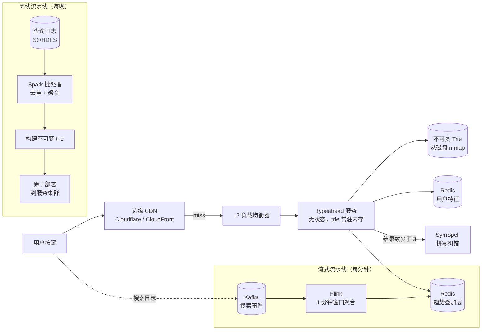
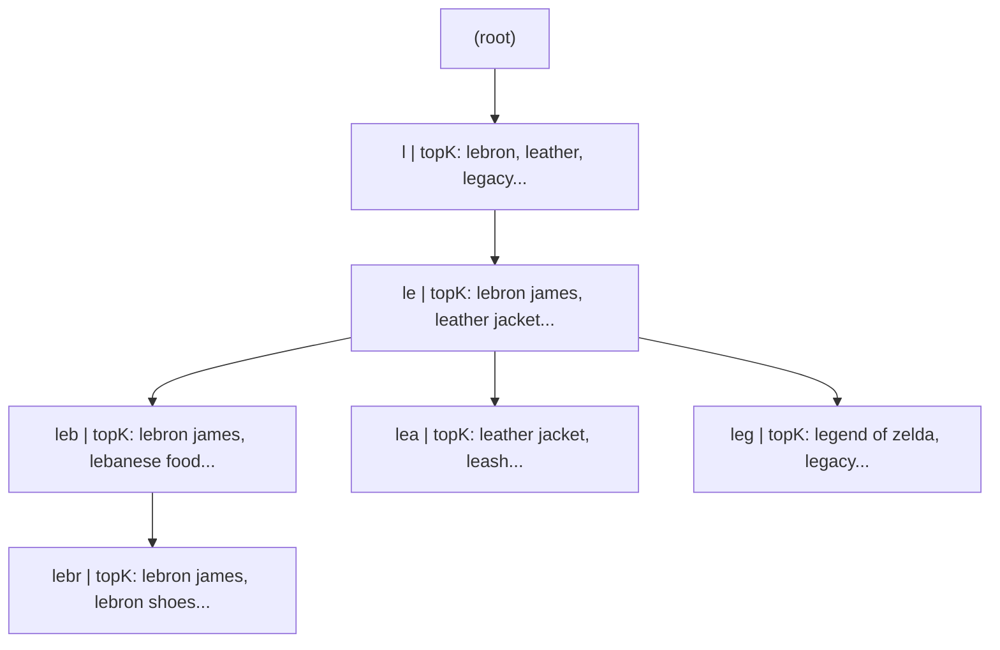
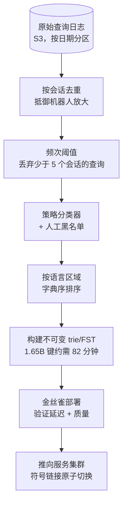
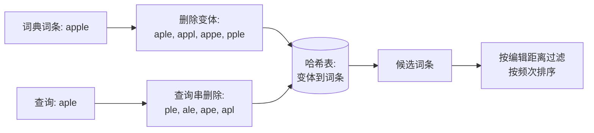

# 设计搜索自动补全（Typeahead 输入联想）

> **TL;DR.** 自动补全是个用户平时注意不到、一旦变慢就立刻察觉的功能。Google 每天处理 85 亿次搜索 [^1]，而自动补全在每次按键时都会触发，所以建议服务承受的 QPS 是搜索的 5-10 倍。从按键到建议渲染的整个预算只有 100 ms，其中后端分到 50 ms 以内 [^2]。胜出的架构是这样的：在每个 trie 节点上预计算 top-K 补全（查询期零排序），叠一层流式趋势数据保新鲜度，再把 20-30% 的流量推到边缘 CDN 缓存。最关键的权衡是预计算与新鲜度之争，一个 lambda 架构的混合方案把它解开了。

## 学习目标

完成本模块后，你将能够：

- [ ] 设计基于 trie 的服务层，在 O(前缀长度) 内返回 top-K 补全，且查询期不做任何排序
- [ ] 用量级估算（back-of-the-envelope estimation）推算 Google 规模自动补全的容量
- [ ] 设计 lambda 式更新流水线：每晚批量重建，外加每分钟一次的流式叠加
- [ ] 论证何时该用 FST 而非普通 trie，并量化能省下多少内存
- [ ] 在不超 50 ms 后端预算的前提下接入拼写纠错与个性化
- [ ] 识别自动补全投毒（autocomplete poisoning）这一信任与安全风险，并设计基于速率的缓解手段

## 直觉理解

你走进一家图书馆，问馆员有没有讲“quantum”的书。你话还没说完，她已经从柜台那头推过来一张卡片，上面列着以“quant”开头、最热门的十个书名。她并没有实时检索目录。昨晚她把每本书按热度排了序，为每一种可能的前缀都写了一张索引卡，写下前十名。你的请求不过是一次卡片查找。

再想象一条突发新闻：一本叫“Quantum Leap”的新书刚刚火起来。馆员晚上写的卡片里还没有它。于是她在柜台后面立了一块小白板，写着“今日热门”。当你问“quant”时，她会同时看预排序的卡片和白板，把结果合并，递给你合并后的前十名。

这就是生产级自动补全系统的全部架构。那些预排序的卡片，就是从查询日志每晚重建、每个节点都带预计算 top-K 的 trie。那块白板，就是由实时搜索事件喂养的流式叠加层。馆员那 100 ms 的响应预算，和 Google 输入联想服务面对的约束是同一个 [^2]。她选择预排序而不是实时检索，理由也和生产系统一样：在每秒 99,000 次查询的情况下 [^1]，为每一次按键给几百万个候选排序实在太慢。

朴素方案（一个数据库，一条 `SELECT ... WHERE query LIKE 'app%' ORDER BY frequency LIMIT 10`）服务 10 个用户没问题。到 500K QPS 就崩了，因为每个请求都要扫描并排序几千行。破解这个设计的洞见是：把所有排序搬到构建期，让查询期只剩下一次指针遍历。

## 需求

### 澄清问题

- **问：目标规模多大？**
  假设：Google 规模。每天 85 亿次搜索，自动补全在每次按键时触发（是搜索 QPS 的 5-10 倍），因此全球 500K-1M 自动补全 QPS。

- **问：延迟 SLA 是多少？**
  假设：端到端 100 ms（从按键到建议渲染出来）。扣掉网络与渲染时间，后端预算为 50 ms 以内。

- **问：个性化建议还是通用建议？**
  假设：两者都要。通用（非个性化）是默认路径，可在 CDN 缓存；个性化在通用 top-K 之上，用用户历史与位置重排。

- **问：趋势建议要新鲜到什么程度？**
  假设：突发新闻词必须在 5 分钟内出现。只靠每日批量重建不够。

- **问：是否支持多语言？**
  假设：支持。130+ 个语言区域，包括需要基于词典分词的 CJK（中文、日文、韩文）。

- **问：需要过滤冒犯性或诽谤性建议吗？**
  假设：需要。策略分类器和人工黑名单都是必须的。这方面已有判例（Bettina Wulff 诉 Google，2013）[^3][^4]。

### 功能需求

- 对用户输入的任何前缀，返回排名前 10 的补全
- 当精确前缀结果太少时，支持模糊匹配（拼写纠错回退）
- 热度飙升后 5 分钟内呈现趋势查询
- 用用户的搜索历史与位置做个性化建议
- 在返回之前过滤违反策略的建议（暴力、仇恨、诽谤）

### 非功能需求

- **负载：** 全球 500K-1M 自动补全 QPS；单服务节点 10K QPS
- **延迟：** 后端 p50 < 10 ms、p99 < 50 ms；端到端 100 ms
- **可用性：** 读路径 99.99%（降级模式：叠加层挂掉时返回陈旧的 trie）
- **一致性：** 最终一致。建议陈旧最多 5 分钟可以接受，陈旧 24 小时不行。
- **语料规模：** 全部语言区域合计 500M-1B 条去重查询串

## 容量估算

| 指标 | 数值 | 推导 |
|--------|------:|------------|
| Google 每日搜索量 | 8.5B | 公开汇总数据 [^1] |
| 自动补全 QPS（持续） | ~500K | 8.5B/86,400 × 5 次平均按键 |
| 自动补全峰值 QPS | ~1.5M | 峰值时段为持续值的 3 倍 |
| 去重查询串数量 | ~1B | 全部语言区域去重后 |
| 平均查询长度 | 20 chars | 行业平均值 |
| 原始语料大小 | 20 GB | 1B × 20 字节 |
| Trie 内存（top-K=10） | 30-40 GB | 约为原始的 2 倍，来自节点开销与 top-K 数组 [^5] |
| FST 内存（压缩后） | 4-8 GB | 原始文本的 20-40% [^6] |
| CDN 缓存命中率（短前缀） | 95%+ | 单字母前缀覆盖 20-30% 的请求量 |
| 趋势叠加层大小 | ~100 MB | Redis 中 top 1M 趋势查询 |

- **读写比：** 1,000:1 甚至更高。写是喂给流水线的搜索事件，读是自动补全查询。
- **带宽：** 平均响应 1 KB * 500K QPS = 源站出口 500 MB/s（CDN 卸载之前）。
- **服务集群：** 单节点 10K QPS 且 trie 常驻内存时，全球约 50-150 个节点（CDN 吸走 80%+ 流量之后）。
- **Redis 叠加层内存：** top 1M 趋势查询、每条约 100 字节 = 每个语言区域约 100 MB。单个 Redis 集群轻松扛住。

## API 与数据模型

### API 设计

```http
GET /v1/autocomplete?q=leb&locale=en&limit=10
  Headers: X-User-ID（可选，用于个性化）
  Returns: 200 {
    "suggestions": [
      {"text": "lebron james", "score": 0.98},
      {"text": "lebanese food", "score": 0.87},
      ...
    ],
    "corrected_prefix": null
  }
  Cache-Control: public, max-age=60（非个性化）
                 private, no-cache（个性化）
  Errors: 429 触发限流, 503 服务降级

GET /v1/autocomplete/trending?locale=en&limit=20
  Returns: 200 { "trending": [...] }
  （内部接口：供监控看板使用，不面向用户）

DELETE /v1/autocomplete/suggestions/{suggestion_id}
  （管理端：策略团队从索引中删除某条特定建议）
```

- **分页：** 不需要。自动补全永远返回固定的 top-K（通常是 10）。
- **限流：** 按 IP、按用户。客户端做防抖（按键间隔 50-200 ms）。
- **缓存键：** 非个性化用 `(prefix, locale)`；个性化请求绕过 CDN。

### 数据模型

```sql
-- 批处理流水线的输出（不可变，每晚重建）
-- 以序列化 trie/FST 的形式落盘，mmap 进服务进程
trie_snapshot (
  prefix        varchar,       -- 隐含在 trie 结构中
  top_k         text[10],      -- 预计算的补全，按分数降序
  score         float[10],     -- 对应的分数
  locale        varchar(5),    -- 用于分片的分区键
  build_id      bigint         -- 用于原子切换的版本号
)

-- 趋势叠加层（Redis 有序集合，用 ZRANGE ... BYLEX 查询）
-- Key: trending:{locale}
-- Members: 查询串，Score: 当前窗口内的频次
ZADD trending:en 4500 "lebron james" 3200 "lebanese food"

-- 用户特征（Redis hash，TTL 30 天）
-- Key: user_features:{user_id}
HSET user_features:u123 recent_queries "lebron,lakers,nba" geohash "9q8yy"
```

分片策略：按前缀区间（a-d、e-h……）把 trie 切到各服务节点上。每个节点在内存里持有自己那段前缀区间的完整 trie。趋势叠加层是单个 Redis 集群，按语言区域分片。

## 高层架构



*端到端自动补全架构：边缘 CDN 吸走热门前缀；typeahead 服务把不可变 trie 与流式趋势叠加层合并；离线与流式两条流水线分别喂养这两层。*

**写路径：** 每一次搜索都产出一条日志事件 `{query, user_id, locale, timestamp}`。事件落到 Kafka topic，按查询哈希分区。Flink 流作业把它们按 1 分钟滚动窗口聚合，写入 Redis 趋势叠加层。另一边，原始日志批量落到 S3，供夜间重建 trie 使用。

**读路径：** 一次按键触发一个 GET 到 CDN。未命中时，typeahead 服务走不可变 trie 拿到通用 top-50，从 Redis 取趋势候选，合并，可选地用用户特征重新打分，返回 top-10。如果结果数少于 3，触发拼写纠错回退。

**异步路径：** 夜间 Spark 作业读取全量查询日志，去重、按频次过阈值、构建新的不可变 trie，再通过原子文件切换（符号链接轮转）部署到服务集群。全程零停机：新 trie 完全加载之前，旧的一直在服务。

## 深入探讨

### 深入 1：基于 trie 的服务、内存账与 FST 压缩

**问题所在：** 要用 50 ms 以内的 p99 扛住 500K QPS，就需要一个常驻内存、能在不排序的前提下回答前缀查询的数据结构。数据库查询太慢，哈希表又不支持前缀匹配。

**带预计算 top-K 的 trie：** 每个节点存一个固定大小的数组，装的是以该子树为根的最热 K 条补全，按分数降序。查询时沿前缀逐字符下行，直接返回 `node.top_k`。代价是 O(前缀长度)，通常 5-20 次指针跳转。服务期一个比较器都不用跑 [^5]。

**内存账：** 1B 条去重查询 * 平均 20 字符 = 20 GB 原始数据。每节点存 K=10 条补全（每条 20 字节指针），这部分开销大致让原始大小翻倍到 30-40 GB。基数树（Patricia trie）会把只有一个子节点的链折叠起来，通常能砍掉 50-70% 的节点数，内存降到每分片 15-25 GB [^5]。

**FST 压缩：** 连基数树都嫌大时，用有限状态转换器（finite-state transducer，FST），它同时共享前缀与后缀。BurntSushi 的 `fst` crate 把 16M 条 Wikipedia 标题（原始 384 MB）索引成 157 MB（原始大小的 41%）；对 1.65B 条 Common Crawl URL（排序后 134 GB），FST 是 27 GB（原始大小的 20%）[^6]。Elasticsearch 的 completion suggester 每个 Lucene segment 用一个 FST，在 2.1M 条 Wikipedia 标题上做到 p50 0.72 ms [^7]。

**分片策略：** 按前缀区间把数据分到 N 个服务节点上，每个节点在内存里持有自己那段前缀区间的完整 trie。路由层把查询的前 1-2 个字符映射到正确的分片。50 个节点、每节点 30 GB 时，集群总内存 1.5 TB，完全落在通用硬件的预算之内。Elasticsearch 的 completion 字段类型每个 Lucene segment 存一个 FST，因此可以横向扩展，每个分片维护自己独立的 FST [^8]。



*每个 trie 节点存一个预计算的 top-K 数组。查询“leb”只走三个节点就拿到答案，零排序。*

**权衡：trie 与 FST。** 当语料能装进单个分片的内存（30 GB 以内）、且需要快速更新时，用普通基数树。当语料超出内存、或需要尽可能小的 mmap 服务体积时，用 FST。FST 不可变，更新要么整体重建，要么新增一个 segment（Lucene 的做法）。

### 深入 2：离线查询日志聚合流水线

**问题所在：** 不可变 trie 每天要基于数十亿条原始搜索事件重建一次。流水线必须在夜间批处理窗口内完成去重、频次阈值、策略过滤，并产出适合构建 FST 的有序键集。

**流水线各阶段：**

1. **接入：** 原始查询日志落到 S3/HDFS，按日期与语言区域分区。每条记录：`{query, user_id, locale, timestamp, clicked_result_id}`。
2. **去重：** 按 `(query, locale)` 分组。统计唯一会话数（不是原始事件数），以抵御机器人放大。
3. **频次阈值：** 丢掉低于最小会话数的查询（例如 30 天内 5 个唯一会话）。这能消除长尾噪声，把语料规模砍掉 80-90%。
4. **策略过滤：** 对每个候选跑自动分类器（暴力、仇恨、色情、选举、健康），违规的直接丢弃。再与信任与安全团队维护的人工黑名单合并 [^9]。
5. **排序：** 按语言区域对存活下来的查询做字典序排序。这是构建 FST 的前提 [^6]。
6. **构建：** 把有序的键流式喂给 trie/FST 构建器。BurntSushi 报告，单机从 1.65B 条预排序 URL 构建 FST 用了 82 分钟 [^6]。
7. **部署：** 把新的 trie 产物上传到每个服务节点，通过符号链接轮转做原子切换。先金丝雀一个节点，验证延迟与建议质量，再推向整个集群。



*夜间批处理流水线用七个阶段把原始查询日志变成可部署的不可变 trie。基于会话的去重与策略过滤放在构建之前，保证语料干净。*

**流式叠加层（加速层）：** 批处理每天只跑一次。为了新鲜度，由一个 Flink 作业消费 Kafka 的搜索事件 topic，开 1 分钟滚动窗口，按 `(query, locale)` 聚合计数，再做速率校验（要求来自 M 个不同 IP 的 N 个唯一会话，以抵御投毒），最后写入 Redis 趋势叠加层 [^10][^11]。查询时，typeahead 服务用一次简单的分数加权并集，把趋势候选与不可变 trie 的 top-K 合并起来 [^12]。

### 深入 3：个性化、排序与拼写纠错

**个性化当作重排器：** typeahead 服务先从 trie 取通用 top-50，再由一个轻量重排器依据用户特征重排：

- **本次会话的近期查询：** 给用户搜过的补全加权（按时间做指数衰减）。
- **地理位置：** 东京的用户在输入“sush”时看到的日料会加权，纽约的用户则看到不同结果。
- **长期兴趣：** 从搜索历史推导出的主题偏好（体育、烹饪、科技）。
- **ML 模型（可选）：** 一个小的 pointwise 排序器（逻辑回归或梯度提升树）给 50 个候选逐个打分。必须在 20 ms 内跑完。

存储成本是 O(通用索引 + 每用户特征向量)，而不是 O(用户数 * 索引大小)。通用层依然可以在 CDN 缓存，重排器只在个性化请求上运行。

**拼写纠错回退：** 精确前缀返回的结果少于 3 条时，服务调用 SymSpell。SymSpell 预先为词典里每个词预计算到编辑距离 d 以内的所有删除变体，存进哈希表。查询时，它生成查询串的删除变体，做哈希表查找。d=2 时每次查找 0.033 ms [^13]。SeekStorm 的基准显示，d=3 时 SymSpell 比 BK-tree 快 1,870 倍 [^14]。



*SymSpell 的非对称技巧：词典词条和查询串都只生成删除变体。用一次哈希表查找取代昂贵的 O(字母表 * 长度^d) 编辑生成，做到每次查找 0.033 ms [^13]。*

**查询时合并的排序信号：**

| 信号 | 权重 | 来源 |
|--------|--------|--------|
| 全局频次 | 0.4 | 不可变 trie 的分数 |
| 趋势速率 | 0.25 | Redis 叠加层 |
| 用户近期行为 | 0.2 | 用户特征 hash |
| 地理相关性 | 0.1 | Geohash 匹配 |
| 拼写纠错惩罚 | -0.05 | 编辑距离 > 0 |

## 真实案例

**LinkedIn Cleo：为 1.5 亿+ 会员提供 20 ms 的输入联想**

LinkedIn 开源的 Cleo 库（2012）同时支撑通用输入联想（公司、群组、技能）和社交关系感知的输入联想（把一度/二度人脉用 People You May Know 的分数重排）。系统在 1.5 亿+ 会员规模下做到平均约 20 ms 返回建议 [^11]。

Cleo 的架构在每个分区上用四种数据结构 [^11]：

1. **倒排索引**，以短前缀为键（最长 4 个字符）。前缀够短，倒排表就能装进 L3 cache，走内存扫描而不是磁盘读。
2. **布隆过滤器**（每个文档 8 字节、64 位）。先过滤掉那些布隆过滤器不包含查询串全部位的候选。误报率约 10%，可以接受，因为第 3 步会把它们筛掉。
3. **正向索引**确认前缀匹配，拒绝布隆过滤器的误报。
4. **外部分数**表，存放每篇文档的相关性（热度、PYMK）。

一次 `john san fran` 的查询会取出 `john` 的倒排表（前缀最长 4）、做布隆过滤、用正向索引确认、打分，并在各分区之间合并 top-K。乱序前缀匹配意味着 `john san fran` 能命中“San Francisco, John Doe”，因为倒排索引是按词建的，不是按短语 [^11]。

LinkedIn 后来把 Cleo 归档进 `LinkedInAttic`，替换成 `typeahead-rest`：一个 Rest.li 中间层，联邦查询会员、公司、群组、技能等后端，2014 年第一季度上线 [^15]。截至 2026 年，LinkedIn 在全球 200 多个国家和地区拥有超过 13 亿会员 [^16]。非专家容易看漏的关键洞见是：Cleo 那个 4 字符前缀上限不是限制，而是刻意的设计选择。前缀越短，倒排表越小，越能装进 CPU cache，让扫描阶段受内存带宽约束，而不是受计算约束。

## 权衡

| 方案 | 优点 | 缺点 | 适用场景 | 我们的选择 |
|----------|------|------|-------------|----------|
| 每节点带 top-K 的 trie | O(前缀) 查找，查询期不排序 | 1 亿查询要 20-40 GB；更新成本 O(深度) | 语料大、分布稳定 | 核心服务层 |
| Lucene FST（独立使用） | 原始文本的 20-40%；共享后缀 | 不可变；需要有序输入；构建复杂 | 十亿级静态语料 | 每日重建格式 |
| Redis ZRANGE BYLEX [^17] | O(log N + M)，更新简单，易分片 | 没有天然的热度序；每条内存开销高 | 趋势叠加层、小语料 | 趋势层 |
| ES completion suggester | 内置模糊匹配，可横向扩展 | p99 不如进程内 trie；JVM GC 停顿 | 已经在用 ES 的混合功能搜索 UI | 不走主路径 |
| 快照 + 流式叠加层 | 几分钟内拿到趋势，核心简单 | 两条代码路径，合并有复杂度 | 查询流变化快 | Lambda 架构 |
| 热门前缀走边缘 CDN | 把 20-30% 负载从源站移走 | 突发新闻期间直到 TTL 到期都是旧的 | 全球用户、读写比高 | 一级缓存 |
| 在通用 top-50 上做 ML 重排 | 能适配用户/查询特征；模型可替换 | 多一跳 10-20 ms；质量上限就是通用 top-50 | 有用户行为数据的成熟产品 | 个性化路径 |

最大的那个权衡：**预计算与新鲜度。** 全量预计算的 trie 给出微秒级延迟，但趋势查询最长要等 24 小时才出现。全实时系统（每次按键都查日志）根本满足不了 50 ms 预算。lambda 混合方案解开了这道题：不可变 trie 承接 99% 以上的查询，流式叠加层覆盖那不到 1% 的趋势查询。Google、YouTube、LinkedIn 用的都是这个模式的变体 [^10][^11][^9]。

## 扩展与故障模式

**10 倍负载（5M QPS）：** CDN 吸走非个性化查询增量的大部分。服务集群通过增加 trie 分片横向扩展。Redis 趋势叠加层可能需要扩容集群。

**100 倍负载（50M QPS）：** trie 必须进一步压缩（FST 变成必选项）。3 个字符以内的所有前缀都由边缘 CDN 缓存，这一点成为关键。流式流水线需要扩 Kafka 分区、提 Flink 并行度。

**1,000 倍负载（500M QPS）：** 架构重写。转向 CDN 优先模式：CDN 持有长度 4 以内所有前缀的预计算 JSON（每个语言区域 26^4 = 456K 个键）。源站只服务长尾和个性化查询，trie 退化为仅源站使用的兜底。

**故障模式：**

- **Redis 趋势叠加层挂掉：** 优雅降级。只从不可变 trie 提供服务。建议最多陈旧 24 小时，但功能仍可用。叠加层陈旧超过 10 分钟就告警。
- **trie 构建失败（夜间）：** 继续用前一天的 trie 服务。符号链接的原子切换意味着旧版本会一直在线，直到被显式替换。构建产物年龄超过 36 小时就告警。
- **自动补全投毒（机器人攻击）：** Flink 流水线里的速率校验（要求来自 M 个不同 IP 的 N 个唯一会话）能挡住大多数自动化活动。万一被投毒的建议真进了生产，人工黑名单 + 策略分类器会在几分钟内拦下。Bettina Wulff 案 [^3][^4] 确立了通知即下架义务的法律判例。

## 常见陷阱

> [!WARNING]
> **把全文检索当输入联想用。** `match_phrase_prefix` 查询会 OR 展开成所有以该前缀开头的词，遍历倒排表并逐个候选打分。Elasticsearch 自己的基准显示，同一数据集上 completion suggester 快 6 倍（0.72 ms 对 4.41 ms）[^7]。请用专门的补全索引。

> [!WARNING]
> **查询期排序而不是预计算 top-K。** 朴素的 trie 存下全部补全，每次请求都排一遍。500K QPS、每个前缀 1,000 个候选，CPU 全烧在比较器上。构建期把 top-K 数组算好，查询就退化成 O(1) 拷贝 [^5]。

> [!WARNING]
> **每次按键都跑拼写纠错。** SymSpell 很快（每次查找 0.033 ms），但无条件跑它会给那 95% 精确前缀已够用的查询平白增加延迟和 CPU。用“精确结果少于 3”作为门槛，并在客户端做 200 ms 防抖 [^13]。

> [!WARNING]
> **忽视 CJK 分词。** 中文、日文、泰文没有词边界。用原始文本建字符级 trie，中文用户会得到零条建议。按语言区域用基于词典的分词器（中文用 jieba，日文用 kuromoji），并把所有键归一化到 Unicode NFC [^18][^19]。

> [!CAUTION]
> **自动补全投毒。** 有组织的机器人活动可以把诽谤性查询顶进 top-K。Bettina Wulff 案（2012-2013）促成德国联邦法院裁定：Google 一旦收到通知，必须移除诽谤性自动补全建议 [^3][^4]。用速率阈值、策略分类器，以及面向用户的“举报此建议”入口来缓解 [^9]。

## 追问

**1. 如何处理多语言自动补全，尤其是 CJK 和 RTL 文字？**

在建索引和查询时都把所有键与查询归一化到 Unicode NFC [^18]。对 CJK，用基于词典的分词器（中文 jieba，日文 kuromoji）切词并按词索引 [^19]。维护并行的音译路径（拼音到汉字），让输入 `beij` 也能命中中文查询。对阿拉伯语/希伯来语，存储与匹配仍按字节逐位进行（LTR），RTL 渲染交给客户端用 BiDi 算法处理。

**2. 如何把语义自动补全和 LLM 结合起来（Bing Chat、Google SGE）？**

LLM 驱动的建议是叠在通用 top-50 之上的重排器，而不是前缀 trie 的替代品。跑一个轻量 embedding 模型，计算部分查询与候选补全之间的语义相似度。把语义 top-10 与基于频次的 top-10 取并集再重排。延迟约束：embedding 推理必须在 20 ms 内完成（用蒸馏模型或预计算 embedding）。

**3. 如何处理诽谤性建议的删除请求？**

维护一份人工黑名单，在构建期（从 trie 中排除）和查询期（从结果中过滤）都检查。面向用户的“举报此建议”入口喂给审核队列。对法律层面的下架要求（DMCA、法院命令），24 小时内移除。Bettina Wulff 判例 [^4] 要求一旦收到通知就要主动过滤。

**4. 如何把自动补全上线到一个新的国家/语言区域？**

用翻译过的全球查询加上本地种子数据（本地企业名、名人、新闻话题）做冷启动。从第一天起就按语言区域跑批处理流水线。流式叠加层随着用户搜索自然填充。质量指标用建议点击率，与全球基线对比。

**5. 针对移动端排序需要做哪些改动？**

移动端用户打字更慢（按键间隔更长），屏幕更小（只显示 5 条建议而不是 10 条）。防抖要更激进（300 ms 对桌面端的 50 ms）。给能塞进一行的短补全加权。App 启动时用用户最近的查询预取 top-100 建议（类似 Twitter typeahead.js 的 Bloodhound 模式 [^20]）。

**6. 防抖间隔怎么定？**

太短（0 ms）会让每次按键都打到后端，把服务淹掉。太长（500 ms）手感发滞。生产系统用 50-200 ms 的自适应防抖：每次按键启动一个计时器，下一次按键时重置，计时器到期就发请求。移动端因为打字慢，用更长的间隔（200-300 ms）。

## 练习

### 练习 1：模糊回退设计

用户输入 `lbro`（`lebron` 的错拼），精确前缀查找返回零条建议。设计一条能在 50 ms 预算内触发模糊/编辑距离查找的回退路径。判断应该有多大比例的查询走模糊路径，以及你会如何衡量质量收益。

<details>
<summary>提示</summary>

触发条件是“精确前缀返回的结果少于 N 条”（通常 N=3）。编辑距离 2 的 SymSpell 每个词条耗时 0.033 ms [^13]，所以模糊路径本身不是瓶颈。想一想，在一份标注过的已知错拼查询留出集上，你会用什么质量指标。

</details>

<details>
<summary>解答</summary>

1. typeahead 服务沿不可变 trie 走前缀 `lbro`，结果数 = 0。
2. 因为结果数 < 阈值（3），服务调用拼写纠错回退。
3. SymSpell 生成 `lbro` 的删除变体（`bro`、`lro`、`lbo`、`lbr`），逐个在预计算的哈希表里查找。命中：`lebron`（编辑距离 2）。
4. 服务沿 trie 走纠正后的前缀 `lebron`，取出 top-10，返回时标注“正在显示 lebron 的结果”。

**走模糊路径的比例：** 大约 5-10% 的查询会触发回退（即那些精确结果少于 3 条的）。SymSpell 只增加 0.033-0.18 ms，远在预算之内。

**质量衡量：** 从点击流日志里构造一份（错拼查询，意图查询）的标注数据集。在这份留出集上分别计算带模糊回退与不带模糊回退的 NDCG@10。做 A/B 测试，把建议点击率作为线上指标。

**预算拆解：** trie 遍历（0.1 ms）+ SymSpell（0.033 ms）+ 纠正后 trie 遍历（0.1 ms）+ 重排（1-2 ms）= 总计不到 5 ms。

</details>

## 要点回顾

- **构建期预计算 top-K，绝不在查询期排序。** 这一个决定就是每请求 0.1 ms 与 100 ms 的分水岭。
- **lambda 架构解开了预计算与新鲜度的矛盾。** 不可变的每日 trie 承接 99% 以上的查询，流式叠加层在几分钟内补齐趋势。
- **FST 靠共享后缀把十亿键的语料压到原始大小的 20-40%**，让通用硬件上的内存服务变得可行 [^6]。
- **拼写纠错是有门槛的回退，不是默认路径。** 只在低结果前缀上触发；SymSpell 每次查找 0.033 ms，塞进预算毫不费力 [^13]。
- **短前缀的边缘 CDN 缓存卸掉 20-30% 的流量**，TTL 60 秒。自动补全的读写比高达 1,000:1。
- **自动补全投毒是实实在在的法律责任。** Bettina Wulff 判决为诽谤性建议确立了通知即下架义务 [^4]。

## 延伸阅读

- [How Google autocomplete predictions work](https://support.google.com/websearch/answer/7368877?hl=en)。Google 官方对排序信号、新鲜度与策略过滤的说明；“预测不是答案”这个定位已成经典。
- [You Complete Me (Elastic blog, 2013)](https://www.elastic.co/blog/you-complete-me/)。Alexander Reelsen 介绍 completion suggester 的文章，附基准：p50 0.72 ms，而前缀查询是 4.41 ms。
- [Index 1,600,000,000 Keys with Automata and Rust (BurntSushi, 2015)](https://burntsushi.net/transducers/)。讲 FST 构建最深入的一篇，带 Wikipedia 标题与 Common Crawl URL 的实测数据。
- [LinkedIn Cleo: Open Source Technology Behind LinkedIn's Typeahead Search](https://web.archive.org/web/20260217114030/https://engineering.linkedin.com/open-source/cleo-open-source-technology-behind-linkedins-typeahead-search)。支撑 1.5 亿会员、20 ms 响应的倒排索引 + 布隆过滤器 + 正向索引架构。
- [SymSpell (GitHub)](https://github.com/wolfgarbe/SymSpell)。对称删除拼写纠正算法，附与 BK-tree、Norvig 的对比基准。
- [SymSpell vs BK-tree (SeekStorm, 2017)](https://seekstorm.com/blog/symspell-vs-bk-tree/)。正面对比，显示 SymSpell 依编辑距离不同快 100-1,870 倍。
- [Fagin et al., "Optimal Aggregation Algorithms for Middleware" (2003)](https://arxiv.org/abs/cs/0204046)。Threshold Algorithm 原论文，多路有序列表 top-K 合并的理论根基。
- [Redis ZRANGEBYLEX reference](https://redis.io/docs/latest/commands/zrangebylex/)。O(log N + M) 的字典序区间查询，趋势叠加层模式的基础。自 Redis 6.2 起已弃用；新代码请用带 `BYLEX` 参数的 `ZRANGE`。

## 记忆卡片

<details>
<summary><strong>问：自动补全的端到端延迟预算是多少，后端分到多少？</strong></summary>

答：从按键到建议渲染，端到端 100 ms。扣掉网络与渲染时间后，后端分到 50 ms 以内 [^2]。

</details>

<details>
<summary><strong>问：为什么 top-K 必须在每个 trie 节点预计算，而不是查询时排序？</strong></summary>

答：每请求给 M 个候选排序是 O(M log M)。500K QPS、M=1,000 时，CPU 全被比较器吃掉。预计算让查询期变成 O(前缀长度)，零排序 [^5]。

</details>

<details>
<summary><strong>问：FST 如何做到只有原始文本的 20-40%？</strong></summary>

答：它同时共享前缀（像 trie）和后缀（trie 做不到）。所有以同一子串结尾的键共享终态，节点数因此大幅减少 [^6]。

</details>

<details>
<summary><strong>问：保证自动补全新鲜度的 lambda 架构模式是什么？</strong></summary>

答：不可变的每日 trie（从查询日志批量重建）承接 99% 以上的查询。流式叠加层（Kafka + Flink，1 分钟窗口，写入 Redis）在几分钟内把趋势查询呈现出来。两者在查询时合并 [^10][^11]。

</details>

<details>
<summary><strong>问：拼写纠错回退应该什么时候触发？</strong></summary>

答：当精确前缀查找返回的结果少于 N 条时（通常 N=3）。无条件跑拼写纠错，会让那 90-95% 已经有足够精确结果的查询白白消耗 CPU [^13]。

</details>

<details>
<summary><strong>问：SymSpell 的非对称技巧是什么？</strong></summary>

答：它只预先计算词典词条的删除变体。查询时，生成查询串的删除变体并做哈希表查找。这让候选生成从 O(字母表 * 长度^d) 降到 O(5^d) 次哈希探测 [^13]。

</details>

<details>
<summary><strong>问：Bettina Wulff 案如何改变了自动补全系统的设计？</strong></summary>

答：2013 年德国联邦法院的判决确立了 Google 对诽谤性自动补全建议负有通知即下架义务。现在的生产系统对每个候选都跑策略分类器，并维护人工黑名单 [^3][^4]。

</details>

<details>
<summary><strong>问：边缘 CDN 在自动补全架构里扮演什么角色？</strong></summary>

答：它用 60-300 秒的 TTL 缓存短小热门前缀的非个性化响应，把总请求量的 20-30% 从源站卸掉。

</details>

<details>
<summary><strong>问：LinkedIn Cleo 如何在 1.5 亿会员规模下做到 20 ms？</strong></summary>

答：每个分区四种数据结构：倒排索引（前缀最长 4 个字符，以装进 L3 cache）、布隆过滤器（64 位，误报率约 10%）、正向索引（确认匹配）、外部分数表。前缀上限让倒排表小到可以做内存扫描 [^11]。

</details>

<details>
<summary><strong>问：自动补全的读写比是多少，为什么重要？</strong></summary>

答：至少 1,000:1。这个极端比例意味着多级缓存（CDN、内存 trie、Redis）在这里的回报比几乎任何其他搜索子系统都高。写（搜索事件）是异步喂进流水线的。

</details>

## 参考文献

[^1]: Colorlib/wifitalents 汇总的 Google 搜索统计数据：“Google 每天处理 85 亿次搜索……每秒约 99,000 次查询。” https://colorlib.com/wp/search-engine-statistics/

[^2]: 从按键到建议延迟的行业惯例（100 ms 为人眼可感知阈值，50 ms 为后端预算）。 https://www.elastic.co/blog/you-complete-me/

[^3]: Deutsche Welle，“German federal court raps Google on the knuckles over autocomplete function”，2013-05-15。 https://www.dw.com/en/german-federal-court-raps-google-on-the-knuckles-over-autocomplete-function/a-16813363

[^4]: AIAAIC，“Google Autocomplete conflates Bettina Wulff with 'prostitute'”案例档案。 https://www.aiaaic.org/aiaaic-repository/ai-algorithmic-and-automation-incidents/google-autocomplete-conflates-bettina-wulff-with-prostitute

[^5]: Donne Martin，“System Design Primer: Design a typeahead/autocomplete system”。 https://github.com/donnemartin/system-design-primer

[^6]: Andrew Gallant（BurntSushi），“Index 1,600,000,000 Keys with Automata and Rust”，2015。 https://burntsushi.net/transducers/

[^7]: Alexander Reelsen，“You Complete Me”，Elastic 博客，2013-08-22。 https://www.elastic.co/blog/you-complete-me/

[^8]: Elasticsearch Reference，“Completion field type”。 https://www.elastic.co/docs/reference/elasticsearch/mapping-reference/completion

[^9]: Google Search Help，“How Google autocomplete predictions work”。 https://support.google.com/websearch/answer/7368877?hl=en

[^10]: Tianpan / Puncsky，“Designing typeahead search or autocomplete”——涵盖不可变快照 + 流式叠加层的 lambda 模式。 https://tianpan.co/notes/179-designing-typeahead-search-or-autocomplete

[^11]: Jingwei Wu，“Cleo: the open source technology behind LinkedIn's typeahead search”，LinkedIn Engineering，2012。 https://web.archive.org/web/20260217114030/https://engineering.linkedin.com/open-source/cleo-open-source-technology-behind-linkedins-typeahead-search

[^12]: Ronald Fagin, Amnon Lotem, Moni Naor，“Optimal Aggregation Algorithms for Middleware”（Threshold Algorithm），JCSS 2003。 https://arxiv.org/abs/cs/0204046

[^13]: Wolf Garbe，SymSpell README，含性能数据。 https://github.com/wolfgarbe/SymSpell

[^14]: SeekStorm，“SymSpell vs. BK-tree: 100x faster fuzzy string search & spell checking”，2017。 https://seekstorm.com/blog/symspell-vs-bk-tree/

[^15]: LinkedIn Engineering，“Search Federation Architecture at LinkedIn”，2018-03。 https://engineering.linkedin.com/blog/2018/03/search-federation-architecture-at-linkedin

[^16]: LinkedIn About 页面：“Welcome to LinkedIn, the world's largest professional network with more than 1.3 billion members in more than 200 countries and regions worldwide。” https://about.linkedin.com/

[^17]: Redis 文档，“ZRANGEBYLEX” 命令参考（自 Redis 6.2 起弃用；新代码请用 `ZRANGE ... BYLEX`）。 https://redis.io/docs/latest/commands/zrangebylex/

[^18]: Unicode.org 关于归一化的 FAQ（NFC 与 NFD）。 http://unicode.org/unicode/faq/normalization.html

[^19]: fxsjy/jieba——中文分词库。 https://github.com/fxsjy/jieba

[^20]: Twitter typeahead.js README，含 Bloodhound + Typeahead 组件拆解。 https://github.com/twitter/typeahead.js
