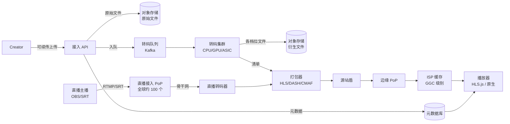
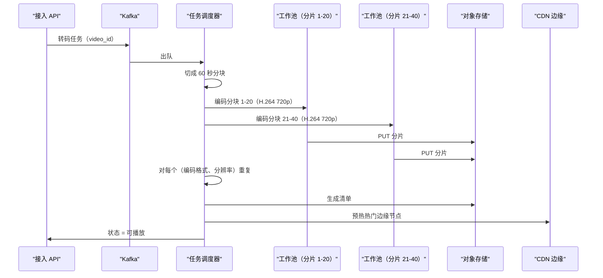
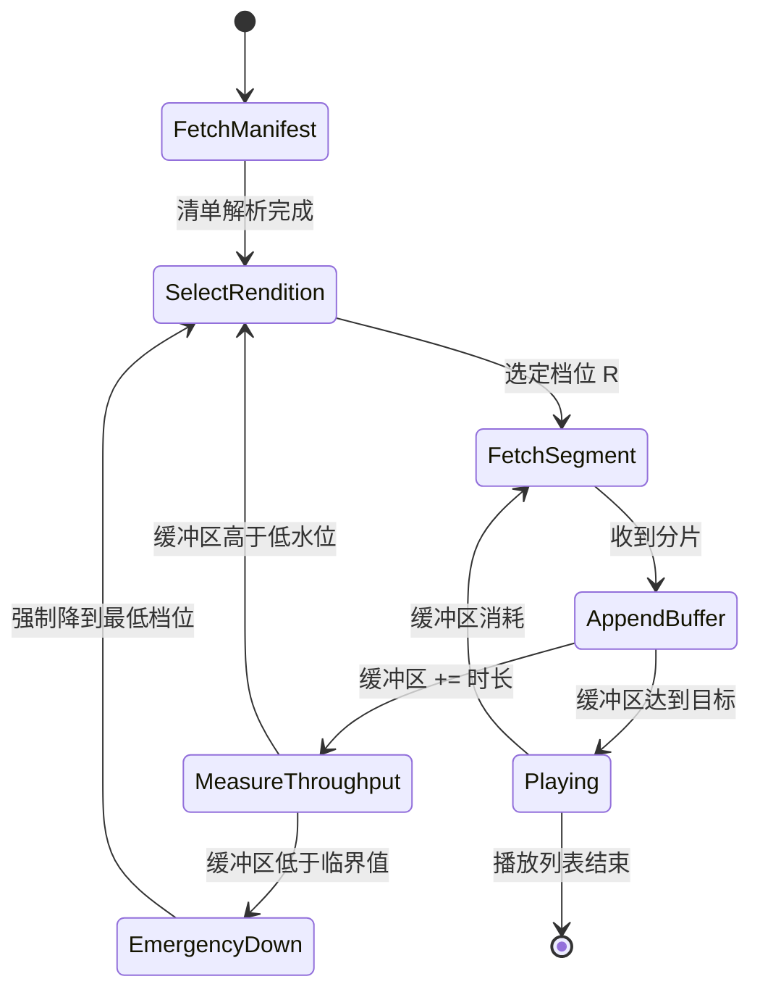
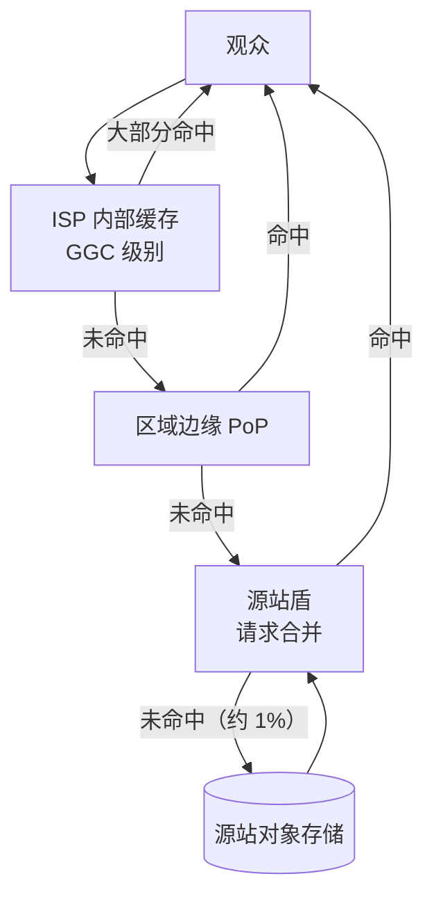
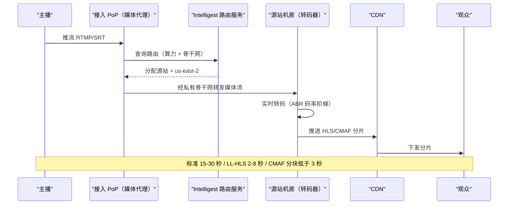

# 设计视频流媒体服务（YouTube / Twitch / TikTok）

> **TL;DR.** 一个 UGC 视频平台就是四条松耦合的流水线共用一个 video ID：接入、转码、打包、分发。YouTube 每分钟接入 500 多小时视频 [^1]，每天服务约 10 亿小时观看时长 [^2]。这套架构利用的是 100,000:1 的读写不对称：在上传时付一次高昂成本（编码所有档位、打成 HLS/DASH 分片、复制到边缘），让之后的每一次观看都变成 CDN 缓存命中。定制转码 ASIC 比软件编码的能效高 20-33 倍 [^3][^4]，驻留在 ISP 内部的缓存把约 95% 的字节留在观众所在网络里 [^5][^6]，自适应码率流式播放则让播放器在播放中途切换档位而不重新缓冲。最关键的权衡是：提前全量预编码（起播快、存储成本高），还是按需编码（存储省、有冷启动延迟）。

## 学习目标

学完本模块后，你将能够：

- [ ] 设计一条转码流水线，从单个上传源文件产出 ABR 码率阶梯
- [ ] 比较 HLS、DASH 与 CMAF，并说明各自在什么情况下胜出
- [ ] 为每分钟接收 500 小时上传的平台估算存储、算力与带宽
- [ ] 设计带源站盾的 CDN 层级，把边缘命中率做到 95% 以上
- [ ] 区分直播接入架构与点播（VOD），并讲清延迟上的权衡（标准 HLS 15-30 秒 vs LL-HLS 2-8 秒）
- [ ] 论证在不同规模档位上，定制硬件（ASIC）与通用 CPU/GPU 转码该如何取舍

## 直觉理解

朴素的视频平台简单得不像话：把 MP4 传到 S3，把 URL 发出去。10 个光纤用户用起来毫无问题。到了 1000 万用户、网络环境五花八门，它会因为三个原因崩掉。

第一，把 4K 60 Mbps 的文件发给一个 4 Mbps DSL 用户，结果要么无限缓冲，要么 90% 的字节被浪费。你需要多种分辨率。第二，把一个 10 分钟的视频编成 7 档的码率阶梯要花 30 多 CPU 分钟。按每分钟上传 500 小时算 [^1]，那就是每分钟 210,000 CPU 分钟的编码工作量。你需要并行，甚至可能需要定制硬件。第三，每天从单一源站服务 10 亿小时观看时长 [^2]，出口带宽得是千万亿比特量级。你需要在各处布缓存，最好布在观众所用的 ISP 内部。

打开这个设计的钥匙是一句话：视频写一次、读几百万次。上传时花的每一块钱（编码、打包、复制），都能在播放时省下几千块。整套架构就是这个不对称的直接推论。一旦想通这一点，后面的每个决定（提前编好完整阶梯、把分片推到 ISP 缓存、用基于 HTTP 的分发方式以便任何 CDN 都能接）都顺理成章。

## 需求

### 澄清问题

- **Q: 是 UGC（用户生成内容），还是买断版权的片库（Netflix 那种）？**
  假设：UGC。任何创作者都能无上限上传。版权点播的场景见 [设计 Netflix](./11-netflix.md)。
- **Q: 上传量有多大？**
  假设：YouTube 规模下每分钟 500 多小时 [^1]。按这个上限来设计。
- **Q: 起播延迟（首帧时间）的目标是多少？**
  假设：命中缓存的观众 p99 < 200 毫秒。冷门内容可能要几秒。
- **Q: 是否支持直播？**
  假设：支持。标准直播（15-30 秒延迟）与低延迟直播（2-8 秒，调优良好的部署常见 2-5 秒）。
- **Q: 要支持多种编码格式吗？**
  假设：要。H.264（兼容性）、VP9（省带宽）、AV1（约 2024 年起成为主流；YouTube 片库覆盖 75% 以上，Netflix 30% 的播放流）。三者都进码率阶梯。

- **Q: 地理分布呢？**
  假设：全球。观众分布在 200 多个国家。能驻留 ISP 的缓存就驻留。

### 功能性需求

- 创作者通过可续传的 HTTP 上传视频（上传中途断网后能接着传）
- 系统把每次上传转成多分辨率、多编码格式的 ABR 码率阶梯
- 观众观看时根据网络状况自适应切换码率
- 直播创作者推送 RTMP/SRT 流，实时转码并分发
- 创作者管理元数据（标题、简介、封面）并查看播放分析

### 非功能性需求

- **上传量：** 每分钟 500 多小时（约 30,000 视频分钟/分钟）[^1]
- **每日观看时长：** 约 10 亿小时/天 [^2]
- **月活用户：** 约 25.8 亿（2025-2026 年；近几年在 25 亿至 27 亿之间波动）[^2]
- **起播延迟：** p99 < 200 毫秒（命中缓存的内容）
- **边缘命中率：** 95% 以上的分片请求不落到源站 [^5]
- **直播延迟：** 标准 15-30 秒，低延迟 2-8 秒 [^7][^8]
- **可用性：** 读路径 99.99%，写路径 99.9%

## 容量估算

| 指标 | 数值 | 推导 |
|--------|------:|------------|
| 上传速率 | 500 小时/分钟 | YouTube 公开数据 [^1] |
| 上传 QPS | 约 50 次/秒 | 500 小时/分钟 ÷ 平均每视频 10 分钟 |
| 每分钟转码任务 | 500 | 每个上传视频 1 个任务 |
| 每视频档位数 | 15-20 | 7 种分辨率 × 2-3 种编码格式 |
| 每日衍生文件存储 | 约 1 PB | 500 小时/分钟 × 1440 分钟 × 3-5 倍阶梯系数 |
| 每日观看时长 | 10 亿小时 | YouTube 公开数据 [^2] |
| 峰值分片 QPS | 约 5000 万 | 10 亿小时/天 ÷ 86,400 × 每小时分片数 × 峰值系数 |
| 出口带宽 | 峰值约 100 Tbps | 10 亿小时 × 平均 3 Mbps ÷ 86,400 秒 |

- **读写比：** 约 100,000:1（每次上传对应数十亿次观看）
- **缓存命中率目标：** ISP/边缘 95%，到源站之前 99%
- **热存储：** 按播放量取前 10% 的视频；后 50% 很少被观看 [^5]

## API 与数据模型

### API 设计

```http
POST /v1/uploads
  Tus-Resumable: 1.0.0
  Upload-Length: <total_bytes>
  Returns: 201 { "upload_url": "/v1/uploads/{id}", "video_id": "abc123" }

PATCH /v1/uploads/{id}
  Upload-Offset: <current_offset>
  Content-Type: application/offset+octet-stream
  Body: [remaining bytes]
  Returns: 204 { Upload-Offset: <new_offset> }

HEAD /v1/uploads/{id}
  Returns: 200 { Upload-Offset: <current_offset> }

GET /v1/videos/{id}/manifest.m3u8
  Returns: 200 (HLS master playlist with variant streams)

GET /v1/videos/{id}/segments/{resolution}/{segment_number}.m4s
  Returns: 200 (fMP4 segment bytes, served from CDN)

POST /v1/live/streams
  Body: { "title": "...", "latency_mode": "low" | "standard" }
  Returns: 201 { "stream_key": "...", "rtmp_url": "rtmp://ingest.example.com/live" }
```

上传用的是 [tus 可续传上传协议](https://tus.io/protocols/resumable-upload/1-0-x) [^9]: `POST` 创建资源，断线后 `HEAD` 查询已传偏移，`PATCH` 从那个字节位置续传。偏移对不上会返回 `409 Conflict`。

### 数据模型

```sql
-- 元数据存储（PostgreSQL，按 video_id 分片）
CREATE TABLE videos (
  video_id       UUID PRIMARY KEY,
  creator_id     UUID NOT NULL,
  title          TEXT,
  duration_sec   INT,
  status         ENUM('uploading','processing','playable','failed'),
  manifest_url   TEXT,
  created_at     TIMESTAMPTZ,
  INDEX (creator_id, created_at DESC)
);

-- 档位登记表（一个视频有哪些衍生文件）
CREATE TABLE renditions (
  video_id       UUID,
  codec          TEXT,       -- h264, vp9, av1
  resolution     TEXT,       -- 720p, 1080p, 4k
  bitrate_kbps   INT,
  segment_count  INT,
  storage_path   TEXT,
  PRIMARY KEY (video_id, codec, resolution)
);
```

分片本身以对象形式存在 blob 存储（S3/Colossus）里，键是 `video_id/codec/resolution/segment_N.m4s`。清单由 renditions 表生成，并缓存在边缘。

## 高层架构



*四条松耦合的流水线（接入、转码、打包、分发）共用一个 video ID 和一个元数据存储。直播与点播在打包器这里汇合。*

**写路径（VOD）：** 创作者通过可续传 HTTP 把文件传到接入 API。传完后原始文件落进持久化的对象存储。接入服务写入元数据（status=processing），并把一个转码任务投进 Kafka。Worker 消费任务、产出 ABR 码率阶梯、把衍生文件写回对象存储。打包器生成 HLS/DASH 清单。状态翻成“可播放”。

**读路径：** 播放器取主清单（缓存在边缘）。清单列出各路变体流。播放器根据测得的吞吐量挑一个档位，从最近的缓存层取分片。90% 以上的请求在 ISP 内部缓存就结束了，99% 在到达源站之前结束。

**直播路径：** 主播把 RTMP/SRT 推到就近的接入 PoP。PoP 把流路由到还有空闲转码能力的源站。转码器实时产出分片并推给 CDN。观众通过同一套边缘层级取分片，延迟由分片时长和缓冲深度决定。

## 深入探讨

### 深入探讨 1：转码流水线与按片编码

**问题所在：** 一个 10 分钟的 4K 视频编成 7 种分辨率、3 种编码格式的阶梯，需要 21 遍编码。按每分钟接入 500 小时算 [^1]，那就是 10,000 多个并发编码任务。VP9 的软件编码 CPU 开销约为 H.264 的 5 倍；AV1 又比 VP9 贵大约 2-4 倍，具体看编码器预设 [^1][^3][^10]。

**分块并行编码：** 把 60 分钟的视频切成 60 个一分钟分块，把每个分块扇出到成百上千个 Worker 上并行编码 [^10]。单台编码器要跑几小时的批处理任务，几分钟就跑完。关键约束：所有档位的 GOP（图像组）边界必须在分片边界上对齐，播放器才能在中途干净地切换档位 [^11]。

**YouTube 的 VCU ASIC：** YouTube 自研了 Argos Video Coding Unit，这颗定制 ASIC 的计算能效是通用 CPU 上软件转码的 20-33 倍 [^3][^4]。每块 PCIe 卡被动散热片下装两颗 Argos ASIC。第一代（2018 年）针对 VP9；第二代加入 AV1。ASPLOS 2021 的论文记录了芯片团队与视频流水线团队之间的协同设计 [^4]。这是一项耗时数年、投入数亿美元的工作，日转码量不到 1 亿次根本收不回成本。

**按片编码（Netflix 的做法）：** Netflix 不对每个视频套用同一套固定码率阶梯，而是分析内容复杂度（运动、纹理），以 VMAF 为质量指标，算出每个片源自己的（码率、质量）点集凸包 [^12]。结果是同等感知质量下省约 20% 码率 [^12]。后续的按镜头编码（2020 年）针对 4K 精品内容细化到镜头粒度 [^13]。这套做法对有限的片库（Netflix 只有几千部）划算，但对无上限的 UGC 不划算——长尾内容永远摊销不掉前期分析的成本。



*分块并行编码：调度器把视频切成片，按档位把分块扇出到多个工作池，等优先级高的档位全部完成后组装出清单。*

### 深入探讨 2：自适应码率流式播放（HLS、DASH、CMAF、BOLA）

**问题所在：** 观众的网络在波动。固定码率播出，要么一直缓冲（码率太高），要么白白浪费画质（码率太低）。播放器必须实时调整。

**HLS**（RFC 8216，2017 年 8 月）[^11] 使用 `.m3u8` 文本播放列表。主列表列出各路变体流（每个档位一路，声明 `BANDWIDTH`）。每个变体指向一个由分片 URL 组成的媒体播放列表。`EXT-X-TARGETDURATION` 声明最大分片时长；服务端不能产出更长的分片，否则客户端会卡住 [^11]。

**DASH**（ISO/IEC 23009-1）[^14] 使用 XML 格式的 `.mpd` 清单。概念一样：一份清单，加上通过 HTTP 取的分片。

**CMAF**（ISO/IEC 23000-19，2018 年首次发布；2024 年第 3 版）[^15] 定义了单一的 fragmented MP4 格式，HLS 和 DASH 播放器都能消费。编一次、存一套 fMP4 分片、生成两份清单。相比分别维护 TS（HLS）与 fMP4（DASH）两套拷贝，媒体分片的存储大约减半 [^7]。

**BOLA 算法：** 播放器在每次取完分片后测量吞吐量，挑能维持住的最高档位。BOLA（Buffer Occupancy based Lyapunov Algorithm，基于缓冲区占用的李雅普诺夫算法）[^16] 在 2026 年拿到 IEEE INFOCOM Test of Time 奖，它把这件事形式化为对缓冲区占用的效用最大化。基于缓冲区的 ABR 避开了朴素吞吐量算法那种来回震荡的毛病——后者会在每个测量样本上过度修正。



*播放器把缓冲区维持在高水位与低水位之间；吞吐量测量驱动档位上调，缓冲区见底则触发紧急降档（BOLA 风格）。*

### 深入探讨 3：CDN 架构与 ISP 对等互联

**问题所在：** 每天从源站服务 10 亿小时观看时长 [^2]，出口带宽需要约 100 Tbps。没有任何单个数据中心做得到。你需要一套缓存层级，把 99% 的请求在到达源站前就地结束。

**Google Global Cache（GGC）：** Google 免费向参与计划的 ISP 提供服务器，换取机架空间、电力和一个网络端口 [^5][^6]。这些节点缓存热门的 YouTube 内容，字节根本不离开 ISP 的内部网络。截至 2021 年，Google 的边缘覆盖 200 多个国家的 1300 多个城市 [^6]。从 GGC 服务的 YouTube 流量不计入 ISP 的传输账单，正是这条经济杠杆让计划不断扩张。

**缓存层级：** 观众请求先命中 ISP 内部缓存（高命中率），再上溯到区域边缘 PoP，再到源站盾，只有极小一部分落到真正的源站。ISP 缓存加区域边缘的合计命中率通常超过 95%，即在到达源站之前就结束 [^6][^7]。源站盾还会合并并发的重复请求（请求合并），这样一条视频从冷到爆时不会对源站形成惊群。

**多 CDN（非 Google 的平台）：** 没有 ISP 关系的平台同时接入 Akamai、Fastly、Cloudflare，做实时流量调度。体验质量平台（Conviva、NPAW）把每个观众会话路由到当下该地区重缓冲率最低的那家 CDN。



*观众请求依次穿过 ISP 缓存、区域边缘、源站盾、源站；约 95% 在源站盾之前结束，约 99% 在源站之前结束。*

### 深入探讨 4：直播（RTMP/SRT 接入、LL-HLS、Twitch Intelligest）

**问题所在：** 直播内容没法预先转码。分片必须在采集后几秒内产出。整条接入-转码-分发的路径都要挤进一个延迟预算里：标准 HLS 15-30 秒 [^7][^8]，LL-HLS 2-8 秒 [^8]，分块 CMAF 3 秒以内 [^7]。

**接入：** 主播的编码器把 RTMP（基于 TCP，老旧但仍是主流）或 SRT（基于 UDP 加自定义 ARQ，延迟更低）推到就近的接入 PoP。Twitch 在全球运营约 100 个接入 PoP [^17]。

**Twitch Intelligest（2022 年）：** 用媒体代理替代了原来基于 HAProxy 的静态路由，每条流都去问一次 Intelligest Routing Service（IRS）[^17]。IRS 会考虑算力利用率（Capacitor 子系统）和骨干网利用率（The Well 子系统），然后用随机化贪心算法挑一个还有余量的源站。这解决了利用率周期性错峰的问题：欧洲主播在欧洲时段开播，美洲主播在美洲时段开播。动态的跨源站路由让整个集群按全球峰值来定容，而不是按各地区峰值之和 [^17]。

**分级转码：** 合作频道拿到完整的 ABR 阶梯；小主播的流走透传或只做有限档位的转码。这省下大量转码成本，同时绝大多数观看时长对应的画质不受影响 [^18]。

**延迟拆解：** 标准 HLS 延迟 = 编码器 GOP（2-4 秒）+ 打包器分片（6-10 秒）+ CDN 传播（1-2 秒）+ 播放器缓冲（3 个分片，合计 18-30 秒）[^7][^8]。LL-HLS 用部分分片（每个 200-500 毫秒）加预加载提示，在同样的 CDN 基础设施上把延迟压到 2-8 秒（调优良好的部署常见 2-5 秒）[^8]。WebRTC 能推到一秒以内，但需要一条完全不同的分发路径。



*动态接入路由：每条新的直播流都被分配到还有转码余量的源站，从而抹平周期性负载，并在源站故障时扛得住。*

## 真实案例

**YouTube：定制芯片、ISP 缓存与每天 10 亿小时。**

YouTube 是 UGC 视频平台的教科书样本。它每分钟接入 500 多小时视频 [^1]，每天服务约 10 亿小时观看时长 [^2]，2025-2026 年月活用户约 25.8 亿（这个数字近几年在 25 亿到 27 亿之间来回摆）[^2]。新冠疫情期间，2020 年第一季度日均观看时长涨了 25%，2020 年上半年日均直播场次增长 45% [^1]。

创作者通过可续传 HTTP 传到 Google 边缘，原始文件落进 Colossus（GFS 的后继系统）。接入服务写元数据并投递转码任务。转码跑在 VCU 加速的服务器上：全长 PCIe 卡，每块卡被动散热片下两颗 Argos ASIC [^4]。这项工作 2015 年启动，2018 年起部署，ASPLOS 论文 2021 年发表 [^3][^4]。理由很直接：VP9 的 CPU 开销是 5 倍、AV1 是 10 倍（libaom 参考编码器，2018 年前后的数据；如今的 SVT-AV1 是 VP9 的 2-4 倍），不做定制芯片，硬件预算就得同比例爆炸。

前端客户端取一个 DASH 清单 URL。这个 URL 经 Google 的全局负载均衡解析到最近的边缘 PoP，或者更常见地，解析到观众所用 ISP 内部的一台 GGC 设备 [^5][^6]。约 95% 的情况下，分片请求由本地缓存直接服务。

关键的工程决策有三条：（1）用定制 ASIC 而不是通用转码，这只有在超大规模下才划算；（2）驻留 ISP 的缓存，把 YouTube 的字节变成从不离开 ISP 网络的字节；（3）优先押注 VP9/AV1 而非需要授权的 HEVC，让编码栈保持免专利费。

**Twitch** 在直播上走的是另一条路：约 100 个接入 PoP [^17]，靠 Intelligest 做动态路由，分级转码省下可观的算力成本 [^18]，分发则混合使用 AWS 源站与 Fastly CDN。Twitch 的架构优化的是延迟（LL-HLS 落在 2-8 秒区间，实践中常见 2-5 秒），而不是存储效率。

## 权衡

| 方案 | 优点 | 缺点 | 适用场景 | 我们的选择 |
|----------|------|------|-------------|----------|
| 预先编好完整阶梯 | 起播快、缓存热、每次观看成本可预测 | 存储 3-5 倍膨胀，长尾内容白编 | 热门 UGC、点播 | UGC 规模下的默认做法 |
| 按需即时编码 | 只存源文件 | 冷启动延迟，播放时 CPU 尖峰 | 归档内容、长尾回捞 | 只用于冷层回捞 |
| 按片编码 | 同等 VMAF 下省约 20% 码率 [^12] | 分析成本高，UGC 上摊不回来 | 数量有限的高流量片库 | UGC 跳过；精品内容用 |
| 定制 ASIC（VCU） | 相比 CPU 有 20-33 倍能效 [^3] | 多年设计周期，只有超大规模才回本 | 日转码量 >1 亿次 | 只在 YouTube/TikTok 量级考虑 |
| 单一 CDN | 简单，有量级折扣 | 方差集中在一点 | 出口 <1 PB/月 | 从这里起步 |
| 多 CDN + 调度 | 每个会话最优，可故障切换 | 编排成本 | 全球规模、SLO 严格 | 超过 1 PB/月后再升级 |
| CMAF（HLS+DASH 共用） | 存储减半、只编一次 [^7] | 打包更复杂 | 设备类型混杂的受众 | 新系统默认选它 |

最大的元决策是：**提前预编码，还是按需编码。** 在 UGC 规模下，读写比极端到约 100,000:1，对于会被观看的内容，预编码永远赢。难点在长尾：后 50% 的视频可能永远没人看 [^5]。折中的答案是：先立刻编一套最简阶梯（720p H.264），等视频拿到前 N 次观看后再编完整阶梯，并在 M 天后把冷掉的衍生文件降级到归档存储。

## 扩展与故障模式

- **10 倍负载（每分钟上传 5,000 小时）：** 转码队列成为瓶颈。缓解手段：工作池横向自动扩容；按创作者层级排优先级（认证创作者优先于新用户）；把 AV1 编码推迟到低峰时段。
- **100 倍负载（每分钟 50,000 小时）：** 对象存储在单个桶前缀上的写入吞吐打满。缓解手段：按 video_id 前缀分片；使用最终一致的多区域写入；把定制硬件（VCU 级别）从可选项变成必选项。
- **1000 倍负载：** CDN 本身成为瓶颈。ISP 内部缓存来不及铺开。缓解手段：对爆款内容做点对点分片共享（BitTorrent 方式）；在 PoP 上用边缘计算按需转码。

**故障模式 1：爆款尖峰把源站盾打满。** 一条视频爆了，5 分钟涌入 1000 万观众，5% 的边缘同时未命中。源站盾若不做请求合并，源站就被打满，未命中率随之雪崩。检测：源站 5xx 率与连接数同时飙升。恢复：请求合并、依据爆款信号主动预热、在源站达到容量上限时熔断。

**故障模式 2：直播清单停滞级联。** 直播过程中源站短暂抖动，15 秒内更新不了清单。所有观众都停止请求新分片。清单恢复后，所有观众同时来要漏掉的分片。检测：观众卡顿高度相关，而编码器和 CDN 都没故障。恢复：在边缘用基于时间的分片可用性预测自行生成清单 [^18]。

**故障模式 3：直播中途转码器崩溃。** 直播转码过程中某个 Worker 挂了。流必须切到另一个 Worker 且观众看不出中断。检测：Worker 心跳丢失。恢复：缩容时优雅下线；新 Worker 从最后一个关键帧接手；观众会看到短暂画质下降（2-3 个分片只含关键帧），但没有中断 [^18]。

## 常见陷阱

> [!WARNING]
> **上传时同步转码。** 让上传 API 阻塞等转码完成，会把 HTTP 连接挂住 5-10 分钟。API 层的 Worker 很快耗尽。永远在持久化成功后立刻返回 200，转码异步做。

> [!WARNING]
> **上线新编码格式时没有回填计划。** 十八个月后才推 AV1，意味着要对 PB 级片库做一次回填。如果没有一个按播放量排优先级、带速率限制的回填控制器，这个任务会吃掉整个转码集群，新上传全部卡住 [^1]。

> [!WARNING]
> **只上传单一分辨率、没有 ABR。** 把一个 4K 60 Mbps 的原始文件发给 4 Mbps DSL 用户，就是无限缓冲。哪怕只做 3 档最简阶梯（360p、720p、1080p），省下的带宽也超过生产它的成本。

> [!WARNING]
> **把完整阶梯永久放在热存储。** 视频热度是重尾分布：前 10% 贡献了大部分播放量 [^5]。两年之后，衍生文件的存储成本会超过出口带宽成本。要激进分层：最后一次观看后 N 天就降级。

> [!WARNING]
> **忽略各档位之间的 GOP 对齐。** 关键帧边界不在分片边界上对齐，播放器就没法干净地切换档位。结果就是每次 ABR 切换都出现画面瑕疵。用 `-g` 和 `-keyint_min` 强制关键帧间隔等于分片时长 [^11]。

## 追问

**1. 直播的 DVR/回看怎么做？**

把最近 N 分钟的直播分片留在热存储里（滑动窗口）。清单里带 `DVR_WINDOW` 属性。播放器可以在这个窗口内后退，用的是和点播完全相同的分片获取机制。超出窗口的分片随时间沉淀进点播归档。

**2. 推荐系统怎么接进来？**

视频平台把观看事件、完播率和互动信号喂给推荐系统（见 [设计推荐系统](./17-recommendation-system.md)）。推荐系统返回排好序的 video ID；视频平台把这些 ID 解析成清单 URL。两个系统共用 video_id 命名空间，其余部分彼此解耦。

**3. 付费/精品流的 DRM 怎么做？**

用 AES-128（HLS）或 CENC（DASH）加密分片。密钥通过授权服务器下发（Widevine、FairPlay、PlayReady）。清单里带 `#EXT-X-KEY` 标签指向授权 URL。播放器先取密钥再解密分片。按会话轮换密钥可以防止密钥被共享。

**4. 不重新编码怎么插广告？**

服务端广告插入（SSAI）。清单缝合器在指定的插入点上，把播放列表里的分片 URL 换成广告分片 URL。观众的播放器从和内容分片同一条 CDN 路径取广告分片，广告拦截器因此失效。缝合器按每个观众会话做个性化。

**5. 换成 WebRTC 接入会有什么变化？**

WebRTC 取代 RTMP/SRT 来实现亚秒级接入延迟（没有 TCP 队头阻塞）。接入 PoP 终结 WebRTC 会话，重新打成 CMAF 分片交给 CDN 分发。权衡：WebRTC 接入更难扩展（每条流都要 SRTP、DTLS、ICE 协商），但省掉了 RTMP 带来的编码器到 PoP 那一段延迟。

**6. 什么时候 AV1 的编码成本是值得的？**

AV1 编码的 CPU 开销大约是 VP9 的 2-4 倍 [^1][^3][^10]。值得的条件是：（a）视频会被看得足够多，省下的带宽能把编码成本摊平（同等质量下比 VP9 少约 20-30% 的比特），以及（b）观众端的解码能力支持 AV1（Chrome、Android 10+、较新的智能电视）。只给播放量越过阈值的视频编 AV1；长尾内容不要编。

## 练习

### 练习 1：渐进式清单发布

你的转码器要把一个 10 分钟的 1080p 视频产出全部档位需要 30 分钟。创作者希望这条视频在预约首映时于“上传后 5 分钟”上线。请设计优先级通道：先转哪些档位、如何发布只含部分档位的清单、以及播放器请求一个还没准备好的档位时会看到什么。

<details>
<summary>提示</summary>

想想哪些档位覆盖的观众最多。蜂窝网络上的移动用户占了流量大头。清单可以只列出当前已存在的档位，之后随着更多档位就绪再更新。

</details>

<details>
<summary>解答</summary>

**优先顺序：** 先编 720p H.264（覆盖约 60% 的移动观众），再编 360p（低带宽兜底），然后 1080p，最后 4K。VP9/AV1 变体等 H.264 阶梯完成后再编。

**渐进式清单：** 720p 与 360p 一就绪（用分块并行编码约 5 分钟）就发布清单，清单里只列这两档。1080p 和 4K 完成后更新清单。新来的观众拿到完整阶梯；已在线观众在下一次刷新清单时（每个目标分片时长一次）发现新档位。

**缺档位的处理：** 播放器永远不会请求清单里没有的档位，因为清单就是唯一事实来源。如果清单在会话中途更新而播放器手里的副本是旧的，最坏情况也只是播放器停留在当前档位，直到下次取清单。不报错，不卡顿。

**成本权衡：** 这个做法用一小段时间的画质选项变少（前 5 分钟只有 2 档），换来起播时间大幅提前。对首映类内容，这笔权衡划算。

</details>

## 要点回顾

- **100,000:1 的读写不对称**决定了每一个选择：在上传时付一次，之后永远从缓存服务。
- **分块并行编码**是任何视频流水线里最大的墙钟时间改善；它把几小时变成几分钟。
- **CMAF 消灭了 HLS 与 DASH 的存储税。** 今天重做系统，就从 CMAF 起步，再生成两份清单。
- **驻留 ISP 的缓存或多 CDN 调度**是全球规模下做到 95% 以上边缘命中率的唯一路径。
- **直播是同一条流水线压缩到实时。** 杠杆在分片时长：越短延迟越低，但 HTTP 开销越大。
- **按片编码是 Netflix 的模式，不是 YouTube 的模式。** UGC 的量级让长尾内容的按片分析在经济上不成立。

## 延伸阅读

- [Reimagining video infrastructure to empower YouTube (YouTube blog, 2021)](https://blog.youtube/inside-youtube/new-era-video-infrastructure/)。Jeff Calow 讲述 VCU 的由来、每分钟 500 小时这个数字，以及推动自研芯片的编码经济学。
- [Warehouse-Scale Video Acceleration (ASPLOS 2021)](https://dl.acm.org/doi/10.1145/3445814.3446723)。经过同行评审的 Argos VCU 论文；想看芯片团队与视频流水线团队的协同设计细节就读这篇。
- [Ingesting Live Video Streams at Global Scale (Twitch blog, 2022)](https://fr.blog.twitch.tv/en/2022/04/26/ingesting-live-video-streams-at-global-scale/)。Twitch 的 Intelligest 系统：优化问题的建模、Capacitor、The Well，以及动态路由。
- [Per-Title Encode Optimization (Netflix, 2015)](http://techblog.netflix.com/2015/12/per-title-encode-optimization.html)。内容感知码率阶梯的开山之作；理解它为什么适用于有限片库、却不适用于无上限的 UGC。
- [RFC 8216: HTTP Live Streaming](https://tools.ietf.org/html/rfc8216)。HLS 的权威规范；主列表与媒体播放列表的示例是理解清单结构的最佳参考。
- [BOLA: Near-Optimal Bitrate Adaptation for Online Videos (Spiteri, Urgaonkar, and Sitaraman)](https://arxiv.org/abs/1601.06748)。DASH 参考播放器里部署最广的 ABR 算法；2026 年 INFOCOM Test of Time 奖得主。
- [tus resumable upload protocol](https://tus.io/protocols/resumable-upload/1-0-x)。可续传上传的参考开放协议；思路上和 YouTube 自研的可续传上传很像。
- [Google peering infrastructure](https://peering.google.com/#/options/google-global-cache)。Google 自己对该 ISP 计划（GGC）的说明；解释了让驻留 ISP 缓存可行的经济模型。

## 记忆卡片

<details>
<summary><strong>Q: YouTube 规模下的读写不对称是多少，它如何塑造架构？</strong></summary>

A：YouTube 每分钟接入约 500 小时（写），但每天服务约 10 亿小时观看时长（读），比值约 100,000:1。架构在上传时付一次大成本（转码、打包、复制），让每次观看都变成 CDN 缓存命中。

</details>

<details>
<summary><strong>Q: YouTube 的 Argos VCU 相比软件转码带来多少能效提升？</strong></summary>

A：按 ASPLOS 2021 论文的数据，相比通用 CPU 上的软件转码，计算能效高 20-33 倍。正是这个数字让多年期的 ASIC 设计投入在 YouTube 的规模下说得通。

</details>

<details>
<summary><strong>Q: CMAF 是什么，为什么它能降低存储成本？</strong></summary>

A：CMAF（Common Media Application Format，通用媒体应用格式）定义了一种 fragmented MP4 分片格式，HLS 和 DASH 播放器都能消费。不用再为 HLS 维护一套 TS 分片、为 DASH 维护一套 fMP4，而是存一套分片、生成两份清单，媒体存储大约减半。

</details>

<details>
<summary><strong>Q: 标准 HLS 和 LL-HLS 的延迟差多少？</strong></summary>

A：标准 HLS 会带来 15-30 秒的端到端延迟（3 个分片的缓冲，每个 6-10 秒）。LL-HLS 用部分分片加预加载提示，在同一套 CDN 基础设施上把延迟降到 2-8 秒（调优良好的部署常见 2-5 秒）。

</details>

<details>
<summary><strong>Q: Twitch 的分级转码怎么省钱？</strong></summary>

A：合作频道拿完整 ABR 阶梯；小主播的流透传或只做有限档位转码。这省下大量转码成本，同时绝大多数观看时长的画质不受影响，因为大部分观众看的是合作频道的流。

</details>

<details>
<summary><strong>Q: BOLA 是什么，为什么它比朴素的吞吐量 ABR 更好？</strong></summary>

A：BOLA（Buffer Occupancy based Lyapunov Algorithm）把 ABR 建模为对缓冲区占用的效用最大化。朴素的吞吐量算法会在每次测量上过度修正、在档位之间来回震荡，BOLA 则给出稳定的画质切换，并且可以证明接近最优。

</details>

<details>
<summary><strong>Q: 为什么按片编码是 Netflix 的模式，而不是 YouTube 的模式？</strong></summary>

A：按片编码要烧掉大量前期算力去分析内容复杂度。Netflix 的片库有限（约两万部），每条内容有几百万次观看，能摊平这笔开销。YouTube 的无上限 UGC（每分钟 500 小时）里有庞大的长尾，永远看不回分析成本。

</details>

<details>
<summary><strong>Q: 源站盾是什么，为什么它对视频 CDN 至关重要？</strong></summary>

A：源站盾是位于边缘 PoP 与真正源站之间的区域中间层缓存。它把来自多个边缘的并发重复请求合并成一次源站回源，防止一条视频爆红、大量边缘同时未命中时形成惊群级联。

</details>

<details>
<summary><strong>Q: Twitch 的 Intelligest 怎么解决利用率的周期性错峰？</strong></summary>

A：Intelligest 依据实时遥测，把每条新的直播流动态路由到还有转码余量的源站。这意味着集群按全球峰值定容，而不是按各地区峰值之和来定容，因为欧洲与美洲的主播开播时段不同。

</details>

<details>
<summary><strong>Q: 什么是分块并行编码？</strong></summary>

A：把一个长视频切成 N 个分块（比如 60 个一分钟分块），每个分块在成百上千个 Worker 上并行编码。这把一个要跑几小时的批处理任务变成几分钟的任务，是任何视频流水线里最大的墙钟时间改善。

</details>

## 参考文献

[^1]: The YouTube Team, "Reimagining video infrastructure to empower YouTube", Inside YouTube blog, April 21, 2021. https://blog.youtube/inside-youtube/new-era-video-infrastructure/

[^2]: 各家行业追踪机构对 YouTube 月活用户与每日观看时长的汇总。DemandSage（访问于 2026-05-08）报告 2025 年月活约 25.8 亿（2024：25.0 亿；2023：27.0 亿），日观看时长约 10 亿小时。https://www.demandsage.com/youtube-stats/

[^3]: Ranganathan et al., "Warehouse-Scale Video Acceleration: Co-design and Deployment in the Wild", ASPLOS 2021. https://dl.acm.org/doi/10.1145/3445814.3446723

[^4]: Ars Technica, "YouTube is now building its own video-transcoding chips", April 2021. https://arstechnica.com/gadgets/2021/04/youtube-is-now-building-its-own-video-transcoding-chips/

[^5]: "Google Global Cache", Wikipedia, 访问于 2026 年。https://web.archive.org/web/20260702000943/https://en.wikipedia.org/wiki/Google_Global_Cache

[^6]: Shweta Jain, "What's in a name? Understanding the Google Cloud network edge", Google Cloud blog, February 22, 2021. https://cloud.google.com/blog/products/networking/understanding-google-cloud-network-edge-points

[^7]: Shoutcast Net, "What is CMAF (Common Media Application Format)", 2026. https://www.shoutcastnet.com/school/what-is-cmaf-common-media-application-format.php

[^8]: Cloudinary, "Low-Latency HLS (LL-HLS), CMAF, and WebRTC: Which Is Best". https://cloudinary.com/guides/live-streaming-video/low-latency-hls-ll-hls-cmaf-and-webrtc-which-is-best

[^9]: Geisendorfer et al., "tus resumable upload protocol v1.0.0", March 2016. https://github.com/tus/tus-resumable-upload-protocol/blob/main/protocol.md

[^10]: Jaiswal, "Video Transcoding Pipeline Design"（对 YouTube/Twitch 规模下分块并行编码的行业分析）。https://sujeet.pro/articles/video-transcoding-pipeline

[^11]: Pantos and May (Eds.), "HTTP Live Streaming", RFC 8216, Independent Submission, August 2017. https://tools.ietf.org/html/rfc8216

[^12]: Aaron et al., "Per-Title Encode Optimization", Netflix Tech Blog, December 14, 2015. https://netflixtechblog.com/per-title-encode-optimization-7e99442b62a2

[^13]: Netflix Research, "Optimized shot-based encodes for 4K: Now streaming!", 2020. https://research.netflix.com/publication/optimized-shot-based-encodes-for-4k-now-streaming

[^14]: ISO/IEC 23009-1, "Dynamic adaptive streaming over HTTP (DASH) - Part 1: Media presentation description and segment formats". https://www.iso.org/standard/83314.html

[^15]: ISO/IEC 23000-19, CMAF (Common Media Application Format), 第 1 版 2018；第 3 版 2024（现行）；第 4 版制定中。https://www.iso.org/standard/71975.html

[^16]: UMass CICS, "Spiteri, Sitaraman Receive 2026 IEEE INFOCOM Test of Time Paper Award for Video Streaming Algorithm"（关于 BOLA）。https://www.cics.umass.edu/news/2026-ieee-infocom-test-time-award

[^17]: Puri, Lafata, Pan, Kwong, "Ingesting Live Video Streams at Global Scale", Twitch blog, April 26, 2022. https://fr.blog.twitch.tv/en/2022/04/26/ingesting-live-video-streams-at-global-scale/

[^18]: SystemDR, "Live Streaming Architecture: Ingest, Transcoding, and Delivery at Scale", April 2026. https://systemdr.substack.com/p/live-streaming-architecture-ingest
