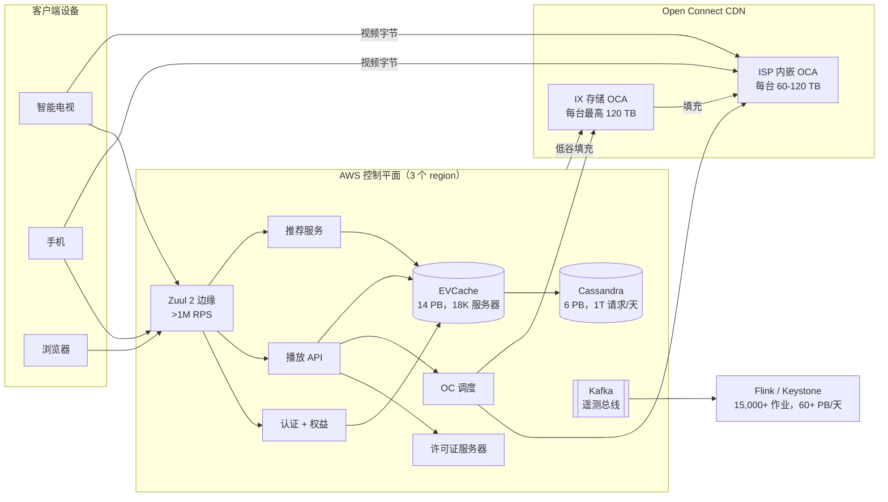
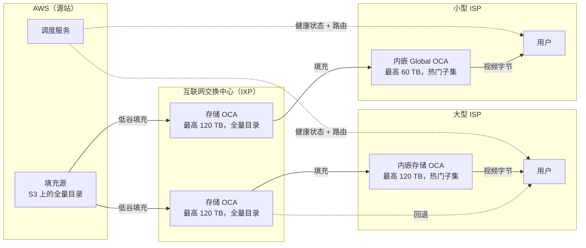
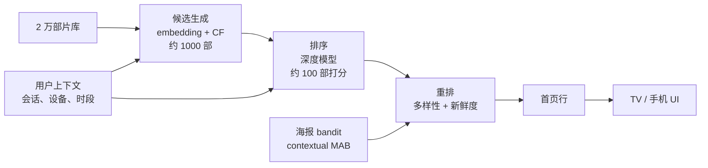
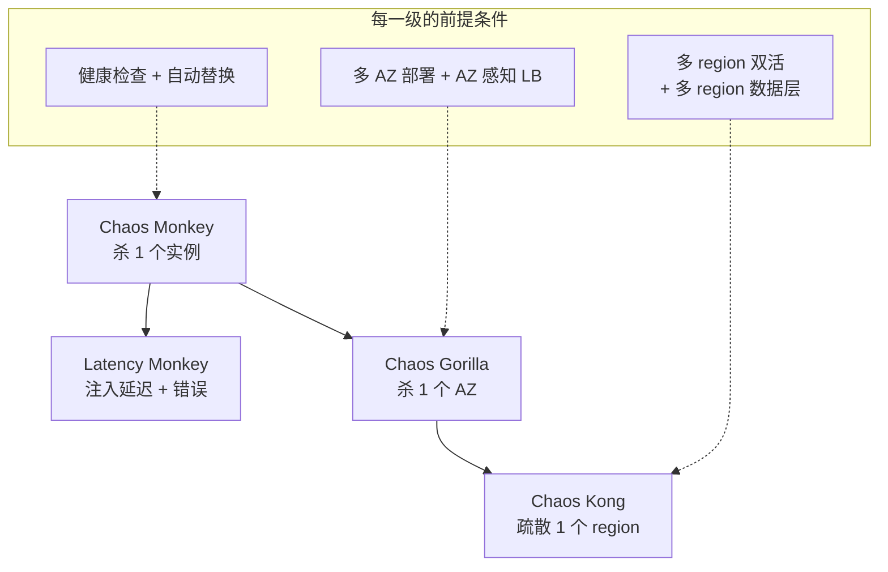

# 设计 Netflix（端到端）

> **TL;DR.** Netflix 把控制平面（截至 2020 年跑在 AWS 上的 1,000+ 个微服务，多 region 双活）与数据平面（Open Connect：6,000+ 个 ISP 机房里的约 18,000 台定制设备，承载全球约 15% 的下行互联网流量 [^1]）解耦。这套架构由三个押注定义：当流量超过互联网总量约 10% 时自建 CDN；对每部片子按自身的码率阶梯编码，在同等画质下把带宽减半 [^2]；靠主动破坏生产环境（从 Chaos Monkey 到 Chaos Kong）来证明韧性 [^3]。拥有 3.25 亿付费订阅用户 [^4]、每天处理超过 1 万亿次 Cassandra 请求 [^5]，Netflix 是行星级规模上公开资料最完整的分布式系统。

## 学习目标

- 设计一套 VOD 流媒体架构，把控制平面（AWS）与数据平面（CDN）分开，从而做到 99.99% 可用性
- 论证自建 CDN 的经济拐点（互联网流量约 10%），说明从哪个点起自建优于付费购买商业 CDN
- 应用按片（per-title）与按镜头（per-shot）编码加凸包优化，在同等感知画质下把带宽减半
- 在 200 ms 的页面加载预算内实现两级推荐漏斗（候选生成 + 深度排序）
- 把 Simian Army 的各个层级与所需基础设施前提对应起来，论证混沌工程是一种生产环境纪律
- 为 3.25 亿订阅用户、约 15% 全球下行流量做容量估算

## 直觉理解

想象你经营着 6,000 家社区音像店，每家都备着该邮编区域最热门的片子。顾客走进门，挑一部片子，店员立刻把光盘递给他。没有线上下单，没有物流等待，没有远在另一个州的仓库。

再想象你还管着一个总部，决定哪些片子发到哪些门店。每天夜里，卡车根据各社区明天可能想看什么，把新片送到各个门店。光盘一旦进了店，总部就再也不碰它。就算总部烧成灰，门店照样把架上现有的东西租出去。

这就是 Netflix 的架构。“社区门店”是 Open Connect Appliance（OCA），物理服务器直接摆在你所用 ISP 的网络里。“总部”是 AWS 控制平面：账号管理、个性化、DRM 许可证签发，以及告诉你的电视该从哪台 OCA 取流的调度服务。“夜间卡车”是低谷填充窗口（通常是本地时间 02:00 到 06:00），OCA 在这段时间拉取新内容。

关键洞察：播放过程中，视频字节从不经过公网。它们从你 ISP 内部的一台服务器直接送到你的设备。Netflix 为这些字节付零流量费，ISP 也省下了骨干网带宽。双方都赢——这就是 ISP 愿意免费提供机位托管 OCA 的原因 [^6]。控制平面与数据平面的这种分离，是整个系统里最重要的一个架构决策。

## 需求

### 澄清问题

- **问：只做 VOD，还是也包括直播？**
  假设：VOD 是主要设计目标。直播（WWE、拳击）是后续扩展。
- **问：片库和订阅用户是什么规模？**
  假设：约 20,000 部片子，3.25 亿付费订阅用户，190+ 个国家 [^4]。
- **问：可用性目标是多少？**
  假设：起播 99.99%；控制平面降级绝不能阻断视频分发。
- **问：需要多 region 吗？**
  假设：需要，控制平面在 3 个 AWS region 上双活。
- **问：起播延迟目标是多少？**
  假设：manifest/许可证路径从点击到首字节 p99 < 200 ms；视频分片由本地 OCA 提供，再增加约 10-50 ms。
- **问：用户状态用什么一致性模型？**
  假设：观看历史和推荐用最终一致性；计费和权益（entitlement）用强一致性。

### 功能需求

- 从约 20,000 部片子的片库向所有设备类型（电视、手机、网页、游戏主机）提供点播流
- 按用户个性化首页行、行内片序和海报图
- 签发 DRM 许可证，并按账号限制并发流数量
- 根据实测吞吐量实时调整码率（ABR）
- 支持离线下载，配时限型 DRM 许可证

### 非功能需求

- **负载：** 3.25 亿订阅用户，峰值并发流数千万，Zuul 边缘处理 >1M req/sec [^7]
- **延迟：** manifest + DRM 许可证往返 p99 < 200 ms；视频秒开
- **可用性：** 播放可用性 99.99%；个性化变慢时优雅降级
- **带宽：** 约占全球下行互联网流量的 15% [^1]
- **持久性：** 内容存在 S3 上，11 个 9 的持久性；用户状态跨 3 个 region 复制

## 容量估算

|" 指标 "| 数值 |" 推导 "|
|--------|------:|------------|
|" 付费订阅用户 "| 325M |" 2025 年 Q4 财报 [^4] "|
|" 峰值并发流 "| ~65M |" Tyson vs. Paul 直播事件峰值 [^8] "|
|" Zuul 边缘 RPS "| >1M |" 80+ 个集群，2018 年数据 [^7] "|
|" Cassandra 请求/天 "| ~1T |" 10,000+ 实例，6 PB，100+ 集群 [^5] "|
|" EVCache 集群规模（截至 2021 年） "| ~18,000 台服务器 |" 约 14 PB 缓存数据 [^9][^10] "|
|" OCA 规模 "| ~18,000 台设备 |" 全球 6,000+ 个机房 [^6] "|
|" 单台 OCA 吞吐 "| 最高 200 Gbps |" Storage Appliance 规格 [^6] "|
|" 单台 OCA 存储 "| 最高 120 TB |" 裸 NAND 容量 [^6] "|
|" 全球下行流量份额 "| ~15% | Sandvine GIPR 2018、2023 [^1] |
|" Spinnaker 部署（2021 年引用数据） "| >20,000/天 |" 多 region 流水线 [^11] "|
|" Flink（Keystone）作业数 "| 15,000+ |" 每天处理 60+ PB [^29] "|

关键比值：

- 控制平面的**读写比**极端失衡：每天数十亿次 manifest/推荐读取，对应数百万次写入（新的观看历史记录、资料更新）。
- EVCache 的**缓存命中率**至关重要：亚毫秒级读取吸收了热路径负载，否则这些负载会把 Cassandra 压垮 [^9]。
- **填充带宽**要在低谷窗口内把新片送到 18,000 台 OCA，赶在次日高峰之前；分层填充（AWS 到 IXP 再到 ISP）把这件事并行化。

## API 与数据模型

### API 设计

```http
POST /v1/play
  Authorization: Bearer ***
  Body: { "title_id": "80100172", "device_id": "...", "profile_id": "..." }
  Returns: 200 {
    "manifest_url": "https://oca-123.nflxvideo.net/manifest.mpd",
    "license": "<base64 DRM license>",
    "oca_urls": ["https://oca-123...", "https://oca-456..."],
    "bitrate_ladder": [{"width": 1920, "bitrate_kbps": 5800}, ...]
  }

GET /v1/profiles/{profile_id}/homepage?device=tv&page=1
  Returns: 200 {
    "rows": [
      {"title": "Continue Watching", "items": [...]},
      {"title": "Because You Watched X", "items": [...]}
    ]
  }

GET /v1/titles/{title_id}/segments?range=0-299
  （由 OCA 直接提供，不经过 AWS）
  Returns: 206 Partial Content (encrypted video bytes)

POST /v1/telemetry
  Body: { "events": [{"type": "rebuffer", "ts": "...", "bitrate": 3000}] }
  Returns: 202 Accepted
```

### 数据模型

```sql
-- Cassandra：观看历史（多 region 异步复制）
CREATE TABLE viewing_history (
  user_id       uuid,
  title_id      uuid,
  watched_at    timestamp,
  progress_pct  float,
  PRIMARY KEY ((user_id), watched_at)
) WITH CLUSTERING ORDER BY (watched_at DESC);

-- Cassandra：片目元数据
CREATE TABLE titles (
  title_id      uuid PRIMARY KEY,
  name          text,
  genres        set<text>,
  bitrate_ladder frozen<list<frozen<map<text, int>>>>,
  available_regions set<text>
);

-- EVCache：会话与权益（亚毫秒读取）
-- Key: "session:{user_id}" -> {device_ids, concurrent_count, region}
-- Key: "entitlement:{user_id}:{title_id}" -> {allowed, expiry}
```

观看历史的分区键是 `user_id`，让同一用户的数据落在同一处。Cassandra 的多数据中心异步复制正好匹配双活的地理要求 [^5]。

## 高层架构



*控制平面（AWS）负责认证、个性化、DRM 和调度；视频字节从观众所在 ISP 内部的 OCA 直接流出，播放期间从不经过 AWS。*

**写路径：** 用户操作（播放、暂停、评分）经 Zuul 流向应用服务，服务写入 Cassandra（持久化）并使 EVCache 失效。遥测事件流入 Kafka，由 Keystone 流水线（Apache Flink）做实时处理：15,000+ 个作业每天处理 60+ PB，覆盖数据搬运、个性化、消息和财务等场景 [^29]。

**读路径：** 首页请求打到 Zuul，再路由到推荐服务。推荐器从 EVCache 读取用户特征（亚毫秒），给候选打分，返回个性化行。播放请求走按下播放后的固定序列：认证、权益、manifest、DRM 许可证、OCA 地址选择。

**异步路径：** 低谷填充把 S3 上的新编码经 IXP 的 OCA 逐层下推到 ISP 内嵌的 OCA。Kafka 遥测喂给模型重训、A/B 实验分析和实时告警。

## 深入探讨

### 深入探讨 1：Open Connect CDN 与对等互联经济性

整个架构最核心的押注：在全球下行互联网流量约 15% 的量级上 [^1]，用商业 CDN 每年要花掉数亿美元。Netflix 反过来把定制的 2U FreeBSD/Nginx 设备送到 ISP 和互联网交换中心 [^6]。

**硬件：** 每台 Storage Appliance 装最多 120 TB 的通用 NAND SSD，用一颗 AMD 处理器输出约 200 Gbps；Storage Appliance 部署在 IX（互联网交换中心）机房，也内嵌在较大的 ISP 合作伙伴处。Global Appliance 提供约 60 TB、约 80 Gbps，峰值功耗约 250 W，用于较小的 ISP 和新兴市场 [^6]。软件栈是 FreeBSD-CURRENT（Netflix 的工程师本身就是上游内核提交者）、用 kTLS 和 sendfile(2) 提供 HTTP 服务的 Nginx，以及做 BGP 对等互联的 BIRD [^6]。

**两级拓扑：** 较小的 ISP 内嵌 OCA 只缓存热门子集（该区域的热门片）。互联网交换中心（以及较大 ISP）的 OCA 存全量目录。托管在 AWS 上的填充源是最终的源站。AWS 里的一个中心调度服务根据健康指标、利用率和实测吞吐量，告诉每个客户端该打哪台 OCA [^6]。

**经济性：** ISP 免费给 OCA 提供机位，因为这样省下自己的骨干网流量费。Netflix 付零出口流量费。拐点大约在峰值互联网流量的 10%：低于约 5% 时商业 CDN 更便宜；高于约 10% 时自建硬件决定性胜出 [^6][^12]。



*Open Connect 是一个两级 CDN：ISP 内嵌的 OCA 在本地提供热门子集；互联网交换中心的 OCA 存全量目录作为回退；AWS 只是填充源和控制平面。Storage Appliance（最高 120 TB）用在 IX 和较大的 ISP，Global Appliance（最高 60 TB）用在较小的 ISP 和新兴市场。*

### 深入探讨 2：按片与按镜头编码

固定码率阶梯（235/560/1050/1750/2350/3000/4300/5800 kbps）在简单内容上浪费比特，在复杂内容上又给不够。按片编码分析每部片子的复杂度，在六种候选分辨率上跑一组量化参数（QP）的试编码，用 VMAF 衡量质量 [^13][^14]，然后在率-质量曲线的凸包上挑码率-分辨率组合 [^2]。

结果：对一部 1080p 动画片，Netflix 从固定阶梯上的 1750 kbps @ 480p，改到按片阶梯上的 1540 kbps @ 1080p [^2]。在同等画质（VMAF=80）下，优化后的阶梯用的比特不到一半 [^15]。

按镜头编码（“Dynamic Optimizer”，2018 年）把这件事推到单个镜头。一集 1 小时的剧集变成约 900 个按镜头边界对齐的单元（平均镜头长度约 4 秒），每个单元独立优化 [^15]。阶梯把比特分给难的镜头，饿着容易的镜头。

**流水线复杂度：** 从每集 20 个 chunk 变成 900 个镜头，消息量涨了约 100 倍。团队加了合并（把镜头打包成 chunk 大小的工作单元）和检查点（把每个镜头的编码结果持久化到 S3，被抢占的 spot 实例不必重做）[^15]。

**编解码器覆盖：** AVC（H.264）作为通用回退，HEVC 用于高端设备，VP9 用于 Android，AV1 走现代电视上的硬件解码器。截至 2025 年底，AV1 承担了 Netflix 全站约 30% 的观看量，VMAF 得分比 AVC 高 4.3 分，缓冲中断少 45% [^16]。


*按片编码器在率-质量曲线的凸包上挑码率-分辨率组合；固定阶梯按预设阈值分配分辨率，在简单内容上浪费比特。*

### 深入探讨 3：推荐架构

Netflix 个性化的不只是首页上的行，还包括行的顺序、行内片序、每部片子展示的海报图，以及悬停时播放的预告片。这套系统内部估值超过每年 10 亿美元的订阅留存收入 [^17]。

**两级漏斗：**

1. **候选生成**从约 20,000 部片库里召回约 1,000 个候选，手段是向量相似度（双塔神经网络）和协同过滤查表。
2. **排序**用更重的深度模型给候选打分，输入包括用户上下文、会话上下文、时段和设备。
3. **重排**执行业务规则：多样性、新鲜度、授权窗口到期。

**海报个性化**用上下文多臂老虎机：对每个（用户，片子）组合，挑最可能带来播放的图片变体，同时在探索与利用之间取平衡 [^18]。浏览会员大约 82% 的注意力落在海报上 [^18]。

整页的延迟预算约 200 ms。两级模式（在全量目录上做廉价召回，在小集合上做昂贵排序）是让这个预算可行的关键。



*两级推荐漏斗：廉价召回产出约 1,000 个候选；昂贵的排序器给它们打分；重排器施加业务规则并做海报个性化。*

### 深入探讨 4：混沌工程与多 region 韧性

Netflix 的欧美控制平面跑在 3 个 AWS region 上双活，算力成本相比主备模式大约翻倍，换来 region 故障时近乎零 RTO [^3]。为了证明这个性质真的成立，他们造了 Simian Army。

**严重程度递进：**

- **Chaos Monkey** 在工作时间随机杀掉实例。与 Spinnaker 集成：每个部署的服务默认都在范围内，除非显式退出 [^19]。
- **Chaos Gorilla** 干掉整个可用区。
- **Chaos Kong** 疏散整个 region。Netflix 曾把美国的实时流量从 us-east-1 全部切到 us-west-2，持续 24 小时以上，用户无感知 [^3][^20]。
- **Latency Monkey** 在服务之间注入延迟和错误响应。

**经典验证：** 2014 年 AWS us-east-1 的一次重启事件，Netflix 会员基本无感，因为此前的 Chaos Kong 演练已经证明流量能切到西岸 [^20]。

**熔断器（从 Hystrix 到 Envoy）：** Hystrix 引入了三态熔断器（CLOSED、OPEN、HALF_OPEN）加线程池隔离 [^21]。它在 2018 年进入维护模式 [^22]。Netflix 转向自适应并发上限（基于 Little's Law 和实时延迟）以及基于 Envoy 的服务网格韧性 [^22]。教训是：预设阈值在规模上变成负担；能对实测延迟做出反应的自适应上限才是接替方案。



*Simian Army 随着系统证明自己能吸收每一级故障，逐步加大爆炸半径；只有在 Chaos Gorilla 常规通过之后才会跑 Chaos Kong。*

这套纪律被写进混沌工程的原则：针对稳态行为提出假设、施加真实世界的事件、在生产环境运行、控制爆炸半径、自动化 [^23]。

## 真实案例

2008 年，Netflix 遭遇一次严重的数据库损坏，服务下线三天。那次事故促成了从单数据中心 Oracle 栈向 AWS 的迁移 [^24]。迁移花了七年（2016 年 1 月完成），逼着每个团队按“一定会坏”来设计 [^24]。

Open Connect 在 2011-2012 年出现，是应对 CDN 成本的秘密武器。当时 Netflix 每年付给 Akamai 和 Limelight 数千万美元。一旦流量超过峰值互联网带宽的约 10%，经济账就反过来了：把定制 FreeBSD 盒子送到 ISP，比任何 CDN 合同都便宜 [^6][^12]。今天，6,000+ 个机房里的约 18,000 台 OCA 承担了几乎所有视频字节 [^6]。

混沌工程文化直接长自 AWS 迁移。当你跑在随时可能故障的通用基础设施上，唯一能确认系统还活着的方式就是主动干掉东西。Netflix 在 2011 年推出 Chaos Monkey（2012 年以 Apache 2.0 开源）；到 2014 年，Netflix 已经能在不影响用户的情况下疏散整个 AWS region [^20]。这套实践由 Casey Rosenthal 和 Nora Jones 在 O'Reilly 的《Chaos Engineering》（2020）一书中系统化 [^23]。

2024 年 11 月的 Jake Paul vs. Mike Tyson 拳击赛以 6,500 万并发观众检验了这套架构 [^8]。它暴露出 VOD（内容预先摆到 OCA 上）与直播（内容实时生成，无法预置）之间的差距。一场重试风暴把一次瞬时的抖动放大成了大面积缓冲。Netflix CTO Elizabeth Stone 后来说，修复工作的一部分是“构建更灵活的算法来决定某个用户从哪台设备取流” [^8]。直播平台现在每秒处理高达 3,800 万条遥测事件 [^25]。

## 权衡

|" 方案 "| 优点 |" 缺点 "| 适用场景 |" 我们的选择 "|
|----------|------|------|-------------|----------|
|" 自建 CDN（Open Connect） "| 零传输成本、为视频调优的内核、对等互联议价能力 |" 硬件物流；多年建设周期；资本开支只有在超大规模流媒体量级才能摊薄 "| 承载互联网流量两位数百分比 |" 是，在 Netflix 的规模上 "|
|" 购买商业 CDN（Akamai/Cloudflare） "| 无资本开支，上市快 |" 出口账单线性增长，共享租户 "| 低于互联网流量约 5% |" 创业公司和中等规模 "|
|" 多 region 双活 "| region 故障时 RTO 近零，平时还能分担流量 |" 成本约 2 倍，冲突解决，需要多 region 数据层 "| 收入超 10 亿美元的关键消费者服务 |" 是，Netflix 采用 "|
|" 多 region 主备 "| 数据路径更简单，更便宜 |" RTO 以分钟计，冷备可能起不来 "| 能容忍一定停机 |" 大多数公司 "|
|" 按片 / 按镜头编码 "| 同等 VMAF 下省 20-50% 带宽 |" 编码算力大增，流水线复杂 "| 十亿级观看小时，CDN 出口是前三成本 |" 是，在 Netflix 的规模上 "|
|" 固定码率阶梯 "| 简单、可预测、运行便宜 |" 在容易的内容上浪费比特，难的内容给不够 "| 小片库、小受众 |" 早期服务 "|
|" 服务网格（Envoy） "| 语言无关的韧性，统一策略 |" 需要网格运维团队，sidecar 带来延迟开销 "| 多语言微服务群 + 平台团队 |" Netflix 当前方向 "|

元决策：Netflix 的架构很贵。双活让算力翻倍。Open Connect 需要在 18,000 台的量级上做硬件物流[^6]。按片编码把编码算力放大 10-100 倍。这些押注只有在超大规模流媒体收入之上才划算（Netflix 2025 年营收约 450 亿美元[^4]）。对大多数公司，正确答案是：商业 CDN、主备、固定码率阶梯，加一个模块化单体。

## 扩展与故障模式

**10 倍负载（热门新片上线）：** 控制平面（manifest、DRM、调度）面临惊群压力。缓解手段：通过 Scryer 做预测式自动扩缩 [^26]、在部署时通过 EBS 快照搬运 PB 级数据的 EVCache 预热流水线 [^9]、以及 Zuul 的准入控制丢弃超额请求。

**100 倍负载（直播事件，6,500 万并发）：** 直播平台无法把内容预置到 OCA。摄取（ingest）延迟变得关键。重试风暴会级联。缓解手段：服务端指导的退避（Retry-After 头）、区域间流量再平衡、以及每秒 3,800 万条事件的遥测管道做实时检测 [^25]。

**1000 倍负载（假设的全球直播事件）：** 调度服务成为瓶颈。OCA 的 200 Gbps 链路被打满。缓解手段：多 CDN 故障切换（把 Akamai/Cloudflare 当溢出）、边缘侧 manifest 缓存、以及客户端带本地健康探测的 OCA 选择。

**故障模式 1：AWS region 故障。** Chaos Kong 已经证明系统能活下来。流量通过 DNS 和客户端故障切换转到其余 region。EVCache 通过 SQS 做跨 region 失效，保证在数百毫秒内达到最终一致 [^3][^9]。

**故障模式 2：大型 ISP 内的 OCA 劣化。** 调度服务检测到健康度下降，在数秒内把客户端改路由到 IXP 的 OCA 或邻近 ISP 的 OCA。客户端只会看到短暂的质量下降（从更远的 OCA 拿到较低码率），不会中断 [^6]。

**故障模式 3：个性化服务超时。** 熔断器跳到 OPEN。回退方案从 EVCache 提供“继续观看” + “某国热门”行。播放永远不会被慢吞吞的推荐服务挡住。

## 常见陷阱

> [!WARNING]
> **没有平台能力却照抄 Netflix 的微服务。** 一个 50 人的组织把单体拆成 80 个微服务，却没有服务网格，也没有成熟的 CD。结果：每周都在级联故障。Netflix 的架构能成立，是因为约 2,000 名平台工程师在供养这套工具链。先上模块化单体；只在扩展维度真正需要的地方切出服务。

> [!WARNING]
> **双活但数据层跟不上。** 服务在两个 region 双活部署，数据库却还是单 region 的 RDS。region 一挂照样全灭。双活要求热路径上的所有数据都放在多 region 原生的存储里（Cassandra、DynamoDB Global Tables、Spanner）[^3]。

> [!WARNING]
> **直播事件中的重试风暴。** 没有退避抖动的客户端重试会把一次瞬时抖动变成全面故障。在 6,500 万并发观众下，1% 的重试比例就是每秒 65 万次额外请求 [^8]。缓解手段：服务端指导的退避、区域间流量再平衡、边缘准入控制。

> [!WARNING]
> **在小规模上过度设计编码流水线。** 按片编码只有在十亿级观看小时上才划算。如果你的 CDN 支出不是前三项成本，固定码率阶梯就够了。投入之前先算清 CDN 成本与编码基础设施成本的对比。

> [!WARNING]
> **热门上线时的惊群。** 热门新片发布时，所有客户端同时打播放 API。缓解手段：预测式自动扩缩（Scryer）[^26]、缓存预热、准入控制，以及个性化变慢时降级提供通用首页。

## 追问

**1. 你会怎么设计广告支持档（2022 年 11 月上线）？**

微软的广告技术栈负责定向和竞价 [^27]。manifest 里带广告插入标记；客户端从另一个 CDN 拉取广告素材。播放 API 在服务端拼接或客户端拼接的断点处插入广告段。关键约束：广告延迟不能超过 200 ms，否则用户会感到卡顿。

**2. 直播体育的基础设施与 VOD 有何不同（2025 年 WWE、拳击）？**

没有 OCA 预置。从场馆编码器经冗余路径摄取。实时编码会削减按镜头优化（延迟预算以秒计，不是小时）。溢出流量走多 CDN 故障切换。每秒 3,800 万条事件的遥测管道能在数秒内发现重试风暴 [^25][^8]。

**3. 密码共享整治（2023 年 5 月）如何改变了架构？**

设备位置指纹（IP 地理定位 + 设备图谱）用来识别家庭外使用。在权益层执行：如果设备在家庭之外，提示添加成员或阻断。这次整治在 2023 年为 Netflix 带来约 3,000 万新增订阅用户 [^28]。

**4. 离线下载如何与 DRM 配合？**

许可证服务器签发时限型离线许可证（通常是首次播放后 48 小时、下载后 30 天）。内容用同一套 CENC 密钥加密。设备在本地存加密分片；播放时需要一份有效的缓存许可证。Widevine（Android）、FairPlay（iOS）、PlayReady（Windows）各自的离线处理方式不同。

**5. 全球直播事件的多 CDN 故障切换怎么做？**

调度服务维护 Open Connect OCA 和商业 CDN 端点（Akamai、Cloudflare）的健康分。当 OCA 利用率超过阈值（例如 200 Gbps 的 80%），调度服务把溢出流量切给商业 CDN。客户端逻辑也会在超时时探测备用 URL。

**6. 播客或纯音频流要改什么？**

manifest/DRM/OCA 架构不变，只是分片小得多（约 128 kbps 对比 5,800 kbps）。同样一台 OCA 能服务的并发音频流多 100 倍。编码流水线简化为固定阶梯（AAC-LC 64/128/256 kbps）。个性化和推荐完全一样。

**7. Netflix Games（2024 年，100+ 款）如何与流媒体平台整合？**

游戏通过移动应用商店（iOS、Android）分发，不走 OCA。Netflix 应用充当启动器；游戏二进制是单独下载的。认证复用已有的账号/资料/权益栈。无广告，无内购（所有档位都包含）。云游戏（2024 年 beta）从服务端 GPU 实例流式传输交互帧，复用了低延迟的 OCA 调度逻辑，但要求往返 <50 ms，而不是缓冲分片 [^30]。

## 练习

### 练习 1：按下播放的延迟预算

详细设计“按下播放”这条路径：从电视应用发出 POST，经过 Zuul 网关、账号服务、权益检查、播放 manifest 服务、DRM 许可证签发，到第一个视频分片。给每一跳标注延迟预算（manifest 总往返在 200 ms 以内）。然后设计个性化服务变慢时的降级回退方案。

<details>
<summary>提示</summary>

想一想哪些跳在关键路径上（会阻塞播放），哪些可以从缓存提供或干脆跳过。熔断器的 HALF_OPEN 状态就是你探测恢复的手段。

</details>

<details>
<summary>参考答案</summary>

**逐跳预算（总计 < 200 ms）：**

|" 跳 "| 预算 |" 说明 "|
|---|---|---|
|" Zuul 边缘处理 "| 20 ms |" TLS 终止、过滤器链 "|
|" 认证校验 "| 10 ms |" 从 EVCache 验证 token "|
|" 权益检查 "| 30 ms |" 账号状态、地区授权 "|
|" 播放 manifest 组装 "| 50 ms |" 码率阶梯选择、OCA 排序 "|
|" DRM 许可证签发 "| 40 ms |" 设备证明、密钥封装 "|
|" 网络开销 "| 50 ms |" 客户端到最近的 AWS region "|

**降级回退：** 当个性化服务超出它的 p99 预算，熔断器跳到 OPEN。播放 API 退回：(1) 来自 EVCache 的“继续观看”行，(2) 来自预计算缓存的“某国热门”，(3) 编辑精选“Top 10”（静态，每小时刷新）。这些行始终能从 EVCache 拿到，不必打个性化。恢复：5 秒休眠窗口后进入 HALF_OPEN，放一个探测请求通过；成功则闭合熔断器。

</details>

### 练习 2：OCA 容量规划

巴西一家新 ISP 有 200 万 Netflix 订阅用户，想托管 OCA。假设 60% 的观看集中在 Top 500 片目上，每部片子在所有档位合计平均 4 GB，估算他们需要多少台设备、多少存储容量。

<details>
<summary>提示</summary>

先算 200 万订阅用户的峰值并发流（假设峰值并发率 10%）。再算每路流需要的带宽（平均约 5 Mbps），除以单台 OCA 的吞吐。存储方面，算一台 60 TB 的设备能装多少部片子。

</details>

<details>
<summary>参考答案</summary>

峰值并发：2M x 10% = 200,000 路流。带宽：200,000 x 5 Mbps = 1 Tbps。单台 OCA：约 80 Gbps（Global Appliance）。需要：1,000 / 80 = 约 13 台来扛带宽。存储：Top 500 部 x 4 GB = 2 TB（一台 60 TB 的盒子轻松装下）。瓶颈是带宽，不是存储。在该 ISP 网络里的 3-4 个 POP 部署 15 台（留余量）。每台剩下的 58 TB 用来缓存长尾，减少回源 IXP。

</details>

## 要点回顾

- **控制平面 / 数据平面的分离就是这套架构本身。** AWS 管认证、个性化和 DRM；Open Connect 管字节。region 故障不影响已缓存内容的播放。
- **只有在峰值互联网流量约 10% 以上才自建 CDN。** 低于这个点，付钱给 Akamai。不要在 Netflix 规模的 1% 上照抄 Open Connect。
- **按片编码在同等画质下把带宽减半**，但只有在十亿级观看小时上才划算。从固定阶梯起步。
- **多 region 双活很贵（成本约 2 倍）**，且需要多 region 原生的数据层。对 99% 的产品，主备就够了。
- **混沌工程不是作秀。** 在 Netflix 的规模和发布频率上，它是验证韧性的唯一方式。预发环境永远不是生产环境。
- **服务网格取代了进程内库。** Hystrix 自 2018 年起已废弃；自适应并发上限是它的继任者。

## 延伸阅读

- [Open Connect Appliances](https://openconnect.netflix.com/en/appliances/) - Netflix 公开的 OCA 硬件规格、软件栈和对等互联计划文档；CDN 架构细节的一手来源。
- [Per-Title Encode Optimization (Aaron et al., 2015)](https://netflixtechblog.com/per-title-encode-optimization-7e99442b62a2) - 率-质量凸包优化的奠基论文，开启了按片编码这条线。
- [Optimized Shot-Based Encodes: Now Streaming (2018)](https://netflixtechblog.com/optimized-shot-based-encodes-now-streaming-4b9464204830) - 按镜头编码的产品化，包括 100 倍消息量扩张和检查点设计。
- [Active-Active for Multi-Regional Resiliency (2013)](https://netflixtechblog.com/active-active-for-multi-regional-resiliency-c47719f6685b) - 双活迁移的经典记录，含 EVCache 跨 region 失效。
- [Chaos Engineering Upgraded (Chaos Kong)](https://netflixtechblog.com/chaos-engineering-upgraded-878d341f15fa) - 生产环境中的 region 疏散与 2014 年 us-east-1 验证。
- [The Netflix Recommender System (Gomez-Uribe and Hunt, 2015)](https://dl.acm.org/doi/10.1145/2843948) - 每年 10 亿美元级个性化系统的论文，涵盖 A/B 实验文化和两级漏斗。
- [AV1: Now Powering 30% of Netflix Streaming (2025)](https://netflixtechblog.com/av1-now-powering-30-of-netflix-streaming-02f592242d80) - 编解码器推广的现状，附 VMAF 与缓冲对比。
- [Principles of Chaos Engineering](https://principlesofchaos.org/) - 社区维护的宣言，把 Netflix 的混沌实践沉淀为通用原则。

## 记忆卡片

<details>
<summary><strong>问：Netflix 为什么自建 Open Connect，而不用商业 CDN？</strong></summary>

答：在全球下行互联网流量约 15% 的量级上，商业 CDN 的传输账单会是天文数字。把定制的 FreeBSD/Nginx 盒子送到 ISP 成本更低，因为 ISP 免费提供机位（省下自己的骨干网流量），而 Netflix 为本地提供的字节付零出口费。

</details>

<details>
<summary><strong>问：按片编码的凸包是什么？</strong></summary>

答：对每种候选分辨率，Netflix 跑不同质量参数的试编码，画出码率对 VMAF 质量的曲线，然后在凸包上挑码率-分辨率组合（每比特质量最高）。在同等画质下，这比固定阶梯用的比特不到一半。

</details>

<details>
<summary><strong>问：Hystrix 熔断器的三个状态是什么？</strong></summary>

答：CLOSED（请求正常通过）、OPEN（错误率超过阈值后请求快速失败）、HALF_OPEN（休眠窗口后放一个探测请求；成功则闭合，失败则重新打开）。

</details>

<details>
<summary><strong>问：Hystrix 为什么被废弃，什么取代了它？</strong></summary>

答：Hystrix 在 2018 年进入维护模式，因为预设阈值在规模上成了负担。Netflix 转向自适应并发上限（基于 Little's Law 和实时延迟）以及基于 Envoy 的服务网格级韧性。

</details>

<details>
<summary><strong>问：Chaos Monkey、Chaos Gorilla、Chaos Kong 有什么区别？</strong></summary>

答：Chaos Monkey 杀单个实例。Chaos Gorilla 干掉整个可用区。Chaos Kong 疏散整个 AWS region。每一级都要求先证明上一级的前提条件成立。

</details>

<details>
<summary><strong>问：EVCache 如何处理跨 region 一致性？</strong></summary>

答：一个 region 的写入通过 SQS 异步失效另一个 region 里对应的键。这等于用有界的最终一致性（数百毫秒的陈旧窗口）换取更便宜、更能容忍延迟的复制。

</details>

<details>
<summary><strong>问：自建 CDN 的经济拐点在哪里？</strong></summary>

答：大约峰值互联网流量的 10%。低于约 5% 时商业 CDN 更便宜。高于约 10% 时传输账单会盖过任何 CDN 合同，定制硬件成为成本最优解。

</details>

<details>
<summary><strong>问：Netflix 如何应对热门新片上线时的惊群？</strong></summary>

答：预测式自动扩缩（Scryer）按历史负载曲线提前备容量，EVCache 预热流水线在部署时搬运 PB 级数据，Zuul 准入控制丢弃超额请求，个性化变慢时优雅降级从缓存提供通用行。

</details>

<details>
<summary><strong>问：截至 2025 年，Netflix 有多大比例的观看量走 AV1？</strong></summary>

答：约 30%。AV1 的 VMAF 得分比 AVC 高 4.3 分，缓冲中断少 45%，同时带宽大约省三分之一。

</details>

<details>
<summary><strong>问：两级推荐漏斗怎么控制在 200 ms 预算内？</strong></summary>

答：候选生成用廉价的向量查表从 2 万部片库里召回约 1,000 部。只有这约 1,000 部进入昂贵的深度排序器，再打出约 100 部的分。这种不对称（廉价召回 + 在小集合上做昂贵排序）让总延迟保持可行。

</details>

## 参考文献

[^1]: Sandvine, "Global Internet Phenomena Report" (2018, 2023). https://www.sandvine.com/inthenews/netflix-eats-up-15-of-global-downstream-traffic
[^2]: A. Aaron, Z. Li, M. Manohara, J. De Cock, D. Ronca, "Per-Title Encode Optimization," Netflix Technology Blog, Dec 14 2015. https://netflixtechblog.com/per-title-encode-optimization-7e99442b62a2
[^3]: Netflix Technology Blog, "Active-Active for Multi-Regional Resiliency," Dec 2 2013. https://netflixtechblog.com/active-active-for-multi-regional-resiliency-c47719f6685b
[^4]: TheWrap, "Netflix Q4 Revenue Surges as Streamer Reaches 325 Million Paid Subscribers," Jan 2026. https://www.thewrap.com/industry-news/business/netflix-earnings-q4-2025/
[^5]: Apache Cassandra 4.0 release announcement, including Netflix scale statistics. https://news.apache.org/foundation/entry/the-apache-cassandra-project-releases
[^6]: Netflix Open Connect, "Open Connect Appliances (hardware and software specifications)." https://openconnect.netflix.com/en/appliances/
[^7]: Netflix Technology Blog, "Open Sourcing Zuul 2," May 21 2018. https://netflixtechblog.com/open-sourcing-zuul-2-82ea476cb2b3
[^8]: Sports Business Journal, "Netflix makes improvements to live events as push into area grows," Jan 13 2026. https://www.sportsbusinessjournal.com/Articles/2026/01/13/netflix-makes-improvements-to-live-events-as-push-into-area-grows/
[^9]: Netflix Technology Blog (Medium), "Cache warming: Leveraging EBS for moving petabytes of data," Nov 2021. https://netflixtechblog.medium.com/cache-warming-leveraging-ebs-for-moving-petabytes-of-data-adcf7a4a78c3
[^10]: Netflix Technology Blog, "Evolution of Application Data Caching: From RAM to SSD," Jul 2018. https://netflixtechblog.com/evolution-of-application-data-caching-from-ram-to-ssd-a33d6fa7a690
[^11]: Spinnaker blog, "Evolving How Netflix Builds, Maintains, and Operates Their Spinnaker Distribution," May 2021. https://blog.spinnaker.io/evolving-how-netflix-builds-maintains-and-operates-their-spinnaker-distribution-33c844d0102c
[^12]: Netflix Open Connect, program overview. https://openconnect.netflix.com/en/
[^13]: Netflix/vmaf README. https://github.com/Netflix/vmaf
[^14]: Netflix Technology Blog, "Toward a Practical Perceptual Video Quality Metric (VMAF)," Jun 6 2016. https://netflixtechblog.com/toward-a-practical-perceptual-video-quality-metric-653f208b9652
[^15]: M. Manohara, A. Moorthy, J. De Cock, I. Katsavounidis, A. Aaron, "Optimized shot-based encodes: Now Streaming!", Netflix Technology Blog, Mar 9 2018. https://netflixtechblog.com/optimized-shot-based-encodes-now-streaming-4b9464204830
[^16]: Netflix Technology Blog, "AV1 - Now Powering 30% of Netflix Streaming," Dec 1 2025. https://netflixtechblog.com/av1-now-powering-30-of-netflix-streaming-02f592242d80
[^17]: C. A. Gomez-Uribe and N. Hunt, "The Netflix Recommender System: Algorithms, Business Value, and Innovation," ACM Transactions on Management Information Systems, 2015. https://dl.acm.org/doi/10.1145/2843948
[^18]: Netflix Technology Blog, "Artwork Personalization at Netflix," Dec 7 2017. https://netflixtechblog.com/artwork-personalization-c589f074ad76
[^19]: Netflix/chaosmonkey README. https://github.com/Netflix/chaosmonkey
[^20]: Netflix Technology Blog, "Chaos Engineering Upgraded (Chaos Kong)." https://netflixtechblog.com/chaos-engineering-upgraded-878d341f15fa
[^21]: Netflix/Hystrix circuit breaker source. https://github.com/Netflix/Hystrix/blob/master/hystrix-core/src/main/java/com/netflix/hystrix/HystrixCircuitBreaker.java
[^22]: Netflix/Hystrix README, "Hystrix Status: maintenance mode." https://github.com/Netflix/Hystrix
[^23]: C. Rosenthal and N. Jones (eds.), "Chaos Engineering: System Resiliency in Practice," O'Reilly, 2020. https://principlesofchaos.org/
[^24]: Y. Izrailevsky, S. Vlaovic, R. Meshenberg, "Completing the Netflix Cloud Migration," Netflix (about.netflix.com), Feb 12 2016. https://about.netflix.com/en/news/completing-the-netflix-cloud-migration
[^25]: J. Ozer, "Netflix's Live Platform: What Streaming Engineers Can Learn," Streaming Learning Center, Jul 28 2025. https://streaminglearningcenter.com/blogs/netflixs-live-platform-what-streaming-engineers-can-learn-and-what-they-cant.html
[^26]: Netflix Technology Blog, "Scryer: Netflix's Predictive Auto-Scaling Engine." https://netflixtechblog.com/scryer-netflixs-predictive-auto-scaling-engine-a3f8fc922270
[^27]: Microsoft Advertising blog, "How Microsoft will power Netflix's new ad-supported tier," Oct 2022. https://about.ads.microsoft.com/en-us/blog/post/october-2022/how-microsoft-will-power-netflix-new-ad-supported-tier
[^28]: Business Insider, "Netflix added almost 30 million subscribers in 2023 after cracking down on password sharing," Jan 2024. https://www.businessinsider.com/netflix-password-sharing-crackdown-worked-how-to-increase-subscription-streaming-2024-1
[^29]: Confluent Current 2024, "Building a Scalable Flink Platform: A Tale of 15,000 Jobs at Netflix." https://current.confluent.io/2024-sessions/building-a-scalable-flink-platform-a-tale-of-15-000-jobs-at-netflix
[^30]: Netflix, "All of The Games on Netflix Right Now," 2024. https://www.netflix.com/tudum/games
