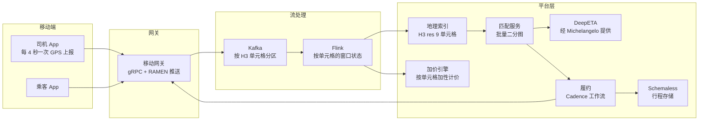
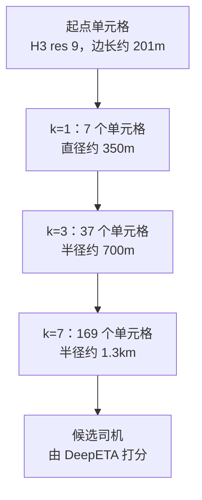
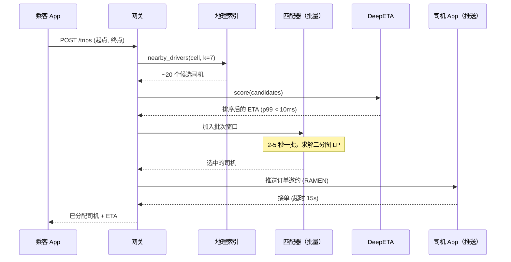
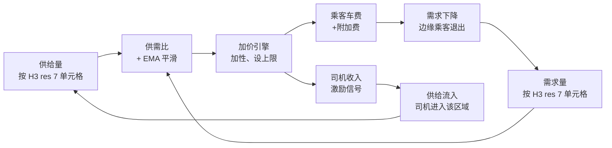
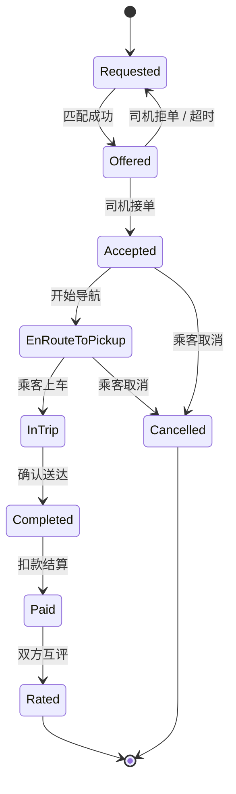

# 设计一个网约车服务（Uber / Lyft）

> **TL;DR.** 网约车是一个双边市场，物理世界的状态（行驶中的车辆、移动中的乘客）与一个全球分布式后端正面相撞，而后端必须在 1 秒内完成匹配。Uber 在 FY2025 完成了超过 150 亿次行程（FY2024 为 113 亿次），覆盖 70 多个国家 [^1][^36]。系统每秒吸收约 125 万次 GPS 更新，把它们索引进 Uber 的 H3 六边形网格 [^2]，每 2 到 5 秒跑一次批量二分图匹配 [^3]，并用持久化的 Cadence 工作流编排每一趟行程 [^4]。最关键的权衡在于：批量匹配会带来可感知的额外延迟，但相比贪心派单，它带来了有据可查的两位数效用提升。

## 学习目标

学完本章，你将能够：

- [ ] 选出一套地理空间索引方案（H3、S2、geohash、四叉树），并能就网约车匹配讲清其中的权衡
- [ ] 设计一条每秒摄入数百万条司机位置更新的流式管道
- [ ] 在延迟与供给约束下应用批量二分图匹配
- [ ] 论证加性动态加价（additive surge）作为一种具备激励相容保证的市场出清机制
- [ ] 把一趟行程建模成能在客户端重启和网络分区中存活的可持久工作流
- [ ] 对地理索引的峰值 QPS 与下游通知扇出做容量估算

## 直觉理解

想象你在 1970 年代经营一间出租车调度室。你身后墙上挂着一幅城市大小的地图，上面摆满磁铁，每块磁铁代表一辆出租车。每隔几秒，司机用无线电报出所在的交叉路口，你就把对应的磁铁滑到新位置。

有乘客打电话进来，你扫一眼地图，找到最近的三个磁铁，用无线电叫最近的那位司机。很简单。可到了跨年夜，电话一分钟响 50 次。你跟不上了。于是你多雇几个调度员，把地图切成若干区域，一人管一片。现在每个人处理的呼叫少了，但处在区域边界上的乘客可能会拿到更差的匹配——因为调度员看不到隔壁区域只隔一条街的那块磁铁。

这就是网约车问题的内核。"磁铁"是 500 万司机发出的 GPS 心跳，"地图分区"是地理索引里的六边形单元格，"调度员"是每几秒运行一次的匹配算法，"跨年夜高峰"是动态加价，而"区域边界"问题正是六边形（只有一类邻居，中心到中心距离处处相等）优于方格（两类邻居，对角方向有畸变）的原因。

工程上的挑战不是派一趟车，而是在每天超过 4000 万次行程 [^36] 的规模上派车——每一块磁铁每 4 秒就动一次 [^5]，地图横跨 10,000 多个城市 [^6]，而调度员必须在 1 秒内做出决定。

## 需求

### 澄清问题

- **Q：地理范围有多大？**
  假设：全球，70 多个国家，10,000 多个城市 [^6]。多区域双活（active-active）。
- **Q：只接真人司机，还是也包括自动驾驶车辆？**
  假设：以真人为主。自动驾驶车辆（AV）是一种受地理围栏约束的司机类型（截至 2026 年，Waymo、Avride 等 20 多个合作伙伴）[^37]。
- **Q：只做 1:1 行程，还是也做拼车？**
  假设：两者都做。拼车会把二分图匹配变成多对一（many-to-one）的变体。
- **Q：派单的延迟目标是多少？**
  假设：地理查询加 ETA 打分的 p99 < 1 秒；批次窗口 2 到 5 秒。
- **Q：可用性目标是多少？**
  假设：派单链路 99.95%。宁可降级（退回贪心），也不拒绝服务。
- **Q：司机位置要多新？**
  假设：司机 App 每 4 秒上报一次 [^5]。最多陈旧一个上报周期。

### 功能需求

- 乘客发起行程，给出起点与终点；系统在数秒内匹配到附近司机。
- 司机通过推送收到订单邀约；在 15 秒内接单或拒单。
- 乘客（接驾 ETA）和司机（导航）双方都拿到实时 ETA 更新。
- 动态定价根据局部供需失衡调整车费。
- 行程生命周期跟踪，从发单一直到支付和评价。
- 拼车：多个乘客匹配到同一司机，并做绕路优化。

### 非功能需求

- **负载：** 每天 4000 万次以上行程（FY2025），峰值约 125 万次/秒位置更新，数千万并发连接 [^36][^5]。
- **延迟：** 地理索引查询 p99 < 100 毫秒；端到端派单 p99 < 1 秒（不含批次窗口）。
- **可用性：** 派单链路 99.95%。
- **一致性：** 位置索引最终一致（4 秒陈旧可接受）；行程状态流转强一致。
- **持久性：** 行程记录必须在任意单区域故障中存活。

## 容量估算

| 指标 | 数值 | 推导 |
|--------|------:|------------|
| 每年行程数 | ~150 亿 | Uber FY2025 年化（2025 Q4：38 亿次）[^36] |
| 每天行程数（均值） | 4000 万+ | CEO 表述，FY2025 财报 [^36] |
| 司机位置更新/秒 | 125 万 | 约 500 万活跃司机与骑手 / 4 秒间隔 [^5] |
| Kafka 吞吐 | 每天数万亿条消息 | Uber 平台整体 [^8] |
| 地理索引读/秒（峰值） | 约 670 万 | 每天 4000 万次行程，峰值 5 倍 ≈ 2300 次/秒，每次查 169 个单元格 |
| 行程记录大小 | 约 2 KB | 路线折线 + 元数据 + 支付 |
| 每日行程存储 | 约 80 GB | 4000 万 × 2 KB |
| 五年行程存储 | 约 146 TB | 80 GB × 365 × 5 |
| ML 预测/秒 | 1000 万 | Michelangelo 峰值 [^6] |

**关键比值：**

- 地理索引的读写比约 4:1（乘客读，司机写）。
- 位置更新主导写带宽：125 万/秒 × 约 100 字节 ≈ 125 MB/秒 的入口流量进入 Kafka。
- 热点单元格（曼哈顿、班加罗尔）在单个分区上聚集了平均流量的 100 倍。

## API 与数据模型

### API 设计

```http
POST /v1/trips
  Body: { "pickup": {"lat": 40.7128, "lng": -74.0060}, "destination": {...}, "ride_type": "pool" }
  Returns: 201 { "trip_id": "uuid", "status": "matching", "estimated_pickup": "3min" }

GET /v1/trips/{trip_id}
  Returns: 200 { "status": "en_route", "driver": {...}, "eta_pickup": "2min", "eta_dest": "14min" }

POST /v1/drivers/{driver_id}/location
  Body: { "lat": 40.7130, "lng": -74.0055, "heading": 270, "speed_mps": 8.5 }
  Returns: 204

POST /v1/trips/{trip_id}/accept
  Idempotency-Key: <uuid>
  Returns: 200 { "trip_id": "...", "rider": {...}, "pickup": {...} }

GET /v1/surge?lat=40.7128&lng=-74.0060
  Returns: 200 { "multiplier": 1.0, "surcharge_cents": 500, "cell_id": "8928308280fffff" }
```

行程历史的分页用基于游标的 `?before=<trip_id>&limit=50`。限流：每个司机每 3 秒最多 1 次位置更新（服务端去重）。

### 数据模型

```sql
-- 行程存储（Schemaless / Cassandra）
table trips (
  trip_id         uuid,
  rider_id        uuid,
  driver_id       uuid,
  status          enum(requested, offered, accepted, en_route, in_trip, completed, cancelled),
  pickup_cell     bigint,       -- H3 res 9 单元格 ID
  pickup_lat      double,
  pickup_lng      double,
  dest_lat        double,
  dest_lng        double,
  fare_cents      int,
  surge_cents     int,
  created_at      timestamp,
  completed_at    timestamp,
  partition_key:  trip_id
)

-- 司机位置（内存地理索引，底层由 Kafka 日志支撑）
table driver_locations (
  driver_id       uuid,
  cell_id         bigint,       -- H3 res 9
  lat             double,
  lng             double,
  heading         smallint,
  speed_mps       float,
  updated_at      timestamp,
  partition_key:  cell_id       -- 让邻近查询落在同一分区
)
```

Uber 的 Schemaless 以 MySQL 为后端，只追加（append-only），单元格不可变，以（row、column、ref_key）为键 [^9][^10]。新版本写入一个新单元格而不是覆盖旧值，因此每次行程状态变更都留下了审计轨迹。

## 高层架构



*司机位置经移动网关流入按 H3 单元格 ID 分区的 Kafka；Flink 物化出按单元格的状态，供派单、加价和 ETA 预测消费。*

**写路径：** 司机 App 每 4 秒通过一条常驻 gRPC 连接推送经纬度 [^11]。网关按分辨率 9 算出 H3 单元格 ID 并发布到 Kafka。Flink 对流做窗口聚合（1 到 5 秒），再更新内存中的地理索引。

**读路径：** 乘客发起行程时，网关以 k 环扩张（res 9 下 k=7，覆盖约 1.3 km）查询地理索引。候选司机由 DeepETA 打分（经 Michelangelo 提供，峰值每秒 1000 万次预测 [^6]），然后送入批量二分图匹配器。

**异步路径：** 一旦匹配成功，一趟 Cadence 工作流接管行程生命周期。状态流转（已接单、前往接驾、行程中、已完成、已支付）都是持久化到 Cassandra 的持久事件。该工作流能在后端重启和 App 崩溃后存活 [^4][^12]。

## 深入探讨

### 深入探讨 1：用 H3 做地理空间索引

**问题。** 找出起点约 1.3 km 范围内所有可用司机，每 4 秒更新一次，全球写入 125 万次/秒、读取数百万次/秒。

**为什么通用索引不行。** B 树无法在二维上做 k-NN。哈希索引做不了范围查询。四叉树能自适应密度，但切分依赖数据，两个副本会逐渐漂移——Uber 把这一点列为转向 H3 的原因之一 [^13]。

**H3 的设计。** 它建立在一个按 Dymaxion 方式定向的球面二十面体上，采用 aperture-7 细分。各分辨率的总单元格数满足 `c(r) = 2 + 120 * 7^r`，res 15 时达到 569.7 万亿个单元格 [^2]。匹配用分辨率 9（平均边长约 201 m，面积约 0.105 km^2）；加价区域用分辨率 7（边长约 1.4 km，面积约 5.16 km^2）[^2]。

**k 环原语。** `gridDisk(origin, k)` 返回网格距离 k 以内的全部单元格，数量公式为 `3k(k+1)+1` [^14]。res 9 下 k=7 返回 169 个单元格，覆盖约 1.3 km 半径，正好是典型的城市匹配半径。



*在分辨率 9 下，把 k 环从 1 扩到 7 就覆盖了典型的城市匹配半径；匹配器对落入这个圆盘的所有司机按预测接驾 ETA 打分。*

**为什么不用 S2？** S2（Google）把 6 个立方体面投影到球面，用 aperture-4 四叉树细分，31 层可细到约 1 cm 的单元格 [^15]。它的强项是细分上的精确包含判断。但方格意味着两类邻居（边相邻与角相邻），等半径扩张因此变复杂 [^16]。H3 的邻居距离唯一，卷积和 k 环查询都更简单。

**12 个五边形。** 六边形铺不满球面。H3 在 Dymaxion 定向的海洋区域为每个分辨率放了 12 个五边形。代码必须处理 `E_PENTAGON` 错误 [^14]。城市里的起点永远不会命中它们。

### 深入探讨 2：派单与匹配算法

**问题。** 给定某区域内 N 个未完成行程请求和 M 个可用司机，产出使市场效用最大化的分配（最小化乘客等待、最大化司机收入、满足公平性约束）。

**贪心 FCFS。** 请求一到，就把最近的司机派给它。简单、公平、延迟最低。但高峰期 t=0 时把附近唯一的司机派给一个平庸的匹配，会让 t=1 时到达的高价值请求无车可派 [^3]。

**批量二分图匹配。** Lyft 公开把派单描述成一个带权二分图匹配问题：一边是司机，一边是乘客，边权是学习出来的效用（接驾 ETA、司机未来收入、绕路成本）。由 Edmonds 定理，二分图上的 LP 松弛给出整数解，可用匈牙利算法在多项式时间内求解 [^3]。



*乘客点一下屏幕，会依次变成一次 H3 k 环查询、一次 ETA 打分和一次批量二分图匹配；地理与 ETA 这条路径的目标是亚秒级，而批次窗口会额外加上 2 到 5 秒可感知延迟。*

**批次窗口的权衡。** 批次越长，对供需的全貌看得越清楚，匹配更好、等待更短，但会推迟派单并有乘客取消的风险 [^3]。Uber 和 Lyft 按城市分别调这个参数：低密度郊区用 2 秒，曼哈顿高峰期用 5 秒。

**RL 增强。** Lyft 的强化学习系统（2021 年全球部署）把司机未来收入估计加进边权。全球上线后，它每年多服务了数百万乘客，并带来每年超过 3000 万美元的增量收入 [^17]。DiDi 用端到端 RL 做微观视角的订单派发 [^18][^19]。

**拼车（UberPool）。** 当一个司机服务多个乘客时，图就不再严格是二分图，问题变成带约束的车辆路径问题。Uber 使用 ILP 求解器，带绕路时间约束和对单人价格的公平性边界 [^3]。

### 深入探讨 3：动态加价作为实时市场出清

**问题。** 当某个地理区域内需求超过供给，系统要么拒绝订单，要么涨价来压制边缘需求、吸引供给。拒绝更糟。

**乘性 vs 加性。** 历史上 Uber 用乘性加价（"3.0x"）。Garg 与 Nazerzadeh（INFORMS《Management Science》，2022）证明在动态环境下乘性加价不满足激励相容：会推算未来加价的司机会产生逆向激励，去拒掉短途的非加价订单 [^20]。他们的论文提出一种结构化的加性机制，Uber 已将其投入生产 [^20]。

**反馈回路。** 加价按 H3 单元格（res 7）计算，用短窗口供需信号并做指数移动平均（EMA）平滑。这个回路必须加阻尼：没有死区时间（dead-time）的朴素反馈会导致振荡——加价上升、需求被压制、基于陈旧数据继续上升，最后市场空了。



*加价是一个作用在按单元格供需失衡上的阻尼反馈回路；它是加性而非乘性，带 EMA 平滑和硬上限来防止过冲。*

**政治与监管风险。** 2015 年跨年夜出现 9 倍加价和 1114 美元的账单 [^21]。2016 年切尔西爆炸案中，爆炸地点附近的加价仍在生效 [^22]。澳大利亚新南威尔士州要求 Uber 在公共交通故障期间给加价设上限 [^23]。学术研究表明司机可以串通制造表面上的供给短缺 [^24]。

**联合优化。** 研究表明，动态定价与动态工资的联合优化"在缓解价格波动的同时，提高了运力利用率、行程吞吐量和整体福利" [^25]。

### 深入探讨 4：行程状态机与 Cadence 工作流编排

**问题。** 一趟行程是一个持续数分钟到数小时的有状态长流程。它要在 App 崩溃、网络中断、后端重启，以及跨数百万并发实例的多步支付流程中存活。

**为什么不用数据库里的一个状态列？** 给单趟行程做 `UPDATE trips SET status = 'accepted'` 没问题。但在 100 万并发行程下，再加上超时、重试、补偿（退款）和多步 saga（扣款 + 派单 + 导航 + 完成 + 支付 + 评价），状态机逻辑会淹没应用代码。每个超时都要一个定时任务，每个重试都要一套幂等管道。

**Cadence / Temporal。** Uber 为此专门做了 Cadence：一个持久化工作流引擎，把全部工作流状态写进 Cassandra，使一个工作流函数可以暂停数小时，然后从断点精确恢复 [^4][^12]。每个状态流转都是一个带幂等键的 activity。若支付服务超时，Cadence 用同一个键重试。若乘客中途取消，一个补偿 activity 会冲正扣款。



*履约工作流掌管着跨越 App 重启和网络中断的行程生命周期；每个流转都是一个持久化的 Cadence 事件，自带重试与补偿。*

**规模。** Uber 的 Fulfillment Platform 掌管覆盖"数百万活跃参与者"的端到端行程生命周期 [^4]。Cadence 自 2017 年投入生产，并于 2023 年 6 月 22 日打上稳定的 v1.0 发布标签 [^12]。Maxim Fateev 后来 fork 出 Cadence 创建了 Temporal（MIT 许可），继承了同样的功能集 [^26]。

**Ringpop（历史）。** Uber 2015 年前后的应用层分片库，把协作节点维护在一个一致性哈希环上，节点之间用基于 TCP 的 SWIM gossip [^27][^28]。它已不再积极开发；新服务改用 Cadence / Temporal 做有状态编排 [^27]。

## 真实案例

**Uber Mobility，FY2025：约 150 亿次行程（年化），2.02 亿月活用户，1930 亿美元总预订额。**

Uber 在 2025 年 Q4 达到 150 亿次的年度行程量（Q4 单季 38 亿次，同比 +22%），每天超过 4000 万次行程，平台月活消费者 2.02 亿 [^36]。作为参照，FY2024 全年为 112.73 亿次行程、1.71 亿 MAPC 和 1628 亿美元总预订额 [^1]。平台运营于 70 多个国家、10,000 多个城市 [^6]。

**ML 栈。** DeepETA 用深度 transformer 风格的模型替换了 XGBoost 基线，能在毫秒级返回 ETA [^29]。配套的残差网络（DeeprETA）对朴素路线规划器给出的 ETA 做精修，论文同时报告了离线 MAE 改善和线上收益 [^30]。两者都经 Michelangelo 提供服务，截至 2024 年该平台运行约 400 个活跃 ML 项目、5000 多个生产模型，峰值每秒提供 1000 万次实时预测 [^6]。

**自动驾驶接入（2025–2026）。** Waymo 于 2025 年 3 月在奥斯汀上线 Uber（初期 37 平方英里，到 2026 年初扩至约 130 平方英里），2025 年 6 月扩至亚特兰大（约 65 平方英里）[^7]。在架构上，AV 只是匹配管道里的另一种司机类型：AV 资格是司机的一个属性（地理围栏、车型、是否加入）。Uber 有 20 多个 AV 合作伙伴（包括 Waymo、Avride、May Mobility、Baidu Apollo Go、Lucid-Nuro、Rivian、NVIDIA），目标是到 2026 年底在 15 个城市运营 AV [^37]。Waymo 自身截至 2026 年初在美国 10 个城市每周跑约 50 万次付费 robotaxi 行程 [^38]。

## 权衡

| 方案 | 优点 | 缺点 | 适用场景 | 我们的选择 |
|----------|------|------|-------------|----------|
| H3 六边形网格 | 邻居均匀；O(k^2) 扩张；经 Uber 大规模验证 [^13] | 12 个五边形；包含判断是近似的 [^31] | 城市匹配、配送 | 匹配用 H3 |
| S2 球面单元格 | 精确包含；31 层细到约 1 cm [^15] | 两类邻居；每层分辨率更粗 [^16] | 地图、地理分片 | S2 只用于分析 |
| Geohash | 基于字符串；任何 KV 存储都能做前缀索引 [^32] | 边界跨格；高纬度不均匀 | 简单场景、Redis GEO | 只用于调试 |
| 四叉树 | 自适应密度；无需选分辨率 | 切分依赖数据；副本漂移 [^13] | 静态或慢变数据 | 不适合实时场景 |
| 贪心 FCFS 派单 | 简单、公平、延迟最低 | 高峰期全局上浪费 [^3] | 低密度市场 | 兜底模式 |
| 批量二分图（2-5 秒） | 效用更好；Lyft 报告切换后"每年超过 3000 万美元增量收入" [^17] | 延迟可感知；求解器复杂 | 高密度峰值 | 高峰期主用 |
| 加性加价（设上限） | 激励相容；透明 [^20] | 价格波动；监管风险 [^23] | 大规模生产环境 | 默认机制 |

最大的一个元决策：贪心还是批量匹配。贪心对稀疏市场（郊区、深夜）是正确的，因为下一个请求可能 30 秒都不来。批量对密集市场（曼哈顿高峰期）是正确的，因为同一个 3 秒窗口里会来 50 个请求。生产系统两个都跑，按实时密度信号切换。

## 扩展与故障模式

**10 倍负载（每天 4 亿次行程）：** 地理索引成为瓶颈。热点单元格（曼哈顿、班加罗尔）会打满单个分区。缓解：在单元格内按司机 ID 哈希再做子分片；把热点单元格复制到多个节点；活动期间把 H3 分辨率提到 res 10（约 38,000 m^2）以便更细地分区。

**100 倍负载（每天 40 亿次行程）：** 按单元格哈希分区已经不够。缓解：多层分区（先区域、再城市、再单元格）；每个都市圈独立 Kafka 集群；边缘本地匹配，只有本地供给耗尽时才升级到区域层。

**1000 倍负载：** 架构转向完全的边缘本地匹配，相邻边缘节点之间用 gossip 共享供给信息。中央平台退化为分析与结算层，而不再是实时派单层。

**故障模式：**

- **区域故障：** 受影响区域的乘客切到最近的健康区域。位置数据会陈旧一个故障切换时长（数秒到数分钟）。降级模式：用更大的 k 环扩张做贪心匹配，直到地理索引重新填充。Uber 2020 年的全球故障持续 1 到 2 小时，期间完全无法发起行程 [^33]。
- **加价引擎故障：** 把加价冻结在最后计算出的值。不要归零（会引发需求尖峰压垮供给）。告警值班；按城市保留人工覆盖开关。
- **支付服务超时：** Cadence 工作流用同一个幂等键重试。若重试 3 次后支付仍失败，行程照常完成，支付异步结算。Uber 2023 年的加价分成故障（乘客被收了加价，司机没拿到钱）就是这类故障的真实例子 [^34]。

## 常见陷阱

> [!WARNING]
> **活动散场时的惊群。** 演唱会散场，3 万人在 5 分钟内涌入一个 4 km^2 的区域，而那里只有 800 个司机。朴素的地理查询会打满索引；派单队列爆炸；客户端重试把负载再放大一圈。缓解：按单元格做分区内限流，把搜索扩到相邻单元格，并诚实地给出 ETA，而不是拒绝服务。

> [!WARNING]
> **单元格边界上的司机抖动。** 处在单元格边界的司机，每次 GPS 上报都在两个 H3 单元格之间来回跳（GPS 误差是米级，单元格边界是几十米级），于是产生大量虚假的进/出事件。缓解：加粘滞性；司机留在单元格 C，直到连续 N 次上报都显示他已越过边界 X 米以上。

> [!WARNING]
> **加价反馈过冲。** 没有阻尼的朴素反馈回路会让加价上升、压制需求、基于陈旧数据继续上升，最后市场空了。缓解：加性加价 + EMA 平滑 + 硬上限 [^20][^23]。

> [!CAUTION]
> **支付与派单脑裂。** 乘客被扣款但司机没被派出，或反之。Uber 2023 年的加价分成故障是有记录的一例 [^34]。缓解：把行程建模成 Cadence 工作流，扣款和派单都是带幂等键和补偿的 activity [^4]。

> [!WARNING]
> **匹配饥饿（长等待离群者）。** 目标函数奖励总效用；一个效用很低的乘客（离供给很远）会被系统性地降权。缓解：按等待时长给边权加成，让更早的请求胜出；在 LP 里加公平性约束 [^35]。

## 追问

**1. 如何在不重写匹配管道的前提下接入自动驾驶车辆？**

AV 就是一种带属性的司机类型（地理围栏多边形、车辆能力、不收小费、不参与评分）。匹配器在打分前按类型资格过滤候选。车队运营（充电、清洁、回场调度）是另外的 Cadence 工作流。Uber 的 Waymo 接入用的正是这个模型 [^7]。

**2. 如何处理多站点行程和拼车拆分？**

多站点在行程状态机里增加中间途经点。拼车（UberPool）定价使用每人的绕路时间预算，并按"独乘等效距离"比例分摊车费。公平性约束防止一个乘客为另一个人的长绕路买单。

**3. 城际长途行程有哪些变化？**

长途行程会跨越多个 H3 res 7 加价区。价格在下单时锁定（行程中不再变加价）。司机的返程属于空驶（dead-heading），不产生收入，除非系统在目的地预匹配了一位返程乘客。接力模式（司机 A 送到中点，司机 B 接续）能减少空驶。

**4. 如何应对 70 多个国家的合规要求？**

按城市配置层控制：加价上限（澳大利亚新南威尔士州 [^23]）、司机执照要求、保险强制要求、数据驻留（欧盟 GDPR、中国 PIPL）、代扣税规则。行程工作流在每次状态流转时读取城市配置。

**5. 如何在不超支的前提下优化司机激励？**

激励（任务奖金、加价保底）是一个约束优化问题：在预算约束下最大化在线时长。Lyft 的 RL 系统估计司机未来收入并把它纳入匹配权重，等于用更聪明的匹配替代了粗放的补贴 [^17]。

**6. Uber Eats 的架构与 Mobility 有哪些重叠？**

共享的基础设施：移动网关、Kafka、Cadence、Michelangelo、Schemaless。Eats 增加了第三方（餐厅），成为三方市场。匹配问题变成：（乘客、餐厅、骑手）在备餐时间约束下的匹配。履约工作流更长（下单、餐厅确认、开始备餐、派出骑手、取餐、送达）。

**7. 一个拥有 1 亿粉丝的名人乘客把加价价格发到社交媒体上会怎样？**

加价引擎不知道也不关心乘客身份。公关应对是运营层面的事，不是架构层面的事。架构上要做的是：确保加价上限生效，并且对外展示的价格明细是透明的（基础车费 + 附加费，而不是一个不透明的倍数）。

## 练习

### 练习 1：演唱会散场加价场景

演唱会散场，3 万人在 5 分钟内涌入一个 4 km^2 的区域。该区域的供给是 800 个司机。设计系统的应对：匹配服务如何避免抖动，加价如何爬升而不过冲，以及如何诚实地沟通 ETA。

<details>
<summary>提示</summary>

到达率约为每秒 100 个请求，且集中在少数几个 H3 res 9 单元格里。想想批次窗口、k 环扩张半径和加价引擎的反馈回路分别会发生什么。最坏的结果不是等得久，而是拒绝派单。

</details>

<details>
<summary>解答</summary>

**峰值 QPS：** 5 分钟 3 万个请求 = 每秒 100 个请求。每次触发 k=7 扩张（169 次单元格查询）= 地理索引上约每秒 16,900 次单元格读。对内存索引来说可控，但会集中在热分区上。

**负载下的匹配：** 800 个司机对 3 万乘客，供需比为 37:1。负载下把批次窗口从 2 秒增到 5 秒。把 k 环从 k=7 扩到 k=15（约 3 km），从相邻区域拉司机进来。

**加价响应：** 检测到供需比 > 5:1。分 3 分钟阶梯式加价：+5 美元、+10 美元、+15 美元，带 EMA 平滑。上限为 3 倍基础车费。把加价信号传播到相邻单元格，作为吸引供给的激励。

**诚实的 ETA：** 基于队列深度 / 匹配速率显示"预计等待：12 分钟"。若等待超过 15 分钟，提供替代方案（预约用车、公共交通、走到不拥堵的地点）。诚实的 ETA 能减少取消带来的流失。

**接受的权衡：** 部分乘客要等 10 到 15 分钟。这比"暂无车辆"好。

</details>

## 要点回顾

- **地理空间索引是地基。** 选定 H3（六边形、邻居均匀、O(k^2) 扩张）就别再动摇。混用方案会在边界处产生接缝 bug。
- **位置更新是一条高压水龙。** 500 万司机 / 4 秒 = 125 万更新/秒。按单元格哈希分区并在流内聚合；永远不要直接查原始流。
- **高密度下批量匹配胜过贪心。** 代价是 2 到 5 秒可感知延迟；收益是 Lyft 有记录的每年 3000 万美元以上 [^17]。
- **加价是市场出清，不是收入榨取。** 加性加价激励相容，乘性不是 [^20]。给它设上限、加阻尼，并且保持透明。
- **把行程建模成持久工作流。** Cadence / Temporal 消除了支付与派单之间的脑裂。每个流转都是一个带重试与补偿的 activity。
- **每个组件都有软失败模式。** 匹配器挂了就退回贪心。加价挂了就冻结在最后的值。最坏的结果是拒绝派单。

## 延伸阅读

- [H3: Uber's Hexagonal Hierarchical Spatial Index](https://h3geo.org/docs/)。H3 单元格层级、分辨率表和 API 的权威文档；动手做任何地理匹配之前，先读这一份。
- [Garg & Nazerzadeh, "Driver Surge Pricing" (arXiv:1905.07544)](https://arxiv.org/abs/1905.07544)。这篇与 Uber 关系密切的论文证明了乘性加价不满足激励相容，并提出如今已投产的加性机制。
- [Azagirre et al., "A Better Match for Drivers and Riders: RL at Lyft" (arXiv:2310.13810)](https://arxiv.org/abs/2310.13810)。线上 RL 做匹配，记录了每年 3000 万美元以上的提升；关于生产环境匹配增强最详尽的公开描述。
- [Lyft Engineering: Solving Dispatch in a Ridesharing Problem Space](https://eng.lyft.com/solving-dispatch-in-a-ridesharing-problem-space-821d9606c3ff)。公开的二分图匹配建模，含 LP 松弛论证和批量化的权衡。
- [Cadence Workflow Engine (GitHub)](https://github.com/cadence-workflow/cadence)。驱动 Uber 行程履约的编排引擎；读 README 里关于"超越请求-响应式的微服务架构"的动机。
- [Uber Engineering: DeepETA](https://www.uber.com/us/en/blog/deepeta-how-uber-predicts-arrival-times/)。Uber 如何用深度模型替换 XGBoost 做 ETA 预测，并如何经 Michelangelo 每秒提供 1000 万次预测。
- [H3 Resolution Tables](https://h3geo.org/docs/core-library/restable/)。每个分辨率的边长和面积；面试做量级估算要用的数字。
- [Uber Q4 and Full Year 2024 Results](https://investor.uber.com/news-events/news/press-release-details/2025/Uber-Announces-Results-for-Fourth-Quarter-and-Full-Year-2024)。FY24 的规模数字：113 亿次行程、1.71 亿 MAPC、1628 亿美元总预订额。另见 [FY2025 results](https://web.archive.org/web/2024/https://www.businesswire.com/news/home/20260204947622/en/Uber-Announces-Results-for-Fourth-Quarter-and-Full-Year-2025) 拿到最新数据：约 150 亿次年化行程、2.02 亿 MAPC、1930 亿美元总预订额。

## 记忆卡片

<details>
<summary><strong>Q: Uber 做匹配用的是什么地理空间索引，分辨率是多少？</strong></summary>

A: H3 六边形网格，分辨率 9（平均边长约 201 m，面积约 0.105 km^2）。分辨率 7（约 5.16 km^2）用于加价和供给热力图。

</details>

<details>
<summary><strong>Q: Uber 司机多久推送一次 GPS 位置，这意味着多大的峰值更新率？</strong></summary>

A: 每 4 秒一次。500 万活跃司机下，峰值约每秒 125 万次位置更新。

</details>

<details>
<summary><strong>Q: 为什么邻近查询用六边形比方格好？</strong></summary>

A: 六边形只有一类邻居（6 个等距邻居），通过 gridDisk 扩张时距离均匀。方格有两类（边相邻与角相邻），对角距离是边长的 1.41 倍，会让半径查询变形。

</details>

<details>
<summary><strong>Q: H3 k 环的单元格数公式是什么？</strong></summary>

A: 3k(k+1)+1。所以 k=1 返回 7 个，k=2 返回 19 个，k=7 返回 169 个，在 res 9 下覆盖约 1.3 km。

</details>

<details>
<summary><strong>Q: 高密度下为什么批量匹配优于贪心 FCFS？</strong></summary>

A: 贪心局部最优但全局浪费。批量二分图匹配同时考虑所有待处理请求和可用司机，整体效用更好。Lyft 记录了 RL 增强的批量匹配每年 3000 万美元以上的增量收入。

</details>

<details>
<summary><strong>Q: Uber 为什么把乘性加价改成了加性加价？</strong></summary>

A: Garg 与 Nazerzadeh 证明在动态环境下乘性加价不满足激励相容：司机有逆向激励去拒掉短途的非加价订单，等着加价。加性加价消除了这种博弈。

</details>

<details>
<summary><strong>Q: Cadence 是什么，Uber 为什么用它做行程履约？</strong></summary>

A: Cadence 是一个持久化工作流引擎，把全部工作流状态写进 Cassandra。行程工作流可以暂停数小时，然后从断点精确恢复，从而在 App 崩溃、网络中断和后端重启中存活。每个状态流转都是一个带自动重试与补偿的 activity。

</details>

<details>
<summary><strong>Q: H3 每个分辨率的 12 个五边形会带来什么问题？</strong></summary>

A: 六边形无法完美铺满球面，所以 H3 在 Dymaxion 定向的海洋区域放了 12 个五边形。代码在遍历时必须处理 E_PENTAGON 错误。城市里的起点永远不会命中它们，但物流、飞行类场景可能命中。

</details>

<details>
<summary><strong>Q: Uber 如何把自动驾驶车辆接入现有架构？</strong></summary>

A: AV 被当成另一种司机类型，带自己的属性（地理围栏多边形、车辆能力）。匹配管道在打分前按类型资格过滤候选。不需要架构重写。

</details>

<details>
<summary><strong>Q: 加价反馈过冲问题是什么，如何缓解？</strong></summary>

A: 朴素反馈回路会让加价上升、压制需求、基于陈旧数据继续上升，最后市场空了。缓解：用加性（而非乘性）加价，配 EMA 平滑和硬上限来防止振荡。

</details>

## 参考文献

[^1]: Uber Technologies, "Uber Announces Results for Fourth Quarter and Full Year 2024", 2025-02-05. https://investor.uber.com/news-events/news/press-release-details/2025/Uber-Announces-Results-for-Fourth-Quarter-and-Full-Year-2024
[^2]: H3 Documentation, "Tables of Cell Statistics Across Resolutions". https://h3geo.org/docs/core-library/restable/
[^3]: Oussama Hanguir, "Solving Dispatch in a Ridesharing Problem Space", Lyft Engineering. https://eng.lyft.com/solving-dispatch-in-a-ridesharing-problem-space-821d9606c3ff
[^4]: Uber Engineering, "Ground-up Re-architecture to Accelerate Uber's Go/Get Strategy" (fulfillment platform). https://www.uber.com/en-CO/blog/fulfillment-platform-rearchitecture/
[^5]: Uber Engineering, "Driver app GPS update interval (~4 seconds)", widely cited in Uber engineering talks and documentation; developer.uber.com (specific page no longer publicly accessible).
[^6]: Uber Engineering, "From Predictive to Generative - How Michelangelo Accelerates Uber's AI Journey", 2024. https://www.uber.com/en-FR/blog/from-predictive-to-generative-ai/
[^7]: Kirsten Korosec, "Uber and Waymo's commercial robotaxi service is open for business in Atlanta", TechCrunch, 2025-06-24. https://techcrunch.com/2025/06/24/uber-and-waymos-commercial-robotaxi-service-is-open-for-business-in-atlanta/
[^8]: Uber Engineering, "Enabling Seamless Kafka Async Queuing with Consumer Proxy", 2021. https://www.uber.com/en-BD/blog/kafka-async-queuing-with-consumer-proxy/
[^9]: Uber Engineering, "The Architecture of Schemaless, Uber Engineering's Trip Datastore Using MySQL". https://www.uber.com/en-MO/blog/schemaless-part-two-architecture/
[^10]: Uber Engineering, "Designing Schemaless, Uber Engineering's Scalable Datastore Using MySQL". https://www.uber.com/en-IN/blog/schemaless-part-one-mysql-datastore/
[^11]: Uber Engineering, "Uber's Next Gen Push Platform on gRPC", 2022. https://www.uber.com/en-JP/blog/ubers-next-gen-push-platform-on-grpc/
[^12]: Cadence Workflow project, README. https://github.com/cadence-workflow/cadence
[^13]: H3 Documentation, "Introduction". https://h3geo.org/docs/
[^14]: uber/h3 source, `src/h3lib/lib/algos.c`. https://github.com/uber/h3/blob/master/src/h3lib/lib/algos.c
[^15]: S2 Geometry Documentation, "S2 Cells". https://s2geometry.io/devguide/s2cell_hierarchy
[^16]: H3 Documentation, "S2 comparison". https://h3geo.org/docs/comparisons/s2/
[^17]: Xabi Azagirre et al., "A Better Match for Drivers and Riders: Reinforcement Learning at Lyft", arXiv:2310.13810, 2023. https://arxiv.org/abs/2310.13810
[^18]: "An End-to-End Reinforcement Learning Based Approach for Micro-View Order-Dispatching in Ride-Hailing" (DiDi), arXiv:2408.10479. https://arxiv.org/abs/2408.10479
[^19]: "Optimizing Long-Term Efficiency and Fairness in Ride-Hailing via Joint Order Dispatching and Driver Repositioning", ACM KDD 2022. https://dl.acm.org/doi/abs/10.1145/3534678.3539060
[^20]: Nikhil Garg and Hamid Nazerzadeh, "Driver Surge Pricing", arXiv:1905.07544v3, 2021. https://arxiv.org/abs/1905.07544v3
[^21]: "Uber cab ride on New Year's Eve pinches customer for $1,114.71", CBC, 2016-01-06. https://www.cbc.ca/news/canada/edmonton/uber-cab-ride-on-new-year-s-eve-pinches-customer-for-1-114-71-1.3387808
[^22]: "Uber rescinded automated surge pricing as soon as it learned of Chelsea bombing", Digital Trends, 2016-09-19. https://www.digitaltrends.com/phones/uber-chelsea-bomb/
[^23]: "Uber to cap surge pricing in NSW during public transport outages after deal with government", The Guardian, 2023-06-01. https://www.theguardian.com/technology/2023/jun/01/uber-to-cap-surge-pricing-in-nsw-during-public-transport-outages-after-deal-with-government
[^24]: "Price Cycles in Ridesharing Platforms", arXiv:2202.07086. https://arxiv.org/abs/2202.07086
[^25]: "Dynamic pricing and matching in ride-hailing platforms", ResearchGate, 2019. https://www.researchgate.net/publication/337282035_Dynamic_pricing_and_matching_in_ride-hailing_platforms
[^26]: Temporal, "Temporal vs. Cadence". https://temporal.io/temporal-versus/cadence
[^27]: uber/ringpop-go README (project no longer under active development). https://github.com/uber/ringpop-go
[^28]: Uber Engineering, "How Ringpop from Uber Engineering Helps Distribute Your Application". https://www.uber.com/en-JP/blog/ringpop-open-source-nodejs-library/
[^29]: Uber Engineering, "DeepETA: How Uber Predicts Arrival Times Using Deep Learning", 2022-02-10. https://www.uber.com/us/en/blog/deepeta-how-uber-predicts-arrival-times/
[^30]: Xinyu Hu et al., "DeeprETA: An ETA Post-processing System at Scale", arXiv:2206.02127, 2022. https://arxiv.org/abs/2206.02127
[^31]: Kabyik Kayal, "Guide to Uber's H3 for Spatial Indexing", Analytics Vidhya, 2025-03. https://www.analyticsvidhya.com/blog/2025/03/ubers-h3-for-spatial-indexing/
[^32]: Redis, "Geospatial" documentation. https://redis.io/docs/latest/develop/data-types/geospatial
[^33]: "Uber say app outages fixed after customers complained of issues", USA Today, 2020-03-05. https://www.usatoday.com/story/tech/2020/03/05/uber-outages-reported-company-says-its-working-known-issue/4963414002/
[^34]: "Uber Charged Riders Surge Rates, But Drivers Didn't Get Paid Due to Glitch", Vice/Motherboard, 2023-05-23. https://www.vice.com/en/article/uber-charged-riders-surge-rates-but-drivers-didnt-get-paid-due-to-glitch/
[^35]: "Ride-share matching algorithms generate income inequality", arXiv:1905.12535. https://arxiv.org/abs/1905.12535
[^36]: Uber Technologies, "Uber Announces Results for Fourth Quarter and Full Year 2025", 2026-02-04. https://web.archive.org/web/2024/https://www.businesswire.com/news/home/20260204947622/en/Uber-Announces-Results-for-Fourth-Quarter-and-Full-Year-2025
[^37]: TechCrunch, "Uber launches an 'AV Labs' division to gather driving data for robotaxi partners" (more than 20 AV partners), 2026-01-27. https://techcrunch.com/2026/01/27/uber-launches-an-av-labs-division-to-gather-driving-data-for-robotaxi-partners/
[^38]: TechCrunch, "Waymo's skyrocketing ridership in one chart" (500,000 paid rides/week across 10 cities), 2026-03-27. https://techcrunch.com/2026/03/27/waymo-skyrocketing-ridership-in-one-chart/
