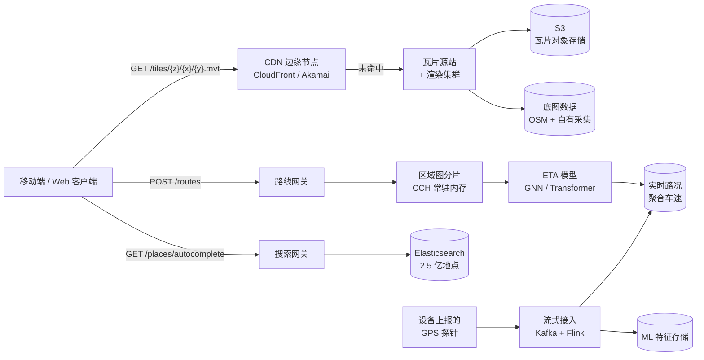
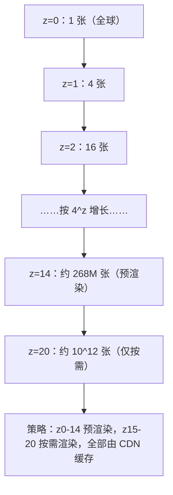
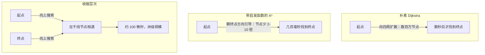
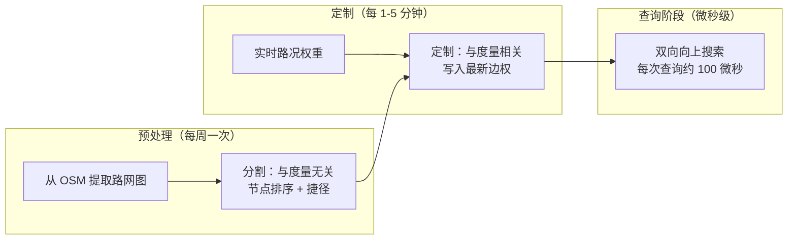
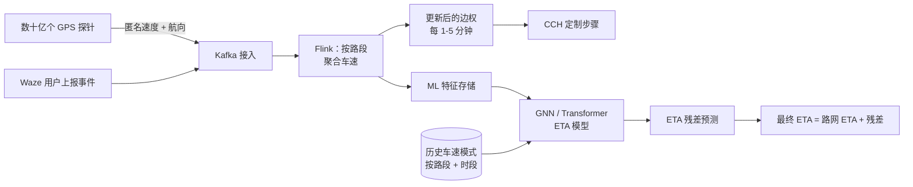
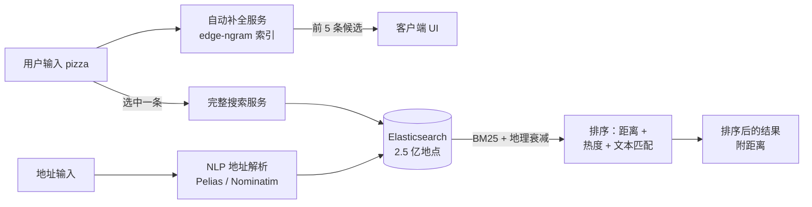

# 设计 Google Maps（路线规划与瓦片渲染）

> **TL;DR.** 行星级地图产品是套在同一件风衣里的两套系统：一套读多写少的瓦片服务，按 20 多个缩放级别把地球每一块土地的矢量多边形经 CDN 送出；一套计算密集的路线引擎，查询预先算好的最短路图，叠加实时路况的边权，一秒内返回一条折线和 ETA。Google Maps 月活超过 20 亿 [^1]，2.5 亿个地点每天产生 1 亿次更新 [^2]。最关键的权衡是新鲜度与成本：瓦片最好是静态的、可被 CDN 缓存，但物理世界每分钟都在变；路线规划想要预计算的捷径，而路况会不停让这些捷径失效。

## 学习目标

学完本章，你将能够：

- [ ] 用 Slippy Map 方案与 CDN 缓存，设计一条每天承载 100 亿次以上瓦片请求的分发流水线
- [ ] 比较 Dijkstra、A*、收缩层次与可定制收缩层次，并说明各自适用场景
- [ ] 搭建一条 ETA 预测流水线，融合历史车速、实时 GPS 探针与 ML 后处理
- [ ] 设计带距离偏置、自动补全在 100 毫秒内的 POI 搜索与地理编码子系统
- [ ] 估算瓦片存储、路线查询 QPS 与路况数据接入带宽的容量
- [ ] 讲清“与度量无关”和“与度量相关”两阶段预处理的切分，以及它如何支撑实时路况路线规划

## 直觉理解

想象你经营一家披萨外卖连锁，在全国有 1 万个门店。每位顾客的冰箱上都贴着一张纸质地图，而这张地图是按小方块印刷的。顾客看自己所在街区时，只需要房子周围的四块。当他缩放到整座城市时，需要一块更粗的、把一切都概括进去的方块。你预先把这些方块按不同缩放级别印出几百万份，堆在各个城市附近的仓库里。这就是瓦片分发：预渲染好的方块，缓存在边缘，按需取用。

现在顾客想要去最近那家披萨店的路线。你可以用手指沿着每一条可能的路描过去（Dijkstra），但这个国家有 5000 万个路口。换个思路：你预先给高速公路打上“重要”标记，再造一些跳过小巷区的捷径路。有人问路时，你只从两端沿着重要性往高处走，直到两条路径相遇。这就是收缩层次：离线算好捷径，查询时微秒级返回。

但路况每五分钟就变一次。凌晨 3 点算出来的捷径，下午 5 点就错了。于是你把工作切开：捷径结构几周不动，通行时间却每隔几秒就用 GPS 探针更新一遍。这就是可定制收缩层次：结构慢、权重快。这三个想法构成了所有现代地图产品的骨架。

## 需求

### 澄清问题

- **Q：需要覆盖多大地理范围？**
  假设：全球 220 多个国家，城区有精细到街道的数据，其余地区至少覆盖到道路级别。
- **Q：瓦片下发与路线查询各自的延迟目标是多少？**
  假设：瓦片获取（由 CDN 直接响应）p99 < 200 毫秒，路线查询（同国内）p99 < 500 毫秒，跨洲路线 p99 < 2 秒。
- **Q：需要实时路况，还是静态限速就够？**
  假设：必须实时。只有静态数据的 ETA 在拥堵时严重不准。
- **Q：是否支持离线地图？**
  假设：支持。用户可以按国家下载数据包，在没有网络时做逐向导航。
- **Q：地图数据更新用什么一致性模型？**
  假设：最终一致性即可。新修的路 24 小时内出现就行；路线规划则必须在几分钟内反映路况变化。
- **Q：需要多模态路线规划（公交、步行、骑行）吗？**
  假设：本设计以驾车为主；公交和步行复用同一套图基础设施，只是边权与权重配置（profile）不同。

### 功能需求

- 以 20 多个缩放级别渲染可交互的地图瓦片，支持平移、缩放、旋转与倾斜
- 计算两个或多个途经点之间的最快路线，并给出逐向导航指令
- 提供计入实时路况的 ETA
- 按名称、地址或类别搜索地点，自动补全带距离偏置
- 支持离线地图下载，内含预先编译好的路线图

### 非功能需求

- **负载：** 每天 100 亿次以上瓦片请求，每天 1 亿次以上路线查询，MAU 20 亿以上 [^1]
- **延迟：** 瓦片下发 p99 < 200 毫秒，路线查询 p99 < 500 毫秒，自动补全 < 100 毫秒
- **可用性：** 瓦片服务 99.99%（有 CDN 兜底），路线服务 99.9%
- **新鲜度：** 路况权重每 1-5 分钟更新一次；底图瓦片在源数据变更后 24 小时内更新
- **存储：** 栅格瓦片金字塔 PB 级，矢量瓦片 TB 级，路网图 TB 级

## 容量估算

| 指标 | 数值 | 推导 |
|--------|------:|------------|
| 每日瓦片请求数 | 10B | 2B MAU × 各会话平均每会话约 5 张瓦片 |
| 峰值瓦片 QPS | 230K | 10B / 86,400 × 2 倍峰值系数 |
| 每日路线查询数 | 100M | 约 10% 的会话会请求路线 |
| 峰值路线 QPS | 2,300 | 100M / 86,400 × 2 倍峰值 |
| 瓦片存储（矢量，z0-20） | 约 50 TB | 稀疏金字塔；深层级只覆盖有人口的区域 [^3] |
| 路网图（全球，已编译） | 约 200 GB | 5000 万节点 × 1.2 亿边 × 含捷径后平均约 1.5 KB |
| GPS 探针接入量 | 约 5 TB/天 | 全球每天数十亿条匿名速度采样 |
| 地点数据库 | 约 2.5 亿条记录 | Google 公布的地点目录规模 [^2] |

- **读写比（瓦片）：** 实质上是无限读对极少写（瓦片在每个版本内不可变）
- **CDN 命中率：** 缩放级别 0-14 超过 95%；稀疏地区的深层级更低
- **路线图内存：** 每个区域分片都能装进内存（北美编译后的 CCH 约 30 GB）
- **路况更新频率：** 边权每 60-300 秒由聚合后的探针数据刷新一次

## API 与数据模型

### API 设计

```http
GET /tiles/v5/{z}/{x}/{y}.mvt
  Returns: 200 application/vnd.mapbox-vector-tile (protobuf)
  Cache-Control: public, max-age=86400, immutable
  Errors: 404 (tile not rendered), 429 rate limited

POST /routes/v1/directions
  Body: { "origin": [lat, lon], "destination": [lat, lon],
          "waypoints": [...], "mode": "driving", "depart_at": "ISO8601" }
  Returns: 200 { "polyline": "encoded", "eta_seconds": 1847,
                  "distance_m": 42300, "steps": [...] }
  Errors: 400 invalid coords, 429 rate limited

GET /places/v1/autocomplete?q=pizza&lat=40.7&lon=-74.0&radius=5000
  Returns: 200 { "predictions": [{ "place_id": "...", "name": "...",
                  "distance_m": 320 }] }

GET /places/v1/geocode?address=1600+Amphitheatre+Parkway
  Returns: 200 { "lat": 37.4220, "lon": -122.0841, "formatted": "..." }

GET /places/v1/reverse?lat=37.4220&lon=-122.0841
  Returns: 200 { "address": "1600 Amphitheatre Parkway, Mountain View, CA" }
```

### 数据模型

```sql
-- 瓦片元数据（真正的瓦片字节在对象存储 / CDN 源站）
table tile_versions (
  z           int,
  x           int,
  y           int,
  version     int,
  blob_key    text,       -- S3 / GCS key
  rendered_at timestamp,
  PRIMARY KEY ((z, x, y), version)
)

-- 路网图以编译后的二进制（CCH 格式）存储
-- 按大洲 / 区域分片，启动时载入内存
-- 结构隐式定义在二进制格式里（节点、边、捷径、权重）

-- 地点 / POI 索引（Elasticsearch）
-- document: { place_id, name, category, lat, lon, rating, review_count, updated_at }
-- geo_point 字段用于距离查询，text 字段用于自动补全
```

## 高层架构



*瓦片路径、路线路径和搜索路径是三棵互不共享运行时状态的服务树，只在客户端 UI 层汇合。*

系统拆成三条彼此独立的读路径：

**瓦片路径。** 客户端按 `(z, x, y)` 向 CDN 请求矢量瓦片。命中缓存时（95% 以上的请求），响应从最近的边缘 POP 返回，耗时不到 50 毫秒。未命中时，请求回落到瓦片源站，后面是一组渲染集群（Mapnik 或 Tippecanoe）和对象存储。热门缩放级别（0-12）预渲染；冷门瓦片按需渲染并缓存。带版本的 URL 路径（`/v5/{z}/{x}/{y}.mvt`）让缓存失效变成一次 CDN 清除加一个新 URL 根 [^4]。

**路线路径。** 客户端把起点和终点发给路线网关，网关派发到持有 CCH 编译路网的区域图分片。分片执行双向向上搜索，产出折线和原始 ETA，再把路线送进 ETA 模型做修正。修正后的结果返回客户端。

**搜索路径。** 自动补全和地理编码查询打到持有 2.5 亿以上地点文档的 Elasticsearch 集群 [^2]。距离偏置用 geo_point 衰减函数；文本匹配用 edge-ngram 分词支持前缀搜索。

## 深入探讨

### 深入探讨 1：每天 100 亿次请求的瓦片分发

**问题。** 每提高一个缩放级别，瓦片数量就是上一级的四倍：缩放级别 `z` 有 `4^z` 张瓦片 [^3]。z20 的理论全球拼图约有 10^12 张瓦片，全部预渲染不可能。如果不走 CDN，光峰值 230K QPS 就要求源站具备对应能力。

**矢量瓦片。** Mapbox Vector Tile 规范把几何编码成 protobuf，坐标是增量压缩的 zigzag 编码整数 [^5]。要素属性被归并进 `keys` 和 `values` 数组，用下标引用，所以 `highway=residential` 这类重复字符串只占常量空间。默认瓦片范围 4096 单位，在赤道、z18 时约合 4 厘米分辨率 [^5]。同等内容的矢量瓦片比栅格瓦片小 2-5 倍，还支持客户端侧旋转、倾斜和换样式，不必回服务器一趟 [^6]。



*每提高一个缩放级别瓦片数翻四倍；预渲染止于 z14（约 2.68 亿张），更深的级别按需渲染并靠 CDN 激进缓存。*

**CDN 策略。** 瓦片在同一个数据集版本内不可变。带版本的 URL 方案（`/v5/{z}/{x}/{y}.mvt`）意味着缓存失效只是部署一个新版本前缀、让旧条目自然过期。缩放级别 0-14 的命中率超过 95%，因为同一批瓦片服务着几百万个看同一座城市的用户。深层级命中率下降，但请求量也在下降（愿意缩放到楼栋级别的人少）。源站渲染集群横向扩展；每个渲染器都是无状态的，从底图存储拉取源数据。

**离线数据包。** Mapbox 曾证明，为离线包重新组织瓦片存储能把包体积最多压小 40% [^6]。一个国家级的离线包包含 z0-14 的矢量瓦片、一份 CH 编译的路线图，以及一个压缩的 POI 索引。

### 深入探讨 2：路线算法的演进

**问题。** 北美路网约有 5000 万个节点、1.2 亿条边。朴素最短路算法在这个规模上根本达不到亚秒级延迟的 SLO。

**Dijkstra** 从起点向四周一圈圈扩散，直到碰到终点，跨城查询要碰几百万个节点 [^7]。按每个节点松弛 1 微秒算，一次查询就是好几秒。

**带地理启发函数的 A\* 算法** 用大圆距离作为可采纳的启发值，把搜索往终点方向引导。基础的欧氏启发能把探索节点减少约 2-3 倍，高级启发能减少 10 倍以上 [^8]。好一些，但长途路线仍要几百毫秒。

**收缩层次（Contraction Hierarchies，Geisberger 等，2008）** 预先算出一个节点重要性排序，反复收缩最不重要的节点并插入捷径边 [^9]。查询时，双向 Dijkstra 只松弛重要性“向上”的边。查询时间降到洲级图上约 100 微秒，而且辅助的捷径数据往往比输入图还小 [^9]。



*同一张洲级图上的三种算法：Dijkstra 把一切都探一遍，A* 朝终点剪枝，CH 利用预计算的重要性把答案压到微秒级。*

**可定制收缩层次（Customizable Contraction Hierarchies，Dibbelt 等，2014）** 把预处理拆成两段：一段慢的、与度量无关（拓扑、节点排序），一段快的、与度量相关，几秒钟就能吸收新的边权 [^10]。微软的 Customizable Route Planning 通过多层图划分实现了同样的切分 [^11]。OSRM 直接把它暴露成两条独立命令 `osrm-partition` 和 `osrm-customize` [^12]：

```bash
# 与度量无关：慢，每次数据更新跑一次（数小时）
osrm-partition /data/north-america.osrm

# 与度量相关：快，路况变化时重跑（数秒）
osrm-customize /data/north-america.osrm

# 用最新权重提供查询服务
osrm-routed --algorithm mld /data/north-america.osrm
```



*与度量无关的分割每周跑一次；与度量相关的定制几秒钟吸收实时路况；查询基于最新权重在微秒级完成。*

### 深入探讨 3：路况数据接入与 ETA 预测

**问题。** 静态限速在拥堵时给出的 ETA 严重不准。生产系统需要一条流水线，接入数十亿条 GPS 探针，按路段聚合车速，再喂给一个 ML 模型去修正路线引擎的估计。

**接入流水线。** 几百万台手机持续上报匿名的速度与方向采样。Apple 只收集随机切片的行程片段，起终点都不上传，标识符还会轮换，行程无法被重建 [^13]。Waze 依赖在路上的活跃司机；它的事件上报平均比基于探针的方案早 9.8 分钟到达 [^14]。Waze 的会话存储每秒承受超过 100 万次 Redis MGET，延迟亚毫秒级 [^15]。



*GPS 探针经 Kafka 与 Flink 汇成按路段的聚合车速，同时供给路线引擎的权重定制和 ML 模型的特征存储。*

**Google Maps + DeepMind 的 GNN（2020）。** 路网被切成一个个“超路段”（Supersegment，相邻路段组成、共享交通流量的子图）。一个在相邻节点间做消息传递的图神经网络预测每个路段的通行时间 [^16]。Google 表示，此前已有超过 97% 的行程 ETA 是准的；GNN 针对的是剩下的不准那部分，在台中这类城市把误差再降低 50% 以上，在柏林、雅加达、圣保罗、悉尼、东京、华盛顿特区等地最多降低 50% [^16]。

**Uber DeepETA（2022）。** 一个全局的编码器-解码器 Transformer（做了线性化，复杂度 O(K*d^2) 而非 O(K^2*d)）对路线引擎的 ETA 做后处理 [^17]。连续特征先做分位分桶再嵌入。由于特征稀疏，每次预测只触达模型约 0.25% 的参数 [^17]。它是 Uber 内部 QPS 最高的模型，延迟预算只有几毫秒 [^17]。

### 深入探讨 4：POI 搜索与地理编码

**问题。** 用户输入“pizza”，期望 100 毫秒内看到相关结果，而且要偏向当前视野。系统得支撑 2.5 亿以上地点 [^2]、跨语言的模糊地址解析，以及输入到一半的自动补全。

**架构。** 地理编码把地址变成坐标，逆地理编码反过来。Pelias 是一个模块化的开源地理编码器，建在 Elasticsearch 之上，用自然语言分类引擎做解析 [^18]。Nominatim 用 OpenStreetMap 数据，分三个阶段：导入（osm2pgsql 灌进带 PostGIS 的 PostgreSQL）、地址计算、搜索前端 [^19]。

**排序信号。** 结果融合地理距离（geo_point 衰减函数）、文本匹配质量（前缀用 edge-ngram，相关性用 BM25）和热度信号（评论数、点击率）。距离偏置保证在曼哈顿搜“Pizza”返回曼哈顿的店，而不是里斯本的。

**自动补全。** 一个独立子系统，底层是 edge-ngram 索引，并朝用户当前视野做地理偏置。每次按键都必须在 100 毫秒内返回。索引按地理区域分片，让单分片体量可控、延迟可预测。



*POI 搜索把一条快速自动补全路径（edge-ngram，100 毫秒内）和一条全文检索路径结合起来，后者融合 BM25 相关性、地理距离衰减与热度信号。*

## 真实案例

**Apple Maps：从零重建（2018 年至今）。**

2012 年 Apple Maps 上线惨败（Tim Cook 公开发了道歉信），之后 Apple 花了四年搭建自有的数据采集基础设施，才重新发布 [^13]。车队是改装厢式车：4 组 LiDAR、8 台有重叠的高分辨率相机、车顶 GPS 装置、车轮里程计，以及一台 Mac Pro 加一组 SSD，用来记录加密的点云和影像 [^13]。

**三层架构：**

1. **真值层（车辆采集）。** 原始数据用分片密钥加密：一片在车上，一片在数据中心。数据回传后，计算流水线抹掉人脸和车牌。计算机视觉模型提取路牌、地址和 POI。深度朗伯网络（Deep Lambertian Network）产出三维物体分类 [^13]。
2. **卫星层。** 高分辨率卫星影像与车辆采集结果交叉比对，生成正射重建，让编辑能“看穿”树冠看到底下的道路 [^13]。
3. **探针层。** 来自 20 亿以上活跃 Apple 设备的匿名速度与方向片段。起终点都不上传，标识符轮换，每段行程只上传随机切片 [^13]。

隐私设计确实聪明：因为切片边界是随机选的、ID 会轮换，行程永远无法被重建。Apple 明确说过：“我们特意不收集数据，哪怕只是从 A 点到 B 点” [^13]。北加州覆盖随 iOS 12（2018 年秋）上线，之后按国家逐个铺开。

非专家容易漏掉的关键判断：Apple 拒绝在第三方数据（TomTom）上打补丁，因为手握 20 亿以上活跃设备，只有自有真值数据才能做到洲级的新鲜度。资本开支巨大（四年的车队运营），换来的是自动驾驶级别的数据密度，顺带把消费级地图也喂饱了。

## 权衡

| 方案 | 优点 | 缺点 | 适用场景 | 我们的选择 |
|----------|------|------|-------------|----------|
| 栅格瓦片（PNG） | 简单，任何客户端都能渲染 | 体积大 2-5 倍，客户端无法改样式 | 老旧客户端、固定样式 | 否 |
| 矢量瓦片（MVT） | 体积小 2-5 倍，样式在客户端 [^6] | 需要支持 WebGL 的客户端 | 现代 Web 与移动端 | 是 |
| 朴素 Dijkstra | 正确、简单 | 洲级规模下每次查询要数秒 [^7] | 小图、预计算场景 | 否 |
| 带启发函数的 A* | 探索节点少 2-10 倍 [^8] | 交互式使用仍然太慢 | 没有预计算预算 | 否 |
| 收缩层次 | 查询约 100 微秒 [^9] | 预处理数小时，权重静态 | 离线地图、极少重新赋权 | 离线场景 |
| CCH / MLD | 几秒钟吸收实时路况 [^10] | 实现更复杂 | 实时路况感知的路线规划 | 是 |
| 静态限速 | 零基础设施 | 拥堵时严重不准 | 仅作兜底 | 否 |
| ML 后处理（GNN） | 难例上误差降低 50% [^16] | 模型漂移，需要持续重训 | 线上消费级产品 | 是 |

最大的一个权衡：**新鲜度与预计算成本。** 每一层级的路线加速都把假设焊进了预处理里。CCH/CRP 的洞察（把拓扑和权重分开）是让实时路况路线规划可行的解法。没有它，你只能在“陈旧但快”（CH）和“新鲜但慢”（Dijkstra）之间二选一。

## 扩展与故障模式

**负载 10 倍（每天 100 亿次路线查询）：**

- 图分片打满。缓解：加区域副本；分片在定制完成后就是只读的，复制毫无难度。
- 深层级瓦片的瓶颈变成 CDN 的源站渲染集群。缓解：预渲染到 z16 而不是 z14；扩充渲染机队。

**负载 100 倍（每天 1000 亿次瓦片请求）：**

- CDN 回源带宽成本成为主导。缓解：谈量级折扣；切到多 CDN，按成本选路。
- ETA 模型推理成为延迟瓶颈。缓解：模型蒸馏；在边缘跑一个更小的学生模型，全量模型兜底。

**负载 1000 倍：**

- 架构级重写：把编译好的路线图推到边缘（端上或边缘 POP），路线查询再也不回源。瓦片分发退化成纯 CDN 问题，热门瓦片根本不需要源站。

**故障模式：**

- **CDN POP 故障：** 自动切到次近的 POP。受影响用户的瓦片延迟从 50 毫秒退化到 150 毫秒。无数据丢失（瓦片不可变）。
- **路况权重陈旧（Flink 流水线积压）：** 路线引擎用的权重是 5-15 分钟前的，而不是 1-5 分钟内的。检测：监控权重年龄指标。降级方式：回落到当前时段的历史模式。
- **定制期间图分片 OOM：** 定制步骤要把新权重写进分片内存。如果流量高峰让权重数组超出配额，分片会崩。缓解：分片蓝绿部署；新权重先写入备用分片，然后切流量。

## 常见陷阱

> [!WARNING]
> **在查询时对全量路网跑 Dijkstra。** 5000 万以上节点时，查询要花几秒。请求量还没到设计值，CPU 就先打满了。用 CH（静态）或 CCH/MLD（实时路况）[^12]。

> [!WARNING]
> **不用 CDN 直接发瓦片。** 瓦片是互联网上最该被缓存的对象。没有 CDN，每一次视野平移都打到源站，峰值时渲染队列无界增长 [^4]。

> [!WARNING]
> **把路况直接焊进收缩层次。** 每次路况更新都会让整个层次结构失效，而预处理要几小时。用 CCH 或 CRP 把拓扑和权重分开 [^10][^11]。

> [!WARNING]
> **把 ETA 当成边权的确定性求和。** 静态限速在拥堵时严重不准。加一层 ML 后处理，预测基于图的 ETA 与真实值之间的残差 [^16][^17]。

> [!WARNING]
> **对 GPS 轨迹不做地图匹配。** 城市峡谷里的原始 GPS 有 10-50 米误差。朴素地吸附到最近道路，在分隔式高速上会吸到平行的错误车道，导致幽灵改道。用基于 HMM 的地图匹配 [^20]。

> [!CAUTION]
> **按国家发离线包却不做增量更新。** 没优化过的包能到 2 GB 以上，用户在蜂窝网下就放弃下载了。改用矢量瓦片（比栅格小 2-5 倍 [^6]）、发 CH 编译的图，并且每周发二进制差分而不是整包重装。

## 追问

**1. 如何加入 AR 步行导航（Live View）？**

手机摄像头画面交给端上的视觉定位（VPS），把建筑立面与 Street View 影像预先构建的三维网格做匹配。箭头和标签作为 AR 覆盖层，锚定在匹配出的位置上。关键难点是没有特色立面的区域的 VPS 精度；置信度低时回落到基于罗盘的箭头。

**2. 如何处理室内路线（机场、商场）？**

室内地图用一套独立的、带楼层概念的路网，边包括电梯、扶梯和走廊。定位从 GPS（室内不可用）切换到 Wi-Fi RTT、BLE 信标，或用气压高度判断楼层。瓦片层增加按楼层的矢量瓦片，由缩放级别阈值触发。

**3. 如何支持多模态路线（公交 + 步行 + 驾车）？**

把每种方式建成独立的图层，之间用换乘边连接（例如“把车停在站里、走到站台、坐火车”）。跑多准则最短路，同时优化时间、换乘次数和步行距离。GTFS 提供公交时刻表；实时 GTFS-RT 更新调整 ETA。

**4. 如何做隐私保护的路线规划（Apple 的做法）？**

路线在端上用下载好的 CCH 图计算。只把匿名、不可重建的探针切片发给服务端做路况聚合。标识符按会话轮换。绝不上传行程起终点 [^13]。

**5. 如何接入社区编辑（Waze 模式）？**

用户提交的封路和危险上报进入审核队列（自动加人工）。核实后的编辑对突发事件几分钟内更新底图，永久性变更则在几小时内更新。Waze 的上报平均比基于探针的方案早到 9.8 分钟 [^14]，社区数据因此成了关键的新鲜度信号。

**6. 如何支持 LLM 驱动的行程规划（2024 年以后的功能）？**

LLM 从自然语言生成结构化行程（途经点、时间预算、POI 类别）。行程再用路线和地点 API 校验。LLM 不替代路线引擎，它只负责编排对路线引擎的调用。幻觉出来的 POI 靠把 place_id 拿去地点库里校验来挡住。

**7. Overture Maps Foundation 如何改变数据格局？**

Overture 的 GA 版交通数据集在宽松许可下包含 8600 万公里道路 [^21]。对商业使用来说，它是 OSM 的可行替代，且没有 share-alike 义务。架构不变，只是数据源换了。针对自有采集数据的质量校验仍然必要。

## 练习

### 练习 1：某国的离线地图

你想给法国加离线导航。用户在 Wi-Fi 下下载一个包，之后两周无网络也能导航。设计包的内容，估算体积，并提出一套新鲜度策略，让 5000 万离线用户保持同步又不至于让 CDN 预算爆掉。

<details>
<summary>提示</summary>

z0-14 的矢量瓦片足以覆盖导航需求。法国的 CH 编译图大约 500 MB。核心张力在新鲜度：封路每天都在发生，但整包重下太贵。想想二进制差分，并算一算 5000 万用户乘以每周增量的量级。

</details>

<details>
<summary>参考解</summary>

**包内容：** z0-14 矢量瓦片（约 800 MB）、CH 编译路网（约 500 MB）、POI 索引（约 200 MB）、语音音素（约 100 MB）。合计压缩后约 1.6 GB。

**实时路况：** 离线不可用。用 CH 图里的自由流限速，ETA 精度退化到 20-40% 误差。UI 标注“离线 ETA”。

**新鲜度：** 每周对上一版做二进制差分（bsdiff）。增量约为整包的 5-15%，即每周约 80-240 MB。封路：一个轻量的事件覆盖层（约 1 MB JSON），有网络时择机同步。

**CDN 成本：** 5000 万用户 × 每周平均 150 MB 增量 = 每周 7.5 PB。按 $0.02/GB 计约每周 15 万美元。缓解：按区域错开发布、对 30 天以上不活跃用户跳过增量、极限压缩。

**接受的权衡：** 离线地图牺牲 ETA 精度和实时事件，换取无网络时的完整可用性。

</details>

## 要点回顾

- **两套系统，一个 UI：** 瓦片和路线是独立的两棵服务树，扩展特性不同。别让它们共用一个数据库或一次部署。
- **CCH 是突破口：** 把与度量无关的预处理和与度量相关的定制分开，才让洲级规模的实时路况路线规划变得可行。
- **ETA 是模型，不是算式：** 把它当成 ML 系统来运营——特征工程、持续重训、漂移监控。静态限速在拥堵时严重不准。
- **瓦片以 CDN 为先：** 每天 100 亿次以上请求时，CDN 本身就是瓦片分发系统。源站只是兜底渲染器，不是主服务路径。
- **隐私是设计约束，不是功能：** Apple 的探针数据架构（随机切片、轮换 ID、分片密钥加密）说明，隐私友好的路况数据在大规模下架构上可行。

## 延伸阅读

- [Contraction Hierarchies: Faster and Simpler Hierarchical Routing (Geisberger et al., 2008)](https://link.springer.com/chapter/10.1007/978-3-540-68552-4_24)。CH 的经典论文；任何关于路线算法的资深面试都以它为背景知识。
- [Customizable Contraction Hierarchies (Dibbelt, Strasser, Wagner, 2014)](https://arxiv.org/abs/1402.0402)。让实时路况下的 CH 变得实用的论文；直接对应“与度量无关 / 与度量相关”的切分。
- [Route Planning in Transportation Networks (Delling et al., 2015)](https://arxiv.org/abs/1504.05140)。微软研究院对 CH、CRP、Hub Labeling、MLD 的全面综述；复习路线算法最好的一篇。
- [DeepETA: How Uber Predicts Arrival Times (Uber Engineering, 2022)](https://www.uber.com/blog/deepeta-how-uber-predicts-arrival-times/)。公开资料里最清晰的 ETA ML 架构，含线性化 Transformer 与离散化嵌入。
- [Traffic Prediction with Advanced Graph Neural Networks (DeepMind + Google, 2020)](https://deepmind.com/blog/article/traffic-prediction-with-advanced-graph-neural-networks)。超路段与 GNN 消息传递在生产环境做 ETA 修正。
- [Mapbox Vector Tile Specification 2.1](https://github.com/mapbox/vector-tile-spec/blob/master/2.1/README.md)。所有现代 Web 地图的权威线格式；理解编码才能推断瓦片体积。
- [Apple is Rebuilding Maps from the Ground Up (TechCrunch, 2018)](https://techcrunch.com/2018/06/29/apple-is-rebuilding-maps-from-the-ground-up/)。关于在隐私约束下用传感器车队构建洲级底图，最好的一份公开记录。
- [OSRM Documentation](https://github.com/Project-OSRM/osrm-backend)。被研究最多的开源路线引擎；把 CH 和 MLD 暴露成可以在本地跑起来的具体流水线。

## 记忆卡片

<details>
<summary><strong>Q：在洲级路网上，收缩层次的查询时间复杂度是多少？</strong></summary>

A：约 100 微秒。CH 预计算捷径边和节点重要性排序；查询时跑双向 Dijkstra，只松弛向上的边，碰到的是几百个节点而不是几百万个 [^9]。

</details>

<details>
<summary><strong>Q：为什么不能把实时路况直接焊进标准收缩层次？</strong></summary>

A：CH 的捷径编码了具体的边权。改动任何一个权重都可能让捷径结构失效，需要几小时重新处理。CCH 和 CRP 把拓扑（慢，与度量无关）和权重（快，与度量相关）分开 [^10]。

</details>

<details>
<summary><strong>Q：瓦片金字塔如何随缩放级别增长？</strong></summary>

A：每提高一个级别，x 和 y 两个方向都翻倍，所以级别 z 有 4^z 张瓦片。z20 的理论全球拼图约有 10^12 张，但深层级只渲染有人口的区域 [^3]。

</details>

<details>
<summary><strong>Q：ML 模型在 ETA 预测中扮演什么角色？</strong></summary>

A：它是后处理器，不替代路线引擎。路线引擎给出折线和原始 ETA；ML 模型利用实时路况、历史模式和空间特征，预测基于图的估计与真实值之间的残差 [^16][^17]。

</details>

<details>
<summary><strong>Q：为什么现代地图应用用矢量瓦片而不是栅格？</strong></summary>

A：矢量瓦片体积小 2-5 倍，支持客户端侧旋转和换样式而不必回服务器，几何以紧凑的 protobuf 加增量压缩坐标编码 [^5][^6]。代价是需要支持 WebGL 的客户端。

</details>

<details>
<summary><strong>Q：什么是地图匹配，为什么必需？</strong></summary>

A：地图匹配把带噪声的 GPS 轨迹（城市峡谷里 10-50 米误差）对齐到路网，用 HMM 建模：发射概率是对到道路距离的高斯，转移概率比较路线距离与大圆距离。没有它，应用在分隔式高速上会吸到平行的错误道路 [^20]。

</details>

<details>
<summary><strong>Q：Google 与 DeepMind 的 GNN 如何提升 ETA 精度？</strong></summary>

A：它把路网切成超路段，训练一个在相邻节点间做消息传递的 GNN。在台中这类城市，它把剩余的 ETA 误差再降低 50% 以上，专攻路线引擎本来就不准的那部分 [^16]。

</details>

<details>
<summary><strong>Q：CCH 的“与度量无关 / 与度量相关”切分指什么？</strong></summary>

A：与度量无关的阶段（节点排序、捷径结构）只依赖图的拓扑，每周跑一次。与度量相关的阶段（给边和捷径赋通行时间）几秒钟就能吸收实时路况。正是这个切分让实时路况感知的路线规划变得可行 [^10][^11]。

</details>

<details>
<summary><strong>Q：Apple Maps 在采集路况数据时如何保护用户隐私？</strong></summary>

A：Apple 只收集行程的随机切片，起终点都不上传。标识符按会话轮换。切片边界随机选取，行程永远无法重建 [^13]。

</details>

<details>
<summary><strong>Q：地图瓦片的 CDN 命中率策略是什么？</strong></summary>

A：预渲染缩放级别 0-14（跨用户复用率高，约 2.68 亿张）。z15-20 按需渲染并在 CDN 缓存。带版本的 URL 路径让失效干净利落。预渲染级别的命中率超过 95%。

</details>

## 参考文献

[^1]: 9to5Google, "Google Maps now has over 2 billion monthly users", 2024 年 10 月（Google 确认；CNBC 2025 年 1 月也报道"月活超过 20 亿"）。https://9to5google.com/2024/10/29/google-maps-2-billion/

[^2]: Google Maps Platform, "Places UI Kit: 250 million places, 100 million daily updates", 2025. https://developers.google.com/maps/architecture/places-ui-kit-getting-started

[^3]: Wikipedia, "Tiled web map"（Slippy Map、XYZ 方案、缩放级别）。https://en.wikipedia.org/wiki/Tiled_web_map

[^4]: switch2osm.org, "Manually building a tile server"（Mapnik + mod_tile + renderd 技术栈）。https://switch2osm.org/serving-tiles/manually-building-a-tile-server-debian-13/

[^5]: Mapbox, "Vector Tile Specification 2.1" GitHub README。https://github.com/mapbox/vector-tile-spec/blob/master/2.1/README.md

[^6]: Mapbox Engineering, "More efficient offline map tiles (up to 40% smaller in v2)"。https://www.mapbox.com/blog/more-efficient-offline-map-tiles-save-up-to-40-storage-space

[^7]: Abhinav Ralhan 等, "A* and Dijkstra performance comparison on OSM"。https://jaeds.uitm.edu.my/index.php/jaeds/article/view/94

[^8]: arXiv 1812.07441, "Fast A* on Road Networks Using a Scalable Separator-Based Heuristic"。https://arxiv.org/abs/1812.07441v2

[^9]: Geisberger, Sanders, Schultes, Delling, "Contraction Hierarchies: Faster and Simpler Hierarchical Routing in Road Networks", Springer LNCS, 2008. https://link.springer.com/chapter/10.1007/978-3-540-68552-4_24

[^10]: Dibbelt, Strasser, Wagner, "Customizable Contraction Hierarchies", arXiv 1402.0402v5, 2015. https://arxiv.org/abs/1402.0402v5

[^11]: Delling, Goldberg, Pajor, Werneck, "Customizable Route Planning", Microsoft Research. https://www.microsoft.com/en-us/research/publication/customizable-route-planning/

[^12]: Project-OSRM, "osrm-backend README"（CH 与 MLD 流水线、HTTP API 服务）。https://github.com/Project-OSRM/osrm-backend/blob/master/README.md

[^13]: Matthew Panzarino, "Apple is rebuilding Maps from the ground up", TechCrunch, 2018 年 6 月。https://techcrunch.com/2018/06/29/apple-is-rebuilding-maps-from-the-ground-up/

[^14]: "Evaluating the Reliability, Coverage, and Added Value of Crowdsourced Traffic Incident Reports from Waze", 2018. https://www.researchgate.net/publication/326916618

[^15]: Google Cloud Blog, "Waze keeps traffic flowing with 1M+ real-time reads per second on Memorystore", 2025 年 11 月。https://cloud.google.com/blog/products/databases/how-waze-keeps-traffic-flowing-with-memorystore

[^16]: Oliver Lange 与 Luis Perez（DeepMind）, "Traffic prediction with advanced Graph Neural Networks", 2020 年 9 月。https://deepmind.com/blog/article/traffic-prediction-with-advanced-graph-neural-networks

[^17]: Xinyu Hu 等, "DeepETA: How Uber Predicts Arrival Times Using Deep Learning", 2022 年 2 月。https://www.uber.com/blog/deepeta-how-uber-predicts-arrival-times/

[^18]: Pelias Project, "pelias/pelias: Modular open-source geocoder using Elasticsearch"。https://github.com/pelias/pelias

[^19]: Nominatim Documentation, "Architecture Overview"（导入 + 地址计算 + 前端）。https://nominatim.org/release-docs/latest/develop/overview/

[^20]: Valhalla, "Meili: Map Matching in a Programmer's Perspective"（HMM，Newson-Krumm 2009 模型）。https://valhalla.github.io/valhalla/meili/algorithms/

[^21]: Overture Maps Foundation, "GA release of Transportation Dataset: 86M km of roads", 2024 年 12 月。https://overturemaps.org/announcements/2024/overture-general-availability-of-transportation-dataset/
