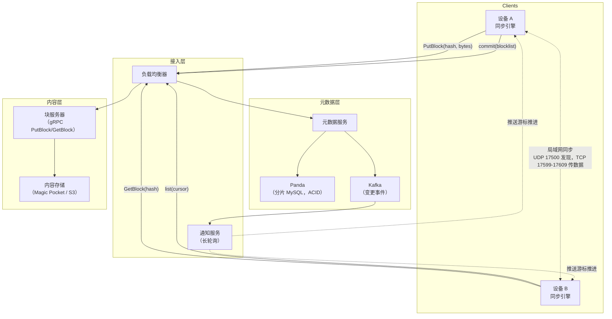
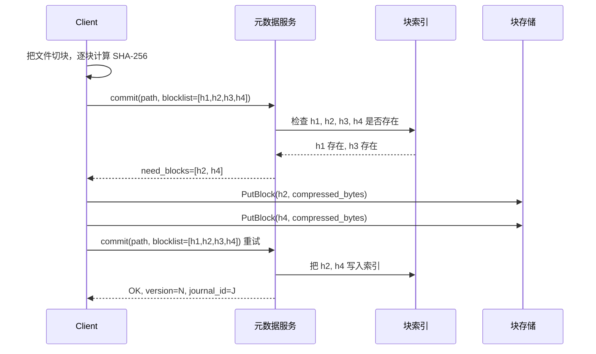
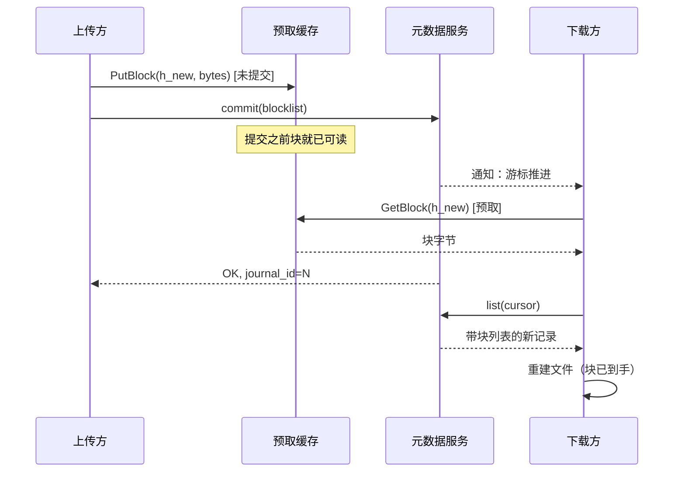
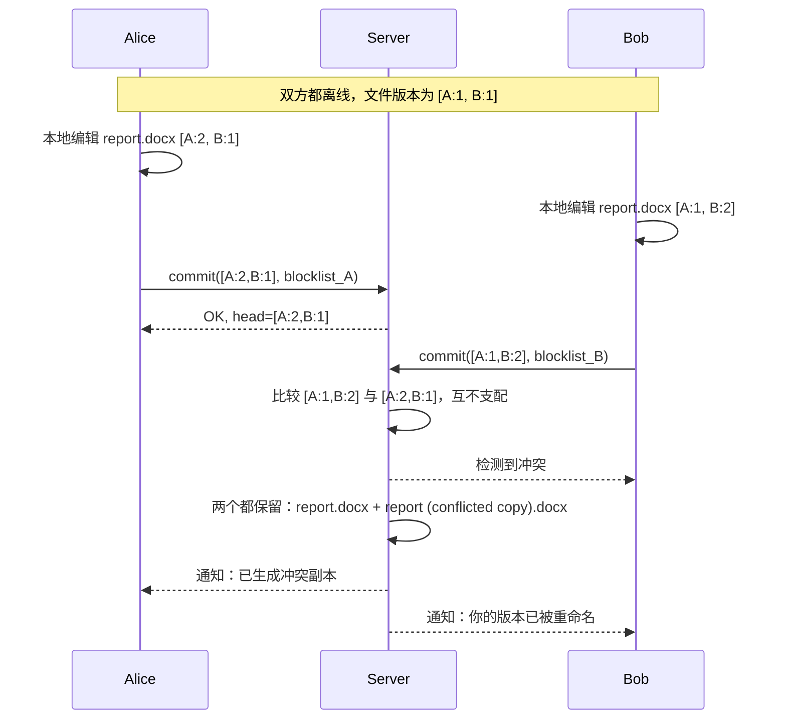

# 设计文件同步服务（Dropbox / Google Drive）

> **TL;DR.** 文件同步服务可以拆成两层：一层是内容寻址的块存储，用 SHA-256 作键保存不可变的块；另一层是元数据服务，负责文件树、版本管理和权限。内容定义分块保证本地编辑只需要重传本地那几个块。块级去重让同一份 10 MB 的 PDF 在 1 亿个收件箱里只存一份。冲突解决靠版本向量与双副本语义，因为静默的“后写者胜”会毁掉数据[^1]。Dropbox 用这套架构在 60 万块以上磁盘上承载约 5 EB 数据，持久性达到 12 个 9 以上[^2][^3]。

## 学习目标

- 设计一个两层文件同步架构，在 EB 级规模上把元数据与内容分离
- 比较固定大小分块与内容定义分块，并说清各自适用的场景
- 用 `need_blocks` 协商协议实现块级去重
- 套用 rsync 风格的增量同步，把文件编辑时的传输字节压到最低
- 解决并发离线编辑产生的冲突，且不静默丢数据
- 为 7 亿以上用户、每天写入 PB 级数据做容量估算

## 直觉理解

文件同步服务看上去就是个平平无奇的 CRUD 应用。上传一个文件，在另一台设备下载。10 个用户用起来毫无压力。到了 7 亿用户、5 EB 数据，它会直接崩掉，原因有三层。

第一，客户端大部分时间离线，或者待在时断时续的网络上。两台笔记本各自在航班上编辑同一份表格，它们没法跑共识协议。等它们重新联网，服务端面对的是分叉的状态，必须在两个用户的工作都不丢的前提下完成协调[^4]。

第二，同一份 10 MB 的 PDF 在几百万个收件箱里流转。给每个用户各存一份，浪费掉的是 PB 级空间。到了这个规模，跨用户去重在成本上是硬要求[^5][^2]。

第三，文件是就地修改的。编辑器在 2 GB 的表格里改了一个单元格，绝不能重传 2 GB。系统必须判断出到底哪几个字节变了，只传这几个字节[^6][^7]。

点亮整个设计的那个洞察是：把文件“是什么”（它的元数据：名字、路径、权限、版本历史）与文件“装了什么”（按密码学哈希作键的不可变字节块）分开。一旦切出这条线，版本管理落在元数据里，去重落在内容里，冲突落在元数据里，而块是傻的。其余所有设计选择都是从这里推出来的。

## 需求

### 澄清问题

- **Q：要支持多大的文件？**
  假设：从 1 KB 的文本笔记到 50 GB 的视频文件。中位数约 2 MB，p99 约 500 MB。
- **Q：每个用户几台设备？**
  假设：平均 3 台（手机、笔记本、台式机）。最多 10 台。
- **Q：需要实时协同编辑吗？**
  假设：不需要。那是另一个系统（OT/CRDT）。这里处理的是离线优先的同步加冲突检测。
- **Q：跨设备同步用什么一致性模型？**
  假设：最终一致性，带因果顺序。在线时变更在数秒内传播到位。
- **Q：需要端到端加密吗？**
  假设：作为可选档位。标准模式允许服务端去重；端到端模式为隐私牺牲跨用户去重。
- **Q：多地域吗？**
  假设：是。三个区（西部、中部、东部），跨区复制约 1 秒完成[^5]。

### 功能需求

- 从任意设备上传文件；在线时在数秒内同步到所有已关联设备
- 中断的上传和下载可续传，不用从零开始
- 检测并暴露并发离线编辑造成的冲突（不静默丢数据）
- 支持文件版本管理，保留期可配置（默认 30 天）
- 与其他用户共享文件和文件夹，权限可细分
- 局域网同步：设备在同一局域网内时，块以对等方式直传[^8]

### 非功能需求

- **用户数：** 7 亿以上注册用户，约 1800 万付费[^2]
- **存储量：** 客户数据总计约 5 EB[^2]
- **持久性：** 12 个 9 以上（>99.9999999999%）[^3]
- **可用性：** 读写均达 99.99%[^2]
- **延迟：** 在线时变更通知到对等设备的 p99 < 1 秒
- **一致性：** 单个命名空间内最终一致并保因果序；客户端视图与服务端视图之间强一致[^4]

## 容量估算

| 指标 | 数值 | 推导 |
|--------|------:|------------|
| 注册用户 | 7 亿 | Dropbox 公开披露[^2] |
| 活跃设备（峰值） | ~2 亿 | 7 亿用户 x 0.3 日活比例 x 平均 1 台活跃设备 |
| 每日文件变更 | ~20 亿 | 2 亿活跃设备 x 日均 10 次变更 |
| 写 QPS（均值） | ~23K | 20 亿 / 86,400 |
| 写 QPS（峰值，3 倍） | ~70K | 工作时段突发 |
| 平均变更大小 | 4 MB | 一个块（Dropbox 的块大小）[^6] |
| 每日入流量（去重前） | 8 PB | 20 亿次变更 x 4 MB |
| 每日入流量（去重后） | ~3 PB | 约 60% 去重率（估算） |
| 总存储量 | ~5 EB | Dropbox 2025 财年[^2] |
| 存储磁盘数 | 60 万块以上 | 跨所有区合计[^2] |
| 块索引条目数 | ~1.5 万亿 | 5 EB / 平均 4 MB 一块 |

关键比例：读写比大致 3:1（每次变更扇出到约 3 台设备）。块去重消掉约 40%–60% 的原始入流量。冷数据（超过一年）占用超过 90% 的字节，却只占不到 5% 的访问[^9]。

## API 与数据模型

### API 设计

```http
POST /v1/files/commit
  Body: { "namespace_id": "ns123", "path": "/docs/report.pdf",
          "blocklist": ["sha256_h1", "sha256_h2", "sha256_h3"],
          "parent_version": 42 }
  Returns: 200 { "version": 43, "need_blocks": ["sha256_h2"] }
           409 conflict (parent_version stale)

PUT /v1/blocks/{block_hash}
  Headers: Content-Type: application/octet-stream, Block-Format: broccoli
  Body: <compressed block bytes, max 4 MB>
  Returns: 201 stored | 200 already exists

GET /v1/blocks/{block_hash}
  Headers: Accept-Encoding: broccoli, identity
  Returns: 200 <block bytes>

GET /v1/files/list?namespace_id=ns123&cursor=41
  Returns: 200 { "entries": [...], "cursor": 43, "has_more": false }

GET /v1/notifications/longpoll?namespace_id=ns123&cursor=41
  Returns: 200 { "new_cursor": 43 } (blocks until change or timeout)
```

`commit` 端点是整个协议的核心：客户端发来块列表，服务端回一个 `need_blocks`，指明哪些哈希它手上没有。客户端只上传这几块，然后重试 `commit`[^6]。幂等性是天然的：同一个块哈希传两次等于没传。

### 数据模型

```sql
-- 元数据层（分片 MySQL / Panda）
CREATE TABLE file_journal (
    namespace_id  BIGINT,
    journal_id    BIGINT AUTO_INCREMENT,  -- 同一 namespace 内单调递增
    path          VARCHAR(4096),
    file_id       UUID,                   -- 跨重命名保持不变
    blocklist     JSON,                   -- 有序的 SHA-256 哈希列表
    size_bytes    BIGINT,
    version_vector JSON,                  -- {client_id: counter}
    is_deleted    BOOLEAN DEFAULT FALSE,
    created_at    TIMESTAMP,
    PRIMARY KEY (namespace_id, journal_id)
);

-- 内容层（Magic Pocket / S3）
CREATE TABLE block_index (
    block_hash    CHAR(64) PRIMARY KEY,   -- SHA-256 十六进制
    cell_id       INT,
    bucket_id     BIGINT,
    checksum      INT,                    -- 损坏检测
    ref_count     INT DEFAULT 1
);
```

文件日志是只追加的：每一次变更（创建、编辑、重命名、删除）都追加一行，`journal_id` 递增。客户端按游标轮询（游标记住自己最后见到的 `journal_id`）[^7]。块索引把哈希映射到物理位置，它没有文件、用户这些概念[^5]。

## 高层架构



*架构切得干干净净：元数据负责正确性（文件树、版本、权限），内容层负责字节（不可变、内容寻址、全局去重）。两边都不知道对方的内部实现。*

**写路径：** 设备 A 把文件切成 4 MB 的块，逐块算 SHA-256，带着块列表调用 `commit`。元数据服务查这些哈希在块索引里是否已存在，返回 `need_blocks`。设备 A 通过 gRPC `PutBlock` 上传缺失的块[^10]，重试 `commit`，元数据服务追加一条新的日志记录。Kafka 把变更事件推给通知服务。

**读路径：** 设备 B 在通知服务上挂着一条长轮询连接。游标一推进，它就调 `list` 拉取新的日志记录，然后对本地缓存里没有的块调 `GetBlock`。它按块列表顺序把块拼起来重建文件，再把临时文件原子地重命名覆盖旧文件。

**局域网同步：** 同网段的设备通过 UDP 17500 端口的广播互相发现[^8]。块传输走点对点 HTTPS，TCP 端口 17599–17609（取第一个可用的），用按命名空间签发的 SSL 证书认证[^11]。元数据永远来自服务端；本地只传不透明的块字节[^8]。

## 深入探讨

### 深入探讨 1：块级去重与内容定义分块

**问题所在：** 7 亿用户，按人各存一份，在成本上根本不可能。同一张素材图、同一个系统安装包、同一份 PDF 存在于几百万个账号里。没有去重，存储成本就随用户数线性增长。

**内容寻址：** 每个块以它未压缩字节的 SHA-256 作键。块存储就是纯粹的键值映射：`hash -> 加密压缩后的字节`[^5]。它没有文件、用户、权限这些概念。两个用户上传同一个 4 MB 块，只存一份。

**`need_blocks` 协议：** `commit` 时客户端发来完整块列表。服务端逐个哈希对块索引做检查。已经存在的跳过，只有缺失的才需要上传[^6]。对于完全重复的文件（比如那 1 亿个收件箱里的 10 MB PDF），第一次上传之后线上跑的字节是零。

**固定分块与内容定义分块：** Dropbox 用的是固定 4 MB 块[^6][^7]。它简单，而且和纠删码的条带大小对得上，但在偏移 0 处插入一个字节，就会把后面每一个边界都推移，所有下游哈希全部失效[^12]。内容定义分块（content-defined chunking，CDC）用滚动哈希（Rabin 指纹或 FastCDC）在内容符合某种模式的位置切边界。边界跟着内容走而不是跟着位置走，所以编辑只扰动局部块[^12][^13]。现代系统里，Hugging Face xet 用平均约 64 KB 的 CDC 块来做 ML 模型的版本管理[^14]。



*去重协议：客户端发哈希，服务端指出哪些是新的，客户端只上传新块。完全重复的文件，线上字节为零。*

**规模数字：** Magic Pocket 在 60 万块以上磁盘上存着约 5 EB[^2]。块在传输前用 Broccoli 压缩（Dropbox 自研的 Rust Brotli 编码器，改动很小：能在仍输出标准 Brotli 流的前提下支持 O(1) 拼接），中位上传体积从 3.5 MB 降到 1.6 MB[^10]。对于选择可变长块的系统，FastCDC 的吞吐量约为经典 Rabin CDC 的 10 倍[^13]。

**隐私风险：** 客户端去重会暴露“某个哈希在服务端存不存在”这件事。攻击者可以通过观察上传时序来探测特定文件是否在库里[^15]。缓解手段：只做服务端去重（客户端照样上传，服务端收到后再去重），或者用随机化阈值。Apple 的高级数据保护（Advanced Data Protection）用按用户的端到端密钥把这个问题完全绕开，代价是跨用户去重彻底失效[^16]。

### 深入探讨 2：用 rsync 算法做增量同步

**问题所在：** 即便切了块，一个只改了 100 字节的 4 MB 块，上传的还是 4 MB。对于大文件的小改动（数据库文件、Photoshop 暂存盘），这纯属浪费带宽。

**rsync 算法**（Tridgell 与 Mackerras，1996）一次往返就能完成[^17]。接收方把自己那份切成 S 字节的块，为每块算一个廉价的滚动 32 位校验和加一个 128 位 MD4 哈希，把这份签名发给发送方。发送方在自己的版本上滑动窗口，在每个字节偏移处都算一遍滚动校验和。一旦对上了，再用 MD4 哈希确认。发送方输出指令：“用接收方的第 k 块”或者“这里是 N 个原样字节”。

线上字节随实际差异大小走，不随文件大小走。一个 100 MB 的文件只改了 1 KB，rsync 大约传 1 KB 再加点开销[^17]。

**Dropbox 的实现：** 开源的 `fast_rsync` crate（Rust，SIMD 加速）在 Intel i7-6820HQ 上以 3.6 GiB/s 计算签名，比 librsync 快约 6 倍[^18]。要注意：MD4 在密码学上已经破了，调用方必须另外用 SHA-256 校验完整性[^18]。

**流式同步：** Dropbox 让上传和下载重叠起来。服务端会把“尚未 commit 的块列表”按上传者收进 memcache。下载端在正式的元数据提交落地之前，就先去预取这些块。在 Dropbox 的测试里，一次 500 MB 的同步从 383 秒降到 293 秒[^7]。



*流式同步通过预取缓存把上传和下载重叠起来。下载方在元数据提交落地之前就拉走了块，端到端同步时间大约减半。*

### 深入探讨 3：用版本向量解决冲突

**问题所在：** 两个客户端离线编辑，会产出分叉的版本。后写者胜会静默毁掉其中一个用户的成果。这在共享文件夹里天天发生[^1]。

**版本向量：** 每个文件版本带一个向量：从客户端 ID 到逻辑计数器的映射。重连时，服务端拿收到的向量与当前头比较。若某一方支配另一方（每个分量都 >=），就是干净的快进。若两边互不支配，这两个版本就是并发的[^1][^19]。

**双副本解决：** 一旦检测到并发，服务端把两个版本都留着：`report.docx`（先到的）和 `report (conflicted copy 2026-05-04).docx`（后到的）。两个都对用户可见，由用户手工合并[^1]。这看着丑，但对于三方合并根本做不了的二进制文件（Photoshop、Sketch、视频）来说，严格优于静默丢数据。

**为什么禁用 LWW：** 文件不像缓存或计数器，它代表的是几个小时的人力。静默丢掉一个版本是不可接受的。每一个生产级文件同步服务（Dropbox、Google Drive、OneDrive）都用双副本或它的变体[^1][^4]。



*两个离线客户端产出了分叉的版本向量。服务端检测到并发（互不支配），把两个版本都保留为双副本，并把冲突暴露给用户。*

**Nucleus（Dropbox 同步引擎的重写版）：** 它给文件分配全局唯一标识符，重命名和移动之后依然保持不变。原子移动与子树大小无关。强一致性检查的原则是“任何不一致都是 bug”[^4]。边界情况：Alberto 把 Archives 移进 January，同时 Beatrice 把 Drafts 移进 Archives。天真地执行会造出一个目录环。Nucleus 靠全局唯一 ID 发现它并拒绝这个环[^4]。

## 真实案例

### Dropbox Magic Pocket：从 S3 走向 EB 级自建存储

Dropbox 起家时跑在 Amazon S3 上。到 2015 年，他们存了超过 500 PB，账算不过来了。迁移到 Magic Pocket——他们自研的不可变块存储系统——期间网络流量峰值超过 0.5 Tbps，据报道两年净省约 7460 万美元[^20][^3][^21]。

**Cell 架构：** Magic Pocket 是一个三区系统（西海岸、中部、东海岸）。区内的前端查一张块索引（分片 MySQL：`hash -> cell, bucket, checksum`）来定位块。每个区里装着若干 Cell，每个 Cell 是 50 到 100 PB 的自包含单元，由 SMR 盘上的对象存储设备组成[^5][^2]。写入进的是 4 副本卷；卷写满封存后做纠删码。Reed-Solomon 6+3 的存储开销是 1.5 倍（每 6 个数据分片存 9 个分片）；局部重建码（Local Reconstruction Codes）把开销压到约 1.33 倍，单盘故障的读取代价不变，代价是对更罕见的 3 盘故障模式失去覆盖[^5][^2]。

**工程哲学：** “无聊的技术赢。”块索引用分片 MySQL 而不是新造的 KV 存储，“能力绰绰有余”，还“复用了运维经验”[^5]。每个 Cell 一个中心化 Master，不用 Paxos。块不可变，而不是可变。Master 因内存和 CPU 限制把 Cell 大小卡在约 100 PB，但 Cell 之间彼此独立，所以系统能横向扩展。

**Panda：** 元数据层从裸的分片 MySQL 演进到 Panda——一个自研的 PB 级事务型键值存储，提供 ACID 事务、区间转移、MVCC 和混合逻辑时钟[^22]。文件日志、权限、共享关系图都跑在它上面。

**冷存储优化：** 超过一年的数据（占字节数 >90%，占访问量 <5%）用跨 3 个区的 XOR 校验条带（2+1），把副本数从 2 降到 1.5，省下 25% 磁盘[^9]。跨区复制约 1 秒完成[^5]。做个对比：Google Drive 坐在 Colossus（单集群可扩到 EB 级、数万台机器的集群文件系统）和用于元数据的 Spanner 之上[^23]。

## 权衡

| 方案 | 优点 | 缺点 | 适用场景 | 我们的选择 |
|----------|------|------|-------------|----------|
| 固定 4 MB 块 | 简单、确定性、与条带大小对齐 | 插入/删除后边界错位；拿不到增量收益 | 只追加的负载；配合压缩使用 | 大规模场景下配合 Broccoli 压缩使用 |
| 内容定义分块（均值 8 KB） | 对编辑鲁棒；跨文件去重友好 | 块大小可变；滚动哈希吃 CPU；需要设最小/最大钳制 | 编辑频繁的通用同步 | 新系统的默认选择 |
| 仅按用户去重 | 隐私强；没有侧信道 | 没有跨用户节省；存储成本极高 | 端到端加密档位（iCloud ADP） | 仅当隐私合规强制要求时 |
| 全局跨用户去重 | 大规模下省下海量存储 | 侧信道泄露[^15]；与按用户端到端密钥不兼容 | 带隐私缓解的消费级同步 | 消费级产品的默认选择 |
| 双副本冲突解决 | 安全、用户可自行处理、不丢数据 | 冲突频繁时收件箱被副本塞满 | 所有文件同步的默认做法 | 永远使用 |
| 纠删码（Reed-Solomon 6+3，1.5 倍开销） | 比 3 副本省空间；能扛 3 盘故障 | 读延迟更高（要重建）；编解码吃 CPU | 冷数据；热数据用副本 | 冷层（超过一年） |
| 局部重建码（约 1.33 倍开销） | 比 Reed-Solomon 6+3 更省；单盘故障读取代价不变 | 相比 RS(6+3)，对更罕见的 3 盘故障模式失去覆盖 | 单盘修复为主的温/冷层 | 当每字节成本比故障模式覆盖更重要时 |

最关键的单个权衡：**去重与端到端加密**。当每个用户用各不相同的密钥加密，相同的明文会产出不同的密文，跨用户去重直接崩掉[^16]。Apple 的高级数据保护把这个权衡摆到了明面上：标准模式通过元数据校验和允许服务端去重；ADP 模式用用户自持的密钥加密一切，并接受更高的存储成本[^16]。

## 扩展与故障模式

**10 倍负载（70 亿用户）：** 块索引成为瓶颈。分片 MySQL 目前扛着 1.5 万亿条目，但 15 万亿条目要么得切得更细，要么得迁到分布式 KV。Cell 数量从约 100 涨到约 1,000。跨区复制的带宽逼近网络饱和。

**100 倍负载（700 亿文件，50 EB）：** 元数据层需要一个全局数据库（Spanner 级别）。块存储默认就得用多地域纠删码，而不只是冷数据用。客户端 CDC 成为减少入流量的硬要求。

**1000 倍负载：** 架构转向边缘优先：块缓存在 CDN 边缘，元数据复制到边缘 PoP，同步决策在本地做，服务端只做惰性协调。

**故障模式：**

- **区级故障：** 跨区复制保证块存在于 2 个以上区。元数据在数秒内切换到备用区。客户端向存活的区重试。RPO：约 1 秒的复制延迟[^5]。
- **块损坏（比特腐坏）：** 每个块在块索引里有校验和。后台巡检器持续校验。损坏的块用纠删码校验或跨区副本修复。修复 SLA：<48 小时；每秒约修复 4 个 extent，每个 1 到 2 GB[^2]。
- **元数据不一致：** 文件的块还没落地，它就不能先出现在元数据里，否则读会返回 404。两阶段提交协议（先传块，再提交元数据）避免了这一点。流式同步的预取缓存带来了额外复杂度：memcache 条目必须安全过期[^7]。

## 常见陷阱

> [!WARNING]
> **可变文件上用固定大小分块。** 在一个 10 MB 文件的偏移 0 处插入一个字节。后面每一个 4 MB 块的哈希都变了。同步引擎于是上传整个文件。用 CDC，或者靠压缩和流式同步来补偿[^12][^10]。

> [!WARNING]
> **冲突时静默采用后写者胜。** 没有版本向量，服务端分不清并发写和顺序写，就会静默丢掉某个用户的成果[^1]。永远要检测分叉，并把两个版本都留住。

> [!WARNING]
> **重命名或移动时全量重传。** 如果客户端把移动表示成“删除 + 新增”这样一对操作，一次瞬时失败就可能把“新增”丢了，文件随之消失[^4]。用跨移动保持不变的全局唯一文件 ID。

> [!WARNING]
> **不支持断点续传。** 用户在酒店 Wi-Fi 上传一个 2 GB 文件，传到 1.8 GB 连接断了。块级上传意味着断线最多只丢掉最后那 4 MB 的块。重试时 `need_blocks` 只会指出缺的块[^6][^7]。

> [!WARNING]
> **跨用户去重的侧信道。** 如果客户端去重在哈希已存在时跳过上传，攻击者就能探测特定文件在不在服务端[^15]。用只做服务端去重，或者用随机化阈值。

## 追问

**1. 怎么在保留去重的同时做端到端加密？**

两者不可兼得。Apple 的高级数据保护把这个说得很直白：标准模式保留服务端可访问的校验和用于去重；ADP 模式用用户自持密钥加密，并接受更高的存储成本[^16]。折中方案是收敛加密（对明文做哈希来派生密钥），但它会泄露两个用户是否持有同一个文件，还是同一个侧信道[^15]。

**2. 同网段设备之间的局域网同步是怎么工作的？**

每个客户端在 UDP 17500 端口广播自己支持的命名空间。命名空间匹配的对等端在 TCP 17599–17609（取第一个可用）上建立 HTTPS 连接，用按命名空间签发的 SSL 证书认证。块传输点对点进行；元数据永远来自服务端[^8][^11]。Dropbox 对“与单个对等端建立的连接数”和“为某个块询问的对等端数量”都设了上限，以防热点[^8]。

**3. 要给云端文件加上 AI 搜索，你会怎么做？**

在服务端索引文件内容（针对非端到端用户），用一条挂在变更事件流上的异步流水线来做。端到端用户只在设备本地索引。Dropbox Dash 和 Google Drive 里的 Gemini 对非端到端内容走的就是服务端路线。

**4. 什么样的版本保留策略是合理的？**

免费档用 30 天滚动窗口（所有日志记录保留 30 天，然后 GC）。付费档：180 天或不限。每个版本只是一个块列表指针，存储成本只落在新增块的那部分差异上。

**5. 去重后的块如何满足 GDPR 的删除权？**

用户删除时对 `ref_count` 减一。只有 `ref_count` 归零才物理删除块。用户的元数据（文件日志记录、权限）立即硬删。与其他用户共享的块保留。

**6. 怎么支持离线优先的移动端？**

客户端维护一个本地 SQLite 日志，镜像服务端的文件日志。重连时它把本地变更重放到服务端，冲突用版本向量处理。选择性同步（只钉住特定文件夹）让移动端的存储占用保持在可控范围。

**7. 大文件流式传输（50 GB 视频）与分块同步怎么处理？**

协议一样，只是加上并行块上传（8 到 16 个并发 `PutBlock` RPC）和 HTTP/2 多路复用。客户端按顺序优先传块，这样部分上传也有用。续传是白送的：重试时 `need_blocks` 会跳过已上传的块。

## 练习

### 练习 1：算一算一次 Photoshop 编辑的线上字节

用户有一个 2 GB 的 Photoshop 文件。他改了一遍，触及 200 个分散的位置。比较固定 4 MB 块与 8 KB CDC 块下的线上字节。

<details>
<summary>提示</summary>

算一下两种方案下，这个编辑模式各自会让多少块失效。固定块方案里，每一次落在不同 4 MB 块里的编辑都会让整个块失效。CDC 方案里，每次编辑只让包含它的那个约 8 KB 块失效。

</details>

<details>
<summary>解答</summary>

**固定 4 MB 块（Dropbox 模型）：**

- 2 GB / 4 MB = 共 512 块。
- 200 次分散编辑最坏可触及 200 个不同的块。
- 线上成本：200 x 4 MB = 上传 800 MB。
- 用 Broccoli 压缩（约省 33%[^10]）：线上约 530 MB。

**8 KB CDC 块：**

- 2 GB / 8 KB = 共约 262,144 块。
- 200 次分散编辑扰动约 200 个块（CDC 边界跟着内容走，所以每次编辑让 1 到 3 个块失效）。
- 线上成本：200 x 8 KB = 上传约 1.6 MB。
- 对这个负载来说，这是约 500 倍的改善。

**结论：** 对 Photoshop 这类带分散编辑的负载，小平均块长的 CDC 完胜。固定 4 MB 块只有配上激进压缩、且负载以只追加或整文件替换为主时才说得通。

</details>

## 要点回顾

- **元数据与内容的切分是架构的拱心石。** 版本、权限、冲突都在元数据里。去重在内容里。块是傻的。
- **内容定义分块是最重要的一个算法选择。** 选错了，每次编辑都要重传整个文件。
- **全局块去重换来巨大的存储收益**（5 EB 的物理字节数少于用户可见字节数[^2]），但侧信道风险需要仔细做隐私分析[^15]。
- **冲突不可避免。** 要把它显式设计出来（双副本），而不是假装它不会发生。文件场景永远不能接受 LWW[^1]。
- **“无聊的技术赢”：** 块索引用分片 MySQL，每个 Cell 一个中心化 Master，块不可变。EB 级规模下的运维简单性[^5]。

## 延伸阅读

- [Inside the Magic Pocket](https://dropbox.tech/infrastructure/inside-the-magic-pocket)。Dropbox 架构的权威文章，讲了 Block Index、Cell 内部结构，以及为什么选分片 MySQL 而不是新造 KV 存储。
- [Streaming File Synchronization](https://dropbox.tech/infrastructure/streaming-file-synchronization)。Dropbox 如何用预取缓存把上传与下载重叠起来，含 500 MB 文件从 383 秒降到 293 秒的基准数据。
- [The rsync algorithm (Tridgell and Mackerras, 1996)](https://www.samba.org/rsync/tech_report/)。增量同步的经典论文；读它是为了滚动校验和的推导和一次往返的证明。
- [A Low-bandwidth Network File System (LBFS, SOSP 2001)](https://pdos.csail.mit.edu/archive/lbfs/pubs.html)。把内容定义分块引入系统领域的那篇，CDC 的起点。
- [FastCDC (USENIX ATC 2016)](https://www.usenix.org/conference/atc16/technical-sessions/presentation/xia)。现代 CDC，吞吐量约为 Rabin 的 10 倍；要自己实现分块器的话必读。
- [Rewriting the heart of our sync engine (Nucleus)](https://dropbox.tech/infrastructure/rewriting-the-heart-of-our-sync-engine)。Dropbox 如何用 Rust 重写同步引擎，配伪随机模拟测试和全局唯一文件 ID。
- [iCloud data security overview](https://support.apple.com/en-us/102651)。标准模式与高级数据保护模式的差别；去重与端到端加密之间那个具体的权衡。
- [Future-proofing our metadata stack with Panda](https://dropbox.tech/infrastructure/panda-metadata-stack-petabyte-scale-transactional-key-value-store)。架在分片 MySQL 之上的事务型 KV 层，支撑 Dropbox 的 PB 级元数据。

## 记忆卡片

<details>
<summary><strong>Q：文件同步架构里的两层是什么？</strong></summary>

A：元数据层（分片 SQL，存文件树、版本、权限、块列表）和内容层（不可变的内容寻址块存储，按 SHA-256 作键，全局去重）。内容层没有用户和文件的概念。

</details>

<details>
<summary><strong>Q：为什么固定大小分块在字节插入面前会失效？</strong></summary>

A：在偏移 0 处插入一个字节，后面每一个块的边界都被推移。所有块哈希都变了，同步引擎只好重传整个文件。CDC 的边界跟着内容走而不是跟着位置走，所以只有受影响的块会变。

</details>

<details>
<summary><strong>Q：need_blocks 协议是什么？</strong></summary>

A：客户端把块列表（有序的 SHA-256 哈希）发给元数据服务。服务端回复它手上还没有的那部分哈希。客户端只上传这些块，对完全重复的文件实现零字节传输。

</details>

<details>
<summary><strong>Q：为什么文件同步禁用后写者胜？</strong></summary>

A：两个用户离线编辑会产生并发版本。没有版本向量，服务端分不清并发写和顺序写，就会静默丢掉某个用户的成果。双副本冲突解决把两个版本都显式保留下来。

</details>

<details>
<summary><strong>Q：流式同步如何降低延迟？</strong></summary>

A：服务端把尚未提交的块列表收进预取缓存。下载端在正式的元数据提交落地之前就去拉块，使上传与下载重叠。Dropbox 实测一次 500 MB 同步从 383 秒降到 293 秒。

</details>

<details>
<summary><strong>Q：去重侧信道攻击是什么？</strong></summary>

A：如果客户端去重在哈希已存在于服务端时跳过上传，攻击者就能通过观察上传时序或带宽来探测特定文件是否被存着。缓解手段包括只做服务端去重，或使用随机化阈值。

</details>

<details>
<summary><strong>Q：Dropbox 如何处理重命名而不重传？</strong></summary>

A：内容寻址存储意味着重命名只是改一下元数据里的路径。块哈希完全没变，客户端直接短路。Nucleus 用全局唯一且跨移动保持稳定的文件 ID。

</details>

<details>
<summary><strong>Q：Apple 的高级数据保护为端到端加密牺牲了什么？</strong></summary>

A：跨用户去重失效了，因为相同的明文用不同的按用户密钥加密会产出不同的密文。存储成本上升，但只有用户本人能解密自己的数据。

</details>

<details>
<summary><strong>Q：Dropbox Magic Pocket 的持久性目标是多少？</strong></summary>

A：12 个 9 以上（>99.9999999999%），可用性 99.99%。靠热数据 4 副本、温数据 Reed-Solomon 纠删码（6+3）、冷数据跨区 XOR 校验来达成。

</details>

<details>
<summary><strong>Q：局域网同步是怎么工作的？</strong></summary>

A：客户端在 UDP 17500 端口广播自己支持的命名空间。命名空间匹配的对等端在 TCP 17599–17609（取第一个可用）上通过 HTTPS 点对点传块，用按命名空间签发的 SSL 证书认证。元数据永远来自服务端；本地只传不透明的块字节。

</details>

## 参考文献

[^1]: "Version vector," Wikipedia (based on Parker et al., 1983). https://en.wikipedia.org/wiki/Version_vector

[^2]: Facundo Agriel, "Magic Pocket: Dropbox's Exabyte-Scale Blob Storage System," InfoQ, May 15, 2023. https://www.infoq.com/articles/dropbox-magic-pocket-exabyte-storage

[^3]: Akhil Gupta, "Scaling to exabytes and beyond," Dropbox Tech Blog, March 14, 2016. https://dropbox.tech/infrastructure/magic-pocket-infrastructure

[^4]: Sujay Jayakar, "Rewriting the heart of our sync engine," Dropbox Tech Blog, March 9, 2020. https://dropbox.tech/infrastructure/rewriting-the-heart-of-our-sync-engine

[^5]: James Cowling, "Inside the Magic Pocket," Dropbox Tech Blog, May 6, 2016. https://dropbox.tech/infrastructure/inside-the-magic-pocket

[^6]: Nipunn Koorapati, "Streaming File Synchronization," Dropbox Tech Blog, July 10, 2014. https://dropbox.tech/infrastructure/streaming-file-synchronization

[^7]: Nipunn Koorapati, "Streaming File Synchronization," Dropbox Tech Blog, July 10, 2014. https://dropbox.tech/infrastructure/streaming-file-synchronization

[^8]: Matt Dee, "Inside LAN Sync," Dropbox Tech Blog, October 13, 2015. https://dropbox.tech/infrastructure/inside-lan-sync

[^9]: Preslav Le, "How we optimized Magic Pocket for cold storage," Dropbox Tech Blog, May 6, 2019. https://dropbox.tech/infrastructure/how-we-optimized-magic-pocket-for-cold-storage

[^10]: Rishabh Jain and Daniel Reiter Horn, "Broccoli: Syncing faster by syncing less," Dropbox Tech Blog, August 4, 2020. https://dropbox.tech/infrastructure/-broccoli--syncing-faster-by-syncing-less

[^11]: Dropbox, "How to enable LAN sync," Dropbox Help Center. https://help.dropbox.com/installs-integrations/sync-uploads/lan-sync-overview

[^12]: Athicha Muthitacharoen, Benjie Chen, and David Mazieres, "A Low-bandwidth Network File System," Proc. 18th Symposium on Operating Systems Principles (SOSP), October 2001. https://pdos.csail.mit.edu/papers/lbfs:sosp01/lbfs.pdf

[^13]: Wen Xia et al., "FastCDC: A Fast and Efficient Content-Defined Chunking Approach for Data Deduplication," USENIX ATC 2016. https://www.usenix.org/conference/atc16/technical-sessions/presentation/xia

[^14]: Hugging Face xet documentation, "Content-Defined Chunking Algorithm." https://huggingface.co/docs/xet/main/en/chunking

[^15]: Danny Harnik, Benny Pinkas, and Alexandra Shulman-Peleg, "Side Channels in Cloud Services: Deduplication in Cloud Storage," IEEE Security and Privacy, 2010. https://ieeexplore.ieee.org/document/5655241

[^16]: Apple, "iCloud data security overview," updated January 5, 2026. https://support.apple.com/en-us/102651

[^17]: Andrew Tridgell and Paul Mackerras, "The rsync algorithm," Technical Report TR-CS-96-05, Australian National University, 1996. https://www.samba.org/rsync/tech_report/

[^18]: Dropbox, "fast_rsync: An optimized implementation of librsync in pure Rust," GitHub README. https://github.com/dropbox/fast_rsync

[^19]: MIT 6.824 Lecture Notes, "Consistency with Timestamps / Version Vectors," 2006. https://pdos.csail.mit.edu/archive/6.824-2006/notes/l10.txt

[^20]: Sujeet Jaiswal, "Dropbox Magic Pocket: Building Exabyte-Scale Blob Storage," 2024. https://sujeet.pro/articles/dropbox-magic-pocket

[^21]: Dropbox, Inc., Form S-1 Registration Statement, SEC Filing, February 23, 2018. https://www.sec.gov/Archives/edgar/data/1467623/000119312518055809/d451946ds1.htm

[^22]: Preslav Le, Tanay Lathia, and Mehant Baid, "Future-proofing our metadata stack with Panda," Dropbox Tech Blog, November 3, 2022. https://dropbox.tech/infrastructure/panda-metadata-stack-petabyte-scale-transactional-key-value-store

[^23]: Dean Hildebrand and Denis Serenyi, "Colossus under the hood: a peek into Google's scalable storage system," Google Cloud Blog, April 20, 2021. https://cloud.google.com/blog/products/storage-data-transfer/a-peek-behind-colossus-googles-file-system
