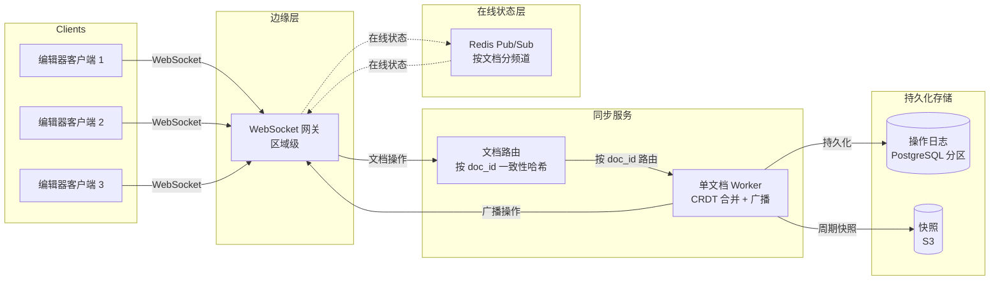
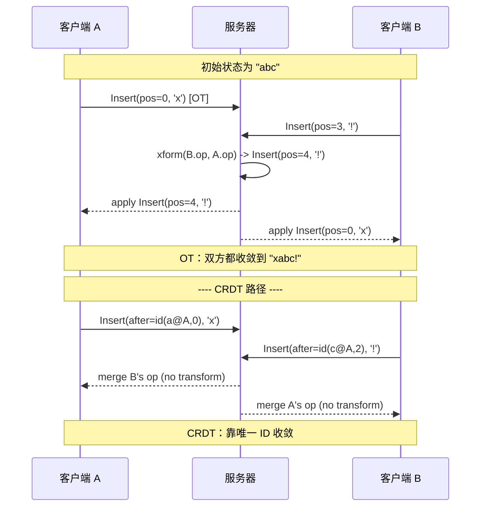
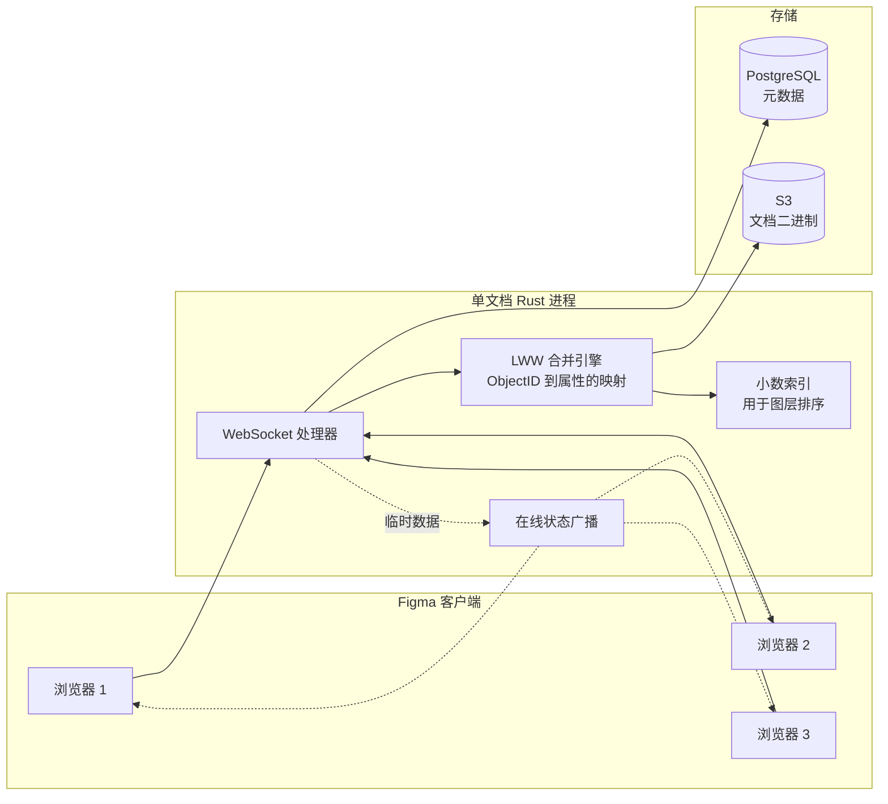
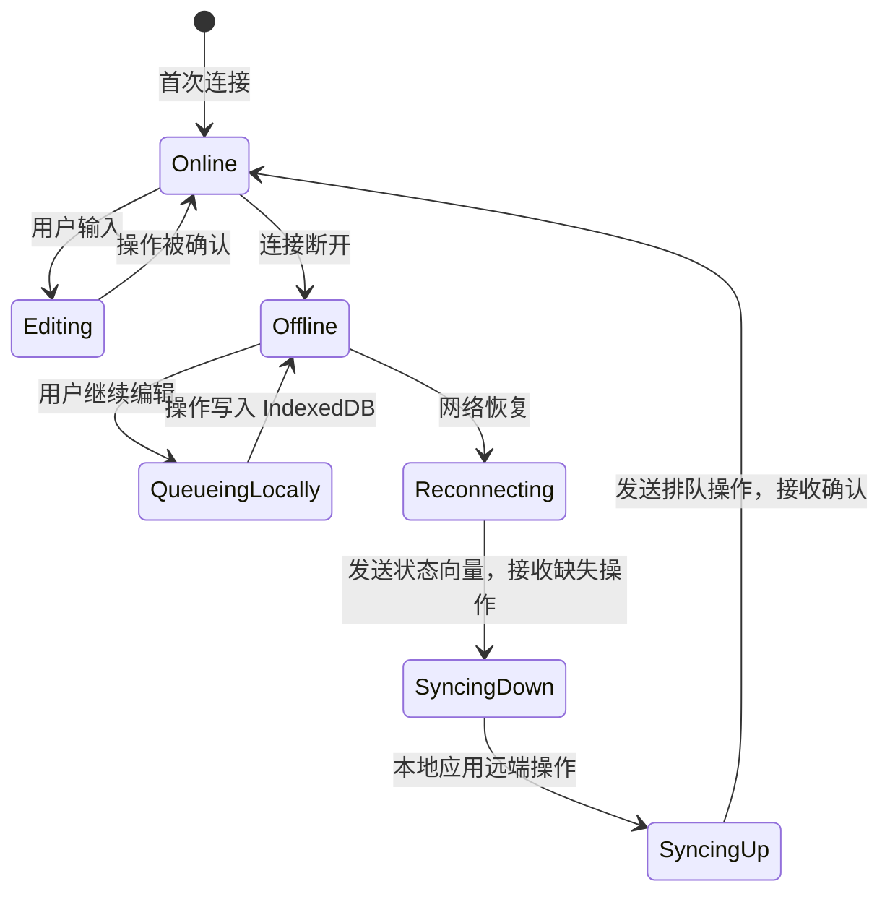
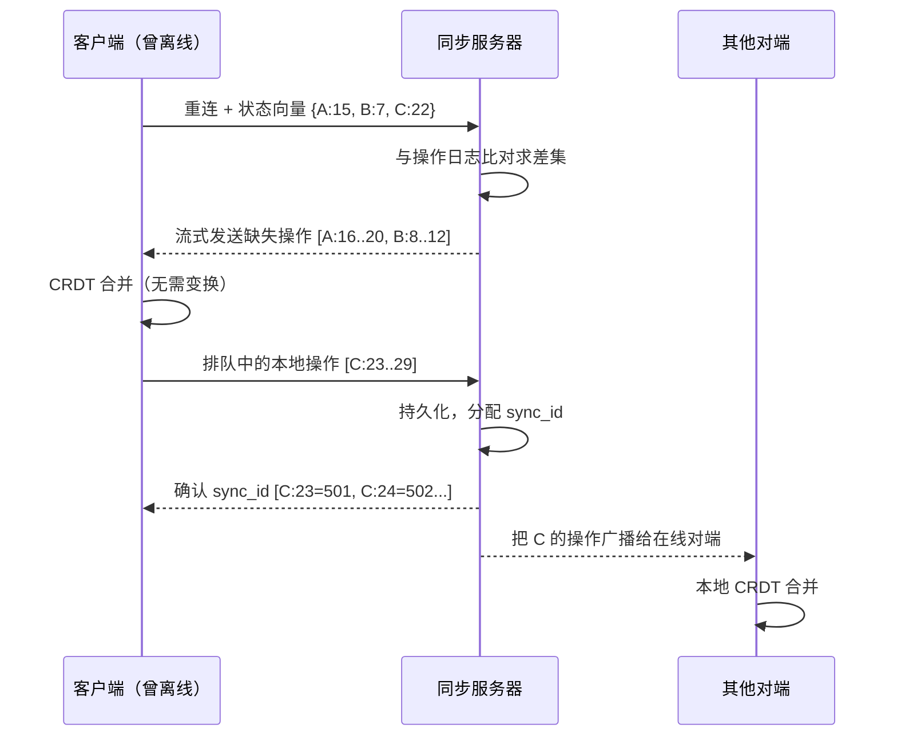

# 设计协同编辑系统（Google Docs / Figma / Notion）

> **TL;DR.** 实时协同编辑是分布式并发的招牌题目。两个用户相隔 80 ms 敲键，必须都看到一个一致、不丢键的最终状态，本地回显（local echo）低于 50 ms，对端可见低于 200 ms [^1]。两条算法路线在竞争：操作转换（Operational Transformation，OT）在中心服务器上对并发的定位型编辑做变换；无冲突复制数据类型（Conflict-free Replicated Data Type，CRDT）给每个字符分配唯一 ID，让操作无需协调即可交换顺序 [^2]。最关键的权衡是中心化（OT，线格式更简单，但单服务器成瓶颈）对可交换性（CRDT，拓扑不限，但元数据更重）。我们的设计采用服务端中介的 CRDT，把临时性的在线状态单独拆出，目标是在数百万文档上扛住 10 万以上并发编辑者。

## 学习目标

- 设计一套协同编辑系统，支撑 10 万以上并发编辑者，p99 按键回显低于 100 ms
- 比较 OT 与 CRDT，并能说明各自适用的场景
- 设计光标在线状态广播，扩展到 N 个编辑者而不产生 N^2 放大
- 用状态向量和 CRDT 合并设计离线编辑的对账流程
- 分别估算编辑通道与在线状态扇出的容量
- 论证 SaaS 产品为什么选服务端中介的 CRDT，而不是纯 P2P 或纯 OT

## 直觉理解

想象两位厨师共用一张菜谱卡。厨师 A 在第 3 行写下“加盐”，与此同时厨师 B 也在第 3 行写下“加胡椒”。两个人都直接往卡上写，一个就会盖掉另一个。

**策略 1（OT）：** 让主厨站到两人中间。两人在同一位置提交编辑时，主厨调整其中一份：“厨师 B，你那行现在是第 4 行，因为厨师 A 已经在第 3 行写过了。” 主厨靠变换位置让两份编辑都干净落地。这个办法成立，但主厨是瓶颈。50 位厨师同时提交，主厨就忙不过来了。

**策略 2（CRDT）：** 每个词都配一张带唯一流水号的便签。“加盐”是便签 #A-7，“加胡椒”是便签 #B-3。因为每张便签都有全局唯一 ID，两位厨师怎么贴，菜谱最后都会收敛到同一个排列。不需要主厨。代价是每个词都背着一个流水号，菜谱卡变重了。

现在把场景放大到一份有 50 个同时编辑者的 Google Doc，每个人都在以按键速度打字。再加上光标位置（每位厨师在看哪里？）、离线编辑（一位厨师回家后继续写）、版本历史（昨天的菜谱长什么样？）。这里的“主厨”是一个服务器进程，“便签”是带 Lamport 时间戳的字符 ID。算法只是最显眼的那部分。生产系统把大部分工程精力花在另外三个问题上：临时在线状态、离线对账和版本历史。

## 需求

### 澄清问题

- **问：哪些内容类型必须支持并发编辑？**
  假设：富文本（段落、标题、列表、行内格式）、结构化块（表格、嵌入对象）和矢量图形（Figma 风格的对象）。文本按字符级合并；结构化对象按属性级合并。

- **问：单文档的并发编辑者有多少？**
  假设：峰值时单文档最多 100 个同时编辑者。系统整体：数百万文档上 10 万以上并发编辑会话。

- **问：按键回显的延迟目标是多少？**
  假设：本地回显低于 50 ms（乐观地先应用到本地）。对端可见低于 200 ms [^1]。

- **问：系统必须支持离线编辑吗？**
  假设：必须。客户端可能离线数小时，重连后必须干净对账，不能丢数据。

- **问：采用什么一致性模型？**
  假设：最终一致性，但保证收敛。给定同一组操作，无论应用顺序如何，所有对端最终必须到达同一状态。

- **问：多区域部署吗？**
  假设：是。文档在同步服务侧固定属于某个主区域（home region）；客户端连接最近的边缘节点，再中继到主区域。

### 功能需求

- 多个用户并发编辑同一文档，实时按字符级合并
- 光标位置、选区和正在输入提示对所有活跃编辑者可见
- 完整的离线编辑能力，重连后自动对账
- 版本历史，支持命名快照与时间旅行回放
- 撤销/重做只回滚本地用户自己的操作，不影响对端的编辑

### 非功能需求

- **负载：** 10 万以上并发编辑会话；数百万活跃文档
- **延迟：** 本地回显 p50 < 30 ms、p99 < 100 ms；对端可见 p99 < 200 ms
- **可用性：** 编辑路径 99.99%；版本历史读取 99.9%
- **一致性：** 最终一致，且保证收敛（所有对端到达完全相同的状态）
- **持久性：** 单区域故障零数据丢失；活跃文档 RPO < 1 秒

## 容量估算

| 指标 | 数值 | 推导 |
|--------|------:|------------|
| 并发编辑会话 | 100K | 峰值负载目标 |
| 每编辑者平均操作数/秒 | 3 | 约 180 字符/分钟的打字速度 |
| 系统总编辑操作/秒 | 300K | 100K 会话 x 3 ops/sec |
| 每编辑者在线状态更新/秒 | 10 | 光标以按键速率移动，已限速 |
| 在线状态消息总数/秒 | 1M | 100K 编辑者 x 10/sec（扇出前） |
| 平均文档大小 | 50 KB | 带格式元数据的富文本 |
| 单条操作日志条目大小 | 64 B | (clientID:8, clock:8, origin:8, content:32, meta:8) |
| 操作日志存储/天 | ~1.6 TB | 300K ops/sec x 86,400 x 64 B |
| 快照存储（5 年） | ~500 TB | 周期性快照 + 压实 |

关键比值：

- **在线状态与编辑之比：** 3:1。在线状态产生的消息量是实际编辑的 3 倍，但完全不需要持久化存储 [^3]。
- **单文档扇出：** 单文档 50 个编辑者时，每次编辑要扇出到 49 个对端；100 个编辑者时扇出到 99 个。在线状态扇出是主要带宽开销。
- **CRDT 开销：** Yjs 把 100 KB 的文档在磁盘上存成约 160 KB（约 1.6x 开销）[^2]；Automerge 2.0 把一篇 107 KB 的论文连同完整历史存成 129 KB（约 1.2x 开销）[^4]。Automerge 3.0（2025 年 7 月）把压缩列式表示用到运行时，而不只是静态存储，把内存占用再削减了 10 倍以上 [^5]。

## API 与数据模型

### API 设计

```http
POST /v1/docs/{doc_id}/connect
  Upgrade: websocket
  Auth: Bearer <token>
  Returns: WebSocket connection + initial document state + state vector

WS SEND: { type: "op", ops: [...], stateVector: {...} }
  Server assigns syncId, persists, broadcasts to peers

WS SEND: { type: "awareness", state: { cursor: {line, col}, selection: {...}, user: {...} } }
  Server broadcasts to peers (ephemeral, not persisted)

WS RECV: { type: "op", ops: [...], syncId: N }
  Remote operations to apply locally

GET /v1/docs/{doc_id}/history?from=<timestamp>&to=<timestamp>
  Returns: 200 { snapshots: [...], ops_between: [...] }

POST /v1/docs/{doc_id}/snapshot
  Body: { name: "v2.1 draft" }
  Returns: 201 { snapshot_id: "...", created_at: "..." }
```

历史记录分页用时间戳游标。限流：每客户端每文档 100 ops/sec。幂等性：每条操作都带全局唯一的 `(clientID, clock)`，重复操作被静默丢弃。

### 数据模型

```sql
-- Document metadata (PostgreSQL)
CREATE TABLE documents (
  doc_id        UUID PRIMARY KEY,
  owner_id      UUID NOT NULL,
  title         TEXT,
  home_region   VARCHAR(16),
  created_at    TIMESTAMPTZ,
  updated_at    TIMESTAMPTZ
);

-- Operation log (append-only, partitioned by doc_id)
CREATE TABLE op_log (
  doc_id        UUID,
  sync_id       BIGINT,       -- monotonic per document
  client_id     BIGINT,
  clock         BIGINT,
  op_data       BYTEA,        -- binary-encoded CRDT op
  created_at    TIMESTAMPTZ,
  PRIMARY KEY (doc_id, sync_id)
) PARTITION BY HASH (doc_id);

-- Snapshots (S3 references)
CREATE TABLE snapshots (
  doc_id        UUID,
  snapshot_id   UUID,
  s3_key        TEXT,
  sync_id_at    BIGINT,       -- op log position at snapshot time
  created_at    TIMESTAMPTZ,
  PRIMARY KEY (doc_id, snapshot_id)
);
```

操作日志是唯一真相来源。快照是周期性物化结果，放在 S3 上，用于快速加载文档（避免重放整条操作日志）。状态向量为操作日志建索引，重连时能高效算出增量。

## 高层架构



*持久化的文档操作走同步服务（每个文档一个逻辑 Worker）；临时在线状态走 Redis Pub/Sub，永远不碰持久化存储。*

**写路径：** 客户端先把操作乐观地应用到本地 CRDT 状态，再通过 WebSocket 发到边缘网关。网关把操作路由到该文档的 Worker（按 `doc_id` 一致性哈希）。Worker 分配单调递增的 `sync_id`，写入操作日志，然后广播给所有已连接的对端。

**读路径（重连）：** 客户端发送自己的状态向量。Worker 拿它和操作日志算差集（或从最新快照 + 前向操作加载），把缺失的操作流式发回。客户端排队的离线操作则朝反方向流动。

**在线状态路径：** 光标/选区更新完全绕过同步服务。它们走 Redis Pub/Sub 的按文档频道。不持久化、不写操作日志、不分配 sync_id。

## 深入探讨

### 深入探讨 1：OT 与 CRDT 的架构权衡

**问题：** 两个用户同时往同一段落里打字。他们的编辑引用的字符位置会因对方的输入而移动。怎么保证双方收敛到同一个最终状态？

**OT 方案（Google Docs）：** 每个操作都是定位型的：`Insert(pos=5, 'H')`、`Delete(pos=12, len=3)`。基于较旧版本的远端操作到达时，服务器拿它和中间发生的操作做变换。Jupiter 算法（Xerox PARC，1995）[^6] 把单台服务器钉成全序权威。每个客户端只和服务器交换操作，把变换简化成两两之间的 `xform(client_op, server_op)` [^7]。

OT 需要两个正确性性质。TP1（两个并发操作无论顺序都收敛）可以做到。TP2（三个并发操作无论路径都收敛）出了名的难。1989 年那篇原始论文就没满足 TP2，这个问题悬了很多年 [^8][^9]。Google 的解法是中心化：只要服务器定义了单一全序，就只需要 TP1 [^2]。代价是热门文档撞上单服务器瓶颈。Google Docs 在单文档过载时会显示“编辑已禁用”[^2]。

变换矩阵会随操作类型数量以 O(n^2) 增长。Figma 明确拒绝了 OT：“增加更多操作会让实现复杂度按平方增长”[^10]。

**CRDT 方案（Yjs、Automerge）：** 每个字符都拿到全局唯一 ID：`(clientID, clock)`。插入引用的是邻居 ID，不是位置。同一字符之后的并发插入通过确定性的比较规则定序 [^11]。操作在构造上就可交换，因此任何应用顺序都能收敛。



*OT 在服务器上变换定位型操作；CRDT 给每个字符打上唯一 ID，任何应用顺序都能收敛，无需变换。*

**性能现实：** Yjs 处理一条 26 万次操作的编辑轨迹只需 1,074 ms。Automerge 2.0 处理同一条轨迹用 1,816 ms，而 0.14 版本要 500,000 ms [^4]。“CRDT 太慢”的说法 2023 年就死了。

**我们的选择：** 服务端中介的 CRDT。我们拿到 CRDT 的合并保证（离线干净、操作可交换），又不用背 P2P 的运维复杂度。服务器负责持久化和扇出，但不定义真相；真相由 CRDT 的收敛性质给出。

### 深入探讨 2：Figma 的多人在线架构

Figma 服务着数百万用户 [^12]，用的是受 CRDT 启发、但明确不是纯 CRDT 的架构。Evan Wallace 写道：“纯 CRDT 会带来一些无法避免的性能和内存开销。既然 Figma 是中心化的，我们可以去掉这层额外开销，把系统简化”[^1]。

**数据模型：** `Map<ObjectID, Map<Property, Value>>`。每个 Figma 对象（矩形、画框、文本节点）都有稳定 ID 和一张带类型的属性字典。两个客户端改同一对象的不同属性永远不会冲突。改同一属性则按服务器排序的 last-write-wins 解决 [^1]。

**有序序列：** 图层和分组用小数索引（fractional indexing）。每个子节点有一个任意精度 base-95 字符串表示的位置。要在 `"0.4"` 和 `"0.5"` 之间插入就取 `"0.45"` [^10]。重排序因此完全不需要 OT。

**单文档进程隔离：** 每个文档跑在独立的 Rust 进程里。客户端建立 WebSocket，连接时下载整份文档 [^1]。2018 年 Figma 把服务器从 TypeScript 重写为 Rust，序列化大约快了 10 倍 [^13]。此前 TypeScript 事件循环会被大文档序列化阻塞，导致多文档 Worker 池整体失败。



*Figma 每个文档跑一个 Rust 进程；属性级 LWW 解决冲突，小数索引处理排序，在线状态走单独的临时通道。*

**关键洞察：** Figma 之所以选属性级冲突解决，是因为设计工具用户很少同时往同一个文本字段里打字。用户 A 改 `x`、用户 B 改 `fill`，根本不冲突。这就是为什么字符级 CRDT 对 Figma 的大部分使用面来说属于过度设计 [^1]。

**局限：** 用户 A 输入“AB”、用户 B 同时输入“BC”到同一文本字段，结果是“AB”或“BC”，绝不会是“ABC”[^1]。对设计工具可接受，对文字处理器不可接受。

### 深入探讨 3：规模化的在线状态与感知

**问题：** 一份文档里 50 个编辑者，各自以按键速率（10 Hz）广播光标位置。朴素实现：单文档 50 x 49 = 2,450 条消息/秒。100 个编辑者时：9,900 条消息/秒。这是 N^2 扇出，还没算上真正的编辑，带宽就已经被它吃光了。

**解决架构：**

1. **独立通道。** 在线状态永远不碰操作日志和持久化存储。Yjs 把它形式化为 Awareness CRDT：一个以客户端 ID 为键、体量极小的基于状态的 CRDT，断连时自动清除 [^3]。Liveblocks 把同样的模式暴露成独立的“presence”原语 [^14]。

2. **服务端扇出。** 客户端只把在线状态发给服务器。服务器再扇出到该文档频道上的所有对端。这是 N 条进、N 条出（共 2N），不是 N^2。

3. **限速与合并。** 服务器把密集的光标更新合并到 30 ms 的窗口里。客户端 30 ms 内发 10 次光标移动，对端只看到最后一次。丢掉中间位置没有任何损失。

4. **相对位置。** 用字符偏移表示光标位置，一旦有人在前面插入文本就失效。Yjs 用 `Y.RelativePosition` 解决：它钉在字符 ID 上，任意并发编辑后依然有效 [^11]。

5. **自动清理。** 对端断连时，服务器广播一个移除事件。没有墓碑、没有垃圾回收、没有存储成本。

**基础设施：** Redis Pub/Sub，每个文档一个频道。10 万并发文档、平均 10 个编辑者，就是整个 Redis 集群每秒 100 万条在线状态消息。单个 Redis 节点大约能处理 50 万条 pub/sub 消息/秒；按 doc_id 分片用两个节点就够了。

### 深入探讨 4：离线支持与重连同步

**问题：** 一个用户离线编辑了几个小时。这期间另外 5 个用户做了数千次编辑。重连时，离线用户的编辑必须干净合并，既不能丢数据，也不能让用户意外。

**CRDT 方案：** 客户端把操作追加到本地日志，持久化在 IndexedDB 里。每条操作都带 `(clientID, clock, origin, content)`。重连时：

1. 客户端发送状态向量：`{A:15, B:7, C:22}`（每个对端已见到的最大 clock）
2. 服务器算差集：“你缺 A:16-20、B:8-12”
3. 服务器把缺失的操作流式发给客户端
4. 客户端把本地排队的操作（C:23-29）发给服务器
5. 服务器持久化、分配 sync_id、广播给其他对端
6. CRDT 合并自动处理所有冲突：不需要变换步骤



*客户端状态机把离线当作一等状态，而不是错误态。本地编辑在 IndexedDB 里排队，重连后双向同步。*



*重连时状态向量让增量交换最小化；CRDT 合并步骤不需要变换，因为操作在构造上就可交换。*

**OT 的替代做法（Figma 的路子）：** “重新上线时，客户端下载一份全新的文档，把离线编辑重新应用到这份最新状态之上，然后继续同步”[^1]。更简单，但可能出人意料：OT 会把定位型操作拿到用户从未见过的操作上做变换，离线时间一长就容易出现奇怪结果。

**Linear 的做法：** 每次变更都写入由 IndexedDB 支撑的 TransactionQueue。重连时队列通过 REST 接口重放。服务器分配单调递增的 sync ID，所有客户端订阅 [^15][^16]。冲突按最大的 sync_id 解决（属性级、服务器排序的 LWW）。

**我们的选择：** CRDT 加状态向量同步。客户端从不需要重新下载整份文档。合并自动完成，并且保留用户意图，因为插入携带的是来源指针，不是位置偏移 [^11]。

## 真实案例

**Google Docs：十亿用户规模下以服务器为权威的 OT。**

Google Docs 使用基于 Jupiter 算法的操作转换，在 Google Workspace 上服务数十亿用户 [^17]。每份文档由一个逻辑进程服务，该进程给每个操作分配一个标量版本号。客户端通过 WebSocket 发送增量，服务器做变换并广播 [^6][^18]。

架构按文档 ID 在 Worker 之间分片。每个文档的进程维护权威操作日志和周期性快照。版本历史按需从快照加前向增量物化出来。变换逻辑放在服务器侧（而非对端两两之间），这把矩阵简化成 `xform(client_op, server_op)`，彻底消除了 TP2 问题 [^7]。

**扩展上限：** 单文档在并发过高时会被限流，并给出“编辑已禁用”的提示。Joseph Gentle（前 Google Wave 工程师）把它直接归因于单服务器 OT 瓶颈 [^2]。Google 靠让单文档进程足够轻量，为大多数文档绕过了这个问题，但架构天花板确实存在。

**关键工程决策：**

- 中心服务器作为全序权威，从而消除 TP2
- 每个热门文档一个进程；靠分片文档 ID 横向扩展
- 持久化操作日志 + 快照存放在 Bigtable 风格存储中
- 版本历史从快照 + 前向增量物化

**与我们的设计对比：** 我们选服务端中介的 CRDT，正是为了避开单服务器瓶颈。服务器负责持久化和扇出，但 CRDT 的收敛性质意味着服务器不需要变换操作。服务器挂了，客户端可以继续离线编辑，之后再对账。

## 权衡

| 方案 | 优点 | 缺点 | 适用场景 | 我们的选择 |
|----------|------|------|-------------|----------|
| OT（中心服务器） | 单操作元数据极少；在 Google 久经验证 [^18] | 单服务器瓶颈；操作类型矩阵 O(n^2)；TP2 未解 [^7][^10] | 有可信权威的富文本文档 | 仅文字处理器 |
| CRDT（Yjs/Automerge） | 可 P2P；离线干净；可交换 [^11][^4] | 体积开销 1.2-1.6x；墓碑持续增长；结构化移动偏弱 | 本地优先、离线为主的应用 | 本地优先工具 |
| 服务端中介 CRDT | CRDT 保证 + 简单操作模型 [^1][^14] | 放弃 P2P；服务器是持久化咽喉 | 大多数 SaaS 协同产品 | **我们的默认选择** |
| 纯 P2P CRDT | 无服务器；数据真正归用户 [^19] | NAT 穿透；节点发现；持久性无保证 | 隐私敏感的特种工具 | 仅当隐私是硬要求 |
| 属性级 LWW | 简单；没有字符级复杂度 [^1] | 并发文本编辑会丢掉一方的输入 | 设计工具、issue 跟踪器 | 非文本字段 |
| 块级 LWW（Notion） | 冲突罕见；权限继承自然 [^20] | 块内没有字符级合并；不是 CRDT | 结构化文档工具 | 基于块的编辑器 |

最大的一个权衡：**中心化对可交换性**。Google 选了中心化（OT），换来简单性，代价是单文档天花板。Figma 选了混合方案（服务端中介的属性级 CRDT），换来水平扩展，代价是放弃字符级合并。我们选服务端中介的字符级 CRDT（Yjs 风格），因为我们的产品是文字处理器，不是设计工具。

## 扩展与故障模式

**10 倍负载（100 万并发编辑者）：** 对 500 人以上的病毒式文档，单文档 Worker 成为瓶颈。缓解：把在线状态扇出拆到多个 Redis 节点；编辑路径上 CRDT 合并是 CPU 密集型，所以要么纵向扩容 Worker，要么把读扇出与写持久化拆开。

**100 倍负载（1000 万并发编辑者）：** 操作日志写 PostgreSQL 会打满。缓解：把操作日志搬到只追加存储（Kafka 或自研 WAL），异步压实到冷存储。快照成为主读路径；操作日志只用于增量同步。

**1000 倍负载（1 亿并发编辑者）：** 架构转向边缘优先：每个区域跑完整同步服务，区域之间异步 gossip CRDT 状态，“主区域”概念消解为多主 CRDT 网状结构。这就是本地优先理论在基础设施层面的形态 [^19]。

**故障模式：**

- **同步服务崩溃（单文档 Worker 挂掉）：** 客户端通过心跳丢失发现，重连并发送状态向量。新 Worker 加载最新快照 + 操作日志尾部，继续服务。支持离线的客户端在本地接着编辑。数据丢失窗口：已接受但尚未持久化的操作（靠确认前 WAL fsync 缓解）。

- **Redis Pub/Sub 故障（在线状态中断）：** 光标停住，但编辑完全不受影响。在线状态是临时的；Redis 恢复后客户端重新广播当前状态。不丢数据，只是用户体验退化。

- **区域间脑裂：** 同一文档的两个同步 Worker 各自接受相互冲突的操作。CRDT 的收敛保证它们一旦交换操作就会到达同一状态。无需人工解决冲突。这是相对 OT 的根本优势。

## 常见陷阱

> [!WARNING]
> **把光标在线状态跑在持久化编辑通道上。** 光标是临时的、高频的。如果和持久编辑共用代码路径，每一次光标抖动都会写操作日志、打磁盘。把在线状态和编辑分开。Yjs、Automerge-Repo 和 Liveblocks 都提供了显式的 awareness API 来防止这一点 [^3][^14]。

> [!WARNING]
> **忽视 CRDT 的墓碑膨胀。** 序列 CRDT 必须记住被删除的字符，因为对端可能从任意旧的离线状态引用它们。Automerge 0.14 为一篇 100 KB 论文的完整历史需要约 1.1 GB 内存 [^2][^4]。开启垃圾回收（Yjs 的 `doc.gc = true`）或使用 Automerge 的列式格式；Automerge 3.0 在运行时使用压缩表示，内存占用比 2.0 降低 10 倍以上（例如粘贴《白鲸》从约 700 MB 降到约 1.3 MB）[^5]。

> [!WARNING]
> **以为 OT 的 TP2 已经解决。** 如果变换函数不满足 TP2，三个并发操作会让不同对端分叉。连 1989 年的原始论文都没过这一关 [^9]。Google 的修法是中心化定序，这样就只需要两两之间的 TP1。没法中心化，就用 CRDT。

> [!WARNING]
> **指望属性级系统做字符级合并。** 用户 A 输入“AB”、用户 B 同时输入“BC”到同一文本字段，属性级 LWW 系统给你“AB”或“BC”，绝不会是“ABC”[^1]。选算法之前先搞清楚你的冲突单元是什么。

> [!WARNING]
> **用字符偏移表示光标位置。** 有人在文档前面插入文本，偏移就废了。用钉在字符 ID 上的相对位置（Yjs 的 `Y.RelativePosition`），它能扛住任意并发编辑 [^11]。

> [!CAUTION]
> **树形文档里的重挂父节点成环。** 客户端 A 把 X 挂到 Y 下；客户端 B 把 Y 挂到 X 下。父指针一旦成环，树就非法了。Figma 的修法：先临时移除两个对象，直到服务器拒绝其中一次移动 [^1]。

## 追问

**1. 富文本的结构化内容（表格、嵌入对象、嵌套块）怎么处理？**

用基于块的 CRDT，每个块是树上的一个节点。块内文本用字符级 CRDT（Yjs 的 Y.Text）。块级操作（移动、重挂父节点、删除）用带环检测的树 CRDT。Peritext [^21] 处理并发格式（粗体 + 斜体）时，是把格式标记存在字符位置上，而不是当作树节点。

**2. 端到端加密的协同怎么做？**

每份文档有一个对称的组密钥，通过非对称加密分发给有权限的编辑者。操作在客户端加密后才传输。服务器只看到密文，无法变换或校验内容。这会破坏服务端搜索、拼写检查和 AI 功能。组密钥轮转可以用 Signal 的 Sender Keys 模式。

**3. 块级 CRDT 与字符级 CRDT 有什么不同？**

块级系统（Notion 风格）把冲突单元从字符换成块属性。Notion 本身不是 CRDT：每个客户端动作变成针对一条记录的事务，服务器通过 `saveTransactions` API 按字段做 last-write-wins [^20]。冲突更少，因为用户通常编辑不同的块。权衡是：同一个块的文本字段内同时编辑不会在字符级合并。Linear 只对富文本描述用 CRDT，其余全部保持在属性级 LWW [^22]。

**4. 跨会话的撤销怎么做？**

撤销只能回滚本地用户自己的操作，不能动对端的编辑。为每个用户维护一个操作逆操作的撤销栈。对 CRDT 来说，“撤销插入”意味着“把该字符标记为已删除”；“撤销删除”意味着“取消墓碑标记”。撤销操作本身也是一条新的 CRDT 操作，会被其他对端接收并应用。

**5. 跨文档事务（在文档之间原子移动）怎么处理？**

跨文档的真正原子性需要分布式事务，这和单文档隔离模型冲突。改用 saga：(1) 插入目标文档，(2) 从源文档删除，(3) 若第 2 步失败，则通过从目标文档删除来补偿。要接受一个短暂的窗口里内容同时存在于两份文档中。

**6. Liveblocks 和 PartyKit 如何简化这套架构？**

两者都是同步服务层的托管基础设施。Liveblocks 把 WebSocket 网关、CRDT 存储（兼容 Yjs）、在线状态 API 和冲突解决作为服务提供 [^14]。PartyKit（2024 年 4 月被 Cloudflare 收购）在 Durable Objects 上跑单文档 Worker [^23]。它们省掉了自建同步服务的活，但也把你的数据模型限制在它们支持的 CRDT 类型里。

**7. 如何做隐藏延迟的光标预测？**

在服务器确认之前，先在本地客户端乐观地应用光标移动。如果服务器拒绝（用 CRDT 极少发生），把光标纠正到正确位置。对远端光标，用时间戳在已知位置之间插值，这样即使更新只有 10 Hz，渲染也能平滑到 60 fps。

## 练习

### 练习 1：规模化的在线状态扇出

一份文档有 200 个并发编辑者，每人以 10 Hz 广播光标位置。算出每秒的总消息量，提出一套把每客户端带宽控制在 50 KB/s 以下的架构，并说明你牺牲了什么。

<details>
<summary>提示</summary>

先算原始扇出（200 编辑者 x 10 Hz x 199 个接收方）。再想：如果服务器把更新合并到 100 ms 窗口、每窗口只发一批呢？哪些信息可以丢掉而不伤害体验？

</details>

<details>
<summary>解答</summary>

**原始扇出：** 200 编辑者 x 10 次更新/秒 = 每秒 2,000 条入站消息。每条扇出到 199 个对端 = 单文档每秒 398,000 条出站消息。按每条在线状态消息约 100 字节算，单文档出站带宽就是 39.8 MB/s。

**缓解：** 服务器合并到 100 ms 窗口。每个窗口最多到达 200 条更新。服务器每 100 ms 向 200 个客户端各发一批 200 个光标位置（200 x 100 B = 20 KB）。每客户端带宽：20 KB x 10/sec = 200 KB/s。还是太高。

**进一步优化：** 只发客户端视口内可见的编辑者光标。如果客户端视口只显示文档的 20%，每批就只发约 40 个相关光标：40 x 100 B x 10/sec = 每客户端 40 KB/s。落在 50 KB/s 预算之内。

**牺牲：** 视口外的光标在用户滚动之前不可见。这可以接受，因为用户本来也看不见屏幕外的光标。Google Docs 用的就是这个优化。

</details>

## 要点回顾

- **服务端中介的 CRDT 是 SaaS 协同编辑的正确默认值。** 你拿到了 CRDT 的合并保证，又不用背 P2P 的运维复杂度。
- **在线状态和编辑是两套系统。** 把它跑在持久操作通道上，是教科书级的扩展错误，会造成 N^2 写放大。
- **OT 赢了 2000 年代，CRDT 正在赢 2020 年代。** Yjs 约 1 秒处理 26 万次操作 [^4]；Automerge 2.0 存完整历史只有 30% 开销 [^4]。性能这条论据已经定论。
- **搞清楚你的冲突单元。** 属性级 LWW（Figma）更简单，在用户很少编辑同一字段时足够用。文字处理器则必须用字符级 CRDT。
- **离线是一等状态，不是错误态。** CRDT 靠状态向量处理；OT 需要重新下载整份文档并 rebase。

## 延伸阅读

- [How Figma's multiplayer technology works](https://www.figma.com/blog/how-figmas-multiplayer-technology-works/)。Evan Wallace 对服务端中介、CRDT 式合并的权威叙述；这个领域最好的一篇生产架构文章。
- [I was wrong. CRDTs are the future](https://josephg.com/blog/crdts-are-the-future/)。Joseph Gentle（前 Google Wave）讲 OT 为什么输了、CRDT 为什么赢了；理解这场算法之争的必备背景。
- [Introducing Automerge 2.0](https://automerge.org/blog/automerge-2/)。2023 年的重写，基准显示 275 倍加速；CRDT 可用于生产的证明。
- [Yjs internals (INTERNALS.md)](https://github.com/yjs/yjs/blob/main/INTERNALS.md)。真正的 YATA 实现：来源指针、链表结构和集成算法。
- [Local-first software: you own your data, in spite of the cloud](https://www.inkandswitch.com/local-first/)。Ink & Switch 2019 年的宣言，把协同编辑重新定义为数据归属问题。
- [Realtime editing of ordered sequences](https://www.figma.com/blog/realtime-editing-of-ordered-sequences/)。Figma 讲小数索引的文章；不用 OT 做有序列表的标准技法。
- [Peritext: a CRDT for rich text](https://www.inkandswitch.com/peritext/)。并发格式算法，Automerge 2.2 已集成；属于值得知道其存在的前沿材料。
- [Scaling the Linear Sync Engine](https://linear.app/blog/scaling-the-linear-sync-engine)。Linear 如何用服务器排序的增量和有选择的 CRDT 采纳，做出精神上本地优先的同步。

## 记忆卡片

<details>
<summary><strong>问：协同编辑的两大算法家族是什么？</strong></summary>

答：操作转换（OT）在中心服务器上让定位型操作相互变换。CRDT 给每个字符分配全局唯一 ID，使操作无需变换即可交换，于是任何应用顺序都能收敛。

</details>

<details>
<summary><strong>问：为什么 OT 在实践中需要中心服务器？</strong></summary>

答：OT 需要操作的全序，才能绕开 TP2 正确性问题（三个并发操作会分叉）。中心服务器提供这个全序，把问题降级为两两之间的 TP1 变换。

</details>

<details>
<summary><strong>问：CRDT 里的墓碑问题是什么？</strong></summary>

答：被删除的字符必须作为墓碑保留，因为对端可能从任意旧的离线状态引用它们。不做垃圾回收，文档体积会无界增长。Automerge 0.14 为一篇 100 KB 论文的历史需要 1.1 GB；Automerge 2.0 用列式编码把它降到 129 KB。

</details>

<details>
<summary><strong>问：为什么光标在线状态要用独立于文档编辑的通道？</strong></summary>

答：光标是临时的、高频的（每用户每秒 10 次以上更新）。把它走持久编辑通道，会对持久存储造成写放大，并产生 N^2 扇出，把编辑流水线打满。

</details>

<details>
<summary><strong>问：Figma 如何处理对同一对象属性的并发编辑？</strong></summary>

答：属性级、服务器排序的 last-write-wins。两个客户端改不同属性永不冲突。两个客户端改同一属性，由服务器接受后到的那条消息。

</details>

<details>
<summary><strong>问：什么是小数索引，Figma 为什么选它？</strong></summary>

答：每个元素得到一个 0 到 1 之间的位置字符串（例如夹在 "0.4" 和 "0.5" 之间的 "0.45"）。重排序只更新一个字段。用 OT 则必须把重排表达成删除加插入，并对每种其他操作类型做变换，复杂度按 O(n^2) 增长。

</details>

<details>
<summary><strong>问：CRDT 客户端离线之后如何同步？</strong></summary>

答：客户端把状态向量（每个对端已见到的最大 clock）发给服务器。服务器算出差集并流式发送缺失操作。客户端排队的本地操作朝反方向流动。不需要变换步骤，因为 CRDT 操作可交换。

</details>

<details>
<summary><strong>问：Yjs 在标准编辑轨迹上能达到什么性能？</strong></summary>

答：Yjs 约 1,074 ms 处理 260,000 次操作，二进制压缩后文档体积开销是原始文本的 1.2-1.6x。Automerge 2.0 处理同一轨迹用 1,816 ms，存储开销 30%。

</details>

<details>
<summary><strong>问：什么是 N^2 在线状态问题，怎么解决？</strong></summary>

答：N 个编辑者各自以 10 Hz 广播，朴素的对等扇出每秒产生 N x (N-1) 条消息。解法：服务端扇出（N 进、N 出 = 2N）、按时间窗口合并、基于视口过滤只发相关光标。

</details>

<details>
<summary><strong>问：Figma 为什么把多人在线服务器从 TypeScript 重写为 Rust？</strong></summary>

答：TypeScript 事件循环会被大文档序列化阻塞，导致多文档 Worker 池失败。Rust 的序列化大约快 10 倍，内存占用也足够低，让“每文档一进程”在规模上变得可行。

</details>

## 参考文献

[^1]: Evan Wallace, "How Figma's multiplayer technology works", Figma Blog, October 2019. https://www.figma.com/blog/how-figmas-multiplayer-technology-works/

[^2]: Joseph Gentle, "I was wrong. CRDTs are the future", September 2020. https://josephg.com/blog/crdts-are-the-future/

[^3]: Yjs documentation, "Awareness & Presence". https://docs.yjs.dev/getting-started/adding-awareness

[^4]: Alex Good, Orion Henry et al., "Introducing Automerge 2.0", Automerge Blog, January 2023. https://automerge.org/blog/automerge-2/

[^5]: Alex Good, "Automerge 3.0", Automerge Blog, July 2025. https://automerge.org/blog/automerge-3/

[^6]: Nichols, D. A.; Curtis, P.; Dixon, M.; Lamping, J., "High-latency, low-bandwidth windowing in the Jupiter collaboration system", UIST 1995. https://doi.org/10.1145/215585.215706

[^7]: Wikipedia, "Operational transformation", section on TP1/TP2 transformation properties. https://en.wikipedia.org/wiki/Operational_transformation#Transformation_properties

[^8]: Ellis, C. A.; Gibbs, S. J., "Concurrency control in groupware systems", ACM SIGMOD Record 18(2), 1989. https://doi.org/10.1145/67544.66963

[^9]: Sun, Chengzheng; Ellis, Clarence, "Operational transformation in real-time group editors: Issues, algorithms, and achievements", CSCW 1998. https://doi.org/10.1145/289444.289469

[^10]: Evan Wallace, "Realtime editing of ordered sequences", Figma Blog, March 2017. https://www.figma.com/blog/realtime-editing-of-ordered-sequences/

[^11]: Yjs internals (INTERNALS.md), GitHub. https://github.com/yjs/yjs/blob/main/INTERNALS.md

[^12]: "How Figma Beat Sketch", ideaplan.io analysis, 2024. https://www.ideaplan.io/blog/how-figma-won-the-design-tool-market

[^13]: Evan Wallace, "Rust in production at Figma", Figma Blog, May 2018. https://www.figma.com/blog/rust-in-production-at-figma/

[^14]: Max Heichling, "Understanding sync engines: How Figma, Linear, and Google Docs work", Liveblocks Blog, December 2025. https://www.liveblocks.io/blog/understanding-sync-engines-how-figma-linear-and-google-docs-work

[^15]: Tuomas Artman, "Scaling the Linear Sync Engine", Linear Blog, June 2023. https://linear.app/blog/scaling-the-linear-sync-engine

[^16]: Mark Percival, "Reverse engineering Linear's sync magic", December 2022. https://marknotfound.com/posts/reverse-engineering-linears-sync-magic/

[^17]: "Google Workspace Statistics 2026", gwsave.com, 2025. https://gwsave.com/blog/google-workspace-statistics

[^18]: "Operational transformation", Wikipedia, accessed 2026. https://en.wikipedia.org/wiki/Operational_transformation

[^19]: Kleppmann, M.; Wiggins, A.; van Hardenberg, P.; McGranaghan, M., "Local-first software: you own your data, in spite of the cloud", Ink & Switch, April 2019. https://www.inkandswitch.com/local-first/

[^20]: Jake Teton-Landis, "The data model behind Notion's flexibility", Notion Blog, May 2021. https://www.notion.com/blog/data-model-behind-notion

[^21]: Ink & Switch, "Peritext: a CRDT for rich-text collaboration", 2022. https://www.inkandswitch.com/peritext/

[^22]: Thuan Ho, "Linear's sync engine architecture", fujimon.com, August 2024. https://www.fujimon.com/blog/linear-sync-engine

[^23]: Sunil Pai, Rita Kozlov, "Cloudflare acquires PartyKit to allow developers to build real-time multi-user applications", Cloudflare Blog, April 2024. https://blog.cloudflare.com/cloudflare-acquires-partykit
